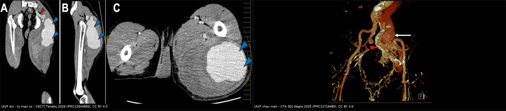
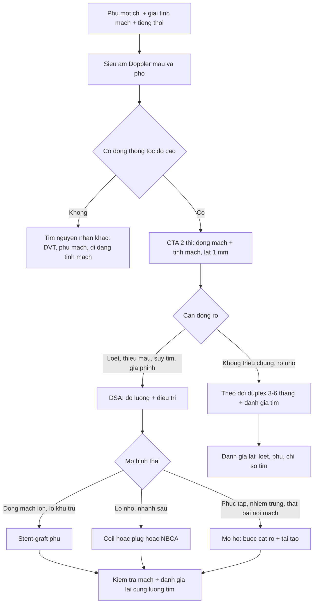
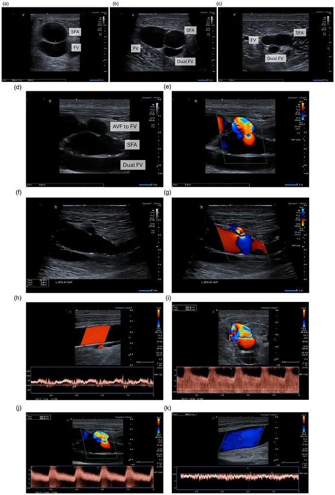
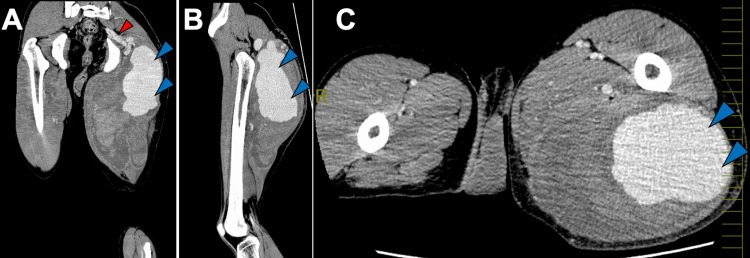
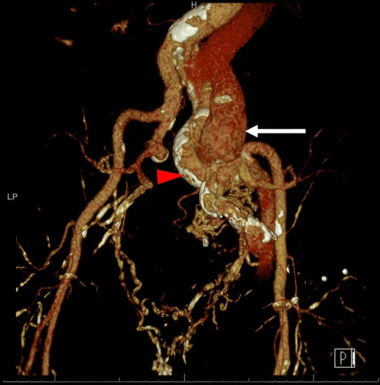

# 3147 — Rò động – tĩnh mạch do chấn thương ở chi / Traumatic arteriovenous fistula of the limb

**Tags:** `pattern:ro-dong-tinh-mach` `pattern:gia-phinh-dong-mach` `pattern:phu-chi` `pattern:loet-tinh-mach` `pattern:di-dang-mach` `vung:chi-duoi` `vung:chi-tren` `vung:dui` `vung:khoeo` `protocol:sieu-am-Doppler` `protocol:CTA` `protocol:DSA` `score:chi-so-tim`

**Mức chắc chắn (certainty):** tổng hợp y văn (literature synthesis) — ghép các nguồn mở đã đối chiếu PMCID/DOI: (a) tổng quan gộp **291 ca** AVF chấn thương xuyên thấu (**Asensio JA** et al., *Eur J Trauma Emerg Surg* 2022, DOI 10.1007/s00068-020-01574-z); (b) ca AVF ĐM–TM đùi nông tồn tại **27 năm** sau tai nạn băng leo núi, có phân tích Doppler định lượng (**Thomas KN** et al., *Exp Physiol* 2026, PMC13405334, **CC BY 4.0**); (c) ca tụ máu cơ đùi khổng lồ do AVF sau chấn thương kín, điều trị nút mạch (**Tanabu T** et al., *Cureus* 2026, PMC12844860, **CC BY 4.0**); (d) ca AVF chậu **58 năm** sau chấn thương bom, phát hiện tình cờ (**Nagra R** et al., *Cureus* 2025, PMC12718485, **CC BY 4.0**); (e) ca AVF ĐM–TM đùi nông **10 năm** gây suy tim cung lượng cao (**Amini SM** et al., *Int Med Case Rep J* 2026, PMC13196796); (f) đoàn hệ **34 bệnh nhân** AVF có thông tim phải (**Tripathi A** et al., *J Clin Med* 2025, PMC12609771, **CC BY 4.0**). Số nào nguồn không đưa thì ghi "chưa rõ".

> **Bài này trả lời 4 câu hỏi của ca "phù – giãn tĩnh mạch một chi, nghe có tiếng thổi":**
> (1) **Vì sao một lỗ thông 3 mm lại làm tim tăng cung lượng tới 9–15 L/phút?** (2) **Siêu âm Doppler, CTA và DSA mỗi thứ chốt được gì — và vì sao CTA âm chưa loại trừ?** (3) **Ngưỡng nào buộc phải đóng rò (loét, thiếu máu, suy tim cung lượng cao), ngưỡng nào cho theo dõi?** (4) **Chọn stent-graft, nút coil/keo hay mổ hở — và cái bẫy nào làm hụt chẩn đoán?**
> Đây là mặt **luồng thông** của chấn thương mạch chi; mặt **tắc – rách nội mạc** ở [3146 – Động mạch khoeo sau trật khớp gối](../3146-dong-mach-khoeo-sau-trat-khop-goi/lesson.md), mặt **đứt mạch lớn** ở [3107 – Đứt động mạch dưới đòn](../3107-dut-dong-mach-duoi-don/lesson.md).

## 1. Tổng quan bệnh học – cơ chế hình ảnh

### 1.1 Bệnh học: một ống nối tắt giữa hai hệ áp lực

- **AVF chấn thương (traumatic arteriovenous fistula):** rách **đồng thời thành động mạch và tĩnh mạch** nằm sát nhau, rồi hai lỗ rách **liền thành một đường thông** được bao bọc bởi tổ chức xơ. Thường gặp nhất là **thông trực tiếp (direct)** một đường; thể **gián tiếp (indirect)** đi qua một **túi giả phình** rồi mới đổ vào tĩnh mạch.
- **Cơ chế:** vật xuyên (dao, đạn, mảnh bom, **băng leo núi**, mảnh kính) hoặc **y sinh** (chọc mạch, đặt catheter, sinh thiết, mổ). Trong tổng quan 291 ca, **dao 43,3%**, **súng 32,3%**, cơ chế khác 12%, không rõ 12,4% (DOI 10.1007/s00068-020-01574-z). AVF chấn thương chỉ chiếm **2,5–4%** các tổn thương mạch do vật xuyên (PMC13756989) nhưng **chi là vị trí rất thường gặp**: **30,6% (89/291)** ca trong tổng quan trên, tương đương **bụng 30%**.
- **TẠI SAO rò không tự tắc:** lòng thông được cho là có **nội mạc tĩnh mạch phủ** và **thành xơ** giữ nó mở; khác với lỗ rách nhỏ ở mô mềm, dòng chảy qua đây **luôn có chênh áp** nên khó hình thành huyết khối bịt kín. Vì vậy AVF chấn thương có thể tồn tại **20–58 năm** (PMC13756989, PMC12803833, PMC12718485) và **lớn dần** theo thời gian.

### 1.2 Vật lý dòng chảy: vì sao "nhỏ mà dữ"

- **Chênh áp:** động mạch chi có áp lực trung bình khoảng **90–100 mmHg**, tĩnh mạch chỉ **5–10 mmHg** → chênh áp **~90 mmHg** trên một đoạn dài vài milimét. Đây là động lực mạnh nhất trong cơ thể đối với một ống nối tắt.
- **Định luật Poiseuille:** lưu lượng **Q ∝ r⁴/ηL**. Đường kính lỗ thông chỉ cần **gấp đôi** là lưu lượng **gấp 16 lần**; vì vậy **lỗ thông 2,9–3,3 mm** trong ca PMC13405334 đã đủ mang **cung lượng tim 9,1 L/phút** (bình thường 4–6 L/phút).
- **Hệ quả huyết động — 4 tầng:**
  1. **Giảm sức cản ngoại vi (SVR)** → tim tăng cung lượng để giữ huyết áp; mạn tính → **giãn buồng tim, suy tim cung lượng cao (high-output heart failure, HOHF)**.
  2. **Tăng áp lực tĩnh mạch** tại vùng dẫn lưu → **phù, giãn tĩnh mạch, tăng sinh mô mỡ – xơ hóa dưới da, loét tĩnh mạch không lành** (ca PMC11361727: loét **2 năm**, lành sau **6 tháng** khi đóng rò).
  3. **"Cướp máu" động mạch (arterial steal)** ra ngoài giường mao mạch → **thiếu máu chi xa**, đau cách hồi, lạnh, giảm mạch.
  4. **Tĩnh mạch bị "động mạch hóa"**: nhận trực tiếp áp lực phồng – xẹp của động mạch → **phình giãn tĩnh mạch** (ca PMC13196796: tĩnh mạch chậu **8,7 cm**; ca PMC13405334: TM đùi **13 mm** so với **7 mm** bên đối diện).
- **Vì sao có tiếng thổi – rung miu:** dòng chảy vận tốc cao qua lỗ hẹp tạo **xoáy rối (turbulence)**; vận tốc đỉnh tâm thu trong ca PMC13405334 là **420–462 cm/s**, vận tốc cuối tâm trương **275–350 cm/s** — cao gấp 3–5 lần động mạch bình thường, đủ để nghe thấy **tiếng thổi liên tục ("machinery murmur")** và sờ thấy **rung miu (thrill)**.

### 1.3 Số liệu định lượng bắt buộc nhớ

| Đại lượng | Con số | Nguồn |
|---|---|---|
| AVF / tổn thương mạch do vật xuyên | **2,5–4%** | PMC13756989 |
| Vị trí **chi** trong AVF chấn thương xuyên thấu | **30,6% (89/291)** | DOI 10.1007/s00068-020-01574-z |
| Cơ chế: dao / súng | **43,3% / 32,3%** | DOI 10.1007/s00068-020-01574-z |
| Giả phình kèm theo AVF | **44,3% (129/291)** | DOI 10.1007/s00068-020-01574-z |
| Chụp mạch xác định chẩn đoán | **91,1%** ca | DOI 10.1007/s00068-020-01574-z |
| Điều trị: mổ hở / nội mạch | **59,6% / 34,8%** | DOI 10.1007/s00068-020-01574-z |
| Cắt cụt sau AVF khoeo (số liệu lịch sử) | **10–20%** | PMC13756989 |
| Suy tim cung lượng cao | **CI ≥ 4,0 L/phút/m²**; gặp **29,4% (10/34)** bệnh nhân AVF có thông tim phải | PMC12609771 |
| CI ở nhóm HOHF vs không | **4,54 vs 2,91 L/phút/m²** (p < 0,001) | PMC12609771 |
| Cung lượng tim trước → sau đóng rò | **14,9 → 8,6 L/phút**; áp lực ĐM phổi **33/20 → 22/15 mmHg** | PMC13196796 |
| Đường kính lỗ thông / ĐM đùi nông / TM đùi (ca 27 năm) | **2,9–3,3 mm** / **16–19 mm** (đối diện 7 mm) / **13 mm** (đối diện 7 mm) | PMC13405334 |
| Vận tốc trong lỗ thông | PSV **420–462 cm/s**, EDV **275–350 cm/s**, dòng liên tục cả chu chuyển | PMC13405334 |
| Thời gian tồn tại trước khi chẩn đoán | **10 – 20 – 25 – 27 – 54 – 58 năm** (các ca riêng lẻ) | PMC13196796, PMC13756989, PMC13236230, PMC13405334, PMC12803833, PMC12718485 |

- **Hệ quả thực hành:** AVF chấn thương **không phải bệnh của phút** như đứt động mạch, mà là bệnh của **năm**. Vì vậy câu hỏi lâm sàng không phải "có mất mạch không" mà là **"có luồng thông huyết động đáng kể không, và chi/tim đã chịu hậu quả chưa"**.

## 2. Mẫu hình + chẩn đoán phân biệt theo vị trí và thời gian (Gamut)

- **Theo vị trí giải phẫu (gamut "phù – giãn tĩnh mạch một chi có tiếng thổi"):**
  - **Đùi:** ĐM đùi nông – TM đùi (ca 27 năm, PMC13405334; ca 10 năm, PMC13196796); ĐM đùi sâu/nhánh mông trên trong AVF sau chấn thương kín (PMC12844860).
  - **Khoeo:** ĐM – TM khoeo (AVF khoeo 20 năm sau đạn, PMC13756989; AVF khoeo sau **12 năm** gây loét, PMC11361727); nguy cơ cắt cụt **10–20%** khi can thiệp muộn.
  - **Cánh tay – khuỷu:** ĐM cánh tay – TM cánh tay sau gãy khuỷu (**25 năm**, PMC13236230); ĐM quay sau chọc mạch (**y sinh**, PMC12775931).
  - **Khung chậu – chậu:** ĐM chậu trong – TM chậu (58 năm sau bom, PMC12718485); phình giãn tĩnh mạch chậu khổng lồ (PMC11635981).
  - **Cẳng chân – bàn chân:** nhánh chày/mác – TM sâu, thường sau chấn thương xuyên hoặc mổ; **chưa rõ** tỷ lệ riêng.
- **Theo thời gian – đây là trục quyết định:**
  - **Cấp (< 7 ngày):** chảy máu, máu tụ lan nhanh, tiếng thổi mới; siêu âm/CTA cấp cứu; **ưu tiên cầm máu**.
  - **Bán cấp (tuần – tháng):** phù, đau, giả phình lớn dần; nguy cơ **vỡ giả phình**.
  - **Mạn (> 1 năm):** phù – giãn tĩnh mạch – **loét**, thiếu máu chi xa, **HOHF**, phình giãn tĩnh mạch; **đây là thể dễ bỏ sót nhất** vì bệnh nhân quên chấn thương.
- **Bốn câu hỏi bắt buộc khi đọc bất kỳ ca nghi AVF:**
  1. **Lỗ thông ở đâu** (động mạch nào – tĩnh mạch nào, đoạn nào)?
  2. **Có giả phình kèm theo không** (44,3% ca có)?
  3. **Có dấu hiệu dẫn lưu tĩnh mạch sớm trên thì động mạch không?**
  4. **Huyết động đã ảnh hưởng tim chưa** (cung lượng, chỉ số tim, áp lực ĐM phổi)?

## 3. Bảng so sánh phân biệt (ma trận đối chiếu)

| Thực thể (entity) | Hình ảnh điển hình (siêu âm / CT / DSA) | Chốt vào (rule-in) | Chốt loại (rule-out) | Gợi ý xác nhận |
|---|---|---|---|---|
| **AVF chấn thương** | Siêu âm: **dòng xoáy mosaic tại lỗ thông**, PSV rất cao, dòng **liên tục**, tĩnh mạch **đập theo thì động mạch**; CTA: **tĩnh mạch ngấm thuốc ở thì động mạch** + ĐM nuôi và TM dẫn lưu giãn; DSA: thấy rõ lỗ thông | **Dẫn lưu tĩnh mạch sớm + tiếng thổi/rung miu + tiền sử chấn thương** | Không có dòng thông, không có tĩnh mạch ngấm sớm → loại | Duplex + CTA 2 thì; DSA khi can thiệp |
| **Giả phình (pseudoaneurysm)** | Túi đối quang **có cổ**, dòng **to-and-fro** ở cổ, dấu **"yin-yang"** trên Doppler màu, giữ thuốc thì muộn | **Túi + cổ + dòng hai chiều ở cổ** | Có tĩnh mạch ngấm sớm + dòng liên tục → nghĩ AVF (hoặc cả hai) | Duplex; CTA; DSA |
| **Dị dạng động – tĩnh mạch bẩm sinh (AVM)** | **Nidus** nhiều ổ, nhiều ĐM nuôi và TM dẫn lưu, có từ nhỏ, lớn theo tuổi | **Nidus + nhiều cuống + không có điểm chấn thương** | Một đường thông đơn độc sau chấn thương → AVF mắc phải | MRI/MRA, DSA |
| **Dị dạng tĩnh mạch (venous malformation)** | Tổn thương **dòng chậm**, tăng tín hiệu T2, **sỏi tĩnh mạch (phlebolith)**, không có ĐM nuôi | **Dòng chậm + không có động mạch nuôi** | Có dòng động mạch tốc độ cao → loại | Duplex (dòng chậm), MRI |
| **Hội chứng Klippel–Trénaunay** | **Bớt mạch máu (port-wine) + giãn tĩnh mạch + phì đại chi**, dòng chậm | **Tam chứng lâm sàng + phì đại mô mềm/xương** | Không phì đại, không bớt → loại | MRI, đo chi |
| **Huyết khối tĩnh mạch sâu (DVT) / di chứng sau huyết khối** | Tĩnh mạch **không xẹp**, huyết khối trong lòng, phù; **không có tiếng thổi** | **Tĩnh mạch không xẹp + không có luồng thông** | Có luồng thông tốc độ cao → loại | Duplex có ép; D-dimer |
| **Phù bạch huyết** | Phù mô mềm, **không giãn tĩnh mạch**, không có dòng thông; dày mô dưới da | **Không có bất thường mạch máu** | Có giãn TM + tiếng thổi → loại | Duplex, MRI |
| **Tụ máu cơ lớn (không có AVF)** | Khối trong cơ, tín hiệu hỗn hợp, **không có dòng thông**; nhưng có thể có **khoảng trống tín hiệu (signal void)** do mạch máu lớn | **Khối + không có tĩnh mạch ngấm sớm** | Có dẫn lưu tĩnh mạch sớm → nghĩ AVF (ca PMC12844860) | MRI/CT; DSA nếu nghi |
| **AVF do lọc máu / y sinh tại chi** | Lỗ thông giữa ĐM – TM tại vị trí mổ/chọc, thường có tiền sử rõ | **Tiền sử thủ thuật + vị trí điển hình** | Không liên quan thủ thuật → cơ chế khác | Duplex; DSA |

*Trái: CECT thì động mạch — **tụ máu khổng lồ trong cơ mông/đùi sau** (mũi tên xanh) kèm **thoát thuốc** và **ĐM mông trên giãn** (mũi tên đỏ) ở bệnh nhân 18 tuổi sau chấn thương kín (PMC12844860). Phải: CTA 3D — **AVF chậu phải** với **vôi hóa ĐM chậu trong** (mũi tên đỏ) và **TM chậu chung giãn, ngấm thuốc ngay thì động mạch** (mũi tên trắng) ở bệnh nhân 79 tuổi, 58 năm sau chấn thương bom (PMC12718485). Nguồn: Cureus 2026 + Cureus 2025, CC BY 4.0. Ảnh ghép letterbox, không crop/kéo giãn.*

### Ba dấu hiệu "đọc đúng" trên hình

- **Dẫn lưu tĩnh mạch sớm (early venous drainage):** trên CTA thì động mạch, tĩnh mạch **đáng lẽ chưa có thuốc** lại **ngấm thuốc**; đây là dấu chốt của luồng thông. Trong ca PMC12718485, **TM chậu chung phải** hiện rõ trên thì động mạch còn **TM chậu chung trái thì không** — chính là dấu hiệu so sánh nội tại mạnh nhất.
- **Tĩnh mạch "động mạch hóa" trên Doppler:** phổ tĩnh mạch mất dạng liên tục – thì thở, thay bằng **phổ đập theo nhịp tim**, có thể **hai pha**; kèm **dòng liên tục** trong lỗ thông.
- **Bắt chước khối u / tụ máu:** AVF mạn có thể biểu hiện như **khối mô mềm lớn dần** (tụ máu cơ đùi 18 tuổi, PMC12844860) hoặc **phù – loét** (PMC11361727); **tiền sử chấn thương xa** + **tiếng thổi** là chìa khóa, không phải kích thước khối.

## 4. Protocol chụp + định lượng huyết động + ngưỡng can thiệp

### 4.1 Trình tự hình ảnh (siêu âm trước – CTA sau – DSA khi điều trị)

1. **Siêu âm Doppler màu + phổ (duplex):** đầu dò thẳng **5–12 MHz**; đặt **cửa sổ phổ ngay lỗ thông**; đo **đường kính lỗ thông, ĐM nuôi, TM dẫn lưu**, **PSV/EDV**, ghi **dạng sóng tĩnh mạch**; ép tĩnh mạch để loại huyết khối; **luôn so sánh bên đối diện**. Ca PMC13405334 phát hiện AVF **chỉ bằng siêu âm** sau 27 năm, rồi mới chụp CT/MRI tim.
2. **CTA 2 thì (động mạch + tĩnh mạch):** lát **≤ 1 mm**, **bolus tracking** ở ĐMC bụng, trường chụp **từ ĐMC bụng/khung chậu tới bàn chân** (không cắt ở khớp); dựng **MPR + MIP/3D**. Đọc 4 thứ: **lỗ thông, giả phình, tĩnh mạch ngấm sớm, nhánh bàng hệ**.
3. **DSA:** tiêu chuẩn vàng (**91,1%** ca trong tổng quan được xác định bằng chụp mạch — DOI 10.1007/s00068-020-01574-z); vừa chẩn đoán vừa **đo lưu lượng/áp lực** và **điều trị**.
4. **MRI/MRA (thì động) hoặc siêu âm cản quang** khi cần tránh iod/ion hóa (trẻ, suy thận) hoặc khi CTA không kết luận; **không thay thế DSA** khi đã quyết định can thiệp.

### 4.2 Định lượng huyết động — con số phải ghi vào hồ sơ

- **Chỉ số tim (cardiac index, CI):** **≥ 4,0 L/phút/m²** = **suy tim cung lượng cao** (định nghĩa dùng trong đoàn hệ PMC12609771); nhóm HOHF có CI **4,54** so với **2,91 L/phút/m²**.
- **Cung lượng tim trước – sau đóng rò:** ca PMC13196796 giảm **14,9 → 8,6 L/phút**, áp lực ĐM phổi **33/20 → 22/15 mmHg** — đây là bằng chứng "đóng rò = điều trị suy tim".
- **Đo trực tiếp lỗ thông:** đường kính **2,9–3,3 mm**, PSV **420–462 cm/s**, EDV **275–350 cm/s**, dòng **liên tục** (PMC13405334). Tỷ lệ lưu lượng shunt (shunt fraction) có thể tính qua thông tim phải; **ngưỡng shunt fraction để mổ dự phòng chưa được chuẩn hóa** — xem mục 7.
- **Kích thước tĩnh mạch dẫn lưu:** TM đùi **13 mm** (đối diện 7 mm), TM chậu **8,7 cm** — giãn tĩnh mạch là dấu của **tăng áp lực tĩnh mạch mạn**, không phải "giãn vô căn".

### 4.3 Ngưỡng và lựa chọn điều trị

- **Chỉ định đóng rò (không phụ thuộc kích thước):**
  - **Triệu chứng do tăng áp lực tĩnh mạch:** phù dai dẳng, giãn tĩnh mạch tiến triển, **loét không lành** (ca PMC11361727: loét **2 năm**, lành sau **6 tháng** khi đóng rò).
  - **Thiếu máu chi xa / cướp máu:** đau cách hồi, lạnh, giảm mạch, chênh ABI.
  - **Suy tim cung lượng cao:** **CI ≥ 4,0 L/phút/m²**, giãn buồng tim, tăng áp ĐM phổi (PMC12609771, PMC13196796).
  - **Giả phình kèm theo** (44,3% ca) hoặc **nguy cơ vỡ/chảy máu** (ca cánh tay chảy máu từng đợt, PMC13236230).
  - **AVF lớn, tiến triển** hoặc **không thể theo dõi** ở nơi không có siêu âm.
- **Lựa chọn kỹ thuật:**

| Kỹ thuật | Ưu điểm | Hạn chế | Chỉ định điển hình |
|---|---|---|---|
| **Stent-graft phủ (covered stent)** | Bịt lỗ thông **một thì**, giữ lòng ĐM, ít xâm lấn | Cần ĐM đủ lớn, không nhiễm trùng; huyết khối stent | AVF ĐM đùi nông/khoeo/chậu, lỗ thông khu trú, bệnh nhân ổn định (PMC12995491) |
| **Nút coil / plug mạch (Amplatzer)** | Chọn lọc cao, ít tổn thương mô | Có thể di chuyển, cần cổ đủ dài; nguy cơ tái thông | AVF nhỏ, lỗ thông ngắn, nhánh sâu; ca chậu 58 năm dùng **plug 12 mm** (PMC12718485) |
| **Keo NBCA / hỗn hợp coil + NBCA** | Bịt nhanh, hiệu quả cao với lỗ thông nhỏ | Khó kiểm soát, nguy cơ tắc mạch xa | AVF nhánh mông (PMC12844860), AVF quay tái phát sau buộc (PMC12775931) |
| **Mổ hở: buộc – cắt rò + tái tạo mạch** | Kiểm soát trực tiếp, lấy được mô viêm | Xâm lấn, cần mạch lành; thời gian hồi phục lâu | AVF lớn, tổn thương phức tạp, nhiễm trùng, thất bại nội mạch |

- **Trong tổng quan 291 ca:** mổ hở **59,6%**, nội mạch **34,8%** — không có thử nghiệm ngẫu nhiên so sánh, nên lựa chọn dựa trên **giải phẫu + kinh nghiệm + nguồn lực** (DOI 10.1007/s00068-020-01574-z).

- **Không có hệ phân độ RADS** cho AVF chấn thương. Dùng mô tả **giải phẫu (ĐM–TM, đoạn) + hình thái (trực tiếp/gián tiếp) + huyết động (CI, áp lực ĐM phổi, mức tăng áp tĩnh mạch)** trong phiếu — vì mỗi yếu tố đổi chỉ định can thiệp.

## 5. Biến thể bình thường và cạm bẫy

- **Biến thể bình thường 1 — tĩnh mạch đùi đôi (duplicated femoral vein):** ca PMC13405334 có **TM đùi đôi** ở bên AVF; dễ đọc nhầm là **tách lớp/huyết khối** hoặc bỏ sót nhánh dẫn lưu thứ hai. Luôn ghi **số nhánh** và đo cả hai.
- **Biến thể bình thường 2 — tĩnh mạch nông giãn đơn thuần:** giãn tĩnh mạch mạn do suy van có thể **giống hệt** về lâm sàng nhưng **không có tiếng thổi** và **không có tĩnh mạch ngấm sớm** trên CTA.
- **Biến thể bình thường 3 — động mạch chia cao / nhánh bàng hệ lớn:** sau tắc mạn, các nhánh bàng hệ giãn có thể trông như "nhiều cuống" của AVM; đối chiếu **tiền sử** và **không có nidus**.
- **Cạm bẫy 1 — "phù một chi = DVT":** bệnh nhân được điều trị kháng đông – bó chân nhiều năm trong khi AVF vẫn tiến triển (ca 27 năm, PMC13405334). **Nghe tiếng thổi + sờ rung miu** trước khi kết luận DVT.
- **Cạm bẫy 2 — "loét = suy tĩnh mạch nguyên phát":** ca PMC11361727 có loét **2 năm**, **không giãn tĩnh mạch rõ**, nguyên nhân là AVF khoeo sau đạn **12 năm**; loét chỉ lành khi đóng rò. Hỏi **tiền sử chấn thương xa** ở mọi loét chân không lành.
- **Cạm bẫy 3 — CTA âm tính giả:** AVF nhỏ, lỗ thông nằm sát xương/khung kim loại, hoặc chụp **quá sớm/quá muộn** có thể không thấy dẫn lưu tĩnh mạch; nếu lâm sàng mạnh (**tiếng thổi + phù**) → **DSA** hoặc **siêu âm lặp lại**.
- **Cạm bẫy 4 — chỉ thấy giả phình, bỏ AVF:** **44,3%** ca AVF có giả phình kèm theo; khi can thiệp giả phình mà không kiểm tra tĩnh mạch, có thể **bỏ sót lỗ thông** và tái phát sau nút.
- **Cạm bẫy 5 — nhiễu màu do rung (color bruit artifact):** dòng xoáy mạnh gây **màu tràn ra ngoài lòng mạch** ở mô mềm, giả tạo "dị dạng"; dùng **cửa sổ phổ** đặt đúng lỗ thông và **tăng PRF** để xác nhận.
- **Cạm bẫy 6 — bỏ qua tim:** bệnh nhân được đóng rò nhưng **không đánh giá cung lượng tim trước mổ**; ca PMC13196796 cho thấy **CI 4,0** là ngưỡng cần theo dõi huyết động xâm lấn khi can thiệp. Ngược lại, AVF nhỏ không triệu chứng có thể **theo dõi** — nhưng phải đánh giá **định kỳ** cả chi và tim.

## 6. Tự lượng giá — Blind Quiz

**Ca 1 — Nam 74 tuổi, phù chân trái 2 năm, giãn tĩnh mạch mặt sau đùi, có sẹo nhỏ mặt trong đùi. Nhìn siêu âm.**

- Gợi ý lâm sàng: từng bị **băng leo núi đâm vào đùi 27 năm trước**; sờ thấy **rung miu**; chân trái **to hơn 2 cm** ở đùi dưới và **1 cm** ở cẳng chân.
- Câu hỏi: (1) Hình (a–c) cho thấy gì về kích thước mạch? (2) Hình (d–e) và phổ (h–k) chốt chẩn đoán gì? (3) Vì sao bệnh nhân lại có **suy tim cung lượng cao**?

<b>Bấm để hiện đáp án (findings + chẩn đoán)</b>

- **Findings:** (a–b) **ĐM đùi nông 16–19 mm** so với **7 mm** bên phải; **TM đùi 13 mm** so với **7 mm**; lỗ thông **2,9–3,3 mm**. (d–e) hình B-mode và màu: **dòng thông trực tiếp ĐM đùi nông → TM đùi**, màu **mosaic** do xoáy rối. (h–k) phổ **liên tục cả chu chuyển**, PSV **420–462 cm/s**, EDV **275–350 cm/s**; TM nhận **phổ đập theo nhịp tim**.
- **Chẩn đoán:** **AVF chấn thương ĐM đùi nông – TM đùi, tồn tại 27 năm**; biến chứng **phù – giãn tĩnh mạch – suy tim cung lượng cao** (MRI tim: **9,1 L/phút**).
- **Vì sao suy tim:** lỗ thông **3 mm** làm giảm mạnh sức cản ngoại vi → tim tăng cung lượng mạn tính → **giãn nhĩ/that, HOHF**; đóng rò làm cung lượng giảm (ca tương tự: **14,9 → 8,6 L/phút**, PMC13196796).
- **Nguồn:** Thomas KN et al., *Exp Physiol* 2026, PMC13405334, CC BY 4.0. Hình 4 (nguyên bản).

**Ca 2 — Nam 18 tuổi, chấn thương kín mông–đùi, khối sưng tăng dần rồi đau dữ dội. Nhìn CECT.**

- Gợi ý lâm sàng: khối lớn vùng mông lan mặt sau đùi; **không sốt**; siêu âm trước đó gọi là "tụ máu cơ".
- Câu hỏi: (1) Dấu hiệu nào trên CECT gợi ý **nguồn mạch** chứ không phải tụ máu đơn thuần? (2) Cần chụp gì tiếp theo? (3) Vì sao không mổ lấy khối ngay?

<b>Bấm để hiện đáp án (findings + chẩn đoán)</b>

- **Findings:** CECT thì động mạch (A: vành, B: dọc, C: ngang) — **khối lớn trong cơ mông/đùi sau** (mũi tên xanh) với **thoát thuốc cản quang** trong khối (mũi tên xanh đậm) và **ĐM chậu trong – ĐM mông trên giãn** (mũi tên đỏ) liên tục với tổn thương.
- **Chẩn đoán:** **tụ máu cơ khổng lồ do AVF nhánh ĐM mông trên** sau chấn thương kín.
- **Bước tiếp:** **DSA** cùng ngày xác nhận **AVF tại ĐM mông trên** và **nút mạch bằng coil + NBCA**; 3 tháng sau không còn mạch bất thường, khối được lấy ra; theo dõi **5 năm** không tái phát.
- **Vì sao không mổ ngay:** khối lớn, **chảy máu hoạt động**, mổ vào có thể làm **bùng phát chảy máu**; nút mạch kiểm soát nguồn trước rồi mới lấy khối.
- **Nguồn:** Tanabu T et al., *Cureus* 2026, PMC12844860, CC BY 4.0. Hình 2.

**Ca 3 — Nam 79 tuổi, chụp CT vì nghi viêm ruột thừa, tình cờ thấy bất thường mạch chậu. Nhìn CTA 3D.**

- Gợi ý lâm sàng: **không triệu chứng**, khám bình thường; tiền sử **chấn thương bom 58 năm trước**.
- Câu hỏi: (1) Dấu hiệu nào chứng minh có luồng thông? (2) Vì sao **TM chậu chung trái không thấy** trên thì động mạch? (3) Điều trị đã chọn và theo dõi ra sao?

<b>Bấm để hiện đáp án (findings + chẩn đoán)</b>

- **Findings:** CTA 3D — **vôi hóa nặng ĐM chậu trong phải** (mũi tên đỏ); **TM chậu chung phải giãn, ngấm thuốc ngay thì động mạch** (mũi tên trắng) trong khi **TM chậu chung trái không hiện** → dẫn lưu tĩnh mạch sớm.
- **Chẩn đoán:** **AVF chậu phải mạn, phát hiện tình cờ 58 năm sau chấn thương bom**; không có triệu chứng lâm sàng.
- **Điều trị:** đặt **plug Amplatzer 12 mm** qua đường TM cảnh trong; sau can thiệp **mất dẫn lưu tĩnh mạch sớm**, TM chậu giảm kích thước, không biến chứng.
- **Bài học:** AVF có thể **hoàn toàn không triệu chứng** trong nhiều thập kỷ; dấu hiệu trên hình (**so sánh hai bên**) là chìa khóa.
- **Nguồn:** Nagra R et al., *Cureus* 2025, PMC12718485, CC BY 4.0. Hình 1.

## 7. Câu hỏi nghiên cứu & điểm chưa đồng thuận (tính đến 11/2026)

1. **[Tranh cãi] Ở bệnh nhân AVF chấn thương chi, can thiệp nội mạch (stent-graft/nút) có giảm biến chứng và thời gian nằm viện so với mổ hở mà vẫn giữ tỷ lệ thông mạch tương đương không?**
   - **Đã biết:** tổng quan 291 ca cho thấy mổ hở **59,6%**, nội mạch **34,8%**, nhưng không có so sánh ngẫu nhiên; ca AVF chi dưới 7 năm được xử lý nội mạch thành công (PMC12995491).
   - **Chưa rõ:** khác biệt về **tỷ lệ tái thông, nhiễm trùng, thời gian nằm viện** giữa hai cách; chọn lọc bệnh nhân trong các ca báo cáo rất khác nhau.
   - **Hướng nghiên cứu:** registry tiến cứu theo giải phẫu và hình thái; thử nghiệm ngẫu nhiên ở AVF ĐM đùi nông/khoeo đơn độc.
   - **Nguồn:** DOI 10.1007/s00068-020-01574-z (2022); PMC12995491 (2026).

2. **[Khoảng trống] Ngưỡng lưu lượng shunt (shunt fraction) hoặc lưu lượng AVF nào đủ để chỉ định đóng rò ở bệnh nhân mạn tính KHÔNG triệu chứng?**
   - **Đã biết:** HOHF được định nghĩa bằng **CI ≥ 4,0 L/phút/m²**, gặp **29,4%** bệnh nhân AVF có thông tim phải; đóng rò làm cung lượng giảm **14,9 → 8,6 L/phút** (PMC12609771, PMC13196796).
   - **Chưa rõ:** ngưỡng **shunt fraction/lưu lượng (L/phút)** để can thiệp **trước khi** xuất hiện suy tim, loét hoặc giãn tĩnh mạch; chưa có tiêu chuẩn thống nhất cho AVF không triệu chứng.
   - **Hướng nghiên cứu:** đoàn hệ tiến cứu đo shunt fraction + theo dõi tim/chi; phân tầng theo đường kính lỗ thông và vị trí.
   - **Nguồn:** PMC12609771 (2025); PMC13196796 (2026).

3. **[Khác biệt thực hành] Chiến lược hình ảnh đầu tay và thời điểm đóng AVF mạn: siêu âm ± CTA rồi theo dõi, hay DSA sớm để đóng ngay?**
   - **Đã biết:** siêu âm phát hiện AVF sau **27 năm** và đo được lỗ thông **2,9–3,3 mm**, PSV **420–462 cm/s** (PMC13405334); CTA 3D phát hiện AVF chậu **không triệu chứng** (PMC12718485); một số trung tâm vẫn dùng DSA là chuẩn (**91,1%** ca) (DOI 10.1007/s00068-020-01574-z).
   - **Chưa rõ:** bệnh nhân **không triệu chứng, AVF nhỏ** nên theo dõi bao lâu và bằng phương tiện nào; nguy cơ của **can thiệp sớm** so với **theo dõi** chưa được định lượng.
   - **Hướng nghiên cứu:** so sánh hiệu quả chi phí của **duplex-first** so với **DSA-first**; xây dựng lộ trình theo dõi thống nhất cho AVF không triệu chứng.
   - **Nguồn:** PMC13405334 (2026); PMC12718485 (2025).

## Bài liên quan chéo
- [300 – Tổng quan hệ Cơ – Xương – Khớp](../300-tong-quan-he-co-xuong-khop/lesson.md)
- [3146 – Chấn thương động mạch khoeo sau trật khớp gối](../3146-dong-mach-khoeo-sau-trat-khop-goi/lesson.md) (mặt tắc – rách nội mạc của cùng chấn thương)
- [3107 – Đứt động mạch dưới đòn sau chấn thương](../3107-dut-dong-mach-duoi-don/lesson.md) (nguyên lý "mạch còn không loại trừ")
- [249 – Rò động mạch cảnh – xoang hang do chấn thương](../249-ro-dong-mach-canh-xoang-hang-chan-thuong/lesson.md) (cùng cơ chế rò, khác vị trí)
- [627 – Giả phình mạch xuất huyết muộn gan – lách ở trẻ](../627-gia-phinh-mach-xuat-huyet-muon-gan-lach-nhi/lesson.md) (giả phình và luồng thông)

## Ảnh
- Tên file: `3147_ro-dong-tinh-mach_Modality_SourceID.jpg`. Nguồn + giấy phép từng ảnh trong `images/CREDITS.md`.
- Cả 4 ảnh gốc và ảnh ghép đều **CC BY 4.0** (cho phép tái sử dụng, kể cả ảnh ghép, khi ghi công).
- Ảnh ghép `composite_3147_avf-tu-mau-va-chau.jpg` tạo bằng `tools/make_composite.py` (letterbox nền đen, **giữ nguyên tỷ lệ, không crop/kéo giãn**).

> Không dùng để chẩn đoán độc lập khi chưa có người hướng dẫn.
