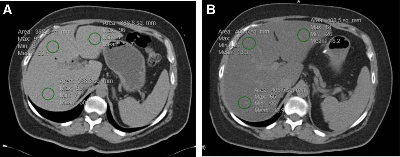
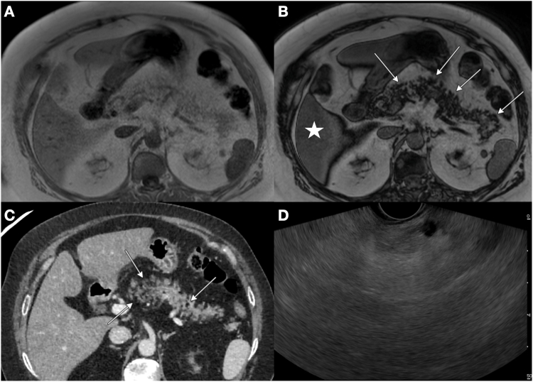
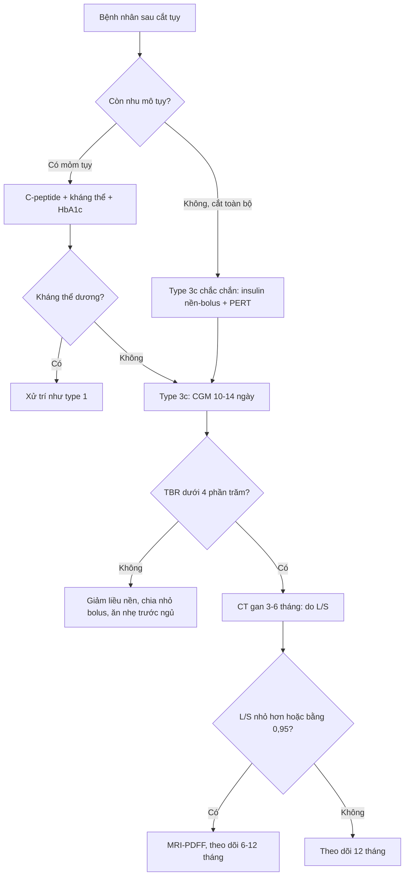

# 3148 — Đái tháo đường sau cắt tụy (type 3c diabetes): đường huyết dao động, hạ đường huyết và mỡ gan / Diabetes after pancreatectomy

**Tags:** `pattern:duong-huyet-dao-dong` `pattern:ha-duong-huyet` `pattern:teo-tuy` `pattern:nhiem-mo-gan` `vung:tuy` `vung:o-bung` `vung:gan` `protocol:CT-bung` `protocol:MRI-PDFF` `protocol:CGM` `score:time-in-range`

**Mức chắc chắn (certainty):** tổng hợp y văn (literature synthesis) — số liệu lấy từ **một đoàn hệ 41 bệnh nhân cắt toàn bộ tụy** theo dõi 12 tháng (JPEN J Parenter Enteral Nutr 2026 — **PMC13169115**), **một đoàn hệ 503 ca cắt tụy có ghép tiểu đảo tự thân** (Clin Transplant 2026 — **PMC13127559**), **một đoàn hệ 100 ca cắt toàn bộ tụy chụp CT theo dõi mỡ gan** (Surg Today 2026 — **PMC13473225**), **một đoàn hệ 509 ca ung thư tụy** (World J Surg Oncol 2025 — **PMC11830169**), **một nghiên cứu thực hành thực tế 2.146 ca viêm tụy** (Ther Adv Endocrinol Metab 2026 — **PMC13558923**) và **một đoàn hệ 136 ca hậu cắt tụy tìm NAFLD** (Medicine 2023 — **PMC9875952**). Phần cơ chế nào chưa có số đo trực tiếp được ghi rõ là **suy luận**.

> **Câu chốt:** bệnh nhân **không còn tụy** không phải "type 1 không có tự kháng thể" — họ **mất cả tế bào beta (insulin) lẫn tế bào alpha (glucagon)**, nên ba con số quyết định cách đọc phim và cách theo dõi: **(1)** sau cắt toàn bộ tụy, **100%** có type 3c diabetes ở 12 tháng nhưng **HbA1c trung vị chỉ 8,0%** trong khi **thời gian hạ đường huyết (time below range) trung vị 0,2%** — đường huyết "trông ổn" trên giấy mà vẫn có cơn hạ đường huyết (PMC13169115); **(2)** ở 156 người **đã cai insulin** sau ghép tiểu đảo, **28,8%** vẫn hạ đường huyết < 70 mg/dL, **20,5%** xuống < 54 mg/dL và **25%** trong nhóm đó có cơn **cần người ngoài trợ giúp** (PMC13127559); **(3)** mỡ gan xuất hiện ở **24,0%** sau cắt toàn bộ tụy (so với **3,0%** trước mổ), nữ **37,8% vs 12,7%** nam, và **BMI trước mổ cao** là yếu tố dự báo độc lập (PMC13473225).

## 1. Tổng quan bệnh học – cơ chế hình ảnh (TẠI SAO)

### 1.1 Vì sao cắt tụy tạo ra một kiểu đái tháo đường riêng

- Tụy nội tiết có **bốn loại tế bào** trong đảo Langerhans: **beta (insulin)**, **alpha (glucagon)**, **delta (somatostatin)**, **PP (pancreatic polypeptide)**. Cắt tụy lấy đi **toàn bộ** bốn loại theo cùng tỉ lệ mô còn lại; cắt toàn bộ tụy thì **không còn tế bào alpha**.
- **Glucagon là "phanh ngược" của insulin:** khi đường huyết giảm, tế bào alpha tiết glucagon → gan **phân giải glycogen** và **tân tạo glucose**. Không còn alpha, phản ứng phòng vệ này **mất hoàn toàn**, nên bất kỳ liều insulin nào hơi quá cũng đổ thẳng xuống hạ đường huyết — và **hạ đường huyết không có triệu chứng báo trước** vì đáp ứng adrenaline cũng bị giảm sau nhiều năm dao động. *(Suy luận từ sinh lý — đo trực tiếp glucagon sau cắt tụy không có trong các nghiên cứu trích dẫn.)*
- **Mất pancreatic polypeptide** làm tăng nhạy cảm insulin ở gan và làm **chậm/không đều rỗng dạ dày**, khiến đỉnh glucose sau ăn **lệch pha** với đỉnh insulin tiêm dưới da: ăn vào → glucose tăng vọt (vì insulin tiêm chưa kịp hấp thu), rồi 1–2 giờ sau insulin vào máu khi thức ăn đã hết → **hạ đường huyết muộn**. Đây là lý do kiểu đường huyết này được gọi là **"brittle" (dao động dữ dội)**.
- **Suy tụy ngoại tiết đi kèm** làm bệnh cảnh rối thêm: thiếu enzyme → **phân mỡ, sụt cân, hấp thu thuốc kém**, và **bữa ăn không đoán trước được** (nôn, chán ăn) → liều insulin cố định trở nên sai. Trong đoàn hệ 41 ca cắt toàn bộ tụy, **59,0%** còn suy dinh dưỡng ở 12 tháng và **hơn một nửa** mất **> 10%** cân nặng thường ngày (PMC13169115).
- **Kiểu đường huyết (pattern):** đỉnh sau ăn cao, **hạ đường huyết lúc 2–4 giờ sáng hoặc sau vận động**, HbA1c **không phản ánh hết mức dao động**. Ở 156 người cai insulin sau ghép tiểu đảo, hạ đường huyết xuất hiện **trung bình 2,4 ± 2,2 năm** sau ghép, thường **sau ăn hoặc sau gắng sức** (PMC13127559) — nghĩa là "cai insulin" **không đồng nghĩa "hết nguy cơ"**.

### 1.2 Vì sao gan nhiễm mỡ lại là chuyện của bệnh nhân cắt tụy

- Bình thường insulin từ tụy đi **thẳng qua tĩnh mạch cửa** vào gan (nồng độ gan cao gấp 2–3 lần ngoại vi). Sau cắt tụy, insulin **tiêm dưới da** → vào tuần hoàn hệ thống trước → gan nhận **insulin ít hơn** nhưng mô mỡ/mô cơ nhận **nhiều hơn**.
- Kèm **mất glucagon** (giảm phân giải mỡ và giảm tân tạo glucose ở gan) → gan **tăng tổng hợp mỡ (de novo lipogenesis)** và **giảm xuất VLDL** → mỡ tích trong tế bào gan. Suy dinh dưỡng/thay đổi cân nặng nhanh sau mổ cũng góp phần (giảm khối cơ → giảm nơi tiêu thụ insulin).
- **Số liệu:** mỡ gan tăng từ **3,0% trước mổ lên 24,0% ở 3–6 tháng sau cắt toàn bộ tụy** (100 ca); nữ **37,8% vs 12,7%**; yếu tố độc lập: **nữ OR 7,77** (KTC 95% 2,03–29,8; p = 0,009), **tuổi trẻ hơn OR 0,93/1 tuổi** (0,88–0,98; p = 0,011), **BMI trước mổ OR 1,28/1 kg/m²** (1,05–1,63; p = 0,015) (PMC13473225). Đoàn hệ khác (136 ca cắt tụy) ghi **NAFLD mới 17,5%** (24/136), **21%** ở nhóm mổ vì ung thư so với **9,5%** ở nhóm lành tính, xuất hiện **26,4 tháng** (ung thư) so với **32,8 tháng** (lành tính) sau mổ (PMC9875952).

### 1.3 TẠI SAO mỡ gan hiện trên CT và MRI — vật lý

- **CT:** gan bình thường **50–65 HU**, **cao hơn lách khoảng 5–10 HU**. Mỡ nội bào **hạ đậm độ** vì triglyceride có hệ số suy giảm tia X thấp hơn nước. Ngưỡng dùng được: **tỷ lệ gan/lách (CT L/S) ≤ 0,95** cho mỡ gan độ ≥ S1, **AUC 0,826** so với chuẩn MRI-PDFF (75 bệnh nhân, Front Med 2026 — PMC13290692). Trong ảnh mục 3, gan trước mổ đo **trung bình 50,7 HU** và sau mổ còn **16,2 HU** — tức đã sang mức **mỡ gan nặng**.
- **MRI:** mỡ và nước **cộng hưởng lệch pha** trong voxel. Chuỗi **in-phase/out-of-phase (đồng pha/ngược pha)** ở 1,5 T: chu kỳ lệch pha là **2,2 ms**, nên ảnh ngược pha (TE ≈ 2,2 ms) làm tín hiệu **tụt** ở voxel có **cả mỡ lẫn nước**; tụt tín hiệu **lan tỏa, đối xứng, cùng một mức** = mỡ. Đây chính là cơ chế của ảnh **tụy nhiễm mỡ** ở mục 3 (nhiều ổ tụt tín hiệu hình đám, kèm gan tụt cùng mức).
- **MRI-PDFF (proton density fat fraction)** đo **phần trăm mỡ** đã hiệu chỉnh T1/T2* → là chuẩn tham chiếu; **siêu âm định lượng (UDFF)** đạt **AUC 0,926** với ngưỡng **8,5%**, tốt hơn CT (PMC13290692) — nhưng phụ thuộc đầu dò, nên trong thực hành vẫn hay dùng CT khi đã có CT theo dõi ung thư.

### 1.4 Ngưỡng định lượng dùng ngay

| Đại lượng | Ngưỡng / số đo | Nguồn |
|---|---|---|
| Chẩn đoán type 3c sau cắt toàn bộ tụy | **100%** ở 12 tháng | PMC13169115 |
| HbA1c trung vị sau cắt toàn bộ tụy | **8,0%** (IQR 7,2–8,8) | PMC13169115 |
| Hạ đường huyết ở người cai insulin sau ghép tiểu đảo | **28,8%** < 70 mg/dL; **20,5%** < 54 mg/dL | PMC13127559 |
| Cơn hạ đường huyết cần trợ giúp | **25%** trong số người có hạ đường huyết | PMC13127559 |
| Đái tháo đường sau mổ ở ung thư tụy (509 ca) | đường huyết đói **9,81–9,95 mmol/L**, **AUC 0,745** (kết hợp trước + sau mổ) | PMC11830169 |
| Tỷ lệ tử vong 24 tháng khi có đái tháo đường sau mổ | **5,03% vs 2,35%** (p = 0,020) | PMC11830169 |
| Mỡ gan mới sau cắt toàn bộ tụy | **3,0% → 24,0%** ở 3–6 tháng | PMC13473225 |
| NAFLD mới sau cắt tụy (mọi loại) | **17,5%**, muộn nhất **26,4–32,8 tháng** | PMC9875952 |
| CT L/S cho mỡ gan ≥ S1 | **≤ 0,95** (AUC 0,826) | PMC13290692 |
| Điều trị thực tế bệnh nhân viêm tụy + đái tháo đường | insulin **41,9% → 61,2%** sau nhập viện | PMC13558923 |

## 2. Mẫu hình + chẩn đoán phân biệt theo vị trí (gamut)

- **Mẫu hình 1 — "không còn tụy":** trên CT sau cắt toàn bộ tụy, **không thấy nhu mô tụy**, chỉ còn **miệng nối mật–ruột**, dạ dày–ruột và mạc treo; đừng báo "tụy teo" mà phải nói **"tụy đã cắt toàn bộ"** — vì nó đổi hoàn toàn cách đọc đường huyết và mỡ gan.
- **Mẫu hình 2 — tụy còn lại nhưng teo/nhiễm mỡ:** sau cắt đầu tụy (Whipple), mỏm tụy còn lại bị **teo do tắc ống tụy** và **thay mỡ**; đây là **nguyên nhân thực thể của type 3c** (khác type 2 chỉ có tụy bình thường hoặc thoái hóa mỡ nhẹ).
- **Mẫu hình 3 — gan nhiễm mỡ mới:** đậm độ gan tụt, **gan < lách**, không có dấu hiệu tắc mật; xuất hiện **3–6 tháng** sau cắt toàn bộ tụy.
- **Mẫu hình 4 — hạ đường huyết không rõ nguyên nhân:** bệnh nhân cắt tụy dùng insulin, **lú lẫn/vã mồ hôi ban đêm**, nhưng HbA1c 7–8% → **không loại trừ** được hạ đường huyết; phải đọc **CGM**.
- **Gamut theo cơ chế của tăng đường huyết sau mổ tụy:** **(a)** mất nhu mô tụy (cắt toàn bộ > cắt đầu tụy); **(b)** suy tụy ngoại tiết → suy dinh dưỡng/hấp thu thất thường; **(c)** mỡ gan/NAFLD → đề kháng insulin tại gan; **(d)** **corticoid, nuôi ăn tĩnh mạch, nhiễm trùng, thuốc ức chế miễn dịch**; **(e)** type 2 có từ trước (không phải "do mổ").
- **Gamut theo vị trí khi đọc phim:** **mỏm tụy** (teo/thay mỡ/tái phát u) → **miệng nối tụy–ruột** (hẹp, rò) → **tĩnh mạch lách** (huyết khối sau cắt thân–đuôi, gây tăng áp cửa) → **gan** (mỡ, di căn) → **mạc treo/ruột non** (quai nối, tắc).

## 3. Bảng so sánh phân biệt (ma trận đối chiếu)

| Thực thể (entity) | Hình ảnh điển hình | Chốt vào (rule-in) | Chốt loại (rule-out) | Gợi ý xác nhận |
|---|---|---|---|---|
| **Type 3c sau cắt tụy** | Không thấy nhu mô tụy / mỏm tụy teo + thay mỡ; mỡ gan mới | **Tiền sử cắt tụy + C-peptide thấp + không tự kháng thể** | Tụy đầy đủ, không mổ → nghĩ type 1/2 | CGM 10–14 ngày, C-peptide, GAD65 |
| **Type 1** | Tụy bình thường về kích thước (teo muộn), không mỡ gan đặc trưng | **Tự kháng thể dương, nhiễm ceton cấp** | Có mổ tụy + không kháng thể → 3c | GAD65/IA2/ZnT8 |
| **Type 2** | Tụy thoái hóa mỡ nhẹ theo tuổi, gan nhiễm mỡ thường có sẵn | **Kháng insulin, BMI cao, không mất tế bào alpha** | **HbA1c cao nhưng ít hạ đường huyết về đêm** → không phải 3c | HOMA-IR, C-peptide |
| **Đái tháo đường do corticoid** | Không đổi hình thái tụy; có thể mỡ gan do thuốc | **Bắt đầu sau khi tăng liều corticoid, giảm khi giảm liều** | Không liên quan liều thuốc → nghĩ 3c | Nhật ký liều + đường huyết |
| **Mỡ gan do cắt tụy** | Gan **16–20 HU**, **L/S ≤ 0,95**, tụt tín hiệu ngược pha lan tỏa | **Mổ tụy + BMI trước mổ cao + nữ** | Vôi hóa/đậm độ cao bất thường → nghĩ thuốc (amiodarone) hoặc ứ sắt | MRI-PDFF, siêu âm định lượng |
| **Hạ đường huyết do insulin** | Không có tổn thương trên hình ảnh | **CGM < 70 mg/dL, đặc biệt 0–6 giờ sáng** | Glucose luôn cao, không cơn → chỉnh liều chứ không phải bệnh khác | CGM, nhật ký ăn/tiêm |
| **Tái phát u tại mỏm tụy** | Khối mới ở miệng nối, **ADC thấp**, ngấm thuốc | **Nốt mới + tăng CA 19-9** | Mỏm tụy teo đều, không nốt → lành | CT/MRI có cản quang, PET-CT |

*Ảnh A–B: cùng một bệnh nhân, CT không cản quang **trước mổ** (A, gan trung bình 50,7 HU) và **sau cắt tụy** (B, gan trung bình 16,2 HU) — mỡ gan mới xuất hiện. Nguồn: Medicine 2023, PMC9875952 Fig. 1, CC BY 4.0.*

*Ảnh A–D: **tụy nhiễm mỡ** — (A) T1 đồng pha, (B) T1 ngược pha với nhiều ổ **tụt tín hiệu** (mũi tên) và gan cũng tụt tín hiệu; (C) CT, (D) siêu âm nội soi. Nguyên lý: mỡ + nước trong cùng voxel triệt tín hiệu ở thì ngược pha. Nguồn: PMC13101595 Fig. 1, **CC BY-NC-ND** (nguyên bản, không cắt/ghép).*

## 4. Protocol chụp + hệ phân độ/điểm chuẩn hóa

### 4.1 Chụp gì, khi nào

- **CT bụng có cản quang, lát ≤ 1–3 mm, thì tụy (pancreatic phase 40–50 giây)** — dùng để: (a) xác nhận **tụy đã cắt bao nhiêu**, (b) tìm **tái phát tại miệng nối**, (c) **đo mỡ gan** trên cùng một lần chụp (không cần thêm liều).
- **CT không cản quang để đo mỡ gan:** đặt ROI **≥ 300 mm²** ở **hạ phân thùy VII/VIII**, tránh mạch máu và ống mật, lấy **trung bình 3 ROI**; so với **lách cùng lát**. Ngưỡng: **L/S ≤ 0,95** = mỡ độ ≥ S1 (PMC13290692).
- **MRI bụng** khi cần định lượng: **T1 in/out-of-phase** (sàng lọc nhanh), **MRI-PDFF** (chuẩn tham chiếu, %); thêm **MRCP** nếu nghi hẹp miệng nối tụy–ruột hoặc rò.
- **CGM (continuous glucose monitoring)** là "phim của đường huyết": đeo **10–14 ngày**, đọc 4 chỉ số — **TIR** (70–180 mg/dL), **TBR** (< 70 mg/dL), **TAR** (> 180 mg/dL), **CV** (hệ số biến thiên). Mục tiêu đồng thuận quốc tế: **TIR > 70%, TBR < 4% (và < 1% dưới 54 mg/dL), TAR < 25%, CV ≤ 36%**.
- **Xét nghiệm nền:** C-peptide, HbA1c, tự kháng thể (GAD65/IA2/ZnT8) khi còn nghi ngờ type 1, **elastase-1 phân** (suy tụy ngoại tiết — xem [bài 1941](../1941-pert-sau-phau-thuat-tuy/lesson.md)).

### 4.2 Vì sao HbA1c một mình là bẫy

- HbA1c là **trung bình** của 8–12 tuần; kiểu 3c có **đỉnh cao và đáy sâu** cùng tồn tại → trung bình "đẹp" (**8,0%**) mà vẫn có cơn hạ đường huyết (PMC13169115).
- Bệnh nhân thiếu máu, suy thận, truyền máu, bệnh hemoglobin → HbA1c **sai lệch**; khi đó **CGM/TIR** là chỉ số chính.

### 4.3 Khung theo dõi sau cắt tụy

## 5. Biến thể bình thường và cạm bẫy

- **"Tụy teo" sau Whipple là bình thường**, không phải tái phát: mỏm tụy mất dẫn lưu dịch → teo + thay mỡ trong 6–12 tháng. Đừng đo "kích thước tụy" rồi kết luận bệnh lý.
- **Mỡ gan giả trên CT:** **amiodarone** (tăng đậm độ gan), **ứ sắt/hemochromatosis** (tăng đậm độ), **glycogen** (giảm đậm độ như mỡ) — luôn đọc **L/S** và hỏi thuốc, không chỉ nhìn gan "tối".
- **Tụt tín hiệu ngược pha không đồng nghĩa mỡ:** nếu tụt **khu trú hình vòng** hoặc **lan ra ngoài gan** → nghĩ **dị vật kim loại/khí**; nếu tụt **không đồng đều** ở bệnh nhân có xạ trị → nghĩ **thay đổi do xạ**.
- **CGM có thể sai:** tư thế nằm đè cảm biến, **hạ đường huyết giả** khi ngủ (compression artifact), và **trễ 5–15 phút** so với máu mao mạch — luôn xác nhận bằng **máu mao mạch** trước khi đổi liều.
- **Sai lầm hay gặp nhất:** gọi bệnh nhân cắt tụy là **"type 2 khó kiểm soát"** rồi dùng **sulfonylurea** (kích thích tế bào beta không còn) → **hạ đường huyết nặng mà không hiệu quả**. Trong thực hành thực tế, **61,2%** bệnh nhân viêm tụy + đái tháo đường được dùng insulin sau nhập viện, metformin giảm còn **26,2%** (PMC13558923) — phản ánh đúng hướng, nhưng **chưa có hướng dẫn riêng cho 3c**.
- **PERT không phải "thuốc hạ đường huyết":** trong 48 ca so với 48 ca chứng, PERT **không giảm tần suất/mức độ hạ đường huyết** toàn nhóm, chỉ **cải thiện triệu chứng tiêu hóa 80% vs 20%** (p = 0,02) và **không đổi HbA1c/BMI**; **19%** có tăng đường huyết nhẹ sau khi bắt đầu PERT (PMC10854028). Đừng hứa với bệnh nhân rằng thêm enzyme sẽ ổn định đường huyết.

## 6. Tự lượng giá — Blind Quiz (bấm để hiện đáp án)

**Ca 1 — nam 58 tuổi, cắt toàn bộ tụy vì ung thư ống tụy 6 tháng trước**

- Gợi ý lâm sàng: HbA1c 7,8%, không than phiền, tăng 2 kg sau mổ.
- Câu hỏi: (1) Hai ảnh khác nhau ở đâu và đo được gì? (2) Vì sao tình trạng này lại hay gặp sau cắt tụy? (3) Cần thêm xét nghiệm gì trước khi kết luận "kiểm soát tốt"?

<b>Bấm để hiện đáp án (findings + chẩn đoán)</b>

- **Dấu hiệu:** ảnh A (trước mổ) gan **trung bình 50,7 HU**; ảnh B (sau mổ) gan **trung bình 16,2 HU**, tức **giảm ~34 HU** và **thấp hơn lách** → **mỡ gan mới sau cắt tụy**.
- **Chẩn đoán:** gan nhiễm mỡ do cắt tụy (de novo NAFLD) — insulin tiêm dưới da làm **gan nhận ít insulin qua tĩnh mạch cửa**, mất glucagon làm **tăng tân tạo mỡ**; tỷ lệ **24,0%** sau cắt toàn bộ tụy (PMC13473225).
- **Cần thêm:** **CGM 10–14 ngày** để đo **TBR** — HbA1c 7,8% **không loại trừ** hạ đường huyết về đêm.
- **Nguồn ảnh:** Medicine 2023, PMC9875952 Fig. 1 — CC BY 4.0.

**Ca 2 — nữ 34 tuổi, đau bụng mạn do viêm tụy, MRI bụng trước khi mổ**

- Gợi ý lâm sàng: sụt cân, phân mỡ, đường huyết đói 7,4 mmol/L.
- Câu hỏi: (1) Vì sao tín hiệu tụy **tụt** ở ảnh B nhưng không ở ảnh A? (2) Dấu hiệu này nói gì về chức năng tụy? (3) Nó có loại trừ được ung thư tụy không?

<b>Bấm để hiện đáp án (findings + chẩn đoán)</b>

- **Dấu hiệu:** ảnh **ngược pha (B)** có nhiều ổ **tụt tín hiệu** trong tụy (mũi tên) và gan cũng tụt → **tụy nhiễm mỡ**, không phải khối.
- **Vì sao:** mỡ và nước trong cùng voxel **triệt tín hiệu** ở thì ngược pha; mô đặc/khối u **không tụt** như vậy.
- **Ý nghĩa:** thay mỡ nhu mô là dấu hiệu **mô tụy chức năng đã mất**, phù hợp **type 3c + suy tụy ngoại tiết** (đối chiếu elastase-1 phân).
- **Không loại trừ ung thư:** thay mỡ **lan tỏa** không loại trừ có **nốt đặc**; cần **CT/MRI có cản quang** và **MRCP** đánh giá ống tụy.
- **Nguồn ảnh:** PMC13101595 Fig. 1 — **CC BY-NC-ND**, dùng nguyên bản.

## Bài liên quan chéo
- [1941 – Suy tụy ngoại tiết sau mổ tụy: liều enzyme (PERT)](../1941-pert-sau-phau-thuat-tuy/lesson.md)
- [1981 – Hẹp miệng nối tụy–ruột sau Whipple](../1981-hep-mieng-noi-tuy-ruot-sau-whipple/lesson.md)
- [135 – Viêm tụy cấp & phân độ Atlanta](../135-viem-tuy-Atlanta/lesson.md)
- [1736 – Cổ trướng tụy & rò tụy nội bộ](../1736-co-truong-tuy-ro-tuy-noi-bo/lesson.md)
- [1840 – Huyết khối mảnh ghép tụy](../1840-huyet-khoi-manh-ghep-tuy/lesson.md)
- [1463 – Suy thượng thận do corticoid](../1463-suy-thuong-than-do-corticoid/lesson.md)

## Ảnh
- `images/3148_gan-nhiem-mo_CT_PMC9875952-Fig1.jpg` — CT trước/sau cắt tụy, **CC BY 4.0**.
- `images/3148_tuy-nhiem-mo_MRI-PMC13101595-Fig1.jpg` — MRI đồng pha/ngược pha, **CC BY-NC-ND** (nguyên bản).
- Nguồn + giấy phép từng ảnh: `images/CREDITS.md`.

> Không dùng để chẩn đoán độc lập khi chưa có người hướng dẫn.
