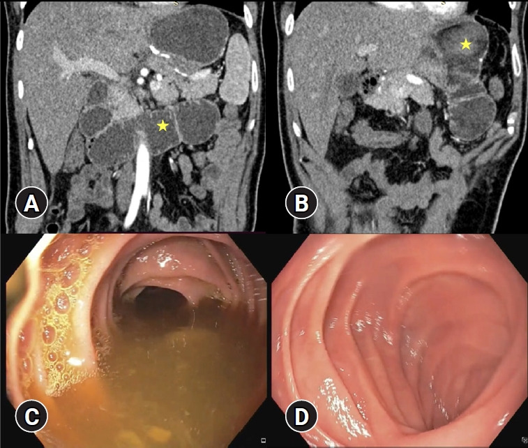
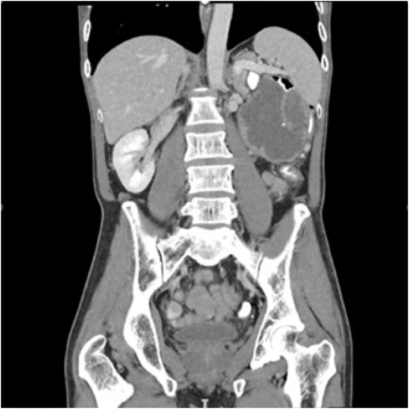
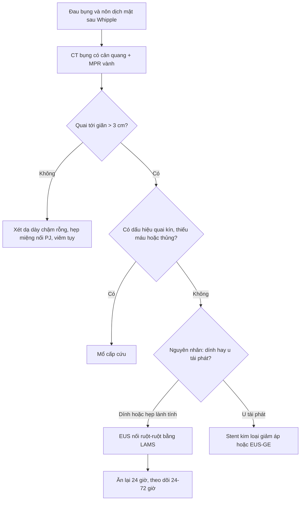
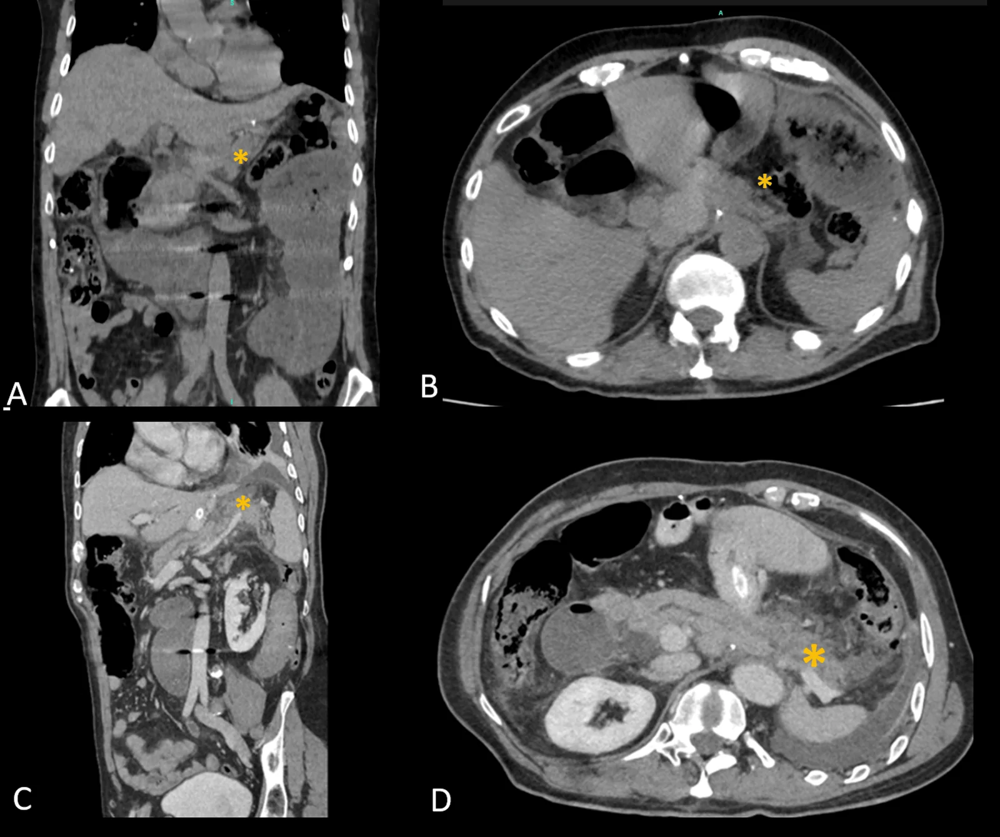

# 3149 — Hội chứng quai tới sau Whipple / Afferent loop syndrome (ALS) after pancreaticoduodenectomy

**Tags:** `pattern:quai-toi` `pattern:tac-ruot` `pattern:viem-tuy` `vung:ruot-non` `vung:tuy` `vung:o-bung` `protocol:CT-bung-co-can-quang` `protocol:EUS` `protocol:MRCP` `protocol:noi-soi`

**Mức chắc chắn (certainty):** tổng hợp y văn (literature synthesis) — dựa trên **1 tổng quan kỹ thuật nội soi 2023** (PMC10191797, CC BY-NC), **1 phân tích gộp 2026 (12 nghiên cứu/134 ca)** (PMC13407301, CC BY), và **4 ca nguyên văn có ảnh** (PMC12933610, PMC13343362, PMC13523788, PMC13310770). Không có thử nghiệm ngẫu nhiên; mọi ngưỡng là dữ liệu hồi cứu/đồng thuận.

> **Câu chốt:** sau Whipple, **đau bụng + nôn ra dịch mật không lẫn thức ăn** mà **dạ dày không giãn** thì phải tìm **quai tới giãn**. Ba số phải thuộc: ALS gặp **0,2–1%** tùy kiểu mổ; **chẩn đoán muộn → tử vong 30–60%**; CT thấy **một quai ruột non đơn độc > 3 cm, chứa dịch, có điểm chuyển tiếp đột ngột** ở người đã mổ cắt dạ dày/tụy. Điều trị nội soi qua EUS đạt **kỹ thuật 98,5% / lâm sàng 94,8%** — nhưng **chẩn đoán hình ảnh phải đúng trước**, vì can thiệp vào “dạ dày chậm rỗng” là can thiệp sai chỗ.

## 1. Tổng quan bệnh học – cơ chế hình ảnh (TẠI SAO)

### 1.1 Quai tới là gì và vì sao nó “tắc mà không tắc”

- Sau cắt đầu tụy–tá tràng, quai hỗng tràng đầu tiên mang **mật + dịch tụy** đổ vào miệng nối não–hỗng tràng (hoặc tụy–hỗng tràng). Đoạn này gọi là **quai tới (afferent loop)** hay **quai mật–tụy (pancreaticobiliary limb)** — dài **30–40 cm** ở kiểu trước đại tràng (antecolic) và thường ngắn hơn ở kiểu sau đại tràng (PMC10191797).
- **Tắc hoàn toàn** biến quai thành **quai kín (closed loop)**: mật–dịch tụy và dịch ruột tích lại, **không có đường thoát**, áp lực lòng tăng → **viêm tụy cấp**, **viêm đường mật ngược dòng**, rồi **thủng quai** và viêm phúc mạc. Đây là thể **cấp, tử vong cao** (PMC10191797).
- **Tắc một phần** tạo cơ chế **“van xả áp”**: dịch ứ đầy rồi thoát từng đợt → bệnh cảnh **mạn**: đau thượng vị từng cơn, nôn ra **dịch mật không có thức ăn**, sụt cân, **loạn khuẩn ruột non → thiếu B12, tiêu chảy mỡ** (PMC10191797).

### 1.2 TẠI SAO hình ảnh lại “một quai đơn độc” — và tại sao dễ đọc thành tắc ruột non

- Chỉ **một đoạn** ruột (quai tới) bị chặn; các quai còn lại bình thường. Vì vậy CT không thấy “nhiều quai giãn” như tắc ruột non thông thường, mà thấy **một ống ruột chứa dịch, đường kính lớn hơn hẳn quai bên cạnh**, chạy **chéo qua đường giữa** (thường từ trái sang phải hoặc ngược lại tùy kiểu mổ), nằm **giữa tụy và gan**, **trước động mạch chủ/tĩnh mạch chủ dưới**.
- **Vật lý đậm độ:** dịch mật–tụy **0–20 HU** (có khi 20–30 HU nếu đặc); khí trong ruột **−1.000 HU**; thành ruột ngấm thuốc **+20 đến +40 HU** so với trước tiêm. Quai tới chứa **dịch thuần, không có cặn thức ăn** → trông như “nang dịch” hình ống; nếu có cặn lợn cợn lẫn khí (dấu **“phân hóa” — fecalized**) thì đó là **ứ đọng mạn**.
- **TẠI SAO bilirubin tăng:** quai tới bị chặn là **chỗ nối của đường mật**, nên giãn ngược dòng cả **đường mật trong gan** — bilirubin/ALP tăng **trước khi** có vàng da rõ. Tương tự, **ống tụy chính giãn** và **amylase/lipase tăng** khi dịch tụy ứ (ca dưới đây: amylase **8.003 U/L**, lipase **6.000 U/L**) (PMC13523788).
- **Ngưỡng kích thước:** ruột non bình thường **≤ 3 cm**; **> 3 cm = giãn**. Trong các ca ALS có triệu chứng đã công bố, đường kính quai tới đo được **4,6 cm**, **5,0 cm**, và **7,5 cm** (quai tới) cùng **4,3 cm** (tá tràng) — tức **vượt ngưỡng 1,5–2,5 lần** (PMC12933610; PMC13343362; PMC13523788).

### 1.3 Ngưỡng định lượng trụ cột

| Biến số | Số liệu | Nguồn |
|---|---|---|
| Tần suất ALS | **0,2–1%** tùy loại cắt dạ dày và kiểu tái lập lưu thông | PMC10191797; PMC13523788 |
| Tử vong khi chẩn đoán muộn | **30–60%** | PMC13523788 |
| Chiều dài quai tới nguy cơ (trước đại tràng) | **> 30–40 cm** → xoắn/gập/dính | PMC10191797 |
| Đường kính quai tới khi có triệu chứng | **4,6 / 5,0 / 7,5 cm** (ngưỡng giãn ruột non **> 3 cm**) | PMC12933610; PMC13343362; PMC13523788 |
| Kết quả EUS điều trị (gộp) | **12 nghiên cứu, 134 ca**: kỹ thuật **98,5%** (132/134), lâm sàng **94,8%** (127/134), biến cố **9,7%** (13/134) | PMC13407301 |
| Thời gian giảm triệu chứng sau can thiệp | **24–72 giờ** | PMC13407301 |
| Đường kính stent dùng | **10–20 mm**; LAMS **10 mm** đủ dẫn lưu, **15 mm** nếu cần đưa ống soi vào quai | PMC13407301; PMC10191797 |
| ALS ác tính — sống sau đặt stent | trung vị **~5 tháng** | PMC13310770 |
| Hẹp quai tới (ca) | hẹp **3 cm**, cách miệng nối **15 cm** | PMC11612805 |

*(A, B) MPR vành: quai tới (dấu sao vàng) giãn tối đa **4,6 cm**, chứa dịch, có chỗ gập (kink) ở đầu xa; không thấy khối hay thoát vị nội. (C, D) Nội soi: ứ đọng dịch mật trong quai tới, quai hiệu bình thường. Nguồn: Dhar J, Ancil S, Samanta J; *Clin Endosc* 2026; Fig. 1 — PMC12933610, CC BY-NC 4.0.*

## 2. Mẫu hình + chẩn đoán phân biệt theo vị trí (Gamut)

- **ALS sớm (< 1 tháng sau mổ):** phù nề miệng nối · **gập/kink quai tới** · **thoát vị nội qua lỗ mạc treo** (kiểu sau đại tràng) · xoắn quai · dính sớm · tụ máu/áp-xe chèn ép.
- **ALS muộn (> 1 tháng):** **tái phát ung thư** tại miệng nối/quanh động mạch mạc treo tràng trên · hẹp xơ miệng nối · **sỏi ruột/enterolith – bã thức ăn (bezoar)** · hẹp do xạ · loét miệng nối.
- **Theo vị trí chỗ tắc:** tại **miệng nối não–hỗng tràng** (quai tới giãn tới sát miệng nối) · tại **miệng nối tụy–hỗng tràng** (ống tụy giãn, tụy teo) · **giữa quai** (dính, thoát vị nội, xoắn) · **đầu xa** (u tái phát, hạch).
- **Bắt chước thường gặp:** chậm làm rỗng dạ dày · hẹp miệng nối vị–hỗng tràng · hội chứng ứ quai Roux · viêm tụy cấp đơn thuần · giãn ruột non do liệt ruột · lymphocele/tụ dịch quanh tụy.
- **Gợi nhớ 3 chữ “quai tới = 3 không”:** **không thức ăn** trong dịch nôn · **không giãn dạ dày** (dạ dày thường xẹp) · **không có nhiều quai giãn** (chỉ một quai).

## 3. Bảng so sánh phân biệt (ma trận đối chiếu)

| Thực thể | Hình ảnh điển hình | Chốt vào (rule-in) | Chốt loại (rule-out) | Gợi ý xác nhận |
|---|---|---|---|---|
| **ALS do dính/gập quai tới** | **Một quai ruột non chứa dịch > 3 cm** (ca: 4,6–7,5 cm), điểm chuyển tiếp đột ngột, **không khối, không thoát vị** | **Quai tới giãn + chuyển tiếp + không nguyên nhân khác** | Nhiều quai giãn lan tỏa, không điểm chuyển tiếp → liệt ruột | CT cổng tĩnh mạch + MPR vành; nội soi thấy ứ mật, hẹp/gập |
| **ALS do thoát vị nội** | **Quai kín**: 2 điểm chuyển tiếp, **dấu xoáy mạch treo (whirl)**, mạc treo phù, quai tới + quai bên trong túi thoát vị | **Whirl + 2 điểm chuyển tiếp + mạch treo kéo về một điểm** | Chỉ 1 điểm chuyển tiếp, không whirl → dính/kink | CT MPR vành + dọc; mổ nội soi nếu nghi ngẹt |
| **ALS do tái phát ung thư** | **Mô mềm không đều quanh miệng nối/động mạch mạc treo tràng trên**, hạch, di căn gan; quai tới giãn thượng nguồn | **Khối/mô mềm + thâm nhiễm mạch + hạch tại chỗ chuyển tiếp** | Thành ruột mỏng, không khối, không hạch → lành tính | CT + PET; EUS chọc hút; nội soi sinh thiết |
| **Hẹp miệng nối tụy–hỗng tràng (bài 1981)** | **Ống tụy chính > 3 mm** (sau Whipple trung vị **4 mm** là bình thường), thắt đột ngột tại miệng nối, **tụy teo**; quai tới **không** giãn | **Giãn ống tụy + teo nhu mô, không giãn quai tới** | Quai tới giãn > 3 cm + ống tụy bình thường → ALS, không phải hẹp PJ | MRCP; EUS; elastase phân biệt |
| **Chậm làm rỗng dạ dày / hẹp miệng nối vị–hỗng tràng** | **Dạ dày giãn to**, thức ăn ứ, miệng nối hẹp; **quai tới không giãn** | **Dạ dày giãn > quai tới + thức ăn trong dạ dày** | Dạ dày xẹp, chỉ một quai giãn → ALS | CT + nội soi; test làm rỗng dạ dày |
| **Hội chứng ứ quai Roux (Roux stasis)** | Quai Roux giãn nhẹ, **không điểm chuyển tiếp cơ học**, nhu động kém | **Không có chuyển tiếp + không nguyên nhân chèn ép** | Có điểm chuyển tiếp rõ → ALS cơ học | CT động học/ manometry; loại trừ cơ học trước |
| **Viêm tụy cấp do ALS (thể nặng)** | Tụy phù/hoại tử **kèm quai tới giãn**; amylase/lipase rất cao (ca: **8.003 / 6.000 U/L**) | **Quai tới giãn + tụy viêm cùng lúc** | Viêm tụy không có quai giãn → nguyên nhân khác (mật, rượu) | CT 72 giờ; MRCP; theo dõi hoại tử |
| **Không tắc: lymphocele/tụ dịch/liệt ruột** | Ổ dịch **không có thành ruột**, hoặc nhiều quai giãn đều không chuyển tiếp | **Ổ dịch ngoài lòng ruột / giãn lan tỏa** | Quai có thành và van ruột rõ → ALS | CT; siêu âm; chọc hút dịch |

*MPR vành: quai tới giãn **5 cm** ở hạ sườn trái, chuyển đột ngột về cỡ ruột non bình thường ở đầu xa; không khối, không dày thành → nguyên nhân dính. Đây là mẫu hình “một quai đơn độc” kinh điển. Nguồn: Ang NKJ, Lim JQ, Lye TJY, Tan DMY, Lim CH; *VideoGIE* 2026; Fig. 1 — PMC13343362, CC BY-NC-ND 4.0 (nguyên bản, không crop).*

## 4. Protocol chụp + hệ phân độ/điểm chuẩn hóa

### 4.1 Protocol

- **CT bụng–tiểu khung có cản quang tĩnh mạch, thì cổng tĩnh mạch (portal venous, 60–70 giây)**: lát **1–1,25 mm**, **bắt buộc dựng MPR vành + dọc**. Quai tới chạy chéo qua đường giữa → **ảnh trục đơn thuần bỏ sót**.
- **Cho uống nước (500–750 mL) trước chụp 15–20 phút** để phân biệt **dạ dày/quai hiệu** với **quai tới**; không dùng cản quang uống đặc nếu đang nghi tắc hoàn toàn.
- **Đo và ghi:** đường kính lớn nhất của quai tới (mm) · vị trí + hình thái **điểm chuyển tiếp** · thành ruột (mm, ngấm thuốc) · mạc treo (phù, xoáy mạch) · **đường mật trong gan** và **ống tụy chính** · hạch/khối quanh động mạch mạc treo tràng trên.
- **MRCP** khi cần phân biệt **hẹp miệng nối tụy–hỗng tràng** với ALS (bài 1981) hoặc tìm **sỏi/enterolith**; **EUS** để đo khoảng cách quai tới – dạ dày/ruột non **trước khi đặt stent xuyên thành** (PMC10191797).
- **Nội soi** khi nghi ALS: tìm **ứ dịch mật trong quai tới**, đoạn hẹp/gập, loại trừ loét và tái phát u.

### 4.2 Chọn can thiệp

| Tình huống | Ưu tiên | Ngưỡng / số liệu |
|---|---|---|
| ALS **lành tính**, bệnh nhân mổ lại khó | **EUS nối ruột–ruột (enteroenterostomy) bằng LAMS** | Kỹ thuật **98,5%**, lâm sàng **94,8%**, biến cố **9,7%** (134 ca) (PMC13407301) |
| Cần đưa ống soi vào quai sau can thiệp | LAMS **15 mm** | **10 mm** đủ dẫn lưu; **15 mm** cho phép nội soi qua stent (PMC10191797) |
| Hẹp quai tới **ngắn, trong tầm với** | Nội soi + **nong bóng** hoặc **stent kim loại không màng** | Ca hẹp **3 cm** cách miệng nối 15 cm: nong + ống nuôi (PMC11612805) |
| ALS **ác tính/tái phát u** | **Stent kim loại không màng** để giảm áp, hoặc EUS-GE | Sống trung vị **~5 tháng** sau stent (PMC13310770) |
| Thoát vị nội, xoắn, thủng, hoại tử | **Mổ** | Không chờ nội soi khi có dấu hiệu thiếu máu/thủng |
| Dự phòng khi mổ lần đầu | Quai trước đại tràng **≤ 30–40 cm**, đóng kín lỗ mạc treo | Quai **> 30–40 cm** tăng nguy cơ xoắn/gập (PMC10191797) |

## 5. Biến thể bình thường và cạm bẫy

- **Tá tràng giãn khí sau mổ là bình thường:** trong 24–72 giờ đầu, tá tràng/quai tới có thể chứa **khí và dịch** do liệt ruột — chỉ gọi ALS khi **giãn tiến triển + có điểm chuyển tiếp + triệu chứng**.
- **Quai tới “bình thường nhưng to”:** ở người cắt dạ dày kiểu quai trước đại tràng dài, quai tới có thể **2,5–3 cm** mà không tắc; ngưỡng **> 3 cm** chỉ có nghĩa khi kèm **chênh lệch với quai bên cạnh** và triệu chứng.
- **Chỉ đọc ảnh trục:** quai tới chạy chéo, cắt ngang nhiều lát → dễ bị đọc thành “nhiều ổ dịch nhỏ” hoặc “hạch hoại tử”. **MPR vành/dọc là bắt buộc**.
- **Bỏ sót nguyên nhân ác tính:** thấy quai giãn rồi dừng → bỏ **mô mềm quanh động mạch mạc treo tràng trên** (ca tái phát PDAC có thâm nhiễm mạch) (PMC13310770). Luôn đọc **động mạch mạc treo tràng trên + tĩnh mạch mạc treo tràng trên** ở mọi ca ALS.
- **Viêm tụy cấp che lấp ALS:** tụy hoại tử + dịch quanh tụy làm **mờ quai tới giãn**; nếu amylase/lipase rất cao mà **không có nguyên nhân mật/rượu**, phải đo quai tới trên MPR (ca amylase **8.003 U/L** tiến triển hoại tử trong **72 giờ**) (PMC13523788).
- **Stent xuyên thành sai vị trí:** EUS cần thấy **quai tới sát thành dạ dày/ruột non, không có mạch xen giữa**; đặt vào quai hiệu hoặc mạch máu = thủng.
- **Sau can thiệp, đừng nhầm khí trong ổ với nhiễm khuẩn:** khí trong quai tới/stent vài ngày đầu là bình thường.

## 6. Tự lượng giá — Blind Quiz

**Ca 1 — Bệnh nhân 1 tháng sau cắt dạ dày Billroth II, nôn dịch mật, sụt cân. Nhìn CT (A, B) và nội soi (C, D).**

- Câu hỏi: (1) Dấu sao vàng là cấu trúc gì, đo được bao nhiêu? (2) Vì sao dạ dày không giãn? (3) Ba chẩn đoán phân biệt và cách xử trí khi mổ lại khó?

<b>Bấm để hiện đáp án (findings + chẩn đoán)</b>

- Sao vàng = **quai tới** (tá tràng + hỗng tràng đầu) giãn tối đa **4,6 cm**, chứa dịch, **gập ở đầu xa**; không khối, không thoát vị.
- Dạ dày không giãn vì tắc nằm **sau miệng nối não–hỗng tràng** — dịch mật ứ trong quai tới, không trào ngược vào dạ dày.
- **Chẩn đoán:** ALS lành tính sau Billroth II.
- **Phân biệt:** hẹp miệng nối vị–hỗng tràng (dạ dày giãn) · viêm tụy cấp · thoát vị nội.
- **Xử trí:** EUS nối hỗng–hỗng bằng **LAMS 15 × 10 mm**; ăn mềm sau **24 giờ**.
- Nguồn: Dhar J, Ancil S, Samanta J; *Clin Endosc* 2026 — PMC12933610, CC BY-NC 4.0.

**Ca 2 — Bệnh nhân nhiều lần mổ bụng, nôn ra dịch mật từng đợt, CT vành dưới đây.**

- Câu hỏi: (1) Mô tả quai giãn và điểm chuyển tiếp. (2) Vì sao không nghĩ tắc ruột non thông thường? (3) Can thiệp nào giữ được giải phẫu cũ?

<b>Bấm để hiện đáp án (findings + chẩn đoán)</b>

- Quai hỗng tràng đầu giãn **5 cm**, chuyển đột ngột về cỡ bình thường ở hạ sườn trái; **không khối, không dày thành** → dính.
- Không phải tắc ruột non thông thường vì **chỉ một quai giãn**, các quai khác bình thường và bệnh nhân có giải phẫu nối tắt ruột–ruột trước đó.
- **Xử trí:** EUS đặt LAMS **15 × 15 mm** nối quai tới với quai hiệu (enteroenterostomy) — giảm áp mà không phải mổ lại.
- Nguồn: Ang NKJ, Lim JQ, Lye TJY, Tan DMY, Lim CH; *VideoGIE* 2026 — PMC13343362, CC BY-NC-ND 4.0 (nguyên bản).

**Ca 3 — Bệnh nhân 6 năm sau cắt dạ dày toàn bộ + Roux-en-Y, đau thượng vị dữ dội, amylase 8.003 U/L. Nhìn (A, B) và (C, D).**

- Câu hỏi: (1) Ở (A, B) có mấy bất thường, dấu sao chỉ gì? (2) Vì sao amylase tăng rất cao? (3) Vì sao (C, D) xuất hiện sau 72 giờ và ý nghĩa lâm sàng?

<b>Bấm để hiện đáp án (findings + chẩn đoán)</b>

- (A, B) **quai tới giãn 7,5 cm** + tá tràng **4,3 cm**, chứa dịch “phân hóa”, **điểm chuyển tiếp sát thành bụng trước** (dấu sao = vùng tụy giảm ngấm); (C, D) sau **72 giờ**: **hoại tử tụy** (dấu sao vàng).
- Amylase/lipase tăng rất cao vì dịch tụy **ứ trong quai tới bị chặn** trào ngược vào tụy và ổ bụng.
- Hoại tử xuất hiện sau 72 giờ vì **CT sớm chưa đủ** để thấy hoại tử; diễn tiến này chứng minh ALS là **nguyên nhân**, viêm tụy chỉ là **hậu quả** — điều trị phải giải quyết chỗ tắc (mổ gỡ dính).
- Nguồn: Santos EHM, Blitzkow ACB; *Cureus* 2026 — PMC13523788, CC BY 4.0.

## Bài liên quan chéo
- [100 – Tổng quan hệ Bụng](../100-tong-quan-he-bung/lesson.md)
- [1981 – Hẹp miệng nối tụy–hỗng tràng sau Whipple](../1981-hep-mieng-noi-tuy-ruot-sau-whipple/lesson.md) (phân biệt chính)
- [1942 – Chảy máu muộn sau cắt tụy–tá tràng](../1942-chay-mau-muon-sau-cat-tuy-ta-trang/lesson.md)
- [135 – Viêm tụy cấp (Atlanta)](../135-viem-tuy-Atlanta/lesson.md)
- [160 – Bụng cấp & tắc ruột](../160-bung-cap-GI/lesson.md)
- [162 – Tắc ruột](../162-tac-ruot/lesson.md)
- [1730 – Nang giả tụy & hội chứng ống tụy đứt](../1730-hoi-chung-ong-tuy-dut/lesson.md)

> Không dùng để chẩn đoán độc lập khi chưa có người hướng dẫn.
