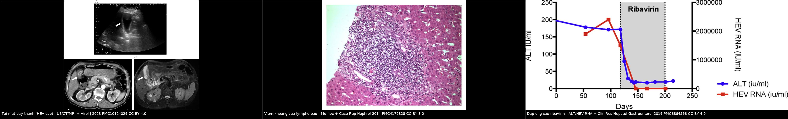
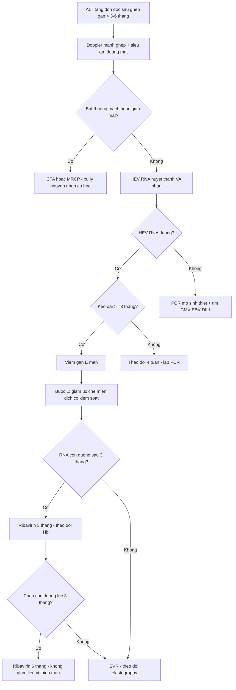
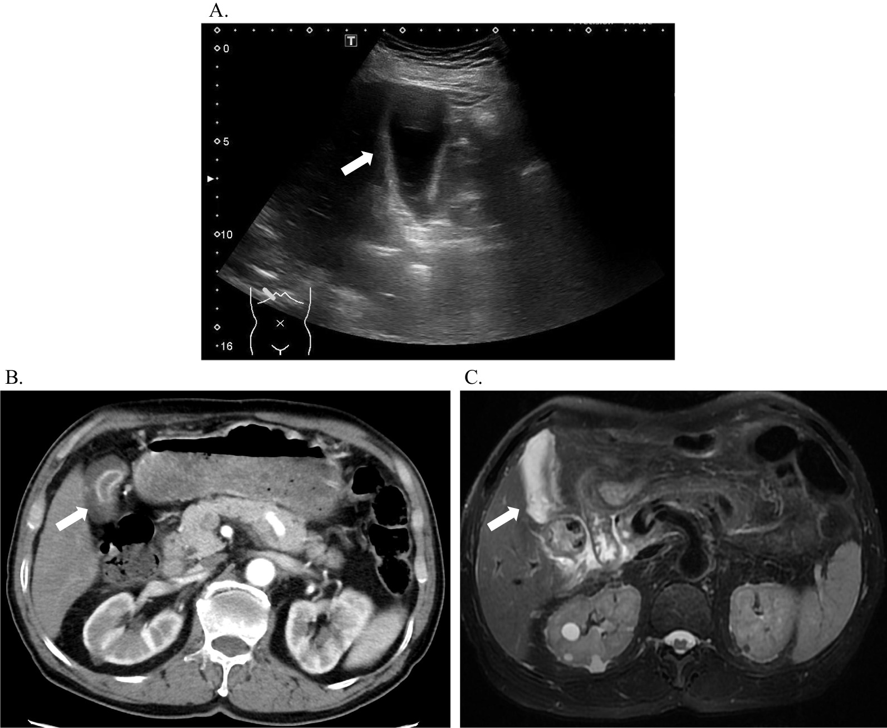
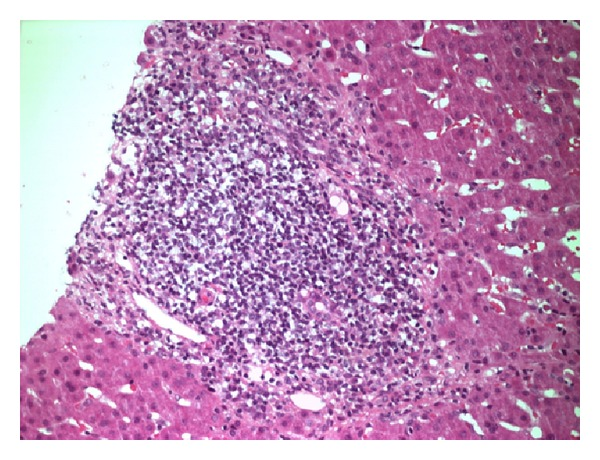
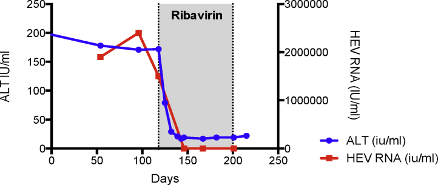

# 3150 — Viêm gan E mạn sau ghép gan ở trẻ: men gan tăng "không rõ nguyên nhân", HEV RNA trong PHÂN và ngưỡng ribavirin

**Tags:** `pattern:tang-transaminase` `pattern:viem-gan-sau-ghep` `pattern:gan-to` `pattern:day-thanh-tui-mat` `pattern:xo-gan` `pattern:giam-ngam-nhu-mo` `vung:gan` `vung:duong-mat` `vung:tui-mat` `protocol:HEV-RNA-mau-phan` `protocol:sieu-am-Doppler` `protocol:MRCP` `protocol:elastography` `protocol:sinh-thiet-gan` `score:HEV-RNA` `score:kPa` `incidentaloma:khong`

**Mức chắc chắn (certainty):** tổng hợp y văn (literature synthesis) — ghép **ba nguồn có ảnh, đều là người lớn** (Virol J 2023, PMC10124029; Case Rep Nephrol 2014, PMC4177828; Clin Res Hepatol Gastroenterol 2019, PMC6864596), **một phân tích gộp 582 bệnh nhân** (J Viral Hepat 2021, PMC7898834), **hai đoàn hệ trẻ ghép gan Pháp** (80 trẻ — PMID 31266724; 96 trẻ — PMID 26209371) và **ca nguyên văn nhi 13 tuổi** (J Clin Microbiol 2014, PMC4313334 — chỉ đọc phần tóm tắt, không có ảnh). Bài **không** có ca nguyên văn do nhóm tự chụp; các ca trong quiz là ca của nguồn, ghi rõ hình gốc.

> **Câu hỏi thực hành:** bé gái **11 tuổi**, ghép gan **3 năm** vì teo đường mật, **ALT 120–180 U/L** kéo dài **8 tháng**, **GGT bình thường**, không sốt, không vàng da. Siêu âm Doppler mảnh ghép: động mạch gan và tĩnh mạch cửa bình thường; **MRCP không giãn đường mật**; nồng độ tacrolimus trong đích. Bác sĩ điều trị định **tăng ức chế miễn dịch vì "thải ghép mạn"**. Câu hỏi: **có nên tăng không, và xét nghiệm nào còn thiếu?**
> Bài chốt **năm quyết định**: **(1) 60% người ghép tạng nhiễm HEV chuyển viêm gan mạn và 10% tiến tới xơ gan** — ca nguyên văn đi từ **ALT 94 U/L** tới **xơ gan có TE > 20 kPa trong 16 tháng**; **(2) chẩn đoán bằng HEV RNA trong HUYẾT THANH và PHÂN, không bằng huyết thanh học** (ba bộ kit cho IgG **12% / 38% / 53%** trên cùng nhóm người ức chế miễn dịch); **(3) giảm ức chế miễn dịch là bước 1** (sạch virus **32%**), **ribavirin là bước 2** (SVR gộp **78%**); **(4) tăng ức chế miễn dịch khi đang nhiễm HEV là sai hướng** — ca 13 tuổi được chẩn đoán sau nhiều đợt điều trị "thải ghép cấp"; **(5) ở trẻ ghép gan bệnh hiếm hơn người lớn ghép thận nhưng không bằng 0** — hai đoàn hệ trẻ Pháp không có ca mạn, nhưng ca nhi có thải ghép cấp kèm HEV mạn đã được báo cáo.

## 1. Tổng quan bệnh học – cơ chế hình ảnh: vì sao virus "im lặng" trên siêu âm mà vẫn phá gan

- **Bản chất virus:** HEV là **RNA virus** thuộc *Hepeviridae*; **Gt1–2 lây qua nước** (ổ dịch ở nước đang phát triển), **Gt3–4 lây từ động vật** (thịt lợn, tạng, thịt săn chưa nấu chín) — trẻ ghép tạng ở nước phát triển hầu như chỉ gặp **Gt3**, và ca Gt1 ở Ấn Độ là ngoại lệ đáng nhớ (Diagn Microbiol Infect Dis 2026, PMID 42880147).
- **Định nghĩa viêm gan E mạn:** **HEV RNA còn phát hiện được trong huyết thanh hoặc phân ≥ 3 tháng**. Ngưỡng thời gian này là mốc phân biệt "nhiễm cấp tự khỏi" với "nhiễm mạn cần điều trị" — trong bài là mốc để **không chờ thêm** (Clin Res Hepatol Gastroenterol 2019, PMC6864596).
- **Tần suất — bốn con số cần nhớ:**
  - **60%** người ghép tạng bị nhiễm HEV **chuyển thành viêm gan mạn**; **10%** toàn bộ người ghép tạng nhiễm HEV **tiến tới xơ gan** (PMC6864596).
  - Yếu tố nguy cơ chuyển mạn: **dùng tacrolimus** và **tạng được ghép là gan** — nghĩa là trẻ ghép gan nằm trong nhóm nguy cơ cao nhất về mặt cơ chế (PMC6864596).
  - **16 tháng** là khoảng cách từ lần đầu men gan bất thường tới **xơ gan xác nhận** trong ca nguyên văn (ghép tim–thận, ALT khởi đầu **94 U/L**, HEV RNA **> 2,4 × 10⁶ IU/mL**, TE **> 20 kPa** khi nhập khoa gan) — nhanh hơn nhiều so với viêm gan virus mạn ở người có miễn dịch bình thường (PMC6864596).
  - **Trẻ ghép gan:** đoàn hệ **80 trẻ** (Pháp, 2014–2016): **HEV IgG 8% (6/80)**, nhưng **30% (6/20)** ở nhóm từng có **đợt tăng transaminase không giải thích**; **không em nào HEV RNA dương** và **không có ca viêm gan mạn** (Clin Res Hepatol Gastroenterol 2020, PMID 31266724). Đoàn hệ **96 trẻ** (Lyon, 2010–2013): **8,3%** huyết thanh dương, **không ca mạn** (J Clin Virol 2015, PMID 26209371).
- **Vì sao trẻ ghép gan lại hiếm ca mạn hơn người lớn ghép thận:** trẻ được dùng **phác đồ ức chế miễn dịch nhẹ hơn** và phần lớn nhiễm HEV ở trẻ là **nhiễm cấp tự khỏi**; nhưng "hiếm" **không** đồng nghĩa "không có" — ca **13 tuổi** ghép gan có **ALT tăng tái diễn + thải ghép tế bào cấp** được xác định HEV mạn, và ca **Gt1 sau ghép gan từ người cho sống** kèm PTLD EBV đã được báo cáo năm 2026 (PMC4313334; PMID 42880147).
- **TẠI SAO ALT tăng từng đợt chứ không tăng liên tục — cơ chế miễn dịch:** HEV **không phá tế bào gan trực tiếp**; tổn thương do **phản ứng lympho T CD8 chống tế bào gan nhiễm virus**. Khi **mức ức chế miễn dịch dao động** (nhiễm trùng xen kẽ, giảm liều, nồng độ tacrolimus thay đổi), phản ứng viêm **bùng lên rồi lắng xuống** → ALT **dao động theo đợt**. Hệ quả thực hành: **một lần ALT bình thường giữa hai đợt không loại trừ nhiễm mạn**; phải nhìn **xu hướng nhiều tháng**.
- **TẠI SAO siêu âm/CT gần như luôn bình thường ở giai đoạn đầu:** tổn thương là **viêm khoảng cửa vi mô + xơ hóa dần**, không tạo phù nhu mô lan tỏa hay hoại tử ổ lớn. Siêu âm chỉ đổi khi đã có **xơ gan/loạn cấu trúc** (bờ gan không đều, đảo phổ, lách to, dịch cổ trướng); CT/MRI chỉ đổi khi có **thay đổi hình thái xơ gan**. Vì vậy **"siêu âm bình thường" là dữ kiện trung tính**, không phải bằng chứng loại trừ.
- **TẠI SAO elastography tăng nhưng không đặc hiệu:** độ cứng gan (**liver stiffness**) tăng do **xơ hóa**, nhưng cũng tăng do **viêm đang hoạt động** và **ứ mật/ứ máu**. Trong ca nguyên văn, **TE > 20 kPa** đi kèm xơ gan thật; ở trẻ đang viêm cấp, trị số có thể cao rồi **giảm sau khi virus được thanh thải** — nên dùng **xu hướng**, không dùng một ngưỡng tuyệt đối để chẩn đoán xơ gan.
- **TẠI SAO huyết thanh học không đáng tin ở người ức chế miễn dịch:** sản xuất kháng thể **IgM/IgG suy giảm**, hiệu giá thấp và xuất hiện muộn. Nghiên cứu so sánh **ba bộ kit** trên người ung thư đang điều trị: **IgG 12% (Euroimmun) / 38% (Wantai) / 53% (Elecsys)** — **đồng thuận kém** (kappa mức nhẹ–trung bình) (Antibodies 2025, PMC12015928). Ngoài ra **IgG truyền thụ động** qua IVIG/máu có thể dương giả: trong đoàn hệ 80 trẻ, **2/6 trẻ IgG dương đã nhận IVIG trước đó** và **4/6 âm lại** khi kiểm tra sau 3–42 tháng (PMID 31266724).
- **TẠI SAO PHÂN là mẫu bắt buộc:** HEV nhân lên ở **niêm mạc ruột non** rồi bài tiết **qua mật vào phân**; RNA trong phân có thể **tồn tại lâu hơn huyết thanh**. Trong loạt **36 ca ghép tạng** của một trung tâm, **25% thất bại điều trị đều tái phát với HEV còn trong phân tại tháng thứ 3**, và **mọi ca tái phát đều liên quan đến việc giảm liều ribavirin vì tác dụng phụ** (PMC6864596). Đây là lý do **không dừng ribavirin khi chỉ âm huyết thanh**.

## 2. Mẫu hình + chẩn đoán phân biệt theo thời điểm và theo kiểu men gan (Gamut)

- **Mẫu hình cốt lõi:** trẻ ghép gan **> 3–6 tháng**, **ALT tăng đơn độc hoặc ưu thế tế bào gan**, **GGT/ALP bình thường**, **không sốt, không vàng da**, **siêu âm Doppler + MRCP bình thường**, **không đáp ứng với tăng ức chế miễn dịch** (hoặc tái phát sau mỗi lần giảm liều).
- **Gamut theo thời điểm sau ghép:**
  1. **< 1 tháng:** biến chứng **kỹ thuật/mạch máu** (huyết khối động mạch gan, hẹp tĩnh mạch cửa), **thải ghép tối cấp**, **thiếu máu – bảo quản mảnh ghép**, **nhiễm khuẩn hậu phẫu**.
  2. **1–6 tháng:** **thải ghép tế bào cấp (TCMR)**, **thải ghép thể dịch**, **CMV/EBV**, **hẹp miệng nối đường mật**, **DILI** (kháng sinh, kháng nấm, thuốc chống thải ghép).
  3. **> 6 tháng:** **viêm gan E mạn**, **viêm gan tự miễn de novo**, **PTLD**, **tái phát bệnh gan gốc** (viêm gan B/C nếu có), **hẹp đường mật muộn**, **bệnh mạch ghép tiến triển**.
- **Gamut theo kiểu men gan (quyết định bước hình ảnh):**
  - **Tế bào gan (ALT > 2 × ULN, ALP/GGT bình thường):** HEV, TCMR, viêm gan tự miễn, DILI, CMV/EBV/adenovirus, thiếu máu cục bộ.
  - **Cholestatic (GGT/ALP ưu thế):** hẹp miệng nối đường mật, sỏi/ứ mật, **viêm túi mật không sỏi do HEV**, DILI.
  - **Hỗn hợp:** thải ghép + nhiễm trùng, hẹp mật + viêm gan.
- **Mnemonic "DAMN" cho trẻ ghép gan có men gan tăng:** **D**rug (DILI, thuốc chống thải ghép), **A**lloimmune (TCMR, thể dịch, tự miễn de novo), **M**icrobe (HEV, CMV, EBV, adenovirus), **N**eoplastic/Mechanical (PTLD, hẹp mật, biến chứng mạch). HEV nằm ở chữ **M** — nhưng là chữ **M** duy nhất **có điều trị đặc hiệu bằng ribavirin**.
- **Ba câu hỏi đọc ca:** **(1) men gan kiểu gì? (2) Doppler mảnh ghép và MRCP có bất thường không? (3) đã làm HEV RNA huyết thanh VÀ phân chưa?** Nếu (1) tế bào gan, (2) bình thường, (3) chưa → **câu trả lời nằm ở phòng xét nghiệm, không ở phòng siêu âm**.

## 3. Bảng so sánh phân biệt (ma trận đối chiếu)

| Thực thể (entity) | Hình ảnh / xét nghiệm điển hình | Chốt vào (rule-in) | Chốt loại (rule-out) | Gợi ý xác nhận |
|---|---|---|---|---|
| Viêm gan E mạn | Siêu âm/CT **bình thường** giai đoạn đầu; muộn: gan bờ không đều, lách to, **TE tăng**; mô học **viêm khoảng cửa lympho bào** | **HEV RNA (+) huyết thanh hoặc phân ≥ 3 tháng**; ALT dao động nhiều tháng; không có nguyên nhân khác | HEV RNA âm **cả huyết thanh và phân** ở 2 lần cách nhau ≥ 4 tuần → ít khả năng | RT-PCR huyết thanh + phân; nhuộm HEV/HMMD trong mô nếu sinh thiết |
| Thải ghép tế bào cấp (TCMR) | Siêu âm **bình thường** hoặc gan to, phù quanh cửa; **không khuyết thuốc** | **Sinh thiết: thâm nhiễm khoảng cửa + viêm ống mật + nội mô** (Banff); đáp ứng với corticoid/tăng ức chế miễn dịch | HEV RNA (+) hoặc sinh thiết không có tổn thương ống mật/nội mô → không phải TCMR đơn thuần | Sinh thiết + C4d/DSA nếu nghi thể dịch |
| Viêm gan tự miễn de novo | Gan to, phù quanh cửa; **không có tổn thương đường mật**; TE có thể tăng | **ANA/SMA dương, IgG tăng, sinh thiết có viêm mảng xơ hóa**, đáp ứng corticoid | HEV RNA (+), kháng thể âm, không đáp ứng corticoid | Sinh thiết + tự kháng thể; loại trừ virus trước khi tăng ức chế miễn dịch |
| DILI (kháng sinh, kháng nấm, thuốc chống thải ghép) | Siêu âm bình thường; có thể **dày thành túi mật**, gan to nhẹ | **Thời gian khớp thuốc mới**, eosinophilia, giảm sau ngừng thuốc | Virus (+) hoặc sinh thiết có viêm khoảng cửa không điển hình DILI | Ngừng thuốc nghi ngờ, theo dõi men gan 2–4 tuần |
| Hẹp miệng nối đường mật | **Giãn đường mật trong gan**, dày thành ống mật, **tắc mật** trên MRCP | **Giãn mật + chỗ hẹp trên MRCP**, cấy mật (+) nếu có can thiệp | MRCP không giãn, GGT bình thường → không phải nguyên nhân chính | MRCP; ERCP/PTC khi cần can thiệp |
| Viêm gan CMV / EBV / adenovirus | Siêu âm **bình thường** hoặc gan to; tổn thương **không đặc hiệu** | **PCR máu/mô (+)**, thể vùi trong sinh thiết, hóa mô miễn dịch (+) | PCR âm + không thể vùi → không phải | PCR định lượng; sinh thiết + IHC |
| Biến chứng mạch ghép (HAT, hẹp tĩnh mạch cửa) | **Mất phổ / tăng tốc tại miệng nối** trên Doppler; CTA khuyết thuốc | **Bất thường Doppler/CTA ở miệng nối**, thiếu máu nhu mô vùng | Doppler + CTA bình thường → loại trừ nguyên nhân mạch lớn | Doppler, CTA; đo gradient nếu hẹp |

*Trái: **viêm túi mật không sỏi** trong HEV cấp — siêu âm (a) thành túi mật dày (mũi tên trắng), CT (b) và MRI (c) xác nhận (Virol J 2023, PMC10124029, **CC BY 4.0**). Giữa: **mô học gan** — khoảng cửa thâm nhiễm lympho bào dày đặc, viêm bờ múi nhẹ (Case Rep Nephrol 2014, PMC4177828, **CC BY 3.0**). Phải: **ALT và HEV RNA** trước/trong/sau ribavirin (Clin Res Hepatol Gastroenterol 2019, PMC6864596, **CC BY 4.0**). Ba ảnh từ **ba bệnh nhân khác nhau**, không phải một ca; ảnh ghép letterbox, giữ nguyên khung và nhãn của tác giả.*

### Đọc kỹ ba mẫu hình
- **Dày thành túi mật không phải viêm túi mật do sỏi:** trong **114 ca HEV cấp**, **57,9%** có viêm túi mật không sỏi trên hình ảnh; nhóm này nằm viện **20,1 ± 9,4 ngày** so với **13,0 ± 7,3 ngày**, và **viêm phúc mạc nguyên phát 9,1% so với 0%** (Virol J 2023, PMC10124029). Đây là **dấu hiệu của bệnh nặng hơn**, không phải chỉ định cắt túi mật.
- **Viêm khoảng cửa lympho bào là hình thái chung, không phải chữ ký của HEV:** cùng mô học gặp ở TCMR, viêm gan tự miễn và DILI. Giá trị của sinh thiết là **loại trừ** và **lấy mô để PCR/IHC HEV**, không phải "nhìn ra HEV".
- **Đường cong ALT/HEV RNA sau ribavirin là bằng chứng đáp ứng:** cả hai giảm song song trong **2–3 tuần**; nếu ALT giảm mà **HEV RNA trong phân còn dương**, chưa được coi là khỏi.

## 4. Protocol chụp + ngưỡng xử trí

- **Bước 1 — Phân loại men gan và loại trừ nguyên nhân cấp cứu (ngày 0):**
  - ALT/ALP/GGT, bilirubin, INR, albumin; **doppler mảnh ghép** (động mạch gan: RI, phổ; tĩnh mạch cửa: vận tốc, hướng), **siêu âm đường mật**.
  - **Ngưỡng loại trừ mạch:** mất phổ động mạch gan hoặc tĩnh mạch cửa → **CTA cấp** (bài 1861/1909), không chờ.
  - **Ngưỡng loại trừ mật:** GGT/ALP tăng + giãn đường mật → **MRCP** (bài 3011/1909); không giãn + GGT bình thường → ưu tiên nguyên nhân nhu mô.
- **Bước 2 — Xét nghiệm HEV (bắt buộc, song song):**
  - **HEV RNA RT-PCR huyết thanh VÀ phân** — không thay bằng huyết thanh học. Nếu PCR âm nhưng nghi ngờ cao: **lặp lại sau 4 tuần**, và **PCR trên mô sinh thiết**.
  - **Huyết thanh học chỉ để tham khảo:** IgM/IgG **âm không loại trừ**; IgG **dương không xác nhận** (IVIG, kit khác nhau).
  - **Định nghĩa mạn:** RNA (+) **≥ 3 tháng** → chỉ định điều trị, không chờ thêm.
- **Bước 3 — Sinh thiết gan khi:** PCR âm mà ALT vẫn tăng, hoặc cần phân biệt TCMR/viêm gan tự miễn, hoặc trước khi tăng ức chế miễn dịch. Gửi mô làm **HEV RNA/IHC**, **CMV/EBV IHC**, **C4d**, **trichrome/Sirius red** đánh giá xơ hóa.
- **Bước 4 — Điều trị theo bậc (quan trọng: đừng đảo thứ tự):**
  1. **Giảm ức chế miễn dịch** có kiểm soát (hạ nồng độ đích tacrolimus, giảm/ngừng MMF nếu an toàn): sạch virus **32% (55/174)** trong phân tích gộp (J Viral Hepat 2021, PMC7898834). Theo dõi sát thải ghép.
  2. **Ribavirin** nếu còn RNA sau **3 tháng** giảm ức chế miễn dịch, hoặc có tổn thương gan đáng kể: **người lớn 600 mg/ngày**, **trẻ dùng liều theo cân nặng và chức năng thận**, **3 tháng**; SVR gộp **78% (95% CI 72–84)** trên **395 bệnh nhân**; **RVR 25%**, **tái phát 18%**, **thiếu máu 37%** dẫn tới giảm liều/truyền máu (PMC7898834).
  3. **Tái phát sau 3 tháng** → **ribavirin 6 tháng**: SVR **76% (39/51)** ở lần điều trị thứ hai (PMC7898834). **Không giảm liều ribavirin vì thiếu máu mà không có kế hoạch** — đây là nguyên nhân tái phát trong loạt 36 ca (PMC6864596) và là cơ chế chọn **đột biến kháng G1634R**.
  4. **Thất bại ribavirin** ở **người ghép gan**: cân nhắc **peg-IFN-α** (SVR 85% trong 13 ca) nhưng **thải ghép cấp 15% (2/13)** — **chống chỉ định ở ghép tim/phổi/thận/tụy** (PMC7898834). Các lựa chọn ít dữ liệu: sofosbuvir phối hợp, giảm ức chế miễn dịch sâu hơn.
- **Bước 5 — Theo dõi:**
  - **Hb mỗi 1–2 tuần** trong tháng đầu ribavirin (ngưỡng can thiệp theo trung tâm; thiếu máu là lý do giảm liều thường gặp).
  - **HEV RNA huyết thanh + phân** tại **tháng 3**, và **6 tháng sau khi ngừng** để xác định SVR. **Phân âm mới được coi là sạch** trước khi dừng thuốc.
  - **Elastography mỗi 6–12 tháng** sau khi virus âm: dùng **xu hướng kPa**, không chẩn đoán xơ gan bằng một lần đo khi còn viêm.
  - **Siêu âm Doppler mảnh ghép** theo lịch ghép gan định kỳ; **MRCP** chỉ khi GGT/ALP tăng hoặc có giãn mật.

## 5. Biến thể bình thường và cạm bẫy

- **Bẫy 1 — "Huyết thanh học âm là loại trừ":** ở người ức chế miễn dịch, **IgM/IgG âm vẫn có thể đang nhiễm**, và ba bộ kit cho ba tỷ lệ khác nhau (**12% / 38% / 53%**) (PMC12015928). Luôn làm **PCR**.
- **Bẫy 2 — IgG dương do truyền thụ động:** **2/6 trẻ IgG dương đã nhận IVIG** trước xét nghiệm và **4/6 âm lại** sau 3–42 tháng (PMID 31266724). Hỏi kỹ **truyền máu/IVIG trong 3 tháng** trước đó.
- **Bẫy 3 — ALT bình thường giữa các đợt:** dao động là bản chất của tổn thương qua miễn dịch; **một lần bình thường không loại trừ**, phải nhìn chuỗi nhiều tháng.
- **Bẫy 4 — Tăng ức chế miễn dịch khi đang nhiễm HEV:** ca **13 tuổi** được chẩn đoán HEV mạn sau **ALT tăng tái diễn và thải ghép tế bào cấp** — nghĩa là trước đó đã được điều trị như thải ghép (PMC4313334). Tăng ức chế miễn dịch làm **kéo dài tình trạng nhiễm** và đẩy nhanh xơ hóa.
- **Bẫy 5 — Dày thành túi mật bị đọc thành viêm túi mật/viêm đường mật:** gặp ở **57,9%** ca HEV cấp; không đặt stent, không cắt túi mật chỉ vì hình ảnh (PMC10124029).
- **Bẫy 6 — Elastography cao bị đọc thành xơ gan:** viêm đang hoạt động làm tăng độ cứng; đo lại sau khi virus âm. Ngược lại, TE **bình thường** không loại trừ xơ hóa sớm.
- **Bẫy 7 — Giảm liều ribavirin vì thiếu máu rồi coi là "thất bại điều trị":** **37%** bệnh nhân thiếu máu phải giảm liều/truyền máu; **25%** thất bại trong loạt 36 ca đều do giảm liều và đều còn virus trong phân tháng thứ 3 (PMC7898834; PMC6864596). Kế hoạch đúng: **theo dõi Hb, bù sắt/EPO, truyền máu nếu cần, giữ liều hiệu quả**, không tự hạ liều.
- **Bẫy 8 — Bỏ sót nhiễm Gt1 và đường lây khác:** trẻ sinh ở vùng dịch tễ hoặc có người cho từ vùng dịch tễ có thể nhiễm **Gt1** (ca 2026 ở Ấn Độ), không chỉ Gt3 từ thịt lợn (PMID 42880147).
- **Bẫy 9 — Không phân biệt "nhiễm cấp tự khỏi" với "nhiễm mạn":** thiếu mốc **3 tháng** dẫn tới điều trị sớm không cần thiết hoặc chờ quá lâu ở trẻ đã có xơ hóa.

## 6. Tự lượng giá — Blind Quiz

**Ca 1 — Trẻ ghép gan 3 năm, ALT 150 U/L, GGT bình thường, siêu âm bụng có hình dưới. Nhìn ảnh trước, mô tả sau.**

- Gợi ý: không đau hạ sườn phải, không sỏi trên siêu âm.
- Câu hỏi: Dấu hiệu chính là gì? Nó gợi ý chẩn đoán nào, và **hai việc không được làm** vì hình ảnh này?

<b>Bấm để hiện đáp án (findings + chẩn đoán)</b>

- Dấu hiệu: **thành túi mật dày rõ** trên siêu âm (a, mũi tên trắng); CT (b) và MRI (c) xác nhận **viêm túi mật không sỏi**. Trong HEV cấp, dấu hiệu này gặp **57,9% (66/114)**, đi kèm thời gian nằm viện dài hơn (**20,1 so với 13,0 ngày**) và **viêm phúc mạc nguyên phát 9,1% so với 0%**.
- Chẩn đoán: **viêm túi mật không sỏi do HEV** — dấu hiệu của bệnh nặng hơn, không phải bệnh túi mật nguyên phát.
- Hai việc không làm: **không cắt túi mật** và **không đặt stent/ERCP** chỉ vì dày thành túi mật khi không có sỏi/tắc mật; điều trị là **hỗ trợ + xử lý HEV**.
- Nguồn: Virol J 2023 (PMC10124029), CC BY 4.0. Ảnh từ **hai bệnh nhân khác nhau** trong bài gốc (a: ca 1; b, c: ca 2).

**Ca 2 — Cùng bệnh nhi, sinh thiết gan vì ALT tăng kéo dài. Nhìn ảnh trước, mô tả sau.**

- Câu hỏi: Mô học này **chẩn đoán được HEV không**? Nếu không, sinh thiết dùng để làm gì trong bệnh cảnh này?

<b>Bấm để hiện đáp án (findings + chẩn đoán)</b>

- Dấu hiệu: **khoảng cửa thâm nhiễm lympho bào dày đặc**, viêm bờ múi nhẹ; thấy **tĩnh mạch cửa, động mạch gan và ống mật** trong thâm nhiễm (H&E, ×20).
- Trả lời: **không chẩn đoán được HEV bằng hình thái** — cùng kiểu thâm nhiễm gặp ở TCMR, viêm gan tự miễn, DILI. Sinh thiết dùng để **(1) loại trừ thải ghép/tự miễn**, **(2) lấy mô làm HEV RNA/IHC**, **(3) đánh giá xơ hóa** (trichrome/Sirius red).
- Nguồn: Case Rep Nephrol 2014 (PMC4177828), CC BY 3.0 — bệnh nhân **ghép thận**, không phải trẻ ghép gan; dùng làm ví dụ hình thái.

**Ca 3 — Bệnh nhân HEV mạn, HEV RNA 2,4 × 10⁶ IU/mL, bắt đầu ribavirin. Nhìn biểu đồ trước, mô tả sau.**

- Câu hỏi: Hai đường biểu diễn là gì? Vì sao **không được dừng ribavirin ngay khi ALT về bình thường**?

<b>Bấm để hiện đáp án (findings + chẩn đoán)</b>

- Dấu hiệu: **ALT (xanh)** và **HEV RNA (đỏ)** cùng giảm sâu trong **2–3 tuần** sau khi bắt đầu ribavirin; ALT về **~20 U/L**, HEV RNA về **0**.
- Vì sao không dừng sớm: **ALT bình thường không đồng nghĩa hết virus trong phân**; HEV còn trong phân lúc **3 tháng** dự báo tái phát, và **25% ca thất bại** trong loạt 36 ca đều do **giảm liều ribavirin** vì thiếu máu. Phải đủ **3 tháng** và **âm cả huyết thanh lẫn phân** rồi mới xét dừng; tái phát → **6 tháng**.
- Nguồn: Clin Res Hepatol Gastroenterol 2019 (PMC6864596), CC BY 4.0.

## Bài liên quan chéo
- [1945 – Viêm gan tự miễn de novo sau ghép gan ở trẻ](../1945-viem-gan-tu-mien-de-novo-sau-ghep-gan-tre/lesson.md) (đối thủ chính của HEV khi ALT tăng đơn độc)
- [1916 – Thải ghép tế bào cấp sau ghép gan](../1916-thai-ghep-cap-te-bao-sau-ghep-gan/lesson.md) (bẫy "tăng ức chế miễn dịch")
- [1917 – Thải ghép thể dịch sau ghép gan](../1917-thai-ghep-the-dich-sau-ghep-gan/lesson.md) (DSA, C4d)
- [1918 – Nhiễm CMV sau ghép gan ở trẻ](../1918-nhiem-cmv-sau-ghep-gan-o-tre/lesson.md) (cùng kiểu "men gan tăng, hình ảnh bình thường")
- [1933 – Viêm gan adenovirus sau ghép gan ở trẻ](../1933-viem-gan-adenovirus-sau-ghep-gan-o-tre/lesson.md) (virus khác, cùng khung chẩn đoán)
- [1909 – Hẹp tĩnh mạch cửa sau ghép gan](../1909-hep-tinh-mach-cua-sau-ghep-gan/lesson.md) (loại trừ nguyên nhân mạch)
- [3011 – Biến chứng niệu quản sau ghép thận](../3011-bien-chung-nieu-quan-sau-ghep-than/lesson.md) (khung "biến chứng muộn sau ghép" — chỉ tham khảo cách lập luận)

## Ảnh
- `images/3150_hev_day-thanh-tui-mat_US-CT-MRI_PMC10124029.jpg` — siêu âm + CT + MRI túi mật trong HEV cấp, Virol J 2023 (PMC10124029), **CC BY 4.0**.
- `images/3150_hev_viem-khoang-cua_Mo-hoc_PMC4177828.jpg` — mô học gan, Case Rep Nephrol 2014 (PMC4177828), **CC BY 3.0**.
- `images/3150_hev_dap-ung-ribavirin_Bieu-do_PMC6864596.jpg` — ALT/HEV RNA trước–trong–sau ribavirin, Clin Res Hepatol Gastroenterol 2019 (PMC6864596), **CC BY 4.0**.
- `images/composite_hev-sau-ghep-gan.jpg` — ảnh ghép letterbox 3 ảnh trên, **CC BY 4.0 / CC BY 3.0** theo từng ô.
- Nguồn, giấy phép và ghi chú phái sinh từng ảnh: `images/CREDITS.md`.

> Không dùng để chẩn đoán độc lập khi chưa có người hướng dẫn.
