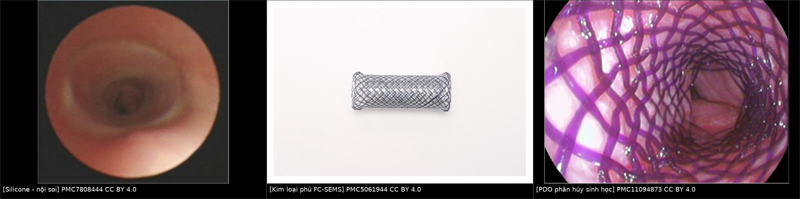
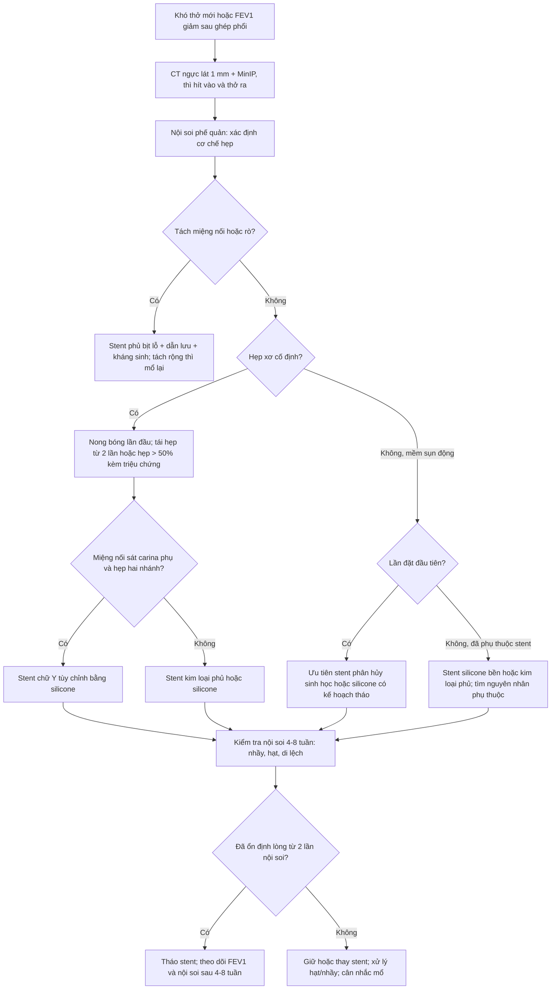
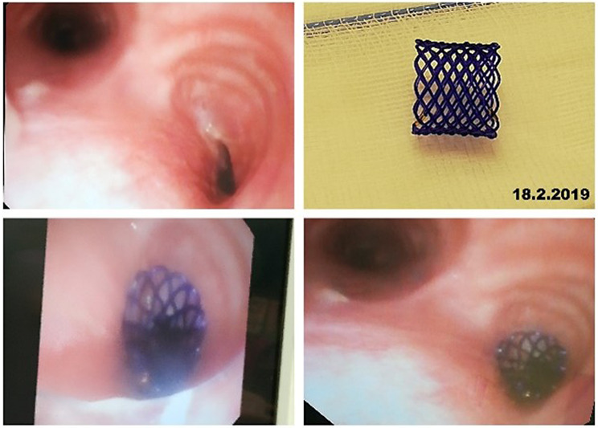
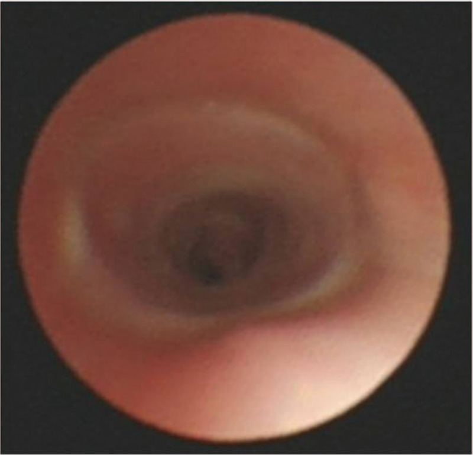
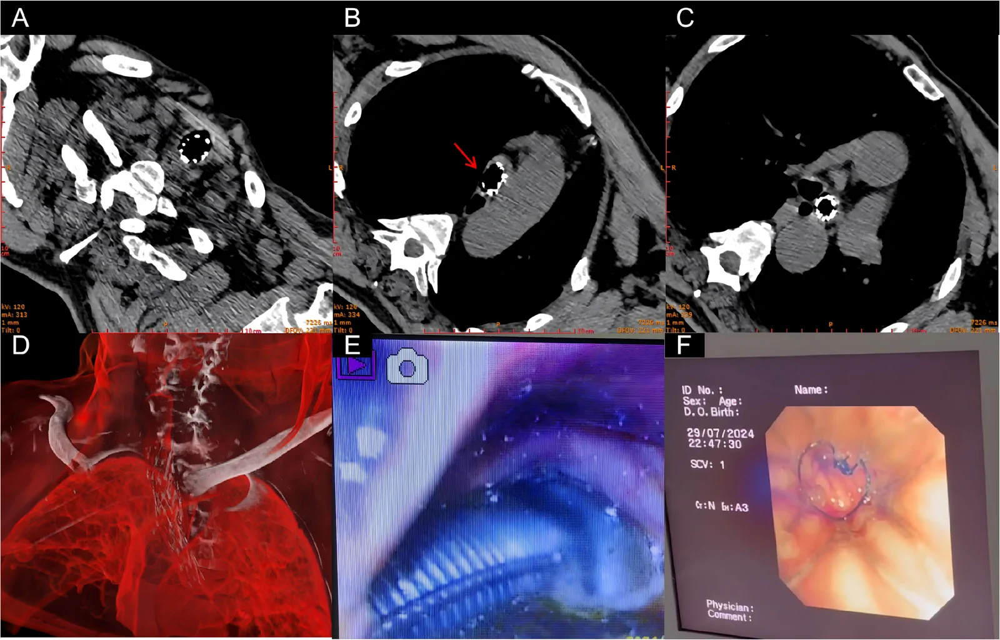

# 3151 — Stent đường thở sau ghép phổi: chọn loại nào và khi nào tháo / Airway stent selection and removal after lung transplantation

**Tags:** `pattern:hep-duong-tho` `pattern:stent-duong-tho` `pattern:hoa-hat` `pattern:di-lech-stent` `pattern:mat-phang-khi` `vung:phe-quan` `vung:khi-quan` `vung:duong-tho` `vung:phoi` `protocol:CT-nguc-lat-mong` `protocol:noi-soi-phe-quan` `score:ISHLT-airway`

**Mức chắc chắn (certainty):** tổng hợp y văn (literature synthesis) — số liệu từ đoàn hệ ghép phổi 12 năm **1.170 ca** (PMC10395170), loạt stent silicone sau ghép **17/117 ca** (PMID 20133161), loạt **376 stent kim loại phủ** ở người ghép (PMC9264061), phân tích gộp Dumon **395 bệnh nhân** (PMC7867818), hai loạt stent phân hủy sinh học **57 stent/12 ca** (PMID 38486062) và **65 stent/47 ca** (PMC11094873), cùng tổng quan biến chứng đường thở 2024–2025 (PMID 39166423, PMID 41076777). Nhóm **không có bệnh nhân của mình**.

> **Câu chốt:** stent đường thở sau ghép phổi **không phải "ống thông để mở đường thở"** mà là **vật lạ có thời hạn**: nó chống sập bằng lực hướng tâm, nhưng đồng thời **chặn hệ thống nhầy – lông chuyển, ép niêm mạc và kích thích mô hạt**. Vì vậy mọi quyết định stent phải trả lời **ba câu cùng lúc**: **(1) cơ chế hẹp là gì** (xơ cố định, mềm sụn động, tách miệng nối) — vì cơ chế quyết định loại stent; **(2) stent là cầu hay là đích** — nếu là cầu thì **phải có kế hoạch tháo ngay từ lúc đặt**; **(3) ống soi nào đặt được** — silicone và stent phân hủy sinh học cần **nội soi ống cứng**, stent kim loại phủ có thể đặt qua ống mềm. Ba con số neo: biến chứng đường thở sau ghép **2–18%**, tử vong **2–4%**; hẹp miệng nối có triệu chứng **23,7%**; stent **không sửa được nguyên nhân** — nó chỉ giữ lòng cho tới khi quá trình lành/xơ ổn định.

## 1. Tổng quan bệnh học – cơ chế hình ảnh

### 1.1 Vì sao đường thở sau ghép cần stent — và vì sao stent lại gây bệnh

- **Nền bệnh:** miệng nối phế quản **không có nguồn động mạch phế quản**; sống nhờ **dòng ngược từ tuần hoàn phổi** cho tới khi tân mạch hình thành (**~6 tuần**). Trình tự: **thiếu máu → hoại tử/tách (tháng 1) → tổ chức hạt → xơ hẹp (2–3 tháng) → mềm sụn (< 4 tháng)**. Vì thế stent được đặt **muộn**, trung bình **165 ngày** (5–360 ngày) sau ghép trong loạt silicone (PMID 20133161).
- **Cơ chế cơ học của stent:** stent tạo **lực hướng tâm** chống sập. Áp lực lên niêm mạc tỉ lệ với **độ "quá cỡ" của stent** (đường kính stent − đường kính lòng thật) và **độ cứng của vật liệu**: stent quá lớn → **thiếu máu niêm mạc → loét → mô hạt → hẹp lại đúng chỗ đặt stent**. Đây là lý do **"hẹp do stent"** là biến chứng riêng, không phải thất bại của kỹ thuật.
- **TẠI SAO stent làm ứ nhầy:** hệ **nhầy – lông chuyển** cần bề mặt niêm mạc liên tục; stent thay một đoạn bằng **silicone hoặc màng polyurethane** → không có lông chuyển, **nhầy ứ tại chỗ nối và trong lòng stent**. Trong loạt **376 stent kim loại phủ** ở người ghép, **nút nhầy là biến chứng thường gặp nhất: 193 stent**, trên tổng **15.711 stent-ngày** (PMC9264061); với Dumon, ứ nhầy **23,82%** (KTC 95% 13,77–41,20) (PMC7867818).
- **TẠI SAO vật liệu quyết định số phận stent:**
  - **Silicone (Dumon):** đàn hồi, **không bị niêm mạc "nuốt"**, tháo được — nhưng **thành dày** (chiếm lòng), **đặt cần ống cứng**, và **bám kém** → di lệch. Phân tích gộp 395 bệnh nhân: **di lệch 25,04%**, **mô hạt 15,66%**, **ứ nhầy 23,82%**; ổn định lâu dài chỉ **41,12%** (PMC7867818).
  - **Kim loại phủ (fully covered SEMS):** lưới nitinol mỏng + màng phủ → **lòng trong lớn hơn** cùng đường kính ngoài, đặt qua ống mềm; màng phủ **ngăn niêm mạc mọc xuyên** nên **tháo được**. Nhưng lực hướng tâm tập trung ở các sợi lưới, **màng trơn** → di lệch; và **không phủ → niêm mạc mọc xuyên, không tháo được** (đây là lý do **FDA cảnh báo 2005** với stent kim loại trong bệnh lành tính; PMID 38529714).
  - **Phân hủy sinh học (biodegradable, PDO — polydioxanone):** liên kết ester **thủy phân theo thời gian** → mất lực đỡ dần rồi tiêu; **không cần lần tháo thứ hai**. Loạt Hà Lan: tuổi thọ trung vị **112 ngày** (66–202) (PMID 38486062); loạt Praha: hiệu quả đỡ lòng trong **2 tháng đầu 66,7%** (26/39), hiệu quả lâm sàng **89,7%**, nhưng **mô hạt 23,1%**, **di lệch 7,5%**, **ứ nhầy 2,6%** (PMC11094873).
  - **Stent chữ Y / tại carina phụ:** miệng nối sau ghép thường **sát carina phụ** (phế quản người cho cắt ngắn) → stent thẳng không che được cả hai nhánh; stent chữ Y tùy chỉnh giải quyết, nhưng **khó đặt, khó tháo, dễ ứ nhầy**.
- **TẠI SAO "thời hạn" là trọng tâm:** stent là **vật lạ tạm thời** đặt vào đường thở **đang lành**. Nếu để lâu, mỗi tuần thêm đều tăng **mô hạt, nhiễm, di lệch**. Loạt Hà Lan cho thấy khác biệt rõ: **6/6 bệnh nhân chưa từng đặt stent thường → thoát stent hoàn toàn**, trong khi **6/6 bệnh nhân đã đặt stent thường trước đó → vẫn phụ thuộc stent** cuối theo dõi (PMID 38486062) — gợi ý **thứ tự lựa chọn quan trọng hơn việc "đặt đúng kỹ thuật"**.

### 1.2 Vật lý hình ảnh: CT thấy gì và tại sao phải đo bên trong stent

- **Kim loại trên CT:** nitinol có **HU rất cao** → **hiện vệt sáng (streak)** và **che lòng stent** ở lát dày; phải đọc **lát mỏng ≤ 1 mm** và **cửa sổ phổi** để thấy lòng trong, **cửa sổ trung thất** để thấy thành/khí ngoài lòng.
- **Silicone:** cản quang **yếu/không cản quang** → trên CT có thể **chỉ thấy vòng thành dày giảm đậm độ**, dễ bị đọc là "thành phế quản dày"; đối chiếu **nội soi** là bắt buộc.
- **Stent phân hủy sinh học:** PDO **gần như không cản quang**; trên CT chỉ thấy **lòng được nong** và có thể thấy **mảnh vụn** khi phân hủy — không thấy "khung" như nitinol.
- **Đo đúng:** diện tích lòng phải đo **bên trong stent** và **ngay trên/dưới hai đầu stent**, vì **mô hạt mọc ở đầu stent** là nơi hẹp tái phát; đo ở lát **vuông góc trục đường thở**, không đo trên mặt phẳng chéo.
- **Mềm sụn động:** chỉ lộ khi **thở ra**; CT một thì hít vào có thể báo "bình thường". Vì vậy protocol nghi mềm sụn **phải có thì thở ra** (kỹ thuật lấy từ bài 023, PMC11067284).

### 1.3 Ngưỡng định lượng cần nhớ

| Đại lượng | Số liệu | Nguồn |
|---|---|---|
| Biến chứng đường thở sau ghép | **2–18%**, tử vong **2–4%** | PMID 41076777 |
| OAC (biến chứng tắc nghẽn) trong 1.170 ca ghép | **11,5%**; hai bên **4,4%**; **80%** ca hai bên được stent | PMC10395170 |
| Sống mảnh ghép khi OAC hai bên | **63% / 50%** ở 3/5 năm so với **83% / 73%** | PMC10395170 |
| Hẹp miệng nối có triệu chứng | **23,7%**; tách **2,5%**; SAC **26,5%** | PMC9340386 |
| Stent silicone sau ghép: tháo thành công | **16/23 (69,5%)**, stent lưu trung bình **266 ngày** | PMID 20133161 |
| Stent kim loại phủ sau ghép | **376 stent / 50 bn / 15.711 stent-ngày**; **2** biến chứng nặng | PMC9264061 |
| Stent phân hủy sinh học | tuổi thọ **112 ngày**; **5/57** cần nội soi thêm | PMID 38486062 |
| Stent chữ Y tùy chỉnh | **32/400 (8%)** cần stent; **15 (3,5%)** chữ Y; **78,6%** tháo được | PMID 35490670 |
| Stent silicone xuyên dây thanh | hạt **18%**, di lệch **12%**, hít sặc **29%** | PMID 29621756 |

## 2. Mẫu hình + chẩn đoán phân biệt theo vị trí (gamut)

### 2.1 Gamut theo **cơ chế** cần stent (quyết định loại stent)

- **Hẹp xơ cố định tại miệng nối** — hẹp không đổi giữa hít vào/thở ra, thành dày, thường **2–3 tháng** sau ghép. Điều trị đầu tay là **nong bóng**; stent khi **tái hẹp sau ≥ 2 lần nong** hoặc hẹp > 50% diện tích kèm triệu chứng.
- **Mềm sụn động (malacia)** — thành trước sa vào khi thở ra, **giảm > 50% diện tích khi thở ra**; nong bóng **thất bại**, stent là chính. Đây là nhóm **hay phụ thuộc stent nhất**.
- **Tách miệng nối / rò** — khí ngoài lòng, bờ phế quản mất liên tục, **tháng đầu**; cần **stent phủ** để bịt + dẫn lưu, và **mổ lại** nếu tách rộng.
- **Tắc do mô hạt** — khối trong lòng, thành không hẹp; điều trị **cắt đốt/laser** trước, stent chỉ khi hẹp tái diễn.
- **Hẹp do chèn ép ngoài lòng** — khối/hạch/tái phát u; stent **chỉ giữ lòng tạm**, phải điều trị nguyên nhân.
- **Hẹp lan / "phế quản biến mất" (VBIS)** — xơ lan > 2 cm; stent thẳng thường không đủ, cân nhắc **stent chữ Y** hoặc **mổ**.

### 2.2 Gamut theo **biến chứng của stent** (khi bệnh nhân đã có stent)

- **Ứ nhầy/nút nhầy** — thường gặp nhất (**193/376 stent**; PMC9264061); biểu hiện **khó thở đột ngột, giảm FEV₁**, trên CT **tắc lòng trong stent**.
- **Mô hạt ở hai đầu stent** — **131/376 stent** (PMC9264061); hẹp **ngay tại đầu stent**, dễ nhầm tái phát bệnh nền.
- **Di lệch** — **51/376 stent**; stent trượt xuống dưới chỗ hẹp, hoặc lên trên vào khí quản; trên CT **đầu stent không còn ngang mức hẹp**.
- **Gãy stent** — **15/376**, nhiều hơn với Bonastent (p = 0,04) (PMC9264061).
- **Chảy máu/ăn mòn** — **5/376**; nghi ngờ khi **ho máu + đau ngực + khí ngoài lòng**.
- **Nhiễm stent/biofilm** — *P. aeruginosa*, *S. aureus*, *K. pneumoniae*; **không đồng nghĩa nhiễm lâm sàng** nhưng làm tăng mô hạt và mùi (PMC13190032).
- **Phụ thuộc stent** — không cai được sau nhiều lần thay; thường ở nhóm **đã đặt stent thường trước đó** (PMID 38486062).

## 3. Bảng so sánh phân biệt (ma trận đối chiếu)

| Thực thể (entity) | Hình ảnh/đặc điểm điển hình | Chốt vào (rule-in) | Chốt loại (rule-out) | Gợi ý xác nhận |
|---|---|---|---|---|
| **Stent silicone thẳng (Dumon)** | Vòng silicone thành dày, **đầu stent rõ**, đặt qua ống cứng; trên CT cản quang yếu | **Cần tháo chắc chắn** (hẹp lành tính, đang viêm) + lòng đủ rộng cho thành stent | Lòng phế quản **< đường kính ngoài tối thiểu** của stent → chọn loại khác | Nội soi ống cứng; kiểm tra đầu stent mỗi 4–8 tuần |
| **Stent kim loại phủ (FC-SEMS)** | Lưới nitinol + màng, **thành mỏng**, lòng trong lớn; đặt qua ống mềm | **Cần lòng lớn tối đa** + đặt nhanh + dự kiến tháo trong vài tuần–tháng | Hẹp **sát carina phụ** cần che hai nhánh → chữ Y; **màng trơn ở đoạn thẳng đứng** → di lệch | Nội soi/CT: kiểm tra **đầu stent**; tháo trước khi mô hạt bám |
| **Stent kim loại KHÔNG phủ** | Lưới trần, niêm mạc mọc xuyên | Chỉ **malignancy** hoặc đường thở **không tháo được** | **Bệnh lành tính sau ghép** → không dùng (FDA 2005) | Nội soi: niêm mạc phủ kín sợi lưới = không tháo được |
| **Stent phân hủy sinh học (PDO)** | Không cản quang; nong lòng; **tự tiêu sau ~3–4 tháng** | **Lần đặt đầu tiên**, hẹp/mềm sụn khu trú, muốn tránh lần tháo | Cần **lực đỡ > 4–6 tháng** hoặc hẹp **rất cứng, dài** → dùng silicone/SEMS | Nội soi 1–2 tháng; theo dõi **mảnh vụn** khi tiêu |
| **Stent chữ Y tùy chỉnh** | Hai nhánh vào phế quản thùy + thân ở carina phụ | Miệng nối **sát carina phụ**, hẹp **cả hai nhánh** | Tổn thương **một nhánh đơn thuần** → stent thẳng đủ | Nội soi + CT 3D đường thở |
| **Nong bóng đơn thuần (không stent)** | Lòng mở ngay sau nong, không vật lạ | **Hẹp mềm, lần đầu**, hẹp < 50% và triệu chứng nhẹ | **Tái hẹp ≥ 2 lần** hoặc mềm sụn động → cần stent | Nội soi kiểm tra 2–4 tuần |
| **Hẹp do mô hạt trong stent** | Khối trong lòng **tại đầu stent**, thành ngoài bình thường | **Hẹp đúng vị trí đầu stent** + tiền sử đặt stent | Hẹp **lan ra ngoài stent** → bệnh nền/tái phát | Nội soi + cắt đốt; CT so sánh |

*Trái: stent silicone trong khí quản, xác nhận vị trí bằng nội soi mềm (PMC7808444, CC BY 4.0). Giữa: stent kim loại tự bung phủ toàn bộ (FC-SEMS) — lòng trong lớn, thành mỏng (PMC5061944, CC BY 4.0). Phải: stent phân hủy sinh học PDO ngay sau khi đặt trong khí quản (PMC11094873, CC BY 4.0). Ảnh ghép letterbox, không crop.*

## 4. Protocol chụp + hệ phân độ/điểm chuẩn hóa

### 4.1 Protocol hình ảnh trước và sau đặt stent

- **CT ngực lát mỏng ≤ 1 mm**, tái tạo **MinIP 2–5 mm** theo trục đường thở; **thì hít vào tối đa + thở ra tối đa** khi nghi **mềm sụn** hoặc hẹp động.
- Đọc **hai cửa sổ**: phổi (lòng, ứ nhầy, xẹp, giãn phế quản đầu xa) và trung thất (thành, khí ngoài lòng, hạch, mạch).
- **Đo**: diện tích lòng **bên trong stent**, **ngay trên và dưới hai đầu stent**; báo **% giảm diện tích** so với đoạn lành; ghi **khoảng cách từ miệng nối tới carina phụ** (quyết định stent thẳng hay chữ Y).
- **Nội soi phế quản** là chuẩn xác nhận **và** là cửa điều trị: đánh giá **loại hẹp (xơ/mềm sụn/hạt)**, **độ dài**, **vị trí so với miệng nối và carina**, **tình trạng niêm mạc** (đang viêm/hoại tử).
- **Trước khi đặt stent**: cấy/rửa phế quản (nhiễm hoạt động làm tăng mô hạt và nhiễm stent), **PFT/FEV₁** làm mốc, **đông máu**, và **kế hoạch tháo** ghi rõ trong hồ sơ.

### 4.2 Chọn stent theo cơ chế — thuật toán thực hành

- **Nguyên tắc chọn:** **cơ chế hẹp** > **kích thước lòng** > **khả năng tháo** > **sở thích của trung tâm**. Các bài tổng quan **không đưa ra một ngưỡng đường kính thống nhất** cho từng loại stent (chưa rõ) — chọn theo **đường kính lòng lành trên CT**, cỡ stent của nhà sản xuất và **kinh nghiệm nội soi**.
- **Silicone vs kim loại phủ:** silicone **tháo chắc chắn, rẻ, không bị niêm mạc nuốt**, nhưng **thành dày + cần ống cứng + di lệch 25%**; kim loại phủ **lòng lớn, đặt mềm**, nhưng **màng trơn → di lệch**, **mô hạt**, và **gãy** (PMC9264061, PMC7867818).
- **Phân hủy sinh học:** chọn khi **muốn tránh lần tháo thứ hai** và **không cần lực đỡ quá 4–6 tháng**; nhớ rằng stent **mất lực đỡ dần** — **không dùng cho hẹp rất cứng, dài, hoặc đường thở đang nhiễm nặng** (PMID 38486062, PMC11094873).
- **Thời điểm tháo — không có một con số chung:**
  - **PDO**: tự tiêu; tuổi thọ trung vị **112 ngày**, hiệu quả đỡ lòng rõ nhất **2 tháng đầu** (PMID 38486062, PMC11094873).
  - **Silicone**: trong loạt ghép phổi, lưu trung bình **266 ngày**, tháo thành công **69,5%** khi hẹp đã ổn định (PMID 20133161).
  - **Kim loại phủ**: trong loạt 376 stent, thời gian tới tháo **khác nhau theo loại** (trung vị **17–26 ngày** ở các loại hay dùng) (PMC9264061) — phần lớn đóng vai trò **cầu tạm**, không phải stent vĩnh viễn.
  - **Tiêu chuẩn tháo thực hành:** lòng **ổn định trên 2 lần nội soi cách nhau ≥ 4 tuần**, **FEV₁ không giảm khi thử bịt/tháo**, không còn **mô hạt hoạt động**; nếu thất bại → đặt lại (chưa có chuẩn quốc tế, ghi rõ là **khác biệt thực hành**).

### 4.3 Hệ phân độ ISHLT 2018 (dùng chung với bài 023)

- Phân độ **I (thiếu máu/hoại tử) – D (tách) – S (hẹp) – M (mềm sụn)** × vị trí **a/b/c** × mức độ **a–d**; **hẹp > 50% diện tích (S-c)** là ngưỡng thực hành để xem xét can thiệp, **tắc hoàn toàn (S-d)** là cấp cứu (PMC13279507 — chi tiết ở bài 023).
- Hệ này **chuẩn hóa báo cáo**, không thay thế quyết định lâm sàng: chỉ **41,2%** quốc gia dùng ở **100% trung tâm**, **59,6%** muốn sửa (PMC13279507).

## 5. Biến thể bình thường và cạm bẫy

- **"Hẹp nhẹ sau nong" là bình thường:** giảm **0–25%** diện tích ngay sau nong/stent do **phù niêm mạc**; đừng đặt thêm stent — chụp/nội soi lại sau **2–4 tuần**.
- **Đầu stent hơi nhô vào lòng** không phải di lệch: kiểm tra **so với vị trí lúc đặt** (phim/nội soi cũ); chỉ gọi di lệch khi **đầu stent lệch khỏi đoạn hẹp** hoặc **gây tắc**.
- **Nút nhầy giả hẹp:** khối đậm độ mô mềm **trong lòng stent**, thành không dày; hẹp thật có **thành dày + hẹp cố định**. Hút/nội soi rồi chụp lại trước khi kết luận "hẹp tái phát".
- **Mô hạt ở đầu stent giả "tái phát bệnh nền":** hẹp **đúng hai đầu stent**, lan ra ngoài ít; tái phát bệnh nền thường **lan dọc > 2 cm** hoặc có **nốt/nhiễm**.
- **Bỏ sót mềm sụn vì chỉ chụp hít vào:** hẹp động chỉ lộ khi **thở ra**; luôn chụp **hai thì** khi nghi.
- **Đo lòng trên lát dày có kim loại:** vệt sáng của nitinol **che lòng** → dùng **lát ≤ 1 mm**, cửa sổ phổi, tái tạo vuông góc trục.
- **Stent silicone quá lớn ở phế quản nhỏ:** thành dày + đường kính ngoài lớn → **bít lòng còn lại**; ở **phổi ghép thùy** (đường thở nhỏ) ưu tiên **kim loại phủ mỏng hoặc PDO**.
- **Đặt stent khi đang nhiễm hoạt động:** tăng **mô hạt, nhiễm stent, di lệch**; điều trị nhiễm trước, stent chỉ khi **tắc nghẽn đe dọa tính mạng**.
- **Không tháo được stent kim loại không phủ:** niêm mạc mọc xuyên lưới → tháo gây **rách/ chảy máu**; đây là lý do **không dùng stent không phủ cho bệnh lành tính** (FDA 2005; PMID 38529714, PMC4530858).
- **Mảnh PDO khi phân hủy:** có thể **ho ra mảnh stent** hoặc **mảnh gây tắc tạm**; trên CT không thấy khung → đừng kết luận "stent đã mất" khi chưa nội soi (PMC11094873).

## 6. Tự lượng giá — Blind Quiz

**Ca 1 — Khó thở tiến triển sau ghép phổi thùy**

- Gợi ý lâm sàng: bệnh nhân ghép phổi thùy, vài tháng sau mổ khó thở tăng, FEV₁ giảm; nội soi phế quản phải.
- Câu hỏi: (1) Tổn thương nằm ở đâu? (2) Vật trong lòng là gì, và vì sao chọn loại này? (3) Hai biến chứng cần theo dõi nhất?

<b>Bấm để hiện đáp án (findings + chẩn đoán)</b>

- Dấu hiệu: **hẹp phế quản phải tại/vùng miệng nối**, lòng bị xơ co kéo; trong lòng có **stent phân hủy sinh học (PDO)** — không phải lưới kim loại, bề mặt trắng đục, đầu stent mềm.
- Chẩn đoán: **hẹp phế quản sau ghép phổi được đặt stent phân hủy sinh học**. Chọn PDO vì đường thở nhỏ (ghép thùy) và **muốn tránh lần tháo thứ hai**; stent tự tiêu trong ~3–4 tháng.
- Theo dõi: **ứ nhầy** và **mô hạt/hẹp lại khi stent tiêu**; cần nội soi định kỳ và sẵn sàng đặt lại.
- Nguồn ảnh: *J Cardiothorac Surg* 2025 (PMC11776313), Fig. 4, **CC BY-NC-ND 4.0** — nguyên bản, không crop.

**Ca 2 — Trẻ có stent silicone khí quản**

- Gợi ý lâm sàng: trẻ được đặt stent silicone qua nội soi ống cứng vì hẹp khí quản trung tâm; kiểm tra sau thủ thuật.
- Câu hỏi: (1) Cấu trúc trong lòng là gì? (2) Vị trí stent so với tổn thương? (3) Biến chứng nào hay gặp ở **đầu dưới** stent?

<b>Bấm để hiện đáp án (findings + chẩn đoán)</b>

- Dấu hiệu: **stent silicone hình trụ**, thành dày, lòng trong trơn; hai đầu stent nằm **trên và dưới đoạn hẹp**, không che lỗ phế quản bên.
- Chẩn đoán: **stent silicone khí quản đúng vị trí**. Silicone được chọn vì cần **tháo chắc chắn** và mô đang viêm.
- Biến chứng hay gặp: **mô hạt ở đầu dưới stent** (và ứ nhầy) — trong loạt này hạt tăng dần qua các lần theo dõi 1–6 tháng.
- Nguồn ảnh: *Medicine* 2021 (PMC7808444), Hình 2, **CC BY 4.0** — nguyên bản, không crop.

**Ca 3 — CT ngực ở bệnh nhân có stent khí quản, khó thở cấp**

- Gợi ý lâm sàng: bệnh nhân viêm sụn tái phát, đã đặt stent khí quản, nhập viện vì khó thở; CT được chụp cấp.
- Câu hỏi: (1) Stent nằm ở đâu so với chỗ hẹp? (2) Dấu hiệu nào cho thấy stent không còn tác dụng? (3) Xử trí nội soi đầu tiên là gì?

<b>Bấm để hiện đáp án (findings + chẩn đoán)</b>

- Dấu hiệu: trên các bình diện sagittal/axial, **stent di lệch khỏi đoạn hẹp** — đầu stent nằm cao/thấp hơn tổn thương, lòng khí quản tại chỗ hẹp **không được nong**; có thể thấy **hẹp do mô hạt/nhầy** quanh stent.
- Chẩn đoán: **stent đường thở di lệch** — không còn che đoạn hẹp. Đây là biến chứng **51/376 stent** trong loạt ghép phổi (PMC9264061) và **25%** với Dumon (PMC7867818).
- Xử trí: **nội soi phế quản** đánh giá và **chỉnh vị trí/thay stent**; kiểm tra nhiễm và mô hạt trước khi đặt lại.
- Nguồn ảnh: *BMC Anesthesiol* 2026 (PMC13700277), Fig. 1, **CC BY-NC-ND 4.0** — nguyên bản, không crop. Bối cảnh bệnh gốc là viêm sụn tái phát (không phải ghép phổi); dùng để minh họa **hình ảnh di lệch**, không đại diện cho quần thể ghép.

## 7. Câu hỏi nghiên cứu & điểm chưa đồng thuận (tính đến 11/2026)

1. **[Tranh cãi] Ở người ghép phổi có hẹp/mềm sụn đường thở, stent phân hủy sinh học có nên là lựa chọn ĐẦU TAY thay cho stent silicone/kim loại phủ?**
   - **Đã biết:** loạt 4 trung tâm Hà Lan (12 bn/57 stent PDO) cho thấy **toàn bộ bệnh nhân chưa từng đặt stent thường trở nên độc lập stent**, trong khi **toàn bộ bệnh nhân đã đặt stent thường vẫn phụ thuộc** (PMID 38486062); loạt Praha 47 bn: hiệu quả 2 tháng đầu **66,7%**, hiệu quả lâm sàng **89,7%**, mô hạt **23,1%** (PMC11094873).
   - **Chưa rõ:** chưa có **thử nghiệm ngẫu nhiên** so sánh PDO với silicone/FC-SEMS; các loạt đều **hồi cứu, chọn bệnh**, và định nghĩa "thoát stent" khác nhau.
   - **Hướng nghiên cứu:** RCT hoặc registry tiền cứu với **tiêu chí chính là tỉ lệ không cần stent ở 12 tháng**, phân tầng **hẹp vs mềm sụn** và **đường thở < 10 mm** (phổi ghép thùy).
   - **Nguồn:** PMID 38486062 (2024); PMC11094873 (2024); PMC10395170 (2023).

2. **[Khoảng trống] Thời điểm và tiêu chuẩn tháo stent kim loại phủ sau ghép phổi — khi nào là "đủ ổn định"?**
   - **Đã biết:** loạt **376 stent/50 bn** có **15.711 stent-ngày**, thời gian tới tháo **khác nhau theo loại stent** (trung vị **17–26 ngày** ở các loại hay dùng), và **nút nhầy là lý do tháo thường gặp nhất** (PMC9264061); stent silicone sau ghép lưu trung bình **266 ngày**, tháo thành công **69,5%** (PMID 20133161).
   - **Chưa rõ:** không có **tiêu chuẩn quốc tế** (số lần nội soi ổn định, ngưỡng FEV₁, thời gian tối thiểu) để quyết định tháo; thực hành khác nhau giữa trung tâm.
   - **Hướng nghiên cứu:** nghiên cứu tiến cứu định nghĩa **"stent-free survival"** và so sánh **tháo sớm có kế hoạch** với **tháo theo triệu chứng**; đưa tiêu chí vào bộ dữ liệu ISHLT.
   - **Nguồn:** PMC9264061 (2022); PMID 20133161 (2010); DOI 10.1097/MOT.0000000000001162 (2024).

3. **[Khác biệt thực hành] Stent kim loại trong bệnh đường thở lành tính: cảnh báo FDA 2005 còn áp dụng cho stent kim loại PHỦ hiện nay không?**
   - **Đã biết:** FDA cảnh báo stent kim loại trong bệnh lành tính từ **2005** vì khó tháo và biến chứng muộn (PMID 38529714; PMC4530858); nhưng loạt hybrid phủ ở người ghép ghi **chỉ 2 biến chứng nặng/376 stent**, chủ yếu là biến chứng nhẹ (PMC9264061), và stent phủ thế hệ 3 tháo được trong **90%** trường hợp (PMID 28448981).
   - **Chưa rõ:** cảnh báo dựa trên **stent không phủ thế hệ cũ**; chưa có dữ liệu dài hạn đủ lớn cho **stent phủ thế hệ mới** ở bệnh lành tính ngoài ghép phổi.
   - **Hướng nghiên cứu:** registry đa trung tâm ≥ 5 năm cho **FC-SEMS ở bệnh lành tính**, báo cáo **tỉ lệ tháo thành công, gãy, ăn mòn, nhiễm**; so sánh trực tiếp với silicone.
   - **Nguồn:** PMC9264061 (2022); PMID 28448981 (2017); PMID 38529714 (2024); PMC4530858 (2015).

## Bài liên quan

- [023 — Hẹp miệng nối phế quản sau ghép phổi: thiếu máu miệng nối, "phế quản biến mất" và ngưỡng can thiệp](../023-hep-mieng-noi-phe-quan-sau-ghep-phoi/lesson.md) — nền bệnh học và phân độ ISHLT của chính vùng này.
- [019 — Hẹp miệng nối động mạch phổi sau ghép phổi](../019-hep-mieng-noi-dong-mach-phoi-sau-ghep-phoi/lesson.md) — mặt mạch máu của cùng biến chứng miệng nối.
- [058 — Nhiễm nấm khí–phế quản ở người ghép phổi](../058-nhiem-nam-khi-phe-quan-ghep-phoi/lesson.md) — nguyên nhân hẹp lan và chống chỉ định tương đối của stent.
- [3057 — Vỡ khí quản–phế quản sau đặt nội khí quản](../3057-vo-khi-quan-phe-quan-sau-dat-noi-khi-quan/lesson.md) — tổn thương đường thở lớn cần stent phủ bịt.
- [3108 — Vỡ mỏm phế quản sau cắt phổi](../3108-vo-mom-phe-quan-sau-cat-phoi/lesson.md) — cùng nguyên lý "vật liệu che lỗ rò" nhưng ở mỏm phế quản.

> **Disclaimer y tế:** bài này là học liệu tổng hợp, **không dùng để chẩn đoán hay điều trị độc lập**. Mọi quyết định đặt/tháo stent phải do ê-kíp ghép phổi – nội soi phế quản can thiệp quyết định trên từng bệnh nhân.
