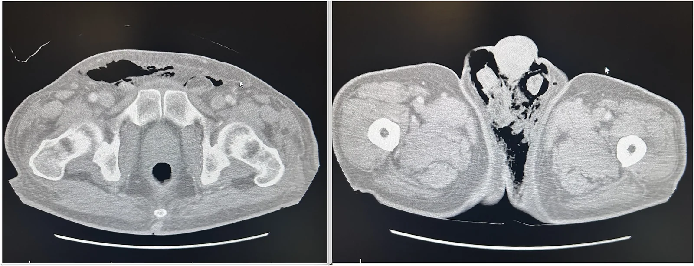
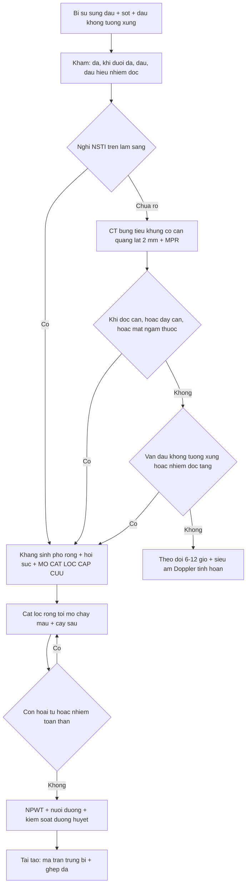
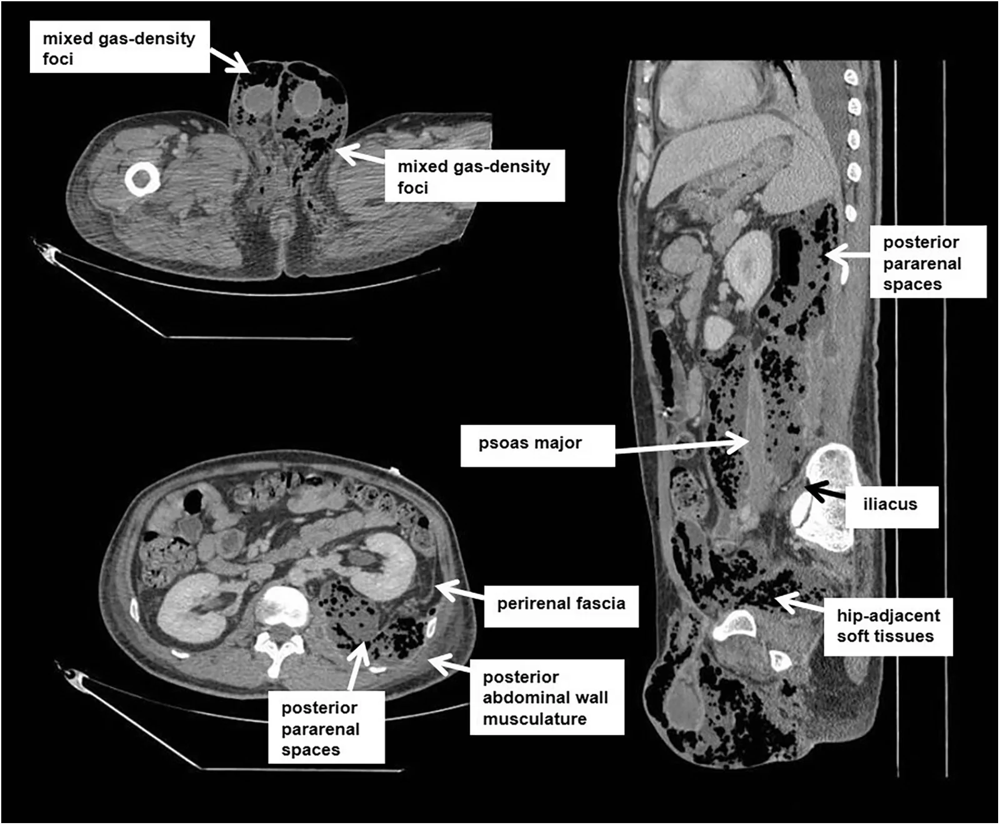
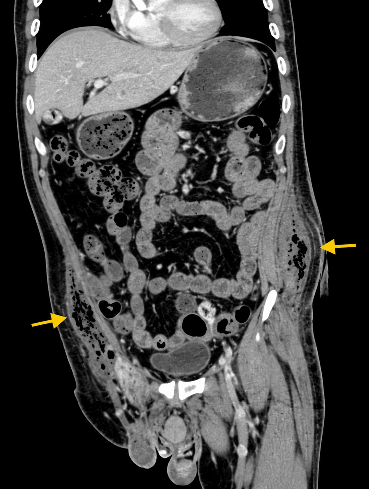

# 3152 — Viêm cân mạc hoại tử vùng sinh dục – tầng sinh môn (Fournier) / Fournier gangrene

**Tags:** `pattern:khi-trong-mo-mem` `pattern:hoai-tu-can-mac` `pattern:day-can` `pattern:ap-xe-vung-chau` `vung:sinh-duc` `vung:tang-sinh-mon` `vung:thanh-bung` `vung:tieu-khung` `protocol:CT-tieu-khung` `score:FGSI` `score:UFGSI` `score:LRINEC`

**Mức chắc chắn (certainty):** tổng hợp y văn (literature synthesis) — ghép các đoàn hệ: **228 ca** (*Mou C et al.*, 2026, PMC13202853), **100 ca ICU** (*Tanaka S et al.*, Crit Care 2022, PMC8788076), **95 ca** (*Dogan AE et al.*, 2026, PMC13561077), **65 ca** (*López Pacheco EB et al.*, 2026, PMC13032777), **54 ca** (*Karahan M et al.*, 2026, PMC13039031), **181 ca** (*Brands SR et al.*, 2024, PMC11249592); ảnh CT từ 3 ca nguyên văn (*Garrosi S et al.*, JSCR 2026, PMC13679822; *Sakamoto GF et al.*, Cureus 2026, PMC13615475; *Wu T et al.*, Front Surg 2026, PMC13585740). Nguồn không đưa số nào thì ghi "chưa rõ".

> **Bài này trả lời 4 câu hỏi của ca "bìu sưng đau, sốt, nhiễm trùng lan nhanh":**
> (1) Khi nào là **viêm cân mạc hoại tử** (necrotizing fasciitis) chứ không phải **áp-xe bìu** (scrotal abscess) hay **viêm mô tế bào** (cellulitis)?
> (2) **CT có giá trị gì — và khí VẮNG thì loại trừ được không?**
> (3) Vì sao nhiễm lan **lên thành bụng** mà thường **không xuống đùi**, và vì sao **tinh hoàn hay được "tha"**?
> (4) **Điểm tiên lượng nào dùng được** (FGSI / UFGSI / LRINEC) và **vì sao chờ CT có thể là sai lầm**?

## 1. Tổng quan bệnh học – cơ chế hình ảnh

### 1.1 Bệnh học và nguồn nhiễm

- **Fournier = NSTI** (necrotizing soft-tissue infection) của **tầng sinh môn – sinh dục**: hoại tử lan theo **cân nông** (superficial fascia) và **mô dưới da**, **không có vỏ áp-xe** — nên "dẫn lưu ổ mủ" không bao giờ đủ, phải **cắt lọc rộng** (radical debridement).
- **Đa vi khuẩn hiếu – kỵ khí hiệp lực** (synergistic polymicrobial): *Escherichia coli*, *Klebsiella pneumoniae*, *Bacteroides*, *Peptostreptococcus*, *Enterococcus*, tụ cầu/liên cầu; **MRSA đơn thuần** và **Klebsiella** đơn thuần đều đã được báo cáo (PMC13679822, PMC13585740).
- **Nguồn nhiễm theo tần suất:** **hậu môn – trực tràng 56,9% (37/65)**, còn lại từ đường niệu – sinh dục và da (PMC13032777). Nhiễm từ **ổ bụng** cũng có: ca sau **tắc ruột – nhiễm ổ bụng** rồi lan xuống tầng sinh môn (PMC13585740).
- **Nền bệnh hay gặp:** **đái tháo đường 70,8% (46/65)**, tăng huyết áp 38,5%; tuổi trung bình **59,4 ± 11** (PMC13032777); **béo phì 24%**, nghiện rượu 20%, đang dùng thuốc ức chế miễn dịch 10% (PMC8788076).
- **Tử vong theo đoàn hệ:** **9,6%** (228 ca), **14,8%** (54 ca), **20,0%** (95 ca), **24,4%** (45 ca), **27,7%** (65 ca) — dao động lớn vì khác **độ nặng khi nhập viện**, không phải vì điều trị khác nhau.

### 1.2 TẠI SAO có khí, TẠI SAO cân mất ngấm thuốc (cơ chế vật lý + mô bệnh)

- **Khí trong mô mềm:** vi khuẩn kỵ khí và Enterobacteriaceae **lên men đường – axit amin** sinh **CO₂, H₂, N₂**; các khí này **không tan trong dịch mô** nên tích thành bóng **−1.000 đến −200 HU** (mức "không khí"), **không đổi theo tư thế** và **không có mức dịch-khí** như trong lòng ruột. Trên CT, khí nằm **dọc theo mặt phẳng cân** — đây là dấu hiệu **định vị** (chỉ ra đường lan), không chỉ là dấu hiệu "có nhiễm".
- **Dày cân + mất ngấm thuốc:** viêm hoại tử làm **huyết khối vi mạch dưới da** → vùng cân **không được tưới máu** → trên CT có cản quang, **cân không ngấm thuốc** trong khi **lớp cơ bên dưới vẫn ngấm**; phù quanh làm **dày cân** và **tăng đậm độ mỡ dưới da** (stranding). Đây là tương quan trực tiếp của "không còn mạch nuôi → phải cắt bỏ".
- **Dịch:** ổ dịch nhiều ngăn, đậm độ **10–25 HU** (không phải mủ đặc 30–40 HU), nằm **giữa các lớp cân**.
- **Ngưỡng định lượng tại giường CT** (đoàn hệ 100 ca NSTI nặng, PMC8788076, 54 ca có CT):

| Dấu hiệu CT | Sống (n = 39) | Tử vong ngày 90 (n = 15) | Ý nghĩa |
|---|---|---|---|
| **Khí trong mô mềm** | 32 (82%) | 15 (100%) | Rất thường gặp nhưng **KHÔNG phân biệt được tử vong** (p = 0,171) |
| **Nhiều ổ dịch** | 6 (15%) | 8 (53%) | Lan nhiều ngăn = nặng hơn (p = 0,012) |
| **Mất/không đồng nhất ngấm thuốc** | 33 (85%) | 15 (100%) | Gần như luôn có ở ca nặng |
| **Thay đổi viêm của cân và tổ chức dưới** | 10 (26%) | 13 (87%) | **OR 8,09** cho tử vong; **Se 60% / Sp 92% / PPV 75% / NPV 86%** |
| **Diện da tổn thương (%)** | 5% (5–9) | 18% (9–19) | **OR 1,15 mỗi 1%** diện da (p = 0,01) |

### 1.3 Giải phẫu quyết định đường lan (và vì sao tinh hoàn thường còn)

- **Cân Colles** (superficial perineal fascia / Colles fascia) bám vào **ngành ngồi – mu**, **màng đáy chậu** phía sau và **liên tục phía trước với cân Scarpa** của thành bụng → nhiễm đi **từ bìu/tầng sinh môn lên thành bụng dưới** trong cùng một khoang cân.
- **Vì sao ít xuống đùi:** cân Scarpa **bám chặt vào cân đùi (fascia lata) ngay dưới dây chằng bẹn**; vì vậy nhiễm bị "chặn" ở nếp bẹn và **đi lên** thay vì xuống.
- **Vì sao vào được sau phúc mạc:** đường lan **qua ống bẹn / dọc thừng tinh** và **qua cân quanh thận** — ca PMC13585740 cho thấy khí tới **cân quanh thận, khoang cạnh thận sau, cơ thắt lưng (psoas), cơ chậu (iliacus)** và **mô mềm quanh háng**.
- **Vì sao tinh hoàn thường được "tha":** máu nuôi tinh hoàn từ **động mạch tinh hoàn xuất phát từ động mạch chủ bụng** (không phải từ mô bìu), nên hoại tử da bìu **không** làm chết tinh hoàn. Tuy vậy **tinh hoàn vẫn có thể bị tổn thương**: **10/51 (19,6%)** ca có tổn thương tinh hoàn trong một loạt mổ (PMC11323460) — **không được mặc định "tinh hoàn luôn lành"**.

## 2. Mẫu hình + chẩn đoán phân biệt theo vị trí và cơ chế (Gamut)

- **Theo nguồn nhiễm:** **hậu môn – trực tràng** (áp-xe quanh hậu môn, rò, ung thư trực tràng, sau đặt stent trực tràng) · **niệu – sinh dục** (hẹp niệu đạo, đặt catheter, sau phẫu thuật tiết niệu) · **da** (vết xước, chấn thương bìu, sau tiêm) · **ổ bụng** (tắc ruột, thủng tạng, sau mổ).
- **Theo đường lan (dấu hiệu chỉ điểm trên CT):** **bìu – dương vật** (khí trong dartos) → **tầng sinh môn** → **thành bụng dưới** (dọc cân Scarpa) → **ống bẹn / thừng tinh** → **sau phúc mạc, cơ thắt lưng – chậu, quanh thận**.
- **Theo hình thái tổn thương:** **khí đơn thuần** · **dày cân + dịch** · **mất ngấm thuốc cân** (dấu nặng nhất) · **hoại tử da** (dấu muộn, "da đen" chỉ là phần nổi của tảng băng).
- **Gamut "bìu sưng đau + sốt"** — nhớ **SCROTUM**:
  - **S**oft-tissue gas (Fournier) — **khí dọc cân, đau không tương xứng, nhiễm độc**.
  - **C**ellulitis — đỏ nóng lan, **không khí, không hoại tử cân**, đáp ứng kháng sinh.
  - **R**upture/abscess of scrotum — **ổ dịch có vỏ**, không lan theo cân.
  - **O**rchitis/epididymitis — đau tinh hoàn, **Doppler tăng tưới máu**, không khí.
  - **T**orsion — đau khởi phát đột ngột, **mất tưới máu tinh hoàn**, không khí.
  - **U**rethral extravasation — sau chấn thương niệu đạo, nước tiểu lan **dartos/Colles**, có thể **nhiễm kế phát**.
  - **M**alignant/necrotizing infiltration — ung thư bìu, loét Fournier "khô" do thiếu máu cục bộ.

## 3. Bảng so sánh phân biệt (ma trận đối chiếu)

| Thực thể (entity) | Hình ảnh điển hình (CT có cản quang) | Chốt vào (rule-in) | Chốt loại (rule-out) | Gợi ý xác nhận |
|---|---|---|---|---|
| **Fournier (NSTI tầng sinh môn)** | **Khí dọc cân** bìu → thành bụng → sau phúc mạc; **dày cân + mất ngấm thuốc**; nhiều ổ dịch; **không có vỏ** | **Khí theo mặt phẳng cân + dày cân + đau không tương xứng + nhiễm độc** (khí có ở **82–100%** ca nặng) | **Thiếu khí KHÔNG loại trừ** — 18% ca sống trong đoàn hệ nặng **không có khí** | Mổ thăm dò + cấy sâu; CT chỉ để **đo đường lan** |
| **Áp-xe bìu** | **Ổ dịch có vỏ ngấm thuốc**, ± khí trong ổ, **không lan theo cân** | **Vỏ ngấm thuốc + ổ dịch khu trú + không dày cân lan** | Khí **dọc cân** ra ngoài ổ, dày cân lan lên bụng → Fournier | Dẫn lưu + cấy; nếu da hoại tử **phải cắt lọc** |
| **Viêm mô tế bào (cellulitis)** | Dày mỡ dưới da **không có khí**, **cân vẫn ngấm thuốc**, không ổ dịch | **Dày mỡ đối xứng + cân ngấm thuốc bình thường + đáp ứng kháng sinh 24–48 giờ** | **Đau không tương xứng + nhiễm độc + dày cân** → không phải cellulitis | Theo dõi 6–12 giờ; xấu đi → CT/mổ |
| **Viêm tinh hoàn – mào tinh** | Tinh hoàn/mào tinh to, **tăng tưới máu**, **không khí**, không dày cân bìu | **Đau tinh hoàn + Doppler tăng tưới máu + không khí** | **Khí dọc cân** hoặc **mất tưới máu** → không phải viêm | Siêu âm Doppler là bước đầu |
| **Xoắn tinh hoàn** | Tinh hoàn **không ngấm thuốc**, dây thừng xoắn, không khí | **Mất tưới máu hoàn toàn + đau đột ngột** | Có khí/dày cân → nghĩ NSTI trước | Siêu âm Doppler **cấp cứu**; mổ thăm dò nếu không chắc |
| **NSTI sau phúc mạc "giả Fournier"** | Khí/quanh thận – cơ thắt lưng, **bìu có thể chỉ phù thứ phát** | **Khí ở khoang cạnh thận/cơ thắt lưng + bìu ít tổn thương** | Khí **bắt đầu từ bìu** và lan lên → Fournier thật | CT bụng – tiểu khung đủ thì; nguồn ổ bụng/tiết niệu phải xử lý |
| **Hoại tử da do thuốc (warfarin, heparin)** | **Vùng da hoại tử rõ ranh giới**, **KHÔNG khí**, cân ngấm thuốc bình thường | **Tiền sử kháng vitamin K + hoại tử da khu trú + không khí** | Có khí dọc cân + sốc nhiễm khuẩn → NSTI | Ngừng thuốc, vitamin K; sinh thiết nếu còn nghi |

*Trái: lát ngang qua khung chậu — **khí dưới da thành bụng dưới** (lan ngược lên theo cân Scarpa). Phải: lát ngang qua bìu — **khí lan rộng trong mô dưới da bìu – tầng sinh môn**, tinh hoàn vẫn nhận diện được. Nguồn: JSCR 2026, PMC13679822, Fig. 2, **CC BY 4.0**.*

## 4. Protocol chụp + hệ điểm + ngưỡng can thiệp

### 4.1 Chụp gì, khi nào

- **Chẩn đoán là chẩn đoán LÂM SÀNG – NGOẠI KHOA**, không phải chẩn đoán hình ảnh: trong 181 ca NSTI, **81% (85/105)** ca có nghi ngờ lâm sàng **vào thẳng phòng mổ**; imaging chỉ **thay đổi xử trí ở 3 ca (15% của nhóm được chụp)** và chủ yếu để tìm **nguồn ổ bụng** (PMC11249592).
- **CT bụng – tiểu khung có cản quang, lát ≤ 2 mm, dựng MPR vành – sagittal** khi: (a) chẩn đoán **chưa rõ** (phân biệt cellulitis/áp-xe); (b) cần **đo đường lan** trước mổ (thành bụng? sau phúc mạc? cơ thắt lưng?); (c) tìm **nguồn ổ bụng** (tắc ruột, thủng, áp-xe quanh trực tràng).
- **Cửa sổ đọc:** đọc **window khí** (W 1.500 / L −500) để không bỏ sót bóng khí nhỏ; so **hai bên** và **đối chiếu mức đậm độ cơ** (cơ còn ngấm = mốc so sánh cho "cân không ngấm").
- **Siêu âm:** chỉ để loại **xoắn/viêm tinh hoàn** và tìm ổ dịch nông; **không đủ** để loại NSTI. **MRI** cho tương phản mô mềm tốt hơn nhưng **chậm và khó cho bệnh nhân nhiễm độc** — không phải lựa chọn cấp cứu.
- **Cái giá của việc chờ chụp:** trong đoàn hệ ICU, **trung vị từ CT tới mổ là 5 giờ (2–20 giờ)** (PMC8788076) — với bệnh lan theo giờ, đây là **5 giờ hoại tử thêm**.

### 4.2 Điểm tiên lượng — dùng đúng, đừng dùng sai

| Điểm | Thành phần | Ngưỡng / hiệu năng | Dùng để làm gì |
|---|---|---|---|
| **FGSI** (Fournier Gangrene Severity Index, 1995) | **9 thông số**: nhiệt độ, mạch, nhịp thở, Na⁺, K⁺, creatinin, hematocrit, bạch cầu, bicarbonate | **> 9 → 75% nguy cơ tử vong; ≤ 9 → 78% khả năng sống**; gộp **40 nghiên cứu / 2.257 ca**: **Se 84% / Sp 85%** | Phân tầng **khi nhập viện**, so sánh nghiên cứu |
| **UFGSI** (Uludag, 2010) | FGSI + **tuổi** + **diện lan** | **≤ 9 → 81% sống; > 9 → 94% tử vong**; trong **228 ca**: **AUC 0,933, Se 90,9%, Sp 83,0%** — tốt nhất trong 4 điểm | Chọn mức **theo dõi ICU** và tư vấn gia đình |
| **LRINEC** | CRP, bạch cầu, Hb, Na⁺, creatinin, glucose | **KHÔNG dùng để loại trừ**: tại cutoff **≥ 6**, **Se 22,5% / Sp 88,8% / PPV 49,2% / NPV 70,5% / AUC 0,582** (PMC13754352); **trung vị LRINEC chỉ 3** trong đoàn hệ **NSTI nặng ở ICU** (PMC8788076) | Chỉ là **gợi ý phụ**; LRINEC thấp **không** trì hoãn mổ |

### 4.3 Ngưỡng và trình tự xử trí

1. **Hồi sức + kháng sinh phổ rộng ngay** phủ Gram (+), Gram (−), kỵ khí (piperacillin–tazobactam hoặc carbapenem ± vancomycin nếu nghi MRSA); **không chờ kết quả cấy**.
2. **Cắt lọc rộng cấp cứu (radical debridement)** tới **mô còn chảy máu**, kể cả khi da trông "còn hồng"; số lần cắt lọc trung bình **2,5–3,2 lần** (PMC13039031); ca lan sau phúc mạc cần **nhiều đợt** và > 2 tháng điều trị (PMC13585740).
3. **Dẫn lưu xuyên đường hầm thừng tinh** khi nhiễm lan ngược lên trên (Penrose qua ống thừng tinh ra đường đối lưu tầng sinh môn) — giảm mất mô thành bụng (PMC13679822).
4. **Chuyển hướng phân (fecal diversion)** khi tổn thương quanh hậu môn/không kiểm soát được vệ sinh: **hậu môn nhân tạo vs ống quản lý phân (Flexi-Seal)** không khác nhau về tử vong (**17,8% vs 11,5%**, p = 0,51), số lần cắt lọc hay thời gian nằm (PMC13039031).
5. **Liệu pháp áp lực âm (NPWT/VAC)** sau khi sạch: tử vong **15,6% vs 29,0%** so với băng thường; **OR hiệu chỉnh 0,42 (0,18–0,95)**; FGSI tăng **OR 1,28/điểm**, procalcitonin **OR 1,95** (PMC13561077).
6. **Tái tạo muộn** khi giường vết thương sạch: mảnh ghép da mỏng, **ma trận tái tạo trung bì (dermal regeneration template)** rồi ghép thì hai (PMC13679822).

## 5. Biến thể bình thường và cạm bẫy

- **Biến thể bình thường / dương tính giả:** **khí trong mô mềm sau can thiệp** (sau chọc dẫn lưu, sau mổ, sau đặt catheter) — khí **khu trú, có vỏ, không dày cân**, bệnh nhân không nhiễm độc; **khí trong bao quy đầu/miệng sáo** sau thông tiểu; **dày mỡ dưới da đối xứng do phù** ở bệnh nhân suy tim, xơ gan.
- **Cạm bẫy 1 — "không có khí nên không phải Fournier":** khí vắng ở **18% ca sống** trong đoàn hệ nặng; các ca **không khí trên imaging có thời gian tới mổ DÀI HƠN** (PMC11779239). **Đau không tương xứng + nhiễm độc** quan trọng hơn khí.
- **Cạm bẫy 2 — tin vào "da còn hồng":** da chỉ hoại tử **sau khi đã mất mạch nuôi**; diện da tổn thương **trung vị 5%** (sống) và **18%** (tử vong) nhưng **diện cân hoại tử luôn lớn hơn** — cắt lọc theo **mô không chảy máu**, không theo màu da.
- **Cạm bẫy 3 — "tinh hoàn còn nên nhẹ":** tinh hoàn được nuôi từ **động mạch chủ**, nhưng **19,6%** ca vẫn có tổn thương tinh hoàn; đừng vì thấy tinh hoàn "bình thường" mà hạ thấp mức độ.
- **Cạm bẫy 4 — chỉ đọc lát ngang tiểu khung:** nhiễm có thể đã lên **thành bụng** hoặc vào **sau phúc mạc – cơ thắt lưng** (PMC13585740). **Phải dựng MPR vành** và đọc tới **cực trên thận**; nếu khí ở khoang cạnh thận, cần **xử lý nguồn ổ bụng/tiết niệu** cùng lúc.
- **Cạm bẫy 5 — chờ CT ở bệnh nhân rõ bệnh:** imaging làm chậm mổ **trung vị 5 giờ**; ở ca bệnh cảnh điển hình, **CT không được đứng trước dao mổ**.
- **Cạm bẫy 6 — LRINEC thấp:** **trung vị LRINEC = 3** ở đoàn hệ NSTI nặng; dùng LRINEC như "công tắc loại trừ" là nguyên nhân trì hoãn đã được báo cáo (PMC12925613).
- **Cạm bẫy 7 — cho rằng đã "sạch" sau một lần mổ:** ổ dịch thành bụng **tái phát và cần dẫn lưu lại** (PMC13615475) — cần **CT kiểm tra** khi sốt lại hoặc dịch tăng.

## 6. Tự lượng giá — Blind Quiz

**Ca 1 — Nam 61 tuổi, đái tháo đường kiểm soát kém; bìu hoại tử lan lên trên xương mu. Nhìn 2 lát CT ngang.**

- Gợi ý lâm sàng: đau bìu tăng nhanh, da tím – hoại tử, sốt; không có dẫn lưu ổ mủ rõ.
- Câu hỏi: (1) Khí nằm ở khoang nào và **đi theo hướng nào**? (2) Vì sao khí lên **thành bụng** mà không xuống đùi? (3) Vì sao **không dẫn lưu ổ mủ đơn thuần**?

<b>Bấm để hiện đáp án (findings + chẩn đoán)</b>

- **Findings:** (trái) khí dưới da **thành bụng dưới** dọc cân Scarpa; (phải) khí lan rộng trong **mô dưới da bìu – tầng sinh môn**, tinh hoàn vẫn thấy.
- **Chẩn đoán:** **Fournier** do **MRSA đơn thuần**; nhiễm đi **ngược dòng theo ống thừng tinh** lên trên xương mu.
- **Vì sao không xuống đùi:** cân Scarpa **bám vào cân đùi dưới dây chằng bẹn** → đường lan bị chặn, nhiễm đi lên.
- **Vì sao không chỉ dẫn lưu:** không có vỏ áp-xe; tổn thương là **hoại tử cân** → phải **cắt lọc rộng**; ca gốc cắt lọc nhiều lần, đặt **Penrose xuyên ống thừng tinh**, rồi **ma trận trung bì + ghép da**, bảo tồn tinh hoàn, **không cần chuyển hướng phân**.
- **Nguồn:** JSCR 2026, PMC13679822, CC BY 4.0.

**Ca 2 — Nam 47 tuổi, sau đợt tắc ruột; sốt, bìu sưng, da lở, dịch mủ. Nhìn CT: khí lan rất xa.**

- Gợi ý lâm sàng: bụng chướng, tắc ruột, nghi nhiễm ổ bụng; bìu đã có tổn thương khi nhập viện.
- Câu hỏi: (1) Kể **3 khoang** khí đã tới ngoài bìu? (2) Điều này thay đổi kế hoạch mổ thế nào? (3) Cấy máu/dịch khả năng cao là gì?

<b>Bấm để hiện đáp án (findings + chẩn đoán)</b>

- **Findings:** khí trong **mô dưới da bìu – tầng sinh môn**, **khoang cạnh thận sau**, **cân quanh thận**, **cơ thắt lưng (psoas)**, **cơ chậu (iliacus)**, **mô mềm quanh háng** và **cơ thành bụng sau**.
- **Chẩn đoán:** **Fournier lan sau phúc mạc**, khởi phát từ **ổ nhiễm ổ bụng** (tắc ruột) — **Klebsiella pneumoniae** cấy được ở máu và dịch vết thương.
- **Thay đổi kế hoạch:** cắt lọc **cả đường bụng – sau phúc mạc**, không chỉ vùng bìu; cần **nhiều đợt** cắt lọc và kiểm soát nguồn ổ bụng; ca gốc điều trị **> 2 tháng**.
- **Bài học:** khí ở **sau phúc mạc/cơ thắt lưng** = phải tìm **nguồn tiêu hóa – niệu** và mổ cùng lúc; đọc CT tới **cực trên thận**.
- **Nguồn:** Front Surg 2026, PMC13585740, CC BY 4.0.

**Ca 3 — Nam 57 tuổi, HbA1c 12,2%, đau bìu 2 tuần; sau mổ nhiều lần vẫn sốt. Nhìn CT vành.**

- Gợi ý lâm sàng: đã cắt lọc bìu – tầng sinh môn, đặt hậu môn nhân tạo; sốt dai dẳng, dịch thành bụng.
- Câu hỏi: (1) Dấu hiệu mũi tên là gì? (2) Vì sao "đã mổ nhiều lần" vẫn còn ổ nhiễm? (3) Bước tiếp theo?

<b>Bấm để hiện đáp án (findings + chẩn đoán)</b>

- **Findings:** **ổ dịch – khí ở mô dưới da thành bụng hai bên** (mũi tên vàng), dọc cân; ổ dịch nằm **ngoài phúc mạc**.
- **Vì sao còn ổ nhiễm:** nhiễm lan **theo mặt phẳng cân** tới thành bụng, tạo **nhiều ngăn**; một lần cắt lọc không mở hết; **khoang kín** → tái phát và phải **nhập viện lại**.
- **Bước tiếp theo:** **dẫn lưu qua hình ảnh** các ổ thành bụng + kháng sinh theo cấy + **đánh giá lại bằng CT** khi sốt lại; ca gốc nằm viện **~7 tuần**.
- **Nguồn:** Cureus 2026, PMC13615475, CC BY 4.0.

## Bài liên quan chéo
- [1986 – Viêm mô hoại tử ở trẻ (NSTI nhi)](../1986-viem-mo-hoai-tu-o-tre/lesson.md) (cùng bệnh, khác vị trí và cơ địa)
- [1939 – Viêm cân mạc hoại tử vùng cổ](../1939-viem-can-mac-hoai-tu-vung-co/lesson.md) (đường lan theo khoang cổ)
- [3055 – Áp-xe tuyến tiền liệt](../3055-ap-xe-tuyen-tien-liet/lesson.md) (nguồn niệu – sinh dục)
- [1928 – Áp-xe cơ chậu ở thai phụ](../1928-ap-xe-co-chau-thai-ky/lesson.md) (lan vào cơ thắt lưng – chậu)
- [160 – Bụng cấp](../160-bung-cap-GI/lesson.md) (khi nguồn nhiễm ở ổ bụng)
- [3061 – Di căn lỗ trocar sau PIPAC](../3061-di-can-lo-trocar-sau-pipac-va-noi-soi/lesson.md) (nốt thành bụng sau can thiệp)

## Ảnh
- `images/3152_fournier_CT-ngang_PMC13679822-f2.webp` — CT ngang: khí dưới da thành bụng dưới + khí bìu/tầng sinh môn — *JSCR* 2026, PMC13679822, **CC BY 4.0**.
- `images/3152_fournier_CT-sau-phuc-mac_PMC13585740-f2.webp` — CT: khí lan tới cân quanh thận, khoang cạnh thận sau, cơ thắt lưng – chậu — *Front Surg* 2026, PMC13585740, **CC BY 4.0**.
- `images/3152_fournier_CT-canh_PMC13615475-f4.webp` — CT vành: ổ dịch – khí thành bụng hai bên — *Cureus* 2026, PMC13615475, **CC BY 4.0**.
- Chi tiết nguồn + giấy phép: `images/CREDITS.md`.

> Không dùng để chẩn đoán độc lập khi chưa có người hướng dẫn.
