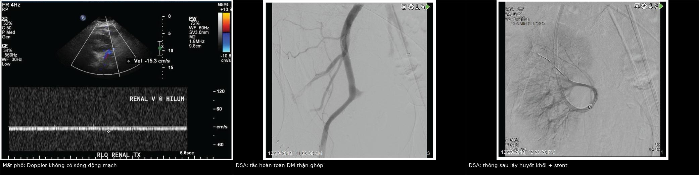
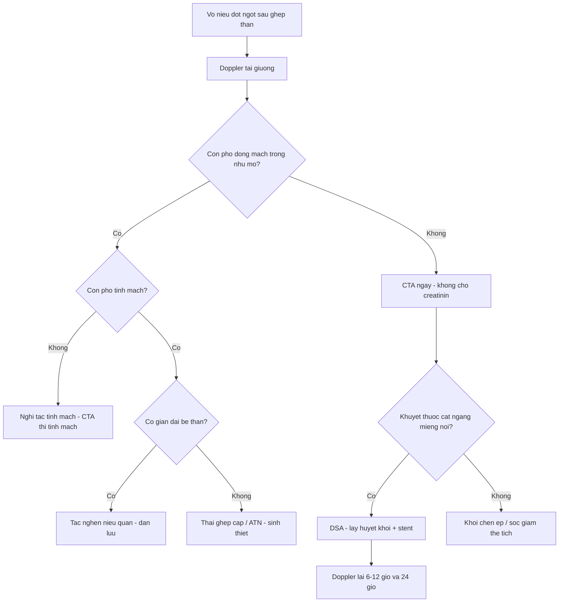
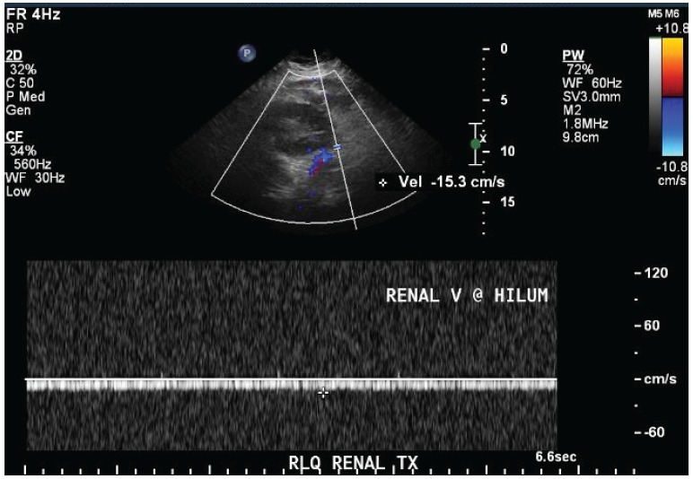
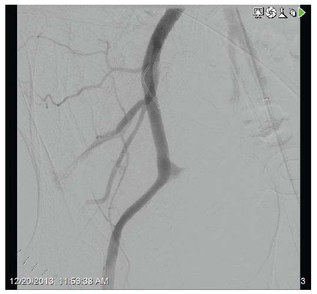

# 3153 — Huyết khối – tắc động mạch thận ghép CẤP: vô niệu + mất phổ trong nhu mô, cửa sổ vài giờ

**Tags:** `pattern:mat-pho-mach` `pattern:khong-ngam-thuoc` `pattern:vo-nieu` `vung:than-ghep` `vung:cuong-mach-ghep` `anatomy:dong-mach-than-ghep` `protocol:sieu-am-Doppler` `protocol:CTA-bung` `score:RI` `score:Banff`
**Mức chắc chắn (certainty):** tổng hợp y văn (literature synthesis) — ghép **hai ca nguyên văn** (J Nephropathol 2014, PMC4119325: tắc ĐM do hẹp đoạn xa, có ảnh Doppler + DSA; BMC Nephrol 2026, PMC13595620: tắc ĐM muộn do thải ghép thể dịch), **một ca tắc sớm do yếu tố đông máu** (World J Transplant 2026, PMC12836249), **loạt 2.304 ca ghép thận** (Front Transplant 2023, PMC11235313) và **tổng quan yếu tố nguy cơ** (J Transplant 2012, PMC3369524). Không có ca do nhóm tự chụp.

> **Câu hỏi thực hành:** nam **52 tuổi**, ngày thứ **7** sau ghép thận từ người hiến chết não. Hôm qua nước tiểu **1.500 mL/ngày**, hôm nay **vô niệu**, đau và ấn đau hố ghép, huyết áp **95/60 mmHg**. Siêu âm Doppler: **không thấy phổ động mạch lẫn tĩnh mạch trong nhu mô**. Câu hỏi: **có phải thải ghép cấp không, và còn kịp cứu thận không?**
> Bài chốt **ba quyết định**: **(1) vô niệu đột ngột sau ghép + mất phổ trong nhu mô = tắc động mạch cho tới khi chứng minh ngược** — không chờ thải ghép, không chờ men thận; **(2) siêu âm Doppler là cửa đầu tiên nhưng KHÔNG đủ loại trừ** (RI chồng lấp giữa các nguyên nhân), **CTA là cửa chốt**, DSA là cửa vừa chẩn đoán vừa điều trị; **(3) mốc thời gian là giờ, không phải ngày** — đã có ca tái thông thành công sau **5,5 giờ thiếu máu ấm**, và tái thông muộn cứu được mạch nhưng **không cứu được nhu mô** (hoại tử vỏ lan rộng).

## 1. Tổng quan bệnh học – cơ chế hình ảnh: vì sao thận ghép "tắt phổ" là cấp cứu

- **Giải phẫu quyết định tất cả:** thận ghép được đặt **ngoài phúc mạc ở hố chậu**, **động mạch thận người cho nối tận–bên vào động mạch chậu ngoài** (hoặc động mạch chậu trong), tĩnh mạch nối vào tĩnh mạch chậu ngoài (Korean J Radiol 2015, PMC4435990). Thận là tạng **một cuống mạch**, gần như **không có tuần hoàn bàng hệ đáng kể** — nên **một huyết khối ở miệng nối = tắt toàn bộ nhu mô**, khác hẳn gan hay phổi.
- **Tần suất — bốn con số cần nhớ:**
  - **Huyết khối động mạch 0,2–7,5%**, **huyết khối tĩnh mạch 0,1–8,2%**; gộp lại, biến cố huyết khối mạch chiếm **tới 1/3 các ca mất ghép sớm** (J Transplant 2012, PMC3369524).
  - **Tắc động mạch thận ghép (RAAT) 0,5–3,5%**, phần lớn trong **tháng đầu**, và **thường mất ghép nếu phát hiện muộn** (BMC Nephrol 2026, PMC13595620).
  - Trong **2.304 ca ghép** một trung tâm: biến chứng mạch **2,34% (54/2.304)**, trong đó **tắc động mạch chỉ 2 ca (0,09%)** và **tắc tĩnh mạch 3 ca (0,13%)** — tức **hiếm nhưng khi xảy ra thì kết cục rất xấu**, tác giả ghi rõ nhóm tắc mạch có tỷ lệ **mất thận cao** (Front Transplant 2023, PMC11235313).
  - **Hẹp động mạch thận ghép (TRAS)** — kẻ bắt chước mạn tính — chiếm **1–5% các ca tăng huyết áp sau ghép**, xuất hiện chủ yếu trong **6 tháng đầu** (Clin Kidney J 2015, PMC4310434).
- **Thời điểm — hai ổ bệnh khác nhau:**
  - **Sớm (< 1 tháng, đa số < 48 giờ):** nguyên nhân **kỹ thuật** — gấp góc, xoắn, bóc tách nội mạc, miệng nối hẹp, đa động mạch phụ, hạ huyết áp, giảm thể tích (J Transplant 2012; J Nephropathol 2014).
  - **Muộn:** **hẹp nặng tiến triển**, **thải ghép cấp thể dịch** (ca POD **83**), **hội chứng tăng đông** (yếu tố V Leiden), hoặc **biến cố toàn thân** (xuất huyết tiêu hóa gây tụt áp) (BMC Nephrol 2026; World J Transplant 2026; Medicine 2016, PMC5265842).
- **Yếu tố nguy cơ đo được:** tuổi người cho **< 6 hoặc > 60**, tuổi người nhận **< 5–6**, **huyết động không ổn định chu phẫu**, **lọc màng bụng trước ghép**, **bệnh thận đái tháo đường**, **tiền sử huyết khối**, **người cho chết não**, **thiếu máu lạnh > 24 giờ**; **đa động mạch KHÔNG phải yếu tố nguy cơ** (J Transplant 2012, PMC3369524).
- **TẠI SAO hình ảnh thay đổi theo giờ — vật lý của dòng chảy và của thuốc cản quang:**
  - **Siêu âm Doppler** đo **vận tốc** dòng máu, không đo tưới máu. Thận ghép bình thường có **phổ động mạch tâm thu–tâm trương liên tục** và **chỉ số kháng (RI) khoảng 0,6–0,8**; gộp 13 nghiên cứu, **RI trung bình nhóm chứng 0,71** và **nhóm rối loạn chức năng mảnh ghép 0,73** — **chồng lấp gần như hoàn toàn** (Caspian J Intern Med 2024, PMC11246670). Vì vậy **RI đơn lẻ không chẩn đoán được nguyên nhân**; cái chốt là **có hay không có phổ**, và **phổ tĩnh mạch có còn hay không**.
  - **Tắc động mạch** → **mất cả phổ động mạch và tĩnh mạch** trong nhu mô (ca nguyên văn: RI **0,98** ở ngày 2, rồi **mất phổ hoàn toàn** khi tắc) (J Nephropathol 2014).
  - **Tắc tĩnh mạch** → máu vào được mà không ra: **phổ động mạch còn nhưng RI tăng rất cao, có thể đảo chiều tâm trương**, thận **phù to, căng đau** — đây là **dấu hiệu phân biệt tại giường**, không cần chờ CTA.
  - **CT có cản quang** đo **độ ngấm thuốc** (Hounsfield), tức **lượng iod đến nhu mô**: tắc động mạch → **khuyết thuốc cắt ngang tại miệng nối**, **nhu mô không ngấm ở thì động mạch**, vỏ thận mất viền tăng đậm; tắc tĩnh mạch → **thận to, ngấm thuốc kéo dài bất thường**, huyết khối thấy **trong lòng tĩnh mạch** (Korean J Radiol 2015, Hình 7–8).
  - **Vì sao tái thông muộn vẫn mất thận:** tế bào ống thận chịu thiếu máu ấm kém; sau **5,5 giờ** đã có ca tái thông **thành công về mạch** nhưng nhu mô **hoại tử vỏ lan rộng**, sinh thiết chỉ thấy **nhồi máu, không có dấu thải ghép** (Arch Surg 1982 — ca tái thông sau 5,5 giờ; J Nephropathol 2014 — mô bệnh học).
- **Vì sao dễ bị gọi sai là "thải ghép cấp" hoặc "hoại tử ống thận cấp":** cả ba đều cho **vô niệu + creatinin tăng + thận to**, và **đều có thể tăng RI**; chỉ **mất phổ hoàn toàn** và **khuyết thuốc trên CTA** mới tách được tắc mạch ra khỏi hai thể kia.

## 2. Mẫu hình + chẩn đoán phân biệt theo thời điểm và kiểu phổ Doppler (Gamut)

- **Mẫu hình cốt lõi:** **vô niệu/thiểu niệu đột ngột** + **đau, ấn đau hố ghép** (có thể **giảm tiểu cầu** do ngưng tập tiểu cầu tại huyết khối) + **mất phổ mạch trong nhu mô** trên Doppler.
- **Gamut theo kiểu phổ (quyết định tại giường):**
  1. **Mất cả phổ động mạch và tĩnh mạch** → **tắc động mạch thận ghép**, **nhồi máu toàn bộ**, hoặc **chèn ép cuống mạch** (nang bạch huyết, máu tụ lớn), **sốc giảm thể tích** (kiểm tra huyết áp trước khi kết luận).
  2. **Mất phổ tĩnh mạch, phổ động mạch còn + RI rất cao/đảo tâm trương** → **tắc tĩnh mạch thận ghép**.
  3. **Phổ động mạch còn nhưng "tardus–parvus"** (sóng dâng chậm, đỉnh tù, giảm biên độ) + **tăng vận tốc khu trú tại chỗ hẹp** → **hẹp động mạch ghép/gấp góc**; cần CTA/DSA.
  4. **Phổ còn, RI tăng nhẹ, không giãn đài bể thận** → **thải ghép cấp**, **hoại tử ống thận cấp**, **nhiễm trùng**, **thuốc độc thận** — chẩn đoán bằng **sinh thiết**, không bằng Doppler.
  5. **Phổ còn + giãn đài bể thận** → **tắc nghẽn niệu quản** (hẹp miệng nối, huyết khối máu cục, nang bạch huyết chèn ép) — siêu âm thấy **giãn đài bể thận**, không có ở tắc mạch đơn thuần.
- **Gamut theo thời điểm:**
  - **Ngày 0–7:** tắc động mạch do **kỹ thuật** (gấp góc, xoắn, bóc tách), **tắc tĩnh mạch**, **thải ghép tối cấp**, **hoại tử ống thận cấp**.
  - **Tuần 2–4:** **thải ghép cấp**, **hẹp miệng nối niệu quản**, **nhiễm CMV/BK**, **huyết khối do tăng đông**.
  - **Tháng 2–6:** **TRAS** (1–5% tăng huyết áp sau ghép), **thải ghép thể dịch muộn** — ca POD **83** (BMC Nephrol 2026).
- **Ba câu hỏi đọc ảnh:** **(1) phổ động mạch còn không? (2) phổ tĩnh mạch còn không? (3) có giãn đài bể thận hay khối chèn ép cuống không?** Trả lời (1) "không" → **cấp cứu mạch**, không phải thải ghép.

## 3. Bảng so sánh phân biệt (ma trận đối chiếu)

| Thực thể (entity) | Hình ảnh điển hình (Doppler/CT/DSA) | Chốt vào (rule-in) | Chốt loại (rule-out) | Gợi ý xác nhận |
|---|---|---|---|---|
| Tắc động mạch thận ghép (RAAT) | **Mất phổ động mạch VÀ tĩnh mạch** trong nhu mô; CTA **khuyết thuốc cắt ngang miệng nối**, nhu mô **không ngấm thì động mạch**; DSA thấy **cụt đầu** | **Vô niệu đột ngột + mất cả hai phổ + khuyết thuốc tại miệng nối** | Còn phổ động mạch, thận ngấm thuốc đều → không phải tắc động mạch | Doppler ngay tại giường, rồi **CTA**; DSA để tái thông |
| Tắc tĩnh mạch thận ghép | **Mất phổ tĩnh mạch**, phổ động mạch **RI rất cao/đảo tâm trương**; thận **to, căng**, ngấm thuốc kéo dài; CTA thấy **huyết khối trong tĩnh mạch chậu** | **Thận phù to + đau + RI cao + mất phổ tĩnh mạch** | Mất cả phổ động mạch → nghiêng tắc động mạch | CTA thì tĩnh mạch; Doppler lặp sau 1–2 giờ |
| Thải ghép cấp (TCMR/ABMR) | Phổ **còn**, RI tăng nhẹ, thận to; **không có huyết khối**; sinh thiết **Banff** | **Sốt, thận to, creatinin tăng, phổ còn, không khuyết thuốc** | **Mất phổ hoàn toàn** hoặc **khuyết thuốc tại miệng nối** → không phải thải ghép đơn thuần | Sinh thiết + C4d/DSA; **không nong mạch** |
| Hoại tử ống thận cấp (ATN) | Phổ **còn**, RI có thể cao; thận **ngấm thuốc bình thường**; **không thiểu niệu tuyệt đối kéo dài** | **Chức năng chậm hồi phục sau thiếu máu lạnh, phổ còn** | Mất phổ → tắc mạch | Theo dõi nước tiểu, creatinin; sinh thiết nếu kéo dài |
| Hẹp động mạch ghép (TRAS) / gấp góc | **Tardus–parvus** hạ lưu + **tăng vận tốc tại chỗ hẹp**; CTA/DSA thấy **hẹp ± xoắn**; xuất hiện **1–5%** tăng huyết áp sau ghép, trong **6 tháng đầu** | **Tăng huyết áp khó kiểm soát + tardus–parvus + hẹp thấy được** | Tắc hoàn toàn (mất phổ) → khác | CTA, DSA + nong/stent |
| Tắc nghẽn niệu quản | **Giãn đài bể thận**, phổ mạch **còn**, RI có thể tăng; CT thấy **niệu quản giãn tới chỗ hẹp** | **Giãn đài bể thận + phổ còn + creatinin tăng** | Không giãn đài bể thận → không phải tắc nghẽn đơn thuần | Siêu âm, CT không cản quang; dẫn lưu |
| Chèn ép cuống mạch (nang bạch huyết, máu tụ) | Khối dịch/quang **quanh thận**, **đè cuống**; phổ có thể **mất một phần**; thận ngấm thuốc giảm | **Khối quanh thận + mất phổ khu trú + tụt huyết áp** | Không có khối chèn ép → nghĩ huyết khối nội sinh | Siêu âm/CT; chọc hút/dẫn lưu |
| Nhồi máu vỏ thận toàn bộ | **Không ngấm thuốc vỏ**, viền vỏ mỏng còn ngấm (**"cortical rim sign"**), mất phổ; DSA tắc | **Khuyết thuốc vỏ lan rộng + mất phổ + vô niệu** | Còn ngấm thuốc vỏ → chưa nhồi máu toàn bộ | CTA; tiên lượng mất thận |

*Trái: Doppler nhu mô thận ghép **không có sóng động mạch**, chỉ còn dòng tĩnh mạch chậm (vận tốc **−15,3 cm/s**). Giữa: DSA **tắc hoàn toàn động mạch thận ghép**. Phải: sau **lấy huyết khối + nong/stent chỗ hẹp đoạn xa**, mạch thông lại toàn bộ. Nguồn: J Nephropathol 2014 (PMC4119325), **CC BY 4.0**. Ảnh ghép letterbox, giữ nguyên khung và thang đo của tác giả.*

### Đọc kỹ ba mẫu hình
- **Mất phổ nhưng còn "màu" trên ảnh Doppler màu:** màu có thể là **nhiễu do tăng gain** hoặc **dòng bàng hệ rất chậm**; chỉ **phổ xung (spectral)** mới xác nhận. Ca gốc cho thấy **phổ gần phẳng**, không có sóng tâm thu.
- **Tardus–parvus** là dấu của **hẹp phía trên**, không phải của tắc: gặp ở TRAS, gấp góc, và cả **hạ huyết áp** — luôn đo huyết áp trước khi kết luận.
- **Tái thông ≠ hồi phục chức năng:** ca gốc thông mạch hoàn toàn sau stent nhưng **nước tiểu không trở lại trong 24 giờ**; sinh thiết **nhồi máu lan rộng, không thải ghép** — đây là lý do phải hành động **trước** khi có hoại tử vỏ.

## 4. Protocol chụp + ngưỡng thời gian xử trí

- **Bước 1 — Siêu âm Doppler tại giường (phút đầu tiên):**
  - Đầu dò **linear 5–12 MHz** (thận ghép nông), **đặt ở hố chậu**, khảo sát **động mạch chính, tĩnh mạch chính, động mạch gian tiểu thùy/động mạch cung**.
  - Ghi **có/không có phổ** ở **3 vị trí nhu mô** (cực trên, giữa, cực dưới), **RI** tại mỗi vị trí, và **phổ tĩnh mạch liên tục**.
  - Đo **kích thước thận (mm)**, tìm **giãn đài bể thận**, **khối dịch quanh thận**, **máu tụ**.
  - **So với lần chụp trước** nếu có: RI **tăng ≥ 10%** giữa hai lần chụp trong tháng đầu liên quan tới **chức năng ghép chậm hồi phục và hoại tử ống** (J Bras Nefrol 2020, PMC7860640).
- **Bước 2 — CT có cản quang (cửa chốt, làm ngay, không chờ creatinin):**
  - **Thì động mạch muộn + thì tĩnh mạch**, lát **≤ 1 mm**, **MPR theo trục mạch**, cửa sổ mạch; đọc **miệng nối tận–bên**, **gấp góc/xoắn**, **bóc tách**, **huyết khối lan vào động mạch chậu**, **tĩnh mạch chậu**, **khối chèn ép**.
  - **Không trì hoãn vì creatinin:** một lần CTA rẻ hơn nhiều so với mất thận; cân nhắc **giảm liều iod** và **hydrat hóa** ở người còn nước tiểu.
- **Bước 3 — DSA (chẩn đoán + điều trị trong cùng một thì):**
  - **Lấy huyết khối bằng catheter** (aspiration/pharmacomechanical), **tiêm thuốc tiêu sợi huyết tại chỗ**, **nong bóng + stent** nếu có hẹp đoạn xa (ca gốc), hoặc **phẫu thuật lấy huyết khối + nối lại mạch** nếu thất bại/miệng nối hỏng.
  - **Ngưỡng thời gian:** hành động trong **giờ**, không phải ngày. Ca tái thông **thành công sau 5,5 giờ thiếu máu ấm** đã được báo cáo (Arch Surg 1982); ngược lại, tái thông sau **> 6 giờ** thường chỉ cứu được mạch, **không cứu được nhu mô** (J Nephropathol 2014; BMC Nephrol 2026 — tái thông thành công nhưng phải cắt thận).
  - **Tiêu sợi huyết toàn thân** đã được dùng khi không can thiệp được; **nguy cơ chảy máu** phải cân với nguy cơ mất thận.
- **Bước 4 — sau tái thông:** Doppler lại **6–12 giờ** và **24 giờ**, theo dõi **nước tiểu theo giờ**, **creatinin**, **K⁺**, **huyết áp**; CTA/DSA kiểm tra nếu phổ không hồi phục; **không kết luận thất bại trước 24–48 giờ** về chức năng, nhưng **kết luận thất bại về mạch** ngay nếu vẫn mất phổ.
- **Bước 5 — khi mất thận:** nếu nhu mô đã hoại tử (không ngấm thuốc, không hồi phục sau 24–48 giờ), **cắt thận ghép** + trở lại lọc máu/chờ ghép lại; tiếp tục **ức chế miễn dịch tối thiểu** theo quyết định của ê-kíp ghép.

## 5. Biến thể bình thường và cạm bẫy

- **RI chồng lấp:** nhóm chứng **0,71** so với rối loạn chức năng **0,73** (PMC11246670) — **một trị số RI không loại trừ và không chẩn đoán** nguyên nhân; phải đọc **có/không có phổ** và **phổ tĩnh mạch**.
- **Hạ huyết áp/tụt thể tích** làm **mất phổ thoáng qua** mà không có huyết khối: luôn **đo huyết áp**, bù dịch, **chụp lại** trước khi đưa bệnh nhân đi DSA.
- **Nhiễu màu (color artifact):** gain cao, chuyển động hô hấp, nhịp tim nhanh tạo "dòng giả" — dùng **phổ xung**, không dùng ảnh màu để kết luận.
- **Bỏ sót huyết khối tĩnh mạch** vì thấy "vẫn có phổ động mạch": phổ động mạch còn nhưng **RI rất cao/đảo tâm trương** là dấu hiệu **tắc tĩnh mạch**, không phải "thận đang hồi phục".
- **Quy sai cho thải ghép:** ca POD **83** chứng minh **tắc mạch muộn có thể do thải ghép thể dịch**; tái thông mạch mà **không điều trị thải ghép** thì mạch thông nhưng **thận vẫn mất** (PMC13595620).
- **Tưởng ATN là "chờ đợi":** ATN có phổ bình thường; mất phổ **không bao giờ** là ATN.
- **Chỉ làm siêu âm rồi dừng:** siêu âm **không thấy huyết khối ở miệng nối** trong nhiều ca; **CTA/DSA mới định vị được** và mở đường điều trị.
- **Tái thông muộn vẫn "thành công":** thông mạch trên DSA nhưng nhu mô đã hoại tử — gia đình và ê-kíp dễ **lạc quan sai**; theo dõi **nước tiểu** là thước đo thật.
- **Đa động mạch không phải yếu tố nguy cơ** (PMC3369524): đừng "đổ lỗi" cho giải phẫu để bỏ qua **huyết khối/tăng đông**.

## 6. Tự lượng giá — Blind Quiz

**Ca 1 — Nam 71 tuổi, ngày thứ 7 sau ghép thận, vô niệu. Nhìn ảnh trước, mô tả sau.**

- Gợi ý lâm sàng: buồn nôn, nôn, **nước tiểu giảm**, đau nhẹ hố ghép; creatinin **2,9 → 3,5 mg/dL**; RI ngày 2 là **0,98**.
- Câu hỏi: Phổ trên ảnh nói gì? Hai chẩn đoán phân biệt hàng đầu? Bước tiếp theo trong **30 phút**?

<b>Bấm để hiện đáp án</b>

- Dấu hiệu: **không có sóng động mạch** trong nhu mô, chỉ còn dòng chậm ghi ở nhánh tĩnh mạch (**−15,3 cm/s**); thận không thấy phổ tâm thu.
- Chẩn đoán: **tắc động mạch thận ghép** (không phải thải ghép, không phải ATN). Phân biệt: **tắc tĩnh mạch** (còn phổ động mạch, RI rất cao) và **hạ huyết áp** (hồi phục sau bù dịch).
- Bước tiếp theo: **CTA ngay** hoặc **DSA trực tiếp** nếu sẵn sàng can thiệp; **không chờ** kết quả men thận.
- Nguồn: J Nephropathol 2014 (PMC4119325), CC BY 4.0.

**Ca 2 — Cùng bệnh nhân, DSA sau khi chụp.**

- Câu hỏi: Vị trí tắc? Nếu sau khi lấy huyết khối thấy **hẹp đoạn xa**, xử trí thế nào và **vì sao vẫn có thể mất thận**?

<b>Bấm để hiện đáp án</b>

- Dấu hiệu: **cụt đầu** động mạch thận ghép ngay sau miệng nối, không có nhánh nhu mô.
- Xử trí: **lấy huyết khối bằng catheter**, sau đó **nong bóng + stent** chỗ hẹp đoạn xa (ca gốc), hoặc **mổ lấy huyết khối**.
- Vì sao vẫn mất thận: tái thông **không hồi phục nhu mô đã hoại tử** — ca gốc vẫn vô niệu sau 24 giờ, sinh thiết **nhồi máu lan rộng, không thải ghép**.
- Nguồn: J Nephropathol 2014 (PMC4119325), CC BY 4.0.

**Ca 3 — Nữ 32 tuổi, ngày thứ 83 sau ghép, vô niệu; Doppler mất phổ động mạch; tiêu sợi huyết tại chỗ thông lại được mạch nhưng không có nước tiểu.**

- Câu hỏi: Vì sao **tắc mạch muộn** lại đổi chẩn đoán? Xét nghiệm nào giúp xác định nguyên nhân khi **sinh thiết bị chống chỉ định**?

<b>Bấm để hiện đáp án</b>

- Chẩn đoán: **tắc động mạch thận ghép muộn do thải ghép thể dịch (ABMR)**, không phải lỗi kỹ thuật; mô bệnh sau cắt thận **C4d dương lan tỏa**.
- Xét nghiệm: **dd-cfDNA** huyết tương **1,36%** và nước tiểu **11,43%** gợi ý thải ghép đang hoạt động khi không thể sinh thiết; kết hợp **DSA** và theo dõi.
- Bài học: tái thông mạch **không thay thế** điều trị thải ghép; ở tắc muộn phải tìm **nguyên nhân miễn dịch**.
- Nguồn: BMC Nephrol 2026 (PMC13595620), CC BY-NC-ND 4.0.

## Bài liên quan chéo
- [3087 – Hẹp động mạch thận ghép](../3087-hep-dong-mach-than-ghep/lesson.md) (thể mạn, tardus–parvus)
- [3088 – Nang bạch huyết quanh thận ghép](../3088-nang-bach-huyet-quanh-than-ghep/lesson.md) (chèn ép cuống mạch)
- [3096 – Bệnh thận do BK polyomavirus](../3096-benh-than-do-bk-polyomavirus/lesson.md) (nguyên nhân nhiễm của rối loạn chức năng ghép)
- [3011 – Biến chứng niệu quản sau ghép thận](../3011-bien-chung-nieu-quan-sau-ghep-than/lesson.md) (tắc nghẽn, rò)
- [117 – Tương tác thuốc và theo dõi tacrolimus](../117-tuong-tac-thuoc-va-theo-doi-tacrolimus/lesson.md)
- [6111 – Huyết khối tĩnh mạch thận ở sơ sinh](../6111-huyet-khoi-tinh-mach-than-so-sinh/lesson.md) (cùng cơ chế mất phổ tĩnh mạch)

## Ảnh
- `images/composite_tac-dong-mach-than-ghep.jpg` — ghép 3 ảnh từ J Nephropathol 2014 (PMC4119325), **CC BY 4.0**.
- `images/3153_hoi-chung-mat-pho_US-Doppler_PMC4119325.jpg` — Doppler, CC BY 4.0.
- `images/3153_hoi-chung-mat-pho_DSA-tac_PMC4119325.jpg` — DSA tắc, CC BY 4.0.
- `images/3153_hoi-chung-mat-pho_DSA-sau-stent_PMC4119325.jpg` — DSA sau tái thông, CC BY 4.0.
- Nguồn, giấy phép và ghi chú phái sinh từng ảnh: `images/CREDITS.md`.

> Không dùng để chẩn đoán độc lập khi chưa có người hướng dẫn.
