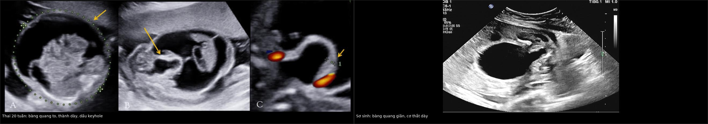
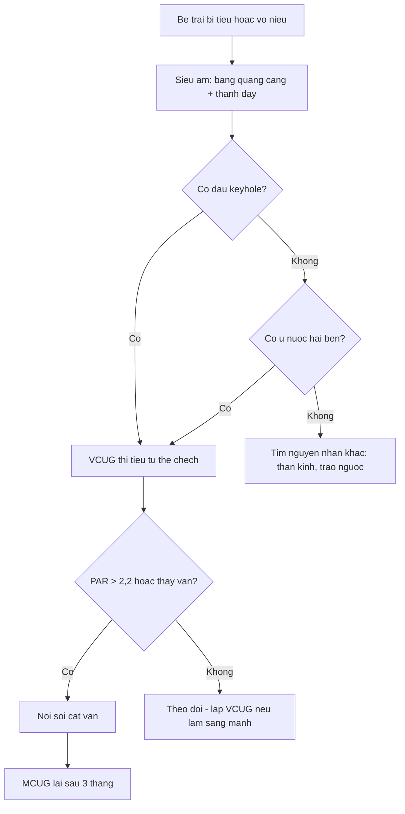
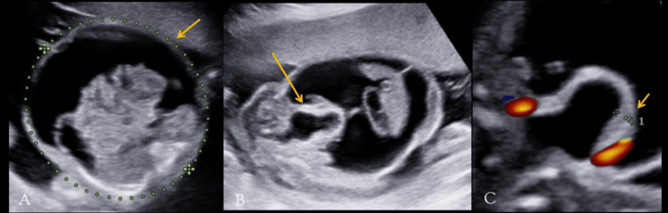
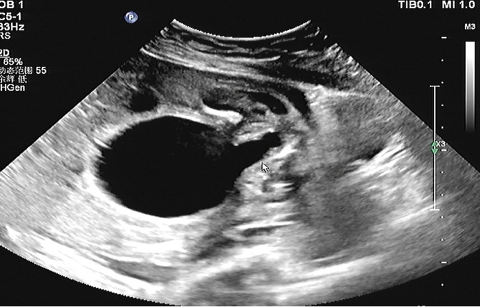

# 3154 — Van niệu đạo sau (PUV) ở trẻ trai: dấu "keyhole", bàng quang thành dày và cái giá của chẩn đoán muộn

**Tags:** `pattern:keyhole` `pattern:gian-nieu-dao` `pattern:thanh-bang-quang-day` `pattern:u-nuoc-than` `vung:bang-quang` `vung:nieu-dao` `vung:than` `vung:thai` `protocol:SA-truoc-sinh` `protocol:SA-than-tiet-nieu` `protocol:VCUG` `score:PAR` `score:BWT`
**Mức chắc chắn (certainty):** tổng hợp y văn (literature synthesis) — ghép **hai ca nguyên văn có ảnh** (Cureus 2024, PMC11380544: thai 20 tuần vỡ bàng quang; Medicine 2024, PMC11666172: sơ sinh có dấu keyhole), **loạt 31 trẻ có đo UR và độ dày thành bàng quang trước–sau cắt van** (J Indian Assoc Pediatr Surg 2020, PMC8853606), **loạt 152 trẻ PUV theo dõi 5 năm** (J Indian Assoc Pediatr Surg 2014, PMC4155628), **loạt 39 trẻ** (Urol Ann 2021, PMC8052897), **audit 10 năm** (BMC Urol 2018, PMC5963049) và **tổng quan VCUG nhi khoa** (Pediatr Nephrol 2026, PMC13009064). Không có ca do nhóm tự chụp.

> **Câu hỏi thực hành:** bé trai **1 ngày tuổi**, đẻ đủ tháng, bụng chướng, **không tiểu** sau 24 giờ, siêu âm thấy **bàng quang căng to** và **hai thận ứ nước**. Bác sĩ trực định **đặt catheter niệu đạo** rồi siêu âm lại. Câu hỏi: **có nên đặt catheter mù không, dấu hiệu nào trên siêu âm đủ để nghĩ van niệu đạo sau, và khi nào bắt buộc chụp VCUG?**
> Bài chốt **ba quyết định**: **(1) bàng quang căng + hai thận ứ nước ở bé trai = nghi LUTO/van niệu đạo sau, phải chụp VCUG để chốt — siêu âm chỉ gợi ý**; **(2) phải đo được "dấu keyhole" và độ dày thành bàng quang, nhưng keyhole KHÔNG đặc hiệu** — nó còn gặp ở bàng quang thần kinh, niệu đạo khổng lồ, hẹp niệu đạo; **(3) đặt catheter không phải điều trị triệt để và có thể thất bại/thủng nếu bàng quang co thắt mạnh — cần dẫn lưu bàng quang trên xương mu khi không lên được, rồi cắt van nội soi.**

## 1. Tổng quan bệnh học – cơ chế hình ảnh: vì sao "keyhole" lại xuất hiện

- **Bệnh học:** van niệu đạo sau (posterior urethral valve, PUV) là **màng/nếp niêm mạc bẩm sinh nằm trong niệu đạo sau**, cản dòng nước tiểu từ bàng quang ra ngoài. Đây là **nguyên nhân tắc nghẽn đường tiểu dưới hay gặp nhất ở bé trai** và là nguyên nhân **suy thận mạn ở trẻ** hàng đầu (BMC Urol 2018, PMC5963049; J Indian Assoc Pediatr Surg 2020, PMC8853606).
- **Tần suất — ba con số:**
  - **1/5.000 – 1/8.000 bé trai sống sinh** (BMC Urol 2018, PMC5963049); một số nguồn châu Âu ghi **1/25.000** (Urol Ann 2021, PMC8052897).
  - **Thể I chiếm 78%** trong loạt 18 ca (PMC5963049) — thể hay gặp nhất, do **nếp niêm mạc từ sàn niệu đạo**; thể II và III hiếm hơn.
  - **72,2% trẻ đến muộn** trong loạt châu Phi (PMC5963049), tuổi trung vị **22 tháng**; trong loạt Ấn Độ, tuổi trung vị **1 tuổi** (1 ngày – 10 tuổi) (PMC8853606) — nghĩa là **không phải lúc nào cũng phát hiện trước sinh**.
- **Hậu quả — vì sao phải chẩn đoán sớm:** tắc nghẽn mạn làm **thành bàng quang phì đại**, **áp lực bàng quang cao**, **trào ngược niệu quản**, **ứ nước – loạn sản thận**, và nếu nặng trong tử cung → **thiểu ối → thiểu sản phổi** (Matern Health Neonatol Perinatol 2015, PMC4823687).
  - **Suy thận mạn 42,7–55,6%**, **suy thận giai đoạn cuối 11,2–18%**, **lọc máu 10%** (J Indian Assoc Pediatr Surg 2014, PMC4155628; BMC Urol 2018, PMC5963049; Urol Ann 2021, PMC8052897).
  - **Tử vong 5,6%** trong loạt 18 ca đến muộn (PMC5963049); **tới 50% suy thận nếu không điều trị kịp** (PMC8853606).
- **TẠI SAO "keyhole" (lỗ khóa):** niệu đạo sau **giãn** vì bị chặn ở phía dưới, trong khi **niệu đạo trước** vẫn bình thường; trên mặt cắt dọc, **bàng quang to + cổ bàng quang + niệu đạo sau giãn** tạo hình **lỗ khóa** — phần "đầu khóa" là bàng quang, phần "thân khóa" là niệu đạo sau giãn, phần "rãnh" là chỗ van.
  - **Vì sao chỉ thấy khi có nước tiểu:** keyhole là **dấu hiệu của chất lỏng**, nên **chỉ hiện khi bàng quang đầy hoặc đang tiểu**; siêu âm lúc bàng quang rỗng có thể **bình thường** — đây là lý do **phải chụp lại** và **không loại trừ PUV bằng một lần siêu âm**.
  - **Vì sao thành bàng quang dày:** theo **định luật Laplace** (áp lực thành ∝ áp lực lòng × bán kính), bàng quang bị tắc phải **tăng áp lực để tống nước tiểu** → **cơ detrusor phì đại**, thành dày. Trong tử cung, **thành bàng quang thai > 3,5 mm** được xem là dày (Cureus 2024, PMC11380544); sau sinh, **trung vị 4 mm trước cắt van** giảm còn **2,5 mm sau cắt van** (PMC8853606).
- **TẠI SAO VCUG là "cửa chốt":** VCUG bơm **thuốc cản quang ngược dòng** qua catheter, chụp **thì tiểu** ở tư thế **chếch (oblique)** — thuốc lấp đầy niệu đạo sau, phơi bày **van, đoạn giãn, và chỗ hẹp**. Trên phim này đo được **tỷ lệ niệu đạo sau/trước (posterior:anterior urethral ratio, PAR)**:
  - **Trẻ chứng: PAR 1,04–1,73**; **trước cắt van trung vị 2,45**, **sau cắt van 1,20** (PMC7343929 — tổng quan 338 bệnh nhân; PMC8853606 — 31 bệnh nhân).
  - **Ngưỡng gợi ý còn van tồn tại: 2,2 – 3,5**, tùy nghiên cứu; **PAR thấp sau cắt van dự báo cắt van thành công** (PMC7343929).
- **Vì sao VCUG có thể bỏ sót:** trong một tổng quan nhi khoa, **nghi ngờ PUV trên VCUG chỉ được đặt ra ở 46% trẻ chưa biết ngồi bô và 59% trẻ đã biết ngồi bô**, và VCUG **bỏ sót trào ngược tới 50%** (Pediatr Nephrol 2026, PMC13009064). Nghĩa là **VCUG bình thường không loại trừ tuyệt đối** khi lâm sàng rất mạnh — cần **chụp lặp có chu kỳ (cyclic VCUG)** hoặc **nội soi niệu đạo**.

## 2. Mẫu hình + chẩn đoán phân biệt theo vị trí tắc nghẽn (Gamut)

- **Mẫu hình cốt lõi:** bé trai **bí tiểu/tiểu yếu, tia nhỏ**, **bàng quang căng**, **hai thận ứ nước**, **thành bàng quang dày**, **dấu keyhole** khi bàng quang đầy; có thể **nhiễm khuẩn tiểu**, **suy thận**, **thiểu ối** trước sinh.
- **Gamut theo vị trí tắc nghẽn (từ trên xuống):**
  1. **Niệu quản – bàng quang:** **hẹp miệng nối niệu quản–bàng quang**, **niệu quản đôi có ureterocele** chèn cổ bàng quang, **trào ngược nặng** — giãn trên, niệu đạo sau **không giãn**.
  2. **Bàng quang:** **bàng quang thần kinh** (nứt đốt sống), **túi thừa bàng quang lớn** cạnh cổ, **bàng quang co thắt** do thuốc/thần kinh — thành dày, nhưng **không có van**.
  3. **Niệu đạo sau:** **van niệu đạo sau thể I–III**, **polyp niệu đạo sau**, **hẹp niệu đạo sau bẩm sinh** — đây là nhóm có **keyhole**.
  4. **Niệu đạo trước:** **van niệu đạo trước**, **túi thừa niệu đạo trước**, **niệu đạo khổng lồ (megalourethra)** — giãn **phía trước** van, khác vị trí keyhole.
  5. **Ngoài đường tiểu:** **khối chậu** chèn bàng quang (nang cùng–cụt, nang buồng trứng), **táo bón nặng** — không giãn niệu đạo.
- **Gamut theo tuổi phát hiện:**
  - **Trước sinh:** thiểu ối + bàng quang to + keyhole + thận tăng âm/nang → **LUTO**, phần lớn là PUV ở bé trai.
  - **Sơ sinh:** bụng chướng, **không tiểu 24–48 giờ**, suy hô hấp do thiểu sản phổi.
  - **Nhũ nhi – trẻ nhỏ:** **nhiễm khuẩn tiểu tái diễn**, tiểu yếu, **sa trực tràng**, chậm tăng cân.
  - **Trẻ lớn – thiếu niên:** **tiểu không kiểm soát ban đêm**, bí tiểu, **suy thận mạn không rõ nguyên nhân**.
- **Ba câu hỏi đọc ảnh:** **(1) bàng quang có căng và thành dày không? (2) niệu đạo sau có giãn (keyhole) không, và giãn ở đâu? (3) hai thận có ứ nước/loạn sản không?** Keyhole + thành dày + ứ nước hai bên ở bé trai → **PUV cho tới khi VCUG/nội soi chứng minh ngược**.

## 3. Bảng so sánh phân biệt (ma trận đối chiếu)

| Thực thể (entity) | Hình ảnh điển hình (SA/VCUG) | Chốt vào (rule-in) | Chốt loại (rule-out) | Gợi ý xác nhận |
|---|---|---|---|---|
| Van niệu đạo sau (PUV) | **Keyhole** ở niệu đạo sau, **bàng quang thành dày**, **ứ nước hai bên**; VCUG: **niệu đạo sau giãn dài**, PAR **2,45** (chứng **1,04–1,73**) | **Bé trai + keyhole + thành bàng quang dày + PAR > 2,2** | Niệu đạo sau **không giãn**, keyhole âm → không phải PUV | **VCUG thì tiểu, tư thế chếch**; nội soi niệu đạo |
| Van niệu đạo trước | Giãn **niệu đạo trước** (bulbar/penile), bàng quang ít dày hơn; VCUG thấy **van phía trước** | **Giãn đoạn trước + chỗ hẹp ở niệu đạo trước** | Giãn đoạn sau → PUV | VCUG; nội soi |
| Hẹp niệu đạo (bẩm sinh/sau can thiệp) | **Đoạn hẹp ngắn**, không có van; tiền sử **đặt catheter/đã cắt van** | **Tiền sử thủ thuật + hẹp khu trú** | Giãn lan tỏa niệu đạo sau → van | VCUG, niệu đồ ngược dòng |
| Niệu đạo khổng lồ (megalourethra) | **Niệu đạo giãn to toàn bộ**, có thể **thiếu thể xốp**, bàng quang **không dày nhiều** | **Giãn toàn bộ niệu đạo, không có van** | Giãn khu trú sau van → PUV | VCUG; siêu âm; niệu đạo đồ |
| Bàng quang thần kinh (nứt đốt sống) | **Thành dày, bàng quang hình tháp**, **ứ nước**, không keyhole; **dấu thần kinh khu trú** | **Dị tật cột sống + bàng quang hình tháp + không van** | Keyhole rõ → PUV | MRI cột sống, niệu động học |
| Trào ngược bàng quang–niệu quản nặng | **Giãn niệu quản – đài bể thận**, **không giãn niệu đạo sau** | **Giãn trên, niệu đạo sau bình thường** | Có keyhole → tắc dưới | VCUG (phân độ VUR) |
| Túi thừa bàng quang / ureterocele | **Túi dịch cạnh bàng quang**, có thể **chèn cổ bàng quang**; ureterocele = **hình "rắn hổ mang"** trong bàng quang | **Cấu trúc dạng túi trong/ngoài bàng quang** | Không có túi, chỉ giãn niệu đạo → van | Siêu âm, VCUG, MRI |
| Polyp niệu đạo sau | **Khối đặc trong lòng niệu đạo sau**, **không phải màng**; có thể gây bí tiểu | **Khối đặc lòng niệu đạo** | Màng mỏng + keyhole → van | Nội soi + sinh thiết |

*Trái: thai **20 tuần** — bàng quang rất to, **thành dày > 3,5 mm**, **dấu keyhole** (mũi tên vàng), kèm **cổ trướng** do vỡ bàng quang (Cureus 2024, PMC11380544, CC BY 4.0). Phải: **sơ sinh** — bàng quang giãn, cổ bàng quang và niệu đạo sau giãn tạo hình lỗ khóa, thành bàng quang dày (Medicine 2024, PMC11666172, CC BY 4.0). Ảnh ghép letterbox, giữ nguyên nhãn A/B/C và mũi tên của tác giả.*

### Ba mẫu hình cần nhớ
- **Keyhole thật:** giãn **niệu đạo sau** (không phải niệu đạo trước), **bàng quang to**, **thành dày**; nếu chỉ thấy bàng quang to mà niệu đạo sau bình thường, nghĩ **bàng quang thần kinh** hoặc **trào ngược**.
- **Thành bàng quang dày:** đo ở **đỉnh và cổ bàng quang** khi bàng quang **căng đầy**; **4 mm → 2,5 mm** sau cắt van là mốc theo dõi đáp ứng (PMC8853606).
- **PAR trên VCUG:** đo **không có catheter**, trên phim **tiểu thì chếch**; **> 2,2** gợi ý còn tắc; **giảm về 1,20** sau cắt van là dấu hiệu tốt (PMC7343929; PMC8853606).

## 4. Protocol chụp + ngưỡng xử trí

- **Trước sinh — siêu âm thai (khi nghi LUTO):**
  - Đo **thể tích bàng quang**, **độ dày thành bàng quang** (ngưỡng **> 3,5 mm** ở thai 20 tuần), tìm **keyhole**, **hai thận ứ nước**, **nang/loạn sản thận**, **thể tích ối** (thiểu ối là dấu nặng).
  - **Không chẩn đoán xác định bằng siêu âm**: LUTO gồm nhiều nguyên nhân, PUV chỉ là một; hội chẩn **sản – nhi – tiết niệu** để quyết định **shunt bàng quang–ối** hay theo dõi.
- **Sau sinh — siêu âm hệ tiết niệu (bước 1):**
  - Bàng quang **căng đầy** (không đặt catheter trước khi chụp nếu bệnh nhi ổn định), đo **thành bàng quang tại đỉnh và cổ**, tìm **keyhole**, đo **đài bể thận**, đánh giá **nhu mô thận** (tăng âm, mất phân biệt vỏ–tủy, nang).
  - **Không dùng siêu âm để loại trừ PUV**: keyhole **có thể âm** khi bàng quang rỗng.
- **VCUG (bước 2 — cửa chốt):**
  - Đặt catheter **nhỏ (5–6 Fr)**, tháo catheter **trước khi chụp thì tiểu**, chụp **AP + chếch (oblique)**, ghi **thì tiểu**; đo **PAR** trên phim chếch **không có catheter**.
  - Đánh giá **trào ngược**, **túi thừa**, **ureterocele**, **hình dạng cổ bàng quang**, và **van**.
  - **Ngưỡng PAR:** chứng **1,04–1,73**; **> 2,2** gợi ý tắc còn lại; **2,5–3,5** là các ngưỡng được đề xuất trong y văn (PMC7343929).
  - **Hạn chế phải nói với gia đình:** VCUG **bỏ sót trào ngược tới 50%**, **chỉ gợi ý PUV ở 46–59%** trẻ, gây **nhiễm khuẩn tiểu sau thủ thuật**, đau và **liều xạ không nhỏ** (PMC13009064).
- **Nội soi niệu đạo (bước 3 — chẩn đoán + điều trị):** **cắt van nội soi (fulguration)** là điều trị đầu tay; nếu không đặt được catheter/không lên được bàng quang → **dẫn lưu bàng quang trên xương mu (vesicostomy)** rồi cắt van thì sau.
  - **Sau cắt van:** **MCUG lại sau 3 tháng** để tìm **van tồn tại**, **hẹp niệu đạo**, **trào ngược**; **van tồn tại 16,7–51,6%**, **hẹp niệu đạo 11,2%**, **20–30% cần cắt van lần hai** (BMC Urol 2018; PMC8853606).
- **Theo dõi dài hạn:** **creatinin/eGFR**, **huyết áp**, **siêu âm thận 6–12 tháng**, **niệu động học** khi có triệu chứng; tư vấn **suy thận mạn 42,7–55,6%** và **ESRD 11,2–18%** dù cắt van thành công.

## 5. Biến thể bình thường và cạm bẫy

- **Keyhole không đặc hiệu:** gặp ở **bàng quang thần kinh**, **niệu đạo khổng lồ**, **hẹp niệu đạo**, và cả **bàng quang căng do bí tiểu vô căn**; phải đo **vị trí giãn** và **PAR**.
- **Siêu âm lúc bàng quang rỗng:** keyhole và thành dày **có thể mất**; đừng loại trừ PUV chỉ vì "siêu âm bình thường".
- **Đo PAR sai vì còn catheter:** catheter làm **mất hình dạng niệu đạo sau**, PAR giả thấp — **tháo catheter trước thì tiểu**.
- **VCUG bình thường nhưng lâm sàng mạnh:** **chỉ 46–59%** ca PUV được gợi ý trên VCUG; cân nhắc **VCUG lặp có chu kỳ** hoặc **nội soi** (PMC13009064).
- **Bỏ sót trào ngược:** VCUG **bỏ sót tới 50%** trào ngược — trào ngược âm không có nghĩa là không có bệnh.
- **Tưởng đã khỏi sau cắt van:** **van tồn tại 16,7–51,6%**, **hẹp niệu đạo 11,2%**, **20–30% cần cắt lần hai** — bắt buộc **MCUG 3 tháng** (BMC Urol 2018; PMC8853606).
- **Creatinin sơ sinh "bình thường":** trong 48 giờ đầu, creatinin phản ánh **creatinin của mẹ**; **không dùng để loại trừ suy thận** ở trẻ PUV.
- **Thành bàng quang dày do khóc/co thắt:** đo khi trẻ **yên, bàng quang căng đầy**, và **lặp lại** trước khi kết luận.
- **Dẫn lưu không đúng đường:** bàng quang **co thắt, thành dày, lòng nhỏ** làm catheter **không lên** hoặc **thủng** — khi thất bại, **dẫn lưu trên xương mu dưới siêu âm**, không cố đẩy catheter.
- **Chẩn đoán muộn = mất thận:** **72,2%** trẻ trong loạt châu Phi đến muộn, với **55,6% suy thận mạn** (PMC5963049).

## 6. Tự lượng giá — Blind Quiz

**Ca 1 — Thai 20 tuần, bàng quang rất to, thành dày. Nhìn ảnh trước, mô tả sau.**

- Gợi ý lâm sàng: siêu âm hình thái thai, **cổ trướng**, **thiểu ối**.
- Câu hỏi: Dấu hiệu chính ở A, B, C? Chẩn đoán nào gộp được **bàng quang to + cổ trướng**? Cần hỏi gì ở lần siêu âm sau?

<b>Bấm để hiện đáp án</b>

- Dấu hiệu: (A) **cổ trướng** (dịch vô hiệu trong ổ bụng, đường kính bụng **189 mm**); (B) **dấu keyhole** — niệu đạo sau giãn sau bàng quang; (C) **thành bàng quang dày > 3,5 mm**.
- Chẩn đoán: **van niệu đạo sau (LUTO)** biến chứng **vỡ bàng quang trong tử cung** — cổ trướng là nước tiểu, không phải dịch báng.
- Lần sau: đo **thể tích ối**, **nhu mô thận** (tăng âm/nang), **độ dày thành bàng quang**, và hội chẩn **shunt bàng quang–ối** nếu nặng.
- Nguồn: Cureus 2024 (PMC11380544), CC BY 4.0.

**Ca 2 — Sơ sinh trai 1 ngày tuổi, bụng chướng, không tiểu. Nhìn ảnh siêu âm.**

- Câu hỏi: Mô tả dấu hiệu. Vì sao **không được kết luận chỉ dựa vào siêu âm**? Bước tiếp theo?

<b>Bấm để hiện đáp án</b>

- Dấu hiệu: **bàng quang giãn lớn**, **cổ bàng quang – niệu đạo sau giãn** tạo hình **keyhole**, **thành bàng quang dày**.
- Vì sao: siêu âm **chỉ gợi ý**; chẩn đoán xác định bằng **VCUG thì tiểu** hoặc **nội soi niệu đạo**; đồng thời phải loại trừ **bàng quang thần kinh, niệu đạo khổng lồ, hẹp niệu đạo**.
- Bước tiếp theo: **VCUG** (đo PAR, tìm trào ngược) → **cắt van nội soi**; nếu không đặt được catheter → **dẫn lưu trên xương mu**.
- Nguồn: Medicine 2024 (PMC11666172), CC BY 4.0.

**Ca 3 — Bé trai 3 tháng sau cắt van, siêu âm còn ứ nước nhẹ, mẹ hỏi "đã khỏi chưa".**

- Câu hỏi: Cần làm gì để trả lời? Ngưỡng nào trên VCUG nói còn tắc? Vì sao vẫn phải theo dõi thận?

<b>Bấm để hiện đáp án</b>

- Cần làm: **MCUG lại sau 3 tháng** (hoặc sớm hơn nếu triệu chứng) để tìm **van tồn tại**, **hẹp niệu đạo**, **trào ngược**.
- Ngưỡng: **PAR > 2,2** gợi ý còn tắc; **PAR trung vị giảm từ 2,45 xuống 1,20** sau cắt van thành công; **thành bàng quang 4 → 2,5 mm** (PMC7343929; PMC8853606).
- Vì sao theo dõi: **suy thận mạn 42,7–55,6%**, **ESRD 11,2–18%**; **van tồn tại 16,7–51,6%**, **20–30% cần cắt lần hai**.
- Nguồn: J Indian Assoc Pediatr Surg 2020/2014; BMC Urol 2018.

## Bài liên quan chéo
- [3086 – Nhiễm khuẩn tiểu và ứ mủ ở trẻ](../3086-cauti-o-tre/lesson.md) (biểu hiện hay gặp của PUV)
- [3010 – Hẹp miệng nối niệu quản–bàng quang ở trẻ](../3010-hep-mien-noi-nieu-quan-bang-quang-o-tre/lesson.md) (tắc nghẽn cao hơn)
- [6112 – Xuất huyết thượng thận ở sơ sinh](../6112-xuat-huyet-thuong-than-so-sinh/lesson.md) (khối thượng thận sơ sinh)
- [6109 – NIV tại nhà quanh mổ ở trẻ](../6109-niv-tai-nha-quanh-mo-o-tre/lesson.md) (hỗ trợ hô hấp khi thiểu sản phổi)
- [3078 – Nang ống utricle/Müllerian](../3078-nang-ong-utricle-mullerian/lesson.md) (khối nang vùng chậu)

## Ảnh
- `images/composite_vnd-sau_keyhole.jpg` — ghép từ Cureus 2024 (PMC11380544) và Medicine 2024 (PMC11666172), cả hai **CC BY 4.0**.
- `images/composite_vnd-sau_truoc-sau-fulguration.jpg` — ghép từ Cureus 2025 (PMC11828713), **CC BY 4.0**.
- `images/3154_vnd-sau_US-Keyhole-thai_PMC11380544.jpg` — siêu âm thai, CC BY 4.0.
- `images/3154_vnd-sau_US-Keyhole-so-sinh_PMC11666172.jpg` — siêu âm sơ sinh, CC BY 4.0.
- `images/3154_vnd-sau_VCUG-truoc-PMC11828713.jpg` — VCUG trước cắt van, CC BY 4.0.
- `images/3154_vnd-sau_VCUG-sau-PMC11828713.jpg` — VCUG sau cắt van, CC BY 4.0.
- Nguồn, giấy phép và ghi chú phái sinh từng ảnh: `images/CREDITS.md`.

> Không dùng để chẩn đoán độc lập khi chưa có người hướng dẫn.
