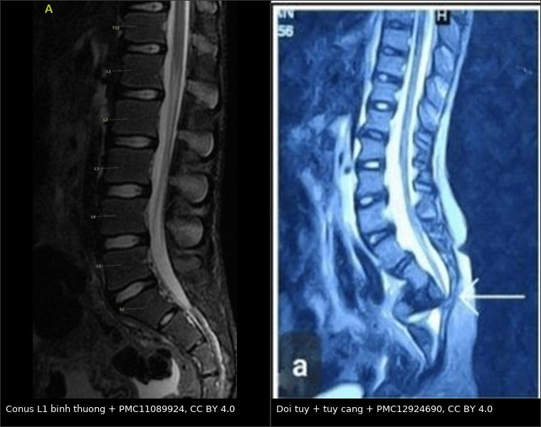
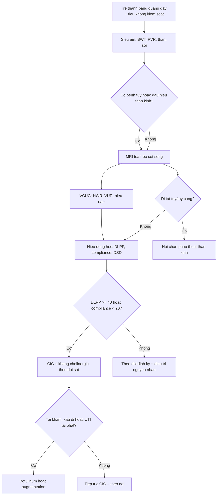
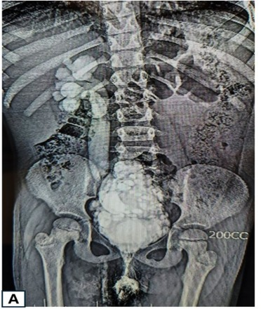
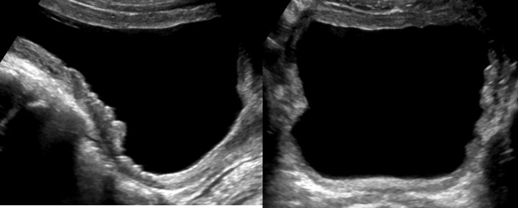
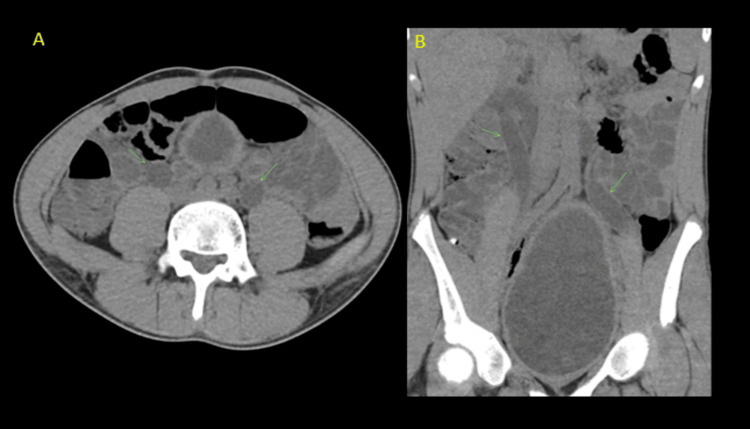

# 3156 — Bàng quang thần kinh ở trẻ: bàng quang "cây thông", thành dày và vì sao phải chụp MRI cột sống

**Tags:** `pattern:thanh-bang-quang-day` `pattern:bang-quang-hinh-thap` `pattern:trabeculation` `pattern:u-nuoc-than` `pattern:trao-nguoc` `vung:bang-quang` `vung:than` `vung:cot-song` `protocol:SA-than-tiet-nieu` `protocol:VCUG` `protocol:MRI-cot-song` `protocol:nieu-dong-hoc` `score:HWR` `score:BWT` `anatomy:bang-quang-than-kinh`
**Mức chắc chắn (certainty):** tổng hợp y văn (literature synthesis) — ghép **tổng quan bàng quang thần kinh ở trẻ MMC** (Diseases 2025, PMC12025530), **tổng quan hình thái bàng quang – áp lực** (J Indian Assoc Pediatr Surg 2025, PMC12094606), **nghiên cứu siêu âm đa phương thức 73 trẻ NB + 100 trẻ chứng** (Sci Rep 2026, PMC12890931), **nomogram 167 + 100 trẻ** (Front Pediatr 2022, PMC9768210), **3 ca rối loạn chức năng nặng/Hinman** (Pediatr Rep 2026, PMC12921987), **3 ca tủy căng ẩn** (Cureus 2025, PMC12779360) và **đồng thuận Delphi** (Eur Urol Open Sci 2026, PMC12936485). Không có ca do nhóm tự chụp.

> **Câu hỏi thực hành:** bé gái **8 tuổi** sau sửa màng não tủy (myelomeningocele, MMC), tiểu không kiểm soát, **nhiễm khuẩn tiểu tái diễn**, siêu âm thấy **bàng quang thành dày, bờ nham nhở**, hai thận **ứ nước nhẹ**. Gia đình hỏi: *“Có phải cháu bị viêm bàng quang mãi không khỏi? Có cần mổ bàng quang không?”*
> Bài chốt **ba quyết định**: **(1) thành bàng quang dày + bàng quang cao/bờ nham nhở ở trẻ có bệnh tủy = bàng quang thần kinh áp lực cao cho tới khi niệu động học chứng minh ngược, không phải “viêm bàng quang tái phát”;** **(2) hình ảnh chỉ là cửa vào — ngưỡng quyết định là DLPP ≥ 40 cmH₂O và compliance < 20 mL/cmH₂O trên niệu động học;** **(3) mọi trẻ bàng quang thần kinh chưa rõ nguyên nhân, hoặc xấu đi dù đã điều trị, phải chụp MRI toàn bộ cột sống để tìm dị tật ẩn/tủy căng — bỏ sót là mất thận dần.**

## 1. Tổng quan bệnh học – cơ chế hình ảnh: vì sao bàng quang “cao lên” và dày thành

- **Bệnh học:** bàng quang thần kinh (neurogenic bladder, NB — theo ICCS còn gọi rối loạn chức năng đường tiểu dưới do thần kinh, NLUTD) là **mất phối hợp chứa – tống nước tiểu do tổn thương thần kinh trung ương hoặc ngoại biên**, với bàng quang và cơ thắt có thể **co quá mức, không co, hoặc phối hợp sai**. **MMC là nguyên nhân hay gặp nhất ở trẻ**; ngoài ra: chấn thương tủy, **tủy căng/dị tật tủy kín**, bất sản cùng cụt, bại não, u tủy, sau mổ vùng cùng cụt.
- **Dịch tễ — ba con số:** MMC **0,5–1,0/1.000 thai** ở Hoa Kỳ; **> 90%** trẻ MMC có rối loạn chức năng bàng quang ở mức cần đánh giá (Diseases 2025, PMC12025530) — con số thấp hơn (**~50%**) trong một đoàn hệ khác tùy định nghĩa “rối loạn chức năng” (Front Pediatr 2022, PMC9768210); **tổn thương đường tiết niệu trên là nguyên nhân tử vong chính** ở nhóm NB nếu không kiểm soát áp lực.
- **Hai kiểu sinh lý bệnh (đọc ảnh phải nghĩ tới kiểu nào):**
  1. **Tổn thương trên nhân cùng (suprasacral — MMC, chấn thương tủy trên S2):** mất ức chế trung ương → **detrusor co bóp quá mức + co thắt cơ thắt không đồng bộ (detrusor–sphincter dyssynergia, DSD)** → **áp lực cao, compliance thấp, thành dày, trabeculation, bàng quang cao, VUR, ứ nước thận**.
  2. **Tổn thương dưới nhân cùng (sacral/peripheral — bất sản cùng cụt, tổn thương đuôi ngựa):** **bàng quang không co bóp (areflexic), dung tích lớn, thành mỏng, tồn lưu nhiều** → tiểu rỉ, nhiễm khuẩn, sỏi — **hình ảnh “êm” nhưng vẫn phá thận**.
- **TẠI SAO thành bàng quang dày — định luật Laplace:** sức căng thành **T ∝ P × r** (P = áp lực trong lòng, r = bán kính). Bàng quang bị tắc chức năng phải **tạo áp lực cao hơn để tống nước tiểu** → **cơ detrusor phì đại**, rồi **trabeculation** (các bó cơ phì đại xen kẽ vùng mỏng), **cellule/pseudodiverticulum** (niêm mạc lồi qua chỗ yếu). Đây là lý do **thành dày không phải “viêm” mà là dấu hiệu của áp lực cao mạn**.
- **TẠI SAO bàng quang cao, hẹp — “pine tree/Christmas tree bladder”:** lớp cơ vòng ở giữa co thắt bóng bàng quang theo chiều ngang, trong khi lớp dọc đẩy dài theo trục; khi **mất cảm giác + không khởi phát được tiểu + DSD**, bàng quang chỉ còn **chứa và căng dọc** → **cao, hẹp, đáy rộng, đỉnh nhọn**. Mô học: **mất/giảm các intermediate junction**, tế bào cơ thoái hóa — nên bàng quang vừa dày vừa **kém co bóp** (J Indian Assoc Pediatr Surg 2025, PMC12094606).
- **Định lượng hóa hình thái — vì sao không dừng ở mô tả:**
  - **Tỷ lệ cao/rộng (height-to-width ratio, HWR)** đo trên cystogram ở **dung tích cystometric tối đa (MCC)**: bàng quang áp lực cao **1,50 vs 1,37** (cut-off **1,4**: Se **87%**, Sp **56,9%** — Kumano, 81 trẻ MMC); và **1,55 vs 1,26** khi áp lực chứa **> 30 cmH₂O** (cut-off **1,3**: Se **87,5%**, Sp **48,28%** — Aithal, 53 trẻ). **Độ đặc hiệu thấp** — HWR là **công cụ sàng lọc**, không thay niệu động học (PMC12094606).
  - **Độ dày thành bàng quang (bladder wall thickness, BWT)** trên siêu âm: **3,61 ± 1,01 mm** ở 73 trẻ NB vs **2,52 ± 0,26 mm** ở 100 trẻ chứng; cut-off **2,98 mm** cho Se **71,23%**, Sp **98,00%**. BWT tương quan nghịch với compliance (**r = −0,642**) và thuận với DLPP (**r = 0,426**) (Sci Rep 2026, PMC12890931).
  - **Độ cứng thành bàng quang bằng siêu âm đàn hồi sóng biến dạng (shear wave elastography, SWE):** vận tốc sóng **3,30 vs 2,22 m/s**, cut-off **2,47 m/s** (Se **90,41%**, Sp **74,00%**) — về vật lý, **SWV tăng khi mô cứng hơn** (SWV = √(G/ρ), G = mô đun trượt), nên phản ánh **xơ hóa/phì đại** chứ không phải “dày” đơn thuần.
- **Ngưỡng niệu động học — “chốt” thật sự:**
  - **DLPP (detrusor leak point pressure) ≥ 40 cmH₂O:** McGuire 1981 theo dõi **42 trẻ myelodysplasia** — nhóm áp lực cao có **81% giãn niệu quản** và **68% VUR**, nhóm < 40 cmH₂O **không ca nào VUR**. Trong nomogram 267 trẻ, **DLPP ≥ 40 cmH₂O OR 3,588** — yếu tố nguy cơ mạnh nhất (PMC9768210).
  - **Compliance < 20 mL/cmH₂O: OR 2,444**; **bàng quang tăng hoạt (OAB): OR 2,848**; **UTI tái phát: OR 2,278**; **CIC là yếu tố bảo vệ: OR 0,374** (PMC9768210).
  - **Ngưỡng “sinh lý” của áp lực chứa:** **98,1%** dung tích bàng quang được chứa ở **Pdet < 20 cmH₂O** và **99,9%** ở **< 30 cmH₂O** (Houle 1993, dẫn trong PMC12094606) — nên **> 30 cmH₂O** đã là bất thường, **≥ 40 cmH₂O** là nguy cơ cao.
- **TẠI SAO phải chụp MRI cột sống:** hình ảnh bàng quang **không cho biết nguyên nhân thần kinh**. Dị tật tủy kín có thể **không có dấu ngoài da**, và **tủy căng ẩn có thể có conus ở L1–L2 bình thường** (PMC12779360). Các mốc giải phẫu: **conus ngang L1–2** ở người trưởng thành (đạt vị trí này quanh ngày thai 60); **dây tận cùng > 2 mm = dày** (một số đề xuất **1,1 mm** cho u mỡ dây); **dây tận cùng nổi 11,3%**, **dây dày > 2 mm 2,2%**; tới **40%** u mỡ tủy đã có bất thường thần kinh–cơ–niệu lúc sinh (Clin Exp Pediatr 2025, PMC12877303).
- **TẠI SAO hình ảnh “kém nhạy” hơn niệu động học:** trong MMC, **khám lâm sàng và hình ảnh thường không phát hiện được tổn thương tủy**; chính niệu động học mới phân tầng nguy cơ (Diseases 2025, PMC12025530). Vì vậy **không được dùng “siêu âm bình thường” để trấn an**.

## 2. Mẫu hình + chẩn đoán phân biệt theo mức tổn thương (Gamut)

- **Mẫu hình cốt lõi:** trẻ có **tiểu không kiểm soát/tiểu rỉ, nhiễm khuẩn tiểu tái diễn, táo bón**; siêu âm: **bàng quang thành dày, bờ nham nhở, có cellule**, có thể **cao – hẹp**, **tồn lưu sau tiểu (PVR) lớn**, **ứ nước hai bên**; VCUG: **bàng quang cây thông, VUR, cổ bàng quang mở/hep**, có thể **“spin-top” niệu đạo**; X-quang/MRI: **dị tật cột sống, conus thấp, dây dày, đôi tủy**.
- **Gamut theo mức tổn thương thần kinh:**
  1. **Trên nhân cùng (MMC, chấn thương tủy, u tủy):** bàng quang **nhỏ – dày – co thắt**, DSD, **áp lực cao**, **VUR + ứ nước + sẹo thận**.
  2. **Dưới nhân cùng (bất sản cùng cụt, tổn thương đuôi ngựa, sau mổ vùng cùng cụt):** bàng quang **lớn – thành mỏng – không co bóp**, **PVR rất lớn**, tiểu rỉ liên tục, sỏi.
  3. **Hỗn hợp/không hoàn toàn:** hình thái trung gian, **không đoán được bằng hình ảnh** — phải niệu động học.
- **Gamut theo hình thái cystogram (Friedenberg & Ney 1960, dẫn trong PMC12094606):** **bàng quang lớn mất trương lực** · **biến dạng “đồng hồ cát”** · **bàng quang hình cây thông** · **bàng quang co nhỏ, tăng trương lực**. Ogawa 1991 (231 bệnh nhân): tổn thương đường trên **8%** ở độ I, **52%** độ II, **62%** độ III — **hình thái càng biến dạng, nguy cơ càng cao**.
- **Gamut theo nguyên nhân “bắt chước” bàng quang thần kinh:**
  - **Hinman/non-neurogenic neurogenic bladder:** hình ảnh **y hệt** NB (thành dày, trabeculation, VUR, ứ nước) nhưng **không có tổn thương thần kinh**; cơ chế là **hành vi nín tiểu/co cơ thắt sai** (Pediatr Rep 2026, PMC12921987).
  - **Hội chứng niệu–mặt (urofacial/Ochoa):** **mặt nhăn ngược khi cười** + bàng quang cây thông, không tổn thương tủy (Case Rep Urol 2025, PMC12431806).
  - **Tắc nghẽn giải phẫu:** **van niệu đạo sau** (keyhole — xem bài 3154), **hẹp niệu đạo**, **túi thừa lớn/ureterocele** chèn cổ bàng quang.
- **Ba câu hỏi đọc ảnh + một câu bắt buộc:**
  1. **Thành bàng quang dày bao nhiêu mm, có trabeculation/cellule không?**
  2. **Bàng quang cao/hẹp không (HWR), có VUR, ứ nước, sẹo thận không?**
  3. **Có tồn lưu lớn, sỏi, khí trong thành không?**
  4. **BẮT BUỘC: nguyên nhân thần kinh là gì — đã chụp MRI toàn bộ cột sống chưa?**

## 3. Bảng so sánh phân biệt (ma trận đối chiếu)

| Thực thể (entity) | Hình ảnh điển hình (SA/VCUG/MRI) | Chốt vào (rule-in) | Chốt loại (rule-out) | Gợi ý xác nhận |
|---|---|---|---|---|
| **NB trên nhân cùng (MMC/SCI)** | **Thành dày 3,6–5 mm, trabeculation, bàng quang cao (HWR 1,3–1,5)**, VUR, ứ nước; MRI: MMC/tủy căng | **Bệnh tủy đã biết + DSD + DLPP ≥ 40 cmH₂O** | Thành mỏng, bàng quang lớn, không DSD → kiểu dưới nhân cùng | **Niệu động học** (DLPP, compliance), MRI cột sống nền |
| **NB dưới nhân cùng (bất sản cùng cụt, đuôi ngựa)** | **Bàng quang lớn, thành mỏng, đáy tròn**, **PVR rất lớn**, ứ nước hai bên | **Bất thường cùng cụt/rễ thần kinh + bàng quang không co bóp** | Thành dày + HWR cao → kiểu trên nhân cùng | UDS: **không có co bóp, compliance có thể bình thường**; MRI |
| **Hinman (non-neurogenic)** | **Y hệt NB**: thành dày, trabeculation, “cây thông”, VUR độ V; **MRI tủy bình thường** | **Đủ 5 tiêu chuẩn Hinman + MRI âm + DSD trên UDS** | Có tổn thương tủy/dị tật → NB thật | UDS + MRI + đáp ứng **urotherapy/biofeedback** |
| **Van niệu đạo sau (PUV)** | **Keyhole** niệu đạo sau, bàng quang dày, ứ nước; **bé trai**, có thể thiểu ối trước sinh | **Keyhole + PAR > 2,2 trên VCUG** | Niệu đạo sau không giãn → không PUV | VCUG thì tiểu; nội soi (bài 3154) |
| **Trào ngược bàng quang–niệu quản nặng** | Giãn niệu quản–đài bể thận, **niệu đạo sau bình thường**, thành bàng quang dày nhẹ | **Giãn trên + VCUG có VUR độ IV–V** | Có keyhole/HWR cao → tắc dưới | VCUG phân độ; DMSA |
| **Túi thừa bàng quang lớn / ureterocele** | **Cấu trúc dạng túi** cạnh bàng quang, có thể chèn cổ; ureterocele = “đầu rắn hổ mang” | **Túi dịch thông với lòng bàng quang, to khi tiểu** | Thành dày lan tỏa, không túi → NB | VCUG thì tiểu; siêu âm |
| **Hội chứng niệu–mặt (Ochoa)** | **Bàng quang cây thông + VUR**, không tổn thương tủy; **mặt nhăn ngược khi cười** | **Bất thường mặt khi cười + hình ảnh NB + MRI âm** | Mặt bình thường → NB/Hinman | Khám mặt; MRI; UDS |
| **Viêm bàng quang nặng (cystitis cystica, tăng áp lực do táo bón)** | Thành dày **lan tỏa, đối xứng**, niêm mạc phù; **không DSD**, hết sau điều trị | **Triệu chứng cấp + hồi phục sau điều trị** | Thành dày mạn + HWR cao + PVR lớn → NB | Siêu âm lặp sau điều trị; UDS nếu kéo dài |

*Trái: **conus ngang L1** (bình thường), dây tận cùng mảnh — Cureus 2024, PMC11089924, CC BY 4.0. Phải: **đôi tủy (diastematomyelia)** — T2 sagittal tách tủy và T2 axial hai tủy trong một bao màng cứng — Cureus 2026, PMC12924690, CC BY 4.0. Ảnh ghép letterbox, giữ nguyên nhãn và mũi tên của tác giả.*

### Ba mẫu hình cần nhớ
- **“Bàng quang cây thông” = áp lực cao mạn, không phải viêm:** thành dày + cao/hẹp + trabeculation; **HWR ≥ 1,3–1,4** chỉ là **gợi ý**, chốt bằng **DLPP/compliance**.
- **Bàng quang lớn – thành mỏng cũng là bàng quang thần kinh:** kiểu **dưới nhân cùng**; nguy cơ đến từ **ứ trệ – nhiễm khuẩn – sỏi**, không phải áp lực cao; **đừng cho “bình thường” vì thành không dày**.
- **Hình ảnh giống nhau ≠ cùng bệnh:** NB, Hinman và Ochoa có thể **cùng hình thái**; khác biệt nằm ở **MRI tủy + niệu động học + khám mặt**.

## 4. Protocol chụp + hệ phân độ/ngưỡng xử trí

- **Siêu âm hệ tiết niệu (đầu tay, không bức xạ):**
  - **Bàng quang căng đầy** (không đặt catheter trước nếu trẻ ổn định) — đo **BWT tại thành trước, 2 điểm A/B hai bên đường giữa**, lấy trung bình (theo Müller, dùng trong PMC12890931); đo **thể tích**, **PVR**, tìm **trabeculation/cellule/sỏi**.
  - Ngưỡng tham khảo: **BWT ≥ 2,98 mm** gợi ý NB (Se 71%, Sp 98%); **SWV thì làm đầy ≥ 2,47 m/s** (Se 90%, Sp 74%) — nhưng **chưa có ngưỡng theo tuổi được chuẩn hóa**, nên **không dùng một mình** (PMC12890931).
  - Đo **đài bể thận**, **niệu quản**, **độ dày nhu mô**, tìm **sẹo thận**; đánh giá **bóng cột sống** và **hố lõm cùng cụt** trên cùng buổi.
- **VCUG (voiding cystourethrography) — cửa chốt hình thái:**
  - Chụp **thì làm đầy + thì tiểu**, tư thế **AP + chếch**; đo **HWR ở MCC** (cao/rộng), phân độ **VUR I–V**, tìm **túi thừa, ureterocele, cổ bàng quang**, đánh giá **niệu đạo** (keyhole, spin-top, hẹp).
  - **HWR ≥ 1,3–1,4** gợi ý áp lực cao nhưng **Sp chỉ 48–57%** → **không loại trừ** và **không thay UDS**.
- **Niệu động học (urodynamic study, UDS) — chuẩn vàng chức năng:**
  - Đo **dung tích, compliance, detrusor overactivity, DSD, DLPP, PVR**; làm **sau khi đã điều trị nhiễm khuẩn** và **trước/độc lập với hình ảnh**.
  - Ngưỡng hành động: **DLPP ≥ 40 cmH₂O**, **compliance < 20 mL/cmH₂O**, **Pdet khi chứa > 30–40 cmH₂O** = **bàng quang đe dọa đường trên**; **OAB + UTI tái phát** làm tăng nguy cơ (PMC9768210).
- **MRI toàn bộ cột sống (bắt buộc khi chưa rõ nguyên nhân hoặc xấu đi):**
  - **T2 sagittal + T1/T2 axial**, lát **1–3 mm**, từ **hố sau đến cùng cụt**; tìm **conus thấp (< L2)**, **dây tận cùng dày > 2 mm**, **u mỡ**, **đôi tủy**, **đường rò da**, **ống tủy rỗng**, **tủy căng**.
  - **Cạm bẫy:** **tủy căng ẩn có conus bình thường** (PMC12779360) — nếu UDS rất bất thường mà MRI “bình thường”, **hội chẩn thần kinh** thay vì kết luận âm.
- **DMSA (nếu có):** đánh giá **sẹo thận** sau **4–6 tháng** để tránh nhầm tổn thương cấp hồi phục.
- **Điều trị theo tầng nguy cơ:** **CIC sạch sớm** (EAU/ESPU khuyến cáo **ngay sau sinh** khi cần) + **kháng cholinergic** (oxybutynin) → **botulinum 200 U** (tới **300 U**) khi kháng trị → **tăng dung tích bàng quang (augmentation cystoplasty)** khi **dung tích nhỏ/compliance thấp không đáp ứng**; **không mổ vì “thành dày” đơn thuần** (Diseases 2025, PMC12025530).

## 5. Biến thể bình thường và cạm bẫy

- **Thành bàng quang dày giả khi bàng quang rỗng:** cơ detrusor co lại làm thành **dày biểu kiến**; **luôn đo khi bàng quang căng đầy** và lặp lại nếu trẻ khóc/co thắt.
- **“Trabeculation” giả trên siêu âm:** bóng khí trong lòng, catheter, hoặc thành bàng quang chùng sau tiểu — **đối chiếu VCUG** trước khi kết luận.
- **Bàng quang lớn – thành mỏng không phải “lành”:** kiểu **dưới nhân cùng** gây **ứ trệ, UTI, sỏi, ứ nước**; bỏ theo dõi vì “không dày” là bỏ sót.
- **Hinman bị gọi nhầm là bệnh thần kinh:** MRI tủy bình thường + hình ảnh NB + **DSD** = Hinman; điều trị là **urotherapy/biofeedback ± kháng cholinergic**, không phải CIC suốt đời mặc định (Pediatr Rep 2026, PMC12921987).
- **Ngược lại, “Hinman” bị gọi nhầm là rối loạn tâm lý:** phải **loại trừ tủy căng/dị tật ẩn bằng MRI** trước khi quy cho hành vi.
- **Tủy căng ẩn với conus bình thường:** **conus L1–L2 không loại trừ** tủy căng ẩn (PMC12779360); dựa vào **UDS + dấu lâm sàng + theo dõi**, không chỉ một phim.
- **Keyhole không đặc hiệu:** còn gặp ở **bàng quang thần kinh, niệu đạo khổng lồ, hẹp niệu đạo** — phải đo **vị trí giãn + PAR** (bài 3154).
- **Bỏ sót sỏi/UTI:** trẻ NB **sốt** hoặc **tiểu máu** cần **siêu âm + cấy** trước khi quy tất cả cho “bàng quang thần kinh” (bài 671, 691).
- **Sau tăng dung tích bàng quang:** **sỏi 10–52%**, **thủng tự phát 1,9–4,5%**, **ung thư tại miệng nối 1,2–4,5%** sau > 10 năm — **đau bụng + sốt ở trẻ đã augmentation là cấp cứu**, không phải “nhiễm khuẩn tái phát”.
- **Hội chứng niệu–mặt dễ bỏ:** **mặt nhăn ngược khi cười** là dấu rẻ tiền; hỏi/khám mặt ở mọi trẻ có bàng quang cây thông không rõ nguyên nhân.

## 6. Tự lượng giá — Blind Quiz

**Ca 1 — Bé gái 8 tuổi sau sửa MMC, tiểu không kiểm soát, UTI tái diễn. Nhìn VCUG trước, mô tả sau.**

- Gợi ý lâm sàng: đã sửa MMC, **cấy nước tiểu nhiều lần dương tính**, siêu âm thận phải **mỏng nhu mô**.
- Câu hỏi: Hình dạng bàng quang? Có trào ngược không? **Bước tiếp theo bắt buộc** để quyết định điều trị?

<b>Bấm để hiện đáp án (findings + chẩn đoán)</b>

- Dấu hiệu: bàng quang **cao, hẹp, đáy rộng, đỉnh nhọn** (“Christmas tree”), **bờ nham nhở/trabeculation**, dung tích hiển thị **200 mL**; **VUR độ 5 bên phải** với niệu quản giãn ngoằn ngoèo.
- Chẩn đoán: **bàng quang thần kinh áp lực cao sau MMC** — hình thái là hệ quả của **DSD + áp lực chứa cao**; ca gốc còn cho thấy **thận phải không chức năng trên DMSA**.
- Bước tiếp theo: **niệu động học (DLPP, compliance)** + **siêu âm thận/PVR**; nếu **DLPP ≥ 40 cmH₂O hoặc compliance < 20 mL/cmH₂O** → **CIC + kháng cholinergic**, xét **botulinum/augmentation**; **MRI cột sống** nếu chưa có hoặc triệu chứng thay đổi.
- Nguồn ảnh: BMC Surgery 2026 (PMC12933896), CC BY 4.0.

**Ca 2 — Bé trai 9 tuổi, tiểu rỉ ban ngày, UTI tái diễn, không yếu chi. Nhìn siêu âm và CT.**

- Câu hỏi: Mô tả thành bàng quang và đường tiết niệu trên. Chẩn đoán nào gộp được cả hai? Cần thêm hai thăm khám nào để **phân biệt NB thật với Hinman**?

<b>Bấm để hiện đáp án (findings + chẩn đoán)</b>

- Dấu hiệu: siêu âm — **thành bàng quang dày, bờ nham nhở, trabeculation**; CT — **ứ nước–niệu quản hai bên**, mỏng vỏ thận cực trên trái.
- Chẩn đoán: **hình ảnh kiểu bàng quang thần kinh**, nhưng bệnh nhi **không có dấu thần kinh** → phải phân biệt **Hinman (non-neurogenic)** với **NB do dị tật tủy ẩn**.
- Hai thăm khám: **MRI toàn bộ cột sống** (trong ca gốc: **tủy và dây tận cùng bình thường**) + **niệu động học** (DSD, áp lực); kết hợp **urotherapy/biofeedback** — ca gốc đáp ứng với kháng cholinergic + huấn luyện.
- Nguồn ảnh: Cureus 2024 (PMC11089924), CC BY 4.0.

**Ca 3 — Bé gái 7 tuổi, tiểu không kiểm soát + yếu chi dưới nhẹ. So sánh hai MRI cột sống.**

- Câu hỏi: Conus của mỗi bên nằm ở đâu? Bên nào bất thường, bất thường gì? Vì sao phát hiện này **đổi hoàn toàn hướng điều trị**?

<b>Bấm để hiện đáp án (findings + chẩn đoán)</b>

- Dấu hiệu: trái — **conus ngang L1**, dây tận cùng mảnh, không khối; phải — **tủy tách đôi (diastematomyelia)** trên T2 sagittal, **hai tủy trong một bao màng cứng** trên T2 axial, kèm **tủy căng**.
- Chẩn đoán: **dị tật tủy kín gây bàng quang thần kinh** — không phải “bàng quang thần kinh vô căn”.
- Vì sao đổi hướng: **phẫu thuật thần kinh (giải phóng tủy/cắt dây tận cùng)** có thể **ổn định hoặc cải thiện chức năng bàng quang**, trong khi chỉ điều trị bàng quang sẽ **mất dần chức năng thận và chi**; ngược lại, can thiệp bàng quang đơn thuần không ngăn được **tái căng tủy**.
- Nguồn ảnh: Cureus 2024 (PMC11089924) và Cureus 2026 (PMC12924690), CC BY 4.0.

## 7. Câu hỏi nghiên cứu & điểm chưa đồng thuận (tính đến 11/2026)

1. **[Tranh cãi] Ở trẻ có tủy căng ẩn và rối loạn bàng quang, cắt dây tận cùng có cải thiện chức năng bàng quang so với điều trị bảo tồn không?**
   - **Đã biết:** rối loạn bàng quang là dấu hiệu nhạy nhất của tủy căng ẩn; một số loạt báo cáo **60–80%** cải thiện tiểu không kiểm soát/dung tích sau cắt dây (PMC12779360).
   - **Chưa rõ:** tiêu chuẩn chọn bệnh (conus bình thường vẫn mổ?), thời điểm mổ, và tỷ lệ cải thiện thật so với **diễn tiến tự nhiên**.
   - **Hướng nghiên cứu:** RCT/đoàn hệ tiến cứu có **UDS trước–sau** và nhóm chứng bảo tồn.
   - **Nguồn:** PMC12779360 (2025); PMC12924690 (2026).

2. **[Khoảng trống] Các chỉ số không xâm lấn (HWR trên cystogram, BWT/SWE trên siêu âm) có thể thay hoặc giảm tần suất niệu động học ở trẻ bàng quang thần kinh không?**
   - **Đã biết:** HWR cut-off **1,3–1,4** có Se **87–87,5%** nhưng Sp chỉ **48–57%**; BWT cut-off **2,98 mm** (Se **71%**, Sp **98%**) và SWV **2,47 m/s** (Se **90%**, Sp **74%**) tương quan với DLPP/compliance (PMC12094606; PMC12890931).
   - **Chưa rõ:** chưa có **giá trị chuẩn theo tuổi**, chưa **ngoại kiểm** đa trung tâm, và chưa chứng minh **thay được outcome** (sẹo thận, mất ghép).
   - **Hướng nghiên cứu:** nghiên cứu chẩn đoán tiến cứu, so sánh **diện tích dưới đường cong** với UDS và outcome 5 năm.
   - **Nguồn:** PMC12094606 (2025); PMC12890931 (2026).

3. **[Khác biệt thực hành] Thời điểm và tần suất niệu động học/MRI cột sống sau sửa MMC khác nhau giữa các trung tâm — ảnh hưởng thế nào tới phát hiện tổn thương đường trên?**
   - **Đã biết:** EAU/ESPU khuyến cáo **CIC sớm**, nhưng lịch UDS không thống nhất; tổng quan 274 bài cho thấy **15% không định nghĩa bất thường thận**, chỉ **19,8%** định nghĩa rõ giãn thận (PMC12936485); hình ảnh **kém nhạy hơn UDS** (PMC12025530).
   - **Chưa rõ:** có cần UDS **định kỳ ở trẻ không triệu chứng** không, và **MRI lặp** ở trẻ đã biết dị tật.
   - **Hướng nghiên cứu:** registry đa trung tâm, chuẩn hóa định nghĩa **UUTD** và lịch theo dõi.
   - **Nguồn:** PMC12936485 (2026); PMC12025530 (2025).

## Bài liên quan chéo
- [3154 – Van niệu đạo sau (PUV) ở trẻ: keyhole, PAR và cắt van](../3154-van-nieu-dao-sau-o-tre/lesson.md) (tắc nghẽn giải phẫu bắt chước NB)
- [3157 – Hẹp niệu đạo sau cắt van ở trẻ](../3157-hep-nieu-dao-sau-cat-van-o-tre/lesson.md) (theo dõi sau can thiệp)
- [691 – Sỏi bàng quang & sỏi quanh catheter ở trẻ bàng quang thần kinh](../691-soi-bang-quang-va-soi-quanh-catheter-o-tre/lesson.md) (biến chứng ứ trệ)
- [671 – Nhiễm trùng tiểu & viêm thận–bể thận ở trẻ bàng quang thần kinh](../671-nhiem-trung-tieu-bang-quang-than-kinh-o-tre/lesson.md) (sốt + NB)
- [668 – Theo dõi sau tháo căng tủy & bàng quang thần kinh](../668-theo-doi-sau-thao-cang-tuy-bang-quang-than-kinh/lesson.md) (tái căng, UUTD)
- [635 – Dị tật tiết niệu nhi (SFU, VUR, PUV)](../635-di-tat-tiet-nieu-nhi-SFU-VUR-PUV/lesson.md) (gamut dị tật)
- [600 – Tổng quan Nhi khoa](../600-tong-quan-nhi-khoa/lesson.md)

## Ảnh
- `images/3156_bang-quang-than-kinh_VCUG-Christmas-tree_PMC12933896.jpg` — VCUG “bàng quang cây thông” + VUR độ 5, CC BY 4.0 (cắt khung A).
- `images/3156_bang-quang-than-kinh_US-thanh-day_PMC11089924.jpg` — siêu âm thành bàng quang dày/trabeculation, CC BY 4.0.
- `images/3156_bang-quang-than-kinh_CT-u-nuoc_PMC11089924.jpg` — CT ứ nước–niệu quản hai bên, CC BY 4.0.
- `images/3156_bang-quang-than-kinh_MRI-doi-day-tuy_PMC12924690.jpg` — MRI đôi tủy, CC BY 4.0 (cắt khung a–b).
- `images/3156_bang-quang-than-kinh_MRI-cot-song-binh-thuong_PMC11089924.jpg` — MRI cột sống bình thường, CC BY 4.0 (cắt khung A).
- `images/composite_3156_MRI-cot-song.jpg` — ảnh ghép đối chiếu, CC BY 4.0.
- Nguồn, giấy phép và ghi chú phái sinh từng ảnh: `images/CREDITS.md`.

> Không dùng để chẩn đoán độc lập khi chưa có người hướng dẫn.
