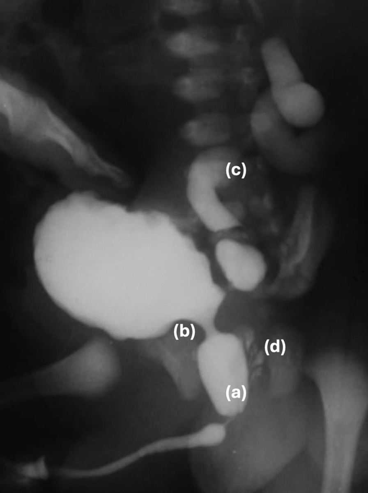
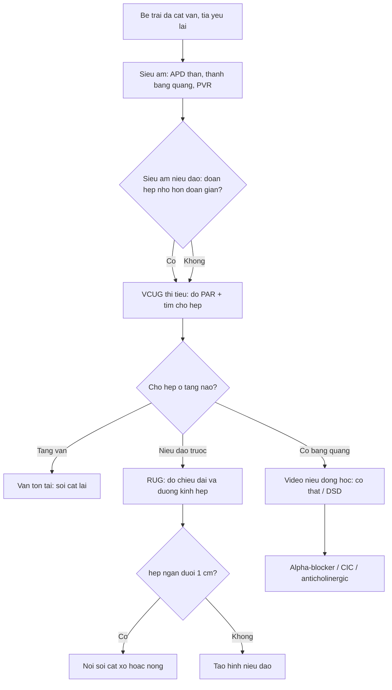
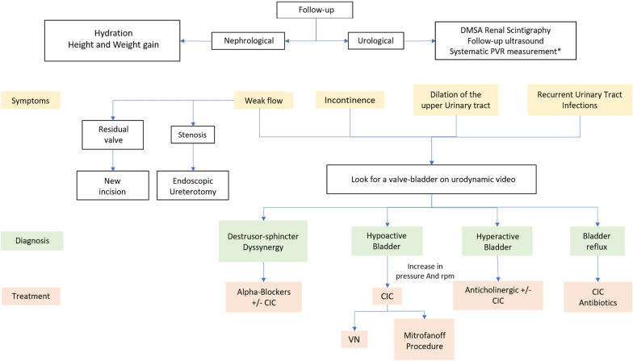
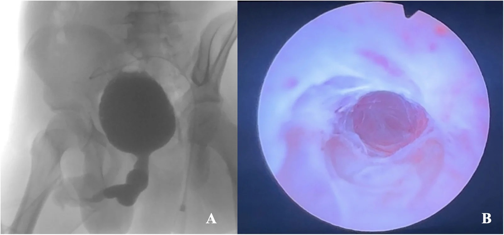
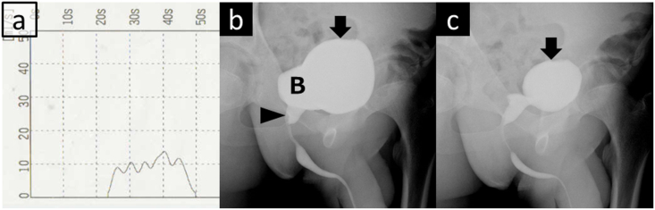
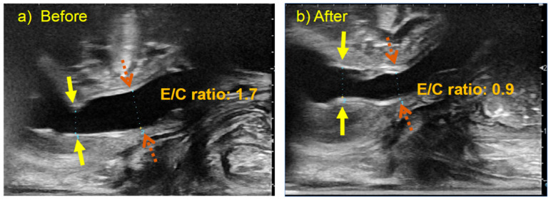

# 3157 — Hẹp niệu đạo sau cắt van niệu đạo sau ở trẻ: "tia yếu trở lại" không có nghĩa là van còn

**Tags:** `pattern:hep-nieu-dao` `pattern:gian-nieu-dao-sau` `pattern:thanh-bang-quang-day` `pattern:u-nuoc-than` `pattern:bi-tieu` `vung:nieu-dao` `vung:bang-quang` `vung:than` `vung:khung-chau` `protocol:VCUG` `protocol:RUG` `protocol:SA-nieu-dao` `protocol:video-nieu-dong-hoc` `score:PAR` `score:E-C-ratio`

**Mức chắc chắn (certainty):** tổng hợp y văn (literature synthesis) — ghép **loạt 180 niệu đạo đồ ngược dòng ở trẻ** (Pediatric Radiology 2023, **PMC9935245**), **nghiên cứu cắt van dưới siêu âm thời gian thực 46 trẻ có đo đường kính niệu đạo** (Children 2025, **PMC12562508**, CC BY 4.0), **báo cáo cắt van bằng cơ học không dùng nhiệt** (Iran J Med Sci 2023, **PMC10541541**, CC BY-ND 4.0), **loạt 55 trẻ tìm yếu tố dự báo van tồn tại** (Korean J Urol 2014, **PMC3897633**), **loạt 31 trẻ đo PAR và độ dày thành bàng quang** (J Indian Assoc Pediatr Surg 2022, **PMC8853606**), **ca hẹp niệu đạo dài ở trẻ sau mổ hypospadias** (Front Pediatr 2026, **PMC13500494**, CC BY 4.0), **ca hẹp niệu đạo 16 tuổi dùng bóng phủ thuốc** (Front Pediatr 2025, **PMC12852328**, CC BY 4.0), **ca hẹp bulbar 3 mm điều trị bằng tạo hình niệu đạo** (IJU Case Rep 2022, **PMC9249651**, CC BY-NC-ND 4.0) và **phác đồ quốc gia Pháp về PUV** (Orphanet J Rare Dis 2025, **PMC12067967**, CC BY 4.0). Không có ca do nhóm tự chụp.

> **Câu hỏi thực hành:** bé trai **2 tuổi**, cắt van niệu đạo sau lúc **1 tháng tuổi**. Ba tháng nay **tia tiểu yếu dần**, **tiểu ngắt quãng**, một đợt **nhiễm khuẩn tiểu**. Siêu âm: **ứ nước thận độ 2 hai bên**, **bàng quang thành dày 4 mm**, **cặn nước tiểu 35 mL**. Bác sĩ kết luận "van còn, cắt lại" và hẹn nội soi. Câu hỏi: **hình ảnh nào phân biệt van tồn tại với hẹp niệu đạo và với cổ bàng quang co thắt — và chụp gì trước khi đưa trẻ vào phòng mổ?**
> Bài chốt **ba quyết định**: **(1) sau cắt van, "tắc lại" có ba nguyên nhân khác nhau về hình ảnh và cách xử trí — van tồn tại, hẹp niệu đạo sau đốt, cổ bàng quang thứ phát; nhóm cần can thiệp lại vì van tồn tại **hoặc** hẹp niệu đạo chiếm **7–25%**, và hẹp niệu đạo là một phần trong đó**; **(2) chụp đúng là VCUG thì tiểu (tháo catheter trước khi tiểu) + niệu đạo đồ ngược dòng khi cần, đo **đường kính chỗ hẹp (mm)** và **tỷ lệ niệu đạo sau/trước (PAR)**; siêu âm niệu đạo đo **tỷ lệ E/C** là công cụ bổ sung mới;** **(3) không mổ lại chỉ vì "ứ nước còn" — phải định vị được chỗ hẹp theo tầng giải phẫu; cắt van lần hai vào đúng chỗ hẹp niệu đạo trước sẽ làm hẹp nặng thêm.**

## 1. Tổng quan bệnh học – cơ chế hình ảnh: vì sao cắt van lại sinh ra hẹp

- **Bối cảnh:** cắt van nội soi (endoscopic valve ablation) là điều trị chuẩn của van niệu đạo sau (posterior urethral valve, PUV); dụng cụ có thể là **dao lạnh (cold knife), Bugbee, đốt điện (diathermy), laser**, qua **resectoscope** — mỗi loại để lại một vết thương khác nhau ở **niệu đạo sau và hành niệu đạo (bulbar urethra)** (PMC12067967; PMC10541541).
- **Vì sao thành sẹo:** năng lượng nhiệt hoặc cắt cơ học phá hủy **biểu mô niệu đạo + thể xốp (corpus spongiosum)**; lành bằng **mô xơ** co rút theo chu vi → **vòng sẹo hẹp đoạn ngắn**. Thêm vào đó **catheter lưu lâu, nhiễm khuẩn, thiếu máu cục bộ do vỏ resectoscope chèn** đều đẩy nhanh xơ hóa. Vì vậy hẹp niệu đạo sau cắt van **không phải tai biến hiếm** mà là một **đường tiến triển tự nhiên của vết thương phẫu thuật**.
- **Ba con số phải nhớ:**
  - **7–25%** trẻ cần **can thiệp lại** vì van tồn tại **hoặc** hẹp niệu đạo (PMC12562508).
  - **2–50%** là khoảng dao động của "hẹp niệu đạo hoặc van tồn tại gây tắc" trong y văn — **khoảng rộng này phản ánh khác biệt kỹ thuật cắt**, không phải khác biệt định nghĩa (PMC10541541).
  - **10–30%** trẻ cần thủ thuật thứ hai để đạt mục tiêu giải phóng van (PMC3897633) — trong loạt 55 trẻ, **32,7% (18/55)** còn **van tồn tại gây tắc** khi soi lại.
- **Vì sao kỹ thuật quyết định:** trong một loạt theo dõi **7 năm, 61 bệnh nhân**, **toàn bộ ca hẹp niệu đạo đều thuộc nhóm dùng resectoscope + đốt điện**; so sánh **đốt điện vs dao lạnh** cho thấy **hẹp cao hơn rõ ở nhóm đốt điện** (Babu 2013, dẫn trong PMC10541541). Báo cáo cắt van **bằng cơ học, không dùng năng lượng nhiệt** ghi **0 ca hẹp niệu đạo** — nhưng cỡ mẫu nhỏ, nên chỉ là tín hiệu, không phải bằng chứng (PMC10541541).
- **TẠI SAO hình ảnh học phải "động" (dynamic):** niệu đạo là **ống mềm, xẹp khi nghỉ**; chỉ khi có **cột dịch (nước tiểu hoặc thuốc cản quang) chảy qua** mới thấy được khẩu kính. Vì thế:
  - **VCUG (voiding cystourethrography)** bơm thuốc vào bàng quang rồi cho trẻ **tiểu** → thuốc đi **xuôi dòng**, phơi bày **niệu đạo sau (van), cổ bàng quang, và chỗ hẹp**; đây là phim **bắt buộc** để đọc tắc nghẽn chức năng – giải phẫu.
  - **Niệu đạo đồ ngược dòng (retrograde urethrography, RUG)** bơm thuốc **ngược dòng** từ lỗ sáo → **căng tốt niệu đạo trước** và cho thấy **chiều dài, vị trí, mức độ hẹp**; nhưng **không đánh giá được van** và **không thấy phần niệu đạo sau** đầy đủ.
  - **Catheter còn trong lòng niệu đạo làm "nong" ống** → hẹp có thể **không thấy**; đây là lý do phải **tháo catheter trước thì tiểu** (PMC9935245).
- **TẠI SAO đo bằng mm chứ không "hẹp/không hẹp":** khẩu kính niệu đạo thay đổi theo tuổi và theo đoạn; trong nghiên cứu cắt van dưới siêu âm, **đường kính đoạn hẹp (C) trước can thiệp 3,0 ± 1,0 mm**, **đoạn giãn (E) phía trên** lớn hơn, và **tỷ lệ E/C = 1,8 ± 0,5**; sau khi cắt đủ, **C tăng lên 5,7 ± 1,2 mm**, **E/C giảm còn 0,9 ± 0,1** (PMC12562508). Nói cách khác: **tắc = chênh lệch đường kính giữa đoạn hẹp và đoạn giãn; hết tắc = hai đoạn gần bằng nhau**.
- **TẠI SAO vẫn phải theo dõi thận dù đã "hết tắc":** tắc trong tử cung gây **loạn sản thận** không hồi phục; **suy thận mạn 42,7–55,6%** và **bệnh thận giai đoạn cuối 11,2–18%** vẫn xảy ra sau cắt van thành công (tổng hợp trong bài 3154).

## 2. Mẫu hình + chẩn đoán phân biệt theo tầng giải phẫu (Gamut)

- **Mẫu hình cốt lõi:** bé trai **đã cắt van**, tái phát **tia yếu – tiểu ngắt quãng – nhiễm khuẩn tiểu**, siêu âm còn **ứ nước + thành bàng quang dày + cặn nước tiểu**; VCUG thì tiểu thấy **một đoạn hẹp ngắn ở niệu đạo trước/hành niệu đạo**, **giãn nhẹ phía trên**, **không có màng/van ở niệu đạo sau**, **PAR không cao**.
- **Gamut theo tầng (từ bàng quang ra ngoài):**
  1. **Cổ bàng quang:** **tắc cổ bàng quang thứ phát** (secondary bladder neck obstruction) do **cổ bàng quang cao (high-riding bladder neck)** và phì đại sau PUV — hẹp **ngay dưới bàng quang**, hình **thuôn nhẵn**, không có đoạn hẹp rời ở niệu đạo trước (PMC9060171).
  2. **Niệu đạo sau (tầng van cũ):** **van tồn tại (residual valve)** — **khuyết đầy/màng** đúng vị trí van, **giãn niệu đạo sau**, **PAR còn cao**; **polyp niệu đạo sau/viêm niệu đạo polyp** — khối đặc trong lòng ống (PMC13741957); **hẹp niệu đạo sau bẩm sinh** (hiếm).
  3. **Hành niệu đạo (bulbar) — tầng hay bị hẹp sau can thiệp:** **hẹp sau đốt/cắt van**, hẹp sau **đặt catheter lâu**, hẹp **sau chấn thương**; đây là **vị trí hẹp hay gặp nhất trên RUG ở trẻ (bulbar, n = 26 trong 54 ca hẹp)** (PMC9935245).
  4. **Niệu đạo dương vật – lỗ sáo:** **hẹp sau mổ hypospadias** (thường **dài, kèm niệu đạo gập/túi giả**), **hẹp lỗ sáo (meatal stenosis)** sau cắt bao quy đầu/cắt van, **xơ hóa địa y (lichen sclerosus/BXO)** — mảng trắng, hẹp dài, lan ra lỗ sáo.
  5. **Chức năng (không có chỗ hẹp thật):** **rối loạn đồng vận cơ thắt – detrusor (detrusor–sphincter dyssynergia, DSD)**, **bàng quang tăng hoạt**, **bàng quang giảm co bóp** — niệu đạo **không hẹp cố định**, nhưng **niệu đạo sau giãn kiểu "spinning top"** khi tiểu; chẩn đoán bằng **video niệu động học (videourodynamics)** (PMC12067967).
- **Ba câu hỏi đọc phim:** **(1) chỗ hẹp ở tầng nào? (2) có phải hẹp cố định (thấy ở cả thì tiểu và ngược dòng) hay chỉ là co thắt chức năng? (3) phía trên có giãn + thành bàng quang dày tương xứng không?** Chỗ hẹp cố định + giãn trên tương xứng + không có màng ở tầng van → **hẹp niệu đạo**, không phải van tồn tại.

## 3. Bảng so sánh phân biệt (ma trận đối chiếu)

| Thực thể (entity) | Hình ảnh điển hình | Chốt vào (rule-in) | Chốt loại (rule-out) | Gợi ý xác nhận |
|---|---|---|---|---|
| **Hẹp niệu đạo sau cắt van** (post-ablation stricture) | Trên **VCUG thì tiểu**: **đoạn hẹp ngắn, cố định** ở **hành/dương vật**, **giãn nhẹ phía trên**; trên **RUG**: **chiều dài hẹp đo được bằng mm**, bờ nhẵn; **E/C trên siêu âm 1,8 → 0,9** sau nong/cắt | **Tiền sử cắt van + hẹp cố định ở niệu đạo trước + không có màng ở tầng van + PAR bình thường** | **Màng/khuyết đầy đúng tầng van**, **giãn niệu đạo sau**, **PAR cao** → nghĩ van tồn tại | **VCUG thì tiểu + RUG**; đo mm; soi niệu đạo |
| **Van tồn tại** (residual valve) | **Giãn niệu đạo sau**, **màng mỏng/lá van** ở tầng van, **cổ bàng quang phì đại**; **PAR còn cao** | **Khuyết đầy đúng vị trí van + PAR > 2,2 + giãn niệu đạo sau** | **Đoạn hẹp rời ở hành niệu đạo**, niệu đạo sau không giãn → hẹp | VCUG thì tiểu; soi lại (32,7% còn van gây tắc) |
| **Tắc cổ bàng quang thứ phát** | **Hẹp ngay dưới bàng quang**, **thuôn nhẵn**, **cổ bàng quang cao**, bàng quang **thành dày, trabeculated**; không có đoạn hẹp ở niệu đạo trước | **Chỗ hẹp sát cổ bàng quang + bàng quang tăng áp lực + tia yếu sau cắt van** | **Hẹp xa cổ bàng quang** → không phải cổ | **Video niệu động học** (áp lực tiểu cao, EMG); soi |
| **Hẹp sau mổ hypospadias** | **Hẹp dài** niệu đạo dương vật, **niệu đạo gập**, **túi giả (pseudodiverticulum)**, có khi **hẹp lỗ sáo** kèm theo | **Tiền sử tạo hình niệu đạo + hẹp dài + gập/túi giả** | Hẹp **ngắn, đơn độc** sau cắt van → không phải thể này | **VCUG + RUG**; đoạn hẹp dài cần tạo hình (mảnh ghép) |
| **Hẹp lỗ sáo** (meatal stenosis) | **Chỗ hẹp ở ngay lỗ sáo**, niệu đạo phía sau **bình thường hoặc giãn nhẹ**; tia tiểu **mảnh, lệch** | **Hẹp đúng lỗ sáo trên RUG + tiền sử cắt bao quy đầu/cắt van** | **Hẹp ở thân/dương vật** → không phải lỗ sáo | RUG; đo caliber; nong/meatotomy |
| **Xơ hóa địa y (BXO)** | **Hẹp dài niệu đạo trước**, thành **dày, xơ**, **mảng trắng ở quy đầu/lỗ sáo** | **Hẹp dài + mảng trắng + hẹp lỗ sáo** | Hẹp **ngắn, sau can thiệp** → nghĩ nguyên nhân do đốt | RUG; sinh thiết khi cần |
| **Hẹp sau chấn thương khung chậu (PFUI)** | **Hẹp/đứt ở niệu đạo màng**, **khoảng cách (gap) đo được** giữa hai đầu, tiền sử **vỡ xương chậu** | **Tiền sử chấn thương + gap ở niệu đạo màng** | Hẹp **hành/dương vật** không tiền sử chấn thương → loại | **RUG + VCUG kết hợp**; đo gap |
| **Rối loạn đồng vận cơ thắt – detrusor (DSD)** | **Niệu đạo sau giãn ("spinning top")** khi tiểu, **không có chỗ hẹp cố định**; bàng quang **thành dày, trabeculated** | **Hình ảnh thay đổi giữa các lần tiểu + áp lực tiểu cao + EMG cơ thắt không im lặng** | **Hẹp cố định thấy ở mọi thì** → loại DSD | **Video niệu động học** (PMC12067967) |

*VCUG bàng quang trên xương mu ở sơ sinh nghi PUV — bản đồ bốn tầng cần đọc: **(a)** niệu đạo sau giãn (tầng van), **(b)** phì đại cổ bàng quang, **(c)** trào ngược – giãn niệu quản, **(d)** trào ngược vào ống phóng tinh. Dùng (a) để phân biệt **giãn do van** với **hẹp xơ cố định ở niệu đạo trước**. Orphanet J Rare Dis 2025, PMC12067967, CC BY 4.0.*

## 4. Protocol chụp + ngưỡng xử trí

- **Trước khi chụp (bước 0 — tại giường):**
  - **Siêu âm thận – bàng quang:** đo **APD bể thận**, **độ dày thành bàng quang** (khi bàng quang căng), **cặn nước tiểu sau tiểu (PVR)**, tìm **trabeculation/túi thừa**.
  - **Siêu âm niệu đạo (urethral ultrasound):** đo **đường kính đoạn hẹp (C)** và **đoạn giãn (E)** cùng mặt phẳng, tính **E/C**; giá trị tham chiếu từ loạt cắt van: **C 3,0 → 5,7 mm**, **E/C 1,8 → 0,9** (PMC12562508). **Chưa có ngưỡng chuẩn hóa theo tuổi** — dùng **so sánh trước/sau** trên cùng bệnh nhi.
  - **Lưu lượng niệu (uroflow) khi trẻ hợp tác:** đường cong **dạng bình nguyên (plateau)** gợi ý tắc nghẽn; Qmax chỉ có ý nghĩa khi **thể tích tiểu đủ** — ca hẹp bulbar **3 mm**: Qmax **13 mL/s** trước, **17 mL/s** sau cắt xơ, **27 mL/s** sau tạo hình (PMC9249651); ca 16 tuổi hẹp tái phát sau nong 2 tháng: Qmax **4,6 mL/s** (PMC12852328).
- **VCUG (bước 1 — cửa chốt):**
  - **Catheter theo tuổi:** **5 Fr < 1 tuổi**, **7 Fr 1–5 tuổi**, **8 Fr > 5 tuổi** (trung vị trong 180 cuộc khảo sát) (PMC9935245).
  - Bơm thuốc **đến khi bàng quang đầy**, chụp **AP + chếch (oblique)**; **tháo catheter trước thì tiểu**; ghi **cả thì tiểu** — thiếu phim tiểu là **nguyên nhân bỏ sót số một**.
  - Đo **PAR** (đường kính niệu đạo sau tối đa / niệu đạo trước): **chứng 1,04–1,73**, **trước cắt van 2,45 → sau cắt van 1,20**, **> 2,2 gợi ý còn tắc** (tổng quan hệ thống **PMC7343929**; loạt 31 trẻ **PMC8853606**).
  - Đọc thêm: **trào ngược bàng quang–niệu quản**, **túi thừa**, **cổ bàng quang**, **lỗ sáo**.
  - **Thời điểm:** **MCUG lặp sau 3 tháng** sau cắt van để tìm **van tồn tại, trào ngược, hẹp sau đốt** (PMC8853606); nghiên cứu cắt van dưới siêu âm dùng **VCUG 6 tháng sau mổ** làm tiêu chí đánh giá (PMC12562508).
- **RUG (bước 2 — khi nghi hẹp niệu đạo trước):**
  - Bóng catheter **2 mL** bơm ở **hố thuyền (fossa navicularis)**, bơm thuốc **ngược dòng** dưới fluoroscopy; chụp **chếch 30–45°**.
  - Đo **vị trí, chiều dài hẹp (mm)**, **đường kính chỗ hẹp**, mức **giãn trước hẹp**; **không làm khi đang nhiễm khuẩn tiểu cấp** hoặc nghi **vỡ niệu đạo**.
  - **RUG là khảo sát hay được chỉ định nhất ở trẻ có triệu chứng tắc**: trong 180 cuộc, **42% vì hẹp**, **34% theo dõi sau mổ**; **46% RUG bình thường**, và **hẹp là bệnh lý hay gặp nhất (30%, 54 ca)**, chủ yếu **hành niệu đạo** (PMC9935245).
- **Video niệu động học (bước 3 — khi hình ảnh không giải thích được triệu chứng):** dùng khi nghi **DSD, bàng quang tăng hoạt/giảm co bóp** — phác đồ Pháp đưa **"tìm bàng quang kiểu van trên video niệu động học"** vào đúng nhánh của **tia yếu, tiểu không kiểm soát, giãn đường niệu trên, nhiễm khuẩn tiểu tái diễn** (PMC12067967).
- **Xử trí theo tầng tổn thương:** **van tồn tại → cắt lại**; **hẹp niệu đạo → nội soi cắt xơ (endoscopic urethrotomy)**, **nong**, hoặc **tạo hình niệu đạo** khi hẹp dài/tái phát. Trong ca hẹp dài ở trẻ sau mổ hypospadias, tạo hình bằng **mảnh ghép niêm mạc môi đặt lưng (dorsal inlay)** là lựa chọn tái tạo (PMC13500494); ca hẹp bulbar **3 mm** thất bại sau **2 lần cắt xơ nội soi** đã được **tạo hình niệu đạo không cắt ngang (non-transecting)** với Qmax **27 mL/s** sau mổ (PMC9249651).

*Sơ đồ theo dõi sau cắt van (phác đồ quốc gia Pháp): nhánh **triệu chứng** (tia yếu, tiểu không kiểm soát, giãn đường niệu trên, nhiễm khuẩn tiểu tái diễn) dẫn tới **video niệu động học** — nơi phân biệt **van tồn tại** (→ cắt lại), **hẹp** (→ cắt xơ nội soi), **rối loạn đồng vận cơ thắt–detrusor**, **bàng quang giảm co bóp**, **bàng quang tăng hoạt**. Orphanet J Rare Dis 2025, PMC12067967, CC BY 4.0.*

## 5. Biến thể bình thường và cạm bẫy

- **Còn catheter khi chụp:** catheter **nong lòng niệu đạo**, hẹp **biến mất** trên phim; luôn **tháo trước thì tiểu** và ghi rõ trong phiếu (PMC9935245).
- **Chỉ chụp thì đầy bàng quang, không có phim tiểu:** không đánh giá được niệu đạo — đây là lỗi hay gặp nhất khi trẻ **không chịu tiểu**; xử lý bằng **cho uống, chờ, làm ấm**, hoặc chụp lại (không kết luận "không hẹp").
- **"Spinning top" không phải hẹp:** giãn niệu đạo sau khi tiểu ở trẻ **rối loạn đi tiểu chức năng** bắt chước tắc nghẽn; khác biệt là **không có chỗ hẹp cố định** và **hình thay đổi giữa các lần** → cần **video niệu động học** (PMC12067967).
- **Thuốc trào vào tuyến niệu đạo:** gặp ở **7%** cuộc RUG (13/180), **11 ca trong số đó có hẹp thật** — dễ bị đọc nhầm là **rò/rách niệu đạo** (PMC9935245).
- **Vỡ niệu đạo do bóng catheter:** bơm bóng quá tay ở **hố thuyền** gây **thoát thuốc** giả "hẹp + rò"; bơm **đúng 2 mL** và kiểm tra vị trí bóng.
- **Thành bàng quang dày + trabeculation sau PUV:** tồn tại **nhiều tháng** sau khi đã hết tắc — **không dùng riêng độ dày thành để kết luận tắc**; phải đo **niệu đạo + PAR**.
- **Sai lầm thoả mãn tìm kiếm (satisfaction of search):** thấy **ứ nước thận** là dừng, không đọc niệu đạo — trong khi **nguyên nhân tắc nằm ở niệu đạo**; đọc **từ dưới lên** (lỗ sáo → hành → niệu đạo sau → cổ bàng quang) trước khi đọc thận.
- **Creatinin sơ sinh "bình thường":** trong **48 giờ đầu**, creatinin phản ánh **creatinin của mẹ** — không dùng để loại trừ tắc nghẽn ở trẻ nhỏ.
- **Hẹp sớm sau đốt do phù nề:** phim **quá sớm** có thể thấy hẹp giả; lịch chuẩn là **MCUG 3 tháng** sau cắt van (PMC8853606).
- **Nhiễm khuẩn tiểu sau thủ thuật:** VCUG/RUG có nguy cơ **nhiễm khuẩn tiểu**; cân nhắc kháng sinh dự phòng theo phác đồ địa phương và **không làm khi đang nhiễm cấp**.

## 6. Tự lượng giá — Blind Quiz

**Ca 1 — Bé trai 12 tuổi, tia tiểu yếu từ nhỏ, đã mổ niệu đạo khi còn bé. Nhìn ảnh A trước, đọc sau.**

- Gợi ý lâm sàng: **tiểu yếu, tiểu rặn**, không sốt; không có tiền sử chấn thương.
- Câu hỏi: Mô tả **vị trí và chiều dài đoạn hẹp** trên ảnh A. Vì sao ảnh B (nội soi) lại cần thiết? Hai chẩn đoán phân biệt chính?

<b>Bấm để hiện đáp án (findings + chẩn đoán)</b>

- Dấu hiệu: (A) **niệu đạo dương vật hẹp dài**, **niệu đạo phía trên giãn và đi gập/tortuous**; (B) nội soi thấy **hẹp dài niệu đạo trước** với **mô xơ** — hình ảnh tương ứng với **hẹp dài sau mổ hypospadias**.
- Vì sao cần nội soi: hình ảnh xác định **vị trí/chiều dài** nhưng **không nói được chất liệu mô** (xơ vs niêm mạc còn tốt) — quyết định **nong/cắt xơ** hay **tạo hình bằng mảnh ghép**.
- Phân biệt: **hẹp sau tạo hình niệu đạo** (thể này) vs **hẹp sau cắt van** (ngắn, ở hành niệu đạo) vs **xơ hóa địa y** (mảng trắng, lan lỗ sáo).
- **Phản biện nguồn:** ca này **không phải PUV** mà là hẹp **sau mổ hypospadias** — giữ nguyên vì đây là kiểu hình **hẹp dài** hiếm gặp ở trẻ, dùng để dạy **cách đo chiều dài hẹp**; đừng suy ra tỷ lệ cho nhóm sau cắt van.
- Nguồn: Front Pediatr 2026 (**PMC13500494**), CC BY 4.0; ảnh ghép A–B nguyên bản của tác giả.

**Ca 2 — Bé trai 6 tuổi, tiểu yếu, đường cong lưu lượng dạng bình nguyên. Nhìn ảnh, đọc trước khi mở đáp án.**

- Gợi ý lâm sàng: **tia tiểu yếu kéo dài**, **tiểu rặn**, không đau; hình (a) là **lưu lượng ký**.
- Câu hỏi: Dấu hiệu ở (b) và (c) nằm ở **tầng nào của niệu đạo**? Đây là **hẹp cố định** hay **cấu trúc trong lòng ống**? Bước tiếp theo?

<b>Bấm để hiện đáp án (findings + chẩn đoán)</b>

- Dấu hiệu: (a) **đường cong lưu lượng dạng bình nguyên** (plateau) = tắc nghẽn; (b) **niệu đạo sau giãn**, có **cấu trúc lá van (arrowhead)** và **túi thừa bàng quang**; (c) **bàng quang giãn**, **cổ bàng quang hẹp tương đối**.
- Kết luận: **van niệu đạo sau (PUV)** — tổn thương là **màng/lá van trong lòng niệu đạo sau**, **không phải hẹp xơ cố định** ở niệu đạo trước.
- Bước tiếp theo: **nội soi cắt van**; sau đó **MCUG 3 tháng** để loại **van tồn tại + hẹp sau đốt + trào ngược**.
- Nguồn: Urol Case Rep 2022 (**PMC8529502**), CC BY-NC-ND 4.0 — ảnh **nguyên bản, không cắt/ghép**.

**Ca 3 — Bé trai sau cắt van: siêu âm niệu đạo trước và sau can thiệp. Nhìn ảnh, đoán tỷ lệ.**

- Câu hỏi: Hai mũi tên vàng đo gì? Tỷ lệ **E/C** thay đổi thế nào và thay đổi đó nói lên điều gì? Vì sao vẫn cần **VCUG** dù siêu âm đã "đẹp"?

<b>Bấm để hiện đáp án (findings + chẩn đoán)</b>

- Dấu hiệu: mũi tên vàng = **đường kính đoạn giãn (E)**; mũi tên nét đứt = **đoạn hẹp (C)**; **E/C = 1,7 trước** và **0,9 sau** can thiệp — đoạn hẹp **mở rộng gần bằng đoạn giãn**.
- Ý nghĩa: **E/C tiến về 1 = hết chênh áp qua chỗ hẹp**; trong loạt này **C 3,0 ± 1,0 → 5,7 ± 1,2 mm**, **E/C 1,8 ± 0,5 → 0,9 ± 0,1**.
- Vì sao vẫn cần VCUG: siêu âm **không thấy van, không đo PAR, không phát hiện trào ngược** — phải có **VCUG thì tiểu** (và **6 tháng sau mổ** trong nghiên cứu này) để chốt.
- Nguồn: Children 2025 (**PMC12562508**), CC BY 4.0.

## 7. Câu hỏi nghiên cứu & điểm chưa đồng thuận (tính đến 11/2026)

1. **[Tranh cãi] Cắt van bằng năng lượng nhiệt (đốt điện/laser) hay bằng cơ học (dao lạnh/Bugbee) làm giảm hẹp niệu đạo ở trẻ PUV?**
   - **Đã biết:** loạt theo dõi **7 năm, 61 bệnh nhân** ghi **toàn bộ hẹp niệu đạo ở nhóm resectoscope + đốt điện**, và so sánh **đốt điện vs dao lạnh** cho hẹp cao hơn ở nhóm đốt điện (Babu 2013); báo cáo cắt van **cơ học không dùng nhiệt** ghi **0 ca hẹp** trong loạt nhỏ; tổng quan ghi khoảng hẹp/van tồn tại **2–50%** (PMC10541541).
   - **Chưa rõ:** chưa có **thử nghiệm ngẫu nhiên** so sánh kỹ thuật với biến cố **hẹp niệu đạo**; các loạt đều **hồi cứu, cỡ mẫu nhỏ, khác nhau về tuổi và dụng cụ**.
   - **Hướng nghiên cứu:** đoàn hệ đa trung tâm có **đo đường kính niệu đạo chuẩn hóa** trước/sau và **theo dõi ≥ 2 năm**, phân tầng theo dụng cụ và tuổi.
   - **Nguồn:** PMC10541541 (2023); PMC9060171 (2022).
2. **[Khoảng trống] Chưa có khuyến cáo riêng cho chẩn đoán – điều trị hẹp niệu đạo ở trẻ, và lịch chụp theo dõi sau cắt van chưa đồng thuận.**
   - **Đã biết:** theo **EAU/ESPU**, **không có khuyến cáo riêng** cho hẹp niệu đạo ở trẻ vì bệnh hiếm, điều trị phải **cá thể hóa** (PMC12852328); một số tác giả khuyến cáo **MCUG lặp 3 tháng** sau cắt van để loại **van tồn tại, trào ngược, hẹp sau đốt** (PMC8853606), trong khi nghiên cứu khác lấy mốc **VCUG 6 tháng** (PMC12562508).
   - **Chưa rõ:** **thời điểm và số lần** chụp tối ưu; giá trị của **siêu âm niệu đạo E/C** so với VCUG; ai cần chụp **theo triệu chứng** thay vì theo lịch.
   - **Hướng nghiên cứu:** so sánh **chiến lược theo lịch vs theo triệu chứng** với kết cục **phát hiện hẹp sớm, số lần can thiệp, liều xạ tích lũy**.
   - **Nguồn:** PMC12852328 (2025); PMC8853606 (2022); PMC12562508 (2025).
3. **[Khác biệt thực hành] Thay VCUG/RUG bằng siêu âm niệu đạo và siêu âm cản quang (ceVUS) để giảm liều xạ — chưa thay thế được phần niệu đạo.**
   - **Đã biết:** **siêu âm niệu đạo** đo được **E/C** và đường kính mm, phân biệt **trước/sau** can thiệp (PMC12562508); nhưng **phác đồ quốc gia Pháp** vẫn đặt **VCUG/voiding cystography** vào trục chẩn đoán và **video niệu động học** vào trục triệu chứng (PMC12067967); thực hành RUG **khác nhau rõ giữa các trung tâm** (chỉ định, catheter, số cuộc/năm) (PMC9935245).
   - **Chưa rõ:** ngưỡng **E/C theo tuổi**; khả năng của **ceVUS** trong đánh giá **niệu đạo** (phần lớn dữ liệu ceVUS là về **trào ngược**, không phải hẹp niệu đạo).
   - **Hướng nghiên cứu:** nghiên cứu tiến cứu **đối chiếu siêu âm niệu đạo với RUG/VCUG** trên cùng bệnh nhi, có **đo liều xạ** và **kết cục can thiệp**.
   - **Nguồn:** PMC12562508 (2025); PMC12067967 (2025); PMC9935245 (2023).

## Bài liên quan chéo
- [3154 – Van niệu đạo sau (PUV): keyhole, PAR và cái giá của chẩn đoán muộn](../3154-van-nieu-dao-sau-o-tre/lesson.md) (bài mẹ: chẩn đoán ban đầu và cắt van)
- [3010 – Hẹp miệng nối niệu quản–bàng quang ở trẻ](../3010-hep-mien-noi-nieu-quan-bang-quang-o-tre/lesson.md) (tắc nghẽn ở tầng cao hơn)
- [3086 – Nhiễm khuẩn tiểu ở trẻ (CAUTI)](../3086-cauti-o-tre/lesson.md) (biểu hiện hay gặp của tắc nghẽn còn lại)
- [3134 – Hẹp niệu đạo sau xạ trị tiền liệt tuyến](../3134-hep-nieu-dao-sau-xa-tri-tien-liet-tuyen/lesson.md) (người lớn, cùng nguyên lý đo chiều dài hẹp)
- [671 – Nhiễm trùng tiểu – bàng quang thần kinh ở trẻ](../671-nhiem-trung-tieu-bang-quang-than-kinh-o-tre/lesson.md) (bàng quang thành dày không do tắc)

## Ảnh
- `images/3157_post-PUV_VCUG_Anatomy_PMC12067967.jpg` — VCUG bàng quang trên xương mu ở sơ sinh nghi PUV: (a) niệu đạo sau giãn, (b) phì đại cổ bàng quang, (c) trào ngược – giãn niệu quản, (d) trào ngược vào ống phóng tinh. CC BY 4.0.
- `images/3157_post-PUV_VCUG_Stricture_PMC13500494.jpg` — (A) VCUG hẹp dài niệu đạo dương vật kèm giãn/gập phía trên, (B) nội soi hẹp dài niệu đạo trước. CC BY 4.0.
- `images/3157_post-PUV_VCUG_ValveLeaflet_PMC8529502.jpg` — (a) lưu lượng ký dạng bình nguyên, (b, c) VCUG niệu đạo sau giãn + lá van + túi thừa. CC BY-NC-ND 4.0 (nguyên bản).
- `images/3157_post-PUV_US_Diameter_PMC12562508.jpg` — siêu âm niệu đạo trước/sau cắt: đoạn hẹp (C) và đoạn giãn (E), E/C **1,7 → 0,9**. CC BY 4.0.
- `images/3157_post-PUV_Algorithm-Monitoring_PMC12067967.jpg` — sơ đồ theo dõi PUV sau mổ của phác đồ quốc gia Pháp (triệu chứng → video niệu động học → chẩn đoán/điều trị). CC BY 4.0.
- Nguồn, giấy phép và ghi chú phái sinh từng ảnh: `images/CREDITS.md`.

> Không dùng để chẩn đoán độc lập khi chưa có người hướng dẫn.
