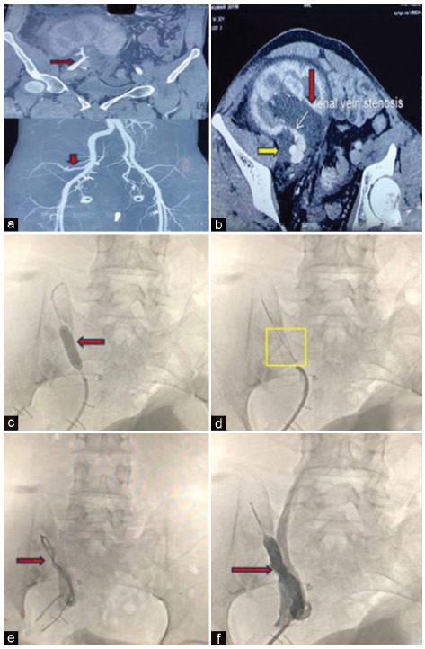
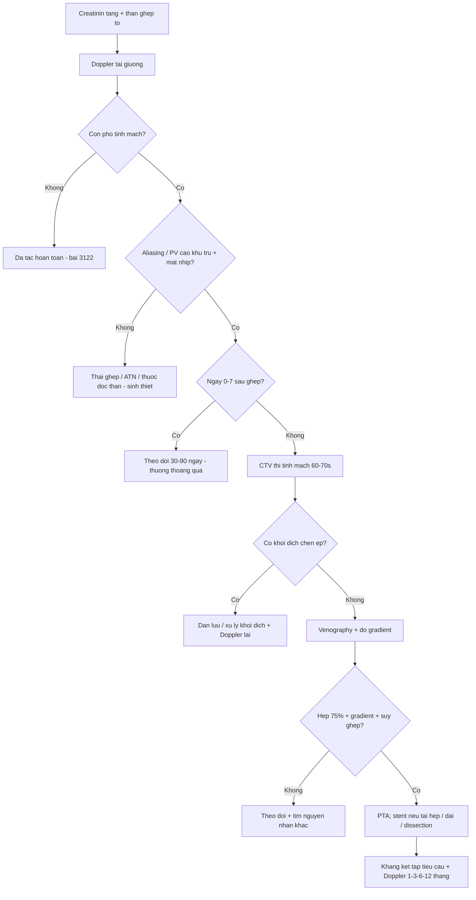
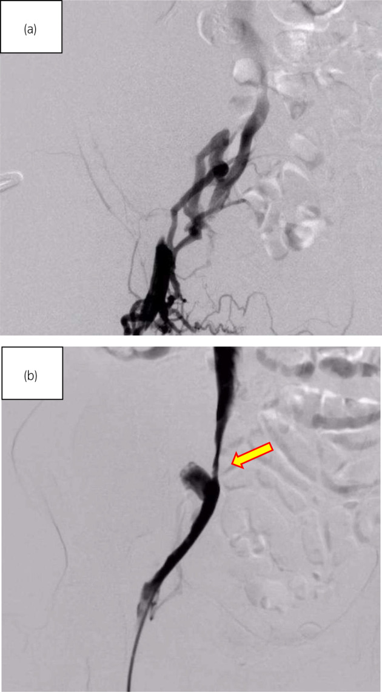
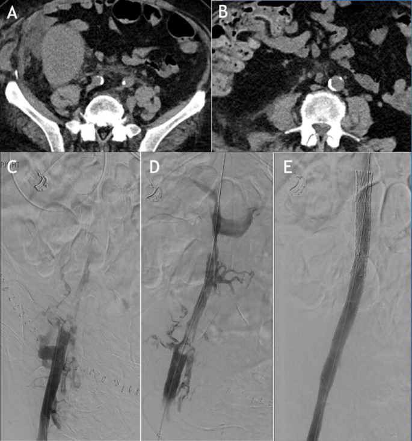

# 3158 — Hẹp miệng nối tĩnh mạch thận ghép: thận to + creatinin tăng nhưng **còn** phổ tĩnh mạch

**Tags:** `pattern:hep-mien-noi` `pattern:tang-van-toc-khu-tru` `pattern:mat-tinh-nhip` `pattern:phu-than-ghep` `vung:than-ghep` `vung:cuong-mach-ghep` `anatomy:tinh-mach-than-ghep` `anatomy:tinh-mach-chau` `protocol:sieu-am-Doppler` `protocol:CTV-bung` `protocol:venography` `score:gradient-ap-luc`
**Mức chắc chắn (certainty):** tổng hợp y văn (literature synthesis) — ghép **ba ca nguyên văn có ảnh** (Indian J Nephrol 2025, PMC11883305; IJU Case Rep 2024, PMC11366437; Abdom Radiol 2025, PMC12602614), **một chuỗi 5 ca có số liệu Doppler–venography–stent** (JVIR 2023, DOI 10.1016/j.jvir.2022.12.473), **một nghiên cứu tiến cứu 23 ca theo dõi vận tốc theo thời điểm** (Clin Nephrol 2026, DOI 10.5414/CN111945) và **một ca kinh điển có đo gradient áp lực** (JVIR 2010, DOI 10.1016/j.jvir.2010.01.037). Không có ca do nhóm tự chụp.

> **Câu hỏi thực hành:** nam **57 tuổi**, **12 tháng** sau ghép thận, creatinin tăng dần lên **782 µmol/L**, thận ghép to từ **11,6 × 6,4 × 6,1 cm** lên **14,3 × 8,3 × 8,0 cm**; không tắc niệu quản, không hẹp động mạch, không thải ghép cấp; Doppler **RI 0,65** (không cao). Vậy **"thận to + chức năng xấu" mà RI bình thường** là bệnh gì — và vì sao **chẩn đoán này có thể bị bỏ sót trên siêu âm thường quy**?
> Bài chốt **ba quyết định**: **(1) hẹp miệng nối tĩnh mạch là nguyên nhân chữa được của suy thận ghép, nhưng không có ngưỡng vận tốc thống nhất** — vận tốc đỉnh ở chỗ hẹp dao động **30–299 cm/s** trong một chuỗi 5 ca (JVIR 2023); **(2) vận tốc cao ngay ngày đầu sau ghép là hiện tượng thoáng qua, không phải chỉ định can thiệp** — trung bình **335 cm/s** ngày 1 giảm còn **134 cm/s** ngày 90 mà không ảnh hưởng kết cục (Clin Nephrol 2026); **(3) chốt huyết động bằng gradient áp lực qua miệng nối** — ca kinh điển **11,4 mmHg** trước, **0,8 mmHg** sau đặt stent (JVIR 2010).

## 1. Tổng quan bệnh học – cơ chế hình ảnh: vì sao "hẹp đường ra" làm thận ghép to và suy

- **Giải phẫu quyết định toàn bộ hình ảnh:** thận ghép nằm **ngoài phúc mạc ở hố chậu**, **tĩnh mạch thận người cho nối tận–bên vào tĩnh mạch chậu ngoài**, **động mạch nối vào động mạch chậu ngoài**. Thận là tạng **một cuống mạch**, gần như **không có bàng hệ tĩnh mạch** trong những tuần đầu. Vì vậy một chỗ hẹp vài milimét ở miệng nối không chỉ làm chậm dòng — nó **dâng áp lực toàn bộ hệ mao mạch của mảnh ghép**.
- **Tần suất — điều quan trọng nhất là nó hiếm và bị đánh giá thấp:**
  - Một trung tâm lớn chỉ tìm được **5 ca hẹp tĩnh mạch ghép trong 22 năm** (1998–2020) (JVIR 2023, DOI 10.1016/j.jvir.2022.12.473) — tức là **hiếm hơn hẹp động mạch ghép rất nhiều**, và tác giả gọi đây là thực thể **"có thể bị bỏ sót"**.
  - Trong **2.304 ca ghép** một trung tâm, biến chứng mạch máu **2,34%** (54 ca), nhưng **không có ca hẹp tĩnh mạch nào**, chỉ có **3 ca huyết khối tĩnh mạch (0,13%)** (Front Transplant 2023, PMC11235313).
  - Huyết khối tĩnh mạch sớm sau ghép **1,4%** trong một đoàn hệ Pháp, và **86,4%** ca huyết khối mất thận ghép (Transpl Int 2023, PMC10077970). Hẹp tĩnh mạch **không** có tỷ lệ chuẩn trong y văn — đây là lý do bài 3122 phải ghi *"ngưỡng vận tốc chưa thống nhất"*.
- **Cơ chế — bốn nhóm nguyên nhân chồng lên nhau:**
  - **Xơ hóa miệng nối** (fibrosis) và **hẹp do kỹ thuật khâu** — thường xuất hiện **vài tuần đến vài tháng** sau ghép.
  - **Chèn ép từ ngoài:** **máu tụ** (ca PMC11366437: hẹp do máu tụ quanh thận ngày 13), **nang bạch huyết**, khối dịch quanh thận.
  - **Gập góc/xoắn cuống ghép** (kinking/torsion) — hẹp cả tĩnh mạch lẫn động mạch, thận có thể xoay bất thường.
  - **Hẹp dòng ra phía trên miệng nối:** **hẹp tĩnh mạch chậu** do **hội chứng May–Thurner**, di chứng **huyết khối tĩnh mạch chậu**, hoặc **hẹp tĩnh mạch chủ dưới** — khi đó hẹp "thận ghép" chỉ là **hệ quả của tắc nghẽn đường ra xa** (Abdom Radiol 2025, PMC12602614).
  - Yếu tố khác được liệt kê trong ca kinh điển: **thải ghép cấp, nhiễm trùng tại chỗ, dòng xoáy áp lực cao khi có rò động–tĩnh mạch trong mảnh ghép, động mạch chậu chèn ép** (JVIR 2010, DOI 10.1016/j.jvir.2010.01.037).
- **TẠI SAO thận to và suy — chuỗi huyết động:**
  1. Hẹp tĩnh mạch → **áp lực tĩnh mạch thận tăng** → **áp lực thủy tĩnh mao mạch tăng** → **thoát dịch vào kẽ** → **phù nhu mô, thận to**.
  2. **Áp lực kẽ tăng** đè lên mao mạch → **giảm tưới máu nhu mô** → giảm GFR; kéo dài → **xơ hóa kẽ và teo ống thận**.
  3. Khi **áp lực đường ra rất cao**, dòng động mạch trong thì tâm trương bị **đảo chiều** (dấu của huyết khối tắc hoàn toàn — bài 3122); nhưng ở **hẹp chưa tắc**, sự đảo chiều này **có thể không xuất hiện** — ca AJT 2008 ghi rõ **hẹp tĩnh mạch mạn không bộc lộ trên siêu âm thường quy** vì không có đảo dòng tâm trương (DOI 10.1111/j.1600-6143.2008.02356.x).
- **TẠI SAO Doppler thấy "tia vận tốc cao" — vật lý dòng chảy:**
  - Theo **phương trình liên tục**, vận tốc tỷ lệ nghịch với tiết diện: hẹp 50% đường kính → tiết diện còn 25% → vận tốc lý thuyết tăng **4 lần**. Doppler ghi **vận tốc**, không ghi **lưu lượng**; vì vậy một chỗ hẹp rất nhỏ vẫn có thể cho **tia vận tốc rất cao** dù thận đã giảm tưới máu.
  - **Aliasing (hiện tượng chồng phổ)** xuất hiện khi vận tốc vượt **tần số Nyquist** (do PRF/scale đặt thấp) — đó là lý do **aliasing là dấu nhất quán nhất** trong chuỗi JVIR (5/5 ca), trong khi **vận tốc đỉnh dao động 30–299 cm/s** và **không có ngưỡng**.
  - **Mất tính nhịp (loss of phasicity):** tĩnh mạch thận bình thường có phổ **vận tốc thấp, nhịp theo hô hấp và chu chuyển tim** (PMC5024974). Khi có hẹp, sóng áp lực từ tim bị **giảm biên độ** qua chỗ hẹp → phổ **phẳng, liên tục** ở đoạn sau hẹp.
  - **RI trong nhu mô tăng** khi áp lực tĩnh mạch tăng, nhưng **RI là chỉ số không đặc hiệu** — ca kinh điển có **RI 0,65** (bình thường) dù hẹp nặng (JVIR 2010); vì vậy **không dùng RI để loại trừ**.
- **TẠI SAO CT tĩnh mạch và venography khác nhau:**
  - CT đo **lượng iod đến nhu mô** theo thời gian. Ở **thì tĩnh mạch 60–70 giây**, chỗ hẹp thấy **giảm đường kính khu trú**, đoạn xa **ứ thuốc**, nhu mô **ngấm thuốc chậm/không đều**, và **tĩnh mạch bàng hệ** nếu hẹp mạn (Abdom Radiol 2025, PMC12602614).
  - Venography đo **áp lực trực tiếp**: ca kinh điển có **gradient 11,4 mmHg** giữa đoạn xa chỗ hẹp và tĩnh mạch chậu; sau stent còn **0,8 mmHg** (JVIR 2010). Đây là **chuẩn huyết động**, không phải hình ảnh.

## 2. Mẫu hình + chẩn đoán phân biệt theo vị trí và thời điểm (Gamut)

- **Mẫu hình cốt lõi:** **creatinin tăng không giải thích được** + **thận ghép to, căng, đau nhẹ** + **còn phổ tĩnh mạch nhưng bất thường** (aliasing/tia vận tốc cao/mất nhịp) ± **phù chi cùng bên** nếu hẹp ở tĩnh mạch chậu.
- **Gamut theo thời điểm — quyết định cách đọc:**
  1. **Ngày 0–7:** vận tốc tĩnh mạch **cao sinh lý do phù nề hậu phẫu và chèn ép máu tụ**; **thoáng qua**, giảm dần trong 3 tháng (Clin Nephrol 2026). **Không can thiệp chỉ vì vận tốc cao.**
  2. **Tuần 2–12:** **xơ hóa miệng nối**, **máu tụ/nang bạch huyết chèn ép**, **gập góc**; đây là lúc hẹp thật xuất hiện.
  3. **Tháng 3–12:** hẹp miệng nối mạn, **hẹp tĩnh mạch chậu**; ca PMC11883305 phát hiện ở **2 năm 9 tháng**, ca Mei ở **12 tháng**.
  4. **> 1 năm:** hẹp dòng ra do **May–Thurner**, xơ hóa sau xạ/vùng chậu, hoặc **hẹp tĩnh mạch chủ dưới**.
- **Gamut theo mức tổn thương (đọc CTV/venography):**
  - **Miệng nối thận–chậu** (TRVS thật) — hẹp ngay tại anastomosis.
  - **Tĩnh mạch chậu ngoài/chung** — hẹp **ngoài** miệng nối, thường do **chèn ép, xơ hóa, May–Thurner**; thận ghép chỉ là "nạn nhân" phía sau.
  - **Tĩnh mạch chủ dưới** — hẹp/occlusion mạn, thường có **tuần hoàn bàng hệ thắt lưng**.
- **Gamut theo kiểu phổ Doppler (quyết định tại giường):**
  1. **Còn phổ + tia vận tốc cao khu trú + aliasing + mất nhịp sau hẹp** → **hẹp tĩnh mạch ghép**.
  2. **Mất hoàn toàn phổ tĩnh mạch + đảo dòng tâm trương động mạch** → **huyết khối tĩnh mạch cấp** (bài 3122), không phải hẹp đơn thuần.
  3. **Phổ tĩnh mạch bình thường + RI tăng nhẹ** → **thải ghép cấp/ATN/thuốc độc thận** — chẩn đoán bằng **sinh thiết**.
  4. **Phổ động mạch "tardus–parvus", PSV tăng tại miệng nối động mạch** → **hẹp động mạch ghép** (bài 3087).
  5. **Không thấy phổ tĩnh mạch nhưng có khối dịch quanh thận đè** → **chèn ép từ ngoài**, có thể hồi phục khi xử lý khối dịch.
- **Ba câu hỏi đọc ảnh:** **(1) hẹp ở đâu — miệng nối hay tĩnh mạch chậu? (2) có bằng chứng huyết động (gradient) hay chỉ là vận tốc cao? (3) có biến chứng cấp (huyết khối, chèn ép) hay hẹp mạn?** Trả lời (1) + (2) quyết định **có can thiệp**, (3) quyết định **can thiệp kiểu gì**.

## 3. Bảng so sánh phân biệt (ma trận đối chiếu)

| Thực thể (entity) | Hình ảnh điển hình (Doppler/CT/venography) | Chốt vào (rule-in) | Chốt loại (rule-out) | Gợi ý xác nhận |
|---|---|---|---|---|
| **Hẹp miệng nối tĩnh mạch ghép (TRVS)** | **Aliasing khu trú** tại miệng nối; tia vận tốc cao (**30–299 cm/s** trong chuỗi 5 ca); phổ sau hẹp **mất nhịp**; CTV: hẹp **> 75%** đường kính, đoạn xa ứ thuốc; venography: **gradient áp lực** (ca gốc **11,4 → 0,8 mmHg**) | **Hẹp khu trú + aliasing + mất nhịp + gradient qua chỗ hẹp** | Còn phổ nhịp bình thường, không có gradient, không hẹp trên CTV → không phải TRVS | Doppler lặp + CTV thì tĩnh mạch + venography đo gradient |
| **Huyết khối tĩnh mạch ghép cấp (bài 3122)** | **Mất phổ tĩnh mạch**; động mạch **đảo dòng tâm trương**, RI **0,9–1,0**; thận to, giảm phân biệt vỏ–tủy; CTV: **khuyết thuốc trong lòng**, thuốc trào bàng hệ | **Mất phổ tĩnh mạch + đảo tâm trương + huyết khối trong lòng** | Còn phổ tĩnh mạch liên tục + sóng tâm trương dương → không phải tắc hoàn toàn | Doppler lặp 1–2 giờ; CTV; DSA/hút huyết khối |
| **Hẹp động mạch ghép (bài 3087)** | **PSV tăng tại miệng nối động mạch** (ngưỡng tham chiếu **> 200 cm/s**, tỷ lệ **> 2:1** so với đoạn trước hẹp); **tardus–parvus** ở nhánh trong thận; RI giảm | **PSV cao khu trú + tardus–parvus + hẹp trên CTA** | Phổ động mạch bình thường, không tardus–parvus → không phải hẹp động mạch | CTA/DSA; đo gradient động mạch |
| **Chèn ép từ ngoài (máu tụ/nang bạch huyết)** | Khối **giảm âm/không đồng nhất** quanh thận **đè tĩnh mạch**; hẹp **khu trú đúng chỗ đè**, có thể hồi phục khi khối dịch nhỏ đi; CTV: khối dịch **0–20 HU** (nang bạch huyết) hoặc **35–70 HU** (máu tụ) | **Khối dịch quanh thận + hẹp đúng vị trí đè + hồi phục theo thời gian** | Không có khối, hẹp cố định tại miệng nối → hẹp thật | Siêu âm + CTV; chọc hút/dẫn lưu |
| **Caliber mismatch (tĩnh mạch cho–nhận lệch cỡ)** | Tĩnh mạch cho **lớn hơn** tĩnh mạch chậu; chuyển tiếp **không có tia vận tốc khu trú** rõ, không gradient; thận bình thường | **Lệch cỡ + không gradient + không suy ghép** | Có gradient/tia vận tốc khu trú + suy ghép → hẹp thật | Venography đo gradient; theo dõi |
| **Thải ghép cấp / ATN** | Phổ **còn**, RI tăng nhẹ, thận to; **không hẹp**, **không khuyết thuốc**, không gradient | **Phổ bình thường + không hẹp + sinh thiết phù hợp Banff** | Có hẹp khu trú + gradient → không phải thải ghép đơn thuần | Sinh thiết Banff; DSA/C4d |
| **Hẹp tĩnh mạch chậu / May–Thurner** | Hẹp **tĩnh mạch chậu chung trái** do động mạch chậu chung phải đè; **phù chi cùng bên**, tuần hoàn bàng hệ; thận ghép có thể phù thứ phát | **Hẹp tĩnh mạch chậu + phù chi + bàng hệ** | Tĩnh mạch chậu bình thường, hẹp chỉ ở miệng nối → TRVS | CTV/venography; stent tĩnh mạch chậu + kháng đông |
| **Xoắn/gập cuống ghép** | Thận **xoay bất thường**, cuống **gập góc nhọn**; hẹp **cả động mạch và tĩnh mạch**; thận có thể nhồi máu | **Xoay thận + gập cuống + hẹp cả hai chiều** | Cuống thẳng, chỉ hẹp tĩnh mạch → TRVS | CTV/CTA + mổ thăm dò nếu cấp |

*Ca 2 năm 9 tháng sau ghép: (a) động mạch ghép bình thường; (b) **hẹp tĩnh mạch ghép** (mũi tên trắng) kèm ứ nước và dịch quanh bể thận (mũi tên đỏ/vàng); (c) **nong bóng** trong tĩnh mạch hẹp; (d) **đặt stent** tĩnh mạch; (e) dòng tĩnh mạch còn kém trước can thiệp; (f) dòng tĩnh mạch cải thiện rõ sau can thiệp. Nguồn: Indian J Nephrol 2025 (PMC11883305), **CC BY-NC-SA 4.0**; ảnh nguyên bản, không crop, không ghép.*

## 4. Protocol chụp + ngưỡng xử trí

- **Bước 1 — Siêu âm Doppler (đầu tay, tại giường):**
  - Đầu dò **linear 5–12 MHz**; khảo sát **miệng nối tĩnh mạch**, **tĩnh mạch thận trong nhu mô**, **tĩnh mạch chậu ngoài/chung**, và **3 vị trí nhu mô** (cực trên/giữa/dưới).
  - Ghi **đường kính tĩnh mạch tại chỗ hẹp và trước hẹp**, **vận tốc đỉnh (PV)**, **tỷ lệ PV hẹp/trước hẹp**, **tính nhịp theo hô hấp**, **hướng sóng tâm trương động mạch**, **RI trong nhu mô**, **kích thước thận (mm)**, và **khối dịch quanh thận**.
  - **Không có ngưỡng vận tốc tuyệt đối:** PV ở chỗ hẹp **30–299 cm/s** trong chuỗi JVIR; vì vậy **aliasing + mất nhịp + bất đối xứng** quan trọng hơn con số. **RI bình thường không loại trừ** (ca gốc RI 0,65).
  - **Ngay sau ghép (ngày 1):** PV trung bình **335 ± 92 cm/s**, tỷ lệ **9,3 ± 5,0** — **giảm dần** còn **221 ± 86 / 3,5 ± 1,9** ngày 30 và **134 ± 59 / 2,0 ± 1,3** ngày 90 (Clin Nephrol 2026). **Đừng can thiệp chỉ vì vận tốc cao ngày 1.**
- **Bước 2 — CT tĩnh mạch (CTV) có cản quang:**
  - **Thì tĩnh mạch 60–70 giây**, lát **≤ 1 mm**, **MPR theo trục mạch**; đọc **miệng nối**, **tĩnh mạch chậu ngoài/chung**, **tĩnh mạch chủ dưới**, tìm **dải chèn May–Thurner**, **huyết khối**, **khối dịch quanh thận**.
  - **Giảm liều iod + hydrat hóa** nếu chức năng thận còn kém; **không hoãn CTV** khi nghi hẹp có thể chữa được.
- **Bước 3 — Venography + đo gradient (chuẩn huyết động):**
  - Đưa catheter qua đường **tĩnh mạch đùi cùng bên**; chụp **trước và sau chỗ hẹp**; **kéo catheter (pull-back)** đo **gradient áp lực trung bình** giữa đoạn xa và tĩnh mạch chậu.
  - **Ngưỡng tham chiếu:** chuỗi JVIR can thiệp khi **hẹp > 75%** trên venography; ca Mei can thiệp với **gradient 11,4 mmHg** và kết quả còn **0,8 mmHg**. **Không có ngưỡng gradient được chuẩn hóa** — quyết định dựa trên **hình ảnh hẹp + gradient + suy ghép**.
  - Có thể dùng **CO₂ venography** để hạn chế iod (JVIR 2023 dùng CO₂ làm phương tiện chẩn đoán và điều trị chính).
- **Bước 4 — Điều trị nội mạch:**
  - **Nong bóng đơn thuần (PTA):** dùng cho hẹp do **chèn ép/máu tụ** hoặc hẹp mềm; ca PMC11366437 chỉ nong bóng và dòng cải thiện.
  - **Stent:** khi **hẹp dai, tái hẹp sớm, có dissection**, hoặc hẹp mạn; **stent lớn hơn ~10%** so với đường kính đo trên venography, **không để đầu stent lấn vào tĩnh mạch chậu** (JVIR 2023).
  - **Sau thủ thuật:** **kháng kết tập tiểu cầu kép 3 tháng rồi aspirin kéo dài** (JVIR 2023); một số nhóm dùng **kháng đông 6 tháng + aspirin** (AJT 2008) hoặc **rivaroxaban + aspirin 75 mg** (PMC11883305). **Theo dõi Doppler 1–3–6–12 tháng** và khi creatinin tăng.
  - **Kết quả:** creatinin giảm trung bình **53%** (giảm **1,6 mg/dL**) sau 1 tháng trong chuỗi JVIR; **4/5** thận ghép thông stent bền vững 2–3 năm, 1 ca mất ghép do **thải ghép** chứ không do stent.

## 5. Biến thể bình thường và cạm bẫy

- **Cạm bẫy lớn nhất — vận tốc cao ngày đầu là sinh lý:** **335 cm/s** và tỷ lệ **9,3** ở ngày 1 giảm còn **134 cm/s / 2,0** ở ngày 90 mà **không ảnh hưởng kết cục ngắn hạn** (Clin Nephrol 2026). Đặt stent vào "hẹp" ngày 1 là can thiệp oan.
- **Aliasing không đồng nghĩa hẹp:** gain cao, scale/PRF đặt thấp, góc Doppler **> 60°** đều tạo aliasing giả. Luôn chỉnh **góc 45–60°**, scale đủ cao, và xác nhận bằng **phổ xung** + **B-mode**.
- **Caliber mismatch:** tĩnh mạch cho **lớn hơn** tĩnh mạch chậu là biến thể giải phẫu; nếu **không gradient, không suy ghép** thì **không can thiệp**.
- **Hẹp mạn có thể "im lặng" trên siêu âm thường quy:** ca AJT 2008 ghi rõ hẹp tĩnh mạch mạn **không có đảo dòng tâm trương** và **không bộc lộ** trên Doppler thường quy — nếu creatinin tăng mà Doppler "bình thường", vẫn phải **CTV/MRV**.
- **Bàng hệ làm phổ "bình thường hóa":** sau vài tuần, tĩnh mạch bàng hệ có thể làm phổ tĩnh mạch trông liên tục trở lại trong khi thận vẫn đang phù — **đừng kết luận an toàn**.
- **Ứ nước đồng thời đánh lừa:** ca PMC11883305 có **ứ nước + dịch quanh bể thận** và lần đầu bị chẩn đoán **viêm thận–bể thận**; cấy sterile là gợi ý để tìm **nguyên nhân mạch máu**.
- **Biến chứng của stent tĩnh mạch ghép:** ca **16 tuổi, 3 năm sau ghép**, sau đặt stent bị **vô niệu do cục máu đông bít hệ thống đài bể thận**, phải đặt **JJ** (Pediatr Transplant 2023, DOI 10.1111/petr.14607) — theo dõi **nước tiểu sát** sau thủ thuật.
- **Tái hẹp sau nong bóng:** ca PMC11883305 tái hẹp **4 tháng** sau PTA và phải đặt stent — hẹp tĩnh mạch có xu hướng **tái phát sớm** nếu chỉ nong bóng.
- **Đừng nhầm với huyết khối cấp:** huyết khối cần **hút/thrombectomy ± kháng đông**, không chỉ nong bóng; và **đừng bỏ sót huyết khối** khi thấy hẹp (ca PMC11366437 có cả máu tụ chèn ép và huyết khối).

## 6. Tự lượng giá — Blind Quiz

**Ca 1 — Nữ 55 tuổi (ca gốc: 2 năm 9 tháng sau ghép), nặng tức hố ghép, creatinin tăng. Nhìn ảnh trước, mô tả sau.**

- Gợi ý lâm sàng: không sốt, cấy máu/nước tiểu **sterile**, siêu âm đầu tiên gợi ý **viêm thận–bể thận + dịch quanh thận**.
- Câu hỏi: Mũi tên trắng ở panel (b) chỉ gì? Vì sao cấy sterile lại quan trọng? Bước tiếp theo sau khi Doppler xác nhận?

<b>Bấm để hiện đáp án (findings + chẩn đoán)</b>

- Dấu hiệu: panel (b) — **hẹp tĩnh mạch ghép** (mũi tên trắng), **ứ nước** (mũi tên đỏ) và **dịch quanh bể thận** (mũi tên vàng); panel (c) — **nong bóng**; (d) — **stent**; (e)→(f) — dòng tĩnh mạch **cải thiện**.
- Chẩn đoán: **hẹp miệng nối tĩnh mạch thận ghép** — không phải viêm thận–bể thận (cấy sterile, không sốt).
- Bước tiếp theo: **venography + đo gradient**, nong bóng; nếu tái hẹp → **stent** + kháng kết tập tiểu cầu.
- Nguồn: Indian J Nephrol 2025 (PMC11883305), CC BY-NC-SA 4.0.

**Ca 2 — Nữ 56 tuổi, ngày 13 sau ghép, thận to, Doppler bất thường. Ảnh venography trước/sau.**

- Gợi ý lâm sàng: đau hố ghép, thận căng, có **máu tụ quanh thận** trên CT.
- Câu hỏi: Vì sao có **bàng hệ** ở (a)? Hẹp còn lại ở (b) do đâu, và vì sao chỉ **nong bóng** mà không đặt stent?

<b>Bấm để hiện đáp án (findings + chẩn đoán)</b>

- Dấu hiệu: (a) **tĩnh mạch chậu ngoài bị tắc** trên venography, thuốc đi **đường bàng hệ**; (b) sau nong bóng, **hẹp phía trên miệng nối do máu tụ** vẫn còn (mũi tên vàng) nhưng **bàng hệ mất, dòng cải thiện**.
- Chẩn đoán: **hẹp tĩnh mạch do máu tụ chèn ép** sau ghép — nguyên nhân **ngoài lòng mạch**, không phải xơ miệng nối.
- Vì sao không stent: tổn thương **do chèn ép, có thể hồi phục** khi máu tụ tiêu; stent sẽ không giải quyết nguyên nhân và có nguy cơ biến chứng.
- Nguồn: IJU Case Rep 2024 (PMC11366437), CC BY 4.0.

**Ca 3 — Nữ 64 tuổi, 1 tuần sau ghép, phù chi dưới cùng bên, creatinin tăng. Ảnh CT/venography.**

- Gợi ý lâm sàng: hạ huyết áp, phù chi dưới **cùng bên thận ghép**, suy thận cấp.
- Câu hỏi: Tổn thương **ở đâu** và vì sao thận ghép suy? Vì sao can thiệp vào **tĩnh mạch chậu/chủ** chứ không phải miệng nối?

<b>Bấm để hiện đáp án (findings + chẩn đoán)</b>

- Dấu hiệu: (A, B) **tắc/hẹp mạn tĩnh mạch chậu chung hai bên và tĩnh mạch chủ dưới**, tuần hoàn bàng hệ thắt lưng; (C) venography xác nhận **tắc tĩnh mạch chậu ngoài phía trên miệng nối** + bàng hệ; (E) sau **nong bóng + stent tĩnh mạch chậu/chủ**, dòng cải thiện.
- Chẩn đoán: **hẹp/tắc dòng ra tĩnh mạch chậu–chủ mạn** gây **bệnh thận sung huyết** (congestive nephropathy) — hẹp "thận ghép" chỉ là hệ quả.
- Vì sao can thiệp tĩnh mạch chậu: đó là **chỗ hẹp thật**; stent miệng nối sẽ không giải quyết tắc nghẽn phía trên.
- Nguồn: Abdom Radiol 2025 (PMC12602614), CC BY 4.0.

## 7. Câu hỏi nghiên cứu & điểm chưa đồng thuận (tính đến 11/2026)

1. **[Tranh cãi] Ở người ghép thận, ngưỡng vận tốc/tỷ lệ vận tốc Doppler nào xác định hẹp tĩnh mạch ghép "có ý nghĩa huyết động" cần can thiệp?**
   - **Đã biết:** chuỗi 5 ca JVIR 2023 ghi PV tại chỗ hẹp **30–299 cm/s**, aliasing là dấu nhất quán, **không có ngưỡng**; nghiên cứu tiến cứu 23 ca cho thấy PV **335 cm/s** và tỷ lệ **9,3** ở ngày 1 giảm còn **134 cm/s / 2,0** ở ngày 90 mà **không tương quan kết cục**.
   - **Chưa rõ:** ngưỡng theo **thời điểm sau ghép**, theo **vị trí** (miệng nối vs tĩnh mạch chậu) và theo **có/không suy ghép**.
   - **Hướng nghiên cứu:** nghiên cứu chẩn đoán tiến cứu, đối chiếu Doppler với **venography đo gradient** làm chuẩn.
   - **Nguồn:** DOI 10.1016/j.jvir.2022.12.473 (2023); DOI 10.5414/CN111945 (2026).
2. **[Khoảng trống] Nong bóng đơn thuần so với đặt stent tĩnh mạch ghép có cải thiện độ bền lâu dài ở bệnh nhân hẹp miệng nối không?**
   - **Đã biết:** dữ liệu chỉ từ **case series/ca lẻ**; PTA đơn thuần có xu hướng **tái hẹp sớm** (ca PMC11883305 tái hẹp **4 tháng**), stent cho kết quả bền ở **4/5** ca JVIR.
   - **Chưa rõ:** tỷ lệ tái hẹp chính xác, yếu tố dự báo tái hẹp, và **chỉ định stent ngay từ đầu**.
   - **Hướng nghiên cứu:** registry đa trung tâm có đối chứng; RCT nhỏ theo kết cục **thông stent 12 tháng**.
   - **Nguồn:** PMC11883305 (2025); PMC11366437 (2024).
3. **[Khác biệt thực hành] Phác đồ kháng huyết khối sau can thiệp tĩnh mạch ghép: kháng kết tập tiểu cầu kép, kháng đông, hay cả hai?**
   - **Đã biết:** JVIR dùng **kháng kết tập tiểu cầu kép 3 tháng + aspirin kéo dài**; ca Mei dùng **LMWH 5 ngày + aspirin 100 mg**; ca AJT 2008 dùng **kháng đông 6 tháng + aspirin 300 mg**; ca 2025 dùng **rivaroxaban + aspirin 75 mg**.
   - **Chưa rõ:** phác đồ tối ưu theo **nguy cơ chảy máu, chức năng thận, loại stent** và thời gian theo dõi.
   - **Hướng nghiên cứu:** khảo sát thực hành (Delphi) + cohort so sánh **biến cố huyết khối/tái hẹp** và **chảy máu**.
   - **Nguồn:** DOI 10.1016/j.jvir.2022.12.473 (2023); DOI 10.1016/j.jvir.2010.01.037 (2010); DOI 10.1111/j.1600-6143.2008.02356.x (2008); DOI 10.25259/ijn_193_23 (2025).

## Bài liên quan chéo
- [3122 – Huyết khối tĩnh mạch thận ghép cấp: mất phổ tĩnh mạch + đảo dòng tâm trương](../3122-huyet-khoi-tinh-mach-than-ghep-cap/lesson.md)
- [3087 – Hẹp động mạch thận ghép: PSV cao + tardus–parvus](../3087-hep-dong-mach-than-ghep/lesson.md)
- [3011 – Biến chứng niệu quản sau ghép thận: ứ nước và hẹp miệng nối niệu quản](../3011-bien-chung-nieu-quan-sau-ghep-than/lesson.md)
- [100 – Tổng quan hệ Bụng: bản đồ chẩn đoán phân biệt](../100-tong-quan-he-bung/lesson.md)

## Ảnh
- `3158_hep-mieng-noi-tm-than-ghep_CT-DSA-Doppler_PMC11883305.jpg` — Indian J Nephrol 2025, **CC BY-NC-SA 4.0**, nguyên bản.
- `3158_hep-mieng-noi-tm-than-ghep_Venography_PMC11366437.jpg` — IJU Case Rep 2024, **CC BY 4.0**, nguyên bản.
- `3158_hep-mieng-noi-tm-than-ghep_Venography-chau_PMC12602614.jpg` — Abdom Radiol 2025, **CC BY 4.0**, nguyên bản.
- Nguồn, giấy phép và phái sinh từng ảnh: `images/CREDITS.md`.

> Không dùng để chẩn đoán độc lập khi chưa có người hướng dẫn.
