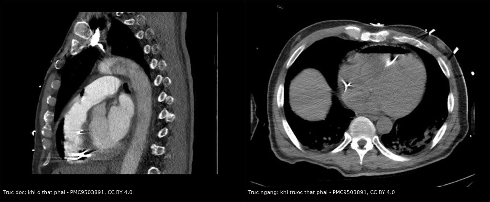
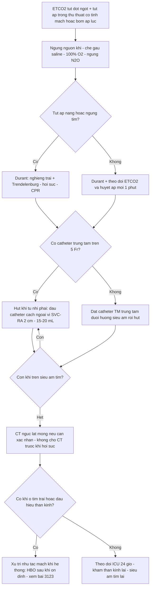
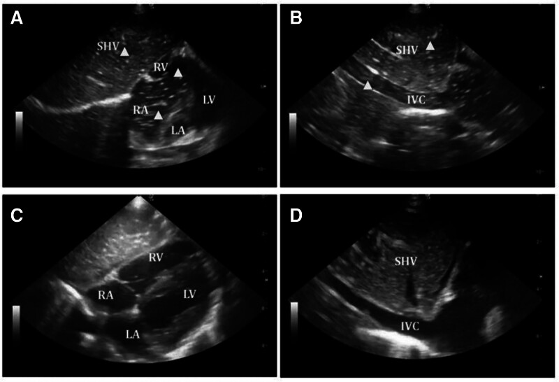
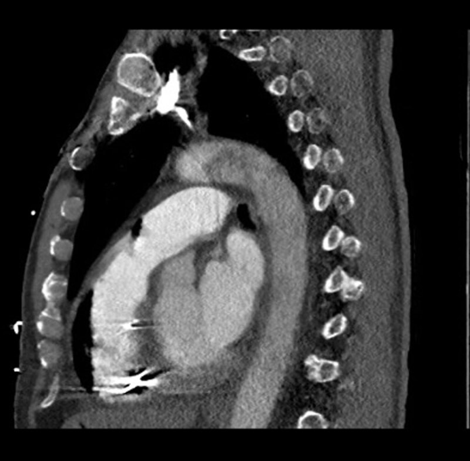
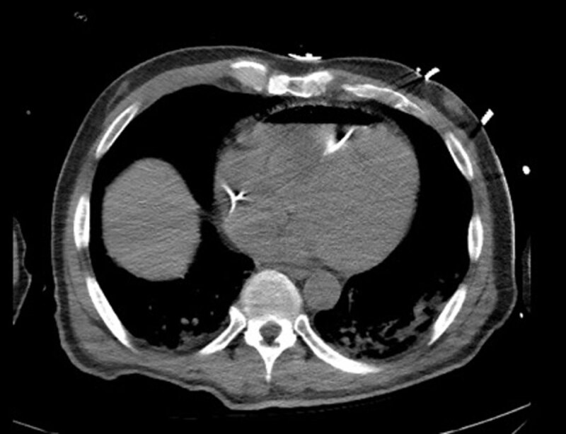

# 3159 — Tắc mạch khí tĩnh mạch lượng lớn (massive venous air embolism) và bọt khí trong tim phải: ETCO₂ tụt trước, huyết áp tụt sau

**Tags:** `pattern:khi-trong-long-mach` `pattern:air-lock-that-phai` `pattern:suy-that-phai-cap` `pattern:etco2-tut` `vung:tim` `vung:nguc` `anatomy:tim-phai` `anatomy:duong-ra-that-phai` `anatomy:dong-mach-phoi` `anatomy:tinh-mach-chu` `protocol:sie-u-am-tim` `protocol:TEE` `protocol:CT-nguc` `score:khong`
**Mức chắc chắn (certainty):** tổng hợp y văn (literature synthesis) — ghép **hai ca nguyên văn có ảnh**: trẻ **3 tuổi** tắc mạch khí khi **rửa ổ tủy xương**, sống và hồi phục hoàn toàn (Medicine 2026, PMC12826233); nam **69 tuổi** ngừng tim khi **nội nha**, CT thấy khí trong **thất phải + hệ tĩnh mạch cửa**, không hồi phục thần kinh (Methodist DeBakey Cardiovasc J 2022, PMC9503891); cộng **ba đoàn hệ phẫu thuật thần kinh tư thế nửa ngồi** (740 + 137 + 208 ca), **một tổng quan hệ thống về PFO** (2.530 ca) và **hai tổng quan cơ chế – điều trị**. Không có ca do nhóm tự chụp.

> **Câu hỏi thực hành:** bé gái **3 tuổi 4 tháng**, viêm tủy xương đùi trái, mổ lần hai. Sau khi nạo xương, phẫu thuật viên **rửa ổ tủy bằng bơm 20 mL** povidone–saline, ước áp lực **100–150 mmHg**. **2 phút** sau: **ETCO₂ 35 → 10 mmHg**, huyết áp **110/70 → 62/38 mmHg**, SpO₂ **99 → 80%**, mạch **120 → 45 lần/phút**, ST chênh xuống. Siêu âm tại giường: **bọt khí trong nhĩ phải và tĩnh mạch chủ dưới**. Câu hỏi: **chẩn đoán gì, và 5 việc phải làm trong 5 phút tới?**
> Bài chốt **ba quyết định**: **(1)** ETCO₂ tụt đột ngột + tụt huyết áp trong thủ thuật có **tĩnh mạch phơi ra hoặc bơm áp lực** = **tắc mạch khí tĩnh mạch cho tới khi chứng minh ngược**, không chờ CT; **(2)** điều trị là **ngừng nguồn khí + 100% O₂ + tư thế Durant + hút khí qua catheter > 5 Fr**, không phải "theo dõi"; **(3)** **không có ngưỡng thể tích an toàn** — ở trẻ, **15 mL** khí đã đủ gây sụp tuần hoàn.

## 1. Tổng quan bệnh học – cơ chế hình ảnh: vì sao một bọt khí ở tim phải làm tim ngừng

- **Đường đi quyết định bệnh cảnh:** khí vào **tĩnh mạch hệ thống** → **nhĩ phải → thất phải → đường ra thất phải (RVOT) → động mạch phổi**. Bình thường **mao mạch phổi là bộ lọc**: tổng quan 2023 tổng kết **< 50 mL** khí vào tĩnh mạch ở người thường **được lọc và hấp thu mà không gây bệnh** (PMC10546929).
- **Vì sao gọi là "air lock" (khóa hơi):** khi thể tích/tốc độ vượt năng lực lọc, bọt khí tập trung thành **khối liên tục ở RVOT** — máu không còn là chất lỏng liên tục mà là **hỗn hợp khí–máu có độ nhớt cao**. Hệ quả theo thứ tự: **tăng hậu tải thất phải → thất phải giãn → giảm lượng máu về thất trái → tụt huyết áp → thiếu máu mạch vành → ngừng tim**. Đây là lý do **huyết áp tụt sau ETCO₂** và lý do **hồi sức chỉ bằng thuốc vận mạch thường thất bại** nếu không lấy được khí ra.
- **Ngưỡng định lượng (bắt buộc nhớ):**
  - **Liều chết ở người trưởng thành: 200–300 mL khí, hoặc 3–5 mL/kg** khi vào nhanh (PMC5126790).
  - **Tốc độ làm vỡ hàng rào lọc phổi: 0,15 mL/kg/phút trong 30 phút** — trong thí nghiệm chó, mao mạch phổi **biến dạng/vỡ**, khí sang tuần hoàn hệ thống (PMC10546929).
  - **Bọt < 22 µm** có thể **qua mao mạch phổi** mà không bị giữ (PMC10546929).
  - **Tốc độ khí có thể vào rất nhanh:** kim **14 G** truyền **100 mL/giây** với gradient chỉ **5 cmH₂O**; sheath peel-away **15 Fr** cho **300 mL trong 0,5 giây** (PMC5126790).
  - **Vì sao tư thế ngồi/ngửa đầu cao nguy hiểm:** **CVP dưới áp lực khí quyển ở tới 40% bệnh nhân** → chênh áp **hút khí vào tĩnh mạch**; tư thế ngồi làm **vị trí mổ cao hơn tim** (PMC5126790).
  - **Dịch tễ thực hành:** tắc mạch khí sau đặt catheter tĩnh mạch trung tâm **1/772** (PMC5126790); ở mổ thần kinh nửa ngồi, **VAE 16,1% (119/740)** khi theo dõi bằng TEE/Doppler, trong đó **TEE phát hiện 40,5%** còn **Doppler qua thành ngực chỉ 11,8%** (PMID 34740183); loạt 137 ca khác: **50% có VAE trên TEE**, **56% ở nửa ngồi vs 11% ở nằm ngửa**, và **86% VAE không làm đổi ETCO₂** (PMID 35367647).
- **Vì sao ETCO₂ tụt TRƯỚC SpO₂ (giải thích sinh lý, không phải mẹo):** ETCO₂ đo **lượng CO₂ được tưới máu đưa lên phổi**. Khi khối khí chặn dòng máu qua tuần hoàn phổi, **khoảng chết (dead space) tăng tức thì** → CO₂ thở ra giảm **trong vài nhịp**, dù oxy máu còn dự trữ. **SpO₂ tụt là dấu MUỘN** vì còn dự trữ oxy trong phổi/máu (PMC5126790).
- **Vì sao nhịp CHẬM chứ không chỉ nhanh:** thất phải căng cấp kích hoạt **phản xạ vagal kiểu Bezold–Jarisch** (thụ thể cơ học ở thành thất) → **chậm nhịp + tụt áp**; đồng thời thiếu máu cơ tim do giảm cung lượng. Vì vậy **chậm nhịp + tụt áp đúng lúc bơm/rút kim** là dấu hiệu vàng.
- **Vì sao tổn thương không chỉ do "bít ống":** bề mặt khí–máu hoạt hóa **bổ thể C3**, gây **thromboinflammation, tổn thương nội mô, ngưng tập tiểu cầu** (thực nghiệm lợn 45 con, PMC8964959; tổng quan PMC10546929). Hệ quả thực hành: **huyết khối hình thành cạnh bọt khí**, nên **thông mạch muộn ≠ nhu mô hồi phục**.
- **Vì sao CT thấy khí — và vì sao CT âm tính không loại trừ:** khí có **−1.000 HU**, tương phản cực mạnh; ở tư thế nằm ngửa, khí **nổi lên phần trước (non-dependent)** của thất phải → **liềm đen phía trước thất phải** trên lát trục ngang, và **khí dọc RVOT–động mạch phổi** trên lát trục dọc. Nhưng **khí nhỏ gặp tới 23%** trên CT ngực và **phần lớn không triệu chứng** (PMC5126790) — thấy khí **không đồng nghĩa** có bệnh cảnh; ngược lại, bọt nhỏ/di chuyển có thể **không thấy** trên một lát cắt.

## 2. Mẫu hình + chẩn đoán phân biệt theo vị trí khí (Gamut)

- **Mẫu hình cốt lõi:** **biến cố tức thì trong thủ thuật** (bơm rửa áp lực, rút/đặt catheter, mở xoang tĩnh mạch, nội soi tử cung, nội nha) + **ETCO₂ tụt ≥ 3–4 mmHg hoặc xuống < 20 mmHg** ± **tụt huyết áp** ± **chậm nhịp**; **không có nguyên nhân hô hấp rõ ràng** (không rời ống, không tràn khí màng phổi).
- **Gamut theo NƠI khí nằm (quyết định điều trị):**
  1. **Nhĩ phải / tĩnh mạch chủ dưới** → khí còn "trong bể chứa", **hút được**, thường hồi phục nếu xử trí sớm. Ca trẻ 3 tuổi: bọt ở **nhĩ phải + TM chủ dưới**, hút ra **15 mL**, hồi phục hoàn toàn (PMC12826233).
  2. **Thất phải / RVOT** → **air lock**, tụt áp nặng; đây là đích của **tư thế Durant** (đẩy khí ra khỏi RVOT về nhĩ phải).
  3. **Động mạch phổi / nhánh phổi** → tăng áp phổi cấp, suy thất phải; CT thấy **khí trong thân ĐM phổi** (ca PMC9503891, lát trục dọc).
  4. **Tim trái / động mạch hệ thống** → **tắc mạch khí hệ thống (3123)**: nhồi máu não, vành, thận; nguy cơ **nghịch thường qua PFO**.
  5. **Hệ tĩnh mạch cửa** → khí **ngược dòng** vào gan, gặp trong ngừng tim/hồi sức (ca PMC9503891: khí ở **thất phải + tĩnh mạch cửa**) — dấu hiệu **khí đã lan rộng**, không phải một biến thể lành.
  6. **Tĩnh mạch não / xoang** → đau đầu, lú lẫn, co giật (thường do bơm ngược dòng khi ngồi).
- **Gamut theo THỦ THUẬT (ai phải cảnh giác):** mổ thần kinh **tư thế ngồi/nửa ngồi** (16,1% VAE — PMID 34740183); **chỉnh hình có bơm rửa ổ tủy/ximăng** (ca PMC12826233); **nội nha** dùng tua bin khí **450.000 vòng/phút** (ca PMC9503891); **đặt/rút catheter tĩnh mạch trung tâm** (1/772 — PMC5126790); **nội soi ổ bụng/robot**; **nội soi tử cung, mổ lấy thai**; **ERCP, nội soi đại tràng**; **can thiệp mạch, sinh thiết phổi** (thể động mạch — 3123).
- **Ba câu hỏi đọc ảnh:** **(1) khí ở tim phải hay đã sang tim trái?** (2) **có khí ở RVOT/thân ĐM phổi không?** (3) **có khí tĩnh mạch cửa hoặc khí trong não không?** — câu (1) quyết định **Durant + hút**, câu (3) quyết định **xử trí như tắc mạch khí hệ thống + HBO**.

## 3. Bảng so sánh phân biệt (ma trận đối chiếu)

| Thực thể (entity) | Hình ảnh điển hình (US/CT) | Chốt vào (rule-in) | Chốt loại (rule-out) | Gợi ý xác nhận |
|---|---|---|---|---|
| **Tắc mạch khí tĩnh mạch (VAE) / air lock** | **Liềm khí −1.000 HU phía trước thất phải**, khí dọc RVOT–thân ĐM phổi; TTE/TEE thấy **bọt tăng hồi âm** trong nhĩ–thất phải | **ETCO₂ tụt đột ngột đúng lúc bơm/rút + tụt áp/chậm nhịp + thấy khí trong tim phải** | **Không thấy khí trên một lát CT không loại trừ** (bọt nhỏ/di chuyển); bệnh cảnh điển hình vẫn phải điều trị | TEE (nhạy nhất) hoặc TTE subcostal; CT ngực chỉ để xác nhận |
| **Tắc mạch khí hệ thống (AAE) — bài 3123** | Khí trong **thất trái/ĐM chủ**, nhánh ĐM não; nhồi máu **nhiều ổ, hai bên** trên DWI | **Khí ở tim trái/ĐM chủ + dấu thần kinh khu trú** | **Khí chỉ ở tim phải** → chưa hệ thống hóa | CT sọ + CTA; DWI 6–24 giờ; HBO |
| **Thuyên tắc phổi do huyết khối (PE) — bài 070** | **Khuyết thuốc trong ĐM phổi** trên CTA, **không có khí**; thất phải giãn | **Yếu tố nguy cơ huyết khối + D-dimer + CTA khuyết thuốc** | **Khí −1.000 HU trong lòng mạch** → không phải PE đơn thuần | CTA ngực; siêu âm tim |
| **Tắc mạch mỡ (FES) — bài 1800** | **Nhiều ổ giảm tỷ trọng rải rác** chất trắng, "starfield" trên MRI; phổi bình thường hoặc mờ nhẹ | **Gãy xương lớn + ban xuất huyết + giảm tiểu cầu + mỡ trong nước tiểu**, sau **12–72 giờ** | **Khí thấy rõ trong buồng tim** → không phải mỡ | MRI sọ; khác thời điểm |
| **Sốc phản vệ** | Tim/phổi **không có khí**; có thể phù thanh môn, co thắt phế quản | **Ban, phù, co thắt phế quản, tryptase tăng**, sau thuốc/latex | **ETCO₂ tụt + thấy khí trong tim phải** → VAE | Tryptase; đáp ứng adrenaline |
| **Tụt ETCO₂ do máy/hô hấp** | **Không khí nội mạch**; phổi bình thường | **Rời ống, rò circuit, tăng thông khí, tụt cung lượng do thuốc** | **Khí trong tim phải + tụt áp không giải thích bằng circuit** | Kiểm tra circuit **song song**, không trì hoãn điều trị VAE |
| **Tắc mạch CO₂ khi nội soi ổ bụng** | Khí trong tim phải **có thể thấy**, nhưng CO₂ **hòa tan nhanh** | **Bơm CO₂ áp lực cao + ETCO₂ tụt thoáng qua, tự hết khi xả hơi** | **Không tự hết, tụt áp nặng** → nghi khí phòng (air) qua tĩnh mạch phơi | Xả hơi, 100% O₂; TEE |
| **Tràn khí màng phổi áp lực — bài 098** | **Khí trong khoang màng phổi**, xẹp phổi, lệch trung thất; **không khí nội mạch** | **Khí màng phổi + lệch trung thất + tụt áp** | **Khí trong buồng tim** → có VAE kèm | X-quang/CT; dẫn lưu |
| **Sốc giảm thể tích/mất máu** | Tim nhỏ, **không khí**, không giãn thất phải | **Mất máu rõ, đáp ứng dịch/máu** | **ETCO₂ tụt trước khi mất máu đủ nhiều + thấy khí** → VAE | Siêu âm tim; theo dõi chảy máu |

*Trái: CT trục dọc — **khí giảm tỷ trọng trong thất phải, lan lên đường ra thất phải/động mạch phổi**. Phải: CT trục ngang — **khí nổi lên phần trước thất phải thành liềm đen** (tư thế nằm ngửa). Bệnh nhân ngừng tim trong nội nha, CT sau ROSC còn thấy **khí cả trong hệ tĩnh mạch cửa** (Hình 4 bài gốc). Nguồn: Methodist DeBakey Cardiovasc J 2022 (PMC9503891), **CC BY 4.0**. Ảnh ghép letterbox, không crop.*

### Đọc kỹ ba mẫu hình
- **"Khí nổi lên trước" là dấu vị trí, không phải dấu nặng:** khí ở **phần không phụ thuộc** của buồng tim; muốn đánh giá **lượng**, phải xem **cả trục dọc** (khí dọc RVOT) và **TEE**.
- **Khí ở tĩnh mạch cửa = khí đã đi ngược dòng** qua gan, gặp khi **hồi sức/ngừng tim**; đây là dấu **lan rộng**, không phải "khí tiêu hóa lành tính".
- **Sự khác biệt giữa hai ca trong bài là thời gian, không phải liều:** ca trẻ **15 mL** được hút sớm → sống; ca người lớn **khí lượng lớn** → ROSC nhưng **không hồi phục thần kinh**. Điều trị đúng **không bảo đảm** hồi phục nếu thiếu máu đã đủ lâu.

## 4. Protocol chụp + xử trí theo phút + thang độ

- **Bước 0 — Nhận diện trong 60 giây (không cần hình ảnh):** nghi VAE khi có **≥ 1 trong 3**: (a) **ETCO₂ tụt ≥ 3–4 mmHg** so với nền (hai ngưỡng đang dùng song song — xem mục 7); (b) **tụt huyết áp ≥ 10 mmHg** không giải thích; (c) **chậm nhịp/loạn nhịp mới** — trong thủ thuật có **tĩnh mạch phơi ra, bơm áp lực, hoặc catheter trung tâm**. **Ưu tiên số một là ngừng nguồn khí**, không phải đi chụp.
- **Bước 1 — 0–5 phút tại bàn mổ:**
  - **Ngừng ngay** bơm rửa/insufflation; **che phủ vùng mổ bằng gạc tẩm saline**, hạ vị trí mổ **thấp hơn tim** nếu làm được.
  - **100% O₂** (FiO₂ 1,0) — tạo gradient thải nitơ, làm bọt nhỏ lại; **ngừng N₂O ngay** vì N₂O khuếch tán vào bọt nhanh hơn nitơ và **làm bọt to lên** (PMID 20689409).
  - **Tư thế Durant: nghiêng trái + Trendelenburg** — đưa khí từ **RVOT về nhĩ phải**, nơi có thể hút. **Nếu nghi khí ĐỘNG mạch/não: nằm ngửa phẳng**, không đầu thấp (làm nặng phù não) (PMC5126790).
  - **Hồi sức:** vận mạch, dịch; **CPR nếu ngừng tim** — ép tim còn giúp **đẩy bọt khí vào các nhánh phổi nhỏ** (PMC5126790).
- **Bước 2 — Hút khí (can thiệp quyết định):**
  - **Catheter > 5 Fr**, tốt nhất **catheter nhiều lỗ**; đầu catheter đặt **2 cm dưới ngã ba tĩnh mạch chủ trên – nhĩ phải**; **hút 15–20 mL** hỗn hợp khí–máu, lặp lại theo đáp ứng (PMC10546929).
  - Ca trẻ 3 tuổi: catheter **4 Fr đôi lòng** ở **tĩnh mạch cảnh trong phải**, hút **2–3 mL khí/10 mL máu × 6 lần ≈ 15 mL khí**, bọt giảm rõ trên siêu âm (PMC12826233).
  - **Đích CVP 10–15 cmH₂O** để giảm chênh áp hút khí vào (PMC10546929; ca nội nha ghi **10–15 mmHg** — khác đơn vị, cần đối chiếu đơn vị khi áp dụng).
- **Bước 3 — Hình ảnh (chỉ để xác nhận/loại trừ biến chứng, KHÔNG để quyết định điều trị):**
  - **Siêu âm tim tại giường** (subcostal 4 buồng + TM chủ dưới): nhanh nhất, thấy **bọt tăng hồi âm**, đánh giá **giãn/thất phải**, theo dõi **đáp ứng sau hút**.
  - **CT ngực không cản quang, lát ≤ 1 mm:** khí **−1.000 HU** ở thất phải/RVOT/ĐM phổi; tìm **tràn khí màng phổi**, **khí tĩnh mạch cửa**; CT sọ nếu có dấu thần kinh (hướng 3123).
  - **TEE** là phương tiện **nhạy nhất** trong mổ: phát hiện **40,5%** so với **11,8%** của Doppler qua thành ngực (PMID 34740183); nhưng **86% VAE chỉ thấy trên TEE mà không đổi ETCO₂** (PMID 35367647) → **theo dõi TEE không thay thế** việc đọc ETCO₂/huyết áp.
- **Bước 4 — Thang độ thực dụng (bài tự đặt để trao đổi ê-kíp; y văn KHÔNG có đồng thuận):**

| Độ | Dấu hiệu | Ý nghĩa thực hành |
|---|---|---|
| 0 | Bọt trên TEE/Doppler, **ETCO₂ và huyết áp không đổi** | Thường **không cần can thiệp**, chỉ ngừng nguồn khí + theo dõi (86% VAE trong PMID 35367647 ở mức này) |
| 1 | **ETCO₂ giảm ≥ 3–4 mmHg**, huyết áp ổn | 100% O₂ + Durant + tìm/hút khí nếu có catheter |
| 2 | **Tụt huyết áp ≥ 10 mmHg** hoặc loạn nhịp/chậm nhịp mới | Độ 1 + hồi sức tích cực + **hút khí**, cân nhắc đặt catheter trung tâm |
| 3 | **Sốc/ngừng tim** | CPR + Durant + hút khí + vận mạch; xét ECMO nếu có |
| 4 | **Khí sang tim trái/PFO, dấu thần kinh** | Xử trí như **tắc mạch khí hệ thống (3123)**: HBO sau khi ổn định huyết động |

  - Y văn dùng thuật ngữ **“Grade ≥ III”** cho VAE có ý nghĩa lâm sàng, nhưng **định nghĩa không thống nhất**: có nơi lấy **ETCO₂ giảm > 3 mmHg** (PMID 27896454), có nơi lấy **≥ 4 mmHg hoặc tụt huyết áp ≥ 10 mmHg** (PMID 34740183) — vì vậy **tỷ lệ VAE dao động 11,9–50%** giữa các nghiên cứu.

## 5. Biến thể bình thường và cạm bẫy

- **"Thấy khí trên CT" ≠ "đang bị VAE":** khí nhỏ gặp **tới 23%** CT ngực, thường **không triệu chứng** và tự hấp thu (PMC5126790). Chốt là **bệnh cảnh + ETCO₂/huyết áp**, không phải một lát cắt.
- **"Không thấy khí" ≠ loại trừ:** bọt nhỏ, di chuyển, hoặc đã hấp thu sau vài phút; **điều trị theo bệnh cảnh**, không chờ hình ảnh.
- **Quy ETCO₂ tụt cho máy thở:** kiểm tra circuit **song song** nhưng **không trì hoãn** 100% O₂ và Durant. Ca trẻ 3 tuổi, ETCO₂ **35 → 10 mmHg** trong **2 phút** là ví dụ điển hình.
- **Quy chậm nhịp cho thuốc mê:** **chậm nhịp + tụt áp đúng lúc bơm/rút** là phản xạ vagal do căng thất phải — **không phải** tác dụng thuốc.
- **Dùng tư thế sai:** **Durant (nghiêng trái + đầu thấp)** cho **VAE**; **nằm ngửa phẳng** cho **khí động mạch/não** — đầu thấp ở thể động mạch **làm nặng phù não** (PMC5126790).
- **Tiếp tục N₂O:** N₂O khuếch tán vào bọt nhanh hơn nitơ → **bọt to lên**; phải **ngừng ngay** khi nghi VAE (PMID 20689409).
- **Hút khí qua đường ngoại vi hoặc catheter nhỏ:** vô ích; cần **> 5 Fr** và đầu catheter **ở nhĩ phải**, cách ngã ba SVC–RA **2 cm** (PMC10546929).
- **Áp dụng ngưỡng người lớn cho trẻ:** **3–5 mL/kg** là liều chết ước tính; trẻ **15 mL** đã sụp tuần hoàn. **Không có "liều nhỏ an toàn"** ở trẻ có thể tích tuần hoàn nhỏ (PMC12826233, PMC5126790).
- **Coi "rửa ổ tủy" là thao tác lành:** bơm **20 mL × 100–150 mmHg** đủ đẩy khí vào xoang tĩnh mạch xương; bài học từ ca là **theo dõi ETCO₂ trong lúc rửa**, **ngừng ngay khi ETCO₂ tụt**, và **che gạc saline** để chặn khí vào thêm (PMC12826233).
- **Bỏ sót tắc mạch khí nghịch thường:** **PFO có ở ~16%** bệnh nhân mổ thần kinh ngồi (405/2.530 — PMID 41793490); **không có ca PAE xác nhận** trong tổng quan, nhưng **khí sang tim trái** trên siêu âm vẫn phải xử trí như thể hệ thống.

## 6. Tự lượng giá — Blind Quiz

**Ca 1 — Bé gái 3 tuổi 4 tháng, mổ viêm tủy xương đùi; 2 phút sau khi bắt đầu rửa ổ tủy thì ETCO₂ tụt, huyết áp tụt. Nhìn ảnh trước, mô tả sau.**

- Gợi ý lâm sàng: trẻ nhỏ, tư thế nằm nghiêng, vừa bơm rửa ổ tủy bằng bơm 20 mL; không ban, không co thắt phế quản.
- Câu hỏi: (1) Bọt khí nằm ở đâu? (2) Vì sao ETCO₂ tụt **trước** SpO₂? (3) Ba việc làm ngay?

<b>Bấm để hiện đáp án (findings + chẩn đoán)</b>

- Dấu hiệu: (A) **nhiều bọt tăng hồi âm (▲) trong nhĩ phải và thất phải** trên mặt cắt 4 buồng dưới sườn; (B) **bọt rải rác trong tĩnh mạch chủ dưới** gần tĩnh mạch gan; (C, D) sau hút khí + 100% O₂ + nghiêng trái, **bọt không còn thấy**.
- Chẩn đoán: **tắc mạch khí tĩnh mạch lượng lớn do rửa ổ tủy dưới áp lực** — khí vào xoang tĩnh mạch xương → tĩnh mạch đùi → nhĩ/thất phải.
- Vì sao ETCO₂ trước: khối khí chặn dòng máu qua phổi → **tăng khoảng chết**, CO₂ thở ra giảm ngay; SpO₂ còn dự trữ nên tụt muộn.
- Ba việc làm: **ngừng rửa + che gạc saline**, **100% O₂ + Durant**, **hút khí qua catheter trung tâm** (ca này hút **~15 mL**, hồi phục hoàn toàn).
- Nguồn: Medicine 2026 (PMC12826233), CC BY 4.0.

**Ca 2 — Nam 69 tuổi, ngừng tim trong nội nha, được ROSC. CT ngực trục dọc.**

- Câu hỏi: Khí nằm ở đâu? Vì sao **không thấy khí trên một lát cắt** không loại trừ? Điều gì quyết định tiên lượng?

<b>Bấm để hiện đáp án (findings + chẩn đoán)</b>

- Dấu hiệu: **khí giảm tỷ trọng (−1.000 HU) trong thất phải**, lan lên **đường ra thất phải và thân động mạch phổi**; các lát khác còn **khí trong hệ tĩnh mạch cửa** (Hình 4 bài gốc).
- Chẩn đoán: **tắc mạch khí tĩnh mạch lượng lớn** do tua bin nha khoa (**450.000 vòng/phút**) thổi khí–nước vào ống tủy → mô quanh chóp → tĩnh mạch.
- Vì sao CT âm tính không loại trừ: bọt nhỏ/di chuyển/đã hấp thu; **chẩn đoán là bệnh cảnh**, CT chỉ xác nhận.
- Tiên lượng: bệnh nhân **ROSC nhưng không hồi phục thần kinh**, rút điều trị — **thời gian thiếu máu não** quyết định, không phải việc "đã lấy được khí".
- Nguồn: Methodist DeBakey Cardiovasc J 2022 (PMC9503891), CC BY 4.0.

**Ca 3 — Cùng bệnh nhân, CT ngực trục ngang.**

- Câu hỏi: Vì sao khí **nằm phía trước** thất phải? Dấu này giúp gì trong quyết định?

<b>Bấm để hiện đáp án (findings + chẩn đoán)</b>

- Dấu hiệu: **liềm khí −1.000 HU ở phần trước (non-dependent) thất phải**, viền rõ với máu; không có khuyết thuốc kiểu huyết khối.
- Vì sao phía trước: bệnh nhân **nằm ngửa**, khí nhẹ hơn máu nên **nổi lên phần cao nhất** của buồng tim — dấu **vị trí**, không phải mức độ.
- Quyết định: xác nhận **khí trong tim phải** → **Durant + hút khí**; nếu khí **ở tim trái** hoặc có dấu thần kinh → xử trí như **3123** (HBO).
- Nguồn: Methodist DeBakey Cardiovasc J 2022 (PMC9503891), CC BY 4.0.

## 7. Câu hỏi nghiên cứu & điểm chưa đồng thuận (tính đến 11/2026)

1. **[Tranh cãi] Ở bệnh nhân mổ thần kinh tư thế ngồi/nửa ngồi, có nên sàng lọc PFO trước mổ cho TẤT CẢ để phòng tắc mạch khí nghịch thường?**
   - **Đã biết:** tổng quan hệ thống **8 đoàn hệ/2.530 ca**, **16% có PFO**, VAE **30,3%**, nhưng **không có ca tắc mạch khí nghịch thường nào được xác nhận**; VAE nặng (Grade ≥ III) hiếm và **không phụ thuộc PFO** (Neurosurg Rev 2026).
   - **Chưa rõ:** PFO có thực sự làm tăng **biến cố thần kinh có hình ảnh xác nhận** hay không; tỷ lệ PAE có thể bị bỏ sót vì thiếu MRI não sau mổ thống nhất.
   - **Hướng nghiên cứu:** registry tiến cứu với **contrast TTE/TEE trước mổ** + **MRI não sau mổ** và hội đồng xác nhận PAE.
   - **Nguồn:** DOI 10.1007/s10143-026-04197-x (2026).

2. **[Khác biệt thực hành] Ngưỡng định nghĩa “VAE có ý nghĩa lâm sàng” khác nhau giữa các trung tâm (ETCO₂ giảm > 3 mmHg vs ≥ 4 mmHg vs chỉ bọt trên TEE), khiến tỷ lệ VAE dao động 11,9–50%.**
   - **Đã biết:** một loạt 208 ca lấy **ETCO₂ giảm > 3 mmHg** làm chuẩn (23% VAE; 53% ở nhóm Doppler vs 31% ở nhóm TEE); loạt 740 ca lấy **≥ 4 mmHg hoặc tụt huyết áp ≥ 10 mmHg** (16,1%); loạt 137 ca thấy **86% VAE không đổi ETCO₂**.
   - **Chưa rõ:** ngưỡng nào dự báo **di chứng thần kinh**; VAE “im lặng” trên TEE có cần điều trị hay chỉ theo dõi.
   - **Hướng nghiên cứu:** đồng thuận Delphi + đoàn hệ tiến cứu dùng **cùng định nghĩa** và outcome thần kinh 30 ngày.
   - **Nguồn:** DOI 10.1007/s00701-016-3034-7 (2017); DOI 10.3171/2021.7.JNS211107 (2022); DOI 10.1016/j.wneu.2022.03.125 (2022).

3. **[Khoảng trống] Tần suất VAE khi rửa ổ tủy xương dưới áp lực ở trẻ chỉnh hình chưa được đo; ngưỡng áp lực/khối lượng bơm an toàn chưa rõ.**
   - **Đã biết:** ca trẻ **3 tuổi**, bơm **20 mL** với áp lực ước **100–150 mmHg** → **15 mL khí** hút ra, hồi phục hoàn toàn; tác giả nêu tần suất VAE trong phẫu thuật chỉnh hình **“chưa được báo cáo đầy đủ”**.
   - **Chưa rõ:** áp lực bơm nào là an toàn, có nên **theo dõi ETCO₂ thường quy** cho mọi ca rửa ổ tủy, và vai trò của **tư thế/độ cao vị trí mổ**.
   - **Hướng nghiên cứu:** nghiên cứu tiến cứu theo dõi **ETCO₂ ± TEE** ở phẫu thuật rửa ổ tủy; mô hình đo **áp lực xoang tĩnh mạch xương** theo thể tích bơm.
   - **Nguồn:** PMC12826233 (2026).

## Bài liên quan chéo
- [3123 – Tắc mạch khí y sinh: khí trong tim trái/ĐM chủ, nhồi máu não tính bằng phút](../3123-tac-mach-khi-y-sinh/lesson.md) (thể **động mạch**, HBO, PFO)
- [070 – Thuyên tắc phổi & ĐMC cấp](../070-thuyen-tac-phoi-dmc-cap/lesson.md) (phân biệt với PE)
- [098 – Barotrauma & tràn khí áp lực ở bệnh nhân thở máy](../098-barotrauma-tran-khi-ap-luc-tho-may/lesson.md) (ETCO₂ tụt do nguyên nhân hô hấp)
- [1800 – Tắc mạch mỡ sau hút mỡ và ghép mỡ](../1800-tac-mach-mo-sau-hut-mo-va-ghep-mo/lesson.md) (phân biệt FES)
- [1698 – Hội chứng tắc mạch silicone](../1698-hoi-chung-tac-mach-silicone/lesson.md) (cùng nhóm “vật liệu lạ trong lòng mạch”)
- [3856 – Rò nhĩ trái – thực quản sau đốt rung nhĩ](../3856-ro-nhi-trai-thuc-quan/lesson.md) (khí trong nhĩ trái là dấu chốt)
- [800 – Tổng quan Tim mạch](../800-cardiovascular-overview/lesson.md)

## Ảnh
- `images/3159_tac-mach-khi-tm_TTE_PMC12826233.jpg` — siêu âm tim subcostal 4 buồng + TM chủ dưới, Medicine (Baltimore) 2026 (PMC12826233), **CC BY 4.0**.
- `images/3159_tac-mach-khi-tm_CT-sagittal_PMC9503891.jpg` — CT ngực trục dọc, Methodist DeBakey Cardiovasc J 2022 (PMC9503891), **CC BY 4.0**.
- `images/3159_tac-mach-khi-tm_CT-axial_PMC9503891.jpg` — CT ngực trục ngang, cùng bài, **CC BY 4.0**.
- `images/composite_tac-mach-khi-tim-phai.jpg` — ảnh ghép letterbox từ **hai ảnh CT CC BY** ở trên (`tools/make_composite.py`).
- Nguồn, giấy phép và ghi chú phái sinh từng ảnh: `images/CREDITS.md`.

> Không dùng để chẩn đoán độc lập khi chưa có người hướng dẫn.
