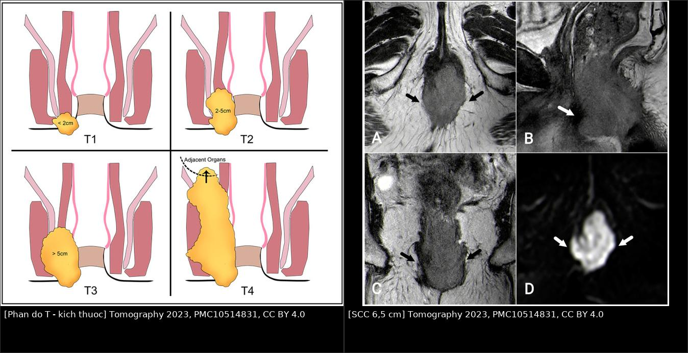
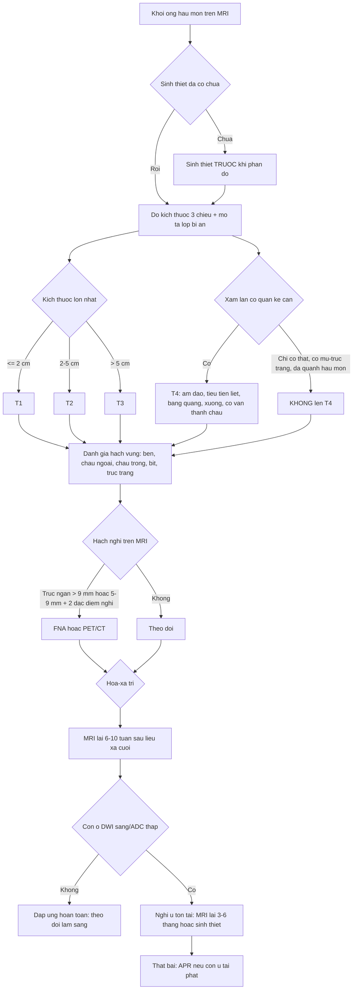
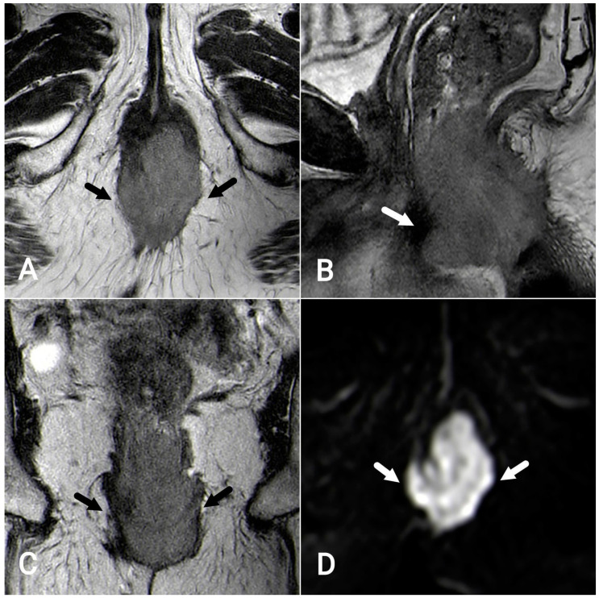
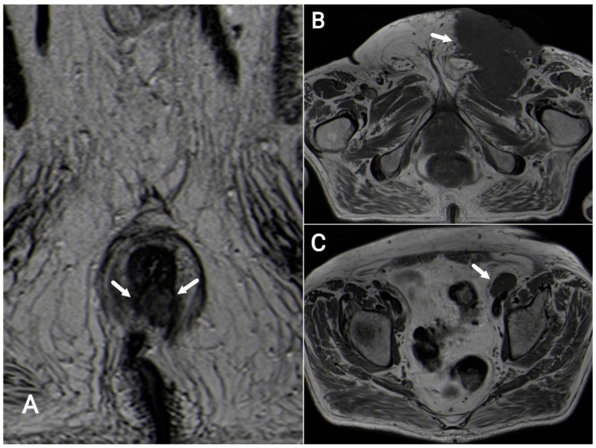
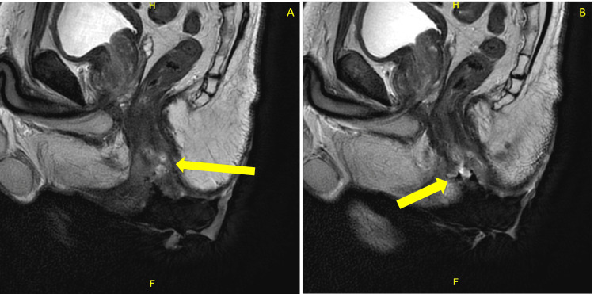
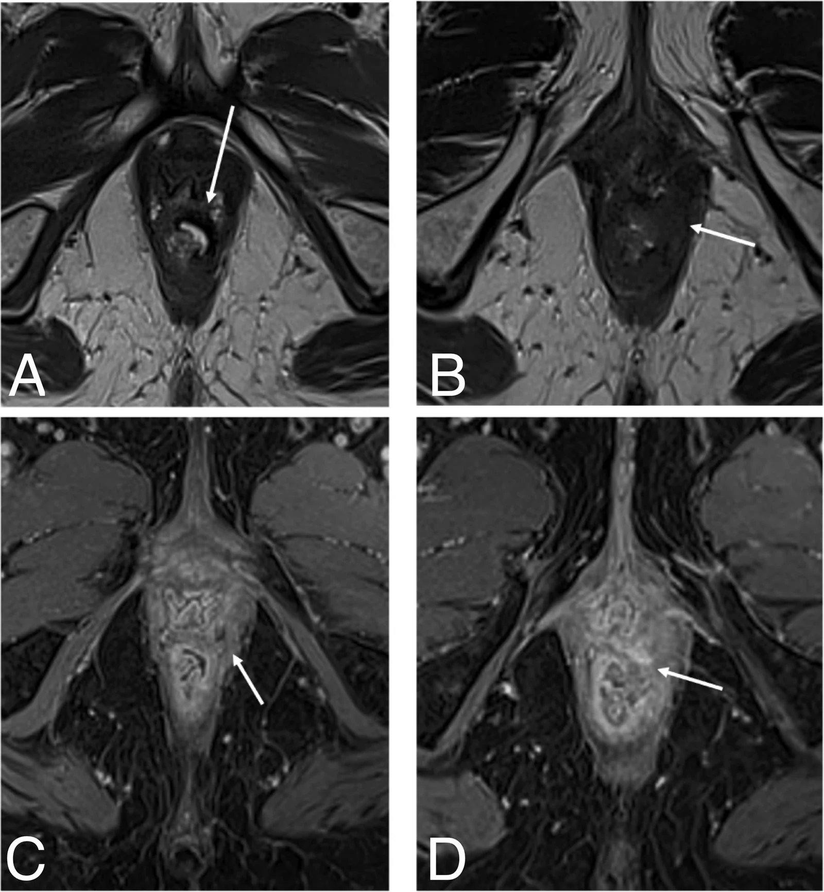

# 3173 — Ung thư biểu mô ống hậu môn trên MRI: phân độ T theo KÍCH THƯỚC, không theo độ sâu / Anal canal squamous cell carcinoma on MRI

**Tags:** `pattern:khoi-ong-hau-mon` `pattern:day-co-that` `pattern:ha-hach-beo` `vung:hau-mon` `vung:tieu-khung` `protocol:MRI-tieu-khung` `protocol:DWI` `score:TNM8` `score:mrT`

**Mức chắc chắn (certainty):** tổng hợp y văn (literature synthesis) — ghép 4 nguồn mở toàn văn: (a) tổng quan hình ảnh – phân độ anal cancer (**Congedo A** et al., *Tomography* 2023, PMC10514831, **CC BY 4.0**); (b) phân tích 228 ca MRI trước hóa–xạ (**Sekhar H, Kochhar R, Carrington B** et al., *Br J Cancer* 2024, PMC11442706, **CC BY 4.0**); (c) ca ASCC lan rộng có ảnh MRI (**Linkous BK, Merchant N, Ptak F** et al., *Cureus* 2025, PMC12551345, **CC BY 4.0**); (d) ca đáp ứng hoàn toàn sau hóa–xạ trên MRI theo dõi (**Nougaret S, Wood V, Rouanet P** et al., *Br J Radiol* 2026, PMC13489399, **CC BY 4.0**). Số nào nguồn không đưa thì ghi "chưa rõ".

> **Bài này trả lời 4 câu hỏi của ca "khối hậu môn 3 cm, MRI thấy ăn vào cơ thắt — T mấy?"**
> (1) **Vì sao ung thư ống hậu môn phân độ T theo KÍCH THƯỚC, trong khi ung thư trực tràng phân độ theo ĐỘ SÂU?** (2) **Xâm lấn cơ thắt có làm lên T4 không?** (3) **Hạch bẹn là hạch VÙNG hay hạch DI CĂN XA?** (4) **Sau hóa–xạ, dày + phù tăng tín hiệu T2 là u tồn tại hay giả u do xạ?**
> Đây là mặt **ung thư ống hậu môn**; các mặt chức năng của cùng vùng ở [546 – Rối loạn vận động tống phân/anismus](../546-loan-van-dong-tong-phan-anismus/lesson.md) và [545 – Sa sàn chậu & MR defecography](../545-sa-san-chau-MR-defecography/lesson.md); chảy máu muộn sau xạ ở [112](../112-chay-mau-truc-trang-muon-sau-xa-tri/lesson.md).

## 1. Tổng quan bệnh học – cơ chế hình ảnh

### 1.1 Giải phẫu: vì sao ống hậu môn "không có lớp để xâm lấn"

- **Chiều dài 3,5–4 cm.** Có hai mốc: **ống hậu môn giải phẫu** (từ **đường răng lược/dentate line** tới bờ hậu môn) và **ống hậu môn phẫu thuật** (từ **ngã ba hậu môn–trực tràng** tới bờ hậu môn) — ống phẫu thuật **dài hơn** (PMC10514831). Đường răng lược **không thấy trực tiếp trên MRI**; người ta **chia ống hậu môn làm 3** và đặt nó ở **ranh giới 1/3 trên – 2/3 dưới**.
- **Phức hợp cơ thắt (sphincter complex)** gồm: **cơ thắt trong (internal anal sphincter — IAS)** là **phần tiếp nối của lớp cơ vòng trong của trực tràng**; **cơ thắt ngoài (external anal sphincter — EAS)** là cơ vân, cùng nhóm với **phần dưới cơ nâng hậu môn (levator ani)** và **cơ mu–trực tràng (puborectalis)**; giữa hai lớp là **khoang liên cơ thắt (intersphincteric space)** chứa mô xơ–mỡ.
- **Tín hiệu T2 chuẩn (đây là "bảng màu" để đọc):** **IAS = tín hiệu trung bình–thấp, ngấm thuốc MẠNH**; **EAS = có vân, T2 THẤP hơn IAS, ngấm thuốc YẾU hơn**; **khoang liên cơ thắt = T2 CAO (mỡ), KHÔNG ngấm thuốc** (PMC10514831, Hình 3). **U = T2 cao hơn cơ vân, T1 trung bình–thấp**.
- **TẠI SAO u sáng trên T2:** tế bào u đặc + phù gian bào → **nhiều nước tự do** → T2 dài; cơ vân vốn **T2 ngắn** nên tương phản rõ. **Cạm bẫy vật lý:** IAS cũng **trung bình–thấp**, nên u nhỏ **có thể đồng tín hiệu với IAS** và bị bỏ — đây là lý do **DWI** phải có: u tăng sinh dày đặc → **hạn chế khuếch tán**, sáng trên DWI b cao/ADC thấp, tách khỏi cơ lành.
- **TẠI SAO phân độ T theo KÍCH THƯỚC (khác trực tràng):** trực tràng có **thang lớp** (niêm mạc → dưới niêm → cơ → mỡ quanh trực tràng), nên T gắn với **độ sâu xuyên qua từng lớp**. Ống hậu môn **không có thang lớp đó** — **chính phức hợp cơ thắt là "thành"** của ống. Vì vậy **ăn vào cơ thắt không phải là "ra ngoài thành"**. ESMO nói rõ: **xâm lấn EAS và/hoặc IAS, cơ mu–trực tràng, cơ nâng hậu môn, thành trực tràng hay da quanh hậu môn KHÔNG làm đổi T4** (PMC10514831). Đây là **khác biệt cốt lõi** và là lỗi hay gặp nhất khi bác sĩ đọc theo phản xạ trực tràng.

### 1.2 Số liệu định lượng bắt buộc nhớ

| Đại lượng | Con số | Nguồn |
|---|---|---|
| Tuổi hay gặp / giới | **45–75 tuổi**, **nữ > nam**; typ mô học hay nhất là **SCC** | PMC10514831 |
| Yếu tố nguy cơ | **HPV 16/18**, **HIV/ức chế miễn dịch**, quan hệ hậu môn nhận, tiền sử K cổ tử cung/âm hộ, thuốc lá | PMC10514831 |
| Di căn xa lúc chẩn đoán | **~6%** (hay gặp: hạch cạnh ĐMC/chậu chung, gan, phổi) | PMC10514831 |
| Sống 5 năm toàn bộ (đoàn hệ MRI, 228 ca) | **74%** (trung vị theo dõi **60,9 tháng**) | PMC11442706 |
| Kích thước u (mrT) là yếu tố tiên lượng | **HR 1,12/cm** cho tử vong; **HR 1,43/cm** cho thất bại tại chỗ–vùng | PMC11442706 |
| Hạch dương | **HR 2,08** (sống) · **HR 2,70** (thất bại tại chỗ–vùng) | PMC11442706 |
| Xâm lấn mạch ngoài thành (mrEMVI) | **HR 3,66** (95% CI 1,88–7,41) — yếu tố mới, độc lập | PMC11442706 |
| Thất bại tại chỗ–vùng 3 năm | **16,5%** | PMC11442706 |
| Sống 5 năm theo hạch | **N0 76%** vs **N1 53,5%** | PMC10514831 |
| T4 trong đoàn hệ 228 ca | **19,7%** (âm đạo 37, tiền liệt tuyến 7, cả hai 1) | PMC11442706 |
| Hóa–xạ trị (CRT) | sống 5 năm **~80%**; **đáp ứng hoàn toàn 50–75%** khi u **≥ 5 cm** | PMC10514831 |
| Hạch "nghi" trên MRI | **trục ngắn > 9 mm**; **5–8 mm + ≥ 2 đặc điểm nghi**, **< 5 mm + 3 đặc điểm**; đặc điểm = **tròn, bờ không đều, tín hiệu không đồng nhất** | PMC10514831 (ESGAR) |
| PET/CT bổ trợ | **lên giai đoạn 15%**, **xuống giai đoạn 15%** | PMC10514831 |
| Độ đồng thuận giữa người đọc | **mrT ICC 0,73–0,88** (khá–mạnh) nhưng **hạch κ 0,53–0,66** (yếu–trung bình) | PMC11442706 |

- **Hệ quả thực hành:** phân độ **T** đọc được khá ổn định; **N** là chỗ **dao động nhất** → đừng "chốt" hạch chỉ bằng thước đo, phải mô tả **hình thái** và **đề xuất FNA/PET** khi hạch 5–9 mm mà lâm sàng cần biết.

## 2. Mẫu hình + chẩn đoán phân biệt theo vị trí (Gamut)

- **Mẫu hình 1 — "thành ống hậu môn dày, có khối ngấm thuốc":** SCC ống hậu môn (bài này) · **adenocarcinoma lan xuống từ trực tràng thấp** · **melanoma hậu môn** · **lymphoma** · **di căn** · **áp-xe/đường rò hậu môn** · **lạc nội mạc (endometriosis)** ở vách âm đạo–trực tràng · **SCC bờ hậu môn (anal margin)**.
- **Gợi nhớ SAMBA:** **S**CC ống hậu môn · **A**denocarcinoma (từ trực tràng) · **M**elanoma · **B**-cell lymphoma · **A**bscess/fistula (áp-xe – rò).
- **Mẫu hình 2 — "ống hậu môn dày + phù tăng tín hiệu T2 sau hóa–xạ":** **u tồn tại** · **xơ hóa do xạ** · **giả u do phù niêm mạc (pseudotumor)** · **viêm/áp-xe sau xạ** · **hẹp do xạ**. Ba thể đầu **chỉ phân biệt được bằng DWI + so chuỗi thời gian**, không bằng một lát T2.
- **Theo vị trí so với đường răng lược → đường lan hạch (đọc để không bỏ sót):**
  - **Trên đường răng lược** (niêm mạc chuyển tiếp/trực tràng): hạch **trực tràng, chậu trong, bịt (obturator)**.
  - **Dưới đường răng lược** (da/biểu mô vảy sừng hóa): hạch **bẹn nông – bẹn sâu, chậu ngoài**.
  - **Hệ quả TNM:** ở **ung thư ống hậu môn**, **hạch bẹn và hạch chậu ngoài là hạch VÙNG (N)**; ở **ung thư trực tràng**, cùng các hạch đó là **di căn xa (M1)**. Đây là câu hỏi thi và cũng là câu hỏi thực hành khi đọc chung một phim tiểu khung.
- **Bờ hậu môn ≠ ống hậu môn:** u **bờ hậu môn** (da quanh hậu môn, biểu mô vảy sừng hóa) **phân độ như ung thư da**, mọc chậm, **T1N0 biệt hóa tốt có thể cắt rộng 1 cm** thay vì hóa–xạ; u **ống hậu môn** điển hình **điều trị bằng hóa–xạ** (PMC10514831).

## 3. Bảng so sánh phân biệt (ma trận đối chiếu)

| Thực thể (entity) | Hình ảnh điển hình (MRI T2/DWI ± cản quang) | Chốt vào (rule-in) | Chốt loại (rule-out) | Gợi ý xác nhận |
|---|---|---|---|---|
| **SCC ống hậu môn** | Khối **T2 cao hơn cơ vân**, phá mẫu hình 3 lớp, **DWI sáng/ADC thấp**, ngấm thuốc; ăn cơ thắt **không** đổi T4 | **Khối + hạn chế khuếch tán + lớn dần + hạch vùng** | Mỡ T2 sáng **không** hạn chế khuếch tán (nang/mỡ); không khối | Sinh thiết **trước** khi phân độ; MRI 3 mặt + DWI |
| **SCC bờ hậu môn** | Tổn thương **nông ở da**, không phá cơ thắt, **T2 trung bình**, bờ loét | **Vị trí da quanh hậu môn + nông** | Ăn sâu vào cơ thắt → ống hậu môn | Khám + sinh thiết; phân độ **như ung thư da** |
| **Adeno trực tràng thấp lan xuống** | Khối **liên tục từ trực tràng**, **T2 trung bình**, ± **nốt nhầy T2 rất cao**; thành trực tràng dày | **Nguồn từ trên, lan theo thành** | Tổn thương **khu trú ở ống hậu môn**, niêm mạc trực tràng trên sạch | Soi + sinh thiết; MRI đo **ranh giới trên** |
| **Melanoma hậu môn** | Khối **T1 sáng (melanin/máu)**, T2 thấp, **ngấm mạnh**, thường **sa lồi ra ngoài**, hạch sớm | **T1 sáng + T2 thấp + sa lồi + hạch bẹn sớm** | T1 trung bình–thấp + không sa lồi → SCC | Hóa mô miễn dịch (HMB-45, Melan-A) |
| **Lymphoma** | Khối **rất lớn, đồng nhất, T2 trung bình, ADC thấp**, **không hẹp lòng**, hạch lớn nhiều tầng | **Khối lớn + hạch lớn + ADC thấp đồng nhất** | Bờ gồ ghề, hoại tử lệch tâm → carcinoma | Sinh thiết, IHC |
| **Áp-xe/đường rò hậu môn** | **Ổ T2 rất cao có vách**, viền ngấm, **khí** (mất tín hiệu), **đường rò hướng da** | **Khí + viền ngấm dày + sốt/đau cấp** | Khí + viền mỏng + không hạn chế khuếch tán (dịch) | Khám, MRI thì muộn; **không sinh thiết mù** |
| **Xơ hóa/giả u sau hóa–xạ** | Dày **lan tỏa**, T2 **tăng vừa phải**, **không có ổ hạn chế khuếch tán**, teo cơ thắt, **giảm dần theo tháng** | **Ổn định/giảm + DWI âm + so chuỗi** | **Ổ DWI sáng/ADC thấp mới** → u tồn tại | MRI lại **6–10 tuần** rồi **3–6 tháng**; so ảnh nền |
| **U tồn tại/tái phát sau CRT** | **Ổ T2 cao khu trú + DWI sáng/ADC thấp**, dày **không đều**, ± hạch mới | **Ổ hạn chế khuếch tán mới/xuất hiện lại** | Dày đều, DWI âm, teo cơ → xơ | Sinh thiết khi còn nghi; PET/CT khi cần |

*Trái: sơ đồ T1 (< 2 cm) – T2 (2–5 cm) – T3 (> 5 cm) – T4 (xâm lấn cơ quan kế cận) của ung thư ống hậu môn (PMC10514831, Hình 5). Phải: SCC ống hậu môn 6,5 × 5,5 × 4 cm trên T2 ba mặt, ăn cơ thắt hai bên + cơ mu–trực tràng + hố ngồi–hậu môn trái (PMC10514831, Hình 4). Nguồn: Congedo A et al., Tomography 2023, CC BY 4.0. Ảnh ghép letterbox, không crop.*

### Dấu hiệu cần mô tả trong mọi báo cáo (không chỉ T)

- **Kích thước 3 chiều** (mm) — vì T là **kích thước lớn nhất**, ghi cả trục ngang/dọc.
- **Lớp bị ăn**: niêm mạc → IAS → khoang liên cơ thắt → EAS → hố ngồi–hậu môn; **mô tả lớp giúp bác sĩ xạ lập GTV**, không thay đổi T (trừ khi tới cơ quan kế cận).
- **Cơ quan kế cận** (âm đạo, cổ tử cung, niệu đạo, tiền liệt tuyến, bàng quang, xương, cơ vân thành chậu) — **chỉ khi có xâm lấn mới là T4**.
- **mrEMVI** (mạch ngoài thành) và **mrTSH** (tín hiệu u không đồng nhất) — hai yếu tố tiên lượng "mới", ghi khi thấy (PMC11442706).

## 4. Protocol chụp + phân độ + ngưỡng điều trị

### 4.1 Protocol MRI tiểu khung cho ống hậu môn

1. **Từ 1,5 T** (3 T tốt hơn), **coil bề mặt mảng**; **KHÔNG dùng coil trong trực tràng** (đau, biến dạng ống hậu môn). Có thể bơm **gel vào ống hậu môn** để căng nhẹ khi u nhỏ (PMC10514831).
2. **Mặt phẳng:** **axial vuông góc trục ống hậu môn**, **coronal song song trục ống**, **sagittal** — cả ba. **Lát < 4 mm**, **FOV nhỏ**, ma trận cao.
3. **Trường chụp phải phủ:** từ **bờ hậu môn + vùng bẹn** lên tới **eo xương cùng/ngã ba ĐMC** — nếu cắt ngắn sẽ **bỏ hạch bẹn và hạch chậu** (đúng loại hạch "vùng" quyết định N).
4. **Chuỗi xung:** **T2 độ phân giải cao** axial/sagittal/coronal (bắt buộc); **DWI** (b = 800–1 000, kèm ADC) để định vị u và hạch; **T1 ± cản quang** (tùy chọn, giúp thấy liên quan cơ thắt). **Không cần** cản quang thường quy nếu T2 + DWI đã rõ.
5. **Ngoài ổ**: **CT ngực–bụng có cản quang** tìm di căn; **PET/CT** khi nghi hạch hoặc di căn (lên/xuống giai đoạn **15%/15%**).

### 4.2 Phân độ TNM8 (phần dùng hằng ngày)

| Thành phần | Định nghĩa | Ghi chú thực hành |
|---|---|---|
| **T1** | **≤ 2 cm** | Theo **kích thước lớn nhất** |
| **T2** | **> 2 – 5 cm** | Hay gặp nhất (mrT trung vị **4,2 cm** trong 228 ca) |
| **T3** | **> 5 cm** | Không liên quan độ sâu |
| **T4** | **Xâm lấn cơ quan kế cận**: âm đạo, cổ tử cung/tử cung, buồng trứng, niệu đạo, bàng quang, tiền liệt tuyến/túi tinh, xương, thần kinh, mạch, **cơ vân thành chậu** | **KHÔNG** tính cơ thắt trong/ngoài, cơ mu–trực tràng, cơ nâng hậu môn, thành trực tràng, da quanh hậu môn (ESMO) |
| **N** | **N0 / N1** theo **vị trí** hạch vùng (không theo số lượng như trực tràng) | Hạch vùng: **bẹn, chậu ngoài, chậu trong, bịt, trực tràng** |
| **M** | M0 / M1 | Hạch **chậu chung, cạnh ĐMC** = **M1** |

- **TNM8 so với TNM7:** chia **IIA/IIB** và **IIIA/IIIB/IIIC**; **IIB (TNM8) là nhóm nguy cơ cao hơn**, có thể cần điều trị tích cực hơn (PMC10514831).
- **Phân độ sau hóa–xạ:** không có RADS riêng; dùng mô tả **"đáp ứng hoàn toàn / còn nghi / u tồn tại"** + **so ảnh nền**, kèm DWI.

### 4.3 Ngưỡng điều trị và lịch chụp lại

- **Điều trị chuẩn:** **hóa–xạ đồng thời** (xạ tiểu khung + **5-FU + mitomycin-C hoặc cisplatin**) — đây là **điều trị triệt để**, khác trực tràng (hóa–xạ **tân bổ trợ rồi mổ**). Nhờ vậy **đa số giữ được cơ thắt** (PMC10514831).
- **Ngoại lệ mổ đơn thuần:** **SCC bờ hậu môn T1N0 biệt hóa tốt** → **cắt rộng 1 cm**; **T1 ống hậu môn** vẫn thường hóa–xạ.
- **Cắt toàn bộ trực tràng–hậu môn (APR):** cho **u tồn tại/tái phát sau hóa–xạ** — tức là "mất cơ thắt" là **hệ quả của thất bại điều trị**, không phải lựa chọn đầu tay.
- **Lịch MRI sau hóa–xạ:** **6–10 tuần** sau liều xạ cuối; **đáp ứng tối đa có thể tới 6 tháng**; **xơ do xạ dễ phân biệt với u tồn tại sau ~6 tháng**; **DWI** là công cụ tách đáp ứng hoàn toàn khỏi u còn (PMC10514831).
- **Theo dõi:** **~50% tái phát trong 2 năm đầu** và **gần vị trí u nguyên phát** hoặc hạch quanh trực tràng/trước xương cùng/bẹn/chậu trong → **MRI có triệu chứng hoặc T4 ban đầu**, không MRI thường quy cho mọi ca (NCCN/ESMO không khuyến cáo thường quy).

## 5. Biến thể bình thường và cạm bẫy

- **Cạm bẫy 1 — "ăn cơ thắt = T4":** sai. **Xâm lấn IAS/EAS/cơ mu–trực tràng/cơ nâng/thành trực tràng/da quanh hậu môn KHÔNG đổi T** (ESMO). Chỉ **cơ quan kế cận** mới là T4. Đọc theo phản xạ trực tràng sẽ **lên giai đoạn oan** và đẩy bệnh nhân khỏi phác đồ chuẩn.
- **Cạm bẫy 2 — "hạch bẹn = di căn xa":** ở ống hậu môn, **hạch bẹn là hạch VÙNG**. Gọi sai thành M1 sẽ **loại bệnh nhân khỏi hóa–xạ triệt để**.
- **Cạm bẫy 3 — cắt trường chụp ở bờ hậu môn:** mất **hạch bẹn** và **hạch chậu ngoài** — hai nhóm quyết định N. Luôn phủ tới **ngã ba ĐMC** và **hai vùng bẹn**.
- **Cạm bẫy 4 — giả u do xạ (pseudotumor):** sau hóa–xạ, **niêm mạc phù T2 rất cao + dày khu trú** bắt chước u; **DWI** và **so ảnh nền** là chốt; đừng sinh thiết ngay trong 6–10 tuần đầu nếu DWI âm.
- **Cạm bẫy 5 — "tram track sign":** hình **hai đường song song** ở vùng u sau xạ mô tả **mô xơ còn lại theo lớp** (Kochhar) — dấu của **đáp ứng**, không phải u tiến triển (PMC10514831).
- **Cạm bẫy 6 — u nhỏ đồng tín hiệu IAS:** u < 2 cm có thể **không nổi trên T2** vì IAS vốn trung bình–thấp; **luôn xem DWI/ADC** và **bơm gel căng nhẹ** khi nghi.
- **Cạm bẫy 7 — phân độ trước khi có mô bệnh học:** **ASCC và adeno trực tràng không phân biệt được trên MRI**; phân độ khi chưa có sinh thiết dễ **đi sai phác đồ** (ung thư trực tràng cần **MRI phân độ T theo độ sâu** + hóa–xạ tân bổ trợ, không phải CRT triệt để).
- **Biến thể bình thường:** **sẹo sau mổ trĩ/rò**, **nếp niêm mạc dày không đều**, **phì đại IAS do rặn mạn**, **nang tuyến hậu môn (anal gland cyst)** — tất cả **không hạn chế khuếch tán mạnh** và **không lớn dần** trên chuỗi ảnh.

## 6. Tự lượng giá — Blind Quiz

**Ca 1 — Nữ 58 tuổi, đau hậu môn + đi máu 4 tháng, sờ thấy khối cứng. Nhìn T2 ba mặt.**

- Gợi ý lâm sàng: khối cứng, cố định, không sa lồi; chưa có sinh thiết.
- Câu hỏi: (1) Đo kích thước và gọi T? (2) Cơ thắt bị ăn có làm T4? (3) Cần bổ sung gì trước khi kết luận?

<b>Bấm để hiện đáp án (findings + chẩn đoán)</b>

- **Findings:** khối **6,5 × 5,5 × 4 cm**, không đồng nhất trên T2, **xâm lấn cơ thắt trong và ngoài hai bên, cơ mu–trực tràng và hố ngồi–hậu môn trái**; **hạn chế khuếch tán** trên DWI (mũi tên trắng).
- **Chẩn đoán:** **SCC ống hậu môn, T3** (vì **> 5 cm** theo kích thước) — **không phải T4** dù đã ăn cơ thắt và ra hố ngồi–hậu môn.
- **Vì sao:** T của ống hậu môn là **kích thước**, không phải độ sâu; **chỉ cơ quan kế cận (âm đạo, bàng quang, xương…)** mới là T4. Ở ca này **hố ngồi–hậu môn và cơ thắt vẫn nằm trong "thành" ống hậu môn**.
- **Cần bổ sung:** **sinh thiết trước** (vì MRI không phân biệt SCC với adeno trực tràng lan xuống), **đánh giá hạch bẹn/chậu** trên cùng phim, **CT ngực–bụng**; nếu hạch 5–9 mm → **FNA/PET**.
- **Nguồn:** Congedo A et al., *Tomography* 2023, PMC10514831, CC BY 4.0 (Hình 4).

**Ca 2 — Nữ 47 tuổi, khối hậu môn 26 mm, sờ thấy hạch bẹn trái. Nhìn T2 axial + T1.**

- Câu hỏi: (1) T mấy? (2) Hạch bẹn và hạch chậu ngoài là N hay M? (3) Vì sao đây là câu hỏi "sống còn" về phác đồ?

<b>Bấm để hiện đáp án (findings + chẩn đoán)</b>

- **Findings:** (A) T2 axial — u **26 mm** từ **5 đến 7 giờ**, **ăn cơ thắt trong hai bên**; (B) T1 — **hạch bẹn trái** lan ra da phía trước; (C) **hạch chậu ngoài trái** (mũi tên trắng).
- **Chẩn đoán:** **SCC ống hậu môn T2 N1** (T2 vì **2–5 cm**).
- **N hay M:** **cả hạch bẹn và hạch chậu ngoài đều là hạch VÙNG (N)** ở ung thư ống hậu môn. Ở **ung thư trực tràng**, hai nhóm này là **di căn xa (M1)** — cùng một hình, khác tên gọi, khác phác đồ.
- **Vì sao quan trọng:** gọi đúng N → bệnh nhân được **hóa–xạ triệt để** (sống 5 năm N1 **53,5%**); gọi sai thành M1 → **chỉ điều trị triệu chứng**, mất cơ hội chữa.
- **Nguồn:** Congedo A et al., *Tomography* 2023, PMC10514831, CC BY 4.0 (Hình 7).

**Ca 3 — Nam 61 tuổi, khối hậu môn lan mô mềm quanh hậu môn. Nhìn T2 sagittal.**

- Gợi ý: tổn thương loét, cứng, lan ra mô mềm; hạch bẹn sờ thấy.
- Câu hỏi: (1) Mô tả tổn thương và mức xâm lấn? (2) Có cần cắt toàn bộ trực tràng–hậu môn ngay? (3) Bước tiếp theo?

<b>Bấm để hiện đáp án (findings + chẩn đoán)</b>

- **Findings:** khối **không đồng nhất, ngấm thuốc**, **xâm lấn cơ thắt**, **biến dạng giải phẫu hậu môn–trực tràng** và **lan ra mô mềm quanh hậu môn** (mũi tên vàng); hạch bẹn **10 mm trục ngắn** trên lát khác.
- **Chẩn đoán:** **SCC ống hậu môn lan rộng** (thể tiến xa tại chỗ) + **hạch bẹn nghi di căn**.
- **Có mổ ngay?** **Không** — điều trị đầu tay vẫn là **hóa–xạ triệt để**; **APR** dành cho **u tồn tại/tái phát**. Cắt ngay là **mất cơ thắt oan** ở bệnh nhân còn khả năng đáp ứng.
- **Bước tiếp:** sinh thiết xác nhận, **CT ngực–bụng**, **PET/CT** nếu nghi hạch ngoài vùng, rồi **hóa–xạ**; **MRI lại 6–10 tuần** sau xạ.
- **Nguồn:** Linkous BK et al., *Cureus* 2025, PMC12551345, CC BY 4.0 (Hình 2).

**Ca 4 — Nữ 64 tuổi, 9 tháng sau hóa–xạ vì SCC ống hậu môn, đi khám lại. Nhìn T2 + T1 sau tiêm.**

- Câu hỏi: (1) Còn u không? (2) Dấu hiệu nào giúp phân biệt xơ do xạ với u tồn tại? (3) Nếu 18 tháng sau vẫn dày nhẹ thì sao?

<b>Bấm để hiện đáp án (findings + chẩn đoán)</b>

- **Findings:** (A) T2 axial 9 tháng sau hóa–xạ — **chỉ còn dải xơ mảnh, không khối** (mũi tên); (C) T1 sau tiêm — **không ổ ngấm khu trú**; (B, D) sau thêm 18 tháng — **ổn định**.
- **Chẩn đoán:** **đáp ứng hoàn toàn** — theo dõi lâm sàng, không can thiệp.
- **Phân biệt:** **xơ do xạ** = dày đều, **DWI âm**, teo cơ thắt, **giảm/ổn định theo thời gian**; **u tồn tại** = **ổ DWI sáng/ADC thấp**, dày không đều, **xuất hiện lại**. "Tram track sign" (hai đường song song) là dấu của mô xơ theo lớp.
- **Nếu vẫn dày nhẹ:** so với ảnh nền và **DWI**; **không sinh thiết mù** mô đã xạ; nếu DWI dương hoặc dày tăng → **MRI 3–6 tháng/PET** rồi sinh thiết có định hướng.
- **Nguồn:** Nougaret S et al., *Br J Radiol* 2026, PMC13489399, CC BY 4.0 (Hình 3).

## Bài liên quan chéo
- [100 – Tổng quan hệ Bụng](../100-tong-quan-he-bung/lesson.md)
- [546 – Rối loạn vận động tống phân (anismus)](../546-loan-van-dong-tong-phan-anismus/lesson.md) (cùng vùng, mặt chức năng)
- [545 – Sa sàn chậu & MR defecography](../545-sa-san-chau-MR-defecography/lesson.md)
- [112 – Chảy máu trực tràng muộn sau xạ trị](../112-chay-mau-truc-trang-muon-sau-xa-tri/lesson.md) (biến chứng muộn của chính trường xạ này)
- [162 – Tắc ruột](../162-tac-ruot/lesson.md) (biến chứng hẹp/tắc sau xạ)
- [3128 – Lồng ruột non–non ở người lớn](../3128-long-ruot-non-non-nguoi-lon/lesson.md) (khối/hạch vùng tiểu khung gây tắc)

## Ảnh
- `images/3173_ung-thu-ong-hau-mon_Sodo-phan-do-T_PMC10514831-F5.jpg` — sơ đồ T1–T4 theo kích thước — *Tomography* 2023, PMC10514831, **CC BY 4.0**.
- `images/3173_ung-thu-ong-hau-mon_MRI-giai-phau-co-that_PMC10514831-F3.jpg` — giải phẫu 3 lớp cơ thắt trên T2 — PMC10514831, **CC BY 4.0**.
- `images/3173_ung-thu-ong-hau-mon_MRI-T2-3mat_PMC10514831-F4.jpg` — u 6,5 cm trên T2 ba mặt + DWI — PMC10514831, **CC BY 4.0**.
- `images/3173_ung-thu-ong-hau-mon_MRI-xam-lan-co-that_PMC10514831-F7.jpg` — u 26 mm + hạch bẹn/chậu ngoài — PMC10514831, **CC BY 4.0**.
- `images/3173_ung-thu-ong-hau-mon_MRI-T2-sagittal_PMC12551345-F2.jpg` — khối lan mô mềm trên T2 sagittal — *Cureus* 2025, PMC12551345, **CC BY 4.0**.
- `images/3173_ung-thu-ong-hau-mon_MRI-sau-CRT_PMC13489399-F3.jpg` — đáp ứng hoàn toàn sau hóa–xạ — *Br J Radiol* 2026, PMC13489399, **CC BY 4.0**.
- `images/composite_3173_phan-do-T-va-u-that.jpg` — ảnh ghép đối chiếu (sơ đồ T + u thật), letterbox nền đen, không crop.
- Chi tiết nguồn + giấy phép: `images/CREDITS.md`.

> Không dùng để chẩn đoán độc lập khi chưa có người hướng dẫn.
