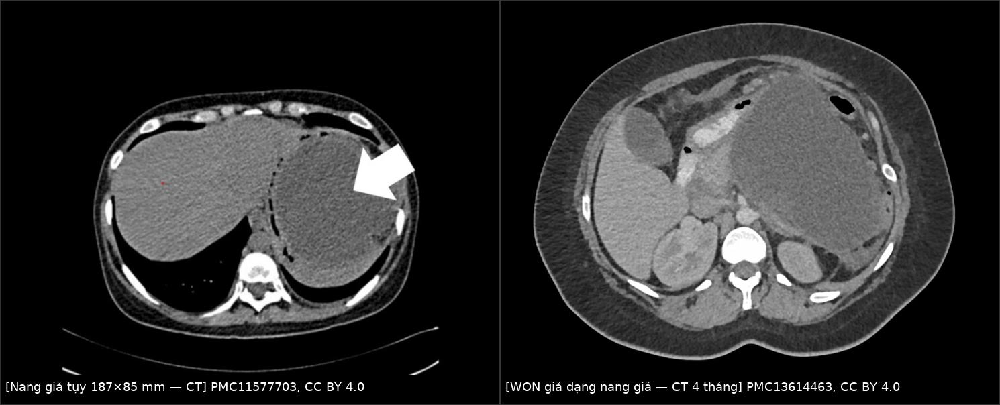
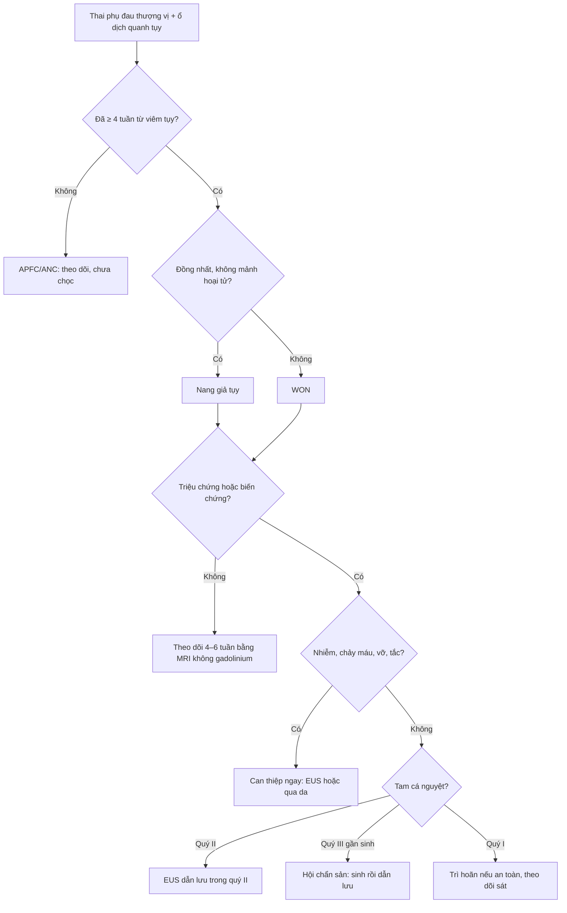
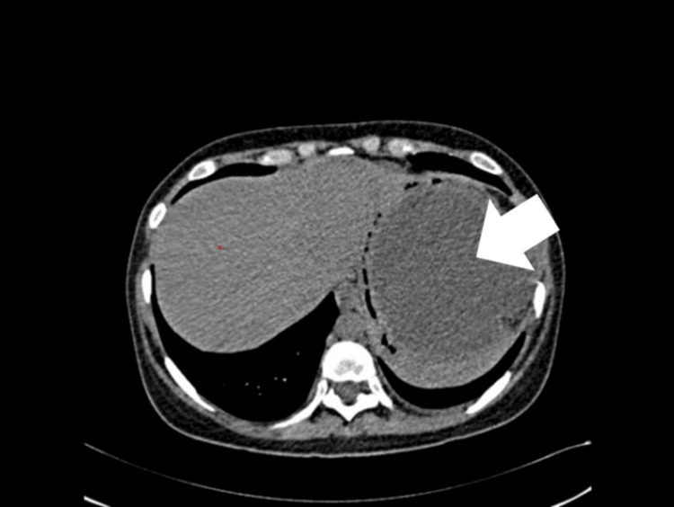
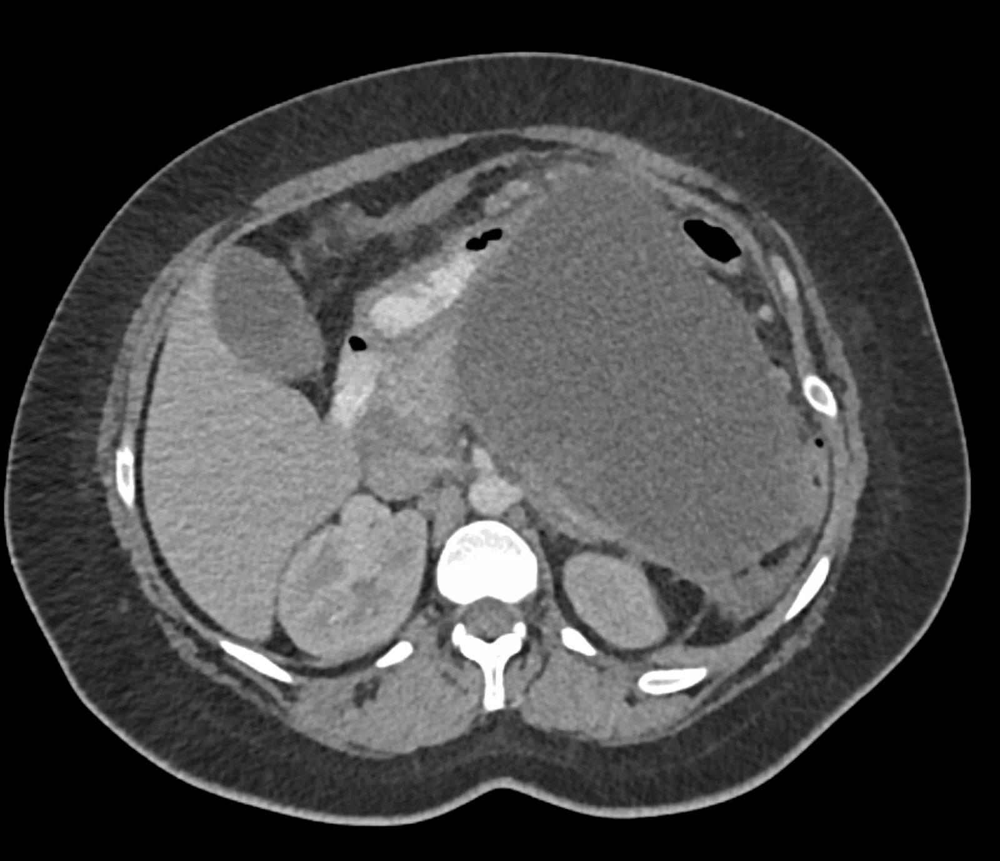
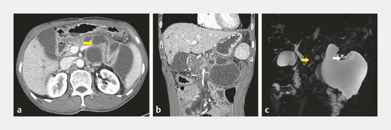
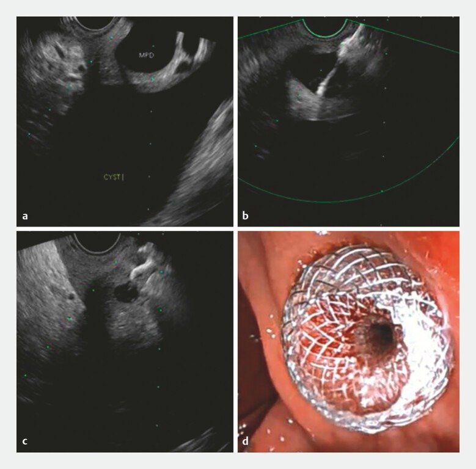

# 3199 — Nang giả tụy & hoại tử có vỏ (WON) ở thai phụ: chọc lúc nào, chọc bằng đường nào / Pancreatic pseudocyst and walled-off necrosis in pregnancy

**Tags:** `pattern:o-dich` `pattern:hoai-tu` `pattern:nang` `vung:tuy` `vung:thai-nhi` `score:Atlanta-2012` `protocol:MRI-thai` `protocol:EUS`
**Mức chắc chắn (certainty):** tổng hợp y văn (literature synthesis) — ghép **tổng quan nang giả tụy 2026** (PMC13356910: thời điểm, chỉ định, EUS/LAMS), **ca WON giả dạng nang giả 2026** (PMC13614463), **ca nang giả nhiễm sau sinh 187 × 85 mm** (PMC11577703), **ca viêm tụy hoại tử chu sản có biến chứng** (PMC7157796), **tổng quan viêm tụy trong thai 2026** (PMC13115793), **loạt 5 ca viêm tụy thai** (PMC13391419), **ca MCN vỡ ở phụ nữ 34 tuổi** (PMC13789036), **phân tích mạng lưới stent 2026** (PMC13406375), **hướng dẫn BSGE/RCOG về phẫu thuật trong thai** (PMC6822954) và **tổng quan MRI cấp cứu bụng–chậu** (PMC13768228). Không có thử nghiệm tiến cứu riêng cho ổ dịch tụy ở thai phụ — số nào nguồn không nêu ghi rõ.

> **Câu chốt:** thai phụ có ổ dịch quanh tụy, ba câu hỏi theo đúng thứ tự: **(1) đã ≥ 4 tuần chưa?** chưa thì **không chọc** (APFC/ANC non); **(2) ổ ĐỒNG NHẤT hay có mảnh hoại tử?** đồng nhất = nang giả, không đồng nhất = **WON** — WON "giả nang giả" sau nhiều tháng vẫn là WON; **(3) có chỉ định cấp không?** nhiễm, chảy máu, vỡ, tắc tiêu hóa/mật → can thiệp ngay; không cấp thì **ưu tiên quý II**, bằng **EUS không xạ**, và **kích thước một mình KHÔNG phải chỉ định** (PMC13356910).

## 1. Tổng quan bệnh học – cơ chế hình ảnh

### 1.1 Vì sao ổ dịch tụy xuất hiện và vì sao thai kỳ làm khó (TẠI SAO)

- **Nang giả tụy (pancreatic pseudocyst, PP):** ống tụy rò hoặc vỡ → dịch tụy giàu enzym thoát ra khoang quanh tụy → phản ứng viêm dựng **vách xơ–mô hạt KHÔNG có biểu mô** (vì không có biểu mô nên gọi "giả"). Sau **≥ 4 tuần** vách đủ chắc để can thiệp; trước đó vách mỏng, dễ rò và dễ thất bại khi dẫn lưu (PMC13356910).
- **Hoại tử có vỏ (walled-off necrosis, WON):** sau viêm tụy **hoại tử**, mô chết + mỡ hoại tử được bao bọc → vách dày, **bên trong KHÔNG đồng nhất** (mảnh hoại tử lơ lửng). Đây là điểm khác gốc với nang giả: **nang giả chỉ có dịch, WON có mô chết** (PMC13614463).
- **Vì sao thai kỳ làm thay đổi cả bệnh cảnh lẫn hình ảnh:** tử cung to đẩy dạ dày – tụy lên cao và sang phải, làm **đau thượng vị bị quy cho sản khoa** (sản giật/HELLP, cơn gò, vết mổ lấy thai); đồng thời **hơi ruột + tử cung** làm siêu âm khó thấy đuôi tụy. Ở thể nặng, **giảm tưới máu tử cung do mất dịch/toan** là con đường gây **chuyển dạ non và thai lưu**, nên hồi sức mẹ vừa là điều trị mẹ vừa là bảo vệ thai.
- **Vì sao có thai làm tăng nguy cơ:** **estrogen** làm mật giàu cholesterol, **progesterone** làm giảm co bóp túi mật và ứ mật; **triglyceride huyết tương tăng 2–3 lần** do giảm lipoprotein lipase — nên **sỏi mật và tăng triglyceride chiếm ~67%** nguyên nhân viêm tụy trong thai (PMC11577703, PMC13115793).
- **Vì sao u nang nhầy (MCN) lại "nổ" trong thai:** mô đệm kiểu buồng trứng của MCN **dương tính thụ thể estrogen/progesterone** → kích thích tăng tiết, căng vỏ, **vỡ tự phát**; ca 34 tuổi vỡ 75 mm hai lần trong vài ngày, dịch tràn qua lỗ hoành vào trung thất (PMC13789036). Vì vậy khối nang **có vách/mấp méo ở thai phụ không được mặc định là nang giả**.

### 1.2 Vì sao hình ảnh trông như vậy (vật lý từng phương thức)

- **Siêu âm:** dịch đơn thuần **trống âm, tăng hồi âm phía sau**; mảnh hoại tử là **cấu trúc tăng hồi âm không đều, không có bóng lưng**, di động chậm khi đổi tư thế. Siêu âm đầu tay vì không xạ, nhưng **hơi ruột và tử cung che** làm bỏ sót đuôi tụy — âm tính không loại trừ.
- **CT:** dịch đơn thuần **0–20 HU**; dịch giàu protein **20–40 HU**; **máu cấp 40–60 HU**; mỡ hoại tử **âm** (−20 đến −100 HU). Vách mô hạt **ngấm thuốc thì tĩnh mạch cửa**; mô hoại tử **không ngấm**. Vì thế **WON chỉ lộ rõ trên CT có cản quang** — CT không cản quang dễ đọc thành "nang giả đồng nhất".
- **MRI:** dịch **T2 rất sáng**; mảnh hoại tử **T2 trung gian, T1 trung gian, không ngấm**; máu bán cấp **T1 sáng** (methemoglobin). MRI **không xạ** nên là chuỗi xung chốt ở thai phụ; **gadolinium bị khuyến cáo tránh** (nguy cơ thai), đa số dữ liệu an toàn ở **1,5 T**, đã chụp an toàn tới **3 T** (PMC13768228). MRCP **không cần gadolinium** cho thấy ống tụy giãn/đứt và sỏi ống mật.
- **EUS:** đầu dò sát thành dạ dày/tá tràng, **không xạ**, phân giải cao hơn MRI cho **mảnh hoại tử nhỏ** và cho phép **chọc hút/dẫn lưu ngay** — vừa chẩn đoán vừa điều trị (PMC13356910, PMC13046431).

### 1.3 Ngưỡng định lượng nằm lòng

- **Mốc thời gian:** **< 4 tuần** = tụ dịch cấp quanh tụy (APFC) hoặc tụ dịch hoại tử cấp (ANC) — **chưa có vỏ, chưa chọc**; **≥ 4 tuần** = nang giả hoặc WON — có vỏ, có thể can thiệp (Atlanta 2012, PMC13356910).
- **Chỉ định can thiệp** (không dựa vào kích thước đơn thuần): **đau kéo dài, hẹp/chèn ép dạ dày–tá tràng gây nôn, vàng da do chèn mật, nhiễm trùng, chảy máu/giả phình, vỡ, hoặc to dần** (PMC13356910).
- **Theo dõi:** chụp lại mỗi **4–6 tuần** để đánh giá vỏ và biến chứng ở ổ không triệu chứng (PMC13356910).
- **Tần suất bệnh:** viêm tụy cấp trong thai **1–3/10.000** thai (PMC13115793), các loạt khác **1/1.000–1/12.000** (PMC13391419) và **5–80/100.000** (PMC11577703) — **con số dao động theo định nghĩa**, không có registry thống nhất. Tử vong mẹ từng **30–60%**, nay phần lớn **< 5%**; tử vong chu sinh được báo **3,6%** (PMC13115793, PMC7157796, PMC11577703).
- **Ca thực tế để neo ngưỡng:** nang giả **187 × 85 mm** phát hiện **ngày 27 sau sinh** (PMC11577703); WON **4 tháng** sau hoại tử trông như nang giả đồng nhất (PMC13614463); MCN **75 mm** vỡ hai lần (PMC13789036).

## 2. Mẫu hình + chẩn đoán phân biệt theo vị trí (gamut)

Bốn câu hỏi định vị, theo thứ tự (áp cho mọi ổ dịch cạnh tụy ở thai phụ):

1. **Thời gian:** < 4 tuần hay ≥ 4 tuần so với đợt viêm tụy?
2. **Đồng nhất hay có mảnh:** có mảnh hoại tử/mỡ lơ lửng trong ổ?
3. **Vỏ:** vỏ mỏng đều (nang giả) hay vỏ dày, không đều, ngấm mạnh (WON/u)?
4. **Quan hệ ống tụy:** ống tụy giãn, đứt đoạn ≥ 2 cm, hay ổ thông trực tiếp với ống?

Gamut theo vị trí:

- **Túi mạc nối/tiền dạ dày, sát thân–đuôi tụy:** nang giả, WON, nang nhân đôi dạ dày, nang mạc treo.
- **Thân/đuôi tụy trong nhu mô:** MCN (thường nữ 40–50, thân–đuôi, vách dày, có mô đệm buồng trứng), SCN (vi nang "tổ ong", sẹo trung tâm), IPMN (thông ống tụy chính).
- **Đầu tụy/đường mật:** nang ống mật chủ (choledochal cyst), nang nhân đôi tá tràng, giãn ống tụy do tắc.
- **Hạ vị/tiểu khung:** nang buồng trứng (thai kỳ rất hay gặp), nang cạnh tử cung; **không được chọc qua tử cung**.
- **Sát lách:** nang lách, **giả phình động mạch lách vỡ** — bắt chước nang giả trên CT không cản quang, tử vong **> 25%** nếu bỏ sót (PMC13264441).
- **Sau phúc mạc/trung thất:** nang giả lan qua lỗ hoành (PMC13789036), nang giả trung thất.

Mnemonic **"4T–4C"** để không bỏ: **T**ime (≥ 4 tuần), **T**issue (mảnh hoại tử = WON), **T**ract (ống tụy đứt = DPDS), **T**umor (vách dày/nốt = MCN); **C**ontrast (CT/MRI có cản quang), **C**yst fluid (amylase dịch), **C**ystoscopy/EUS (EUS-FNA), **C**oming delivery (kế hoạch sinh).

## 3. Bảng so sánh phân biệt (ma trận đối chiếu)

| Thực thể (entity) | Hình ảnh điển hình | Chốt vào (rule-in) | Chốt loại (rule-out) | Gợi ý xác nhận |
|---|---|---|---|---|
| **Nang giả tụy (PP)** | Ổ **đồng nhất**, vỏ mỏng đều, sát dạ dày/tá tràng, **≥ 4 tuần**, không mảnh trong ổ | **Đồng nhất + vỏ đều + ≥ 4 tuần + không có mảnh hoại tử** | Có mảnh/mỡ lơ lửng → **WON**; vách dày + nốt → u nang | MRI T2/MRCP; amylase dịch cao; EUS nếu cần |
| **WON** | Ổ **KHÔNG đồng nhất**, vỏ dày ngấm, mảnh hoại tử, có thể có khí nếu nhiễm | **Mảnh hoại tử trong ổ + tiền sử hoại tử tụy + ≥ 4 tuần** | Ổ thuần dịch, không mảnh → nang giả | Ôn lại **CT đợt cấp** tìm hoại tử; EUS tìm mảnh |
| **APFC / ANC (< 4 tuần)** | Dịch quanh tụy, **chưa vỏ**; ANC không đồng nhất | **< 4 tuần + chưa có vỏ xơ** | Vỏ rõ + ≥ 4 tuần → đã chuyển nang giả/WON | Theo dõi 4–6 tuần, **không chọc** |
| **MCN (u nang nhầy)** | Thân/đuôi, **vách dày, nhiều vách, nốt trong vách**, không thông ống điển hình | **Nữ trung niên + vách/nốt + mô đệm buồng trứng ER/PR+** | Ổ đơn thuần, vỏ mỏng, sau viêm tụy → nang giả | EUS-FNA dịch (CEA/amylase), **cắt bỏ** để có mô bệnh |
| **SCN (u nang thanh dịch)** | **Vi nang "tổ ong"**, sẹo trung tâm vôi hóa, đầu tụy | **Nhiều nang ≤ 2 cm + sẹo trung tâm** | Nang đơn độc → không phải SCN | MRI; theo dõi nếu không triệu chứng |
| **Nang ống mật chủ** | Nang dọc **đường mật**, thông ống mật, có thể kèm giãn trong gan | **Nang dọc OMC + nối với đường mật** | Ổ tách khỏi đường mật → nang giả | MRCP; **không chọc** vì là nang thật |
| **Nang nhân đôi tá tràng** | Nang **dính thành tá tràng**, thành có lớp cơ, dịch trong | **Thành ruột non + dính tá tràng** | Ổ sau viêm tụy, amylase rất cao → nang giả | EUS/CT; mô bệnh sau cắt |
| **Giả phình ĐM lách** | Khối **ngấm thuốc đồng thì với ĐM**, có mạch vào, **không phải dịch** | **Ngấm thuốc mạnh thì động mạch + mạch nuôi** | Không ngấm, 0–20 HU → dịch | **CTA thì động mạch** trước mọi chọc |

*Trái: ổ dịch lớn **187 × 85 mm** sau sinh, đồng nhất, vỏ rõ — nang giả tụy (PMC11577703, CC BY 4.0). Phải: ổ **trông đồng nhất** nhưng tiền sử hoại tử tụy và mổ mở cho thấy **mô hoại tử bên trong** — WON giả dạng nang giả (PMC13614463, CC BY 4.0). Ảnh ghép letterbox.*

### Dấu hiệu phân biệt then chốt trên mặt cắt

- **Vỏ mỏng đều + lòng thuần dịch** = nang giả; **vỏ dày, không đều + mảnh trong lòng** = WON. Trên CT **không cản quang**, WON có thể **mất dấu mảnh** vì mảnh và dịch cùng đậm độ thấp — phải xem **thì tĩnh mạch** hoặc MRI T2.
- **Mảnh hoại tử "di chuyển" khi đổi tư thế** trên siêu âm là dấu gợi ý mạnh cho WON; nang giả không có mảnh di động.
- **Ổ dịch + giãn ống tụy thượng nguồn + đoạn ống mất tín hiệu ≥ 2 cm** = hội chứng ống tụy đứt (DPDS): dẫn lưu đơn thuần sẽ tái phát vì tụy còn tiết dịch mà không có đường ra (PMC13356910, PMC13046431).
- **Khí trong ổ** không đồng nghĩa nhiễm: có thể do **can thiệp trước đó** (stent/ống dẫn lưu) hoặc rò tiêu hóa; ngược lại **không có khí không loại trừ nhiễm**.

## 4. Protocol chụp + hệ phân độ/điểm chuẩn hóa

### 4.1 Chọn phương thức theo thai kỳ

| Bước | Phương thức | Khi nào | Lý do |
|---|---|---|---|
| 1 | **Siêu âm bụng** | Mọi thai phụ đau thượng vị | Không xạ, tìm sỏi mật, ổ dịch, dịch tự do |
| 2 | **MRI bụng + MRCP không gadolinium** | Siêu âm không kết luận, nghi ổ dịch/ống tụy | Không xạ, phân giải mô mềm; **tránh gadolinium** (PMC13768228) |
| 3 | **EUS** | Cần xác định mảnh hoại tử, chọc hút, hoặc dẫn lưu | Không xạ, vừa chẩn đoán vừa điều trị (PMC13356910) |
| 4 | **CT có cản quang** | Nghi chảy máu, giả phình, vỡ, nhiễm nặng, hoặc EUS/MRI không đủ | Chỉ khi **thay đổi xử trí**; che chắn, trường chiếu hẹp |
| 5 | **CTA thì động mạch** | Có máu trong ổ, Hb tụt, nghi giả phình | Giả phình ĐM lách bắt chước nang giả, tử vong **> 25%** nếu bỏ sót (PMC13264441) |

### 4.2 Quyết định can thiệp ở thai phụ

- **Nguyên tắc thời điểm:** chờ **≥ 4 tuần** để vỏ chín; can thiệp sớm chỉ khi **nhiễm, chảy máu, vỡ hoặc tắc**. Trong thai, nếu không cấp, **quý II** là cửa sổ thuận lợi cho can thiệp không cấp cứu (hướng dẫn BSGE/RCOG: phẫu thuật ngoài sản khoa **1–2/1.000** thai, không tăng dị tật/thai lưu; "đặc biệt ngoài quý II" dữ liệu còn ít) (PMC6822954). Gần sinh, **sinh trước rồi dẫn lưu** giúp tránh can thiệp trên tử cung to và giảm nguy cơ chuyển dạ non do thủ thuật.
- **Chọn đường dẫn lưu:**
  - **EUS dẫn lưu xuyên thành (cystogastrostomy/cystoduodenostomy):** ưu tiên khi ổ sát dạ dày/tá tràng, vỏ chín; **không xạ**. **LAMS** cho lòng lớn, lấy được mảnh hoại tử; **stent nhựa double-pigtail** rẻ, an toàn cho nang giả đơn thuần.
  - **Qua da dưới siêu âm:** cầu nối khi bệnh nhân nhiễm nặng/không ổn định, hoặc EUS không khả dụng; nhược điểm **rò tụy ra da, phụ thuộc ống, tái phát cao hơn** (PMC13356910). Tránh đường xuyên tử cung.
  - **Transpapillary (ERCP):** khi ổ **thông với ống tụy**; đặt stent ống tụy để giảm áp. Đơn thuần thường không đủ cho ổ lớn hoặc ống đứt (PMC13356910).
  - **Mổ (cystogastrostomy/cystojejunostomy, cắt đoạn):** khi EUS/qua da thất bại, ổ nhiều vách, **DPDS**, hoặc có u nang thật cần cắt bỏ.
- **Số liệu hiệu quả:** EUS dẫn lưu đạt **thành công kỹ thuật > 85–90%** (PMC13356910). Phân tích mạng lưới **38 nghiên cứu / 4.265 bệnh nhân**: so với stent nhựa, **LAMS tăng thành công lâm sàng RR 1,07 (1,02–1,13)**; **LAMS + nhựa giảm nhiễm RR 0,19 (0,06–0,62)**; **BFMS ít chảy máu hơn nhựa RR 0,32 (0,18–0,99)** (PMC13406375). Chưa có dữ liệu riêng cho thai phụ — đây là **ngoại suy**, phải cá thể hóa.
- **Theo dõi thai:** hội chẩn sản – gây mê – tiêu hóa; theo dõi cơn gò, tim thai khi thủ thuật; dùng **kháng sinh an toàn thai** khi nhiễm; tránh hạ huyết áp vì giảm tưới máu tử cung.

### 4.3 Phân độ cần nhớ

- **Atlanta 2012 (sửa đổi):** APFC (< 4 tuần, phù nề) → nang giả (≥ 4 tuần, đồng nhất, có vỏ); ANC (< 4 tuần, hoại tử) → WON (≥ 4 tuần, không đồng nhất, có vỏ).
- **Không có RADS riêng cho ổ dịch tụy.** Với u nang tụy tình cờ, dùng tiêu chí **Fukuoka** cho IPMN và **phân tầng nguy cơ** cho MCN/SCN — nhưng ở thai phụ, ưu tiên **MRI không gadolinium** và **hoãn can thiệp chẩn đoán không cấp** tới sau sinh nếu an toàn.

## 5. Biến thể bình thường và cạm bẫy

- **WON "giả nang giả":** sau nhiều tháng, mảnh hoại tử có thể lắng/nhiễm dịch làm ổ **trông đồng nhất** trên CT không cản quang. Chốt an toàn: **ôn lại phim đợt cấp** xem có hoại tử không, và **EUS** tìm mảnh trước khi đặt stent (PMC13614463). Đặt cystogastrostomy vào WON còn mảnh → **chảy máu, chậm lành, hở miệng nối**.
- **Chọc ổ non < 4 tuần:** vách chưa chín → rò dịch kéo dài, stent di lệch, nhiễm. Trừ cấp cứu, **không chọc**.
- **Kích thước ≠ chỉ định:** nang giả lớn nhưng không triệu chứng vẫn có thể theo dõi; ngược lại ổ nhỏ nhưng **nhiễm/tắc** phải can thiệp (PMC13356910).
- **Giả phình động mạch lách:** trên CT không cản quang giống hệt ổ dịch cạnh đuôi tụy; **chọc vào là chảy máu không cầm**. Luôn xem **thì động mạch** trước khi chọc ổ cạnh lách (PMC13264441).
- **Satisfaction of search sau sinh:** đau thượng vị ở sản phụ vừa mổ lấy thai/HELLP dễ bị quy cho **vết mổ, tử cung co, sản giật**; ca viêm tụy hoại tử chu sản đã bị chẩn đoán muộn và tiến triển **hội chứng khoang bụng, PRES, huyết khối tạng** (PMC7157796). Ở thai phụ nôn nhiều, **lipase** phải nằm trong xét nghiệm đầu tay (PMC13460976).
- **U nang thật bị gọi là nang giả:** vách dày, nốt trong vách, nhiều vách, hoặc **không có tiền sử viêm tụy** → nghĩ MCN/SCN/IPMN. Chọc hút đơn thuần không chữa và có thể **gieo tế bào**; MCN cần **cắt bỏ** (PMC13789036).
- **Nang giả "trung thất":** dịch tụy có thể chui qua lỗ hoành gây tràn dịch màng phổi/tim mạc; **amylase dịch màng phổi rất cao** là chốt, tránh chẩn đoán nhầm bệnh phổi (PMC13789036).

## 6. Tự lượng giá — Blind Quiz ngay trên trang tĩnh (không cần app)

**Ca 1 — Sản phụ 22 tuổi, ngày 27 sau mổ lấy thai vì tiền sản giật/HELLP, sốt và đau bụng trái. Nhìn CT, mô tả trước khi đọc đáp án.**

- Gợi ý lâm sàng: sốt, đau hạ sườn trái, bụng chướng sau sinh; không có tiền sử tụy.
- Câu hỏi: ổ dịch nằm ở khoang nào? Đồng nhất hay có mảnh? Ba chẩn đoán phân biệt? Bước tiếp theo?

<b>Bấm để hiện đáp án (findings + chẩn đoán)</b>

- Dấu hiệu: **ổ dịch lớn 187 × 85 mm** ở khoảng sau phúc mạc trái, bọc đuôi tụy, **vỏ rõ, lòng chủ yếu đồng nhất**, có **bóng khí nhỏ** sau can thiệp; nhu mô tụy cạnh đó biến dạng nhẹ.
- Chẩn đoán: **nang giả tụy nhiễm sau sinh** (biến chứng của viêm tụy do tiền sản giật/HELLP và sốc). Vì ổ đã có vỏ và bệnh nhân nhiễm, xử trí là **kháng sinh + dẫn lưu tối thiểu xâm lấn** (qua da dưới siêu âm), sau đó **mổ mở sau phúc mạc** khi dẫn lưu không đủ.
- Bài học: **kích thước 187 × 85 mm không phải lý do chọc** — chọc vì **nhiễm**; và đau sau sinh có thể là **tụy**, không phải vết mổ.
- Nguồn ảnh: PMC11577703 Fig. 1, **CC BY 4.0**.

**Ca 2 — Bệnh nhân 34 tuổi, 4 tháng sau viêm tụy hoại tử, CT kiểm tra thấy ổ "nang giả" rất đẹp. Có gì sai?**

- Gợi ý: bệnh nhân không sốt, không đau; ổ lớn, vỏ mỏng đều, không thấy mảnh rõ.
- Câu hỏi: Vì sao không được gọi ngay là nang giả? Cần xem lại gì? Nếu đặt stent thì nguy cơ gì?

<b>Bấm để hiện đáp án (findings + chẩn đoán)</b>

- Dấu hiệu: ổ có vỏ, lòng **đậm độ gần như đồng nhất**; nhưng **phim 10 ngày sau nhập viện đã có hoại tử tụy**, và mổ ra thấy **mô hoại tử + mô viêm** trong ổ.
- Chẩn đoán: **WON giả dạng nang giả**. Vì sau hoại tử, mảnh chết có thể lắng và bị dịch che, làm CT muộn **mất dấu không đồng nhất**.
- Xử trí: **ôn lại CT đợt cấp**, làm **EUS** tìm mảnh; nếu là WON, dẫn lưu phải cho **lòng lớn (LAMS)** và sẵn sàng **lấy hoại tử**, không đặt stent nhựa nhỏ rồi coi như nang giả.
- Nguồn ảnh: PMC13614463 Fig. 3, **CC BY 4.0**.

**Ca 3 — Thai phụ 28 tuần, nang giả tụy đã 6 tuần, đau và nôn. MRCP cho hình dưới; EUS được chọn.**

- Gợi ý: ổ sát dạ dày, ống tụy thượng nguồn giãn; không sốt, không vàng da.
- Câu hỏi: Dấu hiệu nào quyết định đường dẫn lưu? Vì sao ERCP đơn thuần dễ thất bại?

<b>Bấm để hiện đáp án (findings + chẩn đoán)</b>

- Dấu hiệu: **ống tụy giãn + đoạn đứt/mất liên tục**, ổ dịch thông với đoạn đứt (mũi tên vàng/trắng); ổ sát thành sau dạ dày.
- Chẩn đoán: **nang giả tụy + hội chứng ống tụy đứt (DPDS)**. Đuôi tụy còn tiết dịch nhưng không có đường ra → dẫn lưu đơn thuần **tái phát**; cần **dẫn lưu xuyên thành lâu dài** hoặc can thiệp triệt để.
- Xử trí ở thai: **EUS dẫn lưu xuyên thành bằng LAMS** (không xạ) trong quý II/III sớm; theo dõi sản khoa; nếu gần sinh, hội chẩn **sinh trước** rồi can thiệp.
- Nguồn ảnh: PMC13046431 Fig. 1, **CC BY 4.0**; ảnh EUS/LAMS cùng bài (Fig. 2) minh họa bước chọc và đặt stent.

## 7. Câu hỏi nghiên cứu & điểm chưa đồng thuận (tính đến 11/2026)

1. **[Khoảng trống] Ở thai phụ có nang giả/WON có triệu chứng, dẫn lưu trong thai (quý II) hay chờ sau sinh mới an toàn hơn cho mẹ và thai?**
   - **Đã biết:** các hướng dẫn chỉ khuyến cáo chung "chờ ≥ 4 tuần để vỏ chín" và can thiệp sớm khi nhiễm/chảy máu; dữ liệu ở thai phụ chỉ là **ca lâm sàng** (nang giả **187 × 85 mm** dẫn lưu sau sinh; WON **4 tháng** bị gọi nhầm nang giả) (PMC11577703, PMC13614463).
   - **Chưa rõ:** tỉ lệ **chuyển dạ non, thai lưu, nhiễm ổ dịch** khi dẫn lưu trong quý II so với chờ sau sinh; chưa có ngưỡng kích thước/triệu chứng riêng cho thai.
   - **Hướng nghiên cứu:** registry đa trung tâm các thai phụ có ổ dịch tụy, ghi **tuổi thai lúc can thiệp, đường dẫn lưu, biến cố sản khoa**, so sánh can thiệp trước và sau sinh.
   - **Nguồn:** PMC13115793 (2026); PMC13391419 (2026); PMC11577703 (2024).

2. **[Tranh cãi] LAMS hay stent nhựa double-pigtail cho nang giả đơn thuần ở thai phụ — lợi ích lòng lớn có bù được nguy cơ chảy máu và di lệch?**
   - **Đã biết:** phân tích mạng lưới **38 nghiên cứu / 4.265 bệnh nhân** cho thấy **LAMS tăng thành công lâm sàng RR 1,07 (1,02–1,13)** so với nhựa, nhưng **BFMS ít chảy máu hơn nhựa RR 0,32 (0,18–0,99)**; **LAMS + nhựa giảm nhiễm RR 0,19 (0,06–0,62)** (PMC13406375).
   - **Chưa rõ:** không có nghiên cứu nào **riêng cho thai phụ**; nguy cơ chảy máu khi tử cung to làm thay đổi giải phẫu, và nguy cơ stent di lệch khi có cơn gò.
   - **Hướng nghiên cứu:** so sánh tiến cứu LAMS so với nhựa ở thai phụ, kết cục **thành công lâm sàng, chảy máu, di lệch, chuyển dạ non**.
   - **Nguồn:** PMC13406375 (2026); PMC13356910 (2026); PMC13046431 (2026).

3. **[Khác biệt thực hành] Có nên làm EUS cho mọi thai phụ nghi ổ dịch tụy trước khi quyết định can thiệp, hay MRI không gadolinium là đủ ở nơi không có EUS?**
   - **Đã biết:** EUS **không xạ**, phân giải cao cho mảnh hoại tử và cho phép dẫn lưu ngay; MRI không gadolinium an toàn và đánh giá ống tụy tốt (PMC13356910, PMC13768228). Ca WON giả nang giả cho thấy **CT muộn có thể đánh lừa**, và **EUS/mổ mới xác định mảnh** (PMC13614463).
   - **Chưa rõ:** giá trị của EUS so với MRI trong việc **đổi quyết định** (đặt stent nhỏ hay LAMS, dẫn lưu hay chờ) ở thai phụ; chi phí và tính sẵn có.
   - **Hướng nghiên cứu:** nghiên cứu độ chính xác chẩn đoán, lấy **mô hoại tử/mổ** làm chuẩn vàng, so **EUS** với **MRI không gadolinium** ở thai phụ.
   - **Nguồn:** PMC13356910 (2026); PMC13614463 (2026); PMC13768228 (2026).

## Bài liên quan chéo
- [100 – Tổng quan hệ Bụng](../100-tong-quan-he-bung/lesson.md)
- [135 – Viêm tụy cấp Atlanta 2012: 4 ổ dịch, CTSI, ngưỡng 4 tuần](../135-viem-tuy-Atlanta/lesson.md)
- [1938 – Viêm tụy cấp do sỏi ở thai phụ: ERCP, cắt túi mật, lipase](../1938-viem-tuy-cap-do-soi-thai-ky/lesson.md)
- [1730 – Hội chứng ống tụy đứt (DPDS): MRCP 3D, DPS lưu ≥ 12 tháng](../1730-hoi-chung-ong-tuy-dut/lesson.md)
- [1683 – Hoại tử tụy nhiễm khuẩn & step-up](../1683-hoai-tu-tuy-nhiem-khuan-step-up/lesson.md)
- [136 – Nang tụy & IPMN](../136-u-nang-tuy/lesson.md)

## Ảnh
- `3199_nang-gia-tuy-thai_CT_PMC11577703-Fig1.jpg` — CT nang giả 187 × 85 mm sau sinh. Nguồn PMC11577703, **CC BY 4.0**.
- `3199_WON-gia-nang-gia_CT_PMC13614463-Fig3.jpg` — CT WON giả dạng nang giả sau 4 tháng. Nguồn PMC13614463, **CC BY 4.0**.
- `3199_MRCP-duct_CT-PMC13046431-Fig1.jpg` — CT/MRCP ổ dịch + ống tụy đứt. Nguồn PMC13046431, **CC BY 4.0**.
- `3199_EUS-LAMS_EUS-PMC13046431-Fig2.jpg` — EUS chọc ổ và đặt LAMS. Nguồn PMC13046431, **CC BY 4.0**.
- `composite_3199_nang-gia-vs-WON.jpg` — ảnh ghép đối chiếu (letterbox, không crop).

> Không dùng để chẩn đoán độc lập khi chưa có người hướng dẫn.
