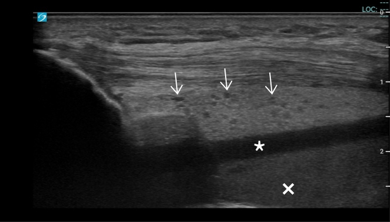
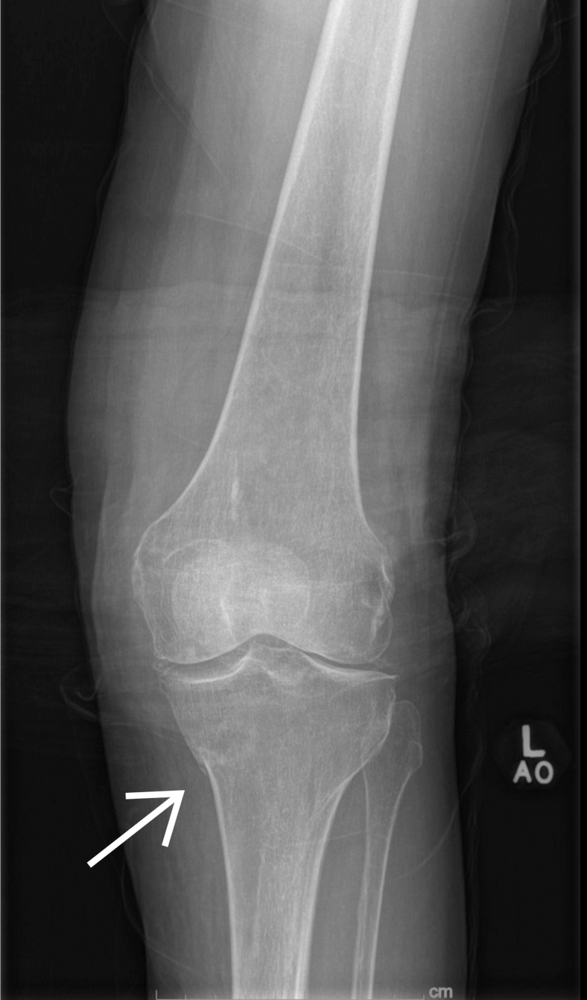
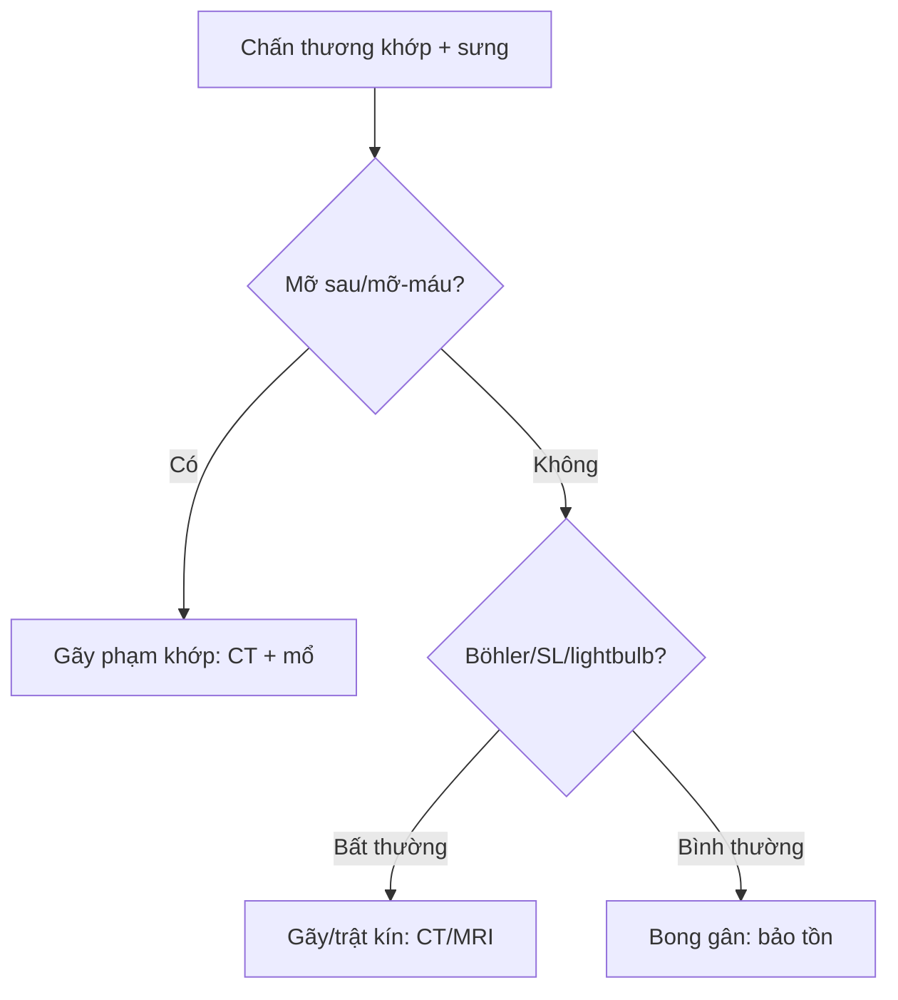

# 320 — Gãy xương & trật khớp cấp cứu: bờm mỡ, mỡ-máu & góc chuẩn / Trauma

**Tags:** `pattern:gay-xuong` `vung:co-xuong-khop` `protocol:X-quang-chan-thuong`
**Mức chắc chắn (certainty):** tổng hợp y văn (literature synthesis) — nhóm tự biên từ y văn mở, chưa gắn ca nguyên văn đơn lẻ.

## 1. Tổng quan — máu/mỡ trong khớp tố cáo gãy dù chưa thấy đường gãy

- Gãy phạm khớp làm rách mạch tủy → máu + mỡ tủy tràn vào ổ khớp — TẠI SAO **bờm mỡ sau khuỷu (posterior fat pad) ở tư thế gấp 90° là bệnh lý 100%**: bình thường nó nằm gọn trong hố mỏm khuỷu, chỉ khi tràn dịch/máu khớp mới bị đẩy nhô ra.
- **Mức mỡ-máu (lipohemarthrosis):** mỡ (**−50 đến −100 HU**) nhẹ nổi trên, huyết thanh giữa, hồng cầu lắng đáy — TẠI SAO 3 lớp phân tầng: riêng mỡ tủy chỉ thoát ra khi **gãy phạm khớp** (vỡ vỏ + thông tủy-khớp), bong gân đơn thuần không có mỡ.
- Ngưỡng: gãy mâm chày kín X-quang **tới 15%**; chọc khớp gối ra **70 mL** máu mỡ là bằng chứng gãy (như ca dưới).

## 2. Gamut chấn thương khớp (Gamut)

- **Ngã chống tay + khuỷu sưng + bờm mỡ sau:** gãy kín đáo (trẻ: trên lồi cầu; lớn: chỏm quay) — bó bột + CT.
- **Ngã đập gối + sưng to + mức mỡ-máu:** gãy mâm chày — CT + mổ nâng mặt khớp khi lún > 2–3 mm.
- **Co giật/điện giật + vai cứng xoay trong:** trật sau (bỏ sót 50% phim thẳng!) — Grashey + CT.
- **Ngã cao + đau gót + Böhler < 20°:** gãy lún gót phạm khớp — CT + mổ.

## 3. Bảng so sánh phân biệt (ma trận đối chiếu)

| Thực thể (entity) | Hình ảnh điển hình | Chốt vào (rule-in) | Chốt loại (rule-out) | Gợi ý xác nhận |
|---|---|---|---|---|
| Gãy kín khuỷu | **Bờm mỡ sau + cánh buồm trước ở gấp 90°** | **Mỡ sau = tràn máu khớp > 90% có gãy** | Không mỡ sau → bong gân | Trẻ: trên lồi cầu; lớn: chỏm quay |
| Gãy mâm chày | **Mức mỡ-máu 3 lớp + vỡ mâm** | **Mỡ −50 đến −100 HU trong khớp = phạm khớp 100%** | Không mỡ → bong gân/sụn chêm | CT + mổ khi lún > 2–3 mm |
| Trật vai sau | **Bóng đèn (lightbulb) + mất half-moon + rãnh ngược Hill-Sachs** | **Co giật + xoay trong cố định** | Trật trước: chỏm ra trước-dưới | Grashey + CT + nắn cấp cứu |
| Gãy gót/Scapholunate | **Böhler < 20°; SL > 3 mm (Terry Thomas)** | **Böhler 20–40° thường; SL ≤ 2 mm thường** | Bình thường → bong gân | CT gót; MRI dây chằng cổ tay |

*Mỡ tăng âm kèm hạt máu + huyết thanh không âm + máu giảm âm. Nguồn: Tripod et al., JACEP Open 2025 Fig. 1, CC BY-NC-ND 4.0 (giữ nguyên bản).*

*Đường gãy mờ bờ trong mâm chày — X-quang suýt bỏ sót. Nguồn: Tripod et al., Fig. 2, CC BY-NC-ND 4.0 (nguyên bản).*

## 4. Protocol X-quang chấn thương

- **2 bình diện + chéo/Grashey + cross-table lateral** (mức mỡ-máu) + CT khi mỡ-máu/mỡ sau mà chưa thấy gãy; siêu âm điểm chăm sóc (POCUS) phát hiện mỡ-máu tại giường.

## 5. Cạm bẫy

- **Trật vai sau bỏ sót 50% phim thẳng** — cơ chế co giật + lightbulb là phải chụp Grashey/CT.
- **Gãy mâm chày kín 15%** X-quang thường — mỡ-máu là lệnh CT, đừng cho về.
- **Scapholunate > 3 mm mạn** thành sụp cổ tay (SLAC) — khâu sớm khi cấp, đừng bó bột mù.

## 6. Tự lượng giá — Blind Quiz

**Ca 1 — Bà 78 tuổi ngã đập gối, X-quang "không gãy". Đọc siêu âm + phim.**

- Hỏi: siêu âm mấy lớp? X-quang thấy gì? Chẩn đoán + bước tiếp?

<b>Bấm để hiện đáp án</b>

- Dấu hiệu (findings): mức mỡ-máu 3 lớp (mỡ + huyết thanh + máu) + đường gãy mờ mâm chày trong.
- Chẩn đoán (diagnosis): **gãy mâm chày trong phạm khớp kín đáo** — chọc ra 70 mL máu mỡ + CT xác nhận + hội chẩn mổ (X-quang suýt sót 15%).
- Nguồn: Tripod et al., Fig. 1–2, CC BY-NC-ND 4.0 (nguyên bản).

**Ca 2 — Co giật + vai phải cứng xoay trong, phim thẳng "bình thường":** trật gì? Phim nào tiếp? *(Bảng mục 3.)*

<b>Bấm để hiện đáp án</b>

- **Trật vai sau:** lightbulb + mất half-moon — chụp Grashey + CT rồi nắn (bỏ sót 50% phim thẳng).

**Ca 3 — Đau gót sau ngã cao, Böhler 12°:** gãy không? Xử trí? *(Bảng mục 3.)*

<b>Bấm để hiện đáp án</b>

- **Gãy lún gót phạm khớp (< 20°):** CT + mổ nâng mặt khớp (thường 20–40°).

## Bài liên quan chéo
- [300 – Tổng quan MSK](../300-tong-quan-he-co-xuong-khop/lesson.md)
- [310 – Xương phụ](../310-giai-phau-xuong-khop-va-bien-the/lesson.md) (gãy Jones vs vesalianum)
- [360 – Khớp gối](../360-mri-khop-goi-day-chang-sun-chem/lesson.md) (mâm chày + ACL)

> Không dùng để chẩn đoán độc lập khi chưa có người hướng dẫn.
