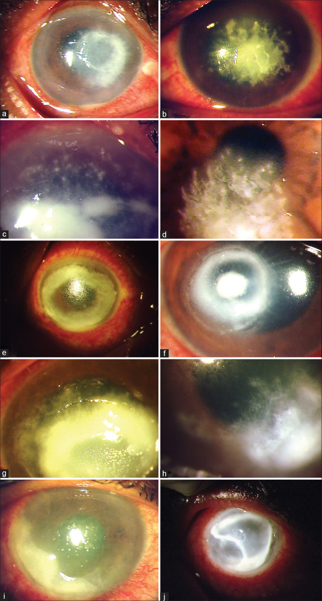
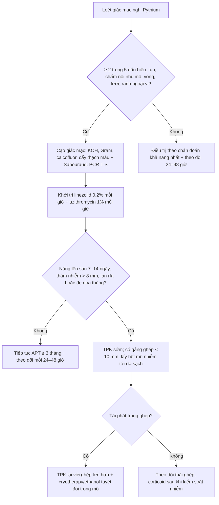
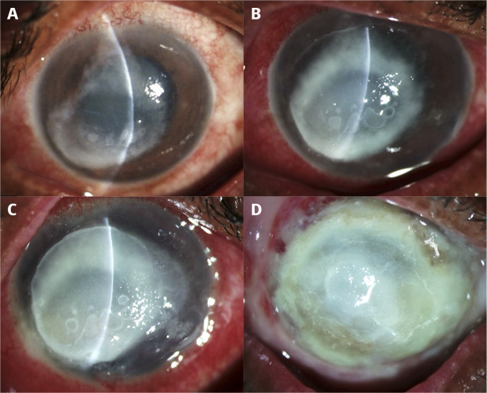
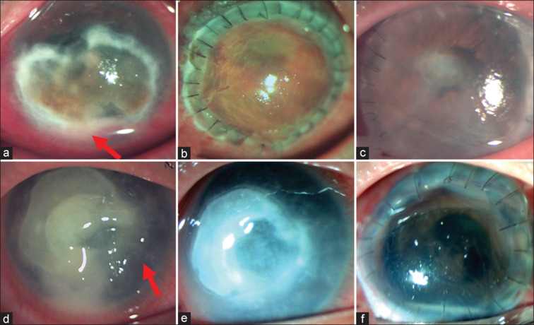
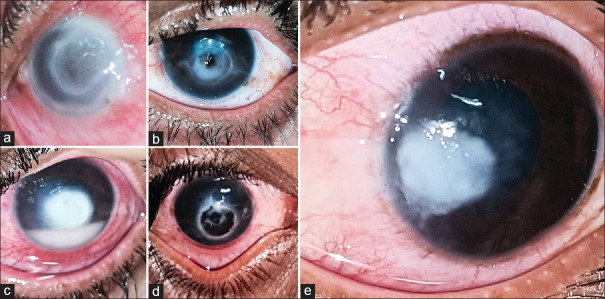

# 3200 — Viêm giác mạc do *Pythium insidiosum*: "nấm giả" không có ergosterol — tua, chấm nội nhu mô, rãnh ngoại vi / *Pythium insidiosum* keratitis

**Tags:** `pattern:tham-nhien-giac-mac` `pattern:o-loet-giac-mac` `pattern:tua-giac-mac` `pattern:cham-noi-nhu-mo` `pattern:luoi-noi-nhu-mo` `pattern:ranh-ngoai-vi` `pattern:vong-tham-nhien` `vung:mat` `vung:giac-mac` `protocol:den-khe` `protocol:cam-mau-cay` `protocol:PCR-ITS` `protocol:IVCM` `protocol:AS-OCT`

**Mức chắc chắn (certainty):** tổng hợp y văn (literature synthesis) — nhóm tự biên từ y văn mở, **không có bệnh nhân của mình**. Số liệu chính: tổng quan bệnh học/điều trị **PMID 35325996 (PMC9240499)**; nghiên cứu phân biệt Pythium – nấm có **hệ điểm lâm sàng** (27 mắt Pythium vs 69 mắt nấm) **PMID 36190038 (PMC9789832)**; loạt 30 mắt **PMID 33913840 (PMC8186601)**; kết cục ghép giác mạc **PMID 39078955 (PMC11451789)** và **PMID 37203046 (PMC10391487)**; MIC kháng nấm vô hiệu **PMID 41446846 (PMC12722454)**; vòng thâm nhiễm **PMID 41930013 (PMC13043113)**; tổng quan Ấn Độ 2025 **PMID 41446894 (PMC12722410)**. Ảnh: **PMC9789832**, **PMC11921247**, **PMC11451789**, **PMC13404707** — ghi giấy phép từng ảnh ở `images/CREDITS.md`.

> **Câu chốt:** *Pythium insidiosum* **không phải nấm** — nó là **oomycete** (Straminipila) có **vách cellulose + β-glucan và KHÔNG có ergosterol**, nên **toàn bộ nhóm azole/polyene vô hiệu** (MIC kháng nấm **> 128 µg/mL** so với **azithromycin 8 µg/mL**, **doxycycline 4 µg/mL**). Trên đèn khe nó **bắt chước nấm từng chi tiết** (bờ bông, mảng nội mô, mủ tiền phòng, thủng), nhưng có **5 dấu hiệu "không phải nấm"**: **tua (tentacles)**, **chấm nội nhu mô (intrastromal dots)**, **hình lưới (reticular pattern)**, **rãnh ngoại vi (peripheral furrow/guttering)**, **lan rìa sớm**. Ba câu hỏi trước khi kê thuốc: **(1) có tiếp xúc nước/nông nghiệp hay kính + nước không? (2) có ≥ 2 trong 5 dấu hiệu trên không? (3) đã dùng kháng nấm bao nhiêu ngày mà vẫn nặng lên?**

## 1. Tổng quan bệnh học – cơ chế hình ảnh (TẠI SAO)

### 1.1 Ngưỡng định lượng (số phải nhớ)

- **Vị trí phân loại:** oomycete, **không phải nấm** — vách **cellulose + β-glucan**, **thiếu ergosterol**; sinh sản vô tính bằng **túi bào tử chứa động bào tử hai roi (biflagellate zoospores)** (**PMC9240499**). Chính "không có ergosterol" là **lý do vật lý** khiến azole (ức chế 14α-demethylase) và polyene (bám ergosterol) **không có đích**.
- **MIC — bằng chứng định lượng cho "kháng nấm vô hiệu":** **doxycycline MIC 4 µg/mL**, **azithromycin MIC 8 µg/mL**, trong khi **kháng nấm MIC > 128 µg/mL**; mô hình chuột nhiễm dưới da sống **80–90%** với azithromycin/doxycycline đơn trị so với **20%** nhóm chứng (**PMC12722454**).
- **Dịch tễ:** Thái Lan là nơi mô tả ca đầu tiên và **ổ dịch địa phương (endemic)**; Ấn Độ là **ổ thứ hai**; tổng quan **1.084 ca pythiosis ở người** cho thấy **Ấn Độ + Thái Lan là điểm nóng**, ca lẻ đang tăng ở Trung Quốc, châu Mỹ, châu Âu (**PMC12722454**). **~50%** ca Pythium giác mạc là **nội trợ, nhân viên văn phòng, người thành thị** — tức **không cần tiền sử nông nghiệp rõ** (**PMC9240499**).
- **Loạt lớn nhất (114 mắt):** tuổi trung bình **41 ± 14,3**, **43% nam**, **40,4% nông dân**, **55,3% không tìm được yếu tố thuận lợi**; thị lực lúc vào **logMAR trung vị 2,78** (khoảng 0,10–3,00); **đường kính thâm nhiễm trung vị 5,5 × 6 mm** (1–10 mm mỗi chiều) (**PMC9240499**).
- **Điều trị nội khoa:** kiểm soát được nhiễm ở **50–60%** ca, **thời gian trung vị ~3 tháng** (**PMC9240499**).
- **Loạt 30 mắt Nam Ấn:** **80% chấn thương nhẹ**, **23,3% tiếp xúc nước bẩn**; **23,3% khỏi với linezolid 0,2% + azithromycin 1%**, **63,3% phải ghép giác mạc điều trị (TPK)**, **23,3% nhiễm lại trong ghép**, **10% viêm nội nhãn**, **10% teo nhãn** (**PMC8186601**).
- **Sau TPK:** **tái phát 20–71%**; dùng **cryotherapy ± ethanol tuyệt đối trong mổ** hạ tái phát xuống **7,1%**; tỉ lệ **múc nội nhãn/teo nhãn < 10–12%** ở các báo cáo gần (**PMC9240499**).

### 1.2 TẠI SAO hình ảnh giống nấm đến vậy

- Trên **KOH 10%/Gram**, sợi của *Pythium* là **sợi hyaline rộng, ít vách, phân nhánh vuông góc hoặc tù (perpendicular/obtuse)** — **trùng mô tả "sợi nấm"**, nên phòng xét nghiệm **báo nấm** và bác sĩ **khởi trị kháng nấm** (**PMC9240499**).
- **Cấy:** mọc trên **thạch máu/thạch dinh dưỡng thường** thành **khuẩn lạc kem-trắng, xù như bông**; trên **Sabouraud mọc rất nghèo** — đây là **bẫy quy trình**: chỉ cấy Sabouraud thì **dễ âm tính giả** (**PMC12722410**).
- **Cơ chế "lan nhanh":** động bào tử **hình thành trong 1 giờ** sau khi cảm ứng, **tạo mầm ống trong 24 giờ** → lượng mycelium lớn rất nhanh; mô đích là **nhu mô giác mạc** → **chảy mủ nhu mô (melting) sớm** dù đang dùng kháng nấm (**PMC9240499**).
- **TẠI SAO có "tua" (tentacles) và "rãnh ngoại vi" (furrows):** sợi nấm mọc **men theo bó collagen** và **men theo dây thần kinh giác mạc** → trên đèn khe thấy **nhánh tua tỏa ra từ bờ ổ loét**; ở **rìa ổ loét**, mô hoại tử **co lại không đều** tạo **rãnh lõm (guttering)**. Đây là **dấu hiệu hình thái của hướng mọc**, không phải phản ứng viêm — nên **nó không mất khi dùng corticoid**, khác **vòng Wessely**.
- **TẠI SAO "chấm nội nhu mô" (intrastromal dots):** ổ viêm **dạng hạt nhỏ** nằm sâu trong nhu mô, phản ánh **lan theo trục trước–sau** của sợi; trên ảnh **đèn khe khuếch tán** chúng hiện thành **đốm trắng rời rạc** (xem ảnh mục 3, panel c).
- **TẠI SAO thiếu "vòng miễn dịch" lại có giá trị:** vòng Wessely là **phản ứng kháng nguyên–kháng thể**, gặp ở **11,6%** mắt nấm nhưng **0%** mắt Pythium trong loạt so sánh (**PMC9789832**) — tức **có vòng kiểu Wessely nhẹ khả năng nấm hơn**. Nhưng **vòng thâm nhiễm đậm (ring infiltrate)** thì **gặp cả ở Pythium** (loạt 7 ca năm 2026) và là **bẫy chẩn đoán** vì gợi **Acanthamoeba/nấm** (**PMC13043113**).

### 1.3 TẠI SAO phải phân biệt sớm — bằng số

- Mỗi ngày chậm trễ = **thêm diện hoại tử**; chỉ định ghép phụ thuộc **đường kính thâm nhiễm** và **lan rìa**. Ghép **càng lớn càng mau thải**: ghép **< 10 mm** có **OR 5,824 (95% CI 1,292–41,6; p = 0,02)** cho ghép trong (**PMC10391487**).
- Trong loạt 16 mắt ghép: **thời gian từ khởi phát đến ghép trung bình 31,3 ngày**, **ghép trung bình 10,4 mm**, **9/16 (56%) tái phát**, ghép lại **11,7 mm**, **cứu được nhãn cầu 87,5%**, **chỉ 3/16 ghép trong ở 6 tháng**, thị lực **logMAR 2,32 → 2,04** (**PMC11451789**).

## 2. Mẫu hình + chẩn đoán phân biệt theo hình thái (gamut)

- **Mẫu hình "Pythium điển hình":** thâm nhiễm **nhu mô nông→toàn bề dày**, bề mặt **khô**, bờ **bông/tua**, **chấm nội nhu mô**, **lưới** ở bờ, **rãnh ngoại vi**, **lan rìa sớm** (giác mạc **mờ đục ra tới limbic**), **mảng nội mô + mủ tiền phòng** muộn, **thủng** nếu chậm.
- **Gamut theo giai đoạn:**
  - **0–7 ngày:** ổ loét **mờ nhẹ + bờ tua**, đau nhiều, **"không đáp ứng kháng nấm"** sau 3–5 ngày.
  - **1–3 tuần:** **chấm nội nhu mô + lưới + rãnh ngoại vi**, thâm nhiễm **dày lên**, **mảng nội mô**, **mủ tiền phòng**.
  - **> 3 tuần:** **chảy mủ nhu mô (melting)**, **thủng**, **lan rìa/củng mạc**, **viêm nội nhãn**, **teo nhãn**.
- **Gamut theo cơ chế "bắt chước":**
  - *Bắt chước nấm:* **Fusarium** (bờ lông vũ, vệ tinh), **Aspergillus** (vòng, mảng), **Candida** (thâm nhiễm nông, tiền phòng).
  - *Bắt chước vi khuẩn:* **Pseudomonas** (mủ xanh, melting nhanh, vành lan), **tụ cầu/liên cầu** (ổ khu trú), **Mycobacterium atypicals** (dạng chấm/lông, mạn).
  - *Bắt chước ký sinh trùng:* **Acanthamoeba** (đau >> tổn thương, viêm thần kinh tỏa tia, vòng).
  - *Bắt chước virus:* **HSV** (đuôi gai thật, bóng tận cùng), **VZV**.
  - *Không nhiễm trùng:* **viêm giác mạc do dung dịch/kính (CLARE)**, **loét thần kinh dưỡng**, **bệnh mắt khô nặng** — **không được ghép sớm**.
- **Gợi nhớ 5 dấu hiệu (tự biên):** **T–D–R–F–L** = **T**entacles, **D**ots, **R**eticular, **F**urrow, **L**imbal spread. **≥ 2 dấu = nghi Pythium** (độ đặc hiệu cao, xem mục 4).

## 3. Bảng so sánh phân biệt (ma trận đối chiếu)

| Thực thể (entity) | Hình ảnh điển hình trên đèn khe / IVCM / AS-OCT | Chốt vào (rule-in) | Chốt loại (rule-out) | Gợi ý xác nhận |
|---|---|---|---|---|
| **Pythium insidiosum** | Thâm nhiễm **toàn bề dày**, bề mặt **khô**, **tua 59,3%**, **chấm nội nhu mô 25,9%**, **lưới**, **rãnh ngoại vi**, **lan rìa sớm**; IVCM: sợi **mảnh, thẳng, phân nhánh vuông góc** | **≥ 2 dấu hiệu T–D–R–F**; **không đáp ứng kháng nấm sau 5–7 ngày**; tiền sử **nước/nông nghiệp** | **Vòng Wessely 0%** (loạt 27 mắt); **không có vệ tinh rõ** | Cấy **thạch máu** + **PCR ITS/18S**; **động bào tử** bằng phương pháp lá |
| **Nấm sợi (Fusarium/Aspergillus)** | Bờ **lông vũ (feathery)**, **vệ tinh**, bề mặt **khô**, **mảng/plaque** nổi, **vòng Wessely 11,6%** | **Vệ tinh + bờ lông vũ + mảng nổi**; đáp ứng một phần với **natamycin 5%** | **Rãnh ngoại vi + tua + chấm nội nhu mô** → nghi Pythium | Soi tươi KOH **+** cấy Sabouraud **và** thạch máu; PCR nấm |
| **Acanthamoeba** | **Đau >> tổn thương**, **viêm thần kinh tỏa tia**, **vòng miễn dịch**, **nang vách đôi 10–25 µm** trên IVCM | **Đau không tương xứng + kính tiếp xúc + nước**; **nang vách đôi** | **Tua + rãnh ngoại vi** (không gặp ở AK); IVCM **không nang** | IVCM (Se **94%**), cạo + PCR 18S |
| **Pseudomonas** | **Mủ xanh-vàng**, **melting rất nhanh** (giờ), **vành lan**, **mủ tiền phòng sớm** | **Kính tiếp xúc + khởi phát < 24 giờ + mủ xanh** | **Bờ tua khô + rãnh ngoại vi** (tiến triển **ngày**, không phải giờ) | Nhuộm Gram, cấy; **đáp ứng kháng sinh trong 24–48 giờ** |
| **HSV** | **Đuôi gai thật (dendrite)** với **bóng tận cùng**, **giảm cảm giác**, ít mủ | **Đuôi gai + bóng tận cùng**; **bùng phát sau corticoid** | **Thâm nhiễm nhu mô toàn bề dày + tua** → không phải HSV | PCR HSV dịch cạo; **không dùng corticoid đơn thuần** |
| **Mycobacterium atypicals** | **Chấm/lông nhỏ li ti**, tiến triển **chậm hàng tuần**, ít mủ, sau chấn thương/chỉnh mắt | **Nhiều chấm nhỏ rải rác + tiến triển chậm** | **Tua lớn + melting nhanh** | Cấy **Lowenstein–Jensen**, PCR 16S |

*Cùng một khung đèn khe khuếch tán: **cột trái = Pythium**, **cột phải = nấm sợi** (Fusarium/Aspergillus). Chú ý (a) **tua** ở bờ ổ loét Pythium so với (b) bờ lông vũ; (i) **rãnh ngoại vi** — dấu hiệu có **OR 60,6** cho Pythium. Nguồn: *Indian Journal of Ophthalmology* 2022, Fig. 1, **PMC9789832** — CC BY-NC-SA 4.0, ảnh nguyên bản.*

### Dấu hiệu định lượng — bảng điểm lâm sàng (Pythium vs nấm)

| Dấu hiệu | Pythium (n = 27) | Nấm (n = 69) | OR / p |
|---|---|---|---|
| **Tua ở bờ ổ loét (tentacles)** | **59,3%** | 4,4% | **OR 24,1** (3,8–158,1); p < 0,0001 |
| **Chấm nội nhu mô (intrastromal dots)** | **25,9%** | 1,4% | p < 0,0001 |
| **Vòng thâm nhiễm (ring)** | 18,5% | 4,3% | p = 0,024 |
| **Rãnh ngoại vi (peripheral furrow)** | **cao** | thấp | **OR 60,6** (5,1–712,3); p = 0,001 |
| **Vòng miễn dịch Wessely** | **0%** | **11,6%** | p = 0,065 |
| **Bề mặt ổ loét khô** | cao | cao | p = 0,010 (không đặc hiệu) |

*Nguồn bảng: **PMC9789832** (Indian J Ophthalmol 2022). Lưu ý phản biện: cỡ mẫu Pythium chỉ **27 mắt**, khoảng tin cậy của OR **rất rộng** — dùng để **hướng** chẩn đoán, không dùng để chốt tuyệt đối.*

## 4. Protocol chụp/xét nghiệm + hệ điểm chuẩn hóa

### 4.1 Quy trình tối thiểu khi nghi Pythium

1. **Ảnh đèn khe chuẩn hóa** (khuếch tán + khe sáng hẹp + sau chiếu sáng) **mỗi 24–48 giờ** — theo dõi **diện thâm nhiễm (mm)**, **độ sâu**, **rãnh ngoại vi**.
2. **Cạo giác mạc (corneal scraping)** tại **bờ ổ loét** (nơi có tua/rãnh), chia 3–4 lam: **KOH 10%**, **Gram**, **calcofluor white**, **nhuộm Giemsa**.
3. **Cấy song song 2 môi trường:** **thạch máu/thạch dinh dưỡng** (Pythium mọc tốt) **và Sabouraud** (nấm) — **không được chỉ cấy Sabouraud**.
4. **Xác nhận loài:** **PCR ITS / 18S rRNA** hoặc **giải trình tự**; **động bào tử** bằng **phương pháp lá (leaf incarnation)** khi có phòng thí nghiệm.
5. **IVCM (soi đồng tiêu):** sợi **mảnh, thẳng, phân nhánh vuông góc** — phân biệt với sợi nấm **dày, phân nhánh nhọn**; **không thấy nang** (loại Acanthamoeba).
6. **AS-OCT:** đo **độ sâu thâm nhiễm (µm)**, **độ dày còn lại của nhu mô**, phát hiện **mảng nội mô** — quyết định **có ghép được hay không** và **kích thước ghép**.

### 4.2 Hệ điểm lâm sàng (clinical score) — bản 5 dấu hiệu

- **Score 2 = 5 dấu hiệu:** **tua**, **chấm nội nhu mô**, **vòng thâm nhiễm**, **hình lưới**, **rãnh ngoại vi** — mỗi dấu **1 điểm**.
- **Ngưỡng ≥ 2 điểm:** **Se 55,6%**, **tỉ lệ dương tính giả 1,4%**, **AUC 0,896** (95% CI 0,810–0,981).
- **Ngưỡng ≥ 1 điểm:** Se **85,2%**, dương tính giả **11,6%** → dùng để **quyết định cạo xét nghiệm + khởi trị theo hướng Pythium**, không dùng để chốt.
- **Score 1** (thêm "bề mặt khô", 6 dấu): AUC **0,889**; ≥ 2 điểm: Se **74,1%**, dương tính giả **10,1%** — kém đặc hiệu hơn vì "khô" cũng gặp ở nấm.
- **AUC từng dấu:** tua **0,78**, hình lưới **0,71**, bề mặt khô **0,66** (**PMC9789832**).

### 4.3 Điều trị — liều và kết cục

- **Liệu pháp kháng Pythium (anti-pythium therapy, APT):** **linezolid 0,2%** (pha từ dạng truyền tĩnh mạch) **mỗi giờ** + **azithromycin 1%** (nhỏ/ mỡ tra) **mỗi giờ**; có thể thêm **minocycline/doxycycline toàn thân** (**PMC12722410**).
- **Không dùng corticoid** khi chưa kiểm soát nhiễm; **doxycycline uống** để **ức chế collagenase**; **keo cyanoacrylate** khi **đe dọa thủng**.
- **Thời gian:** trung vị **~3 tháng**; **50–60%** khỏi nội khoa (**PMC9240499**).
- **Ghép điều trị (TPK):** chỉ định khi **nặng lên dù APT** (**82%** ca trong loạt 50 mắt), **thâm nhiễm lớn**, **lan rìa**, **thủng**.
  - Loạt **50 mắt** dùng APT **trung vị 35 ngày** trước mổ: **không tái phát**, **nhãn cầu ổn định 98%**, **ghép trong 20%**, **thời gian sống ghép trung vị 2,4 tháng**, thị lực cuối **20/125** (**PMC10391487**).
  - Loạt **16 mắt**: **tái phát 56%**, **cứu nhãn cầu 87,5%** (**PMC11451789**) → **ghép nhỏ (< 10 mm) + lấy rộng rìa + cryotherapy** là chìa khóa.
- **Bẫy "ghép xong là xong":** ghép có thể **nhiễm lại từ rìa**; theo dõi **mỗi tuần** trong **3 tháng đầu**, sau đó **hàng tháng tới 12 tháng**.

## 5. Biến thể bình thường và cạm bẫy

- **Cấy âm không loại trừ Pythium:** mọc **chậm**, dễ **bị nấm/lẫn tạp nhiễm lấn át**; **PCR/giải trình tự** có thể dương trước cấy **5–10 ngày**.
- **Sabouraud âm không loại trừ:** Pythium **mọc nghèo trên Sabouraud** — **luôn cấy thêm thạch máu**.
- **KOH thấy "sợi nấm" ≠ nấm:** sợi **ít vách, phân nhánh vuông góc, rộng**; **không được** vì thấy sợi mà **chốt nấm** rồi **bỏ qua dấu hiệu tua/rãnh**.
- **Vòng thâm nhiễm (ring) không loại trừ Pythium:** gặp ở **7 ca** trong loạt 2026, gợi nhầm **Acanthamoeba/nấm** → **luôn cạo xét nghiệm** thay vì điều trị theo vòng (**PMC13043113**).
- **Corticoid trước chẩn đoán = tăng tốc melting:** làm **mờ dấu hiệu viêm**, **giảm đề kháng mô**, **tăng collagenase** — đã là con đường tới **thủng/mất mắt** ở nhiều ca.
- **Cạm bẫy "thỏa mãn tìm kiếm":** thấy **mủ tiền phòng + thâm nhiễm to** → nghĩ **Pseudomonas** rồi **chỉ theo dõi kháng sinh thường**; nếu **không cải thiện sau 24–48 giờ** phải **nghĩ lại toàn bộ gamut**.
- **Bẫy "ghép lớn cho chắc":** ghép **> 10 mm** làm **tăng tái phát và thải ghép** (OR **5,8** cho ghép trong khi **< 10 mm**) — nhưng ghép **quá nhỏ** thì **sót mô nhiễm**; cân bằng bằng **rìa sạch trên đèn khe + AS-OCT**.

## 6. Tự lượng giá — Blind Quiz

**Ca 1 — Nam 45 tuổi, nông dân, đau mắt phải 6 ngày sau khi làm ruộng; đã dùng natamycin 5% 5 ngày, không đỡ.**

- Gợi ý lâm sàng: **tiếp xúc nước/nông nghiệp**, **kháng nấm thất bại**.
- Câu hỏi: mô tả **bờ ổ loét** và **diễn tiến 10 ngày** (A→D). Ba chẩn đoán phân biệt? Dấu hiệu nào khiến bạn **đổi hướng điều trị**?

<b>Bấm để hiện đáp án (findings + chẩn đoán)</b>

- **Findings:** (A) **vòng thâm nhiễm xám-trắng 7 × 7 mm** ở trung tâm; (B, C) **nặng lên rõ sau 10 ngày** — thâm nhiễm **dày, đục toàn bề dày**, mủ tiền phòng; (D) **thâm nhiễm toàn giác mạc + lan củng mạc kế cận** sau 1 tháng, **ghép xuyên toàn bộ thất bại → múc nội nhãn**.
- **Chẩn đoán:** **viêm giác mạc do *Pythium insidiosum*** — **kháng nấm không có đích** (không ergosterol), nên diễn tiến **nặng lên dù đang điều trị đúng "nấm"**.
- **Vì sao:** vách **cellulose/β-glucan** + **MIC kháng nấm > 128 µg/mL** → cần **linezolid 0,2% + azithromycin 1%** và **ghép sớm** khi lan rìa.
- **Nguồn ảnh:** *Community Eye Health* 2024, Fig. 1, **PMC11921247** — CC BY 4.0.

**Ca 2 — Nữ 58 tuổi, đau–chảy nước mắt 4 ngày, có **tua** ở bờ ổ loét và **rãnh ngoại vi**; bên cạnh là mắt viêm giác mạc nấm để so sánh.**

- Câu hỏi: gọi tên **5 dấu hiệu** trong ảnh. Dấu hiệu nào **đặc hiệu nhất** cho Pythium? Vì sao **vòng Wessely** lại nghiêng về nấm?

<b>Bấm để hiện đáp án</b>

- **5 dấu hiệu:** (a) **tua (tentacles)**; (c) **chấm nội nhu mô**; (e) **vòng thâm nhiễm**; (g) **hình lưới (reticular)**; (i) **rãnh ngoại vi (furrow)**.
- **Đặc hiệu nhất:** **rãnh ngoại vi** (**OR 60,6**) và **tua** (**OR 24,1**); **≥ 2 dấu** cho **AUC 0,896**, dương tính giả **1,4%**.
- **Vòng Wessely:** là **phản ứng miễn dịch**, gặp **11,6%** mắt nấm và **0%** mắt Pythium trong loạt này → **có vòng kiểu Wessely nhẹ** nghiêng về **nấm**; nhưng **vòng đậm** vẫn có thể là Pythium.
- **Nguồn ảnh:** *Indian J Ophthalmol* 2022, Fig. 1, **PMC9789832** — CC BY-NC-SA 4.0.

**Ca 3 — Nam 19 tuổi, ổ loét giữa nhu mô với **tua**; sau đó được ghép xuyên 10,5 mm.**

- Câu hỏi: (1) vì sao **ghép lớn** lại cần thiết ở ca này? (2) Vì sao **ghép < 10 mm** lại có tiên lượng **tốt hơn** trong loạt 50 mắt? (3) Nêu **2 biện pháp trong mổ** giảm tái phát.

<b>Bấm để hiện đáp án</b>

- (a) **lan tới rìa (limbal involvement)** — mũi tên đỏ; (b) **ghép lớn, ngày 1 sau mổ**; (c) **ghép thất bại sau 2 tháng, không tái phát**; (d) **tua giữa nhu mô** — mũi tên đỏ; (e) **tiến triển**; (f) **ghép lại**.
- (1) Phải **lấy hết mô nhiễm tới rìa sạch** — Pythium lan **theo bó collagen**, rìa nhiễm còn lại = **tái phát**.
- (2) Ghép **< 10 mm** giữ **rìa ghép–mô nhận** xa **rìa giác mạc** (nơi mạch máu/limbal stem cell), giảm **tái phát + thải ghép**: **OR 5,824** (1,292–41,6) cho ghép trong (**PMC10391487**).
- (3) **Cryotherapy** trong mổ + **ethanol tuyệt đối** ở rìa ghép → hạ tái phát từ **20–71%** xuống **7,1%**; kèm **APT trước và sau mổ**.
- **Nguồn ảnh:** *Indian J Ophthalmol* 2024, Fig. 1, **PMC11451789** — CC BY-NC-SA 4.0.

**Ca 4 (ảnh tham chiếu) — 5 mắt Pythium có **vòng thâm nhiễm** ở các mức độ khác nhau.**

- Câu hỏi: vòng thâm nhiễm gợi chẩn đoán nào? Vì sao **không được** chốt chẩn đoán chỉ dựa vào vòng?

<b>Bấm để hiện đáp án</b>

- (a) thâm nhiễm **6 × 6 mm** + **vòng chu vi rõ** + mỏng trung tâm; (b) **vòng toàn bề dày 4 × 4 mm** + **thủng trung tâm**; (c) **vòng trung tâm toàn bề dày**; (d) vòng nhỏ kèm **mủ tiền phòng**; (e) **vòng lớn lan rìa**.
- Vòng gợi **Acanthamoeba/nấm** — nhưng loạt **7 ca** cho thấy **vòng không hiếm ở Pythium**; chốt bằng **cạo + PCR**, không bằng hình thái.
- **Nguồn ảnh:** *Oman J Ophthalmol* 2026, Fig. 1, **PMC13404707** — CC BY-NC-ND 4.0 (nguyên bản, không cắt/ghép).

## Bài liên quan chéo
- [400 – Tổng quan Mắt & thị giác](../400-tong-quan-mat-thi-giac/lesson.md)
- [1460 – Viêm giác mạc do nấm](../1460-viem-giac-mac-do-nam/lesson.md) (bờ lông vũ, vệ tinh, natamycin)
- [1472 – Viêm giác mạc do Acanthamoeba](../1472-viem-giac-mac-acanthamoeba/lesson.md) (đau >> tổn thương, vòng, IVCM)
- [6132 – Viêm giác mạc nhiễm khuẩn liên quan kính tiếp xúc](../6132-viem-giac-mac-kinh-tiep-xuc/lesson.md)
- [1456 – Bỏng hóa chất mắt cấp](../1456-bong-hoa-chat-mat/lesson.md) (mất biểu mô + thiếu máu rìa)

## Ảnh
- `3200_pythium_DauHieu_PMC9789832.jpg` — 10 panel so sánh Pythium vs nấm (CC BY-NC-SA 4.0).
- `3200_pythium_DienTien_PMC11921247.jpg` — diễn tiến A→D tới múc nội nhãn (CC BY 4.0).
- `3200_pythium_Tentacle-PK_PMC11451789.jpg` — tua giữa nhu mô + ghép/ghép lại (CC BY-NC-SA 4.0).
- `3200_pythium_VongThamNhien_PMC13404707.jpg` — phổ vòng thâm nhiễm (CC BY-NC-ND 4.0).
- Nguồn + giấy phép từng ảnh: `images/CREDITS.md`; link gốc: `sources.md`.

> Không dùng để chẩn đoán độc lập khi chưa có người hướng dẫn.
