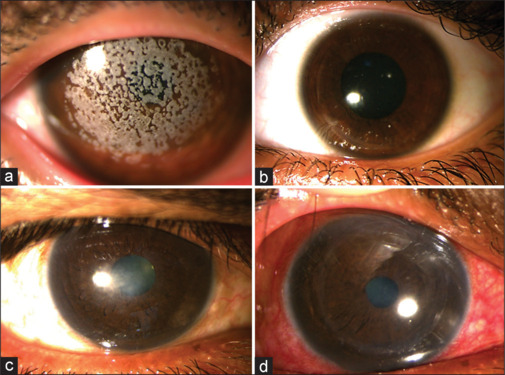
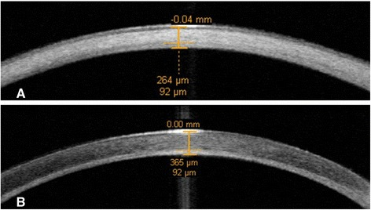
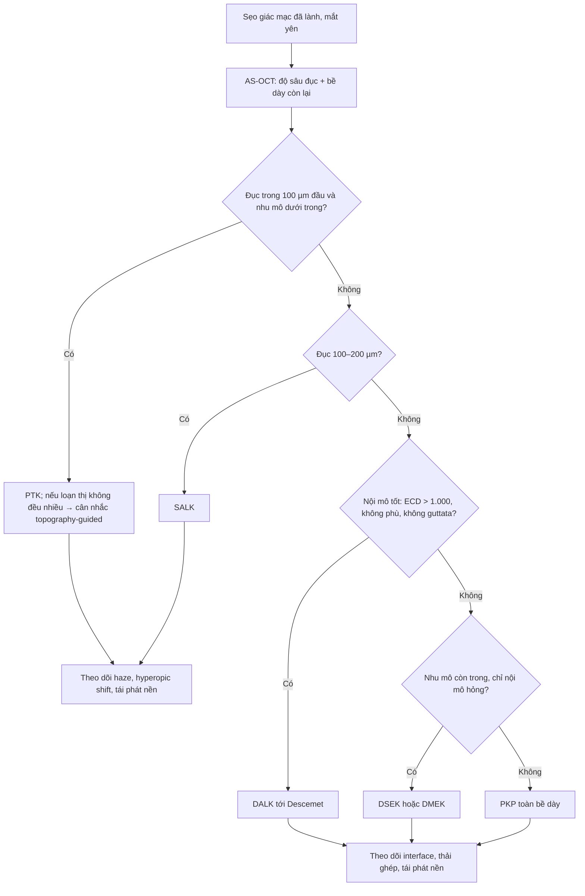
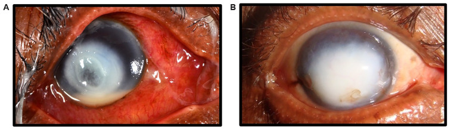

# 3201 — Sẹo giác mạc sau loét đã lành: đo gì để quyết định ghép, và ghép loại nào / Healed corneal scar — measurement and graft selection

**Tags:** `pattern:seo-giac-mac` `pattern:duc-giac-mac` `pattern:tan-mach-giac-mac` `pattern:phu-giac-mac` `vung:mat` `vung:giac-mac` `protocol:AS-OCT` `protocol:den-khe` `protocol:topography` `protocol:specular-microscopy` `score:ECD`

**Mức chắc chắn (certainty):** tổng hợp y văn (literature synthesis) — nhóm tự biên, **không có bệnh nhân của mình**. Số liệu chính: **205 mảnh giác mạc** cắt trong ghép (sẹo "lâm sàng yên" vẫn còn viêm mô học) **PMID 39860466 (PMC11765851)**; **PTK 334 mắt** (độ sâu cắt, hyperopic shift, biến chứng) **PMID 35544925 (PMC11826725)**; **SALK 75 mắt RCT** (ngưỡng đục **200 µm** trên AS-OCT) **PMID 40243069 (PMC12356419)**; ghép trong sẹo do trachoma (PKP vs lamellar) **PMID 39556607 (PMC11573149)**; **10 năm DMEK/DSAEK/PK 2.956 mắt** **PMID 39774993 (PMC11707042)**; xu hướng chỉ định ghép 7 năm **PMID 40319196 (PMC12049314)**; tái phát HSV sau ghép **PMID 40909445 (PMC12405224)**. Ảnh: **PMC12149813**, **PMC4354740**, **PMC12356419**.

> **Câu chốt:** sẹo giác mạc **không phải một bệnh, mà là một độ sâu**. Ba câu hỏi quyết định mổ: **(1) sẹo sâu bao nhiêu µm trên AS-OCT? (2) nội mô còn tốt không (ECD, phù, guttata)? (3) bề mặt nhãn cầu có nuôi được mảnh ghép không (khô, tân mạch, sẹo kết mạc)?** Trả lời 3 câu đó sẽ chọn đúng **PTK/SALK (nông) → DALK (sâu, nội mô tốt) → PKP (toàn bề dày) → DSEK/DMEK (chỉ nội mô)**. Sai lầm hay gặp: **ghép xuyên cho một sẹo nông 150 µm** (mất nội mô lành, tăng thải ghép) hoặc **PTK cho sẹo sâu 400 µm** (thủng/thải).

## 1. Tổng quan bệnh học – cơ chế hình ảnh (TẠI SAO)

### 1.1 Ngưỡng định lượng (số phải nhớ)

- **Gánh nặng:** **10–12 triệu người** có sẹo giác mạc, khoảng **250.000 người mù** do sẹo (**PMC11765851**).
- **Sẹo "yên" vẫn có viêm:** trong **205 mảnh giác mạc** cắt trong PKP vì sẹo trung tâm **lâm sàng không hoạt động** (HSV 55, keratoconus 39, chấn thương cơ học 27, scrophulosa 22, khác 62), mô học vẫn phát hiện **viêm mức độ khác nhau**; nhóm **"có viêm"** có **thải ghép 56%** và **thất bại ghép 44%**, nhóm **"không viêm"** là **33%** (**PMC11765851**).
- **Tỉ lệ thải ghép theo nguyên nhân sẹo:** **keratoconus 13/39 (33%)**, **chấn thương cơ học 11/27 (41%)**, **scrophulosa** khác biệt có ý nghĩa với **ngưỡng điểm viêm thấp 0,06** (p = 0,041) (**PMC11765851**).
- **Sẹo do trachoma (mô hình "giác mạc xấu"):** **302 mảnh ghép**, **71% trong**; **PKP 161/195 (83%)** so với **lamellar 18/20 (90%)**; **thải ghép 31/167 (19%)** ở PKP so với **0/20** ở lamellar; thị lực sau mổ **> 6/60 ở 63%** (**PMC11573149**).
- **PTK (334 mắt):** độ cắt **tối đa trung bình 72,7 ± 32,1 µm** (10–142 µm), **vùng quang học 6,8 ± 0,43 mm**, **hyperopic shift ~1,0 D sau 2 năm**; **haze 1,5%**, **tái phát 0,9%**, **mổ lại 1,5%**; **giác mạc mỏng nhất trước mổ 492,6 ± 63,4 µm** (**PMC11826725**).
- **SALK (75 mắt RCT):** chỉ định **đục nông ≤ 200 µm** đo bằng **AS-OCT**; thị lực **1,32 → 0,62 logMAR** sau 6 tháng; **microkeratome không thua femtosecond** (**PMC12356419**).
- **10 năm, 2.956 mắt (FECD):** ghép sống **PK 92%** vs **DMEK 75%** vs **DSAEK 73%**; nhưng **thị lực ≥ 6/12 trong 5 năm: DMEK 93%, DSAEK 83%, PK 63%**; **thải ghép: DMEK 10%, PK 13%, DSAEK 19%**; **xác suất ECD > 1.000 tế bào/mm² ở 10 năm: PK 18%, DSAEK 8%, DMEK 3%** (**PMC11707042**).
- **Chỉ định ghép (7 năm, trung tâm Trung Quốc):** **viêm giác mạc nhiễm 45,25%**, **sẹo trắng/leucoma 13,59%**, **suy nội mô 8,94%**, **chấn thương 6,70%** (**PMC12049314**).

### 1.2 TẠI SAO sẹo lại trắng — và tại sao độ sâu là biến số chính

- **Tán xạ ánh sáng:** giác mạc trong vì **sợi collagen type I đường kính đồng nhất (~30 nm)** xếp **song song, khoảng cách đều < bước sóng** → **giao thoa triệt tiêu** ánh sáng tán xạ. Sẹo thay bằng **collagen type III + fibronectin + glycosaminoglycan** và **myofibroblast** → **sợi to, không đều, khoảng cách ngẫu nhiên** → **tán xạ tăng** = **đục**.
- **Hệ quả lâm sàng:** độ đục phụ thuộc **vị trí theo trục quang** và **độ sâu**; sẹo **nông 100 µm** ở trục đồng tử làm **giảm thị lực nhiều hơn** sẹo **sâu 400 µm ở ngoại vi**. Vì vậy phải đo **cả độ sâu (µm) và khoảng cách tới trục thị giác (mm)**.
- **TẠI SAO chỉ thay phần bị bệnh:** nội mô **không tái sinh**, nhưng nếu **còn tốt** thì **giữ lại là tối ưu** — ghép **lamellar (SALK/DALK)** **không mở tiền phòng**, **không có thải ghép nội mô**, **ECD không giảm do mảnh ghép**. Đây là **lý do vật lý** cho tỉ lệ thải **0/20** ở lamellar so với **19%** ở PKP trong loạt trachoma (**PMC11573149**).
- **TẠI SAO sẹo "yên" vẫn có thể thải:** tế bào viêm **cư trú mạn** trong mô sẹo tiết cytokine; khi **mở tiền phòng + khâu chỉ** tạo **kích thích mới**, ổ viêm cũ **bùng phát**. Đây là **cơ sở sinh học** của việc **chờ sẹo chín + kiểm soát viêm trước mổ** (**PMC11765851**).
- **TẠI SAO tân mạch là yếu tố xấu:** mạch máu mang **tế bào miễn dịch tới gần mảnh ghép**, phá **đặc quyền miễn dịch** của tiền phòng → **tăng thải ghép**. Đo bằng **số giờ đồng hồ (clock hours)** tân mạch và **khoảng cách tới rìa ghép (mm)**.

### 1.3 Mốc thời gian — số có thật và chỗ còn trống

- **Sau ghép, HSV tái phát sớm:** **40/411 (9,73%)** mắt phát **HSV giác mạc sau ghép**, trong đó **65% trong 1–3 tháng đầu** (**PMC12405224**) → **cửa sổ nguy cơ cao là 3 tháng đầu**, cần **kháng virus dự phòng**.
- **Thời điểm ghép tối ưu:** y văn **không có ngưỡng thời gian thống nhất bằng RCT** — thực hành phổ biến là **chờ sẹo chín và mắt yên** (thường **≥ 3 tháng** sau khi hết nhiễm; **≥ 6–12 tháng** nếu còn **tân mạch hoạt động hoặc viêm tái diễn**). Ghi rõ: **chưa rõ ngưỡng chính xác — cần tra thêm**, và **quyết định dựa trên mô học nguy cơ** (viêm tồn tại, tân mạch) hơn là đếm tháng.

## 2. Mẫu hình + chẩn đoán phân biệt theo độ sâu (gamut)

- **Mẫu hình:** **đốm/mảng trắng xám khu trú** ở nhu mô, **bờ rõ hoặc nhòe**, **không mủ**, **không loét**, **không thấm fluorescein** (biểu mô liền), **giác mạc dày bình thường hoặc mỏng**; **tân mạch** có thể kèm theo.
- **Gamut theo tầng tổn thương — đây là gamut quyết định mổ:**

| Tầng tổn thương | Đo trên AS-OCT | Thủ thuật phù hợp |
|---|---|---|
| **Biểu mô – Bowman – nhu mô nông ≤ 100 µm** | đục **trong 1/3 trước**, nhu mô còn lại trong | **PTK** (excimer 193 nm) |
| **Nhu mô nông 100–200 µm** | đục **tới ~200 µm**, nội mô tốt | **SALK** (lamellar nông) |
| **Nhu mô giữa–sâu > 200 µm, nội mô tốt** | đục **sâu tới gần Descemet**, **ECD bình thường** | **DALK** |
| **Toàn bề dày / Descemet–nội mô tổn thương** | **mất dấu Descemet**, **phù nhu mô**, **ECD < 1.000** | **PKP** |
| **Chỉ nội mô hỏng, nhu mô trong** | nhu mô trong, **phù**, **guttata** | **DSEK/DMEK** |

- **Gamut "giác mạc trắng" (phân biệt với sẹo):** **phù giác mạc do suy nội mô** (dày > 640 µm, **dấu hiệu nhìn thấy Descemet gấp nếp**), **loạn dưỡng (granular/macular/lattice)**, **band keratopathy** (vôi hóa dải kẽ mi), **lắng đọng (amyloid, gelatinous drop-like)**, **loạn sản bẩm sinh (sclerocornea/Peters)**, **thâm nhiễm đang hoạt động** (có mủ, thấm fluorescein, đau).
- **Phân biệt "sẹo đã lành" với "còn hoạt động":** **không đau, không mủ, biểu mô liền, không thấm fluorescein, bờ ổn định ≥ 4 tuần**; nếu còn **bất kỳ** dấu hiệu hoạt động → **điều trị tiếp, chưa ghép**.

## 3. Bảng so sánh phân biệt (ma trận đối chiếu)

| Thủ thuật | Chỉ định điển hình | Chốt vào (rule-in) | Chốt loại (rule-out) | Kết cục / số |
|---|---|---|---|---|
| **PTK (phototherapeutic keratectomy)** | Sẹo **nông ≤ 100 µm**, loạn dưỡng nông, band keratopathy, **bề mặt không đều** | Đục **trong 1/3 trước**, **nhu mô dưới trong**, **nội mô tốt**, **độ dày ≥ 450 µm** | Đục **> 150 µm** hoặc **sát Descemet** → **thủng/thải**; **giác mạc mỏng < 400 µm** | 334 mắt: cắt **72,7 ± 32,1 µm**; haze **1,5%**, tái phát **0,9%**, mổ lại **1,5%**; **hyperopic shift ~1,0 D** |
| **SALK (superficial anterior lamellar KP)** | Sẹo **100–200 µm**, đục **không đều**, PTK sẽ **lệch khúc xạ nhiều** | **AS-OCT: đục ≤ 200 µm**; nội mô tốt; bề mặt nhãn cầu ổn | Đục **> 200 µm** → cần DALK; **khô nặng/neurotrophic** chưa kiểm soát | 75 mắt RCT: **1,32 → 0,62 logMAR** sau 6 tháng; MK **không thua** FL |
| **DALK (deep anterior lamellar KP)** | Sẹo **sâu > 200 µm** nhưng **nội mô tốt**; keratoconus có sẹo sau hydrops | Đục **tới gần Descemet**, **ECD bình thường**, **không phù**, **không guttata** | **Suy nội mô (ECD < 1.000)/phù** → phải PKP hoặc EK; **Descemet thủng lớn** khi mổ → chuyển PKP | Thải ghép **25,8%** (DALK) vs **34,6%** (PKP) ở mắt VKC–KC (p = 0,30); **không có thải nội mô** |
| **PKP (penetrating KP)** | Sẹo **toàn bề dày**, **Descemet/nội mô hỏng**, thủng, không đủ nhu mô nhận | **Đục toàn bề dày + ECD thấp/phù**; **không thể bóc Descemet an toàn** | **Sẹo nông + nội mô tốt** → ghép xuyên là **quá tay** (mất nội mô lành, thải ghép) | Sẹo trachoma: sống **83%**, thải **19%**; 10 năm (FECD) sống **92%** nhưng thị lực **≥ 6/12 chỉ 63% trong 5 năm** |
| **DSEK/DMEK (endothelial KP)** | **Chỉ nội mô hỏng**: phù sau viêm nội mô, bullous keratopathy, Fuchs | **Nhu mô trong**, **phù do nội mô**, **guttata/ECD thấp** | **Sẹo nhu mô thật** (đục không mất khi hết phù) → **không giải quyết bằng EK** | 10 năm: **ECD > 1.000 còn 3% (DMEK) / 8% (DSAEK)**; thải **10%/19%**; thị lực nhanh (**DMEK 7,8 tháng tới 6/12**) |

*(a) loạn dưỡng hạt nông và (c) sẹo nông trước mổ; (b, d) giác mạc **trong sau SALK** — minh họa nguyên lý "chỉ thay lớp bị bệnh" khi **đục ≤ 200 µm** và nội mô tốt. Nguồn: *Indian J Ophthalmol* 2025, Fig. 3, **PMC12356419** — CC BY-NC-SA 4.0.*

### Đo độ sâu trên AS-OCT — mảnh ghép lamellar nông

*AS-OCT trước mổ (A) đo **độ dày sẹo (264 µm)** trên tổng bề dày **92 µm còn lại** phía sau; sau DALK (B) bề dày tăng lên **365 µm**. Đây là cách **đo bằng số** để chọn PTK/SALK/DALK. Nguồn: *SpringerPlus* 2015, Fig. 1, **PMC4354740** — CC BY 4.0.*

## 4. Protocol đo + hệ quyết định

### 4.1 Sáu phép đo bắt buộc trước khi quyết định ghép

1. **AS-OCT (anterior segment OCT):** **độ sâu đục (µm)**, **độ dày nhu mô còn lại phía sau sẹo (µm)**, **bề dày trung tâm**, **dấu Descemet** (còn/mất), **khoảng cách sẹo tới trục thị giác (mm)**.
2. **Đếm nội mô (specular microscopy):** **ECD (tế bào/mm²)**, **hệ số biến thiên**, **tỉ lệ lục giác**, **guttata**. Ngưỡng thực hành: **ECD < 1.000** hoặc **phù nhu mô** → **không làm lamellar thuần**.
3. **Bản đồ giác mạc (topography/tomography):** **độ không đều (irregularity)**, **loạn thị không đều**, **Kmax**, **pachymetry** — quyết định **PTK có sửa được bề mặt** hay cần **ghép**.
4. **Tân mạch:** đếm **số giờ đồng hồ** và **khoảng cách tới rìa ghép dự kiến (mm)** — càng gần càng **tăng thải ghép**.
5. **Bề mặt nhãn cầu:** **thời gian vỡ phim nước mắt (TBUT)**, **nhuộm fluorescein**, **cảm giác giác mạc**, **mi** — **khô/neurotrophic chưa kiểm soát = chống chỉ định tương đối** mọi ghép.
6. **Đáy mắt + nhãn áp + siêu âm**: sẹo đục che **đục thể thủy tinh/võng mạc**; mổ ghép trên mắt **còn đục TTT nặng** sẽ **không cải thiện thị lực** dù ghép trong.

### 4.2 Cây quyết định

### 4.3 Chuẩn bị và theo dõi (số cụ thể)

- **Trước mổ:** điều trị **viêm/bề mặt ổn định ≥ 4 tuần**; **HSV** → **acyclovir 400 mg × 2/ngày** (hoặc valacyclovir) **từ trước mổ**, tiếp **≥ 6–12 tháng** sau ghép vì **65% tái phát trong 1–3 tháng đầu** (**PMC12405224**).
- **PTK:** **mitomycin C 0,02%** sau cắt để **giảm haze** (haze **1,5%** trong loạt 334 mắt); cảnh báo **hyperopic shift ~1,0 D**; **không cắt quá 100–150 µm** ở trục.
- **DALK:** kiểm tra **bong Descemet (double anterior chamber)** ngày 1–7; **interface haze** thường **giảm trong 6–12 tháng**.
- **PKP:** **ghép 7,5–8,5 mm** cho sẹo trung tâm; **cắt chỉ** theo **loạn thị + tuổi**; theo dõi **thải ghép** (đỏ, giảm thị lực, **dấu Khodadoust**) — **19%** trong loạt trachoma.
- **Sau mọi ghép:** **thị lực + khúc xạ + AS-OCT + ECD** ở **1, 3, 6, 12 tháng**, sau đó **hàng năm**.

## 5. Biến thể bình thường và cạm bẫy

- **"Sẹo" thực ra là phù nội mô:** đục **lan tỏa, dày > 640 µm**, **Descemet gấp nếp** → **EK** chứ không phải ghép nhu mô; đo **AS-OCT trước** để tránh mổ sai.
- **Đánh giá độ sâu bằng đèn khe thường thấp hơn thực tế:** ánh sáng khe **tán xạ** làm sẹo **trông nông hơn** → **luôn đo AS-OCT** trước PTK.
- **Ghép xuyên "cho chắc" ở sẹo nông:** mất **nội mô lành**, **tăng thải ghép**, **thị lực chậm hồi phục** (**PK 37,9 tháng tới 6/12** so với **DMEK 7,8 tháng**) (**PMC11707042**).
- **PTK quá tay:** cắt **> 150 µm** gây **hyperopic shift lớn**, **haze**, thậm chí **thủng** ở giác mạc **< 400 µm**.
- **Bỏ qua đục thể thủy tinh/võng mạc:** "ghép trong mà vẫn mờ" — **siêu âm B + đáy mắt** trước mổ; cân nhắc **phaco đồng thời** (bài 1462 về sinh trắc sau ghép).
- **Ghép trên mắt khô/neurotrophic:** biểu mô **không liền** → **tan mảnh ghép**; phải **kiểm soát bề mặt trước** (nước mắt nhân tạo, huyết thanh tự thân, ghép màng ối, **đóng mi**).
- **Tân mạch bỏ qua:** **mạch tới rìa ghép < 2 mm** làm **tăng thải**; cân nhắc **cautery mạch + bevacizumab** và **ghép nhỏ hơn** để tránh mạch.
- **Sẹo "yên" nhưng viêm mô học:** **56% thải** ở nhóm có viêm so với **33%** — **không** dùng "mắt không đỏ" làm tiêu chuẩn duy nhất (**PMC11765851**).

## 6. Tự lượng giá — Blind Quiz

**Ca 1 — Nam 62 tuổi, sau viêm giác mạc nấm đã điều trị khỏi 5 tháng; mắt không đau, không mủ.**

- Gợi ý lâm sàng: **đã hết nhiễm**, thị lực còn **đếm ngón tay**.
- Câu hỏi: (1) khác biệt **hoạt động vs đã lành** trên ảnh? (2) Cần đo gì **trước khi** nói tới ghép? (3) Nếu sẹo chỉ ở **150 µm** thì chọn thủ thuật nào?

<b>Bấm để hiện đáp án (findings + chẩn đoán)</b>

- (A) **đang hoạt động:** thâm nhiễm **trắng đục bờ nhòe**, **mủ tiền phòng**, **phù nhu mô**, kết mạc **sung huyết**; (B) **sẹo đã lành:** **đốm trắng đậm bờ rõ**, **không mủ**, **không thấm fluorescein**, mắt **trắng**.
- Cần đo: **AS-OCT (độ sâu đục, bề dày còn lại, Descemet)**, **ECD**, **topography**, **tân mạch**, **bề mặt nhãn cầu**, **đáy mắt/TTT**.
- **150 µm + nội mô tốt** → **SALK** (hoặc PTK nếu đục rất nông và bề mặt đều); **không** ghép xuyên.
- **Nguồn ảnh:** *Wellcome Open Research* 2025, Fig. 1, **PMC12149813** — CC BY 4.0.

**Ca 2 — Nữ 40 tuổi, sẹo trung tâm; AS-OCT đo độ dày sẹo và nhu mô còn lại trước/sau mổ.**

- Câu hỏi: đọc **hai số đo** trong ảnh. Vì sao **đo độ dày còn lại phía sau sẹo** lại quan trọng hơn **độ dày toàn giác mạc**?

<b>Bấm để hiện đáp án</b>

- (A) sẹo dày **264 µm**, nhu mô còn lại **92 µm** phía sau; (B) sau **DALK femtosecond** bề dày **365 µm**.
- Vì **quyết định mổ dựa trên mô lành còn lại**: nếu **còn ≥ 150–200 µm nhu mô trong + Descemet tốt** thì **bóc trên Descemet (DALK)** được; nếu **không còn nhu mô an toàn** → **PKP**.
- **Nguồn ảnh:** *SpringerPlus* 2015, Fig. 1, **PMC4354740** — CC BY 4.0.

**Ca 3 — Bệnh nhân có đục nông lan tỏa; ảnh trước và sau can thiệp.**

- Câu hỏi: (1) vì sao **không dùng PTK** cho ca (c)? (2) SALK khác PTK ở điểm nào? (3) Nêu **một chống chỉ định** của SALK.

<b>Bấm để hiện đáp án</b>

- (1) Đục **dày, không đều, tới ~200 µm** — PTK phải cắt **nhiều** gây **hyperopic shift lớn + haze**; (2) **SALK cắt – thay một lớp nhu mô nông** (đo trước bằng AS-OCT) thay vì **bốc bay** mô, nên **giữ độ cong sinh lý** tốt hơn; (3) **đục > 200 µm**, **suy nội mô**, **khô/neurotrophic chưa kiểm soát**.
- Kết quả loạt RCT: **1,32 → 0,62 logMAR** sau 6 tháng, **MK không thua FL**.
- **Nguồn ảnh:** *Indian J Ophthalmol* 2025, Fig. 3, **PMC12356419** — CC BY-NC-SA 4.0.

## Bài liên quan chéo
- [400 – Tổng quan Mắt & thị giác](../400-tong-quan-mat-thi-giac/lesson.md)
- [1460 – Viêm giác mạc do nấm](../1460-viem-giac-mac-do-nam/lesson.md) (nguồn sẹo sau loét)
- [1472 – Viêm giác mạc do Acanthamoeba](../1472-viem-giac-mac-acanthamoeba/lesson.md)
- [3200 – Viêm giác mạc do *Pythium insidiosum*](../3200-viem-giac-mac-pythium/lesson.md) (ghép sớm khi lan rìa)
- [1462 – Sinh trắc và tính công suất IOL ở mắt đã ghép giác mạc](../1462-sinh-trac-iol-sau-ghep-giac-mac/lesson.md)
- [1456 – Bỏng hóa chất mắt cấp](../1456-bong-hoa-chat-mat/lesson.md) (sẹo + thiếu tế bào gốc rìa)

## Ảnh
- `3201_seo-giac-mac_HoatDong-ThoatKhoi_PMC12149813.jpg` — hoạt động vs sẹo (CC BY 4.0).
- `3201_seo-giac-mac_AS-OCT_PMC4354740.jpg` — đo độ dày sẹo trước/sau DALK (CC BY 4.0).
- `3201_seo-giac-mac_SALK-TruocSau_PMC12356419.jpg` — đục nông trước/sau SALK (CC BY-NC-SA 4.0).
- Nguồn + giấy phép từng ảnh: `images/CREDITS.md`; link gốc: `sources.md`.

> Không dùng để chẩn đoán độc lập khi chưa có người hướng dẫn.
