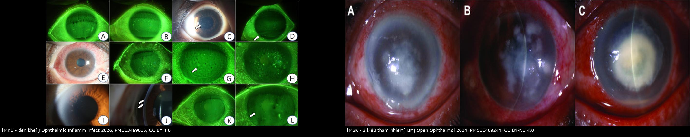
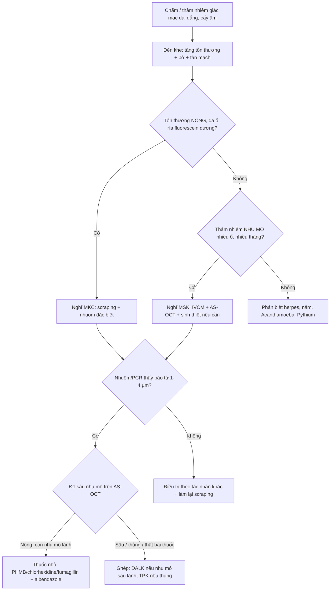
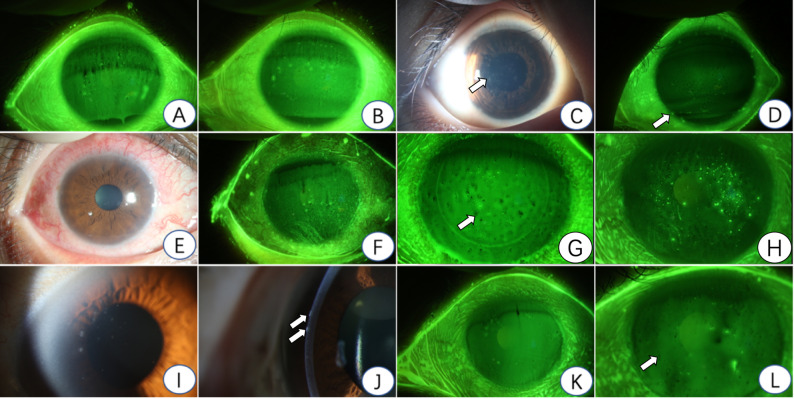
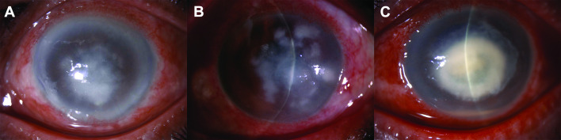
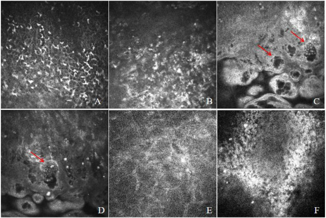
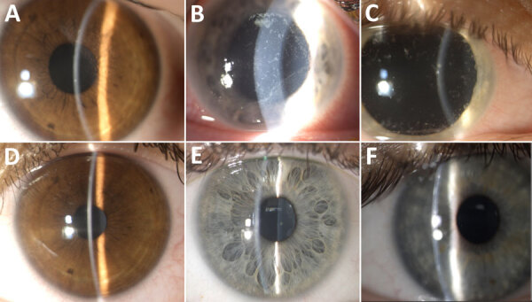

# 3202 — Viêm giác mạc do microsporidia: chấm dưới biểu mô dai dẳng, cấy âm & hai thể MKC – MSK / Microsporidial keratitis

**Tags:** `pattern:loet-giac-mac` `pattern:tham-nhiem-giac-mac` `pattern:cham-bieu-mo` `pattern:viem-ket-mac` `vung:giac-mac` `protocol:den-khe` `protocol:IVCM` `protocol:AS-OCT` `anatomy:bieu-mo-giac-mac`

**Mức chắc chắn (certainty):** tổng hợp y văn (literature synthesis) — ghép **26 ca** viêm giác mạc do microsporidia (Thái Lan, **PMC13139553**), **21 ca thể nhu mô** (Thái Lan, **PMC11409244**), **20 ca** thể kết–giác mạc ở Trung Quốc (**PMC13469015**), **ổ dịch Vittaforma corneae** ven Biển Galilee 2022–2024 (**PMC12309766**), **16/332 ca** di chứng (**PMC8302272**), tổng quan **PMC7196102**, cùng **2 ca nguyên văn có ảnh** (**PMC12852027**, **PMC11409244**). Không có thử nghiệm ngẫu nhiên nào — mọi phác đồ dưới đây là **chuỗi ca + đồng thuận**, ghi rõ chỗ suy luận.

> **Câu chốt:** microsporidia là **ký sinh nội bào bắt buộc**, nên **cấy thường âm** và bệnh nhân bị **chẩn đoán sai trung vị 1 tháng** (100% ca Trung Quốc, PMC13469015); ở thể nhu mô, **33,3% bị chẩn đoán nhầm là viêm giác mạc do herpes** và bệnh diễn tiến **trung vị 9 tháng** trước khi được chẩn đoán (PMC11409244). Hai thể khác nhau về **bản chất**: **MKC** (kết–giác mạc, nông, **tự giới hạn**, đáp ứng thuốc nhỏ) và **MSK** (nhu mô, **phải ghép giác mạc**: 18/21 ca ghép xuyên, lành **76,2%** sau mổ 1 và **95,2%** sau mổ 2). Chẩn đoán nằm ở **soi đèn khe có kinh nghiệm + nhuộm đặc biệt + IVCM/PCR**, không ở cấy.

> **Phân vai với bài khác:** [1460](../1460-viem-giac-mac-do-nam/lesson.md) (nấm), [1472](../1472-viem-giac-mac-acanthamoeba/lesson.md) (Acanthamoeba), [6132](../6132-viem-giac-mac-kinh-tiep-xuc/lesson.md) (vi khuẩn), [3200](../3200-viem-giac-mac-pythium/lesson.md) (*Pythium*), [3201](../3201-seo-giac-mac-ghep/lesson.md) (sẹo – chọn kiểu ghép). Bài này phủ **tác nhân nội bào** — nhóm **cấy âm, nhuộm dương, diễn tiến chậm**.

## 1. Tổng quan bệnh học – cơ chế hình ảnh (TẠI SAO cấy âm mà nhuộm lại thấy)

### 1.1 Tác nhân — "nấm nhưng không phải nấm"

- Microsporidia là **sinh vật nhân chuẩn, nội bào bắt buộc, tạo bào tử**, có **bộ gen thoái hóa**, quan hệ gần với **nấm** hơn là động vật nguyên sinh; **> 1.300 loài / ~200 chi** đã mô tả (PMC7196102). Ở giác mạc hay gặp: ***Encephalitozoon hellem*, *E. bieneusi*, *Vittaforma corneae*, *Encephalitozoon cuniculi*, *Nosema*, *Trachipleistophora***.
- **Kích thước quyết định cách nhìn:** bào tử **~1–4 µm** (meront **2,5 × 1,5 µm**), tức **nhỏ hơn sợi nấm 3–10 µm** và **nhỏ hơn tế bào vi khuẩn chỉ vài lần** → trên **đèn khe chỉ thấy "chấm"**, không thấy "sợi"; phải **nhuộm** hoặc **phóng đại cao (IVCM)** mới thấy cấu trúc.
- **Cơ chế nhiễm:** bào tử **bắn ống cực (polar tubule)** xuyên màng tế bào chủ và **tiêm nguyên sinh chất** vào trong; sau đó nhân lên **trong bào tương**, phá vỡ tế bào và lan sang tế bào bên cạnh. Vì vậy tổn thương là **đốm rời rạc, đa ổ, cùng lứa tuổi** — không phải ổ loét lan từ một điểm như vi khuẩn.

### 1.2 TẠI SAO mỗi đặc điểm lại như vậy

| Đặc điểm | Giải thích cơ chế |
|---|---|
| **Cấy thường âm** | Ký sinh **nội bào bắt buộc**, không mọc trên thạch máu/thạch Sabouraud thường quy; muốn nuôi phải **nuôi cấy tế bào** |
| **Nhuộm Gram dương, Ziehl–Neelsen dương** | Thành bào tử chứa **chitin + protein giàu arginine** → bắt màu gram dương và **kháng cồn-acid** — đây là lý do **ZN dương 89,5% (17/19)** trên mô bệnh học (PMC11409244) |
| **Calcofluor White phát huỳnh quang** | Calcofluor **gắn chitin** → bào tử sáng xanh trên nền tối; nhuộm **nhanh, nhạy**, nhưng **không đặc hiệu loài** |
| **Modified trichrome bắt màu hồng/đỏ** | Trichrome nhuộm **thành bào tử** nổi trên nền xanh → **11/14 ca (78,6%)** phát hiện được trên scraping (PMC11409244) |
| **IVCM: đốm phản xạ mạnh dạng vỏ kép** | Bào tử có **vỏ kép** dày → phản xạ mạnh; thấy **cấu trúc dạng nang vỏ sáng** dọc **lá nhu mô** (PMC12852027) |
| **Không có mạch máu mới ở thể nhu mô** | Sinh vật **khu trú trong keratocyte**, không kích thích tân mạch như viêm nhu mô do herpes tái phát |

### 1.3 Ngưỡng và con số phải nhớ

| Mốc | Số liệu | Nguồn |
|---|---|---|
| Tỷ lệ trong viêm giác mạc nhiễm khuẩn | **~0,4%** ở một số quần thể | PMC7196102 |
| Thời gian bị chẩn đoán sai (MKC, Trung Quốc) | **trung vị 1 tháng, 100% ca** | PMC13469015 |
| Thời gian diễn tiến (MSK, Thái Lan) | **trung vị 9 tháng** (IQR 2,2–12,0) | PMC11409244 |
| Tuổi trung bình MSK | **63,8 ± 12,2** | PMC11409244 |
| Tuổi trung bình MKC | **28,5** (Trung Quốc) · **39** (Thái Lan) | PMC13469015 · PMC13139553 |
| Tiền sử **corticoid nhỏ trước đó** | **53%** | PMC13139553 |
| Tiền sử **mật ong không vô khuẩn** | **23%** | PMC13139553 |
| Yếu tố nguy cơ MKC | **tiếp xúc chim 70%** · **kính tiếp xúc 40%** · **nước 15%** | PMC13469015 |
| Tác nhân MKC (Trung Quốc) | ***E. hellem* 65%** · *E. bieneusi* 15% · *V. corneae* 15% | PMC13469015 |
| Nhuộm **modified trichrome** (scraping) | **78,6%** (11/14) | PMC11409244 |
| Nhuộm **Ziehl–Neelsen** (mô bệnh học) | **89,5%** (17/19) | PMC11409244 |
| Kết cục MSK sau mổ | **76,2%** lành sau mổ 1 · **95,2%** sau mổ 2 | PMC11409244 |
| Di chứng MKC | **16/332 (4,8%)** quay lại; **8 mắt tái phát** sau **60,4 ± 40,6 ngày** | PMC8302272 |

## 2. Mẫu hình + chẩn đoán phân biệt theo vị trí (gamut)

### 2.1 Hai thể bệnh — khác nhau về tầng tổn thương, không chỉ về mức độ

| | **MKC — viêm kết–giác mạc** | **MSK — viêm giác mạc nhu mô** |
|---|---|---|
| Tầng | **Biểu mô / dưới biểu mô** | **Nhu mô trước–giữa** |
| Hình thái | **Chấm rải rác đa ổ**, trợt biểu mô, **nhuộm fluorescein dương ở rìa (limbus)** | **Nhiều ổ xám-trắng, bờ mềm ("fluffy")**, có thể **lan toàn bộ nhu mô** |
| Diễn tiến | **Ngày–tuần**, tự giới hạn | **Tháng (trung vị 9)**, tiến triển âm thầm |
| Điều trị | **Thuốc nhỏ** (fumagillin, PHMB, chlorhexidine, albendazole) | **Phải ghép giác mạc** (TPK/DALK) |
| Tiên lượng | **Tốt** | **Dè dặt**, nguy cơ thủng |

- **Ba kiểu thâm nhiễm của MSK** (PMC11409244, Hình 1): **(A)** ổ xám-trắng **trung tâm nhạt, bờ mềm** kèm nhiều ổ cạnh trung tâm; **(B)** **nhiều ổ quanh trung tâm** rời rạc; **(C)** **đậm đặc, dày toàn bộ**, có thể kèm mủ tiền phòng. Kiểu càng đậm → **tiên lượng thị lực càng xấu**.
- **Dấu hiệu rìa rất hữu ích:** **nhuộm fluorescein dương ở biểu mô rìa** gặp ở **65%** ca MKC Trung Quốc (PMC13469015) — dấu này **hiếm gặp** trong viêm giác mạc do vi khuẩn/nấm thông thường.

*Trái: **MKC** — tổn thương biểu mô nông, rải rác, bờ mờ, nhuộm fluorescein dương (mũi tên). Phải: **MSK** — ba kiểu thâm nhiễm nhu mô xám-trắng, bờ mềm. Nguồn: *J Ophthalmic Inflamm Infect* 2026, **PMC13469015**, CC BY 4.0 và *BMJ Open Ophthalmol* 2024, **PMC11409244**, CC BY-NC 4.0. Ảnh ghép letterbox, giữ nguyên tỷ lệ.*

### 2.2 Gamut theo hình thái

1. **Chấm/trợt biểu mô đa ổ** → **MKC** (microsporidia), **viêm kết–giác mạc do adenovirus**, **viêm giác mạc chấm nông (SPK) do khô mắt/độc tố dung dịch kính**, **herpes biểu mô không điển hình**.
2. **Thâm nhiễm nhu mô nhiều ổ bờ mềm** → **MSK**, **viêm nhu mô do herpes**, **nấm**, **Acanthamoeba**, ***Pythium***.
3. **Ổ loét đơn độc có mủ** → vi khuẩn (Pseudomonas, phế cầu), nấm.
4. **Viêm cùng mạc/củng mạc kèm thâm nhiễm** → microsporidia thể lan (hiếm), *Pythium*, nấm.
5. **Viêm nội nhãn** → microsporidia ở người suy giảm miễn dịch (rất hiếm).

## 3. Bảng so sánh phân biệt (ma trận đối chiếu)

| Thực thể (entity) | Hình ảnh điển hình | Chốt vào (rule-in) | Chốt loại (rule-out) | Gợi ý xác nhận |
|---|---|---|---|---|
| **Microsporidia (MKC)** | **Chấm đa ổ** biểu mô/dưới biểu mô, **rìa nhuộm fluorescein dương**, kết mạc viêm nhẹ | **Chấm đa ổ + tiền sử nước/đất/chim/kính tiếp xúc + cấy âm + nhuộm thấy bào tử** | **Có sợi nấm** hoặc **dendrite điển hình** → tác nhân khác | Scraping: Gram, modified trichrome, ZN, calcofluor; PCR/mNGS |
| **Microsporidia (MSK)** | **Nhiều ổ xám-trắng nhu mô, bờ mềm**, **không tân mạch**, diễn tiến **nhiều tháng** | **Thâm nhiễm nhu mô dai dẳng + không đáp ứng kháng sinh/kháng virus + IVCM thấy vỏ kép phản xạ mạnh** | Đáp ứng nhanh với acyclovir → herpes; có **sợi nấm** → nấm | IVCM, sinh thiết giác mạc, mô bệnh học + ZN |
| **Herpes giác mạc** | **Dendrite** đầu tận có chấm, giảm cảm giác giác mạc; thể nhu mô có **tân mạch + phù** | **Dendrite + giảm cảm giác + PCR HSV dương + đáp ứng acyclovir** | **Không dendrite, không đáp ứng acyclovir sau 2 tuần** → nghĩ microsporidia | PCR HSV, test cảm giác, theo dõi 2 tuần |
| **Acanthamoeba** (bài 1472) | **Vòng thâm nhiễm**, **viêm thần kinh tỏa tia (radial keratoneuritis)**, đau **không tương xứng** | **Đau dữ dội + vòng + tiền sử kính tiếp xúc nước** | Không đau nhiều, không vòng → ít nghĩ | IVCM tìm **nang**, cấy trên thạch *E. coli* |
| **Nấm** (bài 1460) | **Bờ có tua (feathery)**, **tổn thương vệ tinh**, mủ tiền phòng, tiền sử chấn thương thực vật | **Bờ tua + vệ tinh + soi tươi/KOH thấy sợi** | Bờ mềm đều, không vệ tinh → nghĩ microsporidia | KOH, cấy Sabouraud, IVCM |
| **Vi khuẩn** (bài 6132) | Ổ loét **đơn độc, mủ đặc**, khởi phát **< 48 giờ** | **Mủ + hypopyon + Gram thấy vi khuẩn** | Diễn tiến **nhiều tuần**, không mủ đặc → không điển hình vi khuẩn | Gram, cấy, kháng sinh đồ |
| ***Pythium*** (bài 3200) | **Tua/chấm/lưới/rãnh ngoại vi**, tiến triển **bùng nổ** | **Score 5 dấu + tiền sử nước/nông nghiệp** | Bờ mềm nhiều ổ, chậm → microsporidia | Nuôi cấy, PCR, phản ứng kháng nấm kém |
| **SPK do khô mắt/độc tố** | Chấm nông **hai bên, đối xứng**, không thâm nhiễm nhu mô | **Hai bên + khô mắt + ngừng độc tố thì hết** | Một bên, có thâm nhiễm nhu mô → không phải SPK đơn thuần | Test Schirmer, bỏ thuốc nghi ngờ |

## 4. Protocol chụp – xét nghiệm + phác đồ

### 4.1 Trình tự chẩn đoán (quan trọng: **lấy bệnh phẩm TRƯỚC khi nhỏ thuốc**)

1. **Đèn khe + nhuộm fluorescein:** ghi **số ổ, vị trí (rìa/trung tâm), tầng (biểu mô/nhu mô), bờ**, và **có/không tân mạch**.
2. **Cạo giác mạc (corneal scraping):** cạo ở **bờ tổn thương**, chia lam — **Gram, Giemsa, modified trichrome, Ziehl–Neelsen, calcofluor white**, và **PCR/mNGS** nếu có. Không cấy thường quy là đủ.
3. **IVCM (soi đồng tiêu in vivo):** tìm **đốm phản xạ mạnh, vỏ kép, cụm dạng nang** dọc lá nhu mô — không xâm lấn, làm lại được (PMC12852027).
4. **AS-OCT:** đo **độ sâu thâm nhiễm** và **độ dày còn lại** → quyết định **thuốc hay ghép**, và chọn **DALK vs TPK** (bài [3201](../3201-seo-giac-mac-ghep/lesson.md)).
5. **Sinh thiết giác mạc** khi scraping âm mà vẫn nghi: mô bệnh học + **ZN (89,5%)** + trichrome.

### 4.2 Điều trị — theo thể, không theo "kháng sinh mạnh"

| Thể | Lựa chọn | Số liệu |
|---|---|---|
| **MKC** | **PHMB 0,02%** | **lành 90% (18/20)**, 1 tái phát sau khi ngừng (PMC13469015) |
| **MKC** | **Chlorhexidine 0,02%** | hiệu quả và an toàn trong ổ dịch *V. corneae* (PMC12309766) |
| **MKC** | **Fumagillin (Fumidil B) 3 mg/mL** (= 70 µg/mL), **mỗi giờ ban ngày × 7 ngày** | triệu chứng giảm; **kìm khuẩn chứ không diệt** → có thể tái phát khi ngừng (PMC7196102) |
| **MKC/MSK** | **Albendazole 400 mg uống 1–2 lần/ngày** (đơn trị hoặc phối hợp) | hiệu quả hạn chế với *E. bieneusi* (PMC7196102) |
| **MSK** | **Ghép giác mạc**: 18 TPK, 2 DALK, 1 FS-ALK | lành **76,2%** sau mổ 1, **95,2%** sau mổ 2 (PMC11409244) |

- **Corticoid:** **không dùng đơn thuần** — **53%** ca Thái Lan đã nhỏ corticoid trước đó (PMC13139553). Sau khi kiểm soát được tác nhân, corticoid **liều thấp** chỉ dùng cho **di chứng viêm** (SEI/uveitis) dưới vỏ bọc chống nhiễm.

## 5. Biến thể bình thường và cạm bẫy

- **"Cấy âm nên loại trừ nhiễm trùng"** — sai: microsporidia **không mọc** trên môi trường thường quy. Cấy âm **không** loại trừ.
- **Chẩn đoán nhầm herpes** — **33,3%** ca MSK được chẩn đoán ban đầu là **viêm nhu mô do herpes** (PMC11409244). Dấu hiệu phân biệt: **không dendrite, không tân mạch, không đáp ứng acyclovir**.
- **Mật ong không vô khuẩn** — **23%** ca có tiền sử nhỏ mật ong tự pha (PMC13139553); đây là **đường lây** và cũng là **yếu tố làm nặng**.
- **Corticoid trước đó** — **53%**; làm **mất dấu hiệu biểu mô** và **đẩy bệnh vào nhu mô**.
- **"MKC đã khỏi" không có nghĩa hết bệnh:** **8 mắt tái phát** sau **60,4 ± 40,6 ngày**, và **16/332** ca phải quay lại vì **SPK dai dẳng, thâm nhiễm dưới biểu mô, hoặc viêm màng bồ đào** (PMC8302272).
- **Bào tử 1–4 µm rất dễ bỏ sót** trên tiêu bản nhuộm thường — nếu chỉ đọc Gram ở vật kính ×40 sẽ **nhầm với tế bào viêm thoái hóa**. Luôn đọc **×1.000** và đối chiếu **calcofluor**.
- **Không chọc/không cạo quá tay ở thể nhu mô mỏng:** ca PMC12852027 **thủng giác mạc** sau 5 tháng bệnh — cạo ở mắt nhu mô đã mỏng có thể **làm thủng**; khi AS-OCT cho thấy nhu mô còn **< 200 µm**, cân nhắc **sinh thiết tại phòng mổ** thay vì cạo tại giường.

## 6. Tự lượng giá — Blind Quiz ngay trên trang tĩnh

**Ca 1 — Nam 34 tuổi, đỏ mắt 10 ngày, đi bơi hồ và có nuôi chim. Nhìn ảnh trước.**

- Gợi ý: đau nhẹ, thị lực gần bình thường, không mủ tiền phòng.
- Câu hỏi: Tổn thương ở tầng nào? Dấu hiệu nào ở rìa? Ba phân biệt và xét nghiệm chốt?

<b>Bấm để hiện đáp án (findings + chẩn đoán)</b>

- **Dấu hiệu:** trợt/thâm nhiễm **biểu mô nông, đa ổ, bờ mờ**; ở một số ca có **tổn thương biểu mô rìa nhuộm fluorescein dương** (gặp **65%** ca MKC, PMC13469015).
- **Chẩn đoán:** **MKC do microsporidia** — yếu tố nguy cơ khớp: **tiếp xúc chim 70%**, **nước 15%**.
- **Chốt:** scraping + **modified trichrome/calcofluor/ZN** thấy **bào tử 1–4 µm**; cấy thường quy **âm** không loại trừ.
- Nguồn ảnh: *J Ophthalmic Inflamm Infect* 2026, **PMC13469015**, CC BY 4.0.

**Ca 2 — Nữ 62 tuổi, "viêm giác mạc herpes" 7 tháng, acyclovir không đỡ. Ảnh đèn khe + IVCM.**

- Câu hỏi: Vì sao không phải herpes? Tầng tổn thương? Bước tiếp theo?

<b>Bấm để hiện đáp án</b>

- **Dấu hiệu:** **thâm nhiễm nhu mô trước–giữa, nhiều ổ xám-trắng, bờ mềm (fluffy)**, **không tân mạch**, không dendrite — ba kiểu (A) trung tâm nhạt, (B) nhiều ổ quanh trung tâm, (C) đậm đặc dày.
- **Chẩn đoán:** **MSK (microsporidial stromal keratitis)** — diễn tiến **trung vị 9 tháng**, **33,3%** bị gọi nhầm là herpes (PMC11409244).
- **Bước tiếp:** **IVCM** (tìm vỏ kép phản xạ mạnh), **AS-OCT** đo độ sâu, **sinh thiết** với **ZN (89,5%)**; điều trị **ghép** (TPK/DALK), không chỉ thuốc nhỏ.
- Nguồn ảnh: *BMJ Open Ophthalmol* 2024, **PMC11409244**, **CC BY-NC 4.0** — nguyên bản, không chỉnh sửa.

**Ca 3 — Nữ 45 tuổi, đỏ mắt 3 tuần, nghi "viêm kết giác mạc do virus". IVCM dưới đây.**

- Câu hỏi: Cấu trúc mũi tên là gì? Vì sao IVCM hữu ích hơn cấy ở đây?

<b>Bấm để hiện đáp án</b>

- **Dấu hiệu:** **cụm cấu trúc dạng nang, vỏ sáng dày (vỏ kép)**, phản xạ mạnh, nằm dọc **lá nhu mô** (mũi tên đỏ ở C, D) — kèm thâm nhiễm tế bào viêm ở lớp biểu mô (A, B).
- **Chẩn đoán:** **bào tử microsporidia trong nhu mô** — IVCM cho **chẩn đoán sớm, không xâm lấn**, bổ sung cho **mNGS/mô bệnh học**.
- **Vì sao hơn cấy:** sinh vật **nội bào bắt buộc** → cấy âm; IVCM thấy **cấu trúc thật** ngay tại giường.
- Nguồn ảnh: *Front Med* 2025, **PMC12852027**, CC BY 4.0.

**Ca 4 — Trước và sau điều trị (3 bệnh nhân).**

- Câu hỏi: Tổn thương trước điều trị ở hàng trên gồm gì? Đáp ứng điều trị nói lên điều gì về bản chất bệnh?

<b>Bấm để hiện đáp án</b>

- **Trước (A–C):** **thâm nhiễm chấm đa ổ** ở biểu mô/nhu mô nông, giác mạc mờ nhẹ; **sau (D–F):** giác mạc **trong lại**, chỉ còn vết mờ nhỏ.
- **Ý nghĩa:** đây là **MKC** — thể **nông, tự giới hạn**, đáp ứng **chlorhexidine 0,02%** (ổ dịch *Vittaforma corneae* ven Biển Galilee, PMC12309766); khác hẳn **MSK** phải ghép.
- Nguồn ảnh: *Emerging Infectious Diseases* 2025, **PMC12309766**, CC BY 4.0.

## Bài liên quan chéo
- [1460 – Viêm giác mạc do nấm](../1460-viem-giac-mac-do-nam/lesson.md) (bờ tua, vệ tinh — phân biệt chính)
- [1472 – Viêm giác mạc do Acanthamoeba](../1472-viem-giac-mac-acanthamoeba/lesson.md) (vòng, đau không tương xứng)
- [3200 – Viêm giác mạc do *Pythium*](../3200-viem-giac-mac-pythium/lesson.md) (tổn thương bùng nổ, kháng nấm vô hiệu)
- [3201 – Sẹo giác mạc & chọn kiểu ghép](../3201-seo-giac-mac-ghep/lesson.md) (AS-OCT → PTK/SALK/DALK/PKP)
- [475 – Viêm nội nhãn nội sinh do vi khuẩn](../475-viem-noi-nhan-noi-sinh-vi-khuan/lesson.md) (khi nhiễm lan vào nội nhãn)

## Ảnh
- `images/composite_mkc-vs-msk.jpg` — ghép đối chiếu MKC (nông) và MSK (nhu mô).
- `images/3202_viem-giac-mac_MKC_PMC13469015-Fig1-CCBY.jpg` — đèn khe: dấu hiệu MKC điển hình.
- `images/3202_viem-giac-mac_MSK_PMC11409244-Fig1-CCBYNC.jpg` — ba kiểu thâm nhiễm nhu mô.
- `images/3202_viem-giac-mac_IVCM_PMC12852027-Fig3-CCBY.jpg` — IVCM: bào tử vỏ kép trong nhu mô.
- `images/3202_viem-giac-mac_nhuom_PMC12852027-Fig4-CCBY.jpg` — các phương pháp nhuộm (mô học, mực, toluidine blue, calcofluor).
- `images/3202_viem-giac-mac_MKC_PMC12309766-F-CCBY.jpg` — trước/sau điều trị.

> Không dùng để chẩn đoán độc lập khi chưa có người hướng dẫn.
