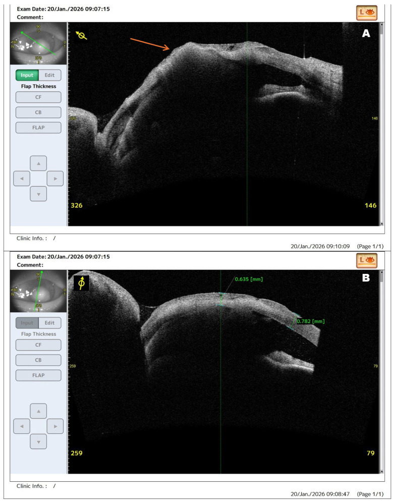
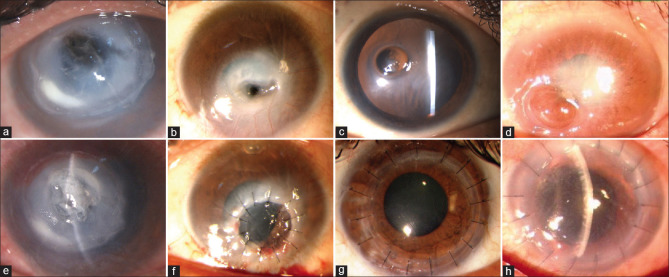
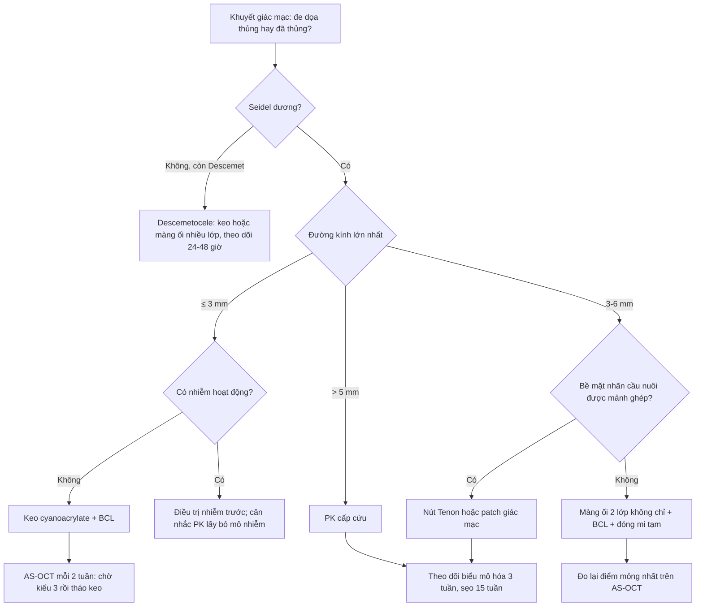
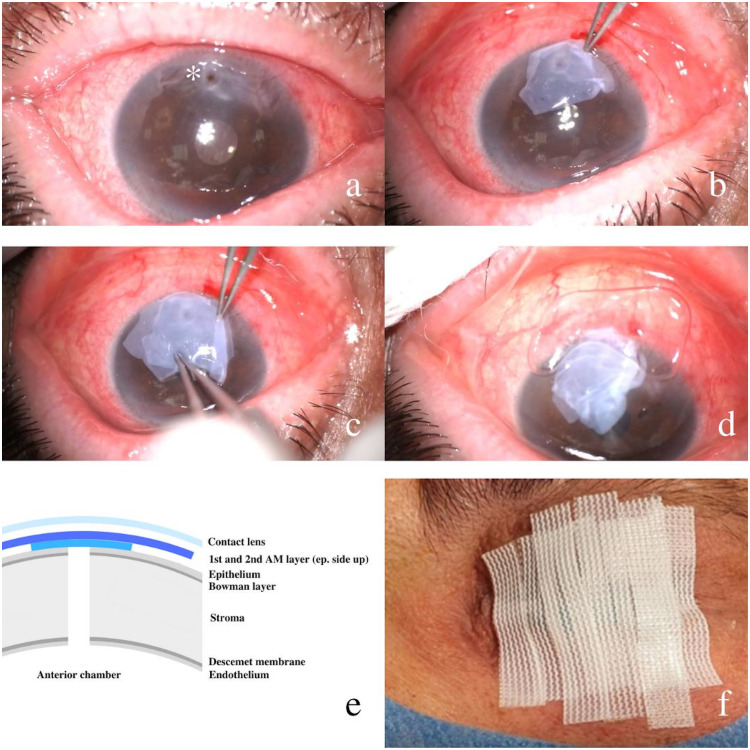
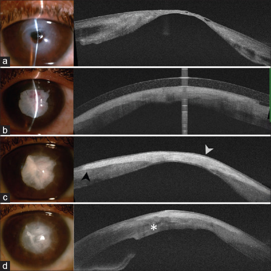
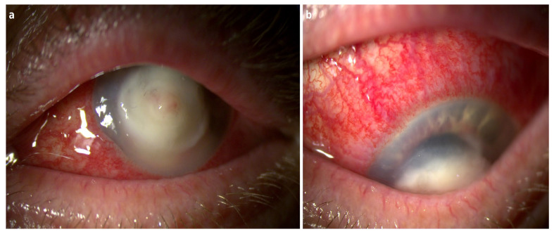
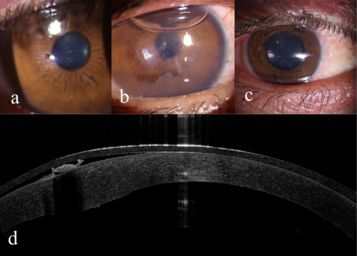

# 3203 — Đe dọa thủng & thủng giác mạc: keo cyanoacrylate, màng ối, nút Tenon hay ghép xuyên / Threatened and frank corneal perforation — tissue adhesive, amniotic membrane, Tenon patch or keratoplasty

**Tags:** `pattern:thung-giac-mac` `pattern:de-doa-thung` `pattern:descemetocele` `pattern:khuyet-nhu-mo` `pattern:phang-tien-phong` `pattern:do-mo-giac-mac` `vung:mat` `vung:giac-mac` `vung:tien-phong` `protocol:den-khe` `protocol:AS-OCT` `protocol:UBM` `protocol:sieu-am-B` `protocol:nhuom-fluorescein` `anatomy:giac-mac`

**Mức chắc chắn (certainty):** tổng hợp y văn (literature synthesis) — nhóm tự biên, **không có bệnh nhân của mình**. Số liệu chính lấy từ: **83 mắt dán keo cyanoacrylate** (Medicina 2025, PMC11943718); **25 mắt N-butyl-2-cyanoacrylate** (Ophthalmol Ther 2023, PMC10640518); **28 mắt thủng < 4 mm theo dõi AS-OCT sau dán keo** (Indian J Ophthalmol 2026, PMC13529033); **24 mắt descemetocele + thuật toán điều trị** (Indian J Ophthalmol 2022, PMC9332962); **85 mắt nút Tenon** (Indian J Ophthalmol 2022, PMC9940507); **15 mắt nút Tenon trong tan chảy miễn dịch** (Indian J Ophthalmol 2025, PMC12097417); tổng quan **nút Tenon 37 bài** (Indian J Ophthalmol 2024, PMC11727946); **50 mắt màng ối không chỉ** (Clin Ophthalmol 2026, PMC12951867); **13 mắt AS-OCT sau màng ối + PRP** (BMC Ophthalmol 2025, PMC12690847); **48 mắt patch giác mạc** (BMC Ophthalmol 2024, PMC11607979); **18 mắt thủng tự phát** (Korean J Ophthalmol 2026, PMC13485424); **78 mắt PK so với màng ối** (Graefes Arch Clin Exp Ophthalmol 2023, PMC10272250); ca **"pre-descemetocele" sau DSAEK** (Eye Open 2025, PMC12863648); ca **thủng do đốt điện mi** (Clin Case Rep 2026, PMC12927933); ca **AS-OCT trong viêm giác mạc do Pseudomonas bùng phát** (Diagnostics 2026, PMC13114990). Ảnh: **PMC13114990**, **PMC9332962**, **PMC9940507**, **PMC12951867**, **PMC12927933**.

> **Câu chốt:** thủng giác mạc không phải "một lỗ cần vá", mà là **ba câu hỏi độc lập**: **(1) còn bao nhiêu nhu mô lành (và Descemet còn không)? (2) có nhiễm trùng đang hoạt động không? (3) bề mặt nhãn cầu có nuôi được vật liệu vá không?** Câu trả lời quyết định **keo (giữ nhãn cầu vài tuần) → nút Tenon/màng ối (thay mô, tự thân, không cần ngân hàng mắt) → ghép xuyên (mô thật, nhưng trên mắt đang viêm thì dễ tan/thải)**. Sai lầm hay gặp: **dán keo lên vùng đang nhiễm rồi coi là "xong"** (keo bít mủ vào trong), và **tháo keo khi ảnh AS-OCT mới ở kiểu 2** — 40% rò lại.

## 1. Tổng quan bệnh học – cơ chế hình ảnh (TẠI SAO)

### 1.1 Ngưỡng định lượng (số phải nhớ)

- **Tần suất:** **6–26%** ca viêm giác mạc nhiễm trùng tiến triển tới thủng dù đã dùng kháng sinh đúng (Indian J Ophthalmol 2026, **PMC13529033**).
- **Tốc độ:** trong **24 mắt descemetocele**, **5/24 (20,1%)** thủng thật trong **24–48 giờ** sau khi vào viện — tức "đe dọa thủng" là **cấp cứu trong ngày**, không phải "hẹn tuần sau" (Indian J Ophthalmol 2022, **PMC9332962**).
- **Phân loại kích thước descemetocele (dùng trong bài gốc):** **nhỏ < 3 mm** (58,3%), **vừa 3–6 mm** (37,5%), **lớn > 6 mm** (4,2%); **vị trí: trung tâm ≤ 5 mm từ trục, cạnh trung tâm 5–8 mm, ngoại vi ≥ 8 mm (kể cả rìa)** (**PMC9332962**).
- **Keo cyanoacrylate (CTA) — 83 mắt:** **66%** vào viện đã thủng thật, **34%** chỉ mỏng/descemetocele; **thất bại (rò dai dẳng phải ghép) 19,2%**; yếu tố duy nhất liên quan thất bại là **dán > 1 lần** (p = 0,047); **keo tự bong trung vị 56,5 ngày** (khoảng 6–360), **thời gian keo lưu trung vị 45 ngày**; **có tiền phòng trước khi dán → dễ tự bong hơn** (p = 0,015) (Medicina 2025, **PMC11943718**).
- **N-butyl-2-cyanoacrylate — 25 mắt:** đường kính thủng **trung vị 2,0 mm** (IQR 1,0–3,0); **dán 1 lần kín 56,5%**, **dán lại kín tới 86,9%**; **sống nhãn cầu tích lũy 71,0% ở 90 ngày và 51,2% ở 250 ngày**; keo lưu **trung vị 94 ngày**; **2/25 (8%) viêm nội nhãn sau dán** (Ophthalmol Ther 2023, **PMC10640518**).
- **Theo dõi AS-OCT sau dán keo — 28 mắt thủng < 4 mm:** 3 kiểu lành (xem 1.2); **tuần 2: 85,7% kiểu 2**; **tuần 4: 35,7% kiểu 3**; **82,1% đạt kiểu 3 ở tuần 8** và **tháo keo ở 41,7 ± 9,2 ngày** — **0 rò**; ngược lại **5 ca tháo sớm ở 31,8 ± 2,5 ngày (khi còn kiểu 2) → 40% (2/5) rò lại phải dán lại** (Indian J Ophthalmol 2026, **PMC13529033**).
- **Màng ối ( amniotic membrane, AM) không chỉ — 50 mắt thủng ≤ 3 mm trên bề mặt nhãn cầu nặng:** **kín 100%**, thời gian lành **14,2 ± 3,6 ngày** (9–21); **điểm mỏng nhất trên OCT 215 ± 38 µm → 402 ± 39 µm ở 6 tháng** (p = 0,000031); **0 ca tuột màng, 0 nhiễm, 0 mổ lại** (Clin Ophthalmol 2026, **PMC12951867**).
- **AS-OCT sau màng ối + cục PRP — 13 mắt:** **100% lành thủng trong 4 tuần**, xác nhận bằng AS-OCT tuần 1 và tháng 1 (BMC Ophthalmol 2025, **PMC12690847**).
- **Nút Tenon (Tenon patch graft, TPG) — 85 mắt:** tổn thương **4,20 ± 1,01 mm** (3–6 mm); **thành công giải phẫu 87%** (**83% ở thủng**, **96% ở descemetocele**); thất bại: **bong mảnh ghép 8**, **giãn mảnh ghép 1**, **sẹo + tiền phòng dẹt 2**; **biểu mô hóa trung vị 3 tuần, tạo sẹo 15 tuần** (Indian J Ophthalmol 2022, **PMC9940507**). Tổng quan 37 bài: TPG hợp với tổn thương **2–6 mm**, thành công **74–87%**, tổn thương **trung tâm → thị lực kém, cần ghép quang học sau** (Indian J Ophthalmol 2024, **PMC11727946**). Trong **tan chảy miễn dịch (15 mắt)**: sẹo + tân mạch **66,7%**, **mất mảnh ghép 13%** (Indian J Ophthalmol 2025, **PMC12097417**).
- **Patch giác mạc toàn/lá — 48 mắt:** thành công giải phẫu **81,2%**; **tan mảnh ghép 22,9%**, **glôcôm 10,4%**, **1 mắt teo nhãn**; descemetocele **đều ở trung tâm**, tan chảy hay ở **cạnh trung tâm** (p = 0,0001) (BMC Ophthalmol 2024, **PMC11607979**).
- **PK so với màng ối (78 mắt, sản khoa–miễn dịch nặng):** **thủng tái phát 26% (AMT) vs 23% (PK)**, p > 0,99 — **không khác biệt**; nhưng **tử vong trong thời gian theo dõi 41% vs 28%** vì nhóm AMT **già/nhiều bệnh nền hơn** → chọn theo **toàn trạng**, không chỉ theo kích thước lỗ (Graefes Arch Clin Exp Ophthalmol 2023, **PMC10272250**).
- **Thủng tự phát (18 mắt):** màng ối **50%**, patch **38,9%**, PK **16,7%**, **38,9% cần > 1 thủ thuật**; thị lực cuối **0,86 ± 1,14 logMAR** (không nhiễm) vs **2,19 ± 1,02 logMAR** (nhiễm/pha trộn), p = 0,038 (Korean J Ophthalmol 2026, **PMC13485424**).

### 1.2 TẠI SAO thủng — và vì sao ảnh trông như vậy

- **Mô bệnh:** nhu mô giác mạc **90% là collagen type I** do tế bào sừng (keratocyte) tổng hợp, **không có mạch máu** — nuôi dưỡng nhờ **thủy dịch và nước mắt**. Khi viêm, **neutrophil và biểu mô tiết MMP-9/collagenase** cắt collagen; mô **không có nguồn tái tạo nhanh** nên mỏng dần theo **từng "khoanh" nhu mô**. **Descemet (collagen IV + laminin)** kháng enzyme hơn nhiều → nhu mô biến mất nhưng Descemet còn **phồng ra như bong bóng** = **descemetocele**; khi áp lực nội nhãn vượt sức căng → **rách Descemet, thủng toàn bề dày**. Vì vậy **đe dọa thủng là trạng thái "chỉ còn một lớp"**, và **20% trong số đó rách trong 24–48 giờ** (**PMC9332962**).
- **Vì sao AS-OCT đọc được (vật lý):** AS-OCT dùng ánh sáng **~1.300 nm**, cho mặt cắt **độ phân giải µm**, xuyên qua **phù nhu mô** tốt hơn đèn khe. Tín hiệu mạnh ở **mặt phân cách có chênh chiết suất**: nhu mô **n ≈ 1,376** so với **không khí 1,0** → bề mặt sáng rõ; **cyanoacrylate n ≈ 1,48 và rất tán xạ** → hiện thành **dải hyperreflective nhăn nheo + bóng che (shadowing)** phía dưới. Đó chính là **kiểu 1**: **che hoàn toàn** phần nhu mô đang lành, nên **không được kết luận "đã kín" chỉ vì hết rò** (**PMC13529033**).
- **Ba kiểu lành trên AS-OCT (dùng để quyết định tháo keo):** **kiểu 1** — khối hyperreflective nhăn nheo (keo) + bóng che; **kiểu 2** — nhu mô **đang tái tạo** dưới keo nhưng **chưa liên tục** với giác mạc lành; **kiểu 3** — **nhu mô tái tạo hoàn toàn, liên tục** với nhu mô xung quanh. Tháo keo **chỉ khi kiểu 3** (**PMC13529033**).
- **Vì sao nghiệm pháp Seidel dương — và vì sao âm giả:** nhỏ **fluorescein 1–2%**, thủy dịch rò ra **pha loãng thuốc** → xuất hiện **"dòng nước trong"** chảy trong vũng xanh. Nếu lỗ **bị mống mắt/màng giả (pseudocornea) bít tạm**, dòng chảy **quá nhỏ** → **Seidel âm** dù vẫn thủng; **ấn nhãn cầu/đo nhãn áp tiếp xúc sẽ làm bung "van" này** → **cấm ấn** cho tới khi đã xử trí.
- **Vì sao có ca tiền phòng còn (formed AC) mà vẫn thủng:** AS-OCT ở các ca này cho thấy **thông thương gián tiếp**: **tách lớp nhu mô (lamellar separation)**, **ổ keo trong nhu mô**, **bọng biểu mô** — tức đường rò **không thẳng**, nên thủy dịch vẫn giữ được tiền phòng; nhóm này **dễ tự bong keo hơn** (p = 0,015) (**PMC11943718** mô tả lại bằng chứng AS-OCT). Ngược lại **tiền phòng dẹt** = rò > khả năng bù, **phải xử trí trong giờ**.
- **Vì sao chọn vật liệu này mà không vật liệu kia (cơ chế):** **keo cyanoacrylate** polymer hóa **trong vài giây khi gặp ẩm**, bám vào mô ướt, tạo **vá cơ học** và có **tính kìm khuẩn nhẹ**, nhưng là **dị vật**: gây **cộm, chảy nước mắt, viêm, tân mạch**, và **không thay được mô**. **Màng ối** có **màng đáy + yếu tố kháng viêm/kháng xơ** → **giá đỡ cho biểu mô**, nhưng **mỏng và tự tiêu** nên chỉ dùng cho **lỗ nhỏ, áp lực thấp**. **Tenon** là **mô tự thân, dày, có mạch** → **vá được lỗ 3–6 mm**, nhưng **đục và tân mạch** nên **thị lực kém, cần ghép quang học sau**. **Ghép xuyên** cho **mô thật + loại bỏ mô nhiễm**, đổi lại **nguy cơ tan/thải cao trên mắt đang viêm**.

*AS-OCT mặt cắt giác mạc lúc nhập viện trong ca viêm giác mạc do **Pseudomonas aeruginosa** bùng phát: **mất cấu trúc nhu mô trên diện rộng**, bề mặt **lõm sâu** (mũi tên), nhu mô quanh còn **phù dày**; máy đo bề dày **0,635 mm** và **0,782 mm** ở hai lát cắt. Đây là hình ảnh **"đe dọa thủng"** — chỉ còn lớp mỏng giữ tiền phòng — và là lý do ca này phải **ghép xuyên cấp cứu**. Nguồn: *Diagnostics (Basel)* 2026, Fig. 1, **PMC13114990** — CC BY 4.0.*

## 2. Mẫu hình + chẩn đoán phân biệt theo vị trí (gamut)

### 2.1 Theo kích thước — quyết định vật liệu

- **Đe dọa thủng / descemetocele (chưa rách):** **bảo tồn tối đa** — **keo** hoặc **màng ối nhiều lớp**; **không** chọc, **không** đo nhãn áp tiếp xúc, **không** nạo đáy ổ.
- **Thủng ≤ 3 mm:** **keo cyanoacrylate ± kính áp tròng điều trị (bandage contact lens, BCL)**, hoặc **màng ối 2 lớp không chỉ**, hoặc **nút Tenon** nếu mô xung quanh quá yếu/đang tan chảy.
- **Thủng 3–6 mm:** **nút Tenon** (vùng hợp lý nhất theo tổng quan: **2–6 mm**, **PMC11727946**) hoặc **patch giác mạc**; **ghép xuyên** nếu có mô nhiễm cần lấy bỏ hoặc không đủ mô nhận.
- **Thủng > 5 mm / vỡ nhãn cầu:** **ghép xuyên (PK) cấp cứu** là chuẩn (nêu trong **PMC9940507**); nếu **không có mô ghép** → **vá tạm** (keo + màng nhân tạo/polydrape, **PMC13541356**) rồi chuyển tuyến.

### 2.2 Theo vị trí (ảnh hưởng tiên lượng và thị lực)

- **Trung tâm (≤ 5 mm):** thủng trung tâm → **sẹo trên trục quang** → thị lực kém dù kín; **TPG/patch trung tâm** làm **thị lực kém hơn** và thường **cần ghép quang học sau** (**PMC11727946**); **descemetocele trong loạt 48 mắt đều ở trung tâm** (**PMC11607979**).
- **Cạnh trung tâm (5–8 mm):** nơi **tan chảy do miễn dịch** hay gặp (p = 0,0001 so với trung tâm, **PMC11607979**); tiên lượng TPG **tốt hơn** trung tâm (**PMC9940507**).
- **Ngoại vi / rìa (≥ 8 mm, kể cả limbus):** dễ **dính mống mắt**, **hở góc**, **mất tế bào gốc rìa**; nếu **thiếu tế bào gốc rìa toàn bộ** → ưu tiên **màng ối** trước, ghép sau (**PMC9332962**).

### 2.3 Theo nguyên nhân — vì sao cùng một lỗ mà xử trí khác

- **Nhiễm khuẩn/nấm/amip đang hoạt động:** **không dán keo "che" vùng thâm nhiễm** khi chưa kiểm soát nhiễm; **kháng sinh/kháng nấm tại chỗ tăng cường**, **cạo bờ ổ (không cạo đáy)**, và **cân nhắc PK lấy bỏ mô nhiễm** — ghép trên mắt còn nhiễm có **nguy cơ tái phát/tan ghép** (định lượng: **PK vs AMT** cho thủng không khác biệt về tái phát nhưng **khác về toàn trạng**, **PMC10272250**).
- **Tan chảy miễn dịch (PUK, viêm khớp dạng thấp, Mooren, SJS):** **ức chế miễn dịch toàn thân là điều trị gốc**; **nút Tenon** là cầu nối **giữ nhãn cầu** trong khi chờ thuốc hiệu quả (**mất mảnh ghép 13%**, **PMC12097417**); **ghép xuyên ngay thường thất bại**.
- **Bệnh thần kinh giác mạc / mắt khô nặng / sau HSV:** bề mặt **không nuôi được mảnh ghép**; **màng ối + BCL + đóng mi tạm** trước; **50 mắt bề mặt nặng** đạt **kín 100%** với màng ối 2 lớp không chỉ (**PMC12951867**) nhưng **phải điều trị khô/neurotrophic song song**.
- **Chấn thương (nhiệt, hóa chất, cơ học, đốt điện):** lỗ thường **sạch, bờ rõ** → **keo ± BCL** hiệu quả; ca thủng trung tâm do **đốt điện đơn cực khi cắt da mi** được **dán N-butyl cyanoacrylate + BCL**, tiền phòng ổn định sau **1 tuần** (Clin Case Rep 2026, **PMC12927933**).
- **Sau mổ (mổ mộng, khúc xạ, phaco):** **hở vết mổ/rò** khác **thủng do tan chảy** — xử trí bằng **khâu lại ± màng ối**, không dán keo lên mép vết mổ đang hở.

- **Gamut "tiền phòng dẹt" (phân biệt nhanh):** **thủng/rò giác mạc** (Seidel dương, tiền phòng nông) · **hở vết mổ phaco** (mép mổ hở, Seidel dương tại vết mổ) · **giảm nhãn áp do tách thể mi (cyclodialysis)** (tiền phòng sâu hơn, không rò) · **viêm màng bồ đào nặng** (dính mống mắt, tiền phòng nông nhưng **không rò**) · **hội chứng giảm áp (hypotony)** sau mổ lọc (bọng thấm).

*Bốn mắt **descemetocele** (a–d) và kết quả sau **bốn phương thức khác nhau** (e–h): **keo cyanoacrylate**, **patch giác mạc**, **ghép lá (DALK)**, **ghép xuyên (PKP)**. Cùng một "lỗ" nhưng chọn vật liệu theo **kích thước, mô xung quanh và tình trạng nhiễm** — ghép xuyên để lại **vòng chỉ và mảnh ghép toàn bề dày**, patch/keo để lại **mô sẹo dày, đục**. Nguồn: *Indian J Ophthalmol* 2022, Fig. 1, **PMC9332962** — CC BY-NC-SA 4.0.*

## 3. Bảng so sánh phân biệt (ma trận đối chiếu)

| Thực thể (entity) | Hình ảnh điển hình | Chốt vào (rule-in) | Chốt loại (rule-out) | Gợi ý xác nhận |
|---|---|---|---|---|
| **Đe dọa thủng / descemetocele** | Nhu mô mỏng, **bóng Descemet phồng trong** trên đèn khe; AS-OCT: **nhu mô còn rất mỏng, Descemet liên tục, lồi ra trước** | **Thấy lớp màng trong suốt phồng + nhu mô quanh mỏng < 1/3 bình thường** | **Màng đứt/khuyết liên tục + Seidel dương** → đã thủng, không còn là descemetocele | AS-OCT (thước đo µm), UBM khi đục; **không ấn nhãn cầu** |
| **Thủng nhỏ ≤ 3 mm, không nhiễm hoạt động** | Lỗ tròn bờ rõ, **tiền phòng nông**, Seidel dương; AS-OCT: **khuyết toàn bề dày, bờ nhu mô lành** | **Seidel dương + đường kính ≤ 3 mm + không mủ/không thâm nhiễm** | **Bờ nhu mô nhuyễn mủ, thâm nhiễm lan** → nhiễm hoạt động, phải xử lý nhiễm trước | Keo cyanoacrylate ± BCL; **dán 1 lần kín 56,5%, dán lại 86,9%** (PMC10640518) |
| **Thủng nhỏ nhưng nhiễm đang hoạt động** | Thâm nhiễm trắng đục quanh lỗ, **mủ tiền phòng**, phù nhu mô; AS-OCT bị **bóng che do thâm nhiễm** | **Thâm nhiễm/mủ + cấy/nhuộm dương tính + lỗ thủng trong vùng thâm nhiễm** | Chỉ **mỏng/sẹo không thâm nhiễm** → không phải nhiễm hoạt động | Cạo bờ ổ (không cạo đáy) + cấy; **PK lấy bỏ mô nhiễm** nếu lan rộng |
| **Thủng/vỡ 3–6 mm thiếu mô** | Miệng lỗ rộng, **mống mắt sa**, tiền phòng dẹt; AS-OCT: **mất liên tục nhu mô + Descemet trên diện rộng** | **Đường kính 3–6 mm + không đủ mô nhận để khâu** | **≤ 3 mm bờ đều** → keo/màng ối đủ | **Nút Tenon 2–6 mm, thành công 87%** (PMC9940507); patch 81,2% (PMC11607979) |
| **Tan chảy miễn dịch (PUK/RA/Mooren)** | Bờ ổ **lõm kiểu "khoét"**, nhu mô quanh **mỏng đều**, mắt **viêm nhẹ nhưng dai dẳng**; hay ở **cạnh trung tâm** | **Bệnh miễn dịch toàn thân + tan chảy tiến triển dù đã che phủ** | **Bờ ổ đều, mủ đặc, cấy dương** → nghĩ nhiễm là chính | **Ức chế miễn dịch toàn thân + Tenon/màng ối**; ghép xuyên sớm dễ tan |
| **Thủng trên mắt khô/neurotrophic/SJS** | Giác mạc **mờ đục mất bóng**, **biểu mô trợt từng đám**, **mất cảm giác**, hay **dính kết mạc** | **Mất cảm giác giác mạc + khô nặng + thủng tái diễn** | **Cảm giác bình thường, bề mặt ẩm** → không phải nhóm này | Màng ối 2 lớp không chỉ: **kín 100%** ở 50 mắt ≤ 3 mm (PMC12951867) |
| **Thủng + mủ tiền phòng (nghi viêm nội nhãn)** | **Mủ tiền phòng**, **dịch kính đục**, **giảm thị lực nặng/đau**; siêu âm B: **dịch kính tăng hồi âm** | **Mủ tiền phòng + đau + thị lực giảm nhanh** | **Chỉ phản ứng tiền phòng nhẹ, dịch kính trong** → chưa phải viêm nội nhãn | **Siêu âm B trước mổ**, cấy dịch kính; **8% viêm nội nhãn sau dán keo** trong loạt 25 mắt (PMC10640518) |
| **Pseudocornea (thủng "tự bít")** | Mô xơ trắng đục **lấp miệng lỗ**, **Seidel âm**, tiền phòng nông nhưng còn | **Tiền sử thủng + mô xơ lấp + Seidel âm + AS-OCT thấy nhu mô mỏng dưới lớp xơ** | **Seidel dương** → còn thông thương | AS-OCT; **đừng ấn** — pseudocornea rất dễ bung thành thủng thật |
| **Hở vết mổ sau phaco (wound leak)** | Mép mổ **hở**, **tiền phòng nông**, **Seidel dương tại vết mổ** | **Mổ gần đây + rò tại mép mổ + tiền phòng nông** | **Rò ở vùng giác mạc ngoài vết mổ** → thủng/tan chảy | Khâu mép mổ ± màng ối; **không dán keo lên mép đang hở** |

- **Nguyên tắc đọc ma trận:** **kích thước quyết định vật liệu**, **tình trạng nhiễm quyết định có được che phủ hay phải cắt bỏ**, **bề mặt nhãn cầu quyết định mảnh ghép có sống được hay không**. Thiếu một trong ba → phương án "đúng kỹ thuật" vẫn thất bại.

## 4. Protocol chụp/khám + ngưỡng xử trí

### 4.1 Bảy phép đo trước khi chọn vật liệu

1. **Đèn khe + fluorescein 1–2%:** **đường kính lớn nhất (mm)**, **vị trí theo 3 mốc (≤ 5 / 5–8 / ≥ 8 mm)**, **Seidel** (dương/âm, dòng mạnh/yếu), **độ sâu tiền phòng**, **sa mống mắt**, **thâm nhiễm quanh lỗ**.
2. **AS-OCT:** **bề dày nhu mô còn lại (µm)** ở điểm mỏng nhất, **Descemet còn/đứt**, **độ lồi của Descemet**, **độ sâu tiền phòng**, **vị trí keo/màng ghép** (nếu đã dán). Ghi nhận **bóng che** — không kết luận "kín" khi bị che.
3. **UBM (siêu âm sinh hiển vi) khi giác mạc đục** không cho AS-OCT: xác định **bờ nhu mô**, **dính mống mắt**, **dị vật**.
4. **Siêu âm B (B-scan)**: **bắt buộc khi không nhìn được đáy mắt** — loại **bong võng mạc, xuất huyết dịch kính, viêm nội nhãn** trước khi mổ.
5. **Vi sinh:** **cạo bờ ổ (không cạo đáy — nguy cơ thủng)**, nhuộm Gram/Giemsa, cấy; **PCR** khi nghi nấm/amip; **cấy dịch kính** nếu có mủ tiền phòng.
6. **Nhãn áp:** **ước lượng bằng ngón tay qua mi**, **không dùng nhãn áp kế tiếp xúc** khi chưa bít lỗ.
7. **Mắt đối diện + toàn thân:** tìm **nguyên nhân nền** (bệnh miễn dịch, đái tháo đường, dùng corticoid, HSV, phơi nhiễm) — quyết định **thuốc toàn thân** song song.

### 4.2 Ngưỡng chọn vật liệu (bảng thực hành)

| Tình huống | Lựa chọn ưu tiên | Ngưỡng/lý do |
|---|---|---|
| Descemetocele chưa thủng | **Keo** hoặc **màng ối nhiều lớp**; theo dõi 24–48 giờ | **20,1% thủng trong 24–48 giờ** (PMC9332962) |
| Thủng ≤ 3 mm, bề mặt tốt | **Keo + BCL** | dán 1 lần **56,5%**, dán lại **86,9%** (PMC10640518) |
| Thủng ≤ 3 mm, bề mặt nặng/khô/miễn dịch | **Màng ối 2 lớp không chỉ + BCL + đóng mi tạm** | kín **100%**, lành **14,2 ± 3,6 ngày** (PMC12951867) |
| Thủng 3–6 mm | **Nút Tenon** (hoặc patch) | TPG **2–6 mm**, thành công **87%** (PMC9940507); patch **81,2%**, tan **22,9%** (PMC11607979) |
| Thủng > 5 mm, vỡ nhãn cầu, mô nhiễm lan | **PK cấp cứu** | chuẩn cho lỗ lớn (PMC9940507); **tái phát 23%** (PMC10272250) |
| Thủng + mủ tiền phòng/dịch kính đục | **PK ± cắt dịch kính + kháng sinh nội nhãn** | **8% viêm nội nhãn** sau dán keo (PMC10640518) |
| Không có mô ghép | **Vá tạm bằng keo + màng nhân tạo (polydrape)** rồi chuyển tuyến | kỹ thuật cho nơi thiếu mô ghép (PMC13541356) |

### 4.3 Cây quyết định

### 4.4 Theo dõi và thời điểm tháo keo (có số)

- **Sau dán keo:** khám **ngày 1, tuần 1–2**, sau đó **mỗi 2 tuần** tới khi tháo; **AS-OCT mỗi lần** để phân kiểu lành. **Tháo khi kiểu 3**: trong loạt 28 mắt, **82,1% đạt kiểu 3 ở tuần 8**, tháo ở **41,7 ± 9,2 ngày**, **0 rò**; **tháo sớm khi còn kiểu 2 (31,8 ± 2,5 ngày) → 40% rò lại** (**PMC13529033**).
- **Keo tự bong** là chuyện bình thường: **trung vị 56,5 ngày** (6–360), **thời gian keo lưu không ảnh hưởng thị lực cuối**; **có tiền phòng trước khi dán → dễ tự bong hơn** (**PMC11943718**). **Thời gian lưu keo trung vị 94 ngày** trong loạt N-butyl-2-CA (**PMC10640518**).
- **Sau nút Tenon:** **biểu mô hóa ~3 tuần**, **sẹo ~15 tuần**; theo dõi **bong mảnh ghép, giãn mảnh ghép, tiền phòng dẹt** — 3 kiểu thất bại chính (**PMC9940507**).
- **Sau màng ối:** đánh giá **điểm mỏng nhất trên OCT** (215 → 402 µm ở 6 tháng) và **độ vững của màng**; **không bỏ BCL quá sớm** (**PMC12951867**, **PMC12690847**).
- **Dán lại lần 2 mà vẫn rò** → **đổi chiến lược** (Tenon/patch/PK): **thất bại của CTA gắn với dán nhiều lần** (p = 0,047) và **dán nhiều lần làm thị lực xấu hơn** (OR 0,11 cho dán 1 lần; OR 3,84 nếu dùng corticoid trước khi dán) (**PMC11943718**).

*Kỹ thuật **màng ối 2 lớp không chỉ**: (a) lỗ thủng (dấu hoa thị); (b) lớp màng ối thứ nhất phủ trực tiếp lỗ; (c) lớp thứ hai chồng lên; (d) kính áp tròng 12 mm giữ trên hai lớp màng; (e) sơ đồ: kính – 2 lớp màng ối – biểu mô – Bowman – nhu mô – Descemet – nội mô; (f) **đóng mi tạm bằng băng dính**. Toàn bộ 50 mắt thủng ≤ 3 mm **kín 100%** trong **14,2 ± 3,6 ngày**. Nguồn: *Clin Ophthalmol* 2026, Fig. 2, **PMC12951867** — CC BY-NC 4.0.*

## 5. Biến thể bình thường và cạm bẫy

- **Seidel âm không loại trừ thủng:** lỗ **bị mống mắt hoặc pseudocornea bít**, dòng rò **quá nhỏ** → âm giả. Ngược lại, **chọc/ấn nhãn cầu** có thể **bung nút bít** và biến "đe dọa" thành "thủng thật".
- **AS-OCT bị keo che (kiểu 1):** **bóng che dưới keo** khiến nhu mô bên dưới **không thấy được** → **không** kết luận "đã lành" chỉ vì hết rò; phải chờ **kiểu 3**.
- **"Descemetocele" không phải luôn là Descemet:** ở mắt **đã bóc Descemet (DSAEK)**, lớp mỏng phồng có thể là **pre-Descemet layer/Dua's layer**, không phải Descemet — khái niệm **"pre-descemetocele"**; gọi tên sai dẫn tới **đánh giá nguy cơ thủng sai** (Eye Open 2025, **PMC12863648**).
- **Đo bề dày bằng đèn khe thường "dày hơn thực":** tán xạ làm **bờ nhu mô mờ**; **luôn đo AS-OCT** trước khi quyết định "còn đủ mô để khâu".
- **Corticoid trước khi dán keo:** dùng corticoid tại chỗ trước khi dán → **thị lực cuối xấu hơn** (OR **3,84**, KTC 1,06–14,7) — **không** dùng corticoid như "giảm viêm" trong lúc chờ bít lỗ (**PMC11943718**).
- **Keo là dị vật:** gây **cộm, chảy nước mắt, tân mạch, viêm**, có thể **dính mống mắt**, **keo vào tiền phòng**; **nhiễm dưới keo** (2 ca viêm nội nhãn/25 mắt) — **không** dán lên vùng nghi nhiễm mà không có kháng sinh.
- **Tan mảnh ghép (patch/Tenon):** **22,9%** tan mảnh ghép trong loạt 48 mắt, **13%** mất nút Tenon trong tan chảy miễn dịch → **không** coi "đã vá" là "đã chữa"; **phải điều trị nguyên nhân nền**.
- **Bỏ sót tổn thương phía sau:** lo chữa lỗ mà **không siêu âm B** → bỏ **bong võng mạc, xuất huyết dịch kính, viêm nội nhãn** (satisfaction of search).
- **Trẻ nhỏ:** đo và can thiệp **dưới mê**, **không ấn nhãn cầu**, và nhớ **thủng ở trẻ** thường do **chấn thương/bẩm sinh** hơn là tan chảy miễn dịch.
- **"Không có mô ghép" không phải lý do để chờ:** **vá tạm** bằng keo/màng nhân tạo vẫn giữ được nhãn cầu (**PMC13541356**); chờ mô ghép trong khi rò là **mất nhãn cầu**.

*Diễn tiến **nút Tenon** ở một ca **descemetocele sau viêm giác mạc do virus**: (a) đèn khe + AS-OCT — **Descemet phồng, nhu mô quanh phù**; (b) tuần 1 — mảnh ghép **chưa biểu mô hóa, dày, không đồng nhất**; (c) bờ mảnh ghép rõ, AS-OCT **đã biểu mô hóa (mũi tên trắng), đồng nhất, bờ nhẵn**; (d) sẹo ổn định. Nguồn: *Indian J Ophthalmol* 2022, Fig. 3, **PMC9940507** — CC BY-NC-SA 4.0.*

## 6. Tự lượng giá — Blind Quiz

**Ca 1 — Nam 63 tuổi, chấn thương mắt khi chẻ củi, đau nhiều, thị lực còn "thấy tay"; đã nhỏ kháng sinh 2 tuần ở tuyến trước.**

- Câu hỏi: (1) Mô tả **ba dấu hiệu** trên ảnh đèn khe? (2) Vì sao đây là **"đe dọa thủng"** chứ không phải "loét thường"? (3) Cần **hai thăm khám bổ sung** nào trước khi mổ?

<b>Bấm để hiện đáp án (findings + chẩn đoán)</b>

- **Findings:** **loét giác mạc trung tâm lớn**, **thâm nhiễm trắng đục bờ không rõ**, **phù nhu mô lan**, **phản ứng tiền phòng**; AS-OCT (xem mục 1.2) cho thấy **mất cấu trúc nhu mô sâu, bề mặt lõm, chỉ còn lớp mỏng giữ tiền phòng**.
- **Chẩn đoán:** **viêm giác mạc do *Pseudomonas aeruginosa* bùng phát, tan chảy nhu mô, đe dọa thủng** — cấy mô học xác nhận *P. aeruginosa*; ca gốc phải **ghép xuyên cấp cứu**.
- **Bổ sung trước mổ:** **AS-OCT đo bề dày còn lại** và **siêu âm B** (loại bỏ tổn thương dịch kính/võng mạc) — cộng **cạo bờ ổ để cấy** trước khi dùng kháng sinh liều cao.
- **Nguồn ảnh:** *Diagnostics (Basel)* 2026, Fig. 3, **PMC13114990** — CC BY 4.0.

**Ca 2 — Nam 27 tuổi, đau dữ dội và nhìn mờ ngay sau **cắt da mi thẩm mỹ có đốt điện**; tiền phòng nông.**

- Câu hỏi: (1) Đường kính lỗ và **bờ lỗ** nói gì về cơ chế? (2) Chọn **keo hay ghép xuyên**? (3) Ảnh OCT sau dán (d) chứng minh điều gì?

<b>Bấm để hiện đáp án</b>

- **Findings:** (a) **lỗ toàn bề dày trung tâm** bờ **trắng, hoại tử, ranh giới rõ** — phù hợp **bỏng nhiệt** chứ không phải tan chảy; (b) 2 ngày và (c) 1 tuần sau **N-butyl cyanoacrylate**: **miếng keo bám chắc, tiền phòng ổn định, không rò**; (d) **OCT: khuyết toàn bề dày được lấp bằng khối phản xạ mạnh (keo), bóng che phía dưới**.
- **Chọn:** **keo + BCL** (lỗ nhỏ, bờ sạch, không nhiễm); ghép xuyên **chưa cần**.
- **Ý nghĩa ảnh OCT:** chứng minh **vá cơ học đúng vị trí** nhưng **không thấy được nhu mô bên dưới** → phải theo dõi **theo kiểu lành trên AS-OCT** (mục 4.4) trước khi tháo.
- **Nguồn ảnh:** *Clin Case Rep* 2026, Fig. 1, **PMC12927933** — CC BY 4.0.

**Ca 3 — Nữ 58 tuổi, descemetocele trung tâm sau viêm giác mạc; mắt khô nặng, cảm giác giác mạc mất.**

- Câu hỏi: (1) Vì sao **không** chọn ghép xuyên ngay? (2) Vì sao **màng ối 2 lớp** mà không 1 lớp? (3) Nêu **hai** yếu tố khiến phương án này thất bại.

<b>Bấm để hiện đáp án</b>

- **Findings:** lỗ thủng **≤ 3 mm** (dấu hoa thị), bề mặt **khô, viêm, kết mạc đỏ**; ảnh (b–d) cho thấy **hai lớp màng ối** phủ trực tiếp lỗ + **kính áp tròng 12 mm**; (e) sơ đồ các lớp; (f) **đóng mi tạm**.
- **Vì sao không PK ngay:** **bề mặt không nuôi được mảnh ghép** (khô/neurotrophic) → **tan/thải cao**; **màng ối** là bước **ổn định bề mặt** trước.
- **Vì sao 2 lớp:** lớp 1 **lấp lỗ như vật liệu**, lớp 2 **phủ như băng sinh học** → kín **100%** trong loạt 50 mắt, lành **14,2 ± 3,6 ngày**.
- **Thất bại khi:** **không kiểm soát khô/neurotrophic**, **nhiễm thứ phát**, **màng tuột** (loạt này 0%), hoặc **lỗ > 3 mm**.
- **Nguồn ảnh:** *Clin Ophthalmol* 2026, Fig. 2, **PMC12951867** — CC BY-NC 4.0.

## Bài liên quan chéo
- [400 – Tổng quan Mắt & thị giác](../400-tong-quan-mat-thi-giac/lesson.md)
- [3201 – Sẹo giác mạc sau loét đã lành: chọn ghép theo độ sâu](../3201-seo-giac-mac-ghep/lesson.md) (bước tiếp theo sau khi đã cứu được nhãn cầu)
- [3200 – Viêm giác mạc do *Pythium insidiosum*](../3200-viem-giac-mac-pythium/lesson.md) (nguyên nhân tan chảy nhanh, dễ thủng)
- [6132 – Viêm giác mạc nhiễm khuẩn liên quan kính tiếp xúc](../6132-viem-giac-mac-kinh-tiep-xuc/lesson.md) (nguồn thủng hay gặp ở người trẻ)
- [1460 – Viêm giác mạc do nấm](../1460-viem-giac-mac-do-nam/lesson.md)
- [1472 – Viêm giác mạc do Acanthamoeba](../1472-viem-giac-mac-acanthamoeba/lesson.md)
- [1456 – Bỏng hóa chất mắt cấp](../1456-bong-hoa-chat-mat/lesson.md) (tan chảy + thiếu tế bào gốc rìa)
- [1425 – Viêm nội nhãn sau tiêm nội nhãn](../1425-viem-noi-nhan-sau-tiem-noi-nhan/lesson.md) (phân biệt nhiễm nội nhãn với phản ứng sau thủ thuật)
- [1837 – Dầu silicone trong tiền phòng & tổn thương nội mô](../1837-dau-silicone-tien-phong-ton-thuong-noi-mo/lesson.md)

## Ảnh
- `3203_de-doa-thung-giac-mac_AS-OCT_PMC13114990.jpg` — AS-OCT tan chảy nhu mô, đe dọa thủng (CC BY 4.0).
- `3203_de-doa-thung-giac-mac_SlitLamp-Melt_PMC13114990.jpg` — đèn khe loét trung tâm lớn, thâm nhiễm đậm (CC BY 4.0).
- `3203_de-doa-thung-giac-mac_SlitLamp-4PhuongThuc_PMC9332962.jpg` — descemetocele trước/sau 4 phương thức (CC BY-NC-SA 4.0).
- `3203_de-doa-thung-giac-mac_SlitLamp-MangOi_PMC12951867.jpg` — màng ối 2 lớp không chỉ + kính áp tròng (CC BY-NC 4.0).
- `3203_de-doa-thung-giac-mac_SlitLamp-TenonPatch_PMC9940507.jpg` — nút Tenon + AS-OCT theo thời gian (CC BY-NC-SA 4.0).
- `3203_de-doa-thung-giac-mac_SlitLamp-CauteryKeo_PMC12927933.jpg` — thủng do đốt điện, trước/sau keo + OCT (CC BY 4.0).
- Nguồn + giấy phép từng ảnh: `images/CREDITS.md`; link gốc: `sources.md`.

> Không dùng để chẩn đoán độc lập khi chưa có người hướng dẫn.
