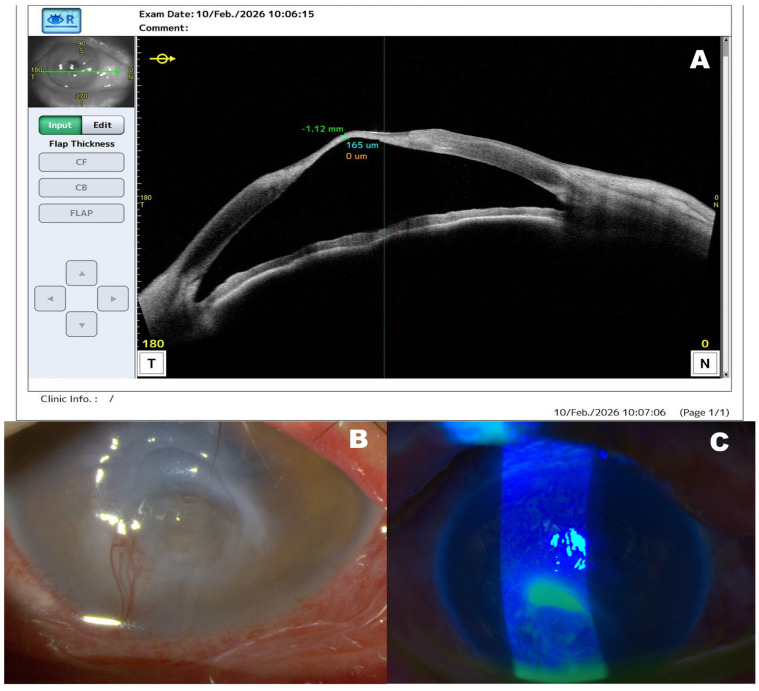
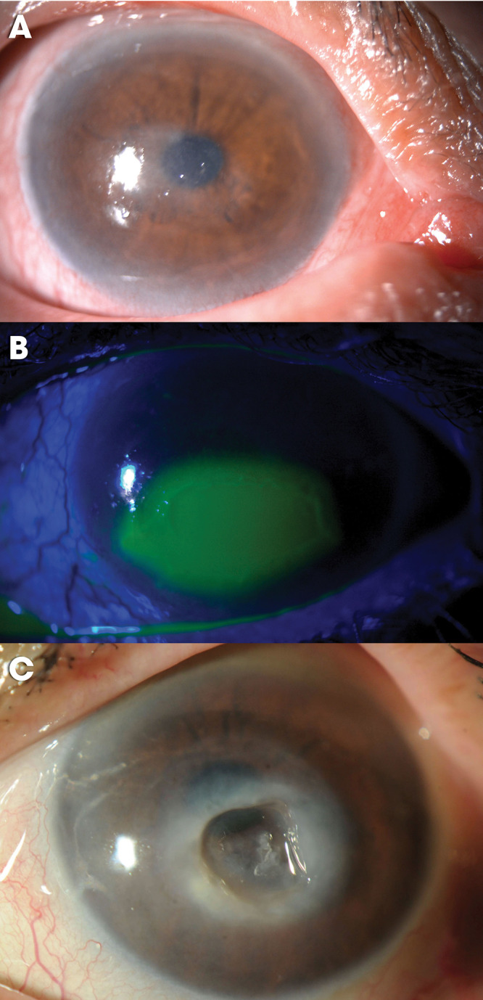
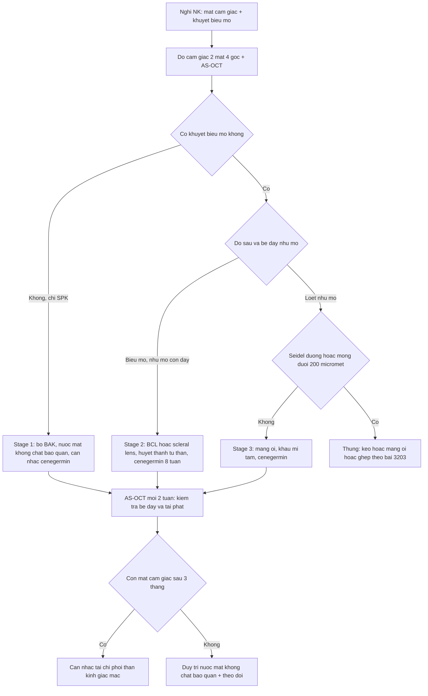
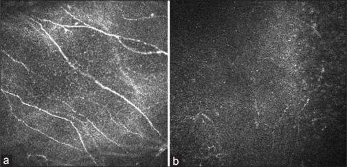
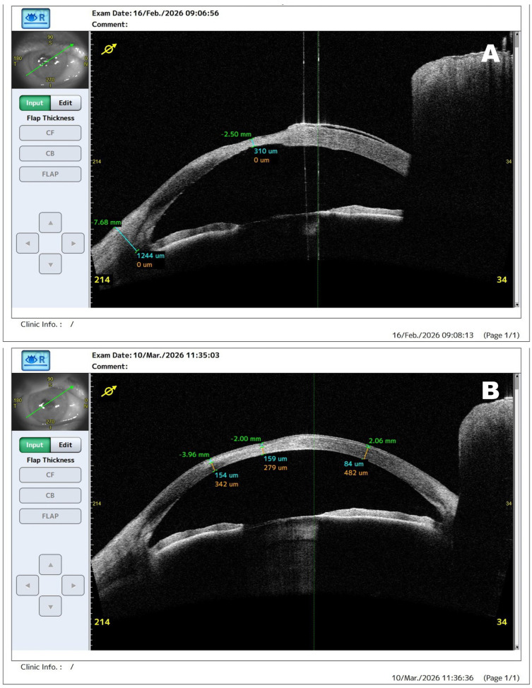
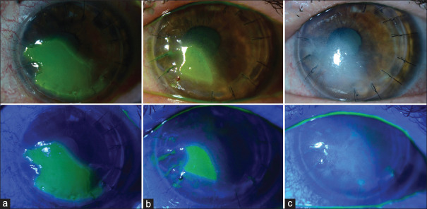

# 3204 — Loét giác mạc do thần kinh: mất cảm giác → loét "không đau" → cenegermin / Neurotrophic keratopathy — painless ulcer, Mackie & NKSG staging, rhNGF

**Tags:** `pattern:loet-than-kinh` `pattern:khuyet-bieu-mo-dai-dang` `pattern:mat-cam-giac-giac-mac` `pattern:mo-giac-mac` `vung:mat` `vung:giac-mac` `vung:bieu-mo-giac-mac` `protocol:AS-OCT` `protocol:IVCM` `protocol:den-khe` `protocol:esthesiometry` `protocol:nhuom-fluorescein` `anatomy:than-kinh-giac-mac` `score:Mackie` `score:NKSG`

**Mức chắc chắn (certainty):** tổng hợp y văn (literature synthesis) — nhóm tự biên, **không có bệnh nhân của mình**. Số liệu chính:
**tổng quan chẩn đoán – điều trị NK** (Indian J Ophthalmol 2025, **PMC12097415**); **thử nghiệm phase IV cenegermin ở Trung Quốc, 28 bệnh nhân** (Ophthalmol Ther 2025, **PMC12579034**); **đoàn hệ 94 mắt NK tại Ả Rập Xê Út** (Clin Ophthalmol 2025, **PMC12535708**); **ca NK – phơi nhiễm hỗn hợp + AS-OCT, 61 tuổi** (Diagnostics 2026, **PMC13114379**); **cenegermin sau ghép xuyên, 14 mắt** (Oman J Ophthalmol 2025, **PMC12258841**); **THINK: 31 bệnh nhân khô mắt trước phaco** (Clin Ophthalmol 2024, **PMC11630729**); **tỷ lệ mắc NK 5,67/10.000** (Int Ophthalmol 2023, **PMC10400685**); **so sánh esthesiometer không tiếp xúc với bông (139 mắt)** (Ophthalmol Ther 2026, **PMC12882924**); **phân tích gộp phẫu thuật tái chi phối thần kinh, 191 bệnh nhân/14 nghiên cứu** (Eur J Med Res 2025, **PMC12345085**); **tiêu chuẩn chọn bệnh tái chi phối thần kinh, 36 nghiên cứu/380 bệnh nhân** (Clin Ophthalmol 2026, **PMC13501355**); **chi phí–hiệu quả cenegermin vs phẫu thuật** (Clinicoecon Outcomes Res 2026, **PMC13682333**); **NK ở trẻ em** (Eye 2026, **PMC13062077**). Ảnh: **PMC12535708**, **PMC12258841**, **PMC13114379**, **PMC12097415**.

> **Câu chốt:** NK là bệnh của **THẦN KINH**, không phải bệnh của **nước mắt**. Ba câu hỏi của mọi ca: **(1) cảm giác còn bao nhiêu — đo, không đoán? (2) biểu mô/nhu mô còn bao nhiêu — AS-OCT tính bằng µm? (3) còn gì đang phá thêm — nhiễm, phơi nhiễm, thuốc độc, corticoid?** Sai lầm hay gặp nhất không phải là "không biết cenegermin", mà là **gọi loét do thần kinh là "khô mắt" rồi nhỏ nước mắt nhân tạo nhiều năm cho tới khi thủng** — vì bệnh nhân **không đau nên không phàn nàn**, và mắt vẫn **không đỏ**.

## 1. Tổng quan bệnh học – cơ chế hình ảnh (TẠI SAO)

### 1.1 Ngưỡng định lượng (số phải nhớ)

- **Tần suất:** **tỷ lệ mắc ≤ 5/10.000** dân số (Indian J Ophthalmol 2025, **PMC12097415**); **tỷ lệ hiện mắc 0,8–5,67/10.000** (Ophthalmol Ther 2025, **PMC12579034**); đoàn hệ Mexico **42/74.056 khám = 5,67/10.000** (KTC 95% 3,95–7,38), tuổi trung bình **59 ± 17,2**, **đái tháo đường type 2 40,5%**, **90% có tiền sử dùng thuốc nhỏ mắt** (Int Ophthalmol 2023, **PMC10400685**). Con số này **thấp hơn thực tế** vì chỉ tính ca được chẩn đoán.
- **Nguyên nhân hàng đầu: herpes** — **HSV → NK 6–27%**, **VZV ~25%** (PMC12097415). Sau đó: **phẫu thuật thần kinh** (u dây VIII, giải ép thần kinh V), **phẫu thuật mắt** (phaco, PKP, LASIK/PRK, laser quang đông), **đái tháo đường**, **thuốc nhỏ có benzalkonium chloride (BAK)**, **kính tiếp xúc**, **chấn thương/hóa chất**, **bẩm sinh** (Riley–Day, HSAN).
- **Giai đoạn lúc vào viện (94 mắt):** **stage 1: 6%**, **stage 2: 74%**, **stage 3: 20%**; **herpes zoster 22,5%** (nhiều hơn **HSV 2,5%**), **liệt thần kinh V 30%**, **do y tế 15%**; can thiệp đã dùng: **màng ối 45,7%**, **khâu mi 36,2%**, **dán keo 17%**; thị lực cuối **1,5 logMAR**, **suy giảm thị lực nặng 78,2% lúc vào → 38,2% sau điều trị** (Clin Ophthalmol 2025, **PMC12535708**).
- **"Khô mắt" là cửa vào của NK:** ở **31 bệnh nhân khô mắt tới khám phaco**, esthesiometry trung bình **40 ± 9,5 mm** (13–55), **18/31 = 58% có ≤ 40 mm** (ngưỡng NK stage 1 trong nghiên cứu); nhóm giảm cảm giác còn có **quang sai bậc cao 0,83 ± 0,22 µm** so với **0,67 ± 0,16 µm** (p = 0,028) (Clin Ophthalmol 2024, **PMC11630729**).
- **Cảm giác hồi phục theo thời gian — nhưng không hoàn toàn:** sau **phẫu thuật phaco 4–8 tháng**, sau **phẫu thuật khúc xạ 1–2 năm**; sau **ghép xuyên (PKP) mật độ sợi thần kinh còn bất thường sau nhiều thập kỷ** (PMC12097415).
- **Cenegermin (rhNGF 0,002% = 20 µg/mL):** **6 lần/ngày cách 2 giờ × 8 tuần**. Kết quả có đối chứng: **74,0% lành (20 µg/mL) vs 43,1% giả dược** sau 8 tuần, tái phát **3,4% vs 4,8%** trong 48 tuần (REPARO, dẫn trong **PMC12579034**); **69,6% vs 29,2%** ở thử nghiệm then chốt tại Mỹ (NGF0214, dẫn trong **PMC13307389** và **PMC12579034**). Thực tế: **84,6% (22/26) lành ở tuần 8**, **53,6% lành ngay từ tuần 2**, **trung vị 15,5 ngày**, tái phát **13,6% (3/22) ở trung vị 126 ngày**, cảm giác **2,72 → 3,98 cm** (+1,45 cm; **73,1% cải thiện**), thị lực **+25,4 chữ ETDRS** (Ophthalmol Ther 2025, **PMC12579034**).
- **Kết quả kém hơn trên mắt đã ghép xuyên:** **14 mắt**, NK stage **1,6 ± 0,5 → 1,1 ± 0,7** (tuần 4) và **0,9 ± 0,7** (tuần 8); **lành hoàn toàn chỉ 42,9%** (1 tháng) và **38,5%** (6 tháng) sau khi kết thúc; diện khuyết **37,24 mm² → < 5 mm²**; **14,3% tiến triển**; **thị lực không cải thiện có ý nghĩa** (Oman J Ophthalmol 2025, **PMC12258841**).
- **Giai đoạn 1 cũng đáp ứng:** DEFENDO (37 bệnh nhân Mackie 1, cenegermin 20 µg/mL 6 lần/ngày × 8 tuần): **lành biểu mô 84,8%** (KTC 95% 68,1–94,9), **cảm giác cải thiện 91,2%** (dẫn trong **PMC13307389**).

### 1.2 TẠI SAO mất cảm giác lại làm thủng giác mạc

- **Giác mạc là mô được chi phối thần kinh dày nhất cơ thể:** mật độ **gấp 300–600 lần da**, khoảng **7.000 nociceptor/mm²** (PMC12097415, **PMC12882924**). Sợi cảm giác đi từ hạch sinh ba (V1) → nhu mô → **đám rối thần kinh dưới đáy (sub-basal nerve plexus, SBNP)** nằm ngay dưới biểu mô đáy.
- **Vòng dinh dưỡng hai chiều (trophic loop):** đầu tận thần kinh tiết **substance P, CGRP, BDNF** → kích thích **biểu mô tăng sinh và di chuyển**; ngược lại biểu mô tiết **NGF, EGF, IGF** → nuôi sợi thần kinh; **NGF còn kích thích tế bào gốc rìa**. Mất thần kinh = **cắt đứt vòng này ở cả hai chiều** → biểu mô không lành dù nước mắt bình thường.
- **Bốn hậu quả nối tiếp:** **(1)** mất phản xạ chớp và giảm tiết nước mắt phản xạ → khô + phơi nhiễm; **(2)** mất yếu tố dinh dưỡng → biểu mô không tăng sinh/di chuyển, khuyết **dai dẳng (persistent epithelial defect, PCED)**; **(3)** mất cảm giác đau → **bệnh nhân không biết mình đang mất mắt**, không đi khám, nên phần lớn vào viện đã **stage 2–3 (94%)**; **(4)** khi nhu mô lộ ra, **MMP/collagenase** tăng, **tan chảy (melting)** → thủng. Vì vậy **mất cảm giác là biến số trung tâm**, không phải "khô" hay "viêm".
- **Chi tiết dễ bỏ:** tổn thương **TRƯỚC hạch** (đột quỵ, mổ u thần kinh) **không làm giảm mật độ SBNP** — nên **IVCM bình thường không loại trừ NK**; ngược lại **phẫu thuật giác mạc** gây **thoái hóa Wallerian tại chỗ** → vùng mất cảm giác **tương ứng đúng vùng mổ** (PMC12097415).
- **TẠI SAO ảnh trông như vậy (vật lý):**
  - **Đèn khe + fluorescein:** biểu mô mất → fluorescein (ưa nước) **thấm vào nhu mô** → vùng **xanh rực**; bờ khuyết ở NK **cuộn lên/dày** vì biểu mô quanh **tăng sản** — tán xạ mạnh ở bờ tạo **viền trắng nhô**, khác bờ "vát mỏng" của loét do nhiễm độc. **Gaule spots** (stage 1) là **đảo biểu mô khô, sừng hóa** — chấm trắng mất bóng trên nền giác mạc còn trong.
  - **AS-OCT (~1.300 nm):** đo **bề dày biểu mô** (trung tâm bình thường **~50 µm**) và **điểm nhu mô mỏng nhất**. Biểu mô mất → **mất lớp tăng phản xạ bề mặt**; phù nhu mô → **dày + tăng tán xạ**; **đáy loét phản xạ mạnh** hơn nhu mô lành vì mô xơ/viêm. Vì máy đọc theo **mặt phân cách có chênh chiết suất** (giác mạc n ≈ 1,376; không khí 1,0), **bề mặt ướt đều → đường cong liên tục**, còn **khuyết → mất liên tục + lõm**. Ca dưới đây: **165 µm** ở điểm mỏng nhất = **nguy cơ thủng cao** (giác mạc trung tâm bình thường ~540 µm).
  - **IVCM (laser 670 nm, phóng đại ×800):** thấy trực tiếp **SBNP**: bình thường là **sợi dài, song song, phân nhánh đều**; trong NK là **mất sợi, còn vài sợi gấp khúc, tăng độ xoắn, neuroma và "beading"**.

*Ca **hỗn hợp phơi nhiễm + thần kinh** trên bệnh nhân **dày sừng lá bẩm sinh (lamellar ichthyosis)** 61 tuổi, **hở mi do ectropion hai bên**: **(A)** AS-OCT lúc vào — nhu mô **mỏng còn ~165 µm** ở trung tâm (số đo trên máy), tức **nguy cơ thủng cao**; **(B)** đèn khe: **loét trung tâm lớn**, nhu mô quanh đục, **tân mạch nông** và biểu mô hóa không đều; **(C)** sau fluorescein dưới ánh sáng cobalt: **đọng thuốc đậm trong đáy ổ** = khuyết biểu mô sâu tới nhu mô. Cảm giác giác mạc (Cochet–Bonnet) **giảm rõ ở cả hai mắt** — thành phần thần kinh nằm dưới thành phần phơi nhiễm. Nguồn: *Diagnostics (Basel)* 2026, Fig. 2, **PMC13114379** — CC BY 4.0.*

## 2. Mẫu hình + chẩn đoán phân biệt theo vị trí (gamut)

### 2.1 Ba mẫu hình lâm sàng (thay đổi cách xử trí)

- **Mẫu hình "chỉ mất cảm giác" (stage 1):** mắt **không đỏ**, bệnh nhân **không phàn nàn**, chỉ có **chấm sáng Gaule**, **bề mặt không đều**; **chẩn đoán chỉ đặt ra nếu ta đo cảm giác**. Đây là giai đoạn **chữa được rẻ nhất** (bỏ thuốc có BAK + nước mắt nhân tạo không chất bảo quản), và là lý do **phải đo cảm giác ở mọi bệnh nhân khô mắt mạn/loét tái phát**.
- **Mẫu hình khuyết biểu mô dai dẳng (stage 2):** **PCED bờ cuộn**, đáy sạch, **không mủ**, **giác mạc quanh còn trong**, ± **nếp gấp Descemet**, ± phù nhu mô; **hiếm khi có phản ứng tiền phòng**.
- **Mẫu hình loét nhu mô (stage 3):** loét **đáy trắng/xám**, bờ dày, **nhu mô mỏng dần**, có thể **thủng + mống mắt sa**. Trên AS-OCT: **mất biểu mô + mỏng nhu mô ± mất liên tục Descemet**.

### 2.2 Gamut theo vị trí — vị trí nói lên nguyên nhân

- **Trên / trung tâm:** vị trí **kinh điển** của PCED do thần kinh (y văn mô tả "thường ở nửa trên") — sau **HSV/VZV**, sau **mổ**, sau **liệt V**.
- **Dưới (1/3 dưới):** **không điển hình cho NK thuần** — nghĩ **phơi nhiễm/hở mi/ectropion**, **bệnh mắt hột**, **liệt VII**, hoặc **hỗn hợp** như ca dày sừng lá ở mục 1. Vị trí **dưới + mất cảm giác** = phải xử lý **cả hai** (mi + thần kinh), chỉ nhỏ thuốc là thất bại.
- **Ngoại vi/rìa (limbus):** nếu kèm **thiếu tế bào gốc rìa** (mờ đục hình chữ V, mạch máu bò vào) → **loét do thiếu tế bào gốc**, không phải NK thuần; nếu bờ **lõm kiểu khoét + mắt ít viêm nhưng dai dẳng** → **tan chảy miễn dịch (PUK)**.
- **Nhiều ổ rải rác/đối xứng:** nghĩ **độc chất (BAK, thuốc nhỏ)**, **kính tiếp xúc**, **lạm dụng thuốc tê**, hơn là NK đơn thuần.

### 2.3 Gamut theo nguyên nhân (dùng khi hỏi bệnh)

- **Sau herpes** (hay nhất): hỏi **đợt đau/loét trước đó**, sẹo dạng **đuôi gai cũ**, **teo mống mắt từng vùng**.
- **Sau mổ:** phaco (mất cảm giác 4–8 tháng), **PKP (có thể vĩnh viễn)**, **LASIK/PRK**, **laser quang đông toàn võng mạc** (tổn thương thần kinh mi dài).
- **Thần kinh:** u dây VIII, **mổ giải ép thần kinh V**, chấn thương sọ mặt; kèm **liệt VII** → hở mi (NK + phơi nhiễm).
- **Toàn thân:** **đái tháo đường** (bệnh thần kinh giác mạc là phần của bệnh thần kinh ngoại biên), **xơ cứng rải rác**, **Sjögren**, **amyloid**.
- **Thuốc/độc:** **BAK** trong thuốc glôcôm (đặc biệt **chẹn beta**), kháng sinh/kháng viêm kéo dài, **thuốc tê tại chỗ** (gây NK giả do độc), hóa trị, thuốc chống loạn thần/kháng histamine (khô).
- **Bẩm sinh:** **Riley–Day** (loét ở tới **50%** bệnh nhân), **HSAN**, **hội chứng Gorlin/Möbius**; ở trẻ, **nhược thị** là hậu quả chính nên phải can thiệp sớm (Eye 2026, **PMC13062077**).

*Ba giai đoạn **Mackie** trên ba mắt khác nhau: **(A) stage 1** — bề mặt có **đảo biểu mô khô (Gaule spots)**, giác mạc còn trong, **mắt gần như không viêm**; **(B) stage 2** — **khuyết biểu mô dai dẳng**, fluorescein bắt rõ, **bờ cuộn/nhẵn**, kèm **phù nhu mô**; **(C) stage 3** — **loét nhu mô đã thủng**, mống mắt dính vào ổ loét, nhu mô quanh trắng đục. Cùng một bệnh, ba mức độ can thiệp khác nhau hoàn toàn. Nguồn: *Clin Ophthalmol* 2025, Fig. 2, **PMC12535708** — CC BY-NC 4.0.*

## 3. Bảng so sánh phân biệt (ma trận đối chiếu)

| Thực thể (entity) | Hình ảnh điển hình | Chốt vào (rule-in) | Chốt loại (rule-out) | Gợi ý xác nhận |
|---|---|---|---|---|
| **NK stage 1 (chỉ mất cảm giác)** | Giác mạc trong, **chấm Gaule**, bề mặt không đều, **không đỏ**; AS-OCT: biểu mô **mỏng không đều** nhưng **liên tục** | **Cochet–Bonnet giảm (≤ 40 mm) hoặc NCE ≥ level 4 + bề mặt còn liên tục** | **Đau nhiều, chảy nước mắt, đỏ** → không phải NK đơn thuần | Đo **4 góc + mắt đối diện**; IVCM (mất SBNP); hỏi thuốc/BAK |
| **NK stage 2 (PCED bờ cuộn)** | Khuyết biểu mô **bờ dày/cuộn**, đáy sạch, **không mủ**, quanh còn trong; AS-OCT: **mất biểu mô, nhu mô còn dày** | **Khuyết dai dẳng > 14 ngày + mất cảm giác + không đau tương xứng** | **Bờ vát, thâm nhiễm xung quanh, cấy dương** → loét nhiễm | AS-OCT đo **bề dày biểu mô/nhu mô**; cạo bờ ổ cấy; đo cảm giác |
| **NK stage 3 (loét nhu mô/thủng)** | Loét **đáy trắng**, nhu mô mỏng, ± **mống mắt sa**, ± **Seidel dương**; AS-OCT: **mỏng < 200 µm hoặc mất liên tục** | **Mất cảm giác + mỏng nhu mô khu trú + mắt ít viêm** | **Thâm nhiễm đậm + mủ tiền phòng** → nhiễm hoạt động, xử trí như 3203 | AS-OCT điểm mỏng nhất; **không ấn nhãn cầu**; B-scan nếu không thấy đáy mắt |
| **Khô mắt nặng (DED)** | Nhuộm **hai bờ mi**, dải fluorescein **ngang mi dưới**, **TBUT < 10 s**, Schirmer < 10 mm/5 phút | **Cảm giác còn bình thường + nhuộm điển hình bờ mi** | **Mất cảm giác + khuyết tròn bờ cuộn** → NK, không phải DED thuần | Esthesiometry; nếu "DED nặng mà loét tròn" → **đo cảm giác ngay** |
| **Phơi nhiễm/hở mi (lagophthalmos)** | Loét **1/3 dưới**, **dải khuyết theo khe mi**, ectropion/liệt VII, **kính tiếp xúc ban đêm ướt** | **Loét ở vùng phơi nhiễm + hở mi khi nhắm** | **Loét trên/trung tâm + mi đóng kín** → nghĩ thần kinh | Đo **khe mi khi nhắm**, test Bell, soi mi; xử lý **mi trước** |
| **Loét nhiễm khuẩn/nấm** | Thâm nhiễm trắng đục bờ không rõ, **mủ tiền phòng**, phù nhu mô; AS-OCT bị **bóng che** | **Cấy/nhuộm dương + tiến triển nhanh vài ngày + đau nhiều** | **Không đau + đáy sạch + cấy âm** → nghiêng NK | Cạo bờ ổ cấy **trước** kháng sinh; PCR nấm/amip |
| **Tan chảy miễn dịch (PUK)** | Bờ ổ **khoét lõm**, nhu mô quanh mỏng đều, mắt **viêm nhẹ nhưng tiến triển** | **Bệnh miễn dịch toàn thân + tan chảy dù đã che phủ + cấy âm** | **Cảm giác mất hoàn toàn một vùng + tiền sử herpes** → NK | Xét nghiệm miễn dịch; **ức chế miễn dịch toàn thân là điều trị gốc** |
| **Thiếu tế bào gốc rìa (LSCD)** | Rìa **mất hàng rào Vogt**, kết mạc **mọc vào giác mạc** dạng màng mỏng, nhuộm **đậm ngoại vi** | **Mạch máu/kết mạc hóa từ rìa vào > 2 mm** | **Giác mạc trong + chỉ khuyết khu trú** → NK | Ấn kính/soi rìa; tế bào học ấn phiến |
| **Bệnh thần kinh giác mạc do thuốc tê/BAK** | Loét **lan rộng, bờ nhợt**, bệnh nhân **xin thuốc tê**, mắt **đỏ ít nhưng đau nhiều** | **Tiền sử dùng thuốc tê/giọt có BAK kéo dài + loét kháng trị** | **Ngừng thuốc là đỡ** → chẩn đoán xác nhận bằng đáp ứng | Rà **toa thuốc** từng giọt; đổi sang không chất bảo quản |
| **Loét do kính tiếp xúc** | Khuyết **trung tâm/trên**, ± thâm nhiễm, kèm **viêm kết mạc nhú** | **Đeo kính + khởi phát nhanh vài ngày + đau** | **Mất cảm giác + không đau** → NK (kính tiếp xúc có thể là **nguyên nhân** hoặc **điều trị**) | Nuôi cấy **vỏ kính + cạo giác mạc**; ngừng kính |

- **Nguyên tắc đọc ma trận:** **cảm giác** tách NK khỏi khô mắt/phơi nhiễm; **cấy + mức viêm** tách NK khỏi nhiễm; **bờ ổ + bệnh nền** tách NK khỏi PUK/LSCD. Nhưng **NK và các bệnh này thường chồng lấp** (herpes + khô + BAK + hở mi) → điều trị phải xử lý **cùng lúc** các thành phần.

## 4. Protocol chụp/khám + hệ phân độ và ngưỡng xử trí

### 4.1 Hai hệ phân độ cần biết

**Mackie (3 giai đoạn, dùng trong hầu hết thử nghiệm):**

| Giai đoạn | Định nghĩa | Điều trị tối thiểu |
|---|---|---|
| **1** | **Chấm sáng/tăng sản biểu mô (SPK, Gaule spots)**, chưa có khuyết | Bỏ thuốc có BAK, nước mắt nhân tạo **không chất bảo quản**, điều trị bệnh nền |
| **2** | **Khuyết biểu mô dai dẳng**, bờ **nhẵn/cuộn**, ± phù nhu mô, ± nếp Descemet | Băng che (BCL/scleral lens), huyết thanh tự thân, **cenegermin**, màng ối |
| **3** | **Loét nhu mô** → tan chảy → **thủng** | Màng ối/keo/ghép; **tái chi phối thần kinh** khi ổn định |

**NKSG 2023 (6 bước, tách "mờ nhu mô" thành một trục riêng — Ocul Surf 2023, PMID 37666470):** **1** mất cảm giác **chưa có tổn thương**; **2** bệnh biểu mô/SPK **không mờ nhu mô**; **3** khuyết biểu mô dai dẳng/tái phát **không mờ nhu mô**; **4** SPK hoặc khuyết biểu mô **có mờ nhu mô**; **5** khuyết biểu mô dai dẳng **có loét**; **6** **thủng giác mạc**. Giá trị thực dụng: **stage 1 chỉ phát hiện được nếu đo cảm giác**, và **mờ nhu mô (stage 4)** là mốc mà kết quả thị lực bắt đầu xấu đi vĩnh viễn.

### 4.2 Bảy bước khám (theo thứ tự, đừng đảo)

1. **Hỏi bệnh có định hướng:** đợt herpes trước, **mổ mắt/mổ thần kinh**, đái tháo đường, **danh sách từng giọt thuốc** (tên + có BAK?), kính tiếp xúc, hở mi/liệt mặt.
2. **Đèn khe + fluorescein 1–2% + lissamine green:** vị trí, **đường kính lớn nhất (mm)**, bờ (cuộn/vát), đáy (sạch/mủ), **mức mờ nhu mô**, tân mạch, **Seidel** nếu nghi thủng.
3. **Đo cảm giác — bắt buộc, cả hai mắt, 4 góc:** **Cochet–Bonnet** bắt đầu ở **60 mm**, giảm **5 mm** mỗi bước tới khi bệnh nhân cảm nhận; **bình thường cảm nhận ở 60 mm**; **≤ 40 mm** được dùng làm ngưỡng "giảm cảm giác" (THINK, **PMC11630729**) và là **tiêu chuẩn vào thử nghiệm cenegermin (≤ 4 cm)** (**PMC12579034**). **Bông (cotton wisp) chỉ để sàng lọc:** so với esthesiometer không tiếp xúc (chuẩn level ≥ 4), bông có **độ nhạy 98,2% nhưng độ đặc hiệu chỉ 30,8%** — **dương tính không loại trừ được giảm cảm giác** (Ophthalmol Ther 2026, **PMC12882924**).
4. **AS-OCT:** **bề dày biểu mô** (mất/thinning), **điểm nhu mô mỏng nhất (µm)**, độ sâu khuyết, phù nhu mô, nếp Descemet. Ghi **số** để so giữa các lần — đây là thước đo chính của đáp ứng điều trị.
5. **IVCM (nếu có):** mật độ SBNP, độ xoắn, neuroma; dùng để **theo dõi tái chi phối** và giải thích triệu chứng. Nhớ: **tổn thương trước hạch vẫn có SBNP**.
6. **Loại trừ nhiễm:** **cạo bờ ổ (không cạo đáy)** nhuộm Gram/Giemsa + cấy, PCR nấm/amip khi nghi — **trước** khi dùng corticoid hoặc bắt đầu cenegermin (nhãn thuốc **chống chỉ định khi nhiễm hoạt động**).
7. **Đánh giá mi + hậu đoạn:** khe mi khi nhắm, ectropion/entropion, lông xiêu, **liệt VII**; **siêu âm B** khi không thấy đáy mắt (loại trừ bong võng mạc/viêm nội nhãn trước khi can thiệp).

### 4.3 Thang điều trị theo giai đoạn (có số)

| Giai đoạn / tình huống | Điều trị ưu tiên | Bằng chứng / ngưỡng |
|---|---|---|
| **Stage 1** | Bỏ **BAK**/thuốc độc, nước mắt nhân tạo **không chất bảo quản**, điều trị bệnh nền, **cenegermin** (cân nhắc) | DEFENDO: lành **84,8%**, cảm giác cải thiện **91,2%** (37 ca) |
| **Stage 2 — bề mặt còn nuôi được** | **BCL/scleral lens** + huyết thanh tự thân **20–100%** ± **cenegermin** | Scleral lens: **100% biểu mô hóa** (17 mắt, 1 ngày–4 tuần); **83%** (18 mắt) |
| **Stage 2/3 — khuyết khó lành** | **Cenegermin 20 µg/mL, 6 lần/ngày × 8 tuần** | **74,0% vs 43,1%** (REPARO); **69,6% vs 29,2%** (NGF0214); thực tế **84,6%**, trung vị **15,5 ngày** |
| **Stage 2/3 — không có/không dung nạp cenegermin** | **Huyết thanh tự thân** hoặc **insulin 1–25 U/mL × 4 lần/ngày** | ASE: lành **100%** (14 mắt, **17,1 ± 8,0 ngày**); insulin: **90%** lành (**18 ± 9 ngày** stage 2, **29 ± 11 ngày** stage 3) |
| **Stage 3 — loét sâu/nguy cơ thủng** | **Màng ối (AMT)**, **keo** nếu thủng ≤ 3 mm, **khâu mi tạm**, scleral lens | AMT **70%** thành công chung, **93,3%** ở nhóm loét thần kinh; khâu mi **90%** biểu mô hóa |
| **Thất bại điều trị nội khoa, còn tiềm năng thị lực** | **Tái chi phối thần kinh giác mạc (corneal neurotization)** | 36 nghiên cứu/**380 bệnh nhân**; cảm giác trở lại ở **~80%** bắt đầu **5–6 tháng**; **ICN > DCN** về cảm giác trung tâm (p < 0,01) |
| **Thủng thực sự** | Xử trí như bài **3203** (keo/màng ối/nút Tenon/ghép) | — |

**Chi tiết cenegermin (dùng đúng mới có kết quả):**
- **Liều:** **20 µg/mL (0,002%)**, **1 giọt × 6 lần/ngày, cách 2 giờ**, **8 tuần**. Trong thử nghiệm, cenegermin là **thuốc nhỏ DUY NHẤT** được phép trong 8 tuần — không phối hợp corticoid/kháng sinh "cho chắc".
- **Không hấp thu toàn thân** (nồng độ NGF huyết thanh không đổi) — an toàn cho hệ thống (**PMC12579034**).
- **Tác dụng phụ hay gặp:** **đau mắt 17,9–28,6%**, cộm, châm chích (do cảm nhận nociceptor), thường **nhẹ và trong thời gian điều trị**.
- **Kết quả khiêm tốn hơn ở mắt đã ghép xuyên:** lành hoàn toàn **~40%** dù stage cải thiện, **thị lực không đổi** (**PMC12258841**) — đừng hứa "sáng mắt".
- **Kinh tế:** mô hình 5 năm: **phẫu thuật tái chi phối thần kinh 36.866 USD/3,66 QALY** vs **cenegermin 161.926 USD/3,32 QALY**; phối hợp **137.048 USD/3,82 QALY** (Clinicoecon Outcomes Res 2026, **PMC13682333**). NICE từng **không khuyến cáo** cenegermin vì mô hình kinh tế chưa đủ chắc (dẫn trong **PMC12097415**).

### 4.4 Cây quyết định

### 4.5 Theo dõi (có mốc)

- **Trong 8 tuần điều trị:** khám **tuần 2, 4, 6, 8**; **AS-OCT mỗi lần** (bề dày biểu mô + điểm mỏng nhất) — trong thử nghiệm, **53,6% lành ngay tuần 2** nên **không đổi phác đồ ở tuần 2 nếu chưa lành** (**PMC12579034**).
- **Sau khi lành:** **tháng 3, 6, 12** rồi mỗi 6–12 tháng; **tái phát 13,6%, trung vị 126 ngày** (112–169) — tức **cửa sổ nguy cơ cao là 4–6 tháng đầu**; dặn bệnh nhân **tự khám ngay nếu mờ đi** dù **không đau**.
- **Theo dõi thần kinh:** IVCM/esthesiometry lại ở **3 và 6 tháng**; cảm giác có thể **cải thiện chậm hơn** so với biểu mô (trong thử nghiệm: **+1,45 cm ở tuần 8**, **+1,59 cm ở tuần 56**).

*IVCM đám rối thần kinh dưới đáy (sub-basal nerve plexus): **(a)** giác mạc bình thường — **sợi thần kinh dài, thẳng, phân nhánh đều**, mật độ dày; **(b)** NK sau nhiễm **HSV** — **mất gần như toàn bộ sợi**, chỉ còn vài sợi **mảnh, gấp khúc, phản xạ yếu** và nền tăng tán xạ. Đây là bằng chứng **tổn thương thần kinh tại chỗ**, độc lập với tình trạng nước mắt — và là thăm khám giải thích vì sao "khô mắt điều trị mãi không lành". Nguồn: *Indian J Ophthalmol* 2025, Fig. 4, **PMC12097415** — CC BY-NC-SA 4.0.*

## 5. Biến thể bình thường và cạm bẫy

- **Cạm bẫy số 1 — "khô mắt" nuốt mất NK:** bệnh nhân **khô mắt + loét tròn bờ cuộn không đau** phải được **đo cảm giác**, không chỉ tăng nước mắt nhân tạo. **58%** bệnh nhân khô mắt trước phaco có **esthesiometry ≤ 40 mm** (**PMC11630729**) — nghĩa là NK **stage 1 nằm rải rác trong phòng khám khô mắt**.
- **Bông (cotton wisp) không đủ để loại trừ:** **độ đặc hiệu 30,8%** — bệnh nhân "còn cảm giác với bông" vẫn có thể **mất cảm giác định lượng** (**PMC12882924**). Dùng **Cochet–Bonnet** hoặc **esthesiometer không tiếp xúc (level 1–6)** trước khi kết luận.
- **Corticoid:** không có chỉ định rõ (viêm miễn dịch) thì **corticoid làm chậm biểu mô hóa và tăng tan chảy**; trong loạt dán keo, **dùng corticoid trước khi dán → thị lực cuối xấu hơn (OR 3,84, KTC 1,06–14,7)** (Medicina 2025, **PMC11943718**, xem bài 3203). **Không dùng corticoid "cho đỡ đỏ"** trên mắt NK.
- **Thuốc tê và BAK:** nhỏ thuốc tê để "đỡ đau" là **đường tự hủy giác mạc**; thuốc glôcôm có **BAK** kéo dài gây độc thần kinh giác mạc — **đổi sang công thức không chất bảo quản** là điều trị, không phải "tối ưu hóa".
- **Cenegermin không phải "chữa khỏi":** **tái phát 13,6%** (trung vị **126 ngày**), thử nghiệm then chốt **KHÔNG đạt tiêu chí cải thiện cảm giác** dù lành biểu mô (REPARO/NGF0214, dẫn trong **PMC12097415**); trên mắt **đã PKP** lành hoàn toàn chỉ **~40%** và **thị lực không cải thiện**. Vì vậy **phải duy trì** nước mắt không chất bảo quản + theo dõi, và **không hứa hết bệnh**.
- **Không loại trừ nhiễm trước khi dùng cenegermin/corticoid:** nhãn thuốc chống chỉ định **nhiễm hoạt động**; loét NK **bội nhiễm** là bẫy chết người (cấy bờ ổ trước).
- **Hỗn hợp phơi nhiễm + thần kinh:** ca dày sừng lá (**PMC13114379**) cho thấy **chỉ nhỏ thuốc mà không sửa mi (ectropion) thì không ổn định** — đường nhu mô **165 → 310 → 438 µm** nhờ **phối hợp** (nước mắt, huyết thanh, insulin, doxycycline chống MMP) **và** kế hoạch **mổ mi**. Luôn hỏi: *có gì ngoài thần kinh đang phá bề mặt?*
- **AS-OCT: đo ở đâu?** Điểm **mỏng nhất** của nhu mô và **bề dày biểu mô trung tâm**; **không đo qua kính tiếp xúc**, không đo qua vùng đọng fluorescein đậm (tán xạ), ghi **cùng vị trí** các lần để so sánh.
- **Trẻ em:** NK bẩm sinh có thể biểu hiện **"mắt bình thường nhưng mất cảm giác"** — nhóm tác giả đề xuất **bổ sung một bậc vào phân loại** cho kiểu hình này; hậu quả chính là **nhược thị**, nên **đo cảm giác dưới mê** khi cần và can thiệp sớm (Eye 2026, **PMC13062077**).
- **Đừng bỏ "satisfaction of search":** mắt NK thường kèm **hở mi, lông xiêu, khô do thuốc, đái tháo đường** — kiểm tra **mi, kết mạc, toa thuốc** mỗi lần khám, không chỉ nhìn ổ loét.

*Cùng mắt trong ảnh mục 1, **theo dõi bằng AS-OCT**: **(A)** ngày 6 sau khi bắt đầu điều trị bảo tồn tích cực — nhu mô tăng lên **~310 µm** tại vị trí trước đó mỏng nhất; **(B)** sau 1 tháng — **~438 µm**, bề mặt **liền lại**, khuyết biểu mô đóng; thị lực từ **đếm ngón tay → 0,2 Snellen (0,7 logMAR)**. Bài học: **thay đổi tính bằng µm trên AS-OCT** mới là bằng chứng đáp ứng, không phải "trông đỡ đỏ hơn". Nguồn: *Diagnostics (Basel)* 2026, Fig. 3, **PMC13114379** — CC BY 4.0.*

## 6. Tự lượng giá — Blind Quiz

**Ca 1 — Nam 62 tuổi, "khô mắt" 3 năm, nhỏ nước mắt nhân tạo mỗi ngày; mắt không đỏ, không đau, chỉ mờ dần. Khám thấy bề mặt không đều.**

- Câu hỏi: (1) Ảnh **A** thuộc giai đoạn nào và dấu hiệu chốt là gì? (2) Vì sao bệnh nhân **không đau** dù bề mặt tổn thương? (3) Một thăm khám **bắt buộc** phải làm trước khi kết luận "khô mắt"?

<b>Bấm để hiện đáp án (findings + chẩn đoán)</b>

- **Findings:** **(A)** các **đảo biểu mô khô, sừng hóa (Gaule spots)** rải rác trên giác mạc còn trong, **không có khuyết biểu mô thực sự** = **Mackie stage 1**; **(B)** khuyết biểu mô **bờ nhẵn/cuộn**, fluorescein bắt rõ, phù nhu mô = **stage 2**; **(C)** **loét thủng** có mống mắt dính = **stage 3**.
- **Vì sao không đau:** mất **nociceptor** ở đám rối dưới đáy → không có tín hiệu đau; đồng thời mất phản xạ chớp/tiết nước mắt → bề mặt xấu đi **âm thầm**.
- **Thăm khám bắt buộc:** **đo cảm giác giác mạc** (Cochet–Bonnet 60 → giảm 5 mm; hoặc esthesiometer không tiếp xúc) ở **cả hai mắt, 4 góc** — vì "khô mắt" + bề mặt không đều + **không đau** chính là chân dung NK stage 1.
- **Nguồn ảnh:** *Clin Ophthalmol* 2025, Fig. 2, **PMC12535708** — CC BY-NC 4.0.

**Ca 2 — Nữ 55 tuổi, đã ghép xuyên (PKP) 6 tháng, nay khuyết biểu mô dai dẳng không đau; được chỉ định cenegermin.**

- Câu hỏi: (1) Mô tả diễn tiến khuyết biểu mô qua 3 mốc? (2) Vì sao mắt **đã PKP** đáp ứng kém hơn mắt nguyên vẹn? (3) Hai điều phải nói trước khi bắt đầu thuốc?

<b>Bấm để hiện đáp án</b>

- **Findings:** khuyết biểu mô lớn ở **trục quang** (a) → **thu nhỏ rõ** sau **4 tuần** (b) → **gần kín** sau **8 tuần** (c), nhu mô quanh còn đục nhẹ; chỉ khâu ghép còn tại chỗ.
- **Vì sao kém hơn:** mảnh ghép **không có thần kinh** và **PKP cắt thêm sợi thần kinh quanh miệng ghép** → vòng dinh dưỡng không tái lập; trong loạt 14 mắt, **lành hoàn toàn chỉ 42,9%** (1 tháng) và **38,5%** (6 tháng), **thị lực không cải thiện có ý nghĩa**, **14,3% tiến triển**.
- **Phải nói trước:** (1) **6 lần/ngày cách 2 giờ × 8 tuần** và trong thời gian đó **chỉ dùng thuốc này** (không phối hợp corticoid/kháng sinh); (2) **mục tiêu là đóng biểu mô, không hứa tăng thị lực**, và **có thể tái phát** (13,6% ở trung vị 126 ngày) → vẫn phải duy trì nước mắt không chất bảo quản và theo dõi AS-OCT.
- **Nguồn ảnh:** *Oman J Ophthalmol* 2025, Fig. 1, **PMC12258841** — CC BY-NC-SA 4.0.

**Ca 3 — Nam 61 tuổi, dày sừng lá bẩm sinh, hở mi hai bên, thị lực đếm ngón tay; loét trung tâm, không mủ, không phản ứng tiền phòng.**

- Câu hỏi: (1) Vì sao **không mổ ghép ngay**? (2) Ba thành phần điều trị bảo tồn trong ca này? (3) Con số nào trên AS-OCT cho biết đã "qua cơn nguy hiểm"?

<b>Bấm để hiện đáp án</b>

- **Findings:** AS-OCT lúc vào **165 µm** (ảnh mục 1); ngày 6 **~310 µm**; 1 tháng **~438 µm**, bề mặt liền; đèn khe: loét trung tâm lớn + tân mạch nông, **không mủ**.
- **Vì sao không ghép ngay:** bề mặt **không nuôi được mảnh ghép** (hở mi + mất cảm giác) → ghép dễ **tan/thải**; ưu tiên **ổn định bề mặt** rồi mới tính ghép/mổ mi.
- **Ba thành phần:** **nước mắt nhân tạo không chất bảo quản + huyết thanh tự thân + insulin tại chỗ**, kèm **doxycycline toàn thân (ức chế MMP)** và kháng sinh dự phòng; **sửa ectropion** là bước quyết định về sau.
- **Con số chốt:** **bề dày nhu mô tăng từ 165 → 438 µm** cùng **biểu mô liền lại**; thị lực **đếm ngón tay → 0,2 Snellen**.
- **Nguồn ảnh:** *Diagnostics (Basel)* 2026, Fig. 3, **PMC13114379** — CC BY 4.0.

## Bài liên quan chéo
- [400 – Tổng quan Mắt & thị giác](../400-tong-quan-mat-thi-giac/lesson.md)
- [3203 – Đe dọa thủng & thủng giác mạc: keo, màng ối, nút Tenon hay ghép xuyên](../3203-de-doa-thung-giac-mac/lesson.md) (bước tiếp theo khi NK đã thủng)
- [3201 – Sẹo giác mạc sau loét đã lành: chọn ghép theo độ sâu](../3201-seo-giac-mac-ghep/lesson.md) (phục hồi thị lực sau khi bề mặt ổn định)
- [3200 – Viêm giác mạc do *Pythium insidiosum*](../3200-viem-giac-mac-pythium/lesson.md) (loét tiến triển nhanh, dễ nhầm là "loét thần kinh")
- [3202 – Viêm giác mạc do microsporidia](../3202-viem-giac-mac-do-microsporidia/lesson.md) (loét dai dẳng, cấy âm)
- [6132 – Viêm giác mạc nhiễm khuẩn liên quan kính tiếp xúc](../6132-viem-giac-mac-kinh-tiep-xuc/lesson.md)
- [1456 – Bỏng hóa chất mắt cấp](../1456-bong-hoa-chat-mat/lesson.md) (mất cảm giác + thiếu tế bào gốc rìa)
- [1470 – Khô mắt do xạ ở trẻ](../1470-kho-mat-do-xa-o-tre/lesson.md) (khô nặng — phải đo cảm giác để tách NK)
- [1472 – Viêm giác mạc do Acanthamoeba](../1472-viem-giac-mac-acanthamoeba/lesson.md) (đau nhiều hơn tổn thương — ngược với NK)

## Ảnh
- `3204_loet-giac-mac-than-kinh_AS-OCT_PMC13114379.jpg` — AS-OCT + đèn khe ca NK hỗn hợp, nhu mô 165 µm (CC BY 4.0).
- `3204_loet-giac-mac-than-kinh_AS-OCT-Serial_PMC13114379.jpg` — chuỗi AS-OCT 310 → 438 µm (CC BY 4.0).
- `3204_loet-giac-mac-than-kinh_SlitLamp-Mackie_PMC12535708.jpg` — ba giai đoạn Mackie 1–2–3 (CC BY-NC 4.0).
- `3204_loet-giac-mac-than-kinh_SlitLamp-Cenegermin_PMC12258841.jpg` — khuyết biểu mô trước/4 tuần/8 tuần cenegermin sau PKP (CC BY-NC-SA 4.0).
- `3204_loet-giac-mac-than-kinh_IVCM_PMC12097415.jpg` — IVCM đám rối dưới đáy: bình thường vs NK sau HSV (CC BY-NC-SA 4.0).
- Nguồn + giấy phép từng ảnh: `images/CREDITS.md`; link gốc: `sources.md`.

> Không dùng để chẩn đoán độc lập khi chưa có người hướng dẫn.
