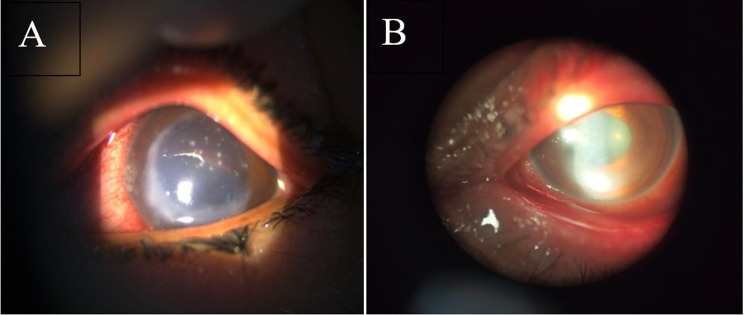
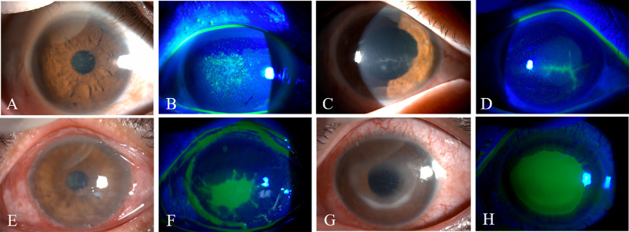
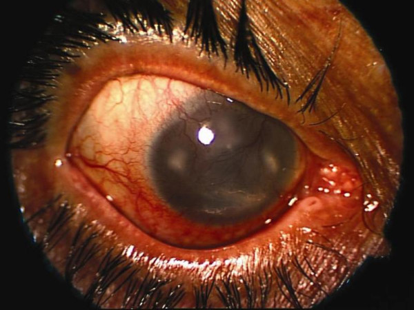
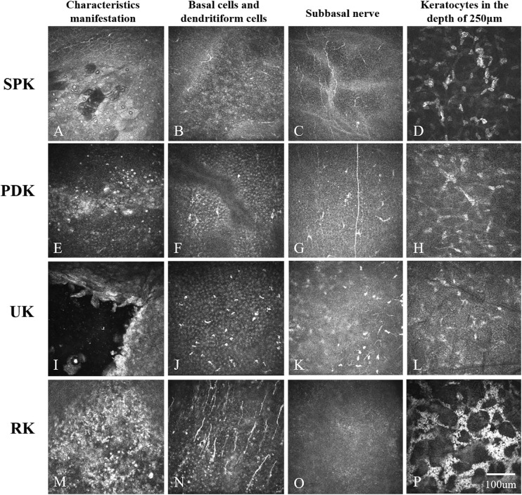
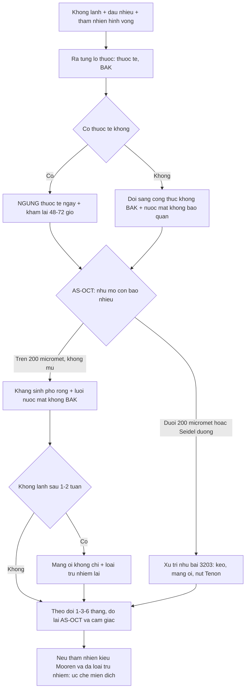
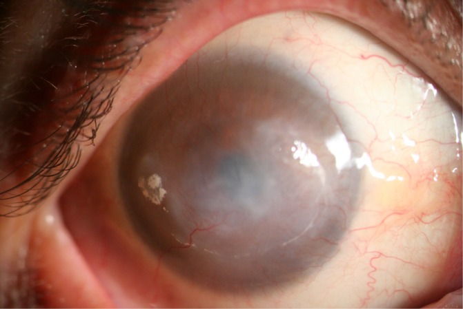

# 3205 — Loét giác mạc do lạm dụng thuốc tê & độc tính chất bảo quản (BAK) / Topical anesthetic abuse keratopathy & benzalkonium chloride toxicity

**Tags:** `pattern:loet-doc-chat` `pattern:tham-nhien-hinh-vong` `pattern:khuyet-bieu-mo-dai-dang` `pattern:mat-cam-giac-giac-mac` `pattern:tan-chay-giac-mac` `pattern:do-mo-giac-mac` `vung:mat` `vung:giac-mac` `vung:bieu-mo-giac-mac` `protocol:den-khe` `protocol:AS-OCT` `protocol:IVCM` `protocol:esthesiometry` `protocol:nhuom-fluorescein` `protocol:sieu-am-B` `anatomy:than-kinh-giac-mac`

**Mức chắc chắn (certainty):** tổng hợp y văn (literature synthesis) — nhóm tự biên, **không có bệnh nhân của mình**. Số liệu chính: **13 bệnh nhân/14 mắt lạm dụng thuốc tê tại Shiraz, Iran** (J Occup Med Toxicol 2025, **PMC12801944**); **54 mắt độc tính giác mạc + 20 mắt chứng, IVCM** (Transl Vis Sci Technol 2021, **PMC8431974**); **ca 65 tuổi hai mắt, màng ối không chỉ** (J Med Case Rep 2010, **PMC2924861**); **ca 42 tuổi loét kiểu Mooren hai mắt** (Clin Ophthalmol 2012, **PMC3484722**); **tổng quan Cochrane 9 thử nghiệm/556 người về thuốc tê ngoại trú** (Commun Med 2025, **PMC12460648**); **thí nghiệm tế bào biểu mô giác mạc người với BAK 0,00002–0,02%** (Transl Vis Sci Technol 2025, **PMC12629134**); **chuột BAK 0,01% × 2 lần/ngày × 3 tuần** (Transl Vis Sci Technol 2024, **PMC11498636**); **tổng quan bệnh bề mặt nhãn cầu ở bệnh nhân glôcôm châu Á** (Clin Ophthalmol 2026, **PMC13593577**). Ảnh: **PMC12801944**, **PMC8431974**, **PMC2924861**, **PMC3484722**.

> **Câu chốt:** đau nhiều mà **mắt đỏ ít**, khuyết biểu mô **không lành dù đã "điều trị đủ"**, và **thâm nhiễm nhu mô hình vòng** — bộ ba này không phải "viêm giác mạc nặng" mà là **thuốc đang phá giác mạc**. Cùng một nguyên lý với bài 3204 nhưng **ngược chiều triệu chứng**: loét thần kinh **không đau**, loét do thuốc tê **đau dữ dội** (vì thần kinh còn, chỉ bị kích thích) — và **mỗi lần nhỏ thêm để "đỡ đau" là thêm một lần tự hủy nhu mô**. Câu hỏi của mọi ca: **(1) trong toa có thuốc tê hay chất bảo quản BAK không? (2) cảm giác còn hay mất? (3) nhu mô còn bao nhiêu µm trên AS-OCT?**

## 1. Tổng quan bệnh học – cơ chế hình ảnh (TẠI SAO)

### 1.1 Ngưỡng định lượng (số phải nhớ)

- **Thuốc tê nhỏ mắt thường dùng:** **tetracaine 0,5%**, **proparacaine 0,5%**, **oxybuprocaine 0,4%** (PMC12801944). Trong loạt 14 mắt, **100% dùng tetracaine 0,5%**, **100% mua tại nhà thuốc không có đơn**, **thời gian lạm dụng trung vị 8,5 ngày (IQR 2)** — nghĩa là **chỉ hơn một tuần** đủ gây tổn thương nhu mô.
- **Nhân khẩu – nghề nghiệp:** **13 bệnh nhân/14 mắt**, tuổi trung bình **43,15 ± 7,14** (32–56), **92,3% nam**; **hàn 38,5%**, **mài kim loại 23,1%**, **xây dựng 15,4%**, **thợ ống nước 15,4%**; chấn thương mắt chiếm **3–4% tổng chấn thương lao động** (PMC12801944). Đây là **bệnh nghề nghiệp** trước khi là bệnh giác mạc.
- **Hình thái lúc vào:** **100% có thâm nhiễm nhu mô hình vòng (ring stromal infiltration)**; cấy dương **7/14 mắt (~50%)** — *S. aureus* 3, *S. epidermidis* 3, *S. pneumoniae* 1 (bài ghi "cấy âm 7 ca = 53,8%" ở mức bệnh nhân) (PMC12801944).
- **Hậu quả:** **4/13 nhập viện (30,8%)**; **1 thủng giác mạc (7,7%)** ở bệnh nhân có tiền sử tiêm chích ma túy, kém tuân thủ. Thị lực trung vị **0,61 → 0,154 logMAR** sau 3 tháng (p < 0,001); tỷ lệ mắt **≥ 5/10 tăng từ 2/14 lên 12/14** (PMC12801944) — tức **ngừng thuốc là điều trị hiệu quả nhất**, nhưng **không phải ca nào cũng hồi phục**.
- **Bốn kiểu hình độc tính giác mạc (54 mắt, phân theo đèn khe):** **chấm nông (SPK) 10 mắt**, **giả đuôi gai (pseudodendritic) 14**, **loét (ulcerative) 16**, **hình vòng (ring) 14**; chứng **20 mắt** (PMC8431974). Đây là **phân loại mô tả**, không phải thang phân độ đã xác nhận.
- **IVCM — vì sao "đèn khe trông nhẹ mà bệnh nặng":** so với chứng, mắt độc tính có **mật độ tế bào hình gai (dendritiform cell) 45,8 (25,0–100,0) vs 24,0 (20,8–32,3) tế bào/mm²** (p = 0,013), **kích thước tế bào gai 111,0 (92,0–137,8) vs 63,7 (47,7–70,3) µm²** (p < 0,001), **độ xoắn sợi thần kinh 0,08 (0,05–0,09) vs 0,04 (0,02–0,04)** (p < 0,001); **mật độ tế bào đáy và chiều dài sợi thần kinh giảm** (p < 0,001); **chiều dài sợi thần kinh có AUC 0,992 ± 0,008** — mạnh hơn mọi thông số khác (PMC8431974).
- **Nhuộm fluorescein KHÔNG tương quan với IVCM** (mọi p > 0,05) — mắt "chỉ trợt nhẹ" vẫn có thể **mất sợi thần kinh + viêm tế bào gai lan rộng** (PMC8431974). Ngược lại, **mức tăng tế bào gai tương quan thuận với thời gian và tần suất nhỏ thuốc** (r = 0,361 và 0,581; p < 0,05) — **liều tích lũy mới là biến số**, không phải "loại thuốc".
- **BAK (benzalkonium chloride) — ngưỡng trên tế bào biểu mô giác mạc người:** **CMC ≈ 0,01%**; **≥ 0,02% làm giảm > 40% trở kháng điện trong 1 giờ** (phá màng tức thì); **0,00025% vẫn giảm 37% sau 72 giờ**, **0,0001% giảm 26%**, **≤ 0,00005% không đáng kể**; **≥ 0,00005% đã giảm hô hấp đáy và ATP của ty thể**, **≥ 0,0001% giảm hô hấp tối đa** (PMC12629134). Nghĩa là **độc tính dưới CMC vẫn tích lũy qua ty thể** — không có "ngưỡng an toàn tuyệt đối".
- **Chuột: BAK 0,01% × 2 lần/ngày × 3 tuần** sau khi bào mòn biểu mô → **chậm hồi phục hàng rào đến ngày 18** và **giảm mật độ sợi thần kinh vùng thương tổn**; **sodium hyaluronate 0,4%** cải thiện theo nồng độ (PMC11498636). Đây là **bằng chứng cơ chế** cho việc đổi sang công thức không chất bảo quản.
- **Bệnh bề mặt nhãn cầu ở người dùng thuốc glôcôm:** tỷ lệ **32,1–99,1%** tùy nước và tùy tiêu chuẩn (triệu chứng hoặc dấu chứng) (Clin Ophthalmol 2026, **PMC13593577**) — **không phải biến chứng hiếm**, mà là **bệnh nền của phần lớn bệnh nhân glôcôm dùng thuốc lâu dài**.
- **Thuốc tê ngoại trú KHÔNG có bằng chứng giảm đau:** gộp **9 thử nghiệm (314 người trợt sau chấn thương + 242 sau mổ)**, **không khác biệt giảm đau ở 24 giờ** ở nhóm sau chấn thương; **nguy cơ khuyết không lành tăng 37% (RR 1,37; KTC 95% 0,78–2,42; 3 thử nghiệm/221 người)**; chất lượng bằng chứng **rất thấp**, **> 50% thử nghiệm nguy cơ sai lệch cao** (Commun Med 2025, **PMC12460648**).

### 1.2 TẠI SAO thuốc tê phá giác mạc — bốn tầng tổn thương

- **Tầng 1 — màng và bộ khung tế bào biểu mô:** thuốc tê **ổn định bất thường màng tế bào**, **phá actin cytoskeleton** và **tách phức hợp vinculin–actin** → tế bào biểu mô **mất khả năng di chuyển và bám** dù còn sống. Vì vậy khuyết biểu mô **không lành** dù bề mặt ẩm: đây là **lỗi cơ học của tế bào**, không phải "thiếu nước mắt" (PMC12801944).
- **Tầng 2 — nhu mô (keratocyte):** độc trực tiếp lên **keratocyte** → **thâm nhiễm, phù, tan chảy nhu mô**. Giả thuyết được nêu cho **vòng thâm nhiễm**: các **antigen giải phóng từ phức hợp vinculin bị tách** bị nhận diện miễn dịch → **phản ứng hình vòng ở nhu mô**, trong khi **trung tâm lại trong (central clear zone)** vì vùng đó **đã mất biểu mô — không còn nguồn antigen** (PMC12801944). Đây là lý do **ring + trung tâm sáng** là chân dung của thể nhu mô, không phải của nhiễm khuẩn.
- **Tầng 3 — nội mô:** độc nội mô gây **đa dạng tế bào, hoại tử khu trú, mất tế bào và nối gian bào bất thường** → phù nhu mô **không hồi phục** dù biểu mô đã lành (PMC12801944). Đây là cơ chế **mờ giác mạc vĩnh viễn** sau một đợt "chỉ loét nông".
- **Tầng 4 — vòng xoắn thần kinh – cảm giác – đau:** thuốc tê **ức chế cảm giác** → **giảm phản xạ chớp, giảm tiết nước mắt**, **giảm dinh dưỡng thần kinh**; đồng thời **thần kinh bị kích thích** gây **đau không tương xứng**. Bệnh nhân **nhỏ thêm để đỡ đau** → **vòng xoắn tự hủy (vicious cycle)** (PMC12801944). So sánh với bài 3204: **cùng mất cảm giác, nhưng NK không đau vì đã mất nociceptor; ở đây đau vì nociceptor còn bị kích thích** — dấu hiệu **phân biệt trên lâm sàng**, không phải trên hình.
- **BAK — tầng thứ năm, chậm và âm thầm:** BAK là **chất hoạt động bề mặt cation**, gắn vào **phospholipid màng**; ở **≥ CMC (~0,01%)** phá màng **trong 1 giờ**, **dưới CMC** vẫn **ức chế ty thể và làm chậm hồi phục hàng rào** qua nhiều ngày (PMC12629134). Trên người, tổn thương biểu hiện **chấm nông, khô, khó chịu tăng dần theo số lọ thuốc** — và đây là **biến số điều chỉnh được ngay** (đổi sang công thức không chất bảo quản), khác với thuốc tê (phải **ngừng hoàn toàn**).

### 1.3 TẠI SAO ảnh trông như vậy (vật lý)

- **Đèn khe + fluorescein 1–2% (kích thích ~490 nm, phát ~520 nm):** fluorescein **ưa nước, không thấm màng biểu mô lành**; nơi **mất biểu mô** thuốc **thấm vào nhu mô** → **vùng xanh rực**. Vì vậy **fluorescein chỉ đo "cửa mở", không đo "mức viêm"** — đúng với phát hiện **không tương quan với IVCM** (PMC8431974). Bờ ổ trong thể độc chất thường **nhợt, không cuộn dày** như thể thần kinh (bài 3204) vì biểu mô quanh **bị độc, không tăng sản**.
- **AS-OCT (~1.300 nm):** đo **bề dày biểu mô** (trung tâm bình thường **~50 µm**) và **điểm nhu mô mỏng nhất** (giác mạc trung tâm bình thường **~540 µm**); khuyết biểu mô → **mất lớp tăng phản xạ bề mặt**; thâm nhiễm/phù → **dày + tăng tán xạ**; đáy loét xơ → **phản xạ mạnh**. Ngưỡng hành động: **< 200 µm** là **nguy cơ thủng cao**, xử trí như bài 3203.
- **IVCM (laser 670 nm, ×800):** thấy **tế bào đáy, tế bào gai (dendritiform), sợi thần kinh dưới đáy, phản xạ keratocyte**. Trong độc tính: **tế bào gai to và nhiều, sợi thần kinh ngắn/xoắn, keratocyte phản xạ mạnh** — **dấu hiệu vi mô xuất hiện trước và nặng hơn dấu hiệu đại thể** (PMC8431974).

*Hai bệnh nhân trong loạt 14 mắt: **(A)** nam 48 tuổi — giác mạc mờ đục lan tỏa, **vòng thâm nhiễm nhu mô** và **tân mạch**, kết mạc viêm; **(B)** nam 47 tuổi — **vòng thâm nhiễm trắng đục rõ ở nhu mô giữa**, **trung tâm tương đối trong**, kết mạc cương tụ. Cả hai đều **dùng tetracaine 0,5% tự mua**; **100% mắt trong loạt có thâm nhiễm hình vòng**. Nguồn: *J Occup Med Toxicol* 2025, Fig. 1, **PMC12801944** — CC BY-NC-ND 4.0 (ảnh nguyên bản).*

## 2. Mẫu hình + chẩn đoán phân biệt theo vị trí (gamut)

### 2.1 Bốn kiểu hình trên đèn khe (dùng để mô tả, không phải để "chấm điểm")

- **Chấm nông (SPK):** nhiều chấm nhuộm **rải rác**, **dưới nhiều hơn trên**, giác mạc còn trong; bệnh nhân **khó chịu, khô, nhìn hơi mờ**; đây là **giai đoạn duy nhất còn đảo ngược hoàn toàn** bằng **bỏ thuốc có BAK**.
- **Giả đuôi gai (pseudodendritic):** **đường cong, nhánh, bờ mềm**, **không có bóng tận cùng (terminal bulbs)** như HSV; **nhuộm fluorescein nhạt**, **không đau kiểu HSV**, **không có tăng cảm giác vùng da**.
- **Loét (ulcerative):** khuyết biểu mô **bờ nhợt, đáy sạch hoặc trắng**, **thâm nhiễm nhu mô quanh**; **không đáp ứng kháng sinh** vì **không có vi khuẩn** (hoặc có bội nhiễm — cấy dương ~50%).
- **Hình vòng (ring):** **vòng thâm nhiễm nhu mô** ± **trung tâm trong**, ± **mỏng nhu mô chu vi vòng**, ± **mủ tiền phòng**; **không phải đặc hiệu** — nhưng **kết hợp tiền sử nhỏ thuốc tê + không lành khi tiếp tục thuốc** là chốt.

*Bốn kiểu hình trên **54 mắt độc tính giác mạc** (20 mắt chứng): hàng trên — **(A, B) chấm nông**: chấm nhuộm rải rác, **giác mạc còn trong**; **(C, D) giả đuôi gai**: đường **cong mềm, không bóng tận cùng**, nhuộm nhạt. Hàng dưới — **(E, F) loét**: khuyết biểu mô lớn, **bờ nhợt, nhu mô quanh đục**; **(G, H) hình vòng**: **vòng nhuộm/thâm nhiễm** với **trung tâm sáng hơn**. Ảnh B, D, F, H là **ánh sáng cobalt sau fluorescein**. Nguồn: *Transl Vis Sci Technol* 2021, Fig. 1, **PMC8431974** — CC BY 4.0.*

*Ca nguyên văn **65 tuổi, nhân viên y tế**, lạm dụng thuốc tê hai mắt: **khuyết biểu mô trung tâm 3 × 1 mm** + **thâm nhiễm hình vòng ở nhu mô giữa** (mắt phải). Đây là "đơn vị" tổn thương nhỏ nhất đủ để chẩn đoán: **khuyết trung tâm + vòng nhu mô**, không cần mủ tiền phòng. Mắt trái của cùng bệnh nhân, **sau khi ghép màng ối không chỉ**, có **mủ tiền phòng** rồi **đe dọa thủng ở lần khám cuối** — cho thấy **ngừng thuốc muộn vẫn để lại hậu quả**. Nguồn: *J Med Case Rep* 2010, Fig. 1, **PMC2924861** — CC BY 2.0.*

### 2.2 Gamut theo vị trí — vị trí gợi ý tác nhân

- **Trung tâm/cạnh trung tâm, đối xứng hai mắt:** **thuốc nhỏ dùng đều hai mắt** (thuốc tê, glôcôm, nước mắt có BAK) — luôn **hỏi toa thuốc của cả hai mắt**; tổn thương **đối xứng** là dấu hiệu **tác nhân toàn thân/tại chỗ dùng đều**, không phải "chấn thương một bên".
- **Dưới (1/3 dưới) + dải theo khe mi:** **thuốc nhỏ đọng ở túi kết mạc dưới** + **phơi nhiễm/hở mi** — BAK và thuốc tê đều **tích ở ngách dưới**, nên **SPK dưới** là chân dung độc chất; nếu **chỉ một bên** thì nghĩ **nhỏ thuốc một mắt** hoặc **liệt VII**.
- **Chu vi vòng/rìa (limbal):** **mỏng nhu mô 360° + bờ khoét** = **kiểu Mooren** (đã ghi nhận ở anesthetic keratopathy, PMC3484722) — **không được sinh thiết mù**; cần **loại trừ nhiễm** trước khi ức chế miễn dịch.
- **Một ổ khu trú + dị vật/tiền sử chấn thương nghề nghiệp:** **không được quy cho thuốc tê trước khi loại trừ dị vật nội nhãn** — CT hốc mắt (bài 449), vì thợ hàn/mài kim loại là đúng nhóm **vừa có dị vật, vừa tự nhỏ thuốc tê** (PMC12801944).

### 2.3 Gamut theo cơ chế thuốc

- **Thuốc tê tại chỗ (tetracaine, proparacaine, oxybuprocaine):** tổn thương **nặng và nhanh nhất**, **đau nhiều**, **bệnh nhân giấu** vì sợ bị mắng/bị cấm; **ngừng là điều trị bắt buộc**.
- **Chất bảo quản BAK (thuốc glôcôm, kháng sinh/kháng viêm mạn):** tổn thương **chậm, tích lũy**, **khô + chấm nông + khó chịu tăng dần**, **không đau dữ dội**; **đổi công thức không chất bảo quản** là điều trị (PMC12629134, **PMC13593577**).
- **Hỗn hợp (thường gặp nhất trên lâm sàng):** bệnh nhân glôcôm **nhỏ 3–4 loại thuốc có BAK**, bị trợt giác mạc do khô, rồi **tự mua thuốc tê** để đỡ đau → **hai tác nhân cộng hưởng**; điều trị phải **xử lý cả hai** cùng lúc.

## 3. Bảng so sánh phân biệt (ma trận đối chiếu)

| Thực thể (entity) | Hình ảnh điển hình | Chốt vào (rule-in) | Chốt loại (rule-out) | Gợi ý xác nhận |
|---|---|---|---|---|
| **Loét do lạm dụng thuốc tê** | Khuyết biểu mô **không lành**, **đau nhiều hơn tổn thương**, **thâm nhiễm nhu mô hình vòng**, **trung tâm trong**, ± mủ tiền phòng; AS-OCT: mất biểu mô + **nhu mô mỏng khu trú** | **Tiền sử nhỏ thuốc tê kéo dài + không lành khi còn dùng + lành sau khi ngừng** | **Đau ít + không đỏ** → nghĩ thần kinh (3204); **cấy dương đơn thuần** không loại trừ độc chất (bội nhiễm ~50%) | **Rà từng lọ thuốc**, hỏi cả nhà thuốc/người nhà; thử **ngừng 48–72 giờ**; IVCM: tế bào gai to, sợi thần kinh ngắn |
| **Độc tính BAK (thuốc glôcôm/kháng viêm)** | **SPK dưới**, khô, **nhuộm tăng dần theo số lọ**, giác mạc trong; nặng: khuyết dai dẳng, tân mạch | **≥ 3 loại thuốc có BAK/ngày + triệu chứng tăng theo thời gian dùng + cải thiện sau đổi sang không BAK** | **Tổn thương một bên, khởi phát đột ngột, mủ** → nhiễm, không phải BAK | Đếm **số lọ/ngày**; đổi sang **công thức không chất bảo quản** và đánh giá lại 4 tuần |
| **Loét thần kinh (NK, bài 3204)** | Khuyết **bờ cuộn dày**, đáy sạch, **mắt không đỏ**, **không đau**; AS-OCT: biểu mô mất, nhu mô mỏng nhưng **ít thâm nhiễm** | **Cochet–Bonnet ≤ 40 mm + không đau + không đỏ** | **Đau dữ dội + thâm nhiễm vòng** → độc chất/thuốc tê | Esthesiometry 2 mắt/4 góc; IVCM mất sợi thần kinh |
| **Acanthamoeba (bài 1472)** | **Viêm thần kinh tỏa tia**, **vòng Wessely**, **mảng nội mô**, đau nhiều, **đeo kính tiếp xúc** | **Đau nhiều + vòng Wessely + tiền sử kính/nước máy**; IVCM **nang vách đôi 10–25 µm** | **Không đeo kính + tiền sử thuốc tê + hết đau sau ngừng thuốc** → độc chất | IVCM, cạo giác mạc PCR/nhuộm; **không corticoid trước khi loại trừ** |
| **HSV (giả đuôi gai thật)** | **Đuôi gai có bóng tận cùng**, giảm cảm giác, **tăng cảm da vùng V1**, tiền sử tái phát cùng vị trí | **Bóng tận cùng + giảm cảm giác + tái phát đúng chỗ** | **Đường cong mềm, không bóng tận cùng, đau lan tỏa, hai mắt** → độc chất | PCR HSV dịch ổ loét; **không corticoid đơn thuần** |
| **Viêm giác mạc vi khuẩn (bài 6132)** | **Thâm nhiễm mủ đặc**, bờ không rõ, **mủ tiền phòng**, khởi phát **giờ–ngày**, đau tăng nhanh | **Thâm nhiễm đặc + mủ tiền phòng + tiến triển < 48 giờ** | **Thâm nhiễm hình vòng mảnh, trung tâm trong, tiền sử thuốc** → độc chất ± bội nhiễm | Cạo bờ ổ cấy **trước** kháng sinh; AS-OCT bị bóng che ở vùng mủ đặc |
| **Nấm sợi (bài 1460)** | **Bờ lông vũ**, **vệ tinh**, **mảng nội mô**, khởi phát **chậm nhiều ngày**, tiền sử chấn thương thực vật | **Bờ lông vũ/vệ tinh/mảng nội mô** | **Bờ nhợt đều, hình vòng, không vệ tinh** → độc chất | Nhuộm/cấy nấm, IVCM sợi **2–6 µm** |
| **Mooren/PUK (tan chảy miễn dịch)** | **Mỏng nhu mô chu vi/rìa, bờ khoét lõm**, mắt **viêm nhẹ nhưng tiến triển** | **Bờ khoét + mỏng chu vi + bệnh miễn dịch toàn thân** | **Có tiền sử thuốc tê + hết tiến triển sau ngừng** → độc chất kiểu Mooren (PMC3484722) | Xét nghiệm miễn dịch; **loại trừ nhiễm trước khi ức chế miễn dịch** |
| **Khô mắt/phơi nhiễm** | Nhuộm **hai bờ mi**, dải **ngang 1/3 dưới**, TBUT **< 10 giây**, Schirmer **< 10 mm/5 phút** | **Nhuộm điển hình bờ mi + cảm giác bình thường + đáp ứng nước mắt nhân tạo** | **Thâm nhiễm nhu mô + đau nhiều + không đáp ứng** → độc chất | Esthesiometry; rà thuốc có BAK; đánh giá mi |

- **Nguyên tắc đọc ma trận:** **tiền sử thuốc** tách độc chất khỏi nhiễm; **cảm giác** tách NK khỏi độc chất; **mức thâm nhiễm + bờ ổ** tách nhiễm khỏi độc chất; **đối xứng + thời gian theo số lọ** gợi BAK. Không có dấu hiệu nào **một mình** đủ — nhưng **"không lành khi còn dùng thuốc, lành khi ngừng"** là **tiêu chuẩn vàng trên lâm sàng**.

*Bốn kiểu hình (hàng: **SPK, giả đuôi gai, loét, vòng**) × bốn lớp (cột: **biểu hiện đặc trưng, tế bào đáy + tế bào gai, sợi thần kinh dưới đáy, keratocyte ở độ sâu 250 µm**). Điểm cần đọc: **(1)** tế bào gai **to, sáng, nhiều nhánh** ở thể loét/vòng; **(2)** **sợi thần kinh thưa, ngắn, gấp khúc** ở cả bốn thể — kể cả thể **chấm nông trông nhẹ**; **(3)** keratocyte **phản xạ mạnh** ở nhu mô sâu = **tổn thương không dừng ở biểu mô**. Nguồn: *Transl Vis Sci Technol* 2021, Fig. 2, **PMC8431974** — CC BY 4.0.*

## 4. Protocol khám + điều trị và ngưỡng xử trí

### 4.1 Sáu bước khám (đúng thứ tự)

1. **Hỏi thuốc — theo cách không gây xấu hổ:** "ngày chấn thương anh/chị có nhỏ thuốc gì để đỡ đau không?", **liệt kê từng lọ**, **ai mua**, **còn lọ nào trong túi**. Trong loạt Shiraz, **100% mua không đơn** và **bệnh nhân thường không tự khai** — hỏi **người nhà** và **đếm lọ** (PMC12801944).
2. **Đèn khe + fluorescein ± lissamine green:** **đường kính lớn nhất (mm)**, **bờ (nhợt/cuộn/khoét)**, **vị trí (trung tâm/dưới/chu vi)**, **thâm nhiễm nhu mô (vòng? trung tâm trong?)**, **mủ tiền phòng**, **Seidel** nếu nghi thủng.
3. **Đo cảm giác (esthesiometry):** **Cochet–Bonnet** từ **60 mm**, giảm **5 mm** mỗi bước; **≤ 40 mm = giảm**; đo **4 góc, hai mắt**. Đây là bước **phân biệt với bài 3204** và **phát hiện thành phần thần kinh đi kèm** (thuốc tê gây mất cảm giác **giả** nhưng hồi phục sau ngừng).
4. **AS-OCT:** **bề dày biểu mô**, **điểm nhu mô mỏng nhất (µm)**, độ sâu khuyết, phản xạ nhu mô. Ghi **cùng vị trí** mỗi lần; **< 200 µm = nguy cơ thủng cao** → xử trí theo bài 3203.
5. **IVCM (nếu có):** **mật độ/kích thước tế bào gai**, **chiều dài + độ xoắn sợi thần kinh**, **mật độ tế bào đáy**, **phản xạ keratocyte**. Giá trị: **phát hiện tổn thương vi mô khi fluorescein còn nhẹ** (không tương quan, PMC8431974) và **theo dõi hồi phục**.
6. **Loại trừ nhiễm + loại trừ dị vật:** **cạo bờ ổ** (không cạo đáy) nhuộm Gram/Giemsa + cấy (Sabouraud/máu/chocolate), PCR khi nghi; **CT hốc mắt** ở người có chấn thương nghề nghiệp **trước khi** quy mọi thứ cho thuốc tê (bài 449); **siêu âm B** khi không thấy đáy mắt (bài 411).

### 4.2 Điều trị theo mức tổn thương

| Mức | Hình ảnh / ngưỡng | Điều trị | Bằng chứng / ghi chú |
|---|---|---|---|
| **1 — chỉ độc BAK/SPK** | Chấm nông, giác mạc trong, **không khuyết** | **Ngừng mọi giọt có BAK**, đổi **công thức không chất bảo quản**, nước mắt nhân tạo không BAK, xử lý mi/khô | OSD ở glôcôm **32,1–99,1%** (PMC13593577); BAK **dưới CMC vẫn độc ty thể** (PMC12629134) |
| **2 — khuyết biểu mô do thuốc tê** | Khuyết **< 3 mm**, nhu mô còn dày, **không mủ** | **NGỪNG thuốc tê tuyệt đối** + **kháng sinh phổ rộng tại chỗ** + **nước mắt không BAK dày** ± **băng che/kính scleral** | Loạt Shiraz: kháng sinh ± nước mắt không BAK, **12/14 mắt ≥ 5/10 sau 3 tháng** (PMC12801944); Cochrane: thuốc tê ngoại trú **RR không lành 1,37** (PMC12460648) |
| **3 — nhu mô thâm nhiễm/vòng, chưa thủng** | Thâm nhiễm vòng, **nhu mô mỏng nhưng còn liên tục** | Như mức 2 + **màng ối không chỉ** nếu không lành sau **1–2 tuần**; **cân nhắc ức chế miễn dịch CHỈ khi đã loại trừ nhiễm** (kiểu Mooren) | AMT hai mắt: **giảm đau, biểu mô hóa**, một mắt còn **đe dọa thủng** (PMC2924861); kiểu Mooren dùng **prednisolone + mycophenolate** rồi **ghép giác mạc** (PMC3484722) |
| **4 — thủng/descemetocele** | **Seidel dương**, mỏng **< 200 µm**, mống mắt dính | **Xử trí theo bài 3203**: keo ≤ 3 mm, nút Tenon 3–6 mm, màng ối, ghép xuyên | Trong loạt: **1/13 thủng (7,7%)** ở bệnh nhân kém tuân thủ (PMC12801944) |

### 4.3 Cây quyết định

### 4.4 Theo dõi (mốc có số)

- **48–72 giờ đầu sau ngừng thuốc tê:** đây là **nghiệm pháp chẩn đoán**: **đau giảm + bờ khuyết bắt đầu liền** = xác nhận độc chất; **không đổi** → tìm **nhiễm, dị vật, bệnh miễn dịch**.
- **1–2 tuần:** AS-OCT lại (bề dày nhu mô, µm); **không lành sau 2 tuần** → màng ối/BCL.
- **1, 3, 6 tháng:** thị lực, cảm giác, IVCM nếu có; **thị lực trung vị cải thiện rõ nhất trong 3 tháng đầu** (0,61 → 0,154 logMAR; PMC12801944).
- **Tái phát/không hồi phục:** nghĩ **bệnh nhân tiếp tục dùng thuốc tê giấu** hoặc **tổn thương nội mô không hồi phục** (phù nhu mô dai dẳng) → đánh giá lại toa thuốc và **cân nhắc ghép**.

## 5. Biến thể bình thường và cạm bẫy

- **Cạm bẫy số 1 — "đau nhiều = nhiễm nặng" rồi tăng kháng sinh/giảm đau:** đau trong độc chất **không do vi khuẩn**; **tăng nhỏ thuốc = tăng độc**. Đau **nhiều hơn tổn thương** là **chìa khóa**, không phải lý do để leo thang kháng sinh (PMC12801944).
- **Cạm bẫy số 2 — chẩn đoán Acanthamoeba/HSV rồi cho corticoid:** **vòng Wessely và thâm nhiễm vòng trông giống nhau**; corticoid trên **giác mạc đang nhiễm độc** làm **tan chảy nhanh hơn**. Nguyên tắc: **ngừng thuốc tê + cấy trước + chỉ corticoid khi đã loại trừ nhiễm và có thành phần miễn dịch**.
- **Cạm bẫy số 3 — tin vào fluorescein:** **fluorescein không tương quan với IVCM** (p > 0,05) (PMC8431974). Mắt **"chỉ trợt nhẹ"** vẫn có thể **mất sợi thần kinh** và **tế bào gai tăng gấp đôi** → **đừng kết luận "nhẹ" chỉ vì nhuộm ít**, nhất là khi **triệu chứng nặng và kéo dài**.
- **Cạm bẫy số 4 — ngừng cả nhóm thuốc glôcôm:** bệnh nhân **cần hạ nhãn áp**; xử lý đúng là **giữ hoạt chất, đổi sang công thức không BAK**, không phải bỏ thuốc (PMC13593577).
- **Cạm bẫy số 5 — kê thuốc tê mang về:** **không bao giờ** kê/đưa thuốc tê nhỏ mắt cho bệnh nhân dùng tại nhà; **một lần tại phòng khám** là tối đa, và phải có **kế hoạch giảm đau khác** (Cochrane **PMC12460648**).
- **Cạm bẫy số 6 — bỏ sót dị vật nội nhãn:** thợ hàn/mài kim loại **vừa có dị vật, vừa tự nhỏ thuốc tê**; **thâm nhiễm vòng quanh một vết sẹo nhỏ** có thể là **dị vật còn sót**. **CT hốc mắt trước** khi kết luận "chỉ do thuốc" (bài 449).
- **Cạm bẫy số 7 — trẻ em và người chăm sóc:** ở trẻ, thuốc tê có thể do **cha mẹ nhỏ "cho đỡ đau"** sau chấn thương nhỏ; trẻ **không mô tả được** → **hỏi kỹ người nhà, xem lọ thuốc trong túi xách**.
- **Cạm bẫy số 8 — "hết đau là khỏi":** **đau giảm có thể do mất cảm giác** (thuốc tê còn tác dụng) trong khi **nhu mô vẫn mỏng dần**. Theo dõi bằng **AS-OCT (µm)**, không bằng cảm giác chủ quan.

*Di chứng của một đợt lạm dụng thuốc tê: **khuyết biểu mô trung tâm dai dẳng**, **đục nhu mô hình vòng**, **tân mạch giác mạc mọc từ rìa** ở mắt đã qua **chấn thương nhẹ + tự nhỏ tetracaine**. Hình này giải thích vì sao **thị lực mất dù tổn thương ban đầu "nhỏ"**: độc chất phá **nội mô và nhu mô**, không chỉ biểu mô. Nguồn: *Clin Ophthalmol* 2012, Fig. 1, **PMC3484722** — CC BY-NC.*

## 6. Tự lượng giá — Blind Quiz

**Ca 1 — Nam 48 tuổi, thợ hàn, 1 tuần sau khi bắn dị vật nhỏ vào mắt: đau tăng dần, nhìn mờ; đã tự mua một lọ thuốc nhỏ "giảm đau" và nhỏ mỗi 2 giờ.**

- Câu hỏi: (1) Mô tả **hai dấu hiệu chính** trên ảnh A và B? (2) Vì sao **không được** chẩn đoán "viêm giác mạc do vi khuẩn" rồi tăng kháng sinh? (3) Ba việc phải làm **ngay** trong 10 phút khám?

<b>Bấm để hiện đáp án (findings + chẩn đoán)</b>

- **Findings:** **(A)** giác mạc **mờ đục lan tỏa**, **vòng thâm nhiễm nhu mô**, tân mạch, kết mạc cương tụ; **(B)** **vòng thâm nhiễm trắng đục ở nhu mô giữa**, **trung tâm tương đối trong** — mẫu hình **ring + central clear zone**.
- **Chẩn đoán:** **loét giác mạc do lạm dụng thuốc tê** (tetracaine 0,5% tự mua) — vì **thuốc tê phá phức hợp vinculin–actin** làm biểu mô không di chuyển, đồng thời **độc keratocyte** gây thâm nhiễm hình vòng; **vòng + trung tâm trong** phản ánh **vùng trung tâm đã mất biểu mô (hết nguồn antigen)**.
- **Ba việc ngay:** **(1) ngừng thuốc tê** và **thu hồi lọ thuốc**; **(2) cạo bờ ổ cấy + nhuộm trước kháng sinh** (cấy dương ~50% trong loạt nên vẫn phải cấy); **(3) CT hốc mắt loại trừ dị vật nội nhãn** ở thợ hàn, + AS-OCT đo điểm nhu mô mỏng nhất.
- **Nguồn ảnh:** *J Occup Med Toxicol* 2025, Fig. 1, **PMC12801944** — CC BY-NC-ND 4.0.

**Ca 2 — Nữ 62 tuổi, glôcôm góc mở, nhỏ 4 loại thuốc/ngày (3 loại có BAK) 6 năm; 6 tháng nay khô, cộm, nhìn mờ tăng dần, không đau nhiều.**

- Câu hỏi: (1) Kiểu hình nào phù hợp với bệnh cảnh này? (2) Vì sao **không được** ngừng cả 4 thuốc glôcôm? (3) Một thăm khám **chứng minh tổn thương vi mô** dù fluorescein còn nhẹ?

<b>Bấm để hiện đáp án</b>

- **Findings:** phù hợp **chấm nông (A, B)** hoặc **khuyết biểu mô nhẹ (E, F)** — **nhuộm rải rác, giác mạc còn trong**, không thâm nhiễm đặc, không mủ.
- **Chẩn đoán:** **độc tính chất bảo quản BAK** trên nền **bệnh bề mặt nhãn cầu do thuốc glôcôm** — tỷ lệ OSD ở nhóm này **32,1–99,1%**.
- **Không ngừng cả 4 thuốc:** bỏ thuốc = **mất kiểm soát nhãn áp**; xử lý đúng là **giữ hoạt chất, đổi sang công thức không chất bảo quản** (+ nước mắt không BAK, xử lý mi).
- **Chứng minh tổn thương vi mô:** **IVCM** — tế bào gai **45,8 vs 24,0 tế bào/mm²**, kích thước **111,0 vs 63,7 µm²**, sợi thần kinh **ngắn/xoắn** (AUC **0,992** cho chiều dài sợi); **fluorescein không tương quan** với các thông số này.
- **Nguồn ảnh:** *Transl Vis Sci Technol* 2021, Fig. 1, **PMC8431974** — CC BY 4.0.

**Ca 3 — Nam 42 tuổi, chấn thương mắt nhẹ 3 tuần trước, tự nhỏ tetracaine; nay đau nhiều, thị lực đếm ngón tay, hai mắt loét bờ khoét.**

- Câu hỏi: (1) Vì sao tổn thương **giống Mooren** mà nguyên nhân lại là **thuốc**? (2) Thứ tự điều trị nào **sai** nếu cho corticoid trước? (3) Ngưỡng nào trên AS-OCT đổi **chiến lược** sang vá giác mạc?

<b>Bấm để hiện đáp án</b>

- **Findings:** khuyết biểu mô **trung tâm dai dẳng**, **đục nhu mô hình vòng**, **tân mạch từ rìa**, bờ ổ **khoét/nhợt**.
- **Vì sao giống Mooren:** độc chất gây **tan chảy nhu mô chu vi + bờ khoét** do **hoạt hóa collagenase/viêm** tại chỗ; hình thái **không đặc hiệu**, **tiền sử thuốc** mới là chốt. Nguồn mô tả **loét kiểu Mooren hai bên do anesthetic keratopathy**, điều trị **prednisolone + mycophenolate** sau khi ngừng thuốc, cuối cùng **ghép giác mạc** để hồi phục thị lực (PMC3484722).
- **Sai nếu corticoid trước:** **che lấp/ làm nặng nhiễm** và **tăng tan chảy** trên giác mạc đang độc; phải **ngừng thuốc tê → cấy → kháng sinh → chỉ ức chế miễn dịch khi đã loại trừ nhiễm**.
- **Ngưỡng đổi chiến lược:** **nhu mô mỏng < 200 µm** hoặc **Seidel dương** → chuyển sang **vá (keo/màng ối/nút Tenon/ghép)** theo bài **3203**.
- **Nguồn ảnh:** *Clin Ophthalmol* 2012, Fig. 1, **PMC3484722** — CC BY-NC.

## Bài liên quan chéo
- [400 – Tổng quan Mắt & thị giác](../400-tong-quan-mat-thi-giac/lesson.md)
- [3204 – Loét giác mạc do thần kinh](../3204-loet-giac-mac-than-kinh/lesson.md) (cùng mất cảm giác, **ngược triệu chứng**: không đau)
- [3203 – Đe dọa thủng & thủng giác mạc](../3203-de-doa-thung-giac-mac/lesson.md) (khi nhu mô < 200 µm)
- [1472 – Viêm giác mạc do Acanthamoeba](../1472-viem-giac-mac-acanthamoeba/lesson.md) (vòng Wessely — bắt chước số 1)
- [6132 – Viêm giác mạc nhiễm khuẩn liên quan kính tiếp xúc](../6132-viem-giac-mac-kinh-tiep-xuc/lesson.md)
- [1460 – Viêm giác mạc do nấm](../1460-viem-giac-mac-do-nam/lesson.md)
- [449 – Chấn thương mắt & dị vật](../449-chan-thuong-mat-dich-vat/lesson.md) (loại trừ dị vật nội nhãn trước)
- [411 – Siêu âm nhãn cầu](../411-sieu-am-nhan-cau/lesson.md) (khi không thấy đáy mắt)
- [1456 – Bỏng hóa chất mắt](../1456-bong-hoa-chat-mat/lesson.md) (mô hình tổn thương bề mặt cấp)

## Ảnh
- `3205_loet-giac-mac-thuoc-te-bak_SlitLamp-RingInfiltrate_PMC12801944.jpg` — Fig. 1, **PMC12801944**, **CC BY-NC-ND 4.0** (nguyên bản).
- `3205_loet-giac-mac-thuoc-te-bak_SlitLamp-4KieuHinh_PMC8431974.jpg` — Fig. 1, **PMC8431974**, **CC BY 4.0**.
- `3205_loet-giac-mac-thuoc-te-bak_IVCM_PMC8431974.jpg` — Fig. 2, **PMC8431974**, **CC BY 4.0**.
- `3205_loet-giac-mac-thuoc-te-bak_SlitLamp-Ring-PMC2924861.jpg` — Fig. 1, **PMC2924861**, **CC BY 2.0** (ảnh dự phòng cho quiz ca thủng/màng ối).
- `3205_loet-giac-mac-thuoc-te-bak_SlitLamp-Haze-Neovascular_PMC3484722.jpg` — Fig. 1, **PMC3484722**, **CC BY-NC**.
- Nguồn + giấy phép từng ảnh: `images/CREDITS.md`.

> Không dùng để chẩn đoán độc lập khi chưa có người hướng dẫn.
