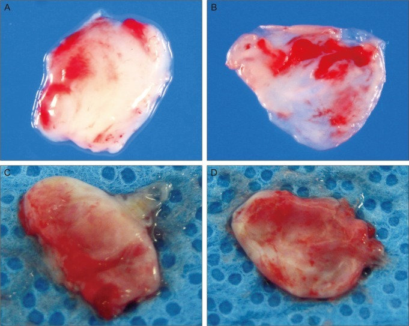
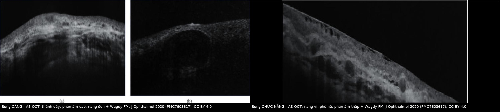
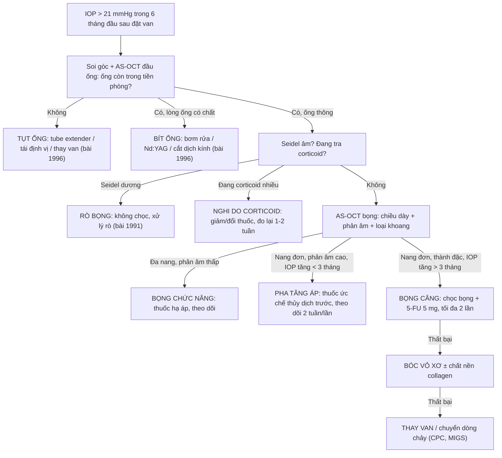
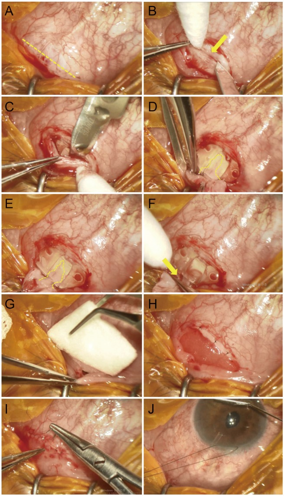
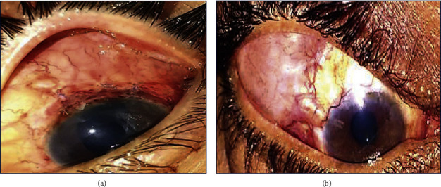
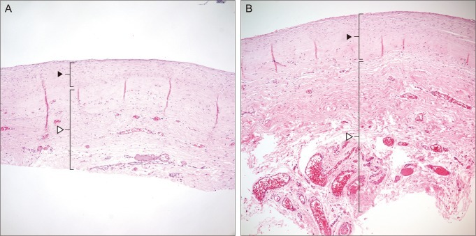

# 3206 — Bọng căng sau van dẫn lưu glôcôm: pha tăng áp hay bao xơ thật, đọc bằng AS-OCT, và chọc bọng – tháo vỏ xơ – thay van / Encapsulated bleb and the hypertensive phase after glaucoma drainage device surgery

**Tags:** `pattern:bong-cang` `pattern:bao-xo-quanh-ban` `pattern:pha-tang-ap` `pattern:thanh-bong-day` `pattern:nang-don` `pattern:iop-tang-sau-van` `vung:mat` `vung:bong-loc` `vung:ban-van` `vung:tien-phong` `protocol:AS-OCT` `protocol:UBM` `protocol:massage-mat` `protocol:choc-bong` `protocol:van-dan-luu` `score:IOP` `score:do-day-thanh-bong`

**Mức chắc chắn (certainty):** tổng hợp y văn (literature synthesis) — ghép **1 đoàn hệ 72 mắt đặt van** (Pitukcheewanont O et al., *Clin Ophthalmol* 2018, PMID 30154645, PMC6103611, CC BY-NC 3.0), **1 thử nghiệm ngẫu nhiên 30 mắt có AS-OCT theo dõi từng mốc** (Wagdy FM, *J Ophthalmol* 2020, PMID 33149944, PMC7603617, CC BY 4.0), **1 so sánh mô học 8 vỏ xơ cắt ra** (Bae K, Suh W, Kee C, *Korean J Ophthalmol* 2012, PMID 22870025, PMC3408531, CC BY-NC 3.0), **1 đoàn hệ 18 mắt tháo vỏ xơ + ghép chất nền collagen** (Lee SE et al., *Korean J Ophthalmol* 2019, PMID 31179652, PMC6557799, CC BY-NC 3.0), **1 đoàn hệ 66 mắt về chọn thuốc đầu tay trong pha tăng áp** (Lee J, Park CK, Jung KI, *J Clin Med* 2020, PMID 32028663, PMC7074076, CC BY 4.0), **1 RCT 40 mắt chọc bọng + 5-FU** (Suzuki R, Susanna-Jr R, *Clinics (São Paulo)* 2013, PMID 24212847, PMC3798692, CC BY-NC 3.0), **1 đoàn hệ needling 32 mắt** (Gürpınar A, Arıtürk N, *Turk J Ophthalmol* 2025, PMID 41446990, PMC12740067, CC BY-NC-ND 4.0) và **1 ca có AS-OCT** (Satpute K et al., *Indian J Ophthalmol* 2023, PMID 37322684, PMC10417986, CC BY-NC-SA 4.0). Chỗ suy luận ghi rõ "suy luận"; chỗ y văn chưa có số ghi "chưa rõ".

> **Vì sao bài này quan trọng:** [1996](../1996-tac-tut-ong-van-dan-luu-glaucoma/lesson.md) đã tách **bít ống** và **tụt ống**; nhưng câu hỏi hay gặp hơn sau đặt van là: **nhãn áp (intraocular pressure, IOP) tăng lại trong 6 tháng đầu, đầu ống thông, mà bọng quanh bản lại căng** — lúc đó vấn đề nằm ở **bao xơ quanh bản van (fibrous capsule around the plate)**, không phải ở ống. Đây là **lý do thất bại hàng đầu** của van có van: van Ahmed báo cáo **40–80%**, Baerveldt **20–30%**, Molteno **20–30%** (Pitukcheewanont 2018 dẫn lại), một loạt 85 mắt Ahmed ghi **83,5%** so với **43,5%** ở Molteno hai bản. Nhưng điều nguy hiểm không phải con số, mà là **hai phản xạ sai ngược nhau**: (a) thấy IOP tăng thì **tăng thuốc rồi chờ** trong khi **pha tăng áp phần lớn tự hết** và **không dự báo thất bại**; (b) thấy bọng căng thì **kết luận "van hỏng" rồi thay van**, trong khi một bọng **dày 2,48 mm** vẫn có thể **hạ từ 31,2 xuống 11,8 mmHg chỉ bằng cách bóc vỏ xơ**.

## 1. Tổng quan bệnh học – cơ chế hình ảnh: vì sao "van mở" mà mắt vẫn tăng áp

### 1.1 Ba pha nhãn áp sau đặt van — và mốc thời gian quyết định cách đọc

| Pha | Thời gian điển hình | Cơ chế | IOP | Việc cần làm |
|---|---|---|---|---|
| **Hạ áp (hypotensive)** | **ngày 1–7** | ống vừa vào tiền phòng, bọng chưa thành, một phần thủy dịch thoát qua chỗ vào ống | có thể **≤ 6 mmHg** | soi tiền phòng, loại trừ hạ áp quá mức — **không** đánh giá bọng |
| **Tăng áp (hypertensive phase, HP)** | xuất hiện **2–8 tuần**, đỉnh **tháng 1**, kéo tới **tháng 3** | kết bám fibrin–fibroblast quanh bản + **ứ thủy dịch trong khoang bọng** chưa thoát qua kết mạc | **> 21 mmHg** (định nghĩa dùng trong phần lớn nghiên cứu) | **đo – ghi – chờ có kiểm soát**, không thay van |
| **Ổn định (steady)** | **sau tháng 3** | bao xơ trưởng thành, hoặc thành **mỏng – nang vi** (thoát tốt) hoặc **dày – đặc** (thất bại) | mục tiêu từng bệnh nhân | AS-OCT quyết định can thiệp |

- **Ngưỡng dùng để nói chuyện với nhau:** HP = **IOP > 21 mmHg trong 3 tháng đầu**, hoặc **IOP > 21 mmHg sau khi đã có ≥ 2 tuần IOP thấp hơn 22 mmHg** (Pitukcheewanont 2018); phải **loại trừ bít/tụt ống, van hỏng, tăng IOP do corticoid** trước khi gọi là HP.
- **Vì sao đúng 2–8 tuần:** [1992](../1992-needling-bong-loc-sau-trabeculectomy/lesson.md) đã nêu "cửa sổ 2–6 tuần" cho xơ hóa bọng lọc; với **vỏ xơ quanh bản van** cửa sổ muộn hơn — mô cắt ra trong loạt Ahmed được lấy ở **26,6 ± 19,4 tuần** so với **12,0 ± 11,4 tuần** ở bọng sau trabeculectomy (Bae 2012). **Suy luận:** bản van polypropylene là **dị vật diện rộng** (Ahmed FP7 **184 mm²**) nên phản ứng bao xơ **chậm nhưng dày hơn** bọng lọc thường.

### 1.2 Vật lý: bao xơ là **môi trường xốp**, không phải ống — nên định luật khác

- Ở [1996](../1996-tac-tut-ong-van-dan-luu-glaucoma/lesson.md), trở lực nằm trong **lòng ống 0,30 mm** và tuân theo **Poiseuille (R ∝ 1/r⁴)**: một màng fibrin 0,1 mm đủ nâng IOP 10–20 mmHg. Ở bài này trở lực nằm ở **thành bao xơ** — một **môi trường xốp (porous medium)**, tuân theo **định luật Darcy**:

  **Q = (k · A · ΔP) / (µ · Δx)**

  với **k** = độ thấm (permeability), **A** = diện tích thấm, **Δx** = **chiều dày thành bao**, **µ** = độ nhớt thủy dịch.
- Hệ quả định lượng, giải thích đúng ca lâm sàng: bao xơ Ahmed dày **2,48 ± 0,42 mm** so với **1,62 ± 0,37 mm** ở bọng sau trabeculectomy (Bae 2012) — **dày gấp 1,53 lần** → nếu **k** giữ nguyên thì lưu lượng **giảm ~35%**; nhưng mô học cho thấy lớp trong là **collagen đặc thoái hóa dạng elastin**, nên **k giảm thêm nhiều bậc** → **Q sụt mạnh dù van vẫn mở**. Đây là câu trả lời cho "van mở 8 mmHg mà IOP 28 mmHg".
- **Kiểm chứng bằng thể tích thật:** MRI 27 mắt cho thấy bọng quanh bản Baerveldt **478,8 ± 84,2 mm³** so với Ahmed **161,1 ± 52,3 mm³** (p = 0,0093), và **IOP tương quan nghịch với thể tích bọng (r = −0,451; p = 0,018)** cùng **chiều cao bọng (r = −0,395; p = 0,041)** — tức **khoang dịch càng lớn, áp càng thấp** (dẫn trong [1993](../1993-that-bai-needling-van-dan-luu/lesson.md), Sano 2015).
- **Vì sao bọng "căng" chứ không chỉ "dày":** theo **Laplace (T = P·r/2)**, cùng áp lực, bán kính khoang lớn hơn → **sức căng thành lớn hơn**; thành dày + căng + mạch máu nổi là hình ảnh **"vỏ dừa"** mà phẫu thuật viên thấy khi mở ra.

### 1.3 Mô bệnh: hai lớp, tỉ lệ 3 : 1 — và vì sao corticoid hết tác dụng khi bao đã thành

- Vỏ xơ cắt ra gồm **lớp trong thoái hóa xơ (inner fibrodegenerative layer)** và **lớp ngoài xơ–mạch (outer fibrovascular layer)**, tỉ lệ chiều dày **≈ 3 : 1**, **giống nhau** ở nhóm van và nhóm trabeculectomy (Bae 2012, H&E ×100). Mặt trong **nhẵn, trắng, giống cùi dừa**; mặt ngoài **không đều, nhiều mạch**.
- Điểm quyết định điều trị: **phản ứng viêm gần như KHÔNG còn** trong toàn bộ mẫu cắt ra (Bae 2012). **Suy luận:** vì vậy **tăng corticoid nhỏ giọt ở giai đoạn này không làm mỏng bao đã trưởng thành** — corticoid chỉ có lý ở **đầu pha tăng áp** (khi còn viêm), còn bao đặc thì phải **giải phóng cơ học** (chọc bọng / bóc vỏ xơ).
- Đây cũng là lý do **tỉ lệ tái phát sau bóc vỏ xơ** khác nhau giữa các kỹ thuật: cắt bỏ vỏ xơ **không kèm chất nền** để lại **giường xơ trần** → nguyên bào sợi quay lại; ghép **chất nền collagen (collagen matrix)** làm "đệm" cho kết mạc.

- **Đọc ảnh:** A/C = **mặt ngoài** (xơ, không đều, có mạch); B/D = **mặt trong** (nhẵn, trắng, "**cùi dừa**") — chính là **bề mặt tiếp xúc khoang dịch**, nơi collagen đặc và thoái hóa dạng elastin. C/D (van Ahmed) **dày hơn** A/B (trabeculectomy) một cách nhìn thấy được.
- Nguồn: Bae K, Suh W, Kee C, *Korean J Ophthalmol* 2012 (PMC3408531), Fig. 1, **CC BY-NC 3.0** — nguyên bản.

### 1.4 Pha tăng áp KHÔNG đồng nghĩa thất bại — bằng chứng phản biện

- Đoàn hệ 72 mắt đặt van (Baerveldt 68,1%) cho thấy HP gặp ở **38/72 = 52,8% (95% CI 40,7–64,7)**, nhưng **không có khác biệt nào về kết cục phẫu thuật** giữa nhóm có và không có HP, kể cả phân tích sống còn; **thất bại 12 tháng 24/72 = 33%** ở cả hai nhóm (Pitukcheewanont 2018).
- Yếu tố nguy cơ: **thị lực trước mổ ≥ 20/70 → OR 7,5 (95% CI 1,4–41,4; p = 0,021)**; yếu tố **bảo vệ**: **bệnh tim nền/đang dùng kháng kết tập tiểu cầu → OR 0,06 (95% CI 0,00–0,72; p = 0,027)** — giả thuyết là **tác dụng kháng viêm của aspirin** làm chậm xơ hóa quanh bản.
- **Kết luận thực hành:** HP là **biến cố cần điều trị**, **không phải chỉ định mổ lại**. Ngược lại, **bao xơ đặc tồn tại > 3 tháng + IOP không đạt mục tiêu dù đã dùng thuốc tối ưu** mới là thất bại cấu trúc. Gọi hai thứ này là một = **thay van oan** hoặc **chờ quá lâu làm mất thị trường**.

## 2. Mẫu hình + chẩn đoán phân biệt theo vị trí (gamut)

**Mẫu hình trung tâm:** *"Đã có van, IOP tăng lại trong 6 tháng đầu, bọng quanh bản căng và không có nang vi."*

Gamut theo **tầng giải phẫu** (định vị bằng AS-OCT/UBM trước khi can thiệp):

1. **Tầng quanh bản – dưới kết mạc (quanh bản van):**
   - **Pha tăng áp (HP)** — khoang dịch còn, thành dày nhưng **giảm dần theo thời gian**, tự hết sau 3–6 tháng.
   - **Bao xơ thật / bọng căng (encapsulated bleb)** — thành **dày, phản âm cao, nang đơn**, không cải thiện sau 3 tháng; đây là **thất bại cấu trúc**.
   - **Vỏ fibrin sớm** — màng mỏng trong 2 tuần đầu, thường **tan khi tăng corticoid**.
2. **Tầng trong lòng ống (đầu ống, tiền phòng)** — bít do máu cục, mống mắt, dịch kính, IOL; hoặc **tụt ống** khỏi tiền phòng → xem [1996](../1996-tac-tut-ong-van-dan-luu-glaucoma/lesson.md).
3. **Tầng sau nhãn cầu** — **tràn dịch hắc mạc thanh dịch**, xuất huyết trên hắc mạc, **glôcôm ác tính (aqueous misdirection)**; đây là nhóm **tiền phòng nông/dẹt** kèm IOP cao — xem [1448](../1448-glaucoma-ac-tinh-sau-mo-noi-nhan/lesson.md).
4. **Không do cấu trúc** — **tăng IOP do corticoid** (bệnh nhân vẫn đang tra corticoid **2 giờ/lần** sau mổ), **thuốc giãn đồng tử**, chu kỳ ngày đêm.

Gamut theo **hình thái bọng trên AS-OCT** (dùng để chọn nhánh điều trị):

- **Nang đơn + thành đặc, phản âm cao** → bọng căng (encapsulated) — **chọc bọng ± 5-FU**, nếu tái lập → **bóc vỏ xơ**.
- **Đa nang vi + thành mỏng, phản âm thấp, ngậm nước** → bọng **chức năng** dù IOP còn cao → **chỉ theo dõi ± thuốc**.
- **Bọng dẹt, không khoang dịch** → không phải vấn đề bao xơ: tìm **bít/tụt ống**, hoặc **dính kết mạc** toàn bộ.

## 3. Bảng so sánh phân biệt (ma trận đối chiếu)

| Thực thể (entity) | Hình ảnh điển hình (AS-OCT/UBM/đèn khe) | Chốt vào (rule-in) | Chốt loại (rule-out) | Gợi ý xác nhận |
|---|---|---|---|---|
| **Bao xơ quanh bản (encapsulated bleb)** | Bọng **vòm căng, mạch máu nổi**, **nang đơn** chứa dịch, **thành dày phản âm cao**; mặt trong nhẵn "cùi dừa" khi mổ | **IOP > 21 mmHg kéo dài > 3 tháng** + **thành bọng phản âm cao, nang đơn** + **không đáp ứng với ấn nhãn cầu/thuốc** | **Nang vi tua tủa + thành mỏng phản âm thấp** (bọng chức năng); **đầu ống ngoài tiền phòng** (tụt ống) | AS-OCT đo **chiều dày + phản âm thành**, so 2 lần cách 4 tuần; mô học nếu cắt: **2 lớp, tỉ lệ 3 : 1** |
| **Pha tăng áp (HP) tự giới hạn** | Bọng căng nhẹ, **còn nang**, thành dày **giảm dần**; có thể phù | **IOP > 21 mmHg trong 3 tháng đầu**, **giảm dần không can thiệp**, **giảm ≥ 4,4–9,3 mmHg khi thêm thuốc** | **IOP tiếp tục tăng sau tháng 4**; **thành dày không đổi hoặc tăng**; **nang biến mất** | Theo dõi IOP **2 tuần/lần** trong 3 tháng đầu; AS-OCT tháng 1 và 3 |
| **Bít ống (tube occlusion)** | Đầu ống có **máu cục/mống mắt/dịch kính**; **bọng xẹp hoặc không đổi** khi ấn | **Ấn nhãn cầu/không thấy thay đổi bọng**, **AS-OCT thấy chất trong lòng ống** | **Ấn nhãn cầu làm IOP tụt 6–30 mmHg** (khoang bọng còn thông) | Soi góc + AS-OCT đầu ống ([1996](../1996-tac-tut-ong-van-dan-luu-glaucoma/lesson.md)) |
| **Tụt ống (tube retraction)** | Đầu ống **nằm trong củng mạc/rãnh thể mi**, không thấy trong tiền phòng | **AS-OCT/UBM không thấy ống trong tiền phòng**, IOP tăng | **Đầu ống trong tiền phòng, cách nội mô ≥ 1 mm** | AS-OCT góc tiền phòng; trẻ lớn/mắt to là nhóm nguy cơ |
| **Tăng IOP do corticoid** | Giác mạc trong, tiền phòng sạch, bọng **không căng** | **Đang tra corticoid**, IOP tăng **1–4 tuần** sau khi tăng liều, **giảm khi ngừng/đổi thuốc** | **Bọng căng/thành dày trên AS-OCT**; IOP không đổi khi giảm corticoid | Ngừng hoặc đổi sang corticoid ít gây tăng áp; đo lại **1–2 tuần** |
| **Glôcôm ác tính (aqueous misdirection)** | **Tiền phòng dẹt đều**, **không có khoang dịch dưới kết mạc**, PI thông | **Tiền phòng dẹt + IOP cao + PI thông + ACD giảm** | **Bọng căng có khoang dịch**; **tiền phòng sâu** | UBM/AS-OCT: **LV 0,46 mm, ACD 2,41 mm**; **atropine, KHÔNG pilocarpine** ([1448](../1448-glaucoma-ac-tinh-sau-mo-noi-nhan/lesson.md)) |
| **Rò bọng / hạ áp quá mức** | Bọng **mỏng, ướt**, **Seidel dương**, tiền phòng nông | **Seidel dương**, IOP **≤ 6 mmHg**, **thành bọng mất liên tục** | **Seidel âm, bọng kín** | **Không chọc bọng khi Seidel dương**; nguy cơ viêm nội nhãn liên quan bọng ([1991](../1991-ro-bong-loc-muon-viem-noi-nhan/lesson.md)) |

- Ảnh ghép đối chiếu **cùng chuỗi xung AS-OCT** (Wagdy FM, *J Ophthalmol* 2020, PMC7603617, **CC BY 4.0**).
- **Đọc ảnh:** bên trái **thành dày liên tục, phản âm cao, một khoang dịch lớn** — bọng căng; bên phải **thành mỏng, ngậm nước, nhiều nang nhỏ** — bọng chức năng dù cùng thời điểm "pha tăng áp".

## 4. Protocol chụp + hệ phân độ/điểm chuẩn hóa

### 4.1 Protocol hình ảnh bọng van (thứ tự bắt buộc)

1. **Đèn khe + Seidel** — mô tả **vòm, mật độ mạch, độ căng**, và **luôn thử Seidel** trước mọi can thiệp.
2. **Soi góc (gonioscopy)** — đầu ống có trong tiền phòng không, có mống mắt/dịch kính/IOL chạm đầu ống không.
3. **AS-OCT tiền phòng–bọng** (bước sóng ~**1310 nm**, phân giải trục **5–10 µm**): cắt **dọc qua tâm bọng**, đo **chiều dày thành tại điểm dày nhất (µm)**, ghi **độ phản âm thành (thang 0–255)**, phân loại khoang (**đơn nang vs đa nang**), đếm **nang vi**.
   - Số tham chiếu từ đoàn hệ 30 mắt: thành bọng **754,67 ± 53,93 µm** ngày 1 → **684 ± 81,66 µm** tháng 1 → **671,6 ± 69,48 µm** tháng 3 ở nhóm **cắt vỏ Tenon**; nhóm **quy ước** là **707,13 ± 31,7 → 499,53 ± 99,1 → 506 ± 76,91 µm** (Wagdy 2020).
   - **Phản âm** là biến số **quyết định hơn chiều dày**: ca bọng căng có thành **375 µm, phản âm 132**; ca bọng chức năng có thành **580 µm, phản âm 103** (Wagdy 2020).
4. **UBM 35–50 MHz** khi **kết mạc dày/đục** hoặc cần nhìn **quanh bản van** và **thể mi**.
5. **Siêu âm B-scan 10 MHz** khi nghi **tràn dịch/xuất huyết hắc mạc** hoặc không thấy đáy mắt ([411](../411-sieu-am-nhan-cau/lesson.md)).
6. **Ấn nhãn cầu có kiểm soát ("nghiệm pháp massage")** — làm **chậm, qua mi**, đo IOP **trước và sau 30 giây**: giảm **22 và 26 mmHg** ở 2 mắt còn khoang thông, so với **1,6 ± 2,2 mmHg** ở 16 mắt bọng đặc (p = 0,013) (Lee SE 2019). **Cấm** ấn mạnh khi vừa mổ < 2 tuần hoặc tiền phòng nông.

### 4.2 Phân độ thực hành (tổng hợp — nhãn suy luận, chỉ dùng để trao đổi trong nhóm)

| Độ | Đèn khe | AS-OCT | Hướng xử trí |
|---|---|---|---|
| **0 — Bọng tốt** | vòm mềm, mạch thưa, không căng | thành **< 500 µm**, phản âm **thấp–trung bình**, **đa nang** | theo dõi thường quy |
| **I — Pha tăng áp** | căng nhẹ, còn nang nhỏ | thành **500–700 µm**, còn **nang vi** | thuốc hạ áp, theo dõi **2 tuần/lần** tới tháng 3 |
| **II — Bọng căng** | vòm căng, mạch nổi rõ, không nang | thành **dày, phản âm cao**, **nang đơn** | **chọc bọng + 5-FU** (không quá 2 lần) |
| **III — Bao xơ thất bại** | bọng đặc, dính, không di động | thành **> 2 mm**, **không khoang dịch**, phản âm rất cao | **bóc vỏ xơ ± chất nền collagen**, hoặc **thay van** |

### 4.3 Thuật toán xử trí

### 4.4 Ngưỡng và liều cụ thể của từng bước

| Bước | Số liệu / liều | Bằng chứng |
|---|---|---|
| **Thuốc đầu tay trong pha tăng áp** | **nhóm ức chế thủy dịch (aqueous suppressant)** giảm **9,3 mmHg** so với **4,4 mmHg** của **prostaglandin** (p = 0,016); thành công có thuốc **67,5% vs 42,3%** (1 năm), **80,6% vs 37,5%** (2 năm), **80,0% vs 35,0%** (3 năm) | Lee J 2020 (66 mắt) |
| **Thời điểm chọc bọng** | sớm: needling trong **≤ 5 tháng** cho IOP **12,14 ± 2,80 vs 15,13 ± 2,07 mmHg** (p = 0,004); muộn (**6,6 ± 6,1 tháng**) chỉ còn **40,6%** thành công lúc 6 tháng (75% lúc 1 tháng) | Suzuki 2013 (40 mắt, trabeculectomy); Gürpınar 2025 (32 mắt, trabeculectomy) — **suy luận** khi áp cho van |
| **Kỹ thuật chọc bọng** | kim **27G** qua kết mạc **cách vạt/bọng một khoảng**, đi **đường hầm dài**, **bẻ dải xơ bằng động tác quét lên–xuống**, **không xuyên thành bọng**; sau đó **5-FU 5 mg = 0,2 mL dung dịch 25 mg/mL** tiêm dưới kết mạc **phía trên bọng** | Suzuki 2013 |
| **Hiệu quả chọc bọng** | IOP 12 tháng: **12,14 vs 15,13 mmHg**; "thành công" **70% vs 75%** (p = 0,89 — **không khác**); trung bình **1,35 ± 0,49 lần** chọc | Suzuki 2013 |
| **Biến chứng chọc bọng** | **3/20 mắt (15%)**: tiền phòng dẹt + máu tiền phòng (1), tràn dịch hắc mạc nhỏ (1), tiền phòng dẹt + tràn dịch hắc mạc **phải mổ** (1) | Suzuki 2013 |
| **Bóc vỏ xơ ± chất nền collagen** | **18 mắt**: IOP **30,6 ± 5,7 → 19,1 ± 3,2 mmHg** lúc 6 tháng (p < 0,001); nhóm đáp ứng ấn nhãn cầu tốt hơn: **14,0 ± 2,8 vs 19,8 ± 2,6 mmHg** (p = 0,052) | Lee SE 2019 |
| **Dự phòng bằng phẫu thuật** | **cắt vỏ Tenon** khi đặt van: pha tăng áp **2/15 (13,3%)** so với **6/15 (40%)** ở kỹ thuật quy ước | Wagdy 2020 |
| **Chọn van theo nguy cơ** | Ahmed **40–80%**, Baerveldt **20–30%**, Molteno **20–30%**; ABC: thất bại 5 năm **51% (Ahmed) vs 34% (Baerveldt)** | Pitukcheewanont 2018; [1993](../1993-that-bai-needling-van-dan-luu/lesson.md) |

- **Đọc ảnh (A–J):** đường rạch kết mạc **cách rìa giác mạc 10 mm** (A, đường vàng) → mở **vỏ xơ** (B) → **bóc tách vỏ xơ** khỏi bản van (C) → kiểm tra **mô xơ–mạch xâm nhập buồng van** (D, nét vàng) → xác định **cuống mô xơ nối vỏ xơ với bản** (E) → cắt cuống (F, mũi tên vàng) → đặt **chất nền collagen** (G) → khâu kết mạc (H, I) → kết quả sau mổ (J).
- Nguồn: Lee SE et al., *Korean J Ophthalmol* 2019 (PMC6557799), Fig. 1, **CC BY-NC 3.0** — nguyên bản.

## 5. Biến thể bình thường và cạm bẫy

- **Biến thể bình thường:** trong **2–8 tuần đầu**, bọng **căng nhẹ + thành dày** là **sinh lý của quá trình lành** — không được gọi là "bao xơ" nếu chưa qua **tháng 3**. Chỉ **chọc/ấn** khi có **IOP vượt mục tiêu kéo dài** hoặc **triệu chứng**.
- **Cạm bẫy 1 — "dày hơn = căng hơn" là SAI.** Thành **375 µm, phản âm 132** (bọng căng) so với **580 µm, phản âm 103** (bọng chức năng) chứng minh **phản âm/mật độ collagen** quan trọng hơn **chiều dày** (Wagdy 2020). Đọc chiều dày đơn thuần sẽ **chọc bọng lành** và **bỏ qua bọng bệnh**.
- **Cạm bẫy 2 — coi pha tăng áp là thất bại.** HP gặp **52,8%** nhưng **không liên quan kết cục** (Pitukcheewanont 2018): **thay van vì HP là mổ oan**; ngược lại **chờ ở bọng căng thật** làm mất thị trường.
- **Cạm bẫy 3 — bỏ sót tăng IOP do corticoid** vì bệnh nhân vẫn tra **corticoid 2 giờ/lần** trong 2–4 tuần đầu. Luôn **hỏi liều và thời điểm tra**, và **thử giảm** trước khi kết luận bao xơ.
- **Cạm bẫy 4 — chọc bọng khi Seidel dương hoặc thành bọng quá mỏng.** Đây là đường vào **viêm nội nhãn liên quan bọng** (rò muộn **3–13%**, MMC ~**3×** 5-FU — [1991](../1991-ro-bong-loc-muon-viem-noi-nhan/lesson.md)).
- **Cạm bẫy 5 — ấn nhãn cầu mạnh.** "Nghiệm pháp massage" chỉ có giá trị **chẩn đoán** khi làm **nhẹ, qua mi, 30 giây**; ấn mạnh trong **2 tuần đầu** hoặc khi **tiền phòng nông** có thể gây **hạ áp, tràn dịch/xuất huyết hắc mạc**.
- **Cạm bẫy 6 — chọc bọng van giống hệt chọc bọng trabeculectomy.** Bọng van **không có vạt củng mạc**, **không có sclerostomy**, nên **chọc không "mở lại lỗ"** mà chỉ **giải phóng khoang dịch dưới vỏ xơ**; nếu vỏ xơ dày **> 2 mm** thì chọc thường **thất bại sớm** và cần **bóc vỏ** (Bae 2012: vỏ Ahmed **2,48 ± 0,42 mm**).
- **Bẫy mặt cắt:** trên AS-OCT, **bản van polypropylene** cho **bóng lưng (acoustic shadowing)** phía sau → **không đánh giá được thành bọng ngay trên bản**; phải cắt **lệch qua bờ bản** hoặc dùng **UBM**.

## 6. Tự lượng giá — Blind Quiz ngay trên trang tĩnh

**Ca 1 — Nữ 62 tuổi, glôcôm tân mạch do đái tháo đường, đặt van Ahmed 1 tháng. IOP 28 mmHg, đang tra dorzolamide/timolol 2 lần/ngày và prednisolone 1% 4 lần/ngày. Nhìn ảnh (b) và mô tả trước khi đọc đáp án.**

- Gợi ý lâm sàng: đang dùng corticoid, IOP tăng trong **tháng đầu**, chưa có AS-OCT.
- Câu hỏi: (1) Mô tả khác biệt giữa hai ảnh; (2) ba chẩn đoán phân biệt cho IOP 28 mmHg lúc này; (3) hai việc phải làm **trước** khi nghĩ đến can thiệp?

<b>Bấm để hiện đáp án (findings + chẩn đoán)</b>

- **Dấu hiệu:** (a) bọng **mỏng, mạch thưa, không căng** — bọng chức năng; (b) bọng **vòm căng, mạch máu nổi rõ, giới hạn rõ** — bọng căng/pha tăng áp. Trong bài gốc, (b) là bệnh nhân **IOP 28 mmHg lúc 1 tháng**.
- **Chẩn đoán:** **pha tăng áp (hypertensive phase)** trong tháng đầu — **chưa phải** bao xơ thất bại. Phân biệt: **tăng IOP do corticoid** (đang tra 4 lần/ngày), **bít/tụt ống** (bài 1996).
- **Vì sao:** giai đoạn 2–8 tuần là lúc fibrin–fibroblast bám quanh bản và khoang dịch chưa thoát qua kết mạc; **phần lớn tự hết** và **không dự báo thất bại** (HP **52,8%** nhưng kết cục không khác — Pitukcheewanont 2018).
- **Việc phải làm trước can thiệp:** (1) **soi góc/AS-OCT đầu ống** loại trừ bít/tụt ống; (2) **giảm hoặc đổi corticoid** rồi đo lại 1–2 tuần. Chỉ khi IOP vẫn > mục tiêu sau tháng 3 mới chọc bọng.
- **Nguồn ảnh:** Wagdy FM, *J Ophthalmol* 2020 (PMC7603617), Fig. 3, **CC BY 4.0** — nguyên bản.

**Ca 2 — Hai mặt cắt AS-OCT của hai mắt sau đặt van, cùng IOP 26–29 mmHg. Mắt nào nên chọc bọng, mắt nào chỉ theo dõi?**

- Gợi ý: cả hai đều đang ở "pha tăng áp"; khác nhau ở **kiểu khoang** và **độ phản âm thành**.
- Câu hỏi: (1) Mô tả từng ảnh; (2) ảnh nào là **bọng căng**; (3) vì sao **chiều dày thành** một mình không trả lời được?

<b>Bấm để hiện đáp án (findings + chẩn đoán)</b>

- **Dấu hiệu:** ảnh trái — **thành dày liên tục, phản âm cao, một khoang dịch lớn**; ảnh phải — **thành mỏng, ngậm nước, nhiều nang nhỏ tua tủa**.
- **Chẩn đoán:** trái = **bọng căng (encapsulated)** → **chọc bọng + 5-FU**; phải = **bọng chức năng đang trong pha tăng áp** → **thuốc + theo dõi**.
- **Vì sao:** bọng căng có **thành 375 µm nhưng phản âm 132**, bọng chức năng **580 µm nhưng phản âm 103** — **mật độ collagen (phản âm)** chứ không phải độ dày quyết định độ thấm (Wagdy 2020). Theo Darcy, **k** giảm mạnh khi collagen đặc, dù **Δx** nhỏ hơn.
- **Xử trí thuốc:** ưu tiên **ức chế thủy dịch** (giảm **9,3 vs 4,4 mmHg**, thành công 3 năm **80,0% vs 35,0%** — Lee J 2020), không khởi đầu bằng prostaglandin.
- **Nguồn ảnh:** ghép từ Wagdy FM, *J Ophthalmol* 2020 (PMC7603617), Fig. 4 và Fig. 5, **CC BY 4.0**.

**Ca 3 — Bệnh nhân sau đặt van, IOP 31 mmHg dù ấn nhãn cầu chỉ giảm 2 mmHg; vỏ xơ quanh bản được cắt bỏ. Nhìn tiêu bản: giải thích vì sao "van vẫn mở" mà mắt tăng áp, và vì sao corticoid không còn tác dụng?**

- Gợi ý: (A) vỏ xơ sau trabeculectomy, (B) vỏ xơ sau van Ahmed; thước đo chiều dày thành.
- Câu hỏi: (1) Hai lớp mô và tỉ lệ chiều dày; (2) vì sao ấn nhãn cầu **không** hạ áp; (3) vì sao **tăng corticoid** ở giai đoạn này ít hiệu quả?

<b>Bấm để hiện đáp án (findings + chẩn đoán)</b>

- **Dấu hiệu:** **lớp trong thoái hóa xơ** (mũi tên đen) và **lớp ngoài xơ–mạch** (mũi tên trắng), tỉ lệ **≈ 3 : 1**; thành ở nhóm van **2,48 ± 0,42 mm** so với **1,62 ± 0,37 mm** ở trabeculectomy.
- **Chẩn đoán:** **bao xơ quanh bản (encapsulated bleb)** — thất bại **cấu trúc**, không phải pha tăng áp.
- **Vì sao ấn nhãn cầu vô hiệu:** khoang dịch **đã bị vỏ đặc chia tách/không còn thông** với kết mạc — ấn chỉ **dịch chuyển thủy dịch trong khoang kín**, IOP giảm **1,6 ± 2,2 mmHg** (so với **22–26 mmHg** khi khoang còn thông — Lee SE 2019).
- **Vì sao corticoid kém:** mô học cho thấy **phản ứng viêm gần như không còn** — đây là **collagen trưởng thành thoái hóa dạng elastin**, không phải viêm hoạt động; phải **giải phóng cơ học** (chọc/bóc), và bóc vỏ xơ đưa IOP **31,2 ± 5,3 → 11,8 ± 5,1 mmHg** (Bae 2012).
- **Nguồn ảnh:** Bae K, Suh W, Kee C, *Korean J Ophthalmol* 2012 (PMC3408531), Fig. 5, **CC BY-NC 3.0** — nguyên bản.

## Bài liên quan chéo

- [1996 — Tắc & tụt ống van dẫn lưu glôcôm](../1996-tac-tut-ong-van-dan-luu-glaucoma/lesson.md) — **bước 1 luôn phải loại trừ**: đầu ống bít hay tụt; AS-OCT/UBM định vị, lòng ống **0,30 mm**, **R ∝ 1/r⁴**.
- [1993 — Thất bại needling: repeat trabeculectomy hay van dẫn lưu](../1993-that-bai-needling-van-dan-luu/lesson.md) — **chọn van nào**, diện tích bản **184 vs 350 mm²**, thể tích bọng **161 vs 479 mm³**, **IOP tương quan nghịch với thể tích bọng (r = −0,451)**.
- [1992 — Needling bọng lọc + 5-FU/MMC sau trabeculectomy](../1992-needling-bong-loc-sau-trabeculectomy/lesson.md) — kỹ thuật chọc, kim **26–27G**, 5-FU **5 mg**, **không chọc khi Seidel dương**.
- [1991 — Rò bọng lọc muộn & viêm nội nhãn liên quan bọng](../1991-ro-bong-loc-muon-viem-noi-nhan/lesson.md) — biến chứng của chính thao tác chọc/ấn bọng.
- [1448 — Glôcôm ác tính sau mổ nội nhãn](../1448-glaucoma-ac-tinh-sau-mo-noi-nhan/lesson.md) — **tiền phòng dẹt + IOP cao**, không phải bọng căng.
- [1985 — MIGS trong glôcôm góc đóng](../1985-migs-glocom-goc-dong/lesson.md) — bậc thang can thiệp khi van đã thất bại.
- [411 — Siêu âm nhãn cầu](../411-sieu-am-nhan-cau/lesson.md) — B-scan 10 MHz loại trừ tràn dịch/xuất huyết hắc mạc.
- [400 — Tổng quan Mắt & thị giác](../400-tong-quan-mat-thi-giac/lesson.md)

## Ảnh

- `3206_bong-cang_Anh-mau_PMC7603617-Fig3.jpg` — đèn khe: bọng mỏng (a) vs bọng căng nhiều mạch (b) (CC BY 4.0).
- `3206_AS-OCT-diffuse_PMC7603617-Fig4.jpg` — AS-OCT bọng chức năng đa nang, ngậm nước (CC BY 4.0).
- `3206_AS-OCT-cang_PMC7603617-Fig5.jpg` — AS-OCT bọng căng: thành dày, phản âm cao, nang đơn (CC BY 4.0).
- `composite_AS-OCT_bong-cang-vs-bong-chuc-nang.jpg` — ảnh ghép đối chiếu hai kiểu bọng (CC BY 4.0, từ hai ảnh trên).
- `3206_vo-xo-day_Anh-mau_PMC3408531-Fig1.jpg` — đại thể vỏ xơ cắt ra, mặt trong "cùi dừa" (CC BY-NC 3.0).
- `3206_hai-lop_Mo_PMC3408531-Fig5.jpg` — mô học hai lớp, tỉ lệ 3 : 1 (CC BY-NC 3.0).
- `3206_thao-vo-xo_Anh-mo_PMC6557799-Fig1.jpg` — các thì bóc vỏ xơ + ghép chất nền collagen (CC BY-NC 3.0).
- Nguồn + giấy phép từng ảnh: `images/CREDITS.md`.

> Không dùng để chẩn đoán độc lập khi chưa có người hướng dẫn.
