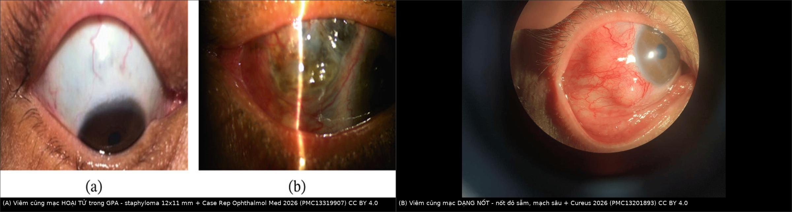
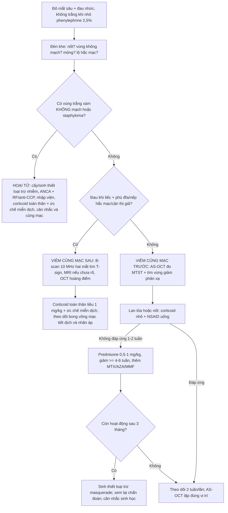
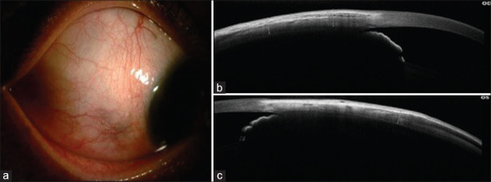
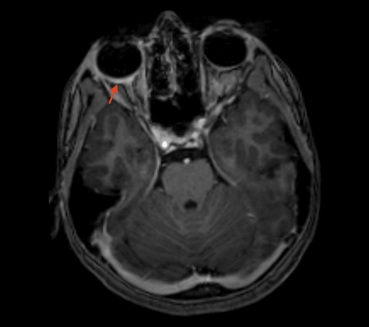
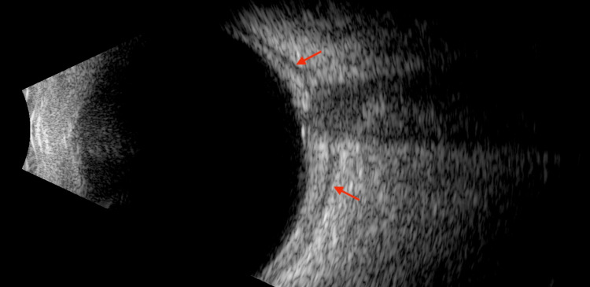
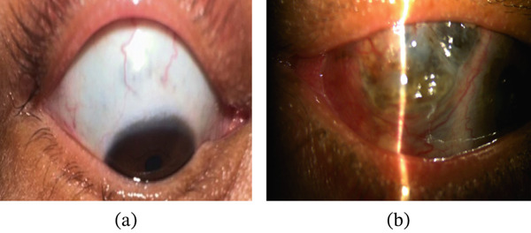
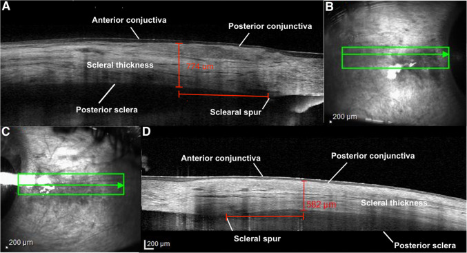

# 3207 — Viêm củng mạc (scleritis): đỏ tím không trắng khi nhỏ phenylephrine, dày củng mạc trên AS-OCT và T-sign trên B-scan — khi nào là hoại tử, khi nào phải nhập viện / Scleritis: the red eye that does not blanch, scleral thickening on AS-OCT and the T-sign on B-scan

**Tags:** `pattern:do-mat-sau` `pattern:khong-trang-phenylephrine` `pattern:tim-bam` `pattern:day-cung-mac` `pattern:mo-cung-mac` `pattern:t-sign` `pattern:hoai-tu-cung-mac` `pattern:hong-cau-thua` `pattern:not-cung-mac` `vung:mat` `vung:cung-mac` `vung:hoc-mat` `vung:hau-doan` `protocol:den-khe` `protocol:phenylephrine` `protocol:AS-OCT` `protocol:UBM` `protocol:B-scan` `protocol:MRI-hoc-mat` `score:IOP` `score:do-day-cung-mac`

**Mức chắc chắn (certainty):** tổng hợp y văn (literature synthesis) — ghép **1 đoàn hệ 44 bệnh nhân/58 mắt có AS-OCT trước–sau điều trị** (Desai S, Biswas J, Ganesh SK, Bhatt D, *Oman J Ophthalmol* 2025, PMID 40666783, PMC12258829, CC BY-NC-SA 4.0), **1 nghiên cứu AS-OCT 9 mắt củng mạc "tím bầm" không hoạt động** (Sutra P et al., *Graefes Arch Clin Exp Ophthalmol* 2025, PMID 40095049, PMC12373549, CC BY 4.0), **1 bộ 104 phim OCT hậu đoạn của 31 bệnh nhân viêm củng mạc sau** (Nayak S et al., *Front Ophthalmol* 2026, PMID 42499422, PMC13395665, CC BY 4.0), **1 bài tổng quan điều trị 2026** (Richey A, Sattarova V, Kopplin LJ, Armbrust KR, *Clin Ophthalmol* 2026, PMID 41937961, PMC13048062, CC BY-NC), **1 ca viêm củng mạc sau ở trẻ có B-scan + MRI** (Alsatrawi AB, Alzayani A, *Cureus* 2024, PMID 39070507, PMC11283761, CC BY 4.0), **1 ca hoại tử củng mạc trong GPA** (Lavaju P et al., *Case Rep Ophthalmol Med* 2026, PMC13319907, CC BY 4.0), **1 ca hoại tử củng mạc kháng sinh học đáp ứng upadacitinib** (*J Ophthalmic Inflamm Infect* 2026, PMC13156378, CC BY 4.0), **1 ca viêm củng mạc lan tỏa hai bên bộc lộ viêm khớp dạng thấp** (*Cureus* 2026, PMC13555373, CC BY 4.0), **1 đoàn hệ 55 mắt người trẻ khỏe đo độ dày củng mạc trước bằng SS-OCT** (Challa NK et al., *J Clin Med* 2026, PMID 42941363, PMC13705192, CC BY 4.0) và **1 tổng quan viêm củng mạc liên quan viêm khớp dạng thấp** (*J Clin Med* 2026, PMC13163695, CC BY 4.0). Chỗ suy luận ghi rõ "suy luận"; chỗ y văn chưa có số ghi "chưa rõ".

> **Vì sao bài này quan trọng:** mắt đỏ là lý do khám **hàng đầu** ở mọi tuyến, và **99% là viêm kết mạc**. Nhưng viêm củng mạc là **bệnh của mô không có mạch máu – không có bạch mạch** nên viêm không tự thoát, tự tiêu: hậu quả là **mỏng củng mạc, thủng nhãn cầu, bong võng mạc, glôcôm**, và ở thể hoại tử còn là **dấu hiệu của viêm mạch hệ thống đe dọa tính mạng** (viêm khớp dạng thấp, GPA). Ba lỗi hay gặp: (a) nhỏ **phenylephrine rồi thấy "bớt đỏ" một phần** và kết luận viêm kết mạc; (b) đo **độ dày củng mạc** rồi mừng vì "dày = viêm" — trong khi **thể hoại tử lại MỎNG hơn mắt lành** (692 vs 833 µm); (c) coi "**mắt hết đỏ, hết đau**" là khỏi, trong khi **scleromalacia perforans không đau** và vẫn có thể **thủng**.

## 1. Tổng quan bệnh học – cơ chế hình ảnh: vì sao "đỏ sâu, đau nhiều, không trắng"

### 1.1 Củng mạc là mô "không có đường thoát" — nên viêm thành mạn và phá collagen

- Củng mạc là **5/6 vỏ nhãn cầu**, dày **0,3–0,4 mm** sau chỗ bám cơ trực, **~0,6 mm** ở xích đạo và **~1,0 mm** quanh rìa giác mạc; cấu tạo **95% collagen type I** bó không đều, **rất ít nguyên bào sợi**, **KHÔNG có mạch máu và KHÔNG có bạch mạch** ở lớp nhu mô.
- Hệ quả kép: (a) **lắng đọng phức hợp miễn dịch** (IgG, C3, C1q) trong thành mạch thượng củng mạc **không được rửa trôi** → phản ứng **quá mẫn type III**; (b) tế bào viêm giải phóng **matrix metalloproteinase (MMP-1/3/9)** và **collagenase** phân hủy collagen type I → **mỏng dần, giãn (ectasia), thủng**.
- Vì sao **đau nhiều và đau về đêm**: nhánh thần kinh giác mạc–củng mạc (V1) bị **phù và chèn ép trong mô không giãn được**; đau **lan lên trán – hàm – thái dương** và **tăng khi liếc mắt** (cơ trực kéo củng mạc viêm). Đây là lý do **viêm củng mạc sau dễ bị chẩn đoán nhầm "đau đầu do căng thẳng" hoặc "viêm thần kinh thị không điển hình"** (ca trẻ 12 tuổi trong bài bị gọi đúng như vậy trước khi siêu âm).

### 1.2 Dịch tễ và "con số phải nhớ" (ngưỡng định lượng)

| Biến số | Số liệu | Nguồn |
|---|---|---|
| Tỷ lệ mới mắc | **4,23 → 2,79/100.000 người–năm** (Anh, 1997→2018); **3–5/100.000/năm** ở các loạt khác | PMC13048062; PMC11283761 |
| Tỷ lệ hiện mắc (2018) | **93,62/100.000** | PMC13048062 |
| Liên quan bệnh hệ thống | **40–50%** | PMC11146444 |
| ANCA dương trong viêm củng mạc | **18%** (nhóm dương có bệnh nặng và biến chứng nhiều hơn) | PMC13048062 |
| Viêm khớp dạng thấp (RA) | **39%** trong nhóm viêm củng mạc có bệnh tự miễn; **~2%** bệnh nhân RA có viêm củng mạc trong đời | PMC13163695 |
| Thể hoại tử | **8–15%** tổng số viêm củng mạc; **71–86%** viêm củng mạc do GPA là hoại tử | PMC13163695; PMC13319907 |
| Viêm củng mạc đi TRƯỚC bệnh hệ thống | **38,7%** ở nhóm có viêm mạch | PMC13319907 |
| Tái phát | **70,45%** (đoàn hệ 44 bệnh nhân); **35,9–69%** theo y văn | PMC12258829; PMC13048062 |
| Cần thuốc ức chế miễn dịch (steroid-sparing) | **~50%** | PMC13048062 |
| Biến chứng trong đoàn hệ 44 bệnh nhân | đục thể thủy tinh **29,5%**, glôcôm **15,9%**, viêm màng bồ đào trước **11,4%**, bong võng mạc **1 ca** | PMC12258829 |
| Nhiễm khuẩn là nguyên nhân | **< 20%** ca viêm củng mạc tại Mỹ; **lao** là tác nhân hay gặp nhất; do herpes **1,8% (Colombia) – 12% (Đài Loan)** | PMC13048062 |
| Ở trẻ | viêm củng mạc **sau** chiếm tới **50%** ca viêm củng mạc nhi khoa | PMC11283761 |

### 1.3 Vật lý: vì sao AS-OCT "nhìn được" củng mạc, và vì sao độ dày đi HAI chiều

- **AS-OCT bước sóng ~1310 nm** (swept-source) xuyên qua kết mạc–Tenon vào củng mạc, phân giải trục **5–10 µm**: củng mạc là **collagen đặc** nên **tăng phản xạ (hyperreflective)**; khi viêm, **nước và tế bào** chen giữa các bó collagen → xuất hiện **vùng GIẢM phản xạ (hyporeflective "vacuoles")**.
- Vì vậy **độ dày phản ánh lượng nước**, còn **cấu trúc collagen** quyết định phản xạ. Hai chiều bệnh lý:
  - **Viêm lan tỏa/nốt (còn collagen):** phù → **DÀY**. Đoàn hệ AS-OCT: **922,17 ± 252,03 µm** khi hoạt động so với **798,05 ± 150,61 µm** ở mắt chứng (**p = 0,005**); thể **lan tỏa 1.008,75 µm** và **nốt 978,33 µm**.
  - **Viêm hoại tử (collagen bị phá):** **MỎNG** — **692,33 ± 221,63 µm** so với **833,4 ± 211,92 µm** ở mắt chứng. Đây là **cạm bẫy số 1**: "dày = viêm nặng" **sai** ở thể nặng nhất.
- **Tham chiếu bình thường** (SS-OCT, 55 mắt người trẻ khỏe, cách rìa củng mạc 1 mm): **dưới 578,85 ± 71,76 µm**, **mũi 516,35**, **thái dương 510,51**, **trên 500,51 ± 74,18 µm**; ở 2 mm các giá trị **488,69–568,07 µm**; độ lặp lại trong cùng buổi **ICC 0,872–0,939** (PMC13705192).
  - **Cẩn thận khi so số:** giá trị **~500–600 µm** đo **trực tiếp trên củng mạc**, còn "MTST" (mean total scleral thickness) trong đoàn hệ viêm đo **xuyên kết mạc** nên **~730–800 µm** ở mắt chứng. **Chỉ so cùng kỹ thuật, cùng vị trí, cùng mắt** — nếu không sẽ gọi "dày gấp rưỡi" một cách giả tạo.
- **Vì sao "tím bầm" (violaceous hue) không đồng nghĩa mỏng:** ở 9 mắt viêm củng mạc **không hoạt động** còn tím, độ dày **582,93 ± 124,03 µm** so với **648,59 ± 103,61 µm** mắt bên (**p = 0,0885** — **không khác**), nhưng **độ tương phản tăng phản xạ** của củng mạc là **65,07% ± 6,49** so với **42,70% ± 5,46** (**p = 0,0001**). **Suy luận:** màu tím là hiệu ứng quang học của **collagen tái cấu trúc** để lộ hắc mạc thẫm, chứ không phải "củng mạc đã mỏng đo được" — nên **không đo được mỏng không loại trừ** nguy cơ.

### 1.4 Vì sao B-scan cho "T-sign", và vì sao MRI là phương án hai

- **Siêu âm 10 MHz** xuyên qua mắt: củng mạc dày **giảm âm**, dịch dưới Tenon **trống âm**, dây thị **giảm âm**. Khi viêm củng mạc sau, **dịch trong khoang dưới Tenon** chạy quanh dây thị → hai cấu trúc trống âm gặp nhau thành chữ **T** (thân T = dây thị, cánh T = dịch dưới Tenon) — **T-sign**.
- Ngưỡng dày củng mạc sau trên B-scan: **> 2,5 mm** là giá trị kinh điển; một loạt đề xuất **> 1,7 mm** với **độ nhạy 87,5% / độ đặc hiệu 88,9%** cho thể sớm–nhẹ. **T-sign âm KHÔNG loại trừ** viêm củng mạc sau khi lâm sàng nghi (PMC11146444).
- **MRI** (T1 sau tiêm, fat-sat) cho thấy **dày và ngấm thuốc củng mạc sau**, dịch dưới Tenon, và **loại trừ khối hốc mắt/u** khi siêu âm không kết luận — ca trẻ 12 tuổi có **dày + ngấm thuốc củng mạc sau** trên MRI **trước khi** T-sign được xác nhận.

## 2. Mẫu hình + chẩn đoán phân biệt theo vị trí (gamut)

**Mẫu hình trung tâm:** *"Đỏ mắt SÂU, tím hơn đỏ tươi, đau nhức về đêm và khi liếc, ấn vào củng mạc đau; nhỏ phenylephrine không trắng."*

Gamut theo **tầng giải phẫu** (chọn đúng tầng trước khi đặt tên bệnh):

1. **Tầng kết mạc – thượng củng mạc (nông):** **viêm kết mạc**, **viêm thượng củng mạc (episcleritis)** — mạch **hình nan quạt, di động theo kết mạc**, **trắng khi nhỏ phenylephrine**.
2. **Tầng củng mạc (sâu) — thể trước (trước xích đạo):**
   - **Lan tỏa (diffuse anterior)** — đỏ lan **một phần hay toàn bộ** củng mạc, có thể phù kết mạc.
   - **Nốt (nodular)** — **nốt đỏ sẫm, đau khi ấn, KHÔNG di động** cùng kết mạc.
   - **Hoại tử kèm viêm (necrotizing with inflammation)** — đau **dữ dội**, vùng **trắng xám không mạch**, mạch máu **bờ ngoằn ngoèo**, nguy cơ **thủng**.
   - **Hoại tử KHÔNG viêm (scleromalacia perforans)** — **không đau**, củng mạc mỏng lộ **hắc mạc xanh**, thường **RA lâu năm ở nữ lớn tuổi**.
3. **Tầng sau nhãn cầu (sau xích đạo):** **viêm củng mạc sau (posterior scleritis)** — **T-sign**, nếp hắc mạc, phù đĩa thị, **bong võng mạc tiết dịch**, cận thị giả; **59%** có kèm viêm củng mạc trước.
4. **Tầng hốc mắt (lan ra ngoài củng mạc):** **viêm mô tế bào hốc mắt**, **giả u viêm (idiopathic orbital inflammation)**, **myositis** — hạn chế vận nhãn, lồi mắt; **cơ to CẢ gân** khác Graves (**chừa gân**).
5. **Bắt chước (masquerade):** **lymphoma**, **melanoma không sắc tố xuyên củng mạc**, **IgG4**, **di căn hắc mạc** — "viêm" mà **không đáp ứng corticoid** hoặc **dày không đối xứng**.
6. **Nhiễm khuẩn:** sau **mổ lộ củng mạc, chấn thương, tiêm**, hoặc **lao/giang mai/herpes** — có **mủ, loét củng mạc, giả mủ tiền phòng**, **đau tăng dù đã corticoid**.

Gamut theo **hình ảnh quyết định** (dùng để chọn nhánh điều trị):

- **Dày + giảm phản xạ trong củng mạc** → viêm hoạt động (lan tỏa/nốt) → chống viêm.
- **Mỏng + tăng phản xạ + mất mạch** → hoại tử, nguy cơ thủng → ức chế miễn dịch **ngay** + vá.
- **Dịch dưới Tenon + dày củng mạc sau + dây thị** → T-sign → viêm củng mạc sau.
- **Khối đặc, bờ rõ, không đau, không đáp ứng corticoid** → masquerade → **sinh thiết**, không tăng liều.

## 3. Bảng so sánh phân biệt (ma trận đối chiếu)

| Thực thể (entity) | Hình ảnh điển hình (đèn khe / AS-OCT / B-scan) | Chốt vào (rule-in) | Chốt loại (rule-out) | Gợi ý xác nhận |
|---|---|---|---|---|
| **Viêm thượng củng mạc (episcleritis)** | Mạch **nan quạt**, đỏ tươi, **di động theo kết mạc**, có thể phù nhẹ; **không có nốt sâu** | **Trắng khi nhỏ phenylephrine 2,5%** (10–15 phút), **đau nhẹ**, tự khỏi **1–2 tuần** | **Đau sâu về đêm**, **nốt không di động**, **không trắng** | Phenylephrine + đèn khe; AS-OCT **không có vùng giảm phản xạ trong củng mạc** |
| **Viêm củng mạc lan tỏa (diffuse anterior)** | Đỏ **tím sẫm** lan nhiều góc phần tư, mạch **sâu không di động**; AS-OCT **dày + vacuole giảm phản xạ** | **MTST hoạt động 1.008,75 ± 194,03 µm** (chứng **795,09**), **đau sâu**, **không trắng** phenylephrine | **MTST ≤ mắt chứng**, **không có giảm phản xạ**, **trắng khi phenylephrine** | AS-OCT cùng vị trí trước–sau; đáp ứng NSAID/steroid trong **1–2 tuần** |
| **Viêm củng mạc dạng nốt (nodular)** | **Nốt đỏ sẫm, không di động**, đau khi ấn; AS-OCT **dày khu trú + vacuole** | **MTST nốt 978,33 ± 285,33 µm** (chứng **731,14**), **nốt > 2 mm** | **Nốt di động cùng kết mạc** (u kết mạc), **dày không có vacuole** | AS-OCT qua tâm nốt + đo đường kính; theo dõi **2 tuần** |
| **Viêm củng mạc hoại tử (necrotizing)** | Vùng **trắng xám không mạch**, mạch bờ **ngoằn ngoèo**, có thể **staphyloma**; **đau dữ dội** | **Mỏng hơn mắt chứng** (**692,33 vs 833,4 µm**), **mất mạch trong vùng tổn thương**, **không đáp ứng NSAID** | **Dày + còn mạch đều** = chưa hoại tử; **đau giảm nhanh khi corticoid đơn thuần** không loại trừ | Đèn khe + ảnh màu; **sinh thiết/cấy nếu nghi nhiễm**; tầm soát **RA/GPA (ANCA)** |
| **Scleromalacia perforans** | Củng mạc **mỏng, lộ hắc mạc xanh**, **KHÔNG đau**, **không mạch**, hai bên | **Mỏng < 500 µm** trên AS-OCT/UBM + **tiền sử RA lâu năm**, **không đau** | **Đau + mạch nổi** = thể viêm; **khối đặc** = masquerade | AS-OCT/UBM đo chỗ mỏng nhất; hỏi **RA, thuốc ức chế miễn dịch** |
| **Viêm củng mạc sau (posterior)** | **T-sign** trên B-scan, nếp hắc mạc, **phù đĩa**, **bong võng mạc tiết dịch**; OCT **dày hắc mạc 100%**, **bump RPE–hắc mạc 97,7%**, **nếp ILM 90,7%** | **T-sign dương** hoặc **củng mạc sau > 1,7 mm** (Se **87,5%**/Sp **88,9%**), **đau khi liếc**, **cận thị giả** | **T-sign âm không loại trừ**; **hắc mạc bình thường + không dịch dưới Tenon** ít nghĩ tới | B-scan 10 MHz **hai mắt**; MRI T1 sau tiêm khi siêu âm không kết luận |
| **Viêm củng mạc do phẫu thuật (SINS)** | Bắt đầu **tại vết mổ/củng mạc bộc lộ**, **mỏng tiến triển**, đau | **Tiền sử mổ/đốt < vài tháng + tổn thương khu trú đúng vị trí mổ** | **Viêm lan tỏa đối xứng**, **không liên quan vị trí mổ** | Ảnh + mốc thời gian; **cấy loại trừ nhiễm** trước khi tăng ức chế miễn dịch |
| **Viêm củng mạc nhiễm khuẩn** | **Mủ, loét củng mạc, giả mủ tiền phòng**, vùng **hoại tử ướt** | **Cấy/nhuộm dương**, **mủ rõ**, **đau tăng sau corticoid** | **Cấy âm + đáp ứng corticoid** không loại trừ hoàn toàn | **Cạo/ sinh thiết củng mạc TRƯỚC corticoid**; AFB/PCR lao, huyết thanh giang mai, PCR herpes |
| **Masquerade (lymphoma, melanoma, IgG4)** | Khối **đặc, bờ rõ**, có thể **tím nâu**; **không đau nhiều**; dày **không đối xứng** | **Không đáp ứng corticoid ≥ 2–4 tuần**, **dày tăng**, **bờ mạch bất thường** | **Đáp ứng nhanh corticoid**, **giảm đều cả chiều dày** | **Sinh thiết** (không chọc mù), MRI, xét nghiệm **IgG4**; **không tăng liều steroid mù** |
| **Viêm mô tế bào/giả u hốc mắt** | **Hạn chế vận nhãn, lồi mắt**, cơ **to CẢ gân**; đau khi liếc | **Lồi mắt + hạn chế vận nhãn + cơ to cả gân** | **Cơ chừa gân** (Graves), **không lồi**, củng mạc bình thường | CT/MRI hốc mắt **≤ 1 mm lát mỏng**; so với Graves (bài 421) |

- Ảnh ghép đối chiếu **cùng phương thức (ảnh màu đèn khe)**: (A) **viêm củng mạc hoại tử trong GPA** với **staphyloma 12 × 11 mm**, mạch **ngoằn ngoèo** men theo vùng củng mạc **mỏng, không mạch**; (B) **viêm củng mạc dạng nốt** — nốt **đỏ sẫm**, mạch **sâu nổi rõ** trên nền củng mạc còn dày.
- **Đọc ảnh:** cả hai đều "đỏ + đau", nhưng (A) **vùng trung tâm KHÔNG có mạch** (hoại tử vô mạch) và **lộ hắc mạc**; (B) **mạch nổi trên nền nốt viêm** — khác biệt này quyết định **nhập viện + ức chế miễn dịch ngay** so với **NSAID/steroid ngoại trú**.
- Nguồn: (A) Lavaju P et al., *Case Rep Ophthalmol Med* 2026 (PMC13319907), Fig. 1, **CC BY 4.0**; (B) *Cureus* 2026 (PMC13201893), Fig. 1, **CC BY 4.0** — ghép bằng `tools/make_composite.py`, letterbox nền đen, **không crop/kéo giãn**.

## 4. Protocol chụp + hệ phân độ/điểm chuẩn hóa

### 4.1 Thứ tự khám bắt buộc (10 phút, tại ghế)

1. **Đèn khe:** mô tả **độ sâu màu đỏ** (tím sẫm = sâu), **mạch có di động theo kết mạc không**, **nốt**, **vùng không mạch**, **mỏng/lộ hắc mạc**. Ghi **kích thước nốt (mm)** và **vị trí theo giờ**.
2. **Phenylephrine 2,5%** (không dùng 10% vì **tăng huyết áp hệ thống**): nhỏ, đợi **10–15 phút**, đánh giá lại **cùng vùng**. **Trắng = thượng củng mạc; không trắng = củng mạc**. Ca viêm củng mạc lan tỏa hai bên do RA: **phenylephrine 10% không làm trắng mạch thượng củng mạc sâu** → chốt viêm củng mạc (PMC13555373).
3. **Nhãn áp (Goldmann)** — viêm củng mạc có thể **tăng nhãn áp** do viêm thể mi/trabeculitis (ca RA: **30 mmHg hai mắt**), hoặc **hạ** khi thủng.
4. **Seidel (fluorescein 2%)** nếu có **mỏng/loét** — **Seidel dương = nguy cơ thủng, không ấn nhãn cầu**.
5. **Đáy mắt sau giãn đồng tử:** phù đĩa, nếp hắc mạc, **bong võng mạc tiết dịch**, dịch dưới võng mạc.
6. **Vận nhãn + độ lồi** (Hertel): phân biệt **lan vào hốc mắt**.

### 4.2 Protocol hình ảnh (chọn theo tầng bệnh)

| Phương thức | Khi nào | Cách đo / ngưỡng |
|---|---|---|
| **AS-OCT (SS-OCT ~1310 nm)** | Mọi viêm củng mạc **trước** — chẩn đoán + theo dõi | Cắt **vuông góc** vùng tổn thương; đo **MTST xuyên kết mạc** tại điểm dày nhất; ghi **có/không vùng giảm phản xạ**; **lặp lại đúng vị trí, đúng kỹ thuật**. Hoạt động **922 µm** vs chứng **798 µm**; thể nốt **978** vs **731**; thể hoại tử **692** vs **833** |
| **UBM 35–50 MHz** | Củng mạc **chu biên**, **thể mi**, **góc tiền phòng**, nghi **staphyloma** | Đo chiều dày củng mạc **chỗ mỏng nhất**; xác định **thoát vị thể mi/dịch dưới Tenon** |
| **B-scan 10 MHz** | Nghi viêm củng mạc **SAU**, hoặc không thấy đáy mắt | **Hai mắt**; đo **củng mạc sau** (kinh điển **> 2,5 mm**; ngưỡng **> 1,7 mm**: Se **87,5%**/Sp **88,9%**); tìm **T-sign**, **dịch dưới Tenon**, **bong võng mạc** |
| **MRI hốc mắt** | Siêu âm không kết luận, nghi **lan hốc mắt/khối**, hoặc cần **loại trừ u** | **T1 fat-sat sau tiêm + T2 fat-sat**, lát **≤ 1 mm**; đánh giá **củng mạc sau, bao dây thị, cơ, mỡ hốc mắt** |
| **OCT hoàng điểm** | Viêm củng mạc sau, hoặc thị lực giảm | **CFT**: cấp **737 µm** → đang thoái triển **269 µm** → ổn định **212 µm**; tìm **nếp ILM, bump RPE–hắc mạc, bong võng mạc tiết dịch** |

### 4.3 Xét nghiệm hệ thống (làm một lần, không lặp vô ích)

- **Bắt buộc ở mọi ca:** **CTM, ESR, CRP, RF, anti-CCP, ANA, ANCA (PR3/MPO)**, **HLA-B27** (nếu có viêm màng bồ đào/đau cột sống), **ACE + X-quang ngực** (sarcoid), **huyết thanh giang mai (treponemal)**, **IGRA/lao**, **tổng phân tích nước tiểu**.
- Ngưỡng hành động: **ANCA dương** → chuyển **thấp khớp/thận** ngay, coi như **viêm mạch hệ thống** cho tới khi loại trừ; **RF/anti-CCP dương + đau khớp** → RA; **viêm củng mạc hoại tử hai bên + sụp sống mũi** → GPA.

### 4.4 Phân loại và bậc thang điều trị (có số)

- **Phân loại Watson** (theo vị trí + hình thái): **lan tỏa trước · nốt trước · hoại tử trước có viêm · hoại tử trước không viêm (scleromalacia perforans) · sau**. Đây là **ngôn ngữ chung**, không phải thang điểm tiên lượng.
- **Bậc thang (stepladder)** — nguyên tắc: **thuốc nhẹ nhất đủ kiểm soát**, nhưng **hoại tử/sau/đe dọa thị lực thì nhảy bậc ngay**:

| Bước | Thuốc | Liều cụ thể | Ghi chú |
|---|---|---|---|
| 1 | **Corticoid nhỏ** (thể trước nhẹ) | **prednisolone acetate 1%** mỗi **2 giờ** | Thành công **47%** lúc **2 tháng** (nghiên cứu Canada) — đừng kỳ vọng cao |
| 2 | **NSAID uống** | **ibuprofen 600–800 mg × 3/ngày**; **indomethacin 25–50 mg × 3–4/ngày** (phóng thích chậm **75 mg × 2**); **naproxen 500 mg × 2** | Kiểm tra **dạ dày, thận, tim mạch** |
| 3 | **Corticoid toàn thân** | **prednisone 0,5–1 mg/kg/ngày**, tối đa **60–80 mg/ngày**; giảm liều **≥ 4–6 tuần**; **methylprednisolone 1 g/ngày × 3 ngày** khi nặng | **Bắt buộc** với **thể sau** và **thể hoại tử**; **loại trừ nhiễm trước** |
| 4 | **Ức chế miễn dịch tiết kiệm steroid** | **methotrexate 7,5–25 mg/tuần** (PO/SQ, acid folic 1 mg/ngày); **azathioprine 1–3 mg/kg/ngày** (TPMT trước); **mycophenolate 1–3 g/ngày**; **cyclosporine 2,5–5 mg/kg/ngày** | SITE: MTX kiểm soát với **pred ≤ 5 mg/ngày** ở **55,6%** (12 tháng); MMF **44,7%** |
| 5 | **Sinh học / đích** | **rituximab 2 × 1.000 mg** (cách 2 tuần); **infliximab 5–10 mg/kg**; **tocilizumab 4–8 mg/kg/4 tuần**; **tofacitinib 5 mg × 2/ngày**; **anakinra 100 mg/ngày** | RCT nhỏ: rituximab đáp ứng **9/12** trong **24 tuần**, **> một nửa** cần lặp |
| 6 | **Vá củng mạc** | **ghép củng mạc/giác mạc/màng ối**, có thể **kèm tarsorrhaphy**; **cyclophosphamide 1 mg/kg/ngày** hoặc **1 g/m² IV** khi viêm mạch nặng | Ghép vá: **thành công giữ nhãn cầu 10/13 mắt**; ca GPA vẫn **ly giải mảnh ghép + bong võng mạc toàn bộ sau 2 tháng** |

### 4.5 Theo dõi — con số quyết định

- **AS-OCT lặp lại**: sau điều trị MTST giảm từ **922,17** xuống **785,31 µm**; **29,54%** mắt có MTST **mỏng hơn mắt chứng** sau điều trị (trung bình **42,84 µm**) — **mỏng sau viêm là dấu hiệu thật**, cần theo dõi tiếp vì nguy cơ **thủng muộn**.
- **Nhóm tái phát (31 ca):** **41,9%** có **mỏng củng mạc**, trung bình **86,71 µm**.
- **Nhãn áp**: tăng trong **15,9%**; kiểm tra mỗi lần khám, đặc biệt khi dùng **corticoid nhỏ kéo dài**.
- **Thời gian điều trị**: viêm củng mạc là bệnh **nhiều tháng** (đoàn hệ có thời gian bệnh trung bình **55,3 tháng**) — tư vấn trước để bệnh nhân không tự ngừng thuốc khi hết đỏ.

## 5. Biến thể bình thường và cạm bẫy

- **Biến thể bình thường 1 — mảng củng mạc tuổi già (senile scleral plaque):** vùng **trong mờ, xám xanh, như phấn**, ở **phía trên–mũi**, **hai bên**, người **> 70 tuổi**, do **mỏng củng mạc + lắng đọng canxi**; **không đau, không mạch** → **không phải hoại tử**, không cần điều trị.
- **Biến thể bình thường 2 — lộ hắc mạc ở người cận thị nặng:** củng mạc **mỏng sinh lý**, **staphyloma sau**, đo AS-OCT **< 500 µm** nhưng **không viêm, không đau**. Đừng gọi "viêm củng mạc mạn".
- **Cạm bẫy 1 — "dày = nặng, mỏng = nhẹ".** Thể **hoại tử MỎNG hơn** mắt chứng (**692 vs 833 µm**): nếu chỉ đo độ dày, ca nặng nhất sẽ được ghi "bình thường". **Luôn đọc thêm mạch máu + màu + mất mạch**.
- **Cạm bẫy 2 — "hết đỏ, hết đau = khỏi".** **Scleromalacia perforans không đau**, và **mắt hết viêm vẫn còn tím** (**violaceous sclera**): độ dày **582,93 vs 648,59 µm** (**p = 0,0885** — không khác) nhưng **tăng phản xạ 65,07% vs 42,70%** (**p = 0,0001**) → **collagen tái cấu trúc**; đây là mắt **vẫn có nguy cơ**, cần theo dõi, không phải "di chứng lành".
- **Cạm bẫy 3 — dùng phenylephrine 10%.** Trắng mạch tốt hơn nhưng **nguy cơ tăng huyết áp, nhịp nhanh, loạn nhịp**; **2,5%** đủ cho nghiệm pháp, chờ **10–15 phút**.
- **Cạm bẫy 4 — T-sign âm là loại trừ.** Thể **sớm/nhẹ** có thể **chưa có dịch dưới Tenon**; **T-sign âm không loại trừ** viêm củng mạc sau. Ngược lại, dịch dưới Tenon còn gặp sau **hạ nhãn áp, sau mổ, viêm bao Tenon** → **T-sign dương cũng cần bối cảnh**.
- **Cạm bẫy 5 — "viêm củng mạc sau giả góc đóng".** Bệnh nhân đến với **đau + nhìn mờ + tiền phòng nông + IOP cao**, dễ bị **laser mống mắt chu biên** và bỏ qua **bong võng mạc tiết dịch/dày hắc mạc**; **luôn siêu âm B-scan** khi **tiền phòng nông một bên không giải thích được**.
- **Cạm bẫy 6 — corticoid trước khi loại trừ nhiễm.** Ở mắt có **mủ/loét củng mạc** (sau mổ, chấn thương, lao, herpes), **corticoid làm tan củng mạc nhanh hơn**: **cạo/cấy/sinh thiết trước**, khởi động kháng sinh/kháng virus thích hợp.
- **Cạm bẫy 7 — chẩn đoán nhầm hốc mắt.** Viêm củng mạc sau + viêm mô hốc mắt/giả u cùng có **đau, hạn chế vận nhãn**; trên MRI, **cơ to CẢ gân** = viêm/myositis, **chừa gân** = Graves; **không chọc mù** vì có thể là **melanoma/lymphoma**.
- **Bẫy mặt cắt AS-OCT:** đo **ngay trên vùng rìa giác mạc** dễ lẫn **lớp collagen sẹo/rìa dày sinh lý**; phải đo **cách rìa ≥ 1 mm** và **ghi rõ khoảng cách** — nếu không, "dày 900 µm" có thể chỉ là **điểm đo sai**.

## 6. Tự lượng giá — Blind Quiz ngay trên trang tĩnh

**Ca 1 — Nữ 43 tuổi, mắt phải đỏ–đau 3 tuần, có nốt đỏ sẫm ở vùng trên–thái dương, không di động khi ấn. Nhìn ảnh (a) rồi trả lời trước khi mở đáp án.**

- Gợi ý lâm sàng: đau **về đêm**, tăng khi liếc; không có tiền sử chấn thương.
- Câu hỏi: (1) Nốt này **di động theo kết mạc hay không**, và điều đó nói gì về tầng tổn thương? (2) AS-OCT (b) so với (c) khác nhau ở **hai** điểm nào? (3) Ba chẩn đoán phân biệt hàng đầu và một xét nghiệm cần làm ngay?

<b>Bấm để hiện đáp án (findings + chẩn đoán)</b>

- **Dấu hiệu:** (a) **nốt đỏ sẫm, không di động** cùng kết mạc, mạch sâu nổi; (b) AS-OCT **dày xuyên kết mạc rõ** so với (c) mắt chứng, kèm **các "vacuole" giảm phản xạ** trong củng mạc — tương ứng **phù nội củng mạc**.
- **Chẩn đoán:** **viêm củng mạc dạng nốt (nodular anterior scleritis)** — trong đoàn hệ gốc, **MTST thể nốt 978,33 ± 285,33 µm** so với **731,14 ± 104,72 µm** ở mắt chứng.
- **Vì sao:** phù + thâm nhiễm tế bào làm **tăng khoảng cách các bó collagen** → dày và xuất hiện vùng giảm phản xạ; khác với **viêm thượng củng mạc** (không có vacuole, trắng khi phenylephrine).
- **Phân biệt + việc cần làm:** **viêm thượng củng mạc**, **u/kết mạc (nốt di động)**, **masquerade (lymphoma/melanoma)**, **nhiễm (lao/giang mai)**; làm **phenylephrine 2,5%**, **AS-OCT hai mắt**, **RF/anti-CCP/ANCA/ANA + huyết thanh giang mai + IGRA**.
- **Nguồn ảnh:** Desai S et al., *Oman J Ophthalmol* 2025 (PMC12258829), Fig. 1, **CC BY-NC-SA 4.0** — nguyên bản.

**Ca 2 — Bé gái 12 tuổi, đau nửa đầu phải dữ dội 2 tuần, đau tăng khi liếc mắt, đĩa thị sung huyết. Chẩn đoán ban đầu: "viêm thần kinh thị không điển hình". Nhìn hai ảnh dưới và cho biết nên làm gì tiếp theo.**

- Gợi ý: không sốt, không chấn thương; CT sọ bình thường **hai lần**.
- Câu hỏi: (1) Mô tả dấu hiệu trên MRI và B-scan; (2) vì sao "đau + phù đĩa thị" ở trẻ **không** đồng nghĩa viêm thần kinh thị? (3) Hai việc phải làm trước khi kết luận.

<b>Bấm để hiện đáp án (findings + chẩn đoán)</b>

- **Dấu hiệu:** MRI **dày và ngấm thuốc củng mạc sau** mắt phải (mũi tên đỏ), kèm thay đổi quanh dây thị; B-scan **T-sign dương** (hai mũi tên đỏ) = **dịch dưới Tenon** gặp **dây thị**.
- **Chẩn đoán:** **viêm củng mạc sau (posterior scleritis)** ở trẻ — trong nhi khoa, thể sau chiếm tới **50%** ca viêm củng mạc.
- **Vì sao dễ nhầm:** viêm củng mạc sau gây **phù đĩa thị + đau khi liếc** (do cơ trực kéo củng mạc viêm) — bộ ba rất giống **viêm thần kinh thị**; nhưng **đau tăng khi ấn nhãn cầu**, **cận thị giả**, và **B-scan** phân biệt được.
- **Việc phải làm:** (1) **siêu âm B-scan hai mắt** (rẻ, tại giường, không xạ) trước khi truyền corticoid liều cao kéo dài; (2) **tầm soát hệ thống** (ANCA, RF, ANA, lao) và **theo dõi bong võng mạc tiết dịch**. Ca gốc đáp ứng **methylprednisolone IV 120 mg mỗi 6 giờ × 3 ngày**, ra viện **prednisolone 40 mg (1 mg/kg)** giảm dần **6 tháng**.
- **Nguồn ảnh:** Alsatrawi AB, Alzayani A, *Cureus* 2024 (PMC11283761), Fig. 2 và Fig. 3, **CC BY 4.0** — nguyên bản.

**Ca 3 — Nam 35 tuổi, GPA đã chẩn đoán 8 tháng, đến với "nốt xanh đen KHÔNG đau" ở củng mạc mắt trái, thị lực 1/60. Nhìn ảnh: vì sao "không đau" lại là dấu hiệu xấu, và nên xử trí thế nào?**

- Gợi ý: đang dùng prednisolone + azathioprine, đã từng dùng cyclophosphamide.
- Câu hỏi: (1) Mô tả tổn thương và phân loại theo Watson; (2) vì sao **không đau** không loại trừ bệnh nặng? (3) Hai lựa chọn điều trị và biến chứng cần cảnh báo.

<b>Bấm để hiện đáp án (findings + chẩn đoán)</b>

- **Dấu hiệu:** củng mạc **mỏng – hoại tử**, **staphyloma 12 × 11 mm**, **mạch ngoằn ngoèo** trên nền không mạch; kèm **bong võng mạc tiết dịch** và **phù đĩa thị** trên đáy mắt.
- **Chẩn đoán:** **viêm củng mạc hoại tử (necrotizing scleritis) trong GPA** — **71–86%** viêm củng mạc do GPA là thể hoại tử; **38,7%** viêm củng mạc đi trước chẩn đoán viêm mạch.
- **Vì sao "không đau":** vùng củng mạc đã **hoại tử vô mạch** và **thần kinh bị phá hủy** — đau **giảm** không phải vì bệnh lui; đây là **nghịch lý của scleromalacia/perforans** (thể không viêm cũng **không đau** nhưng vẫn thủng).
- **Điều trị:** (1) **ức chế miễn dịch tích cực** — ca gốc dùng **rituximab** + ghép vá củng mạc–giác mạc; (2) **vá củng mạc (patch graft) ± màng ối/tarsorrhaphy** khi mỏng đe dọa thủng. **Cảnh báo:** ca gốc **ly giải mảnh ghép + bong võng mạc toàn bộ sau 2 tháng** — **vá không thay thế được kiểm soát viêm hệ thống**.
- **Nguồn ảnh:** Lavaju P et al., *Case Rep Ophthalmol Med* 2026 (PMC13319907), Fig. 1, **CC BY 4.0** — nguyên bản.

**Ca 4 (nâng cao) — Mắt đã hết đỏ, hết đau 8 tháng, nhưng vẫn còn "quầng tím" ở củng mạc. AS-OCT cho thấy độ dày không khác mắt bên. Có cần theo dõi không?**

- Gợi ý: bệnh nhân viêm khớp dạng thấp, từng viêm củng mạc một bên.
- Câu hỏi: (1) Vì sao độ dày **không mỏng** mà vẫn tím? (2) Đại lượng nào trên AS-OCT **thực sự thay đổi**? (3) Kết luận theo dõi?

<b>Bấm để hiện đáp án (findings + chẩn đoán)</b>

- **Dấu hiệu:** độ dày củng mạc tím **582,93 ± 124,03 µm** so với **648,59 ± 103,61 µm** mắt bên (**p = 0,0885**, không khác), nhưng **độ tương phản tăng phản xạ 65,07% ± 6,49** so với **42,70% ± 5,46** (**p = 0,0001**).
- **Chẩn đoán:** **củng mạc tím sau viêm (violaceous sclera)** — **collagen tái cấu trúc**, không phải viêm hoạt động, **không phải mỏng đo được**.
- **Vì sao:** màu tím là **hiệu ứng quang học** khi collagen mất tổ chức làm **lộ hắc mạc thẫm**; độ dày vẫn có thể bình thường, nhưng **tăng phản xạ** phản ánh **mật độ collagen bất thường** — mắt vẫn **dễ tổn thương** về sau.
- **Kết luận:** **vẫn theo dõi** (nhãn áp, độ dày, triệu chứng) và **điều trị bệnh hệ thống**; **không** dùng corticoid đơn thuần vì "mắt còn tím", cũng **không** coi là "đã khỏi hẳn".
- **Nguồn ảnh:** Sutra P et al., *Graefes Arch Clin Exp Ophthalmol* 2025 (PMC12373549), Fig. 2, **CC BY 4.0** — nguyên bản.

## Bài liên quan chéo

- [400 — Tổng quan Mắt & thị giác](../400-tong-quan-mat-thi-giac/lesson.md) — bản đồ chủ đề, bảng chẩn đoán phân biệt toàn hệ.
- [411 — Siêu âm nhãn cầu (B-scan 10 MHz)](../411-sieu-am-nhan-cau/lesson.md) — kỹ thuật tạo **T-sign**, phân biệt màng xơ – bong võng mạc.
- [421 — Lồi mắt Graves](../421-loi-mat-Graves/lesson.md) — cơ **chừa gân**; đối chiếu với **myositis/giả u** (to cả gân).
- [422 — Viêm giả u hốc mắt](../422-viem-gia-u/lesson.md) — khi viêm củng mạc lan ra hốc mắt.
- [449 — Chấn thương mắt & dị vật](../449-chan-thuong-mat-dich-vat/lesson.md) — khởi đầu của **SINS/nhiễm củng mạc sau chấn thương**.
- [3203 — Đe dọa thủng & thủng giác mạc: keo, màng ối, nút Tenon](../3203-de-doa-thung-giac-mac/lesson.md) — nguyên lý **vá mô mỏng** áp dụng cho củng mạc.
- [6132 — Viêm giác mạc nhiễm khuẩn liên quan kính tiếp xúc](../6132-viem-giac-mac-kinh-tiep-xuc/lesson.md) — bảng phân biệt **viêm/loét bề mặt** với tổn thương củng mạc sâu.
- [452 — Hoại tử võng mạc cấp (ARN/CMV)](../452-hoai-tu-vong-mac-ARN-CMV/lesson.md) — bệnh cảnh nhiễm trùng nội nhãn có **đau + viêm tiền phòng**.

## Ảnh

- `3207_viem-cung-mac_Anh-mau_PMC12258829-Fig1.jpg` — đèn khe nốt củng mạc + AS-OCT (có vacuole) + mắt chứng (CC BY-NC-SA 4.0).
- `3207_AS-OCT-diffuse_PMC12258829-Fig3.jpg` — AS-OCT viêm củng mạc **lan tỏa** (a) so với mắt chứng (b), kèm số đo chiều dày (CC BY-NC-SA 4.0).
- `3207_T-sign_Sieu-am_PMC11283761-Fig3.jpg` — B-scan 10 MHz: **T-sign dương** (CC BY 4.0).
- `3207_MRI-hau-cung_PMC11283761-Fig2.jpg` — MRI T1 sau tiêm: dày/ngấm thuốc củng mạc sau (CC BY 4.0).
- `3207_hoai-tu_Anh-mau_PMC13319907-Fig1.jpg` — viêm củng mạc hoại tử trong GPA, staphyloma (CC BY 4.0).
- `3207_not-hoc-giang-mai_Anh-mau_PMC13201893-Fig1.jpg` — viêm củng mạc dạng nốt, nốt đỏ sẫm, mạch sâu (CC BY 4.0).
- `3207_AS-OCT-tim-bam_PMC12373549-Fig2.jpg` — AS-OCT củng mạc tím và mắt đối bên (CC BY 4.0).
- `composite_anh-mau_hoai-tu-vs-not.jpg` — ảnh ghép đối chiếu hoại tử vs dạng nốt (CC BY 4.0, từ hai ảnh trên).
- Nguồn + giấy phép từng ảnh: `images/CREDITS.md`.

> Không dùng để chẩn đoán độc lập khi chưa có người hướng dẫn.
