# 3208 — Bệnh giác mạc dạng dải (band keratopathy): dải canxi vùng khe mi, "lỗ phô-mai" và dải tăng phản xạ có bóng mờ trên AS-OCT — khi nào EDTA, khi nào PTK / Band keratopathy: interpalpebral calcific band, "Swiss cheese" holes and a hyperreflective band with posterior shadowing on AS-OCT

**Tags:** `pattern:dai-canxi` `pattern:mo-giac-mac` `pattern:lo-pho-mai` `pattern:tang-phan-xa-duoi-bieu-mo` `pattern:bong-mo-phia-sau` `vung:mat` `vung:giac-mac` `vung:be-mat-nhan-cau` `protocol:den-khe` `protocol:AS-OCT` `protocol:retroillumination` `protocol:fluorescein` `score:Porter-Crombie` `score:AS-OCT-Pessoa` `score:do-day-giac-mac`

**Mức chắc chắn (certainty):** tổng hợp y văn (literature synthesis) — ghép **1 tổng quan 2026 về canxi hóa mắt ở bệnh thận giai đoạn cuối** (Liu N, Ren R, Gou H, Li M, Lan N, Zeng F, Yang B, *Clin Kidney J* 2026, PMID 41858310, PMC12997402, CC BY), **1 đoàn hệ – chứng 94.039 bệnh nhân ESKD toàn quốc** (Weng SF et al., *Sci Rep* 2016, PMID 27346848, PMC4921853, CC BY), **1 nghiên cứu bệnh – chứng dân số 2.545 ca** (Jan RL, Wang JJ, Tseng SH, Chang YS, *Front Endocrinol* 2022, PMID 35784561, PMC9240185, CC BY), **1 nghiên cứu bệnh – chứng đa trung tâm 100 mắt bơm dầu silicone** (He K et al., *Front Med* 2021, PMID 34368200, PMC8342885, CC BY), **1 loạt 15 mắt PTK transepithelial** (Shah RP, Nanavaty MA, *J Clin Med* 2024, PMID 39407777, PMC11476468, CC BY), **1 loạt 13 mắt PTK trên dải canxi do viêm màng bồ đào** (Nascimento H et al., *J Ophthalmic Inflamm Infect* 2015, PMID 26590046, PMC4654727, CC BY), **1 loạt 6 mắt bào mòn bằng mũi khoan kim cương không dùng EDTA** (Bee CR, Koenig LR, Hwang ES, Koenig SB, *Clin Ophthalmol* 2018, PMID 30319241, PMC6171751, CC BY-NC), **1 kỹ thuật pha EDTA từ ống Vacutainer** (Narvaez J et al., *Cornea* 2021, PMID 34481414, PMC8423137, CC BY-NC-ND), **1 ca tan chảy giác mạc do lạm dụng NSAID + thuốc nhỏ có tá dược phosphate** (Ferreira AM et al., *Am J Ophthalmol Case Rep* 2025, PMID 39803599, PMC11719203, CC BY-NC), **1 ca PTK sau xạ trị u nguyên bào võng mạc có AS-OCT trước–sau** (Wei R et al., *Front Med* 2021, PMID 34513859, PMC8423897, CC BY), **1 ca AS-OCT có bản đồ biểu mô** (Tardão G et al., *J Surg Case Rep* 2025, PMID 39989728, PMC11844240, CC BY-NC) và **1 mô tả ngắn kèm ảnh đèn khe** (Laranjeira JV, Almeida NBM, Kara-Junior N, *Arq Bras Oftalmol* 2025, PMID 41417313, PMC12818042, CC BY). Chỗ **suy luận** ghi rõ; chỗ y văn chưa có số ghi "chưa rõ".

> **Vì sao bài này quan trọng:** đây là **"đục giác mạc" hay bị quy oan cho đục thể thủy tinh**. Bệnh nhân lớn tuổi, thị lực giảm, chói, đau rát — soi đèn khe thấy **một dải xám ngang giữa giác mạc** là đủ để nghĩ tới, nhưng ba lỗi hay gặp vẫn lặp lại: (a) gọi là **loạn dưỡng** hoặc **sẹo** rồi không điều trị được gì; (b) **bóc canxi mà không đo độ dày nhu mô còn lại** → lộ loét, thủng, hoặc mổ xong thị lực không lên; (c) quên rằng dải canxi **có nguyên nhân toàn thân** (calci–PTH–thận) hoặc **do thuốc** (phosphate, NSAID) nên **bệnh tái phát dù mổ đúng**. Triệu chứng không tương xứng với hình ảnh: có mắt chỉ mờ nhẹ nhưng **đau rát và chói nhiều**, mắt khác dải đã vào trục quang mà **chưa đau** — vì vậy phải mô tả **vị trí + độ dày**, không chỉ nhìn "mờ nhiều hay ít". Trên bệnh nhân thận nhân tạo, mức canxi hóa mắt còn **dự báo tử vong** (HR **1,26** mỗi điểm nặng thêm).

## 1. Tổng quan bệnh học – cơ chế hình ảnh: vì sao canxi lắng THÀNH DẢI, và vì sao AS-OCT thấy "bóng mờ"

### 1.1 Bản chất: hydroxyapatite trong Bowman và nhu mô trước

- Tổn thương là **lắng đọng tinh thể calci hydroxyapatit** ở **lớp Bowman và nhu mô giác mạc nông**, **KHÔNG có mạch máu, KHÔNG thâm nhiễm viêm, KHÔNG ngấm thuốc** — mô tả mô học của dải canxi đã rõ từ lâu (PMC12997402; PMC9240185).
- Vì tổn thương **nằm ngay dưới biểu mô**, biểu mô phủ lên bề mặt **gồ ghề, cứng** dễ **bong, trợt tái diễn** — đó là nguồn gốc triệu chứng **đau rát, chói, sợ ánh sáng** (PMC12818042; PMC12997402). Khi dải lan vào **trục quang** thì giảm thị lực; khi chỉ ở rìa thì **thị lực còn tốt nhưng vẫn đau** — đây là lý do "mắt đau mà thị lực 10/10" vẫn có thể là dải canxi.

### 1.2 Vì sao lại là DẢI NGANG ở vùng khe mi — hai "cú đánh"

- **Cú đánh 1 (toàn thân):** máu **quá bão hòa calci × phospho** do suy thận – cường tuyến cận giáp thứ phát – tăng calci (cường cận giáp nguyên phát, sarcoidosis, myeloma, ngộ độc vitamin D) và **thiếu chất ức chế canxi hóa** (fetuin-A, Klotho, MGP) (PMC12997402).
- **Cú đánh 2 (tại mắt — quyết định hình DẢI):** ở vùng **khe mi**, giác mạc **hở ra không khí** → **CO₂ khuếch tán ra ngoài** → **pH bề mặt tăng nhẹ (kiềm cục bộ)** → vượt **tích số tan Ca × P** → canxi kết tủa **đúng vùng phơi sáng**, cộng thêm **phim nước mắt bay hơi làm cô đặc calci/phosphate**, **khô mắt** và **viêm bề mặt** (PMC12997402). Vùng **được mi che phủ** và **vùng rìa có mạch** thì không kết tủa → thành **dải ngang**, chừa **khoảng trong 1–2 mm sát rìa**, thường khởi phát ở **3 và 9 giờ** rồi lan vào trong (kinh điển; cơ chế "rìa có mạch + màng phim nước mắt dày" là **suy luận**, y văn chưa định lượng).
- **"Lỗ phô-mai Thụy Sĩ" (Swiss cheese):** trong dải đặc có **các lỗ nhỏ sáng** do canxi **không lắng quanh một số trục** (kinh điển: quanh lỗ xuyên của ống thần kinh Bowman). Đây là **dấu nhận diện trên đèn khe**, thấy rõ ở ảnh dưới và trong ca PTK (PMC12818042; PMC4654727). Cơ chế giải phẫu của từng lỗ: **suy luận**, chưa có nghiên cứu định lượng.
- **Vì sao có thể HỒI PHỤC:** khi loại bỏ nguyên nhân (điều chỉnh calci, kiểm soát viêm), cặn canxi **tan dần** — đã ghi nhận dải canxi **mất đi** khi viêm nội nhãn được kiểm soát và calci huyết trở về bình thường (Galor A et al., *Clin Ophthalmol* 2008, PMC2694025 — **chỉ dẫn link, không tải ảnh vì bài không ghi license rõ**), và tổng quan 2026 ghi nhận **đảo ngược/hu nhỏ** tổn thương sau điều trị hệ thống, theo dõi bằng AS-OCT (PMC12997402).

### 1.3 Vật lý: tại sao AS-OCT là "cây thước" của dải canxi

- **AS-OCT ~1310 nm** (swept-source): canxi hydroxyapatit **tán xạ ngược mạnh** → dải **tăng phản xạ (hyperreflective)** dưới biểu mô; vì cặn **đặc, chắn sáng**, phía sau dải xuất hiện **vùng tối — "bóng mờ phía sau" (posterior acoustic shadow)**. Tổng quan 2026 gọi đây là **dấu xác định của một lắng đọng đặc, cản sáng**, và AS-OCT **phát hiện được cặn trước khi đèn khe thấy** (PMC12997402).
- Hệ quả thực hành: AS-OCT cho **ba số** quyết định điều trị — **(1) độ dày dải canxi (µm), (2) độ dày biểu mô phủ trên, (3) độ dày nhu mô CÒN LẠI phía sau**. Số thứ ba là **chốt an toàn**: PTK cần **≥ 250 µm nhu mô tồn dư** (PMC11476468), loạt PTK trên mắt viêm màng bồ đào chỉ chọn mắt có **pachymetry > 450 µm và tổn thương sâu ≤ 100 µm** (PMC4654727).
- **Cạm bẫy đo:** **bản đồ biểu mô không đáng tin** ở dải canxi bề mặt gồ ghề — chính nhóm PTK 2024 ghi rõ **loại dữ liệu này khỏi phân tích** (PMC11476468); đừng lấy "biểu mô dày/mỏng" làm lý do trì hoãn mổ.

### 1.4 Những con số phải nhớ

| Biến số | Số liệu | Nguồn |
|---|---|---|
| Tỷ lệ ở bệnh thận giai đoạn cuối (ESKD) | **IRR 12,21**; **aHR 11,56** (94.039 ca bệnh thận / 94.039 chứng) | PMC4921853 |
| "Nghịch lý tuổi" | < 50 tuổi **8,37/10.000 người–năm** vs > 65 tuổi **1,86** | PMC12997402 (từ PMC4921853) |
| Tỷ lệ hiện mắc ở lọc máu | **43,8%** và **60,6%** (đèn khe) → **82,7%** khi sàng lọc bằng **AS-OCT** (29 bệnh nhân) | PMC12997402 |
| Phân bố độ nặng (109 bệnh nhân lọc máu) | nhẹ **39,4%**, vừa **32,1%**, nặng **28,4%** | PMC12997402 |
| Tiên lượng | mỗi **1 điểm** nặng thêm → **HR 1,26** tử vong 1 năm (toàn nhân quả) | PMC12997402 |
| Cường cận giáp | **OR 43,5** (23,789–79,544) → **aOR 11,28** (5,461–23,33); PTH **357,3 vs 228,4 pg/mL**; **R² = 0,434** | PMC9240185; PMC12997402 |
| Mắt chấn thương bơm dầu silicone | dải canxi **28%** (28/100 mắt); thời gian lưu dầu **13,96 ± 10,71** vs **7,86 ± 6,81 tháng** (p = 0,001); **zone III OR 6,88**; nguy cơ tăng rõ **≥ 10 tháng** | PMC8342885 |
| Sau bóc bằng EDTA | sạch trục quang **97,8%**; thị lực cải thiện/ổn định **79,8%**; **tái phát 28,1%**; **4,5%** phải làm lại | PMC12997402 |
| EDTA tại bàn (pha từ ống lấy máu) | 10 mL K₂EDTA **18 mg** + **0,3 mL** nước cất → **52 mg/mL**, **422 mOsm/L**, pha **83 giây**; dùng trên **5 bệnh nhân/6 mắt** | PMC8423137 |

## 2. Mẫu hình + chẩn đoán phân biệt theo vị trí (gamut)

**Mẫu hình trung tâm:** *"Dải mờ xám–trắng NGANG, bờ trên lõm theo bờ mi trên, nằm trong khe mi, chừa 1–2 mm sát rìa, có lỗ nhỏ 'Swiss cheese', không mạch máu, không thâm nhiễm; mắt không đỏ (hoặc đỏ do bệnh nền)."*

**Gamut theo BỐI CẢNH — hỏi 4 câu trước khi đặt tên bệnh (D-A-M-P):**

| Nhóm | Nguyên nhân | Dấu hiệu nhận diện ngoài dải canxi |
|---|---|---|
| **D — Drugs (thuốc)** | thuốc nhỏ **có phosphate** (dexamethasone phosphate, một số thuốc nhỏ glaucoma), **NSAID nhỏ mắt kéo dài**, pilocarpine cũ có phenylmercuric nitrate | tiền sử nhỏ thuốc nhiều tuần–nhiều tháng, thường **sau phaco**, có **khuyết biểu mô/tan chảy** (PMC11719203) |
| **A — Autoimmune / uveitis** | **viêm màng bồ đào mạn** (đặc biệt **viêm khớp tự phát thiếu niên – JIA**), viêm màng bồ đào do herpes | mắt **im lặng – teo nhãn**, dính đồng tử, đục thể thủy tinh; dải canxi ở **trẻ** hầu như luôn gợi uveitis (PMC4654727) |
| **M — Metabolic** | **suy thận/lọc máu**, **cường cận giáp** (nguyên phát hoặc thứ phát), tăng calci (sarcoidosis, myeloma, vitamin D), tăng phospho | xét nghiệm: calci hiệu chỉnh, phospho, **PTH**, creatinine/eGFR; dải canxi hai bên, đối xứng |
| **P — Prior ocular disease** | **bơm dầu silicone** ở mắt không còn bao–thể thủy tinh, **teo nhãn (phthisis)**, chấn thương, xạ trị, **viêm giác mạc mạn** | tiền sử mổ võng mạc/chấn thương, **không thấy thể thủy tinh**, phản xạ dầu silicone |

**Gamut theo LỚP tổn thương (quyết định cách gọi tên, không chỉ mô tả):**

1. **Dưới biểu mô/Bowman (nông, bong được):** **dải canxi**, **loạn dưỡng dạng giọt (gelatinous drop-like)**, **thoái hóa dạng khí hậu (climatic droplet keratopathy)**, **nốt Salzmann**, **lắng đọng thuốc**.
2. **Nhu mô (sâu hơn, không bong được):** **loạn dưỡng Schnyder** (tinh thể cholesterol trung tâm), loạn dưỡng macular/granular, sẹo sau viêm.
3. **Rìa (chỉ ở 3 và 9 giờ):** **vành rìa Vogt (limbal girdle of Vogt)** — biến thể lành tính ở người già, **không lan vào trung tâm**.
4. **Nội mô/hậu đoạn (không phải dải canxi):** phù giác mạc do mất bù nội mô, Fuchs — **dày toàn bộ, không có bóng mờ**.

## 3. Bảng so sánh phân biệt (ma trận đối chiếu)

| Thực thể (entity) | Hình ảnh điển hình | Chốt vào (rule-in) | Chốt loại (rule-out) | Gợi ý xác nhận |
|---|---|---|---|---|
| **Dải canxi (band keratopathy)** | **Dải ngang khe mi**, lỗ "Swiss cheese", chừa 1–2 mm sát rìa; **AS-OCT: dải tăng phản xạ dưới biểu mô + bóng mờ phía sau** | **Dải ngang đúng khe mi + bóng mờ sau trên AS-OCT + tiền sử thận/calci/viêm/dầu silicone** | **Không có bóng mờ + tổn thương trung tâm hình đĩa** → nghĩ loạn dưỡng | AS-OCT đo dày dải + nhu mô tồn dư; calci/PTH/creatinine |
| **Loạn dưỡng Schnyder** | **Đĩa mờ TRUNG TÂM**, tinh thể cholesterol lấp lánh, có thể **vòng/scarf**; **không theo khe mi** | **Trung tâm + hai mắt + gia đình + tinh thể lấp lánh** | Dải **ngang đúng khe mi** + bóng mờ đặc → dải canxi | Soi đèn khe + AS-OCT; gen **UBIAD1** khi cần |
| **Loạn dưỡng dạng giọt (gelatinous drop-like)** | Nốt **dạng dâu (mulberry)** dưới biểu mô, **đục dần toàn bộ**, trẻ, ngứa chói nhiều | **Nốt dạng dâu + khởi phát rất sớm + hai mắt** | Bề mặt **phẳng/dải** → không phải thể giọt | Mô học **amyloid** (đỏ Congo); gen **TACSTD2** |
| **Thoái hóa dạng khí hậu (climatic droplet keratopathy)** | **Giọt vàng nâu** dưới biểu mô vùng khe mi ở người **phơi nắng nhiều**, bề mặt sần | **Giọt vàng + nghề nghiệp ngoài trời + vùng xích đạo** | **Bóng mờ đặc kiểu canxi** + xét nghiệm calci bất thường → dải canxi | Đèn khe + AS-OCT; bản chất **protein**, không phải canxi |
| **Vành rìa Vogt (limbal girdle)** | Vệt trắng **chỉ ở 3 và 9 giờ**, cách rìa **~1 mm**, **không vào trung tâm** | **Khu trú hai đầu rìa + người già + không triệu chứng** | **Dải liên tục qua trục quang** → dải canxi | Quan sát; **không can thiệp** |
| **Lắng đọng do thuốc (phosphate)** | **Dải ngang ở bệnh nhân nhỏ thuốc dài ngày**, có thể kèm **khuyết biểu mô, tan chảy nhu mô** | **Tiền sử thuốc có phosphate/NSAID + mắt đau sau phaco** | Ngừng thuốc mà **không cải thiện** → tìm nguyên nhân khác | Ngừng thuốc nghi ngờ ± kính tiếp xúc điều trị, nước mắt nhân tạo **không chất bảo quản** (PMC11719203) |
| **Phù giác mạc do mất bù nội mô** | **Dày toàn bộ**, mờ đều, **không có bóng mờ**, có thể có bọng biểu mô (bullae) | **Dày toàn bộ + bọng biểu mô + tiền sử phaco/ghép** | **Dải tăng phản xạ khu trú + bóng mờ** → dải canxi | AS-OCT đo bề dày toàn bộ; soi nội mô |

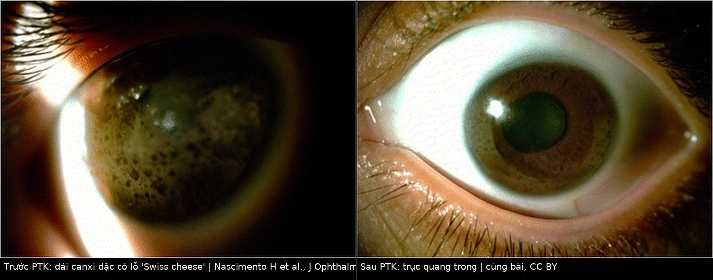

- **Ảnh ghép** tạo bằng `tools/make_composite.py` (letterbox nền đen, **không crop/kéo giãn**), từ hai ảnh **CC BY** của cùng một bài (PMC4654727).

## 4. Protocol chụp/khám + hệ phân độ + sơ đồ quyết định

### 4.1 Đèn khe — 6 bước bắt buộc

1. **Đếm và mô tả:** vị trí dải so với **khe mi**, **chiều cao dải (mm)**, **cách rìa bao xa (mm)**, có **lỗ Swiss cheese** không, **có vào trục quang** không.
2. **Soi ngược sáng (retroillumination)** từ đồng tử: lỗ và vùng canxi mỏng **nổi rõ** hơn ánh sáng trực tiếp.
3. **Fluorescein:** tìm **khuyết biểu mô/trợt** trên mặt canxi (nguồn gốc đau; nguy cơ nhiễm).
4. **Đo thị lực + độ chói (glare)** trước và sau khi **che/khuếch tán** — đánh giá phần mờ do dải canxi so với đục thể thủy tinh.
5. **Nhãn áp, soi đồng tử – thể thủy tinh, đáy mắt:** vì phần lớn bệnh nhân có bệnh nền (viêm màng bồ đào, dầu silicone, glôcôm).
6. **Hai mắt** — dải canxi do nguyên nhân hệ thống thường **đối xứng**.

### 4.2 AS-OCT — thông số và số phải ghi vào hồ sơ

- Lát **cắt ngang qua đỉnh dải** (và 1 lát qua vùng trong nhất tới trục quang), chế độ **corneal/anterior segment**, đo:
  - **độ dày dải tăng phản xạ (µm)**;
  - **độ dày nhu mô còn lại dưới dải (µm)** — **chốt an toàn**, cần **≥ 250 µm** nếu định PTK (PMC11476468);
  - **có/không bóng mờ phía sau** (dấu xác định cặn đặc — PMC12997402);
  - **bản đồ bề dày giác mạc** nếu có (loạt PTK chọn **> 450 µm** — PMC4654727).
- **Không dùng bản đồ biểu mô** làm tiêu chí quyết định ở dải canxi gồ ghề (dữ liệu **không đáng tin** — PMC11476468).

### 4.3 Xét nghiệm nguyên nhân (không có guideline riêng — **suy luận** từ cơ chế)

- **Tối thiểu:** calci hiệu chỉnh theo albumin, phospho, **PTH**, ALP, creatinine/eGFR, 25-OH vitamin D.
- **Khi nghi sarcoidosis/myeloma:** ACE, điện di protein huyết thanh/nước tiểu, calci niệu 24 giờ.
- **Khi có viêm nội nhãn:** đánh giá uveitis (JIA ở trẻ) trước khi mổ — **điều trị viêm trước**, nếu không dải canxi tái phát (PMC4654727; PMC12818042).

### 4.4 Hai hệ phân độ dùng trong thực hành

| Hệ | Cách đo | Thang | Ghi chú |
|---|---|---|---|
| **Porter–Crombie/Tokuyama** | đèn khe | **0** không có; **1** chỉ kết mạc; **2** kết mạc + rìa; **3** kết mạc + **một đường** giác mạc; **4** đường giác mạc rõ + kết mạc; **5** lan rộng | Dùng trong nghiên cứu tiên lượng (tử vong); **chủ quan**, bỏ sót tổn thương dưới lâm sàng (PMC12997402) |
| **AS-OCT (Pessoa)** | AS-OCT | **0** không tín hiệu; **1** kết mạc rời rạc; **2** kết mạc dạng đường; **3** kết mạc dạng cục/nốt; **4** **có tổn thương giác mạc (dải canxi)** | Nhạy hơn đèn khe (82,7% vs 43,8–60,6%); **không tương quan** với điểm calci mạch vành (PMC12997402) |

### 4.5 Cây quyết định điều trị

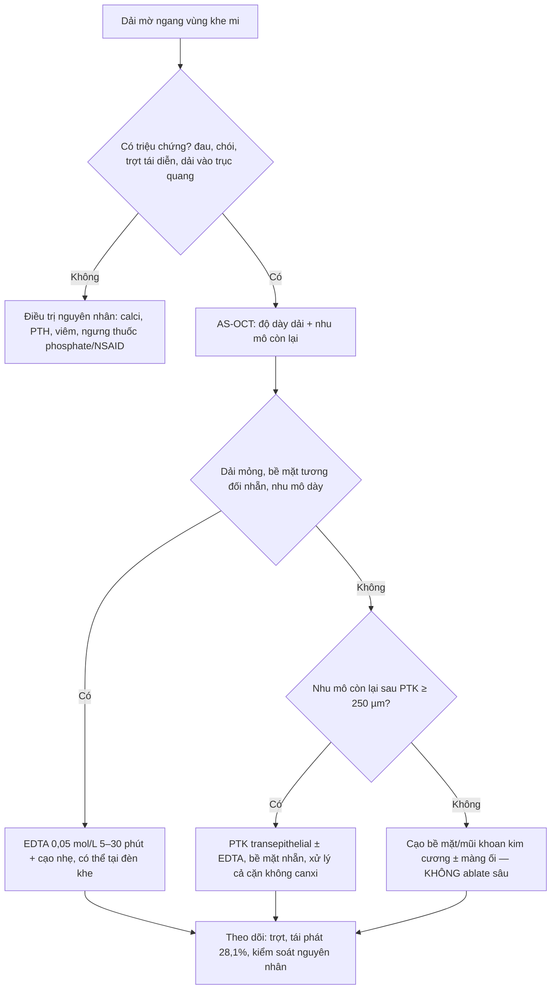

## 5. Biến thể bình thường và cạm bẫy

- **Biến thể bình thường:** **vành rìa Vogt** (vệt trắng ở 3 và 9 giờ, người già) — **không lan vào trung tâm, không triệu chứng, không cần mổ**; cũng đừng gọi **dải canxi nhẹ mới ở rìa** ở bệnh nhân lọc máu là "loạn dưỡng".
- **Cạm bẫy 1 — bóc mà không đo:** bề mặt canxi **cứng, gồ ghề**; cạo mạnh hoặc ablate sâu trên nhu mô mỏng → **loét, tan chảy, thủng**. Luôn có **số nhu mô tồn dư** trước khi can thiệp (PMC11476468; PMC4654727).
- **Cạm bẫy 2 — "tái phát" do cặn KHÔNG phải canxi:** EDTA chỉ hòa tan canxi; cặn **protein/không canxi** còn lại → bề mặt vẫn mờ, bị gọi là tái phát. Đây là lý do nhóm PTK nhấn mạnh **PTK xử lý được cả cặn không canxi**, trong khi **tái phát sau EDTA là 28,1%** (PMC11476468; PMC12997402).
- **Cạm bẫy 3 — sau phaco đau + mờ, tưởng nhiễm trùng:** bệnh nhân **81 tuổi**, 3 tuần sau phaco, **lạm dụng NSAID + dexamethasone có tá dược phosphate** → **khuyết biểu mô + tan chảy nhu mô + lắng đọng calci-phosphate**; **ngừng thuốc** + kính tiếp xúc điều trị + thuốc **không chất bảo quản** giúp biểu mô liền, và ca này còn phải **ghép giác mạc xuyên lớp (DALK)** vì tan chảy (PMC11719203). Bài học: **hỏi thuốc nhỏ**, không chỉ tìm vi khuẩn.
- **Cạm bẫy 4 — đọc AS-OCT quá tay:** **bản đồ biểu mô sai** ở bề mặt gồ ghề; và **điểm canxi hóa trên AS-OCT KHÔNG tương quan với điểm calci mạch vành** — đừng hứa với bệnh nhân "mắt nói lên tim" (PMC12997402; PMC11476468).
- **Cạm bẫy 5 — mắt teo nhãn còn đau:** dải canxi trên **mắt teo (phthisis)** hoặc mắt bơm dầu silicone **vẫn tiến triển theo thời gian lưu dầu** (nguy cơ tăng rõ **≥ 10 tháng**, PMC8342885); mổ long não, võng mạc hỏng thì **mục tiêu là giảm đau**, phải nói rõ trước mổ.

## 6. Tự lượng giá — Blind Quiz

**Ca 1 — Nam 58 tuổi, mắt phải chấn thương vùng III, đã mổ thể thủy tinh + bơm dầu silicone. Sau 8 tháng thấy mờ dần và chói.**

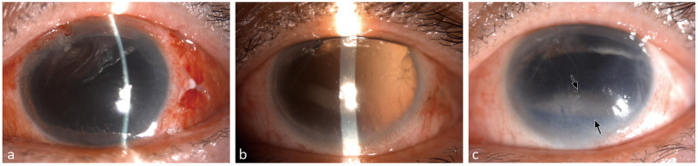

- Gợi ý: thị lực sáng tối, nhãn áp 10 mmHg, mắt không đỏ.
- Câu hỏi: (1) Dấu hiệu ở (c)? (2) Nêu 3 chẩn đoán phân biệt? (3) Yếu tố nào trên tiền sử quyết định nguy cơ?

<b>Bấm để hiện đáp án (findings + chẩn đoán)</b>

- **Dấu hiệu:** dải xám ngang vùng khe mi xuất hiện **sau 8 tháng** bơm dầu (mũi tên đen trong ảnh gốc), bề mặt sần, có lỗ nhỏ — **dải canxi**.
- **Chẩn đoán:** **band keratopathy** trên mắt **không còn thể thủy tinh + bơm dầu silicone**.
- **Vì sao:** mắt **mất hàng rào thể thủy tinh–mống mắt** làm dầu tiếp xúc nội mô/giác mạc; thời gian lưu dầu là yếu tố nguy cơ độc lập — nhóm bệnh **13,96 ± 10,71** vs **7,86 ± 6,81 tháng** (p = 0,001), nguy cơ tăng rõ **≥ 10 tháng**.
- **Phân biệt:** phù giác mạc do mất bù nội mô (dày toàn bộ, không bóng mờ), lắng đọng canxi do thuốc, loạn dưỡng (không theo khe mi).
- **Xử trí:** AS-OCT đo dày dải/nhu mô; mục tiêu **giảm đau, giữ trục quang**; xét calci/PTH vì bệnh cảnh chấn thương không loại trừ nguyên nhân toàn thân.
- **Nguồn ảnh:** He K et al., *Front Med* 2021 (PMC8342885), Fig. 1, **CC BY 4.0** — nguyên bản.

**Ca 2 — Nữ 62 tuổi, chói và đau rát mắt trái 4 tháng; đèn khe chỉ thấy "mờ nhẹ", nghi đục thể thủy tinh. AS-OCT được chỉ định.**

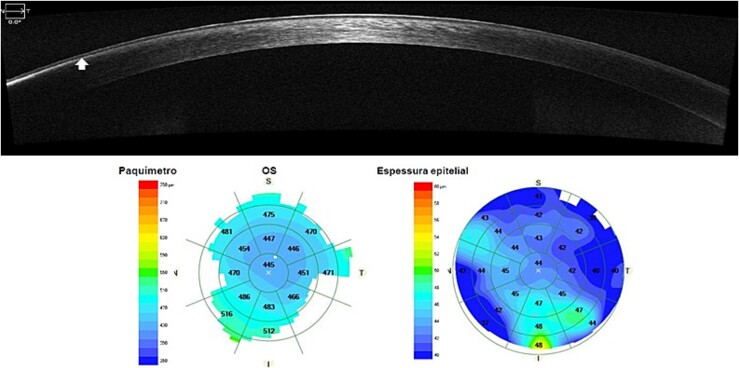

- Gợi ý: bệnh nhân suy thận mạn giai đoạn 4, không dùng thuốc nhỏ mắt.
- Câu hỏi: (1) Mô tả tổn thương trên AS-OCT? (2) "Bóng mờ phía sau" nghĩa là gì? (3) Cần đo thêm gì trước khi quyết định bóc?

<b>Bấm để hiện đáp án (findings + chẩn đoán)</b>

- **Dấu hiệu:** **dải tăng phản xạ mảnh dưới biểu mô** (mũi tên trắng) **kèm bóng mờ phía sau** — dấu của lắng đọng **đặc, cản sáng** (canxi hydroxyapatit); bản đồ bề dày cho số đo µm.
- **Chẩn đoán:** **dải canxi giai đoạn sớm** — AS-OCT **phát hiện trước đèn khe** (tỷ lệ 82,7% khi sàng lọc bằng AS-OCT ở bệnh nhân lọc máu).
- **Cần đo:** **độ dày nhu mô còn lại** dưới dải (**≥ 250 µm** nếu PTK) và **độ dày dải**; ghi **có/không bóng mờ**.
- **Vì sao quan trọng:** đây là ca "đục thể thủy tinh" giả — mổ phaco mà không xử lý dải canxi thì **thị lực vẫn kém**, và ngược lại bóc canxi khi chưa đánh giá nhu mô có thể **thủng**.
- **Nguồn ảnh:** Tardão G et al., *J Surg Case Rep* 2025 (PMC11844240), Fig. 2, **CC BY-NC 4.0** — nguyên bản.

**Ca 3 (nâng cao) — Nữ 81 tuổi, 3 tuần sau phaco "trơn", mắt đau nhiều, giác mạc mờ dần; bác sĩ tuyến trước nghĩ "viêm giác mạc".**

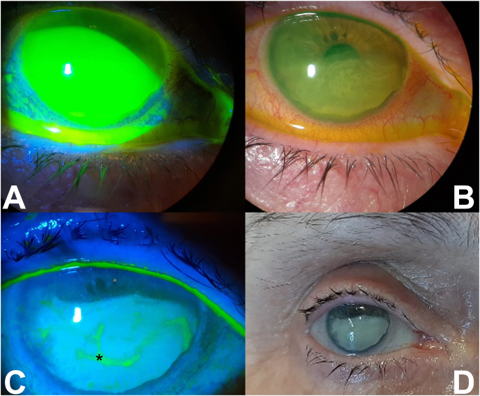

- Gợi ý: bệnh nhân nhỏ **NSAID + dexamethasone** nhiều lần/ngày sau mổ; cấy âm.
- Câu hỏi: (1) Hai tổn thương cùng lúc là gì? (2) Vì sao canxi lại xuất hiện sau mổ? (3) Việc đầu tiên phải làm?

<b>Bấm để hiện đáp án (findings + chẩn đoán)</b>

- **Dấu hiệu:** **khuyết biểu mô rộng + tan chảy nhu mô** (A) rồi **dải canxi trắng ở phía dưới** (B); biểu mô liền lại nhưng **đục trắng tiến triển** (C, D).
- **Chẩn đoán:** **tan chảy giác mạc do độc chất (NSAID) + lắng đọng calci-phosphate do tá dược phosphate** trên bề mặt đã mất biểu mô.
- **Vì sao:** NSAID nhỏ mắt kéo dài **giảm cảm giác giác mạc → trợt → tan chảy**; khi biểu mô mất, **phosphate trong thuốc kết tủa với calci** của phim nước mắt/mô → cặn canxi. **Cấy âm không loại trừ** độc chất.
- **Việc đầu tiên:** **ngừng ngay thuốc nghi ngờ**, dùng **kính tiếp xúc điều trị + nước mắt nhân tạo/kháng sinh/corticoid đều KHÔNG chất bảo quản**; ca này tiến triển tới **DALK**.
- **Bài học:** "mờ + đau sau phaco" **không mặc định là nhiễm trùng**; **hỏi thuốc** quan trọng ngang cấy.
- **Nguồn ảnh:** Ferreira AM et al., *Am J Ophthalmol Case Rep* 2025 (PMC11719203), Fig. 1, **CC BY-NC 4.0** — nguyên bản.

### Ảnh minh hoạ thêm (mục 2 và mục 4)

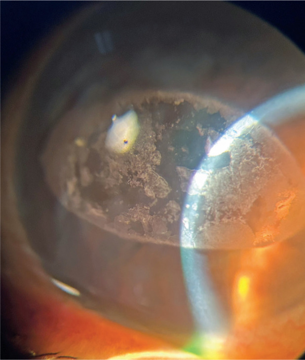

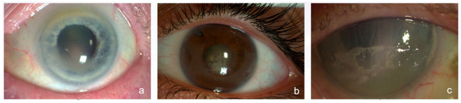

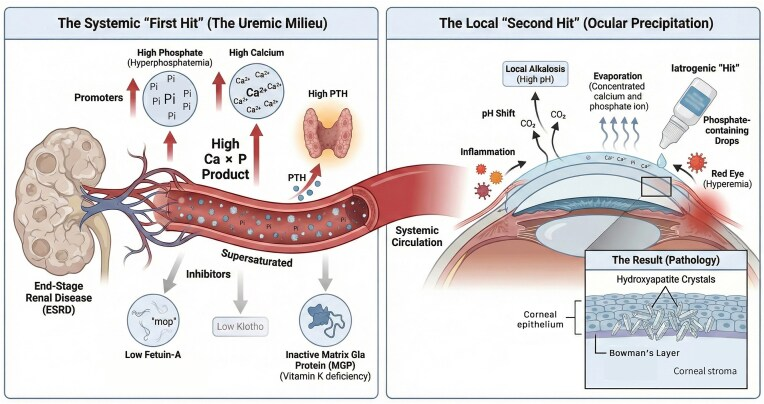

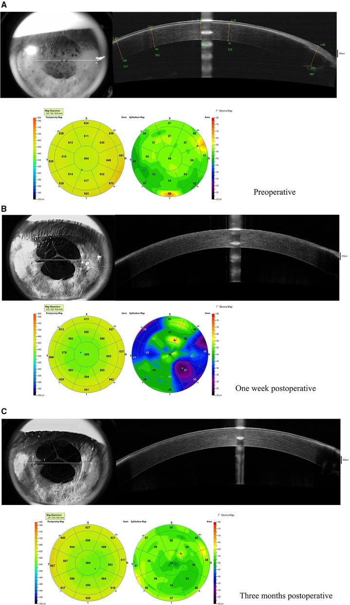

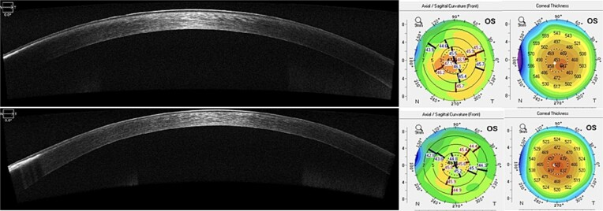

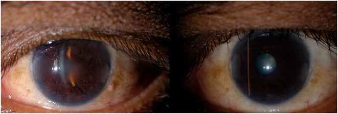

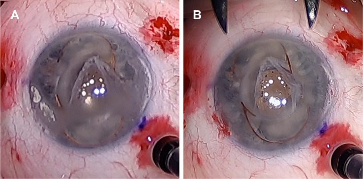

## Bài liên quan chéo

- [400 — Tổng quan Mắt & thị giác](../400-tong-quan-mat-thi-giac/lesson.md) — bản đồ chủ đề, bảng chẩn đoán phân biệt toàn hệ.
- [3203 — Đe dọa thủng & thủng giác mạc: keo, màng ối, nút Tenon](../3203-de-doa-thung-giac-mac/lesson.md) — áp dụng khi bóc canxi làm lộ nhu mô mỏng.
- [3204 — Loét giác mạc do thần kinh](../3204-loet-giac-mac-than-kinh/lesson.md) — trợt tái diễn trên bề mặt canxi gồ ghề dễ bị gọi là loét thần kinh.
- [3205 — Loét giác mạc do lạm dụng thuốc tê & độc tính BAK](../3205-loet-giac-mac-do-thuoc-te-bak/lesson.md) — cùng nguyên lý **độc chất bề mặt**; ca NSAID/phosphate ở đây là biến thể.
- [3207 — Viêm củng mạc](../3207-viem-cung-mac-scleritis/lesson.md) — cùng dùng **AS-OCT** để đo mô không mạch; phân biệt **đỏ mắt** với **mờ giác mạc**.
- [6132 — Viêm giác mạc nhiễm khuẩn liên quan kính tiếp xúc](../6132-viem-giac-mac-kinh-tiep-xuc/lesson.md) — phân biệt **thâm nhiễm viêm** với **lắng đọng canxi không viêm**.
- [1460 — Viêm giác mạc do nấm](../1460-viem-giac-mac-do-nam/lesson.md) — bờ tua, vệ tinh; không có bóng mờ kiểu canxi.

## Ảnh

- `3208_dai-canxi-kinh-dien_Anh-mau_PMC12818042-Fig.jpg` — dải canxi kinh điển (CC BY 4.0).
- `3208_dai-canxi_Anh-mau_PMC8342885-Fig1.jpg` — dải canxi trên mắt chấn thương bơm dầu silicone (CC BY 4.0).
- `3208_phan-do-nhe-vua-nang_Anh-mau_PMC11476468-Fig1.jpg` — phân độ nhẹ/vừa/nặng trên đèn khe (CC BY 4.0).
- `3208_co-che-hai-don_So-do_PMC12997402-Fig1.jpg` — sơ đồ cơ chế "hai cú đánh" (CC BY 4.0).
- `3208_AS-OCT-day-canxi_PMC11844240-Fig2.jpg` — AS-OCT dải tăng phản xạ + bóng mờ (CC BY-NC 4.0).
- `3208_AS-OCT-1-nam-sau_PMC11844240-Fig4.jpg` — AS-OCT 1 năm sau PTK, ngoại vi nặng lên (CC BY-NC 4.0).
- `3208_AS-OCT-truoc-sau-PTK_PMC8423897-Fig3.jpg` — AS-OCT trước–sau PTK (CC BY 4.0).
- `3208_PTK-truoc_Anh-mau_PMC4654727-Fig1.jpg`, `3208_PTK-sau_Anh-mau_PMC4654727-Fig2.jpg` — trước/sau PTK trên mắt viêm màng bồ đào (CC BY 4.0).
- `3208_EDTA-truoc-sau_Anh-mau_PMC8423137-Fig1.jpg` — trước/sau bóc bằng EDTA (CC BY-NC-ND 4.0, **nguyên bản**).
- `3208_diamond-burr_Anh-mau_PMC6171751-Fig1.jpg` — mũi khoan kim cương không EDTA (CC BY-NC 4.0).
- `3208_NSAID-melting_Anh-mau_PMC11719203-Fig1.jpg` — tan chảy + canxi hóa do NSAID/phosphate (CC BY-NC 4.0).
- `composite_truoc-sau-PTK.jpg` — ảnh ghép đối chiếu trước/sau PTK (CC BY 4.0, từ hai ảnh PMC4654727).
- Nguồn + giấy phép từng ảnh: `images/CREDITS.md`.

> Không dùng để chẩn đoán độc lập khi chưa có người hướng dẫn.
