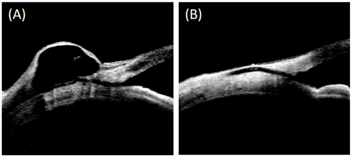
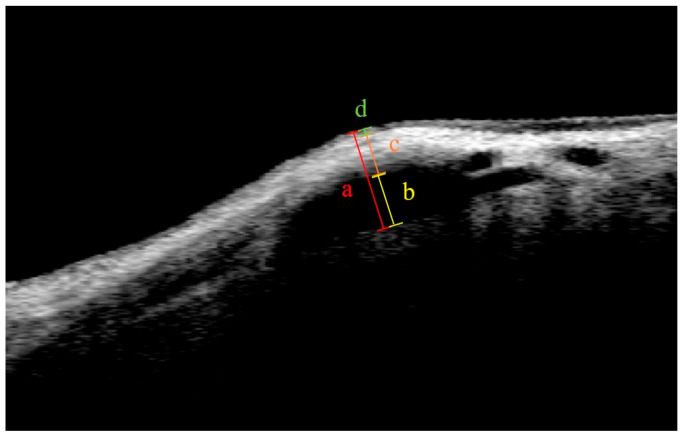
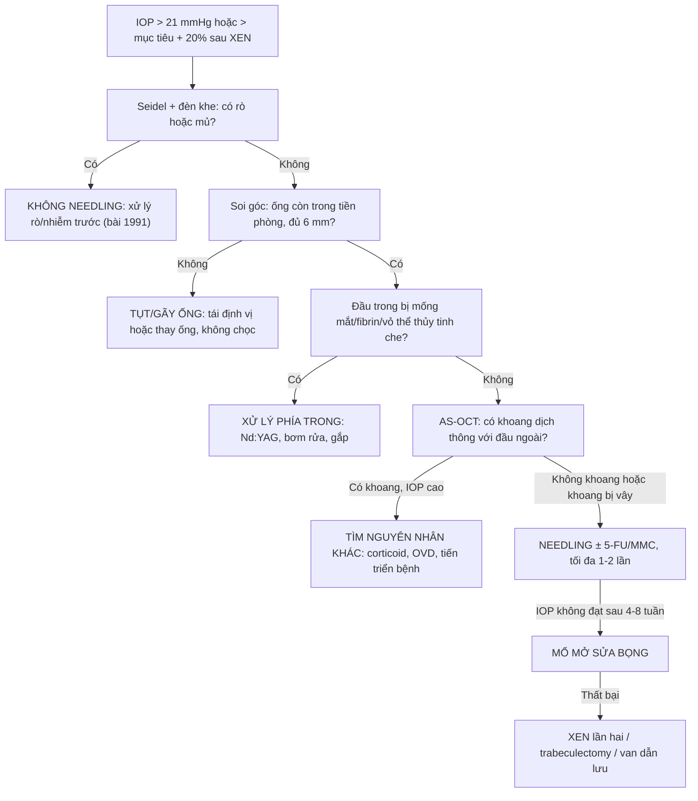
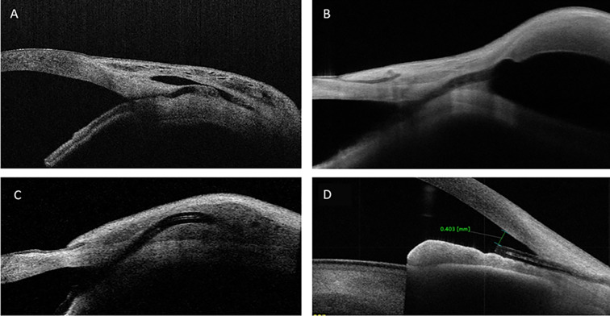
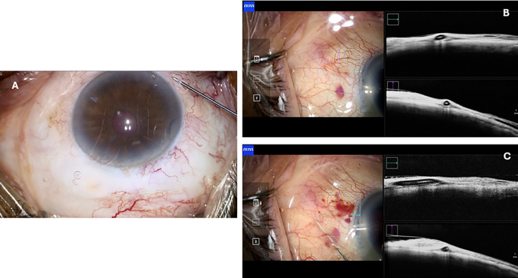

# 3209 — Bọng dẹt sau ống XEN gel stent: bít đầu trong, bít lòng 45 µm hay bao xơ đầu ngoài — đọc bằng AS-OCT và quyết định needling / Bleb failure after XEN gel stent

**Tags:** `pattern:bong-det` `pattern:bong-xo-dau-ngoai` `pattern:bit-long-stent` `pattern:bit-dau-trong` `pattern:nang-tenon` `pattern:tut-stent` `pattern:ring-of-steel` `vung:mat` `vung:bong-loc` `vung:tien-phong` `vung:goc-tien-phong` `protocol:AS-OCT` `protocol:gonioscopy` `protocol:needling` `score:IOP` `score:chieu-cao-bong`

**Mức chắc chắn (certainty):** tổng hợp y văn (literature synthesis) — ghép **1 đoàn hệ 773 mắt / 596 bệnh nhân** về tỉ lệ và thời điểm needling – revision sau XEN (Wenzel CJ et al., *Graefes Arch Clin Exp Ophthalmol* 2026, PMID 42033482, PMC13578004, CC BY 4.0), **1 đoàn hệ 18 mắt có AS-OCT định lượng 6 tháng và 1 năm** (Wy S et al., *J Clin Med* 2023, PMID 37959206, PMC10648008, CC BY 4.0), **1 so sánh 80 mắt XEN vs PreserFlo bằng AS-OCT** (Hasan SM et al., *Diagnostics* 2023, PMID 37510061, PMC10377986, CC BY 4.0), **1 phân tích mô học 36 bọng thất bại** (Neubauer J et al., *Graefes Arch Clin Exp Ophthalmol* 2024, PMID 38625448, PMC11377475, CC BY 4.0), **1 tổng quan tự thuật về XEN** (Millá Griñó E et al., *Ophthalmol Ther* 2026, PMID 41499089, PMC12901802, CC BY-NC 4.0 — **có xung đột lợi ích: một số tác giả là nhân viên hãng**) và **1 nghiên cứu 20 mắt XEN63 ± Healaflow** (Guerin PL et al., *J Clin Med* 2025, PMID 40869674, PMC12387734, CC BY 4.0). Chỗ suy luận ghi rõ "suy luận"; ngưỡng chưa có dữ liệu cho người Việt ghi "chưa rõ".

> **Vì sao bài này quan trọng:** [1992](../1992-needling-bong-loc-sau-trabeculectomy/lesson.md) dạy chọc bọng sau **trabeculectomy**, [1996](../1996-tac-tut-ong-van-dan-luu-glaucoma/lesson.md) dạy đọc **ống van dẫn lưu**, còn [3206](../3206-bong-cang-sau-van-dan-luu-glaucoma/lesson.md) dạy **bao xơ quanh bản van**. Ống **XEN gel stent** không thuộc cả ba: nó là một **ống gelatin 6 mm xuyên củng mạc**, lòng chỉ **45 µm** (XEN45) hoặc **63 µm** (XEN63), **không có bản van** và **không có vỏ xơ quanh bản** — nên câu "bọng dẹt, nhãn áp (intraocular pressure, IOP) tăng" phải được đọc theo **4 vị trí dọc ống**, không theo phản xạ "chọc bọng". Cái bẫy lớn nhất là **chọc đúng vào chỗ không có ống** hoặc **chọc vào một ống đang bị bít từ bên trong**: needling chỉ phá **bao xơ ngoài ống**, không thông được lòng 45 µm. Trong đoàn hệ 773 mắt, **53,9%** phải needling ít nhất một lần và **17,8%** phải mổ mở sửa bọng — nghĩa là đây không phải biến cố hiếm mà là **một phần của quy trình theo dõi** (Wenzel 2026).

## 1. Tổng quan bệnh học – cơ chế hình ảnh: vì sao một ống 45 µm vừa chống hạ áp, vừa dễ bít

### 1.1 Ống XEN là gì — và vì sao lòng 45 µm là con dao hai lưỡi

- XEN45 Gel Stent: **dài 6 mm**, đường kính lòng **45 µm**, làm bằng **gelatin chiết từ lợn** (hydrophilic, mềm, phân hủy sinh học rất chậm); XEN63 có lòng **63 µm**; loại **140 µm** từng thử nhưng không còn dùng rộng (Wy 2023; Millá Griñó 2026).
- Ống đi từ **góc tiền phòng**, xuyên củng mạc, ra **khoảng dưới kết mạc**. Đầu trong nằm **trước bè củng mạc**, đầu ngoài **3 mm sau rìa giác mạc** (kỹ thuật ab interno) — vì vậy trên AS-OCT phải tìm ống **trong củng mạc và dưới kết mạc**, không chỉ trong tiền phòng.
- **Vật lý quyết định thiết kế:** trở lực lòng ống theo **Poiseuille R = 8µL/(πr⁴)**. Giảm đường kính từ 63 xuống 45 µm (tỉ lệ bán kính **1,4**) làm trở lực tăng **1,4⁴ ≈ 3,8 lần** (**suy luận** từ công thức, không phải số đo). Đó là lý do XEN45 được thiết kế để **tự hạn chế lưu lượng** và tránh hạ áp quá mức, còn XEN63 hạ áp sâu hơn nhưng **nguy cơ hạ áp cao hơn** (Millá Griñó 2026).
- **Hệ quả lâm sàng:** cùng một cục fibrin, một sợi máu hay một mảnh vỏ thể thủy tinh có thể bít **hoàn toàn** lòng 45 µm — trong khi với ống van 0,30 mm của [1996](../1996-tac-tut-ong-van-dan-luu-glaucoma/lesson.md) phải có **màng fibrin dày** mới đủ tăng trở lực. Ống càng nhỏ, **ngưỡng bít càng thấp**.

### 1.2 Ba điện trở nối tiếp — và vì sao phải định vị đúng tầng

Sau khi đặt ống, dòng thủy dịch đi qua **ba điện trở nối tiếp**:

1. **Đầu trong (inner ostium)** — có thể bị **mống mắt**, **fibrin**, **máu**, **vỏ thể thủy tinh** (nhất là khi phối hợp phaco) bít.
2. **Lòng ống (lumen)** — 45/63 µm, dễ bị **cục fibrin**, **máu**, **tổ chức hóa**.
3. **Đầu ngoài + thành bọng (outer ostium + bleb wall)** — mô xơ do nguyên bào sợi, tuân theo **định luật Darcy** (Q = k·A·ΔP/(µ·Δx)); đây là nơi **needling có tác dụng**.

- **Vì sao phải phân tầng:** needle đi từ ngoài vào chỉ cắt được **tầng 3**. Nếu điện trở nằm ở **tầng 1 hoặc 2**, chọc bọng tạo ra một khoang dịch đẹp trên AS-OCT nhưng **IOP không giảm**, rồi bọng xẹp lại trong **vài ngày đến vài tuần** — và mỗi lần chọc là một lần thêm nguy cơ nhiễm, rò, tổn thương ống.
- **Tầng 1 và 2 nhìn thấy bằng gì:** soi góc (gonioscopy) thấy **đầu trong và độ dài ống trong tiền phòng**; AS-OCT thấy **đầu ngoài, vị trí ống trong củng mạc/Tenon** và **khoang dịch**. Không có một thăm khám nào trả lời cả ba tầng.

### 1.3 Vì sao AS-OCT đọc được bọng XEN — và một phản trực giác quan trọng

- AS-OCT dùng bước sóng **~1310 nm**, xuyên kết mạc và củng mạc tốt hơn OCT võng mạc: **dịch trong bọng = giảm hồi âm (đen)**, **kết mạc–Tenon xơ = tăng hồi âm (xám–trắng)**, **ống XEN = hai đường song song tăng hồi âm** (thành ống) với lòng ở giữa.
- **Số liệu định lượng:** ở 18 mắt XEN45, sau **1 năm**, nhóm có **khoang nội bọng (internal cavity)** rõ có chiều cao bọng **1,28 ± 0,47 mm** so với **0,70 ± 0,35 mm** ở nhóm **đồng nhất (uniform, không khoang)**; chiều cao khoang ở nhóm có khoang là **0,86 ± 0,56 mm**. IOP lúc 1 năm: **15,0 ± 4,2 mmHg** so với **19,2 ± 5,7 mmHg** (p = 0,040), mức giảm **39,1%** so với **21,9%** (Wy 2023).
- **Tương quan:** IOP sau mổ tương quan **nghịch** với **chiều cao bọng** (r = −0,518; p = 0,028) và **chiều cao khoang** (r = −0,453; p = 0,034) — bọng càng cao, khoang càng lớn thì IOP càng thấp.
- **Phản trực giác:** **độ dày thành bọng KHÔNG tương quan với IOP** (p = 0,844) và **độ dày biểu mô cũng không** (p = 0,619) trong cùng nghiên cứu. Nói cách khác, **"thành dày" một mình không phải lý do để chọc** — điều quyết định là **có khoang dịch thông thoáng hay không**. Đây là khác biệt căn bản so với bọng sau trabeculectomy, nơi thành dày thường đi cùng bọng xơ.
- **Hình thái bọng XEN "chức năng"** (định nghĩa IOP ≤ 21 mmHg và giảm ≥ 20% không tăng thuốc) trong 39 mắt: cao **1,85 ± 0,6 mm**, rộng **9,1 ± 2,3 mm**, dài **8,24 ± 1,9 mm**, thành **1,1 ± 0,4 mm**; **35,9%** có thay đổi dạng hang (cavernous), **30,8%** có **hồ nước thượng củng mạc (episcleral lake)** thấy được (Hasan 2023). Con số này là **mốc tham chiếu**, không phải ngưỡng chẩn đoán.

*Hai kiểu bọng sau XEN45 trên AS-OCT tại 1 năm. (A) Khoang dịch rõ (đen) dưới kết mạc, chiều cao bọng **1,28 mm**, IOP **15,0 mmHg**. (B) Bọng "đồng nhất" không có khoang, chiều cao **0,70 mm**, IOP **19,2 mmHg**. Điểm cần nhớ: **khoang dịch — không phải độ dày thành — mới là thứ tương quan với IOP**. Nguồn: Wy S et al., *J Clin Med* 2023 (PMC10648008), Fig. 2, **CC BY 4.0** — nguyên bản.*

### 1.4 Mô bệnh của bọng XEN thất bại: xơ hóa "lạnh", không phải viêm

- 36 bọng phải mổ sửa (10 XEN, 26 PreserFlo), thời điểm sửa **trung vị 195 ngày** (31–1264 ngày): mô học cho thấy **nguyên bào sợi hoạt hóa và đại thực bào tăng ở 100% mẫu**, **60%** có nguyên bào sợi xếp song song, **92%** có **nguyên bào cơ (myofibroblast) α-SMA dương tính** — nhưng **KHÔNG có phản ứng viêm rõ** (không thâm nhiễm lympho/bạch cầu hạt, không phản ứng dị vật) (Neubauer 2024).
- **Vì sao điều này quan trọng:** nếu xơ hóa không kèm viêm, thì **tăng corticoid nhỏ giọt không làm mỏng bao xơ đã hình thành**; và **không có phản ứng dị vật với gelatin** — nghĩa là thất bại không phải do "cơ thể đào thải ống", mà do **sinh học vết thương của thủy dịch**. Cơ chế được nhóm tác giả nghiêng về: **cytokine trong thủy dịch** (TGF-β, PDGF, VEGF, TNF-α) kích hoạt đại thực bào và nguyên bào sợi dưới kết mạc.
- **Hiệu quả của việc mở bọng khi đã thất bại:** IOP **29,1 ± 10,3 mmHg** trước sửa → **10,8 mmHg** lúc 1 tháng → **18,3 ± 8,7 mmHg** lúc 6 tháng → **16,2 ± 4,2 mmHg** lúc 12 tháng (n = 36; p < 0,0001 so với trước) (Neubauer 2024). Tức là **sửa bọng có hiệu quả thật**, nhưng **không phải sửa một lần là xong** — IOP có xu hướng bò lên lại.

## 2. Mẫu hình + chẩn đoán phân biệt theo vị trí (Gamut)

Nguyên tắc: **"bọng dẹt + IOP tăng" là một triệu chứng, không phải chẩn đoán**. Hãy đi dọc ống từ trong ra ngoài theo **TUBE**:

| Chữ | Vị trí | Nội dung | Thời điểm điển hình |
|---|---|---|---|
| **T** | **Tip** — đầu trong | Mống mắt, fibrin, máu, vỏ thể thủy tinh bít miệng ống | **ngày–tuần** (sớm) |
| **U** | **Under Tenon** — vị trí ống | Ống nằm **trong Tenon** thay vì dưới kết mạc → ít nang, thoát kém | phát hiện **1–3 tháng** |
| **B** | **Block** — lòng ống | Cục fibrin/máu/tổ chức hóa trong lòng **45–63 µm** | **ngày–tuần** |
| **E** | **Encapsulation** — đầu ngoài/thành bọng | Bao xơ khu trú ("**ring of steel**"), nang Tenon, dính kết mạc lan tỏa | **4–12 tuần** trở đi |

- **Ngoài ống (không phải thất bại ống):** **tăng IOP do corticoid**, **OVD sót**, **glôcôm ác tính**, hoặc **bệnh glôcôm tiến triển** — bọng có thể vẫn đẹp. Luôn hỏi "bọng có thật sự dẫn lưu không?" trước khi kết luận "bọng hỏng".
- **Thời gian là gợi ý, không phải chốt:** needling đầu tiên trung vị **14 tuần** nhưng khoảng dao động **0–263 tuần**; **17,8%** cần mổ mở sửa bọng, trung vị **37 tuần** (Wenzel 2026). Có **hai dân số**: xơ hóa sớm (vài tuần) và **xơ hóa muộn sau nhiều năm** — đừng chỉ theo dõi 3 tháng rồi thôi.
- **Bọng "đẹp" mà IOP cao** là gamut riêng: nang Tenon căng (dịch bị nhốt trong vỏ xơ), ống nằm trong Tenon, hoặc tăng IOP do thuốc — AS-OCT phân biệt bằng **vị trí ống** và **cấu trúc thành**.

## 3. Bảng so sánh phân biệt (ma trận đối chiếu)

| Thực thể (entity) | Hình ảnh điển hình | Chốt vào (rule-in) | Chốt loại (rule-out) | Gợi ý xác nhận |
|---|---|---|---|---|
| **Bít đầu trong do mống mắt** | Đầu ống trong tiền phòng bị mống mắt trùm; AS-OCT: mống mắt áp sát miệng ống; bọng có thể còn khoang | **Soi góc thấy mống mắt che miệng ống** + IOP tăng | Đầu ống cách mống mắt **≥ 1 thân ống**, miệng ống trống → không phải mống mắt | Soi góc, chụp AS-OCT qua góc; **Nd:YAG** tại điểm trùm |
| **Bít lòng ống (fibrin/máu/vỏ thể thủy tinh)** | Ống còn đúng vị trí, bọng dẹt nhanh **trong ngày–tuần**; AS-OCT: lòng ống có hồi âm trong lòng thay vì trống | **Bọng xẹp đột ngột sau vài ngày**, trước đó IOP tốt; không có bao xơ dày | Bao xơ đầu ngoài (bọng xẹp **từ từ** nhiều tuần, thành dày) → không phải bít lòng | Soi góc + AS-OCT độ phân giải cao; bơm rửa tiền phòng / Nd:YAG / **10-0 nylon** thông lòng (ca báo, chưa phải chuẩn) |
| **Bao xơ đầu ngoài / "ring of steel"** | Vòng xơ dày, trắng, nhiều mạch **bao quanh bọng**; AS-OCT: thành tăng hồi âm dày, **không có khoang**, ống bị "thắt" ở đầu ngoài | **Vòng xơ khu trú quanh đầu ngoài** + IOP tăng sau **4–12 tuần** + khoang dịch mất | Khoang nội bọng còn lớn + microcyst → bọng còn chức năng, không phải ring of steel | Đèn khe + AS-OCT; **needling ± 5-FU/MMC** là điều trị đầu tay |
| **Nang Tenon (encapsulated bleb)** | Bọng **căng, vòm cao, thành dày**, mạch giãn; AS-OCT: **một khoang đen lớn** nhưng thành **dày và đều**, **không microcyst** | **Bọng căng + IOP tăng** + khoang đơn độc, thành dày | Khoang có **nhiều microcyst + thành mỏng** → bọng chức năng, không phải nang Tenon | AS-OCT + đèn khe; needling có thể thất bại → **mổ mở sửa bọng** |
| **Ống nằm trong Tenon / ít nang** | Ống thấy trên AS-OCT **trong lớp Tenon**, không có khoảng dưới kết mạc; **ít khoang, ít microcyst** | **Ống không nằm ngay dưới kết mạc** + bọng dẹt + IOP tăng | Ống nằm **thượng củng mạc, dưới kết mạc**, có khoang → vị trí đúng | AS-OCT theo trục ống; **sửa vị trí/needling có kiểm soát** — không chọc mù |
| **Tụt/gãy ống vào tiền phòng** | Đầu ống **ngắn hơn 6 mm** hoặc thấy đầu ống **trong tiền phòng**; AS-OCT: khoảng cách ống–nội mô **giảm** (ví dụ **0,483 mm** trong ca minh họa) | **Soi góc thấy ống nhô vào tiền phòng** hoặc ống **ngắn bất thường**; có thể kèm **máu tiền phòng** | Ống đủ 6 mm, đầu ngoài dưới kết mạc, không chạm nội mô → không tụt | Soi góc + AS-OCT đo khoảng cách tới nội mô; **tái định vị/thay ống**, không needling |
| **Tăng IOP do corticoid** | Bọng vẫn có khoang, ống đúng vị trí; IOP tăng **sau khi tăng/đổi corticoid**, thường **2–6 tuần** | **Bọng chức năng trên AS-OCT** + IOP tăng trong thời gian dùng corticoid | Bọng dẹt/không khoang → không phải nguyên nhân do thuốc | Giảm/đổi corticoid, đo lại **1–2 tuần**; không needling |
| **Bọng dẹt do dính kết mạc lan tỏa** | Kết mạc mỏng, dính chắc vào củng mạc trên diện rộng; AS-OCT: **không có khoảng dưới kết mạc**, không khu trú | **Mất khoảng dưới kết mạc trên diện rộng** + nhiều lần needling thất bại | Vòng xơ khu trú một điểm → ring of steel, còn cứu bằng needling | Đèn khe + AS-OCT; thường cần **mổ mở tạo khoảng** hoặc chuyển chiến lược |

**Ba câu hỏi theo thứ tự, trước khi động kim:**
1. **Ống còn trong tiền phòng và đủ dài không?** (soi góc) — nếu không, đây là **tụt ống**, không phải bọng xơ.
2. **Đầu trong có bị che không?** (soi góc) — nếu có, xử lý **phía trong**; needling vô ích.
3. **Trên AS-OCT có khoang dịch thông với đầu ngoài không?** — nếu **không**, needling là hợp lý; nếu **có mà IOP vẫn cao**, tìm nguyên nhân khác (corticoid, OVD, tiến triển bệnh).

## 4. Protocol chụp/đo + phân loại + flowchart

### 4.1 Trình tự khám một mắt XEN có IOP tăng

| Bước | Việc làm | Ngưỡng / ghi nhận |
|---|---|---|
| 1 | **IOP** (Goldmann), số thuốc, thị lực | Gọi "tăng" khi **IOP > 21 mmHg** hoặc **> mục tiêu + 20%**; ghi rõ đang dùng corticoid |
| 2 | **Đèn khe**: chiều cao, vòm, mạch, microcyst, vòng xơ | Dùng **Jenaer Bleb Grading System (JBGS)**: C0–C2 (kết mạc), T0–T3 (Tenon), ES0–ES1 (hồ thượng củng mạc) |
| 3 | **Seidel test** nếu bọng mỏng/ướt | **Seidel dương = không needling**; xử lý rò trước ([1991](../1991-ro-bong-loc-muon-viem-noi-nhan/lesson.md)) |
| 4 | **Soi góc** | Đầu trong **trong tiền phòng**, **cách mống mắt**, độ dài ống, có máu/fibrin/vỏ thể thủy tinh |
| 5 | **AS-OCT** theo trục ống | Đo 4 thông số + vị trí ống + khoảng cách tới nội mô |
| 6 | **Quyết định** theo flowchart 4.4 | Không chọc khi chưa trả lời xong bước 1–3 |

### 4.2 Protocol AS-OCT bọng XEN (bám theo nghiên cứu đã công bố)

- **Thiết bị:** AS-OCT **Visante** (time-domain, 1310 nm) hoặc **ANTERION** (swept-source) — cả hai đã được dùng để đo bọng XEN (Wy 2023; Hasan 2023).
- **Cách đặt đầu dò:** bệnh nhân **nhìn xuống**, mí trên được **nâng nhẹ bằng tăm bông** — **không ấn vào bọng** (ấn sẽ làm dẹt bọng giả tạo). Chụp **song song** và **vuông góc** với trục ống.
- **Thông số quét của Hasan 2023:** hộp quét **7,5 mm**, **45 lát** mỗi hướng, **2 hướng = 90 lát** cho mỗi bọng; tắt theo dõi mắt chủ động.
- **4 thông số bắt buộc đo** (theo Wy 2023, Hình 1):
  1. **Chiều cao bọng (bleb height)** — từ bề mặt củng mạc đến đỉnh kết mạc.
  2. **Chiều cao khoang nội bọng (internal cavity height)** — phần giảm hồi âm lớn nhất.
  3. **Độ dày thành bọng (bleb wall thickness)** — từ đáy khoang đến bề mặt.
  4. **Độ dày biểu mô (epithelial thickness)** — lớp tăng hồi âm ngoài cùng.
- **Độ lặp lại:** ICC **> 0,8** cho cả 4 thông số khi 2 bác sĩ đo độc lập (Wy 2023) — đủ tin cậy để theo dõi dọc.
- **Vị trí ống:** mô tả **thượng củng mạc (supra-scleral)** vs **trong Tenon (intra-Tenon)**; đo **khoảng cách từ ống đến nội mô** khi ống nằm trong tiền phòng (ca minh họa: **0,483 mm**) (Millá Griñó 2026, Fig. 4D).

*Cách đo chuẩn hóa để so sánh giữa các lần: **a** = chiều cao bọng, **b** = chiều cao khoang nội bọng, **c** = độ dày thành, **d** = độ dày biểu mô. ICC giữa 2 người đo **> 0,8** cho cả 4 thông số. Nguồn: Wy S et al., *J Clin Med* 2023 (PMC10648008), Fig. 1, **CC BY 4.0** — nguyên bản.*

### 4.3 Phân loại thực hành trên AS-OCT (tổng hợp — không phải thang điểm đã được validate)

| Kiểu | Khoang nội bọng | Thành | Diễn giải | Hướng xử lý |
|---|---|---|---|---|
| **1. Bọng có khoang** | Rõ, có thể có microcyst | Mỏng–trung bình | Bọng chức năng | Theo dõi; nếu IOP cao tìm nguyên nhân khác |
| **2. Bọng đồng nhất** | Không có khoang | Trung bình–dày, đều | Xơ hóa lan tỏa | Needling ± 5-FU/MMC nếu IOP không đạt |
| **3. Nang Tenon** | Một khoang lớn, **không microcyst** | **Dày, đều** | Dịch bị nhốt trong vỏ xơ | Needling có thể thất bại → **mổ mở sửa bọng** |
| **4. Bọng dẹt** | Không có | Mỏng hoặc dính | Mất khoảng dưới kết mạc | Đánh giá lại vị trí ống; thường cần **mổ mở** |

> **Cảnh báo trung thực:** hiện **chưa có thang điểm AS-OCT riêng cho XEN đã được validate**. Bảng trên là tổng hợp mô tả từ 3 nghiên cứu và tổng quan, dùng để trao đổi trong nhóm — **không dùng để tự động quyết định mổ**. JBGS là thang mô tả định tính, không phải thang tiên lượng.

### 4.4 Thuật toán xử trí

### 4.5 Needling sau XEN: làm đúng chỗ, đúng thì

- **Chỉ định:** bọng **không có khoang** hoặc **bị vây bởi vòng xơ**, ống **đúng vị trí**, **đầu trong thông**, **Seidel âm**, **không nhiễm**.
- **Kỹ thuật (tổng hợp, chi tiết kim và thuốc xem [1992](../1992-needling-bong-loc-sau-trabeculectomy/lesson.md)):**
  - Kim **27G hoặc 30G** (tổng quan XEN dùng cả hai; đầu tù cho mô dày) (Millá Griñó 2026).
  - Vào **cách bọng/ống 5–8 mm**, đi **đường hầm dưới kết mạc**, **hướng mũi kim ra xa ống**; **không xuyên qua thành bọng** vào tiền phòng.
  - Động tác **quét lên–xuống/phải–trái** để **bẻ dải xơ** quanh đầu ngoài; mục tiêu là **tạo khoang thông** với đầu ống, không phải "chọc thủng" ống.
  - **Không bơm nước vào tiền phòng qua đường chọc**, không đẩy mạnh về phía ống.
- **Chất chống xơ:** thực hành rất khác nhau — trong 417 lần needling đầu tiên của đoàn hệ 773 mắt: **5-FU 38,6%**, **MMC 13,7%**, **không dùng 47,7%** (Wenzel 2026). Đây là **mô tả thực hành**, không phải khuyến cáo chọn thuốc; liều 5-FU **5 mg**, MMC **20–60 µg** theo [1992](../1992-needling-bong-loc-sau-trabeculectomy/lesson.md).
- **Kết quả thực tế:** needling là **bước đệm**, không phải chữa khỏi — **17,8%** mắt vẫn phải **mổ mở sửa bọng**, và khoảng cách trung vị từ needling đến mổ mở là **7 tuần** (Wenzel 2026). Nói với bệnh nhân "chọc một lần là xong" là **hứa quá**.
- **Theo dõi sau needling:** IOP **ngày 1, tuần 1, tháng 1**; AS-OCT lại **1–3 tháng** để xem khoang có duy trì; nếu IOP tăng lại **trong 4–8 tuần** → cân nhắc **mổ mở** thay vì chọc lần 3.
- **Khi KHÔNG needling:** **Seidel dương**, **nghi nhiễm bọng**, **ống đã tụt vào tiền phòng**, **ống gãy**, **bọng dẹt do dính lan tỏa** (chọc chỉ tạo khoang giả), hoặc **IOP cao nhưng bọng có khoang đẹp** (tìm corticoid/OVD/tiến triển bệnh).

### 4.6 XEN45 hay XEN63 — chọn cỡ lòng ảnh hưởng đến cách đọc bọng

| Đặc điểm | XEN45 | XEN63 |
|---|---|---|
| Đường kính lòng | **45 µm** | **63 µm** |
| Trở lực (theo Poiseuille, r⁴) | Cao hơn | **Thấp hơn ~3,8 lần** (suy luận từ công thức) |
| Hạ áp | Ít sâu hơn | **Sâu hơn** |
| Nguy cơ hạ áp / rò quanh ống | Thấp hơn | **Cao hơn** (tổng quan) |
| Needling / sửa bọng | **53,9%** needling, **17,8%** mổ mở (đoàn hệ XEN45) | Báo cáo **10–41%** needling/revision (XEN63, 20 mắt) |

- **Vì sao phải biết cỡ lòng khi đọc AS-OCT:** cùng một "bọng dẹt", XEN63 có thể vẫn đủ lưu lượng qua lòng rộng hơn trong khi XEN45 đã bị bít hoàn toàn bởi cục fibrin nhỏ. **Không suy ra mức tắc từ hình ảnh bọng** — phải soi góc và đo IOP.

## 5. Biến thể bình thường và cạm bẫy

1. **Thành dày không đồng nghĩa thất bại.** Trong 18 mắt XEN, độ dày thành và độ dày biểu mô **không tương quan với IOP** (p = 0,844 và 0,619). Chọc bọng chỉ vì "thành dày" là **chọc oan**.
2. **Khoang đen lớn có thể là nang Tenon, không phải khoang chức năng.** Khác biệt nằm ở **thành dày, đều, không microcyst** và **bọng căng** — không phải ở kích thước khoang.
3. **Bốn tuần đầu, hình thái thay đổi rất nhanh.** Nghiên cứu AS-OCT XEN loại trừ bọng trong **4 tuần đầu** vì lý do này (Hasan 2023). Đừng đo rồi kết luận "xơ hóa" khi bọng còn đang tái định hình.
4. **Ấn tăm bông làm dẹt bọng giả.** Kỹ thuật chuẩn là **nâng mí nhẹ**, không tì vào bọng; nếu ấn, bạn đang đo **lực ấn của mình**, không đo bọng.
5. **Thấy ống ≠ ống thông.** Lòng 45 µm nằm dưới độ phân giải của nhiều máy; AS-OCT thấy **thành ống** chứ không chứng minh **dòng chảy**. Phải kết hợp soi góc + đáp ứng IOP.
6. **Ống trong tiền phòng quá gần nội mô.** Ca minh họa đo **0,483 mm**; khoảng cách giảm dần theo thời gian là **nguy cơ mất nội mô**, không phải "bình thường". Đo và ghi mỗi lần chụp.
7. **Needling có thể làm ống di lệch/gãy.** Đã có ca báo **gãy và di lệch XEN** sau thao tác xuyên kết mạc (Zhang Q et al., *BMC Ophthalmol* 2025, PMC11869487) và ca **di lệch PreserFlo trong needling** (Murakami K et al., *Cureus* 2023, PMC10659566) — **ca báo, không phải tỉ lệ**. Đây là lý do phải **giữ mũi kim xa ống** và **không dùng lực đẩy dọc trục ống**.
8. **Đừng quên nguyên nhân ngoài bọng:** corticoid, OVD sót sau phaco, glôcôm ác tính, tiến triển bệnh — bọng đẹp không loại trừ được các nguyên nhân này.
9. **Theo dõi ngắn là bẫy:** needling có thể xảy ra **muộn tới 263 tuần**; bọng hỏng không chỉ trong 3 tháng đầu. Kế hoạch theo dõi phải **dài hơn 2 năm** ở mắt nguy cơ (nam giới, còn thể thủy tinh — HR **1,43** và **0,59** cho giả thể thủy tinh) (Wenzel 2026).

## 6. Tự lượng giá — Blind Quiz

**Ca 1 — Bốn mắt sau XEN, bốn kiểu bọng. Nhìn hình, mô tả từng panel trước khi mở đáp án.**

- Hỏi: (A) ống nằm ở đâu, bọng có gì? (B) khoang lớn nhưng thành thế nào? (C) ống nằm trong lớp nào, có nang không? (D) con số đang đo là gì, và vì sao phải đo?

<b>Bấm để hiện đáp án</b>

- **(A) Ống thượng củng mạc, bọng thông thoáng:** ống thấy dưới dạng hai đường song song tăng hồi âm, dưới kết mạc có **nhiều nang nhỏ lan tỏa** → kiểu bọng chức năng.
- **(B) Nang Tenon:** **một khoang đen lớn** nhưng **thành dày, vòm căng**, không có microcyst → dịch bị nhốt trong vỏ xơ; needling có thể thất bại, cân nhắc **mổ mở sửa bọng**.
- **(C) Ống trong Tenon, ít nang:** ống nằm **trong lớp Tenon**, khoảng dưới kết mạc gần như không có, **rất ít khoảng giảm hồi âm** → vị trí không tối ưu, thoát kém.
- **(D) Đo khoảng cách ống–nội mô trong tiền phòng:** ca này **0,483 mm**; khoảng cách giảm dần = nguy cơ tổn thương nội mô, phải theo dõi và cân nhắc tái định vị.
- Nguồn: Millá Griñó E et al., *Ophthalmol Ther* 2026 (PMC12901802), Fig. 4, **CC BY-NC 4.0** — nguyên bản.

**Ca 2 — Hai bọng cùng 1 năm sau XEN45: bọng nào có IOP thấp hơn, và vì sao?**

<b>Bấm để hiện đáp án</b>

- **(A) có khoang nội bọng rõ** — chiều cao bọng **1,28 mm**, IOP **15,0 mmHg**, giảm **39,1%**.
- **(B) bọng đồng nhất, không khoang** — chiều cao **0,70 mm**, IOP **19,2 mmHg**, giảm **21,9%**.
- Chốt: **chiều cao bọng và chiều cao khoang tương quan nghịch với IOP** (r = −0,518 và −0,453); **độ dày thành thì không** (p = 0,844).
- Nguồn: Wy S et al., *J Clin Med* 2023 (PMC10648008), Fig. 2, **CC BY 4.0** — nguyên bản.

**Ca 3 — Bọng có "vòng thép" quanh chu vi, IOP 26 mmHg, ống vẫn đúng vị trí. Làm gì?**

- Hỏi: vòng xơ nằm ở đâu? Vì sao needling có thể hiệu quả? AS-OCT sau needling phải thấy gì để coi là thành công?

<b>Bấm để hiện đáp án</b>

- **(A)** Vòng xơ dày, trắng, nhiều mạch **bao quanh bọng** — "ring of steel" trong tổng quan; đây là **bao xơ đầu ngoài**, không phải bít lòng ống.
- **(B → C)** AS-OCT trước và sau needling: sau khi bẻ vòng xơ, **khoang dịch dưới kết mạc xuất hiện** quanh đầu ngoài ống → dấu hiệu thành công về mặt cấu trúc.
- Điều kiện tiên quyết: **đầu trong thông, ống đúng vị trí, Seidel âm**; nếu không, needling chỉ tạo khoang giả.
- Needling là **bước đệm**: **17,8%** vẫn cần mổ mở sửa bọng, trung vị **7 tuần** sau needling.
- Nguồn: Millá Griñó E et al., *Ophthalmol Ther* 2026 (PMC12901802), Fig. 5, **CC BY-NC 4.0** — nguyên bản. Bảng A là ảnh đèn khe, B–C là AS-OCT trong mổ.

## Bài liên quan chéo
- [400 – Tổng quan Mắt & thị giác](../400-tong-quan-mat-thi-giac/lesson.md)
- [1992 – Needling bọng lọc + 5-FU/MMC sau trabeculectomy](../1992-needling-bong-loc-sau-trabeculectomy/lesson.md) (kỹ thuật kim, liều thuốc, chỉ định/ chống chỉ định)
- [1996 – Tắc & tụt ống van dẫn lưu glôcôm](../1996-tac-tut-ong-van-dan-luu-glaucoma/lesson.md) (đọc đầu trong, lòng ống, tụt ống)
- [1991 – Rò bọng lọc muộn & viêm nội nhãn liên quan bọng](../1991-ro-bong-loc-muon-viem-noi-nhan/lesson.md) (Seidel dương = không chọc)
- [3206 – Bọng căng sau van dẫn lưu glôcôm](../3206-bong-cang-sau-van-dan-luu-glaucoma/lesson.md) (bao xơ quanh bản van — khác XEN)
- [1993 – Thất bại needling: trabeculectomy lại hay van dẫn lưu](../1993-that-bai-needling-van-dan-luu/lesson.md) (bước tiếp theo khi needling thất bại)
- [1935 – Đục thể thủy tinh sau MIGS](../1935-duc-the-thuy-tinh-sau-migs/lesson.md) (phaco trên mắt đã có ống)

> Không dùng để chẩn đoán độc lập khi chưa có người hướng dẫn.
