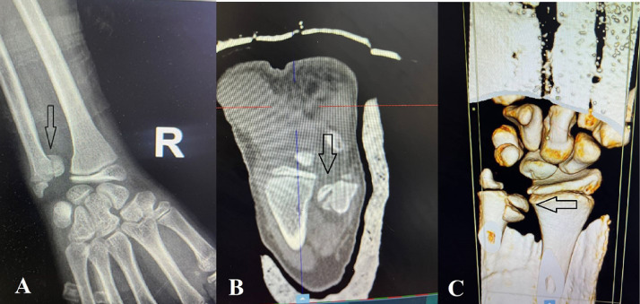
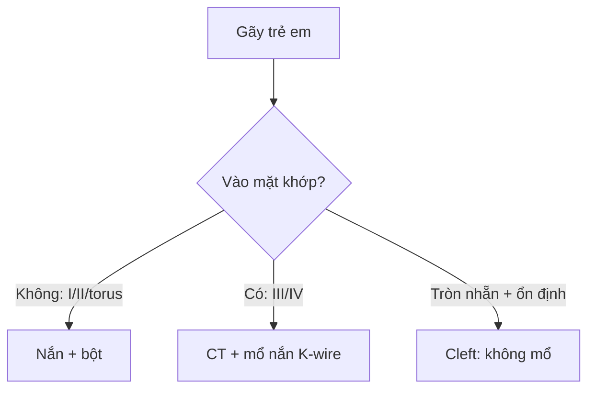

# 321 — Gãy trẻ em: Salter-Harris I–V, cành tươi & bạo hành / Pediatric fractures

**Tags:** `pattern:gay-tre-em` `vung:xuong-tre-em` `score:Salter-Harris`
**Mức chắc chắn (certainty):** tổng hợp y văn (literature synthesis) — nhóm tự biên từ y văn mở, chưa gắn ca nguyên văn đơn lẻ.

## 1. Tổng quan — sụn tiếp hợp là điểm yếu + càng qua mặt khớp càng hỏng tăng trưởng

- Sụn tiếp hợp (physis) yếu hơn xương-dây chằng trẻ em — TẠI SAO gãy trẻ hay đi qua sụn: sụn tăng sinh dễ tách hơn xương đặc.
- Salter-Harris I–V (SALTER: Slip, Above, Lower, Through, Erasure): I (trượt sụn), II (trên sụn + mảnh hành), III (dưới sụn vào mặt khớp), IV (xuyên sụn-mặt khớp-hành), V (ép sụn) — TẠI SAO III–IV nguy cơ ngừng tăng trưởng cao: đường gãy cắt mạch nuôi sụn + lệch mặt khớp.
- Sụn đầu xa trụ (ulna) gánh 70–80% tăng trưởng dài xương trụ — SH-IV lệch là mổ nắn giải phẫu + Kirschner.

## 2. Gamut gãy trẻ em (Gamut)

- **Trượt sụn + di lệch nhẹ:** SH-I/II — nắn kín + bột (tránh nắn nhiều lần hại sụn).
- **Vào mặt khớp + lệch:** SH-III/IV — mổ nắn + vít/K-wire (nguy cơ cầu xương).
- **Phình vỏ + cong:** torus/cành tươi (buckle/greenstick) — bột, liền nhanh.
- **Nhiều tuổi xương + đối xứng + giả sụn:** biến thể (cleft/pseudo-epiphysis) — đừng mổ oan.
- **Gãy nhiều lứa tuổi + xoắn + sườn:** bạo hành — báo cáo + skeletal survey.

## 3. Bảng so sánh phân biệt (ma trận đối chiếu)

| Thực thể (entity) | Hình ảnh điển hình | Chốt vào (rule-in) | Chốt loại (rule-out) | Gợi ý xác nhận |
|---|---|---|---|---|
| SH-I/II | **Trượt/dời sụn + mảnh hành tam giác (II)** | **Sưng + đau sụn + tuổi tăng trưởng** | Vào mặt khớp → III/IV | Nắn 1 lần + bột 6–8 tuần |
| SH-III/IV | **Đường sáng xuyên mặt khớp + lệch khớp** | **Lệch mặt khớp + cần CT/3D** | Không vào khớp → I/II | Mổ nắn giải phẫu + K-wire |
| Torus/cành tươi | **Phình vỏ một bên / cong gãy một vỏ** | **Trẻ + ngã + vỏ còn liền** | Xuyên 2 vỏ → gãy hoàn toàn | Bột, tái khám lệch thứ phát |
| Cleft/pseudo-sụn | **Khe tròn nhẵn + đặc viền + ổn định stress** | **Tròn + đối xứng + không sưng nề** | Sắc + sưng + chấn thương → gãy | Stress test + theo dõi, không mổ |

*(A) XR: đường sáng xuyên sụn-mặt khớp trụ; (B–C) CT + 3D xác nhận lệch khớp. Nguồn: Al Hseinat et al., Radiol Case Rep 2026 Fig. 1, CC BY-NC-ND 4.0 (giữ nguyên bản).*

## 4. Protocol + flowchart

- **X-quang 2 mặt + so sánh đối bên + CT/3D** khi nghi vào khớp; stress test dưới gây mê khi phân biệt cleft.

## 5. Cạm bẫy

- **Cleft trụ giả SH-IV** mổ oan — stress ổn định + viền đặc + đối bên là chốt (ca 2 trong bài gốc!).
- **Nắn kín nhiều lần** hại sụn thêm — thất bại 2 lần là mổ (ca 1!).
- **Bạo hành bỏ sót** — gãy sườn/xoắn nhiều lứa tuổi + chậm đưa đi = báo cáo + toàn xương.

## 6. Tự lượng giá — Blind Quiz

**Ca 1 — Trẻ 12 tuổi ngã xe, đau biến dạng 2 cổ tay. Đọc XR + CT.**

- Hỏi: đường gãy đi qua đâu? SH mấy? Nắn kín hay mổ?

<b>Bấm để hiện đáp án</b>

- Dấu hiệu (findings): đường sáng xuyên sụn tiếp hợp + mặt khớp + hành xương trụ, di lệch (mũi tên).
- Chẩn đoán (diagnosis): **SH-IV đầu xa xương trụ** — nắn kín thất bại 2 lần → mổ nắn + K-wire 1,2 mm (sụn trụ gánh 70–80% tăng trưởng).
- Nguồn: Al Hseinat et al., Fig. 1, CC BY-NC-ND 4.0 (nguyên bản).

**Ca 2 — Khe trụ tròn nhẵn + stress ổn định + không sưng nề:** gãy hay cleft? *(Bảng mục 3.)*

<b>Bấm để hiện đáp án</b>

- **Cleft/pseudo-sụn:** không mổ, bột + theo dõi (khác SH-IV sắc + lệch).

**Ca 3 — Gãy sườn nhiều lứa tuổi + gãy xoắn đùi + đưa đi muộn:** tai nạn hay bạo hành? *(Bảng mục 3.)*

<b>Bấm để hiện đáp án</b>

- **Nghi bạo hành trẻ em:** skeletal survey + báo cáo + hội chẩn bảo vệ trẻ.

## Bài liên quan chéo
- [300 – Tổng quan MSK](../300-tong-quan-he-co-xuong-khop/lesson.md)
- [310 – Xương phụ](../310-giai-phau-xuong-khop-va-bien-the/lesson.md) (vỏ kín vs gãy)
- [320 – Gãy & trật khớp](../320-gay-xuong-trat-khop-cap-cuu/lesson.md) (người lớn)

> Không dùng để chẩn đoán độc lập khi chưa có người hướng dẫn.
