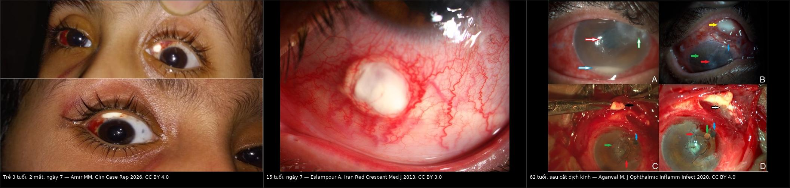
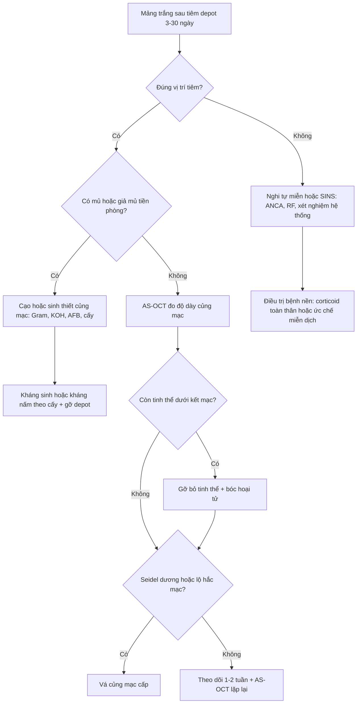
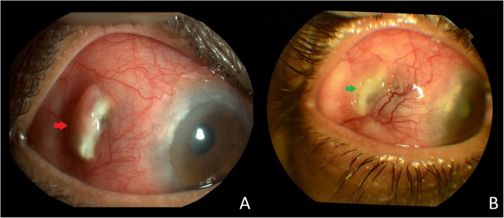
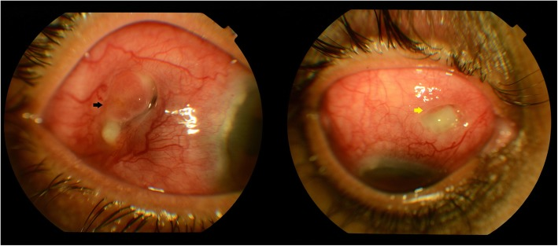
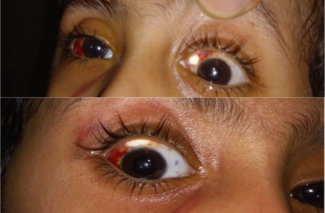
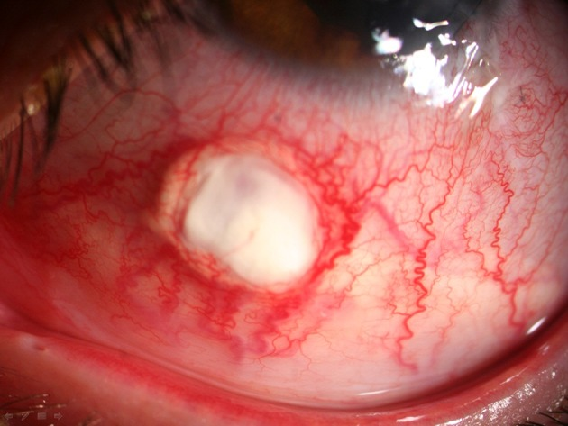
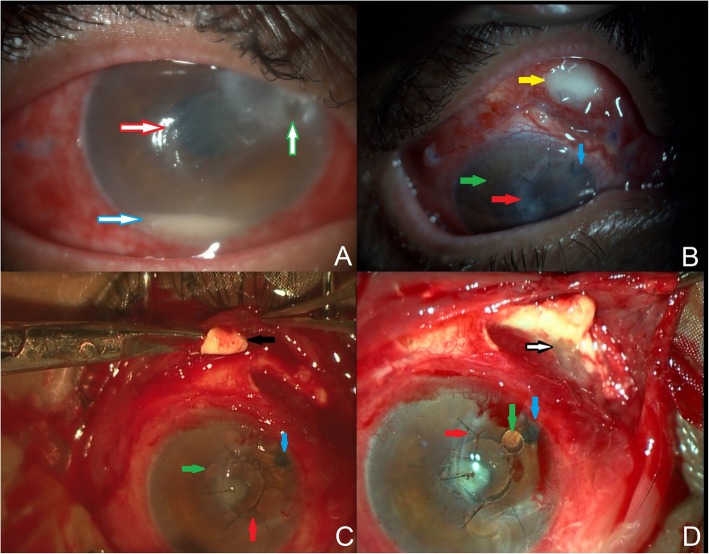

# 3210 — Viêm củng mạc hoại tử sau tiêm triamcinolone dưới kết mạc: mảng trắng KHÔNG mạch đúng vị trí tiêm, ngày 7–30 / Subconjunctival triamcinolone-associated necrotizing scleritis and scleral melt

**Tags:** `pattern:hoai-tu-cung-mac` `pattern:manh-trang-khong-mach` `pattern:lang-dong-triamcinolone` `pattern:mo-cung-mac` `pattern:day-cung-mac` `pattern:do-mat-sau` `pattern:not-cung-mac` `pattern:hoai-tu-ket-mac` `vung:mat` `vung:cung-mac` `vung:ket-mac` `vung:limbus` `vung:tien-phong` `anatomy:cung-mac` `protocol:den-khe` `protocol:AS-OCT` `protocol:UBM` `protocol:seidel` `protocol:chup-anh-mau` `protocol:cam-mau-cay` `score:IOP` `score:do-day-cung-mac` `score:dien-tich-hoai-tu`

**Mức chắc chắn (certainty):** tổng hợp y văn (literature synthesis) — ghép **1 đoàn hệ 176 bệnh nhân viêm củng mạc có tiêm triamcinolone dưới kết mạc/dưới bao Tenon trên TriNetX 2009–2024, 0 ca phải vá củng mạc** (Lama J, Berkenstock M, *BMC Ophthalmol* 2026, PMID 42271290, PMC13251303, CC BY 4.0), **1 loạt 6 mắt viêm củng mạc không hoại tử được tiêm 2–4 mg** (Temkar S, Shah AD, Ramachandar H, Deb AK, *Cureus* 2025, PMID 41257151, PMC12620919, CC BY 4.0), **1 nghiên cứu đa trung tâm 68 mắt/53 bệnh nhân, 2–8 mg** (Sohn EH, Wang R, Read R et al., *Ophthalmology* 2011, PMID 21708408, PMC3184362), **1 loạt 15 ca viêm củng mạc hoại tử sau mổ (SINS)** (Magesan K, Dutta Majumder P, Agarwal M et al., *Indian J Ophthalmol* 2024, PMID 38622865, PMC11338418, CC BY-NC-SA 4.0), **3 ca tổn thương củng mạc do tiêm depot** (Agarwal M, Ranjan R, Mathur U, *J Ophthalmic Inflamm Infect* 2020, PMID 31984430, PMC6983460, CC BY 4.0; Amir MM, Mateen M, Aslam B et al., *Clin Case Rep* 2026, PMID 42016651, PMC13093260, CC BY 4.0; Eslampour A, Abrishami M, Tafaghodi S, *Iran Red Crescent Med J* 2013, PMID 24396585, PMC3871753, CC BY 3.0), **1 phân tích kích thước hạt triamcinolone** (Dodwell DG, Krimmel DA, de Fiebre CM, *Clin Ophthalmol* 2015, PMID 26089635, PMC4467755, CC BY-NC 3.0) và **1 tổng quan nhiễm củng mạc 2025** (*Front Ophthalmol* 2025, PMID 39990248, PMC11842368). Chỗ suy luận ghi rõ "suy luận"; chỗ y văn chưa có ngưỡng ghi "chưa có ngưỡng chuẩn hóa".

> **Vì sao bài này quan trọng:** tiêm triamcinolone acetonide dưới kết mạc/dưới bao Tenon là thủ thuật **rẻ, hiệu quả, rất phổ biến** — 97,0% mắt viêm củng mạc không hoại tử đỡ sau **1 mũi** (PMC3184362). Nhưng khi mũi tiêm đó gây hoại tử, hậu quả là **mỏng củng mạc, lộ hắc mạc, thủng nhãn cầu** — và **không có "thuốc giải"**: phải **lấy bỏ tinh thể**, có khi **vá củng mạc**. Ba lỗi hay gặp: (a) thấy mảng trắng ở **đúng vị trí tiêm** mà nghĩ là "lắng đọng thuốc bình thường"; (b) thấy mắt **đỡ đau sau khi nhỏ corticoid** rồi kết luận lành; (c) nghi nhiễm nhưng **trì hoãn lấy bỏ depot** vì chờ cấy — trong khi chính **khối tinh thể** là ổ nuôi nhiễm và là vật lạ gây viêm.

## 1. Tổng quan bệnh học – cơ chế hình ảnh: vì sao "đúng chỗ tiêm, trắng, không mạch"

### 1.1 Củng mạc không có đường thoát — nên depot không tự tiêu và tổn thương khu trú

- Củng mạc là **5/6 vỏ nhãn cầu**, cấu tạo **~95% collagen type I**, **rất ít nguyên bào sợi**, và — điểm quyết định — **không có mạch máu, không có bạch mạch** ở lớp nhu mô (xem [3207](../3207-viem-cung-mac-scleritis/lesson.md)).
- **Triamcinolone acetonide là hỗn dịch tinh thể, KHÔNG tan trong nước.** Đo trên máy đếm hạt: đường kính trung bình **5,01–5,11 µm** (Triesence) và **18,60–19,20 µm** (Kenalog-40), trung vị 13,09 µm (PMC4467755). Tinh thể **lớn hơn mao mạch** nên nằm lại ngoài lòng mạch, bị đại thực bào "vây" mà không tiêu được (**frustrated phagocytosis**) → **kho lắng đọng tồn tại nhiều tuần**: trong loạt 6 mắt, **lắng đọng trắng còn thấy dưới kết mạc ở tuần thứ 2** (PMC12620919); trong ca hoại tử, khối tinh thể **còn nguyên để gỡ ra sau ~1 tháng** (PMC6983460).
- Ba nhánh cơ chế chồng lên nhau, và **cả ba đều khu trú đúng nơi tiêm**:
  1. **Thiếu máu tại chỗ** — tinh thể chèn ép + tác dụng co mạch của corticoid → vùng củng mạc vốn đã **ít mạch** càng thiếu tưới máu;
  2. **Độc tế bào của tá dược** — **benzyl alcohol** phá màng tế bào biểu mô và khởi động apoptosis, làm chậm liền thương (PMC13093260 dẫn chứng thực nghiệm);
  3. **Viêm do tinh thể** — bạch cầu giải phóng **MMP và collagenase** phá **collagen type I**, đúng cơ chế đã mô tả cho viêm củng mạc hoại tử (PMC13251303).
- Hệ quả hình ảnh: **kết mạc hoại tử trước** (mảng trắng đục, mất bóng), rồi **củng mạc lộ ra, mỏng dần**, bờ tổn thương có **mạch máu ngoằn ngoèo xung huyết** nhưng **bên trong mảng trắng KHÔNG có mạch** — vì mô đã hoại tử, không phải vì "ít viêm". Đây là **nghịch lý cần nhớ**: viêm củng mạc thông thường **đỏ và dày**, còn thể **hoại tử lại trắng và mỏng** (AS-OCT hoại tử **692,33 ± 221,63 µm** so với mắt chứng **833,4 ± 211,92 µm**) — chi tiết đã dạy ở [3207](../3207-viem-cung-mac-scleritis/lesson.md), ở đây **thêm yếu tố thuốc** vào cùng quy luật.

### 1.2 Vì sao 3–30 ngày, và vì sao KHÔNG giống "SINS sau mổ"

- Trong các ca đã công bố, tổn thương xuất hiện **ngày 7** (15 tuổi sau cắt dịch kính + tiêm dưới bao Tenon, PMC3871753; trẻ 3 tuổi sau tiêm 20 mg hai mắt, PMC13093260), **1 tuần** sau mũi thứ 3 ở bệnh nhân GPA (PMC6983460), và **1 tháng** sau tiêm cuối phẫu thuật (PMC6983460).
- Ngược lại, **SINS (surgically induced necrotizing scleritis)** — hoại tử củng mạc sau mổ, không do depot — có **khởi phát trung vị 251 ngày (IQR 127–1.095)** sau một lần mổ, **87%** sau một thủ thuật duy nhất, và loạt 15 ca **không tìm thấy khác biệt** với viêm củng mạc hoại tử vô căn (PMC11338418). **Suy luận:** mốc thời gian là một chốt phân biệt thực dụng — **ngày 3–30 + đúng vị trí tiêm** nghiêng về **thuốc**; **tháng 1–36 + quanh vết mổ** nghiêng về **SINS**; nhưng **không loại trừ nhau**, vì mắt đã mổ vẫn có thể có cả hai.

### 1.3 Các con số phải nhớ (ngưỡng định lượng)

| Biến số | Số liệu | Nguồn |
|---|---|---|
| Tỷ lệ viêm củng mạc chung | **3,4–7,6/100.000** người–năm (Mỹ) | PMC13251303 |
| Hoại tử phải **vá củng mạc** sau tiêm depot ở người đã có viêm củng mạc | **0/176 bệnh nhân**, **0/100.000 người–năm**, theo dõi **15 năm** (2009–2024) | PMC13251303 |
| Không có hoại tử/melting trong nghiên cứu đa trung tâm | **0/68 mắt**, liều **2–8 mg**, theo dõi trung vị **2,3 năm** | PMC3184362 |
| Không có hoại tử trong loạt nhỏ | **0/6 mắt**, liều **2–4 mg** không tá dược, theo dõi **12,3 tháng** | PMC12620919 |
| Hiệu quả 1 mũi tiêm | **97,0%** mắt đỡ triệu chứng; **67,6%** không tái phát ở **24 tháng**, **50,2%** ở **48 tháng** | PMC3184362 |
| Tăng nhãn áp sau tiêm | **20,6%** không cần thuốc, **2,9%** cần thuốc nhỏ, **2 mắt** phải mổ glôcôm; **1/6** mắt lên **28 mmHg** ở loạt nhỏ | PMC3184362; PMC12620919 |
| Liều trong các **ca hoại tử** | **20 mg** (0,5 mL × 40 mg/mL) hoặc **20 mg** ở trẻ — **cao gấp 2,5–10 lần** liều 2–8 mg của các loạt an toàn | PMC6983460; PMC3871753; PMC13093260; PMC3184362 |
| Kích thước tinh thể | **5,01–5,11 µm** so với **18,60–19,20 µm** | PMC4467755 |
| Kích thước tổn thương trong ca | **5 × 4 mm** (15 tuổi); kết mạc hoại tử hai bên vùng trên–mũi (trẻ 3 tuổi); **3 × 4 mm** loét giác mạc kèm mủ tiền phòng **2 mm** (62 tuổi) | PMC3871753; PMC13093260; PMC6983460 |
| Củng mạc trước bình thường (SS-OCT, cách rìa 1 mm) | **578,85 ± 71,76 µm**; mũi **516,35**, thái dương **510,51**, trên **500,51 ± 74,18 µm** | PMC13705192 (dẫn qua 3207) |
| SINS: khởi phát và bối cảnh | **251 ngày** (IQR 127–1.095); **15 ca**, tuổi trung vị **65**, **100% một bên**, **87%** sau 1 lần mổ, **không** kèm bệnh hệ thống | PMC11338418 |

- **Đọc bảng này đúng cách:** hoại tử sau tiêm depot là **biến cố hiếm** (0/176 trong 15 năm; 0/68; 0/6), nhưng **khi xảy ra thì nặng và có ca lâm sàng đăng tải**. Vì vậy **không được** dùng "hiếm" để bỏ qua mảng trắng đúng vị trí tiêm, và cũng **không được** dùng 1 ca để kết luận "tiêm depot nguy hiểm" — đây là bài học về **chọn liều, chọn bệnh nhân, và theo dõi**, không phải bài học cấm thủ thuật.

### 1.4 Vật lý: mỗi phương tiện trả lời một câu hỏi khác nhau

- **AS-OCT (swept-source, ~1310 nm, phân giải trục cỡ 5–10 µm):** xuyên qua kết mạc–Tenon để **đo độ dày củng mạc còn lại**, thấy **kết mạc còn hay đã mất**, thấy **bờ tổn thương dốc hay thoải**, và **tăng phản xạ của sẹo xơ** so với **giảm phản xạ của phù/hoại tử**. Đây là phương tiện **theo dõi mỏng dần** — quan trọng vì tổn thương có thể **lan trong 3 tuần** dù đã ngừng corticoid (ca trẻ 3 tuổi, PMC13093260).
- **UBM (siêu âm tần số cao 50–100 MHz, phân giải trục 20–50 µm, xuyên sâu 4–5 mm):** dùng khi tổn thương **ra sát rìa, sau xích đạo hoặc cần nhìn thể mi – mống mắt**, nơi AS-OCT bị che bởi ánh sáng không qua được (PMC13689183).
- **B-scan 10 MHz:** chỉ cần khi nghi **hậu đoạn** (bong hắc mạc, dịch dưới Tenon, áp-xe sau) — không phải phương tiện đo độ dày củng mạc trước.
- **Đèn khe + fluorescein + nghiệm pháp Seidel:** trả lời câu hỏi **"đã thủng chưa"**. Đây là chốt **quyết định mổ**, không phải AS-OCT. Lưu ý thực hành: **Seidel phải đợi ≥ 15 giây** mới đủ tin (kinh nghiệm đã ghi ở [1991](../1991-ro-bong-loc-muon-viem-noi-nhan/lesson.md)).
- **CT/MRI:** **không** dùng để chẩn đoán hoại tử củng mạc trước xích đạo — nghĩa là **"CT bình thường" không loại trừ bất cứ điều gì** ở bài này; chỉ dùng khi nghi viêm mô tế bào hốc mắt, áp-xe hốc mắt hoặc tổn thương lan ra sau.

## 2. Mẫu hình + chẩn đoán phân biệt theo cơ chế (gamut)

**Mẫu hình trung tâm:** *"Mắt đã tiêm corticoid depot 3–30 ngày trước. Đúng vùng tiêm có mảng trắng–xám, bề mặt mất bóng, **không có mạch trong mảng**, mạch quanh ngoằn ngoèo; đau tăng; kết mạc quanh có thể còn lắng đọng tinh thể trắng."*

Ba câu hỏi phải trả lời trước khi đặt tên:

1. **Vị trí có đúng nơi tiêm không?** Đúng → nghi **thuốc**. Ngoài vị trí tiêm, hoặc lan sang vùng khác sau khi bỏ thuốc hệ thống → nghi **bệnh nền tự miễn đang hoạt động** (ca GPA, PMC6983460).
2. **Có dấu hiệu nhiễm không?** Mủ vàng, giả mủ tiền phòng, đau dữ dội, tiến triển nhanh, không đáp ứng corticoid → **nhiễm củng mạc sau tiêm**: tác nhân hay gặp sau tiêm dưới bao Tenon là **Nocardia** và **Aspergillus** (nhiễm khởi phát muộn), vi khuẩn Gram dương/âm khởi phát sớm (PMC11842368).
3. **Còn lắng đọng tinh thể không?** Còn → **phải lấy bỏ**; đây là can thiệp khác biệt nhất so với mọi nguyên nhân khác.

Gamut theo cơ chế:

- **Do thuốc (drug-induced scleral melt):** đúng vị trí tiêm, 3–30 ngày, có/không còn depot, **không mủ**; nguy cơ cao ở **trẻ**, **mắt đã mổ**, **cận thị cao**, **bệnh tự miễn nền**, **tiêm lặp cùng vị trí**.
- **Nhiễm củng mạc sau tiêm (iatrogenic infectious scleritis):** ổ mủ, áp-xe củng mạc, phản ứng tiền phòng, **khởi phát sớm do vi khuẩn / muộn do nấm – Nocardia**; tiền sử tiêm là yếu tố nguy cơ đã được ghi nhận (PMC11842368).
- **Tự miễn (necrotizing scleritis do GPA/RA/viêm đa sụn tái phát):** đau dữ dội, có thể **hai bên hoặc lan ngoài vị trí tiêm**, kèm ANCA/RF, tổn thương **không tôn trọng "đúng chỗ tiêm"**.
- **SINS (sau mổ, không depot):** quanh vết mổ/rìa, khởi phát **tháng**, không có tinh thể.
- **Hoại tử kết mạc đơn thuần:** mảng trắng trên kết mạc nhưng **củng mạc còn nguyên độ dày** — tiên lượng khác hẳn, thường tự lành hoặc chỉ cần bóc hoại tử.
- **Mỏng củng mạc tại tâm nốt viêm đã lành:** di chứng của chính bệnh củng mạc (nốt viêm), **không mạch nhưng không tiến triển**, không phải biến chứng thuốc (đã gặp ở 1/6 mắt loạt PMC12620919).

## 3. Bảng so sánh phân biệt (ma trận đối chiếu)

| Thực thể (entity) | Hình ảnh điển hình (đèn khe / AS-OCT / UBM) | Chốt vào (rule-in) | Chốt loại (rule-out) | Gợi ý xác nhận |
|---|---|---|---|---|
| **Hoại tử củng mạc do tiêm depot (drug-induced melt)** | Mảng trắng–xám **không mạch**, **đúng vùng tiêm**, 3–30 ngày; lắng đọng tinh thể trắng dưới kết mạc; AS-OCT mỏng dần, kết mạc mất liên tục | **Vị trí trùng khớp mũi tiêm + mốc 3–30 ngày + còn tinh thể** | Có mủ/giả mủ tiền phòng, hoặc tổn thương ngoài vị trí tiêm, hoặc lan sau khi đã ngừng thuốc | Ảnh màu + AS-OCT đo độ dày; gỡ depot thấy tinh thể |
| **Nhiễm củng mạc sau tiêm (Nocardia, Aspergillus, vi khuẩn)** | **Nốt/áp-xe vàng–mủ**, có thể **giả mủ tiền phòng**, loét củng mạc, chảy mủ; tiến triển nhanh dù corticoid | **Mủ, phản ứng tiền phòng, đau tăng, không đáp ứng corticoid** | Tổn thương trắng khô, không mủ, không phản ứng tiền phòng | Cạo/ sinh thiết củng mạc: Gram, KOH, AFB, cấy nấm; **lấy mẫu trước khi tăng corticoid** |
| **Viêm củng mạc hoại tử tự miễn (GPA, RA)** | Vùng **trắng không mạch** nhưng lan **ngoài vị trí tiêm**, thường kèm viêm màng bồ đào/cùng tổn thương mũi–xoang | **ANCA/RF dương, bệnh hệ thống, tổn thương đa ổ** | Tổn thương khu trú tuyệt đối đúng 1 mũi tiêm, không bệnh nền | ANCA, RF, ANA, ESR/CRP, khám TMH–thận–khớp |
| **SINS sau mổ** | Hoại tử quanh **vết mổ/rìa**, không có tinh thể; khởi phát **trung vị 251 ngày** | **Sau mổ, không tiêm depot, tháng 1–36** | Có depot đúng chỗ, khởi phát trong 4 tuần | Bệnh sử thủ thuật + loại trừ nhiễm |
| **Hoại tử kết mạc đơn thuần** | Mảng trắng **trên kết mạc**, củng mạc **còn độ dày**, không lộ hắc mạc | **AS-OCT: củng mạc nguyên vẹn, chỉ kết mạc mất** | Củng mạc mỏng/lộ hắc mạc trên AS-OCT | AS-OCT + theo dõi 1–2 tuần |
| **Mỏng củng mạc do nốt viêm lành** | Vùng mỏng **tại tâm nốt cũ**, bề mặt liền, không hoại tử tiến triển | **Tiền sử nốt viêm cùng vị trí, ổn định nhiều tháng** | Mảng trắng mới, tiến triển, đúng vị trí tiêm | So ảnh cũ + AS-OCT 2 lần cách nhau |

*Trái: trẻ 3 tuổi, **hai mắt**, mảng kết mạc hoại tử trắng vùng trên–mũi đúng nơi tiêm dưới bao Tenon 20 mg. Giữa: 15 tuổi, **ngày 7**, mảng hoại tử **5 × 4 mm** với mạch quanh nổi rõ. Phải: 62 tuổi sau cắt dịch kính + tiêm 20 mg, (A) loét giác mạc + mủ tiền phòng, (C–D) gỡ khối tinh thể và lộ **củng mạc hoại tử rộng**. Ảnh ghép letterbox, không crop. Nguồn: Amir MM et al., Clin Case Rep 2026, CC BY 4.0; Eslampour A et al., Iran Red Crescent Med J 2013, CC BY 3.0; Agarwal M et al., J Ophthalmic Inflamm Infect 2020, CC BY 4.0.*

### Ba dấu hiệu "đọc đúng" trên ảnh

- **Mảng trắng "khô" và không mạch:** hoại tử củng mạc, không phải mủ. **Mủ** thường vàng, bóng, có thể chảy; **hoại tử** trắng xám, bề mặt lì, mạch **dừng đột ngột ở bờ**.
- **Vị trí "đúng mũi tiêm" là dấu hiệu mạnh nhất** — trong cả 3 ca, tổn thương nằm ở **vùng trên–mũi** hoặc **vùng thái dương**, đúng nơi đặt depot, cách rìa vài mm.
- **Bờ mạch ngoằn ngoèo quanh ổ trắng:** phản ứng viêm mạch quanh mô hoại tử; **đừng** đọc là "còn mạch nên chưa hoại tử".

## 4. Protocol chụp – xét nghiệm + cách phân độ và xử trí

### 4.1 Trình tự tối thiểu (15 phút, tại ghế)

1. **Chụp ảnh màu toàn bộ vùng tổn thương + vùng tiêm** (có thước/so sánh), ghi **2 chiều mm**, vị trí theo góc phần tư, khoảng cách tới rìa.
2. **Đèn khe:** bề mặt kết mạc, độ sâu, bờ mạch, phản ứng tiền phòng, thể thủy tinh.
3. **Fluorescein + Seidel ≥ 15 giây:** xác định thủng/không thủng — **quyết định mổ ngay hay theo dõi**.
4. **AS-OCT vùng tổn thương + vùng đối xứng mắt bên:** đo **độ dày củng mạc còn lại (µm)** tại đáy và tại bờ; xác định **kết mạc còn hay mất**.
5. **UBM** nếu tổn thương **sát rìa, ra sau xích đạo hoặc cần nhìn thể mi** (50–100 MHz, xuyên 4–5 mm, phân giải 20–50 µm).
6. **B-scan** chỉ khi nghi hậu đoạn/dịch dưới Tenon/bong hắc mạc.
7. **Xét nghiệm khi có mủ/không điển hình:** cạo hoặc sinh thiết củng mạc → **Gram, KOH, AFB, cấy vi khuẩn/nấm**, tế bào; đồng thời **ANCA, RF, ANA, ESR/CRP** nếu tổn thương không đúng vị trí tiêm hoặc lan.

### 4.2 Phân độ thực dụng (không có hệ điểm chuẩn hóa)

- **Độ 0 — chỉ lắng đọng:** tinh thể trắng dưới kết mạc, **kết mạc liền**, củng mạc **dày bình thường** trên AS-OCT → theo dõi, **không can thiệp**.
- **Độ 1 — hoại tử kết mạc, củng mạc nguyên:** mảng trắng kết mạc, AS-OCT củng mạc **≥ 500 µm** → bóc hoại tử nhẹ + theo dõi 1 tuần; **không tiêm lại**.
- **Độ 2 — hoại tử củng mạc nông, chưa thủng:** mất kết mạc + củng mạc mỏng nhưng **còn giường củng mạc**, Seidel âm → **gỡ bỏ tinh thể** + kháng sinh dự phòng + theo dõi sát 1–2 tuần.
- **Độ 3 — nguy cơ thủng:** Seidel dương, **lộ hắc mạc**, hoặc mỏng tiến triển trên 2 lần AS-OCT → **vá củng mạc/màng ối–Tenon** cấp, ± ghép kết mạc; cấy mô hoại tử.
- **Không có ngưỡng µm được chuẩn hóa** cho chỉ định vá; quyết định dựa trên **Seidel, lộ hắc mạc, tốc độ mỏng và kích thước** — y văn hiện chỉ có ca và loạt nhỏ.

### 4.3 Xử trí: 5 nguyên tắc có số

1. **Ngừng ngay mọi mũi tiêm depot tại vùng đó.** Trong ca GPA, mũi thứ 3 khởi phát hoại tử trong **1 tuần**; tiêm lặp là yếu tố nguy cơ (PMC6983460).
2. **Gỡ bỏ tinh thể là can thiệp quyết định.** Ca trẻ 3 tuổi: bóc hoại tử + cạo tinh thể → **giường củng mạc không bị phá, không cần vá**, lành trong vài tuần, ổn định **6 tháng** (PMC13093260). Ca 62 tuổi: gỡ depot + cấy → củng mạc lành dần, theo dõi **9 tháng** (PMC6983460).
3. **Không tăng corticoid tại chỗ để "chữa" mảng trắng.** Corticoid tại chỗ **không lấy được tinh thể**, làm chậm biểu mô hóa và **che nhiễm**; nếu bệnh nền tự miễn hoạt động thì dùng **corticoid/ức chế miễn dịch toàn thân** — ca GPA lành vết hoại tử trong **1 tháng** với prednisolone tại chỗ + **methotrexate 20 mg/tuần** (PMC6983460).
4. **Vá khi nguy cơ thủng**, không vá "cho chắc": trong 3 ca, **không ca nào cần vá củng mạc** sau khi gỡ depot; vá chỉ đặt ra khi **mất giường củng mạc/Seidel dương**.
5. **Theo dõi bằng ảnh + AS-OCT, không bằng cảm giác đau.** Đau giảm có thể do corticoid, trong khi mỏng vẫn tiến triển; ca trẻ 3 tuổi **lan rộng trong 3 tuần** dù điều trị bảo tồn (PMC13093260).

*Bệnh nhân GPA sau mũi depot thứ 3: (A) củng mạc mỏng, nốt viêm vùng thái dương (mũi tên đỏ); (B) vùng hoại tử lành sau **1 tháng** prednisolone tại chỗ + **methotrexate 20 mg/tuần** (mũi tên xanh). Đây là ca cho thấy **điều trị bệnh nền** quyết định khi tổn thương không còn khu trú đúng mũi tiêm. Ảnh: Agarwal M, Ranjan R, Mathur U, J Ophthalmic Inflamm Infect 2020, CC BY 4.0.*

### 4.4 Liều và lựa chọn bệnh nhân (phần phòng ngừa)

- Các loạt **an toàn** dùng **2–8 mg** (PMC3184362; PMC12620919); các **ca hoại tử** dùng **20 mg** (0,5 mL × 40 mg/mL) (PMC3871753; PMC6983460; PMC13093260). Đây là **suy luận từ so sánh gián tiếp**, không phải quan hệ nhân–quả đã chứng minh, nhưng là lý do thực hành để **dùng liều thấp nhất có hiệu quả**.
- **Tránh** ở: trẻ nhỏ, mắt đã mổ trong vài tuần, cận thị cao có củng mạc mỏng, bệnh tự miễn đang hoạt động, **tiền sử mỏng củng mạc/glôcôm** — loạt PMC12620919 **loại trừ** đúng các nhóm này.
- **Không tiêm qua kết mạc đang viêm nặng** nếu có thể; dùng **thuốc không tá dược** khi có lựa chọn (lý do: benzyl alcohol độc với biểu mô — PMC13093260).

## 5. Biến thể bình thường và cạm bẫy

- **Lắng đọng tinh thể trắng là "bình thường" sau tiêm** — nhưng **chỉ khi kết mạc liền và củng mạc dày bình thường**. Trên AS-OCT, **kết mạc còn liên tục** phân biệt với độ 1–2. Đừng bóc "cho sạch" khi chưa có tổn thương thật.
- **Xuất huyết dưới kết mạc ngày 1–7 che tổn thương:** ca trẻ 20 mg có **xuất huyết đúng vị trí tiêm ở tuần 1**, rồi **2 tuần** mới thấy hoại tử (PMC4302469, dẫn qua PMC13093260). Vì vậy **hẹn khám lại sau 1–2 tuần**, không chỉ khám ngay sau tiêm.
- **"Đỡ đau sau corticoid" không phải khỏi:** corticoid giảm viêm nhưng **không lấy tinh thể**; mảng trắng có thể tiếp tục mỏng. Theo dõi bằng **AS-OCT + ảnh**, không bằng triệu chứng.
- **Mỏng củng mạc tại tâm nốt viêm đã lành ≠ hoại tử do thuốc:** 1/6 mắt trong loạt PMC12620919 có **mỏng khu trú tại tâm nốt** sau khi viêm giảm; ổn định, không tiến triển, không cần vá. So ảnh cũ và đo 2 lần.
- **Tổn thương "di chuyển" sang vùng mới = bệnh nền, không phải thuốc:** bệnh nhân GPA bỏ thuốc 4 tháng → **vùng hoại tử mới ở thái dương** ngoài nơi tiêm (PMC6983460). Đây là dấu hiệu phải **nâng ức chế miễn dịch**, không phải "tiêm thêm".
- **Sai lầm "CT/MRI âm tính":** tổn thương **trước xích đạo** nằm ngoài tầm của CT/MRI thường quy; hình ảnh học đúng là **đèn khe + AS-OCT/UBM**.
- **Satisfaction of search:** thấy loét giác mạc (như ca 62 tuổi) rồi dừng — trong khi **củng mạc hoại tử rộng** ở vùng trên–mũi chỉ lộ ra khi **gỡ khối tinh thể** (Hình 1C–D, PMC6983460).
- **Không chọc dò ổ trắng "để xem có mủ không"** khi chưa loại trừ thủng: dò vào củng mạc mỏng có thể **làm thủng thật**. Dùng AS-OCT và Seidel trước.

*Bệnh nhân GPA sau mũi depot thứ 3: vùng hoại tử/thái dương (mũi tên đen) và **vùng hoại tử MỚI** (mũi tên vàng) xuất hiện sau khi tự bỏ methotrexate 4 tháng. Ảnh: Agarwal M, Ranjan R, Mathur U, J Ophthalmic Inflamm Infect 2020, CC BY 4.0.*

## 6. Tự lượng giá — Blind Quiz

**Ca 1 — Trẻ 3 tuổi, sau mổ đục thể thủy tinh hai mắt, ngày thứ 7.**

- Bối cảnh: đục thể thủy tinh bẩm sinh hai mắt, mổ + đặt IOL, cuối mổ tiêm **20 mg triamcinolone dưới bao Tenon** mỗi mắt; không bệnh hệ thống.
- Câu hỏi: (1) Mô tả tổn thương và vị trí? (2) Ba chẩn đoán phân biệt? (3) Bước tiếp theo quyết định là gì?

<b>Bấm để hiện đáp án (findings + chẩn đoán)</b>

- **Dấu hiệu:** hai mắt, vùng **trên–mũi**, mảng kết mạc **trắng, mất bóng**, củng mạc lộ và **mỏng**; không mủ, không phản ứng tiền phòng; tổn thương **đúng nơi tiêm**.
- **Chẩn đoán:** **hoại tử kết mạc – củng mạc do triamcinolone depot** (drug-induced melt). Phân biệt: nhiễm củng mạc sau tiêm, viêm củng mạc hoại tử tự miễn, SINS.
- **Xử trí trong ca:** điều trị bảo tồn **3 tuần** không đỡ, tổn thương **lan** → **bóc hoại tử + cạo tinh thể**; giường củng mạc còn nguyên nên **không cần vá**; kết mạc lành, ổn định **6 tháng**.
- **Bài học:** trẻ nhỏ + liều **20 mg** + tiêm **hai mắt** là bối cảnh nguy cơ; **theo dõi 1–2 tuần** và chụp ảnh là bắt buộc.
- Nguồn: Amir MM, Mateen M, Aslam B et al., *Clin Case Rep* 2026 (PMID 42016651, PMC13093260), CC BY 4.0.

**Ca 2 — Nam 15 tuổi, ngày thứ 7 sau tiêm dưới bao Tenon, đau dữ dội.**

- Bối cảnh: chấn thương nhãn cầu hở + dị vật nội nhãn, đã cắt dịch kính lấy dị vật; cuối mổ tiêm **0,5 mL triamcinolone 40 mg/mL (20 mg)** dưới bao Tenon.
- Câu hỏi: (1) Dấu hiệu nào cho biết đây là hoại tử chứ không chỉ viêm? (2) Có cần cấy không? (3) Khi nào mổ?

<b>Bấm để hiện đáp án (findings + chẩn đoán)</b>

- **Dấu hiệu:** mảng **trắng, không mạch**, kích thước **5 × 4 mm**, bờ có **mạch ngoằn ngoèo xung huyết**, kết mạc quanh phù; không mủ.
- **Chẩn đoán:** **viêm củng mạc hoại tử + hoại tử kết mạc sau tiêm depot**. Đau dữ dội + đúng vị trí tiêm + ngày 7 là bộ ba chốt.
- **Xử trí:** điều trị bảo tồn **7 ngày không đỡ** → **bóc hoại tử**; kết mạc lành trong **1 tuần** sau mổ. Cấy chỉ định khi có mủ/không điển hình; ca này làm smear dịch ổ loét (8–10 bạch cầu/vi trường) và điều trị theo hướng không nhiễm.
- **Bài học:** **đau tăng + mảng trắng không mạch** ở mắt đã mổ là **red flag** cho hoại tử do thuốc; chờ đợi lâu làm mỏng thêm.
- Nguồn: Eslampour A, Abrishami M, Tafaghodi S, *Iran Red Crescent Med J* 2013 (PMID 24396585, PMC3871753), CC BY 3.0.

**Ca 3 — Nữ 62 tuổi, 1 tháng sau cắt dịch kính + tiêm depot, đỏ và đau.**

- Bối cảnh: cận thị cao, cắt dịch kính + dầu silicone cho bong võng mạc; cuối mổ tiêm **0,5 mL triamcinolone 40 mg/mL** vùng trên–mũi.
- Câu hỏi: (1) Trong ảnh A có mấy tổn thương và ở đâu? (2) Khối trắng ở ảnh C–D là gì? (3) Vì sao phải gỡ khối đó thay vì chỉ nhỏ thuốc?

<b>Bấm để hiện đáp án (findings + chẩn đoán)</b>

- **Ảnh A:** **khuyết biểu mô giác mạc 3 × 4 mm** (mũi tên đỏ), **thâm nhiễm/mỏng nhu mô 3 × 4 mm** (mũi tên xanh lá), **mủ tiền phòng 2 mm** (mũi tên xanh dương) — tức **ba tầng tổn thương** cùng lúc.
- **Ảnh C–D (trong mổ):** khối **tinh thể triamcinolone trắng** dưới bao Tenon (mũi tên đen) nằm trên vùng **củng mạc hoại tử rộng**.
- **Chẩn đoán:** **hoại tử củng mạc do depot + viêm giác mạc do nấm** (cấy *Aspergillus flavus*), trên nền mắt đã mổ.
- **Vì sao phải gỡ:** tinh thể là **dị vật không tan**, nuôi ổ viêm/nhiễm và tiếp tục gây thiếu máu; sau khi **gỡ khối + điều trị kháng nấm**, củng mạc lành dần (theo dõi **9 tháng**) dù thị lực còn kém do tổn thương giác mạc.
- **Bài học:** tổn thương **giác mạc + tiền phòng** có thể **che** tổn thương củng mạc; phải **khám toàn bộ vùng tiêm**, không dừng ở "loét giác mạc".
- Nguồn: Agarwal M, Ranjan R, Mathur U, *J Ophthalmic Inflamm Infect* 2020 (PMID 31984430, PMC6983460), CC BY 4.0.

## Bài liên quan chéo

- [400 – Tổng quan Mắt & thị giác](../400-tong-quan-mat-thi-giac/lesson.md)
- [3207 – Viêm củng mạc: đỏ sâu, AS-OCT và T-sign](../3207-viem-cung-mac-scleritis/lesson.md) (nền tảng: củng mạc không mạch, thể hoại tử mỏng hơn)
- [3209 – Bọng dẹt sau ống XEN](../3209-bong-loc-sau-xen-gel-stent/lesson.md) (đọc AS-OCT bọng lọc, kim qua kết mạc–củng mạc)
- [3206 – Bọng căng sau van dẫn lưu](../3206-bong-cang-sau-van-dan-luu-glaucoma/lesson.md)
- [1427 – Tiêm anti-VEGF hai mắt cùng ngày](../1427-tiem-anti-vegf-hai-mat-cung-ngay/lesson.md) (kỹ thuật tiêm nội nhãn, vô khuẩn)
- [1425 – Viêm nội nhãn sau tiêm nội nhãn](../1425-viem-noi-nhan-sau-tiem-noi-nhan/lesson.md) (phân biệt nhiễm với phản ứng vô khuẩn)
- [1461 – Áp-xe dưới màng xương hốc mắt ở trẻ](../1461-ap-xe-duoi-mang-xuong-hoc-mat-o-tre/lesson.md) (khi tổn thương lan ra hốc mắt)
- [6132 – Viêm giác mạc nhiễm khuẩn liên quan kính tiếp xúc](../6132-viem-giac-mac-kinh-tiep-xuc/lesson.md) (nhiễm *Pseudomonas* và thâm nhiễm vòng)

> Không dùng để chẩn đoán độc lập khi chưa có người hướng dẫn.
