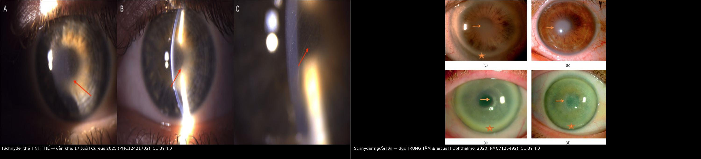
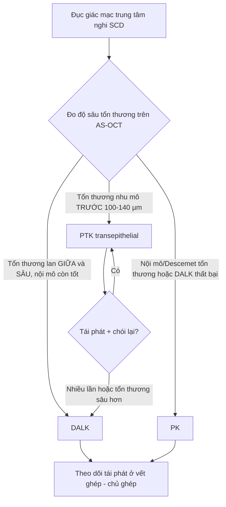
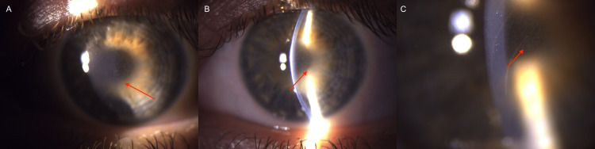
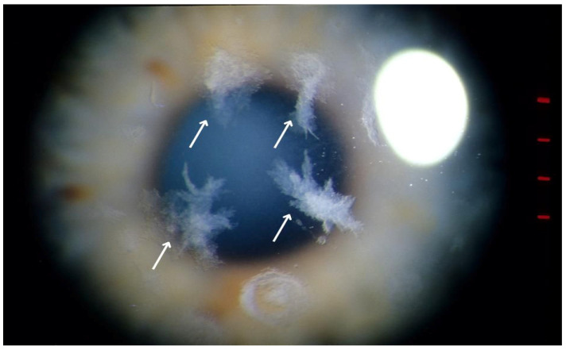
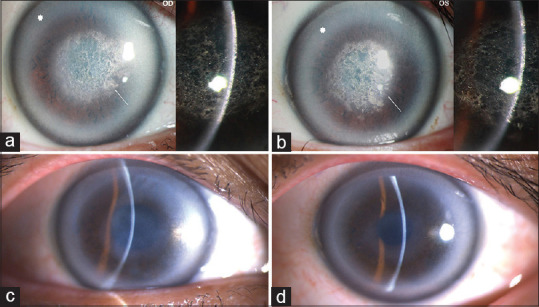

# 3211 — Loạn dưỡng giác mạc Schnyder (Schnyder corneal dystrophy): đục TRUNG TÂM hình đĩa ± tinh thể cholesterol, arcus xuất hiện SỚM và chuỗi tiến triển theo TUỔI — vì sao chỉ 54% có tinh thể, AS-OCT đo độ sâu 100–140 µm để chọn PTK, và khi nào DALK/PK

**Tags:** `pattern:duc-trung-tam` `pattern:tinh-the-giac-mac` `pattern:arcus-som` `pattern:tang-phan-xa-nhu-mo-truoc` `pattern:bong-mo-phia-sau` `pattern:mo-nhu-mo-giua-ngoai-vi` `vung:mat` `vung:giac-mac` `vung:be-mat-nhan-cau` `protocol:den-khe` `protocol:AS-OCT` `protocol:IVCM` `protocol:nhuom-mo` `score:IC3D` `score:giai-doan-tuoi`

**Mức chắc chắn (certainty):** tổng hợp y văn (literature synthesis) — ghép **1 phân loại IC3D phiên bản 3** (Weiss JS, Rapuano CJ, Seitz B, Busin M, Kivelä TT, Bouheraoua N et al., *Cornea* 2024, PMID 38359414, PMC10906208, CC BY-NC-ND), **1 nghiên cứu đa phương thức 7 mắt** (Ghazal W, Georgeon C, Grieve K, Bouheraoua N, Borderie V, *J Ophthalmol* 2020, PMID 32280528, PMC7125492, CC BY), **1 nghiên cứu 37 người/4 gia đình** (Sarosiak A, Udziela M, Ścieżyńska A, Oziębło D, Wawrzynowska A, Szaflik JP, Ołdak M, *Graefes Arch Clin Exp Ophthalmol* 2018, PMID 30084067, PMC6208719, CC BY), **1 nghiên cứu 6 proband** (Evans CJ, Dudakova L, Skalicka P, Mahelkova G, Horinek A, Hardcastle AJ, Tuft SJ, Liskova P, *BMC Ophthalmol* 2018, PMID 30223810, PMC6142341, CC BY), **2 ca lâm sàng có AS-OCT/IVCM** (Bombuy Gimenez J, Izdebska J, Szaflik JP, *Cureus* 2025, PMID 40937252, PMC12421702, CC BY; Stoyanova N et al., *Life (Basel)* 2025, PMID 40141754, PMC11943904, CC BY), **1 ca PTK sâu** (Chen CA, Tung HF, Liu YL, Lin CP, *Taiwan J Ophthalmol* 2023, PMID 37484611, PMC10361439, CC BY-NC-SA), **1 tổng quan điều trị** (Ashena Z, Niestrata M, Tavassoli S, *Vision (Basel)* 2023, PMID 36977302, PMC10059954, CC BY), **1 loạt PK dài hạn** (*Cornea* 2018, PMID 29319599, chỉ abstract), **2 tổng quan của Weiss** (PMID 19398911; PMID 21540632), **1 nghiên cứu cơ chế** (Jiang SY et al., *PLoS Genet* 2019, PMID 31323021, PMC6668851, CC BY), và **3 bài chẩn đoán phân biệt** (Knez N et al., *Diagnostics* 2023, PMID 37175019, PMC10178412, CC BY; Chong SH et al., *Cureus* 2022, PMID 35165597, PMC8831483, CC BY; Nouira C et al., *BMC Ophthalmol* 2025, PMID 40597873, PMC12219982, CC BY-NC-ND). Chỗ **suy luận** ghi rõ; chỗ y văn chưa có số ghi "chưa rõ".

> **Vì sao bài này quan trọng:** đây là **"đục giác mạc trung tâm" bị chẩn đoán muộn nhất trong nhóm loạn dưỡng nhu mô** — vì tên cũ (*Schnyder crystalline corneal dystrophy*) khiến cả thế hệ bác sĩ tin rằng **phải có tinh thể mới là Schnyder**, trong khi **chỉ 54% bệnh nhân có tinh thể** (PMID 19398911) và IC3D đã phải **đổi tên bỏ chữ "crystalline"** vì lý do này (PMC10906208). Hệ quả thực hành: (a) người bệnh **không tinh thể** bị gọi là "sẹo cũ", "arcus bình thường", "loạn dưỡng không rõ" rồi **theo dõi nhiều năm**; (b) **arcus ở người < 40 tuổi** bị bỏ qua dù đây là dấu **gợi ý SCD** (xuất hiện **23–38 tuổi**); (c) chỉ định mổ sai: **PTK quá nông** khi tổn thương đã sâu **120–133 µm**, hoặc **ghép xuyên** khi chỉ cần PTK/DALK. Ngược lại, có **những "tinh thể giác mạc" KHÔNG phải Schnyder** (oxalate thực vật, cystine, paraprotein, nhiễm khuẩn) — điều trị hoàn toàn khác. Bài này đặt **vị trí + tuổi + độ sâu** làm ba trục quyết định, thay vì chỉ tìm "có tinh thể hay không".

## 1. Tổng quan bệnh học – cơ chế hình ảnh: vì sao lipid lắng ở TRUNG TÂM, và vì sao AS-OCT thấy dải tăng phản xạ

### 1.1 Bản chất: cholesterol + phospholipid trong biểu mô đáy, Bowman và nhu mô trước

- Tổn thương là **lắng đọng cholesterol tự do và phospholipid (ester hóa và không ester hóa)** trong **tế bào biểu mô đáy, lớp Bowman và nhu mô** — **không viêm, không mạch máu, không ngấm thuốc** (PMC10906208; PMC7125492).
- **Định lượng mô**: giác mạc SCD có **cholesterol cao gấp 10 lần** và **lipid toàn phần cao gấp 5 lần** giác mạc lành (PMC6208719).
- Vì cholesterol **tan trong dung môi hữu cơ** (alcohol, xylene) và **sáp nến**, tiêu bản **paraffin thường** để lại **ổ trống hình kim giữa các lá nhu mô** và **không bào bào tương tế bào đáy** — đúng hình thái trong ảnh mô học (PMC7125492 Fig. 5; PMC10906208 Fig. 15G–H). Muốn chứng minh lipid phải **mô tươi + cắt lạnh + Oil Red O/Sudan black** (PMC10906208; PMC10178412).
- **Hệ quả lâm sàng của "không viêm"**: mắt **không đỏ**, **không đau** (trừ khi trợt biểu mô), **không loét**, **không tân mạch** — đây là điểm **loại trừ** mạnh với lipid keratopathy thứ phát sau herpes (có mạch + sẹo) và với viêm giác mạc (PMC10178412).

### 1.2 Vì sao TRUNG TÂM — và vì sao arcus lại xuất hiện SỚM

- **Phần chắc chắn (y văn):** tổn thương **bắt đầu ở trung tâm** dưới dạng **đục hình đĩa/vòng** và/hoặc **tinh thể dưới biểu mô**, sau đó **arcus lipoides** xuất hiện, rồi **mờ nhu mô giữa ngoại vi**; trình tự này **dự đoán được theo tuổi** (PMC10906208; PMID 21540632).
- **Cơ chế tại chỗ (đã chứng minh ở mức phân tử):** đột biến **UBIAD1** làm protein **kẹt ở lưới nội chất**, **tranh chấp Insig-1** với **HMG-CoA reductase (HMGCR)** → **HMGCR không bị thoái hóa** → **tăng tổng hợp cholesterol ngay trong tế bào giác mạc**; chuột knock-in **Ubiad1 G184R/+** tăng HMGCR ở nhiều mô (PMC6668851; PMC6402834). Đây là lý do SCD được xem là **khiếm khuyết chuyển hóa TẠI CHỖ**, không chỉ là "mỡ máu cao đổ vào giác mạc".
- **Vì sao trung tâm (suy luận, y văn chưa định lượng):** (a) cholesterol được **tổng hợp tại chỗ** bởi biểu mô/keratocyte, tập trung ở **nhu mô trước** nơi mật độ tế bào và hoạt động chuyển hóa cao; (b) trung tâm là **vùng xa mạch rìa nhất** → **thanh thải lipid chậm nhất**; (c) vì nằm trên **trục quang**, đục trung tâm **được phát hiện sớm** dù tổn thương có thể đã lan. Cơ chế "vì sao đúng hình đĩa" **chưa rõ** — không nên giảng như sự thật đã chứng minh.
- **Vì sao arcus sớm:** arcus là **lipid thấm từ mạch rìa** và đọng ở **nhu mô ngoại vi**, chừa **1–2 mm** sát rìa; ở người trẻ **arcus là bất thường** và là **dấu gợi ý SCD** (cùng với tăng cholesterol gia đình, LCAT/fish-eye/Tangier) (PMID 21540632; PMC10178412). Ở SCD, arcus xuất hiện **23–38 tuổi** — sớm hơn arcus senilis nhiều thập kỷ (PMC10906208).

### 1.3 Vì sao KHÔNG phải mọi bệnh nhân đều có tinh thể

- Tinh thể chỉ hình thành khi cholesterol **kết tinh** (nồng độ vượt độ hòa tan); ở giai đoạn sớm hoặc thể "acrystalline", lipid tồn tại dạng **giọt/phiến** → **chỉ thấy mờ đục**, không thấy tinh thể (PMC10906208; PMC6142341).
- **Con số:** **54%** trong loạt 115 người/34 gia đình (PMID 19398911); **~50%** theo IC3D (PMC10906208); trong loạt ảnh đa phương thức 7 mắt lớn tuổi chỉ **2/7** còn thấy tinh thể (PMC7125492). Tinh thể có thể **một bên**, có thể **muộn**, và hiếm khi **thoái triển** (PMC10906208).
- **Hệ quả:** "không tinh thể" **không loại trừ** SCD; ngược lại "có tinh thể" **không đủ** chẩn đoán — phải xét **vị trí trung tâm + tuổi khởi phát + arcus sớm + tiền sử gia đình**.

### 1.4 Vật lý: vì sao đèn khe, AS-OCT và IVCM cho ba loại thông tin khác nhau

- **Đèn khe:** tinh thể cholesterol **khúc xạ/phan xạ mạnh** → ánh **"kim loại"** trên chiếu trực tiếp, **lấp lánh** trên retroillumination; vùng mờ do **tán xạ ánh sáng** của vô số giọt lipid nhỏ hơn bước sóng. Vì vậy **thị lực ám (photopic) giảm không tương xứng thị lực tối (scotopic)**, và **chói (glare)** là triệu chứng chính (PMID 19398911; PMC10906208).
- **AS-OCT (~1310 nm):** lipid/cholesterol có **chiết suất khác nhu mô** → **tán xạ ngược** → **dải tăng phản xạ** ở nhu mô trước, tối đa ở trung tâm; khi tinh thể **đậm và đặc**, phía sau có **bóng mờ (posterior shadow)** — đúng như mô tả ở 7 mắt (PMC7125492) và ca PTK sâu (PMC10361439). AS-OCT còn cho **ba số quyết định mổ**: **độ sâu tổn thương**, **độ dày biểu mô**, **độ dày nhu mô còn lại**.
  - **Cạm bẫy vật lý:** một số lát cắt thấy **"khe sáng" (lucency)** đúng vị trí tinh thể cholesterol, vì tinh thể có thể **truyền sáng** theo hướng cắt; IC3D mô tả hiện tượng này ở Figure 15Jii–Kii (PMC10906208). Vì vậy **không được lấy "tăng phản xạ" làm tiêu chuẩn duy nhất**, và **không được kết luận "không có tổn thương" chỉ vì OCT âm**.
- **IVCM (400 × 400 µm):** tinh thể **phản xạ rất mạnh** → **hình kim (needle-shaped)** hoặc **hình chữ nhật**, đôi khi **hình thoi** dưới biểu mô; đồng thời **mất nhân keratocyte**, **thần kinh dưới đáy mảnh/không thấy** (giải thích **giảm cảm giác giác mạc**), **striae nhu mô** rõ hơn OCT (PMC7125492 Fig. 3; PMC10906208 Fig. 15I; PMC12421702 Fig. 2).
- **Mô học:** hệ quả của việc **lipid bị hòa tan** — ổ trống, không bào; **Bowman còn nguyên**, **nội mô/Descemet bình thường** (PMC7125492 Fig. 5). Đây là lý do bệnh **phù hợp với ghép nhu mô trước (DALK)** hơn ghép xuyên.

### 1.5 Những con số phải nhớ

| Biến số | Số liệu | Nguồn |
|---|---|---|
| Tinh thể khi khám | **54%** (115 người/34 gia đình); **~50%** theo IC3D | PMID 19398911; PMC10906208 |
| Tuổi khởi phát / chẩn đoán | Bắt đầu **thập niên 1–2**; chẩn đoán thường **thập niên 2–3**; thể không tinh thể **muộn hơn** | PMC10906208; PMC6142341 |
| Mốc tiến triển | **≤ 23 tuổi**: đục đĩa/vòng ± tinh thể; **23–38**: thêm arcus; **> 38**: mờ nhu mô giữa ngoại vi | PMC10906208; PMID 21540632 |
| Cholesterol / lipid giác mạc | **10×** / **5×** so với lành | PMC6208719 |
| Tăng cholesterol máu | **~2/3** bệnh nhân; **cũng gặp ở người không bị bệnh** trong gia đình → **không phải nguyên nhân** | PMID 21540632; PMC6208719 |
| Chiều dày trung tâm (CCT) | **563 ± 44 µm** (507–635) — **bình thường hoặc tăng nhẹ**, không dùng để loại trừ | PMC7125492 |
| Độ dày biểu mô trung tâm | **62–76 µm**, dày không đều trên bản đồ biểu mô | PMC7125492 |
| Độ sâu tổn thương trên AS-OCT | **100–140 µm** (17 tuổi); **120 / 133 µm** (33 tuổi, trước PTK) | PMC12421702; PMC10361439 |
| Độ nhạy cảm giác mạc | **Giảm theo tuổi**, tương ứng mất/thin thần kinh dưới đáy trên IVCM | PMC10906208; PMC7125492 |
| Tỷ lệ phải ghép xuyên | **54%** bệnh nhân ≥ 50 tuổi; **77%** ≥ 70 tuổi | PMID 19398911 |

## 2. Mẫu hình + chẩn đoán phân biệt theo vị trí (gamut)

### 2.1 Ba mẫu hình theo TUỔI (dấu hiệu nhận diện nhanh)

1. **Trẻ/người trẻ ≤ 23 tuổi:** **đục trung tâm hình đĩa hoặc vòng** ± **tinh thể dưới biểu mô xếp đám, hình dấu phẩy/hình kim**; rìa trong; **không đỏ mắt** (PMC10906208 Fig. 15A–B; PMC12421702 Fig. 1).
2. **23–38 tuổi:** thêm **arcus lipoides** — vòng trắng–xám ngoại vi, **chừa 1–2 mm rìa**, **không phải arcus senilis** vì tuổi còn trẻ (PMC10906208 Fig. 15C).
3. **> 38 tuổi:** thêm **mờ nhu mô giữa ngoại vi (midperipheral panstromal haze)** → cả giác mạc mờ; **chói tăng**, thị lực ám giảm nhiều hơn thị lực tối (PMC10906208 Fig. 15D–F; PMC7125492 Fig. 1).

### 2.2 Gamut theo VỊ TRÍ tổn thương

| Vị trí | Nhóm bệnh | Dấu hiệu phân biệt then chốt |
|---|---|---|
| **Trung tâm, nhu mô TRƯỚC/dưới biểu mô, hai bên** | **SCD**, macular dystrophy, granular dystrophy, central cloudy dystrophy of François, **paraprotein trung tâm (ít gặp)** | SCD: **tuổi + arcus sớm + tinh thể dấu phẩy**; macular/granular: **không arcus**, có **mảng/đốm đục đặc**, tiền sử gia đình kiểu khác |
| **Ngoại vi hình vòng, chừa rìa** | **Arcus lipoides** (SCD sớm, tăng cholesterol gia đình, LCAT/fish-eye/Tangier), vành rìa Vogt | Arcus đơn thuần: **trung tâm TRONG**, không tinh thể, không triệu chứng; **arcus < 40 tuổi = tìm bệnh nền** |
| **Dải NGANG vùng khe mi** | **Band keratopathy** (canxi) | **Đúng khe mi**, chừa **1–2 mm** rìa, **lỗ "Swiss cheese"**, AS-OCT **bóng mờ phía sau**; EDTA/PTK (bài 3208) |
| **Ngoại vi dạng nummular, chừa rìa + chừa trung tâm** | **Paraproteinemic keratopathy** (MGUS/Myeloma) | **Thị lực 20/20**, không đau; AS-OCT tổn thương **nhiều lớp** (Bowman + nhu mô trước + sau + nội mô) với **nhu mô giữa trong**; **SPEP + IgG** |
| **Tinh thể lan tỏa, kèm kết mạc** | **Cystinosis** | Trẻ/nephropathic hoặc người lớn không triệu chứng; **tinh thể ở kết mạc**, sợ ánh sáng; **cysteamine 0,44%** |
| **Tinh thể hình kim, MỘT mắt, sau chấn thương thực vật** | **Dieffenbachia/oxalate** | **Tiền sử nhựa cây**, tổn thương **khu trú**, **tan sau ~1 tháng**; AS-OCT có thể **không thấy tinh thể** |
| **Tinh thể trong mảnh ghép, ít viêm** | **Infectious crystalline keratopathy** | **Sau ghép/mổ**, tinh thể hình kim **không đau**, cấy biofilm (viridans); **không đáp ứng corticoid** |
| **Mờ nhu mô + tân mạch/sẹo** | **Lipid keratopathy thứ phát** (herpes, chấn thương) | **Có mạch máu + sẹo**, một vùng; **SCD không có mạch/không viêm** |
| **Mờ lan tỏa hai bên + arcus + phù** | **LCAT deficiency, fish-eye disease, Tangier** | Bệnh **lặn nhiễm sắc thể**, rối loạn lipid máu nặng, có **phù giác mạc** |
| **Lắng đọng lấp lánh nhiều màu** | **Thuốc**: chloroquine (whorl), amiodarone (verticillata), vàng (chrysiasis), clofazimine, chlorpromazine | **Tiền sử thuốc**, tổn thương **đối xứng kiểu whorl**, thường **không giảm thị lực** |

## 3. Bảng so sánh phân biệt (ma trận đối chiếu)

| Thực thể (entity) | Hình ảnh điển hình (đèn khe / AS-OCT / IVCM) | Chốt vào (rule-in) | Chốt loại (rule-out) | Gợi ý xác nhận |
|---|---|---|---|---|
| **SCD (3211)** | Đục **trung tâm hình đĩa** ± tinh thể dấu phẩy/hình kim dưới biểu mô; **arcus 23–38 tuổi**; > 38 tuổi mờ nhu mô giữa ngoại vi; AS-OCT dải tăng phản xạ **nhu mô trước**, sâu **100–140 µm**, có thể có bóng mờ; IVCM tinh thể kim/chữ nhật, **mất nhân keratocyte** | **Hai bên + trung tâm + tiến triển theo tuổi + arcus sớm + tiền sử gia đình trội**; **UBIAD1** | **Không loại trừ** khi không có tinh thể (**54%** có tinh thể); không loại trừ khi CCT bình thường | Giải trình tự **UBIAD1**; Lipid panel; AS-OCT đo độ sâu; IVCM |
| **Band keratopathy (3208)** | **Dải NGANG đúng khe mi**, chừa **1–2 mm** rìa, lỗ **"Swiss cheese"**, bề mặt sần; AS-OCT dải tăng phản xạ dưới biểu mô + **bóng mờ phía sau** | **Vị trí khe mi + bờ trên lõm theo bờ mi + canxi** (thận/PTH/thuốc phosphate) | **Không có đục trung tâm hình đĩa**, không tinh thể dấu phẩy, không arcus sớm | EDTA **0,05 mol/L**; AS-OCT; calci–PTH–chức năng thận |
| **Arcus lipoides đơn thuần** | Vòng ngoại vi trắng–xám, **chừa 1–2 mm rìa**, **trung tâm TRONG**, hai bên đối xứng | **Chỉ vòng ngoại vi**, không triệu chứng, tuổi lớn | **Không đục trung tâm**, **không tinh thể**, không mờ nhu mô giữa ngoại vi | Lipid panel nếu **< 40 tuổi** hoặc arcus dày |
| **Paraproteinemic keratopathy (MGUS/Myeloma)** | Đám mờ **nummular NGOẠI VI**, chừa rìa và **chừa trung tâm**; AS-OCT tổn thương **Bowman + nhu mô trước + sau + nội mô**, **nhu mô giữa trong** | **Thị lực tốt (20/20)** + đám mờ ngoại vi + **IgG kappa/SPEP bất thường** | **Không đục trung tâm**, **không tinh thể dấu phẩy**, không arcus sớm | **SPEP + immunofixation + chuỗi nhẹ tự do**; sinh thiết tủy xương nếu cần |
| **Cystinosis** | Tinh thể **lan tỏa** giác mạc **và kết mạc**, sợ ánh sáng; AS-OCT tăng phản xạ nhu mô; nội mô bình thường | **Tinh thể kết mạc + hội chứng Fanconi/tăng cystine trong bạch cầu** | **Không có đục trung tâm hình đĩa**, không arcus sớm, không tiền sử gia đình trội | **Cystine trong bạch cầu/kết mạc**; **cysteamine 0,44%** |
| **Infectious crystalline keratopathy** | Tinh thể hình kim trong **mảnh ghép/nhu mô**, **rất ít viêm**, bề mặt biểu mô nguyên | **Sau ghép/mổ**, tinh thể không đau, **cấy biofilm** | **Không hai bên đối xứng**, không tiến triển theo tuổi, không arcus | Cấy/nhuộm; **không dùng corticoid đơn thuần** |
| **Dieffenbachia/oxalate** | Tinh thể kim **một mắt**, **khu trú** nơi tiếp xúc, có **trợt biểu mô**; AS-OCT có thể **âm** | **Tiền sử nhựa cây** trong 24–48 giờ; **tan sau ~1 tháng** | **Không hai bên**, không đục trung tâm đối xứng, không tiền sử gia đình | Hỏi kỹ **loại cây**; theo dõi 1 tháng |
| **Lipid keratopathy thứ phát** | Mờ **vàng–kem**, **có tân mạch + sẹo**, thường một vùng/một mắt | **Có mạch máu + sẹo** (herpes, chấn thương, mổ) | **Không tân mạch**, không sẹo, không đối xứng theo tuổi | Soi mạch; tiền sử herpes; OCT thấy mạch/sẹo |
| **LCAT deficiency/fish-eye/Tangier** | Mờ lan tỏa hai bên + arcus + **phù giác mạc**; bệnh lặn | **Rối loạn lipid máu nặng + phù giác mạc + di truyền lặn** | **Không tinh thể dấu phẩy**, không tiến triển kiểu SCD | Lipid máu, **LCAT hoạt tính**, gen |
| **Lắng đọng do thuốc** | **Whorl/verticillata** lấp lánh, đối xứng, thường **không giảm thị lực** | **Tiền sử chloroquine/amiodarone/vàng/clofazimine** | **Không đục trung tâm hình đĩa**, không arcus sớm, không tinh thể kim | Ngừng thuốc; theo dõi |
| **Loạn dưỡng dạng giọt (GDLD, TACSTD2)** | **Nốt dạng dâu/mulberry dưới biểu mô**, có thể **dải canxi**, **amyloid**; trẻ, hai bên | **Nốt dồi lên bề mặt + amyloid** | **Không tinh thể cholesterol**, không arcus sớm, không mờ nhu mô kiểu SCD | Sinh thiết **Congo red**; gen **TACSTD2** |

## 4. Protocol chụp + hệ phân độ/điểm chuẩn hóa

### 4.1 Khám và chẩn đoán (thứ tự thực hành)

1. **Đèn khe**: chiếu trực tiếp + **retroillumination** + **sclerotic scatter**; đo **đường kính vùng đục**, ghi **vị trí (trung tâm/giữa ngoại vi/rìa)**, tìm **tinh thể dấu phẩy/hình kim**, ghi **arcus** và **khoảng chừa rìa**.
2. **Cảm giác giác mạc** (bông wisps/esthesiometer): giảm là dấu hỗ trợ (và là **yếu tố nguy cơ trợt sau mổ**).
3. **AS-OCT** (SD-OCT ~1310 nm): lát cắt **qua trung tâm theo 2 trục**, **bản đồ biểu mô + pachymetry**; đo **độ sâu tổn thương tính từ bề mặt biểu mô**, ghi **bóng mờ phía sau**, ghi rõ nếu **không đánh giá được nhu mô sâu** vì tinh thể chắn sáng (PMC10906208; PMC7125492).
4. **IVCM** (400 × 400 µm): tinh thể, **mật độ keratocyte**, **thần kinh dưới đáy** — hỗ trợ khi đèn khe không điển hình (PMC7125492; PMC12421702).
5. **Xét nghiệm**: **lipid panel** (khoảng **2/3** có tăng cholesterol; kiểm soát vì **nguy cơ tim mạch**, không phải để chẩn đoán); **giải trình tự UBIAD1** (trội, **tư vấn gia đình**); nếu tổn thương **ngoại vi dạng nummular** → **SPEP/immunofixation**; nếu **tinh thể kết mạc** → **cystine**; hỏi **tiền sử cây/chấn thương**.
6. **Mô học**: nếu phải mổ, **gửi mô tươi/cắt lạnh** để **Oil Red O/Sudan black** — nếu không nghi SCD trước mổ, **cơ hội chứng minh lipid sẽ mất** (PMC10906208).

### 4.2 Phân loại và phân độ

- **IC3D Edition 3 — Category 1** (có bằng chứng lâm sàng + gen/mô học) (PMC10906208).
- **Phân độ theo tuổi (dùng cho quyết định, không phải "điểm số"):**

| Giai đoạn | Tuổi điển hình | Đèn khe | Ý nghĩa thực hành |
|---|---|---|---|
| **1. Đục trung tâm ± tinh thể** | **≤ 23** | Đục đĩa/vòng trung tâm; tinh thể dấu phẩy dưới biểu mô; **không arcus** | Chẩn đoán sớm, **tư vấn gia đình**, theo dõi thị lực ám/chói; chưa mổ |
| **2. + Arcus lipoides** | **23–38** | Thêm vòng ngoại vi **chừa 1–2 mm** rìa | **Arcus trẻ = bất thường**; kiểm tra lipid, tìm SCD |
| **3. + Mờ nhu mô giữa ngoại vi** | **> 38** | Mờ lan tỏa, chói nhiều, thị lực ám giảm | Cân nhắc **PTK** nếu tổn thương nông; **DALK/PK** nếu tổn thương toàn nhu mô |

### 4.3 Điều trị: chọn theo ĐỘ SÂU, không theo "độ đục"

- **PTK**: bào **transepithelial**, đa vùng nhiều lượt, **"shoot and check"**; **MMC 0,04% × 20 giây**; kính tiếp xúc mềm sau mổ (PMC10361439). Kết quả: **4 mắt/3 bệnh nhân 20/175 → 20/40**, giảm chói rõ, **hyperopic shift ~+3 D**, **loạn thị không đều** nếu bào lệch trục (PMC10059954). Tái phát **rất ít** — không có ca tái phát ở **6 tháng, 3 năm, 5 năm** trong các loạt khác nhau (PMC10059954).
- **PTK sâu**: tổn thương **120/133 µm**, bào sâu tương ứng, vẫn **chừa nhu mô an toàn**; BCVA **0,5 → 0,9** (P) và **0,3 → 0,9** (T) sau **22 tháng**, không tái phát tinh thể (PMC10361439). Ngưỡng an toàn chung của PTK là **chừa ≥ 250 µm nhu mô** (bài 3208) — với SCD tổn thương 100–140 µm và CCT 565–584 µm, nhu mô tồn dư thường **> 400 µm** (suy luận từ số đo).
- **DALK**: hợp lý về giải phẫu vì **nội mô/Descemet bình thường** và tổn thương ở nhu mô trước; tuy nhiên **y văn SCD về DALK rất ít, chưa có số liệu kết quả** (PMC10059954). Không được nói "DALK đã được chứng minh tốt hơn PK" khi chưa có nghiên cứu.
- **PK**: **72%** đạt **≥ 20/50**; **tái phát 21%** trong trung bình **5 năm (1–8)** (PMC10059954). Loạt 6 mắt/5 bệnh nhân theo dõi **8,8 ± 3,1 năm**: BCVA **logMAR 0,02** ở 3 năm, **không thải ghép/tái phát**, nhưng **mật độ nội mô giảm dần: 2.181 → 1.783 → 910 tế bào/mm² ở 3/5/8 năm** (PMID 29319599) — lý do **ưu tiên PTK/DALK** và **theo dõi nội mô** sau PK.
- **Điều trị hỗ trợ**: nước mắt nhân tạo, kiểm soát **chói** (kính râm), điều trị **rối loạn lipid** vì lợi ích tim mạch; **không có thuốc nào làm tan tinh thể** trong y văn hiện tại.

## 5. Biến thể bình thường và cạm bẫy

- **Arcus senilis ≠ arcus của SCD.** Arcus senilis ở người lớn tuổi, **trung tâm trong**, không triệu chứng. **Arcus ở người < 40 tuổi**, hoặc kèm **đục trung tâm**, phải tìm **SCD, tăng cholesterol gia đình, LCAT/fish-eye/Tangier** (PMID 21540632; PMC10178412).
- **"Không tinh thể = không Schnyder" là sai.** Chỉ **54%** có tinh thể; thể acrystalline thường **chẩn đoán muộn** (PMID 19398911; PMC10906208).
- **"Có tinh thể = Schnyder" cũng sai.** Tinh thể **một mắt**, **khu trú**, sau **nhựa cây** (oxalate) **tan sau ~1 tháng**; tinh thể trong **mảnh ghép** có thể là **nhiễm khuẩn biofilm**; tinh thể **kèm kết mạc** gợi ý **cystinosis** (PMC8831483; PMC10906208; PMC12659670).
- **AS-OCT âm không loại trừ.** Tinh thể oxalate có thể **không thấy** trên AS-OCT (PMC8831483); tinh thể cholesterol có thể hiện **"khe sáng"** thay vì tăng phản xạ (PMC10906208 Fig. 15Jii). Điều cần đo là **vị trí + độ sâu**, không phải "có tăng phản xạ hay không".
- **CCT bình thường không loại trừ.** CCT **563 ± 44 µm** (507–635) — nhiều mắt **không dày** (PMC7125492).
- **Đừng gọi "lipid keratopathy" khi không có mạch.** SCD **không viêm, không tân mạch**; lipid keratopathy thứ phát **có mạch + sẹo** và thường **một vùng** (PMC10178412).
- **Đừng bỏ qua xét nghiệm máu.** **2/3** có tăng cholesterol; chẩn đoán SCD **không phụ thuộc** lipid máu, nhưng **bỏ sót rối loạn lipid = bỏ sót nguy cơ tim mạch** (PMID 21540632).
- **Cạm bẫy mô học:** tiêu bản **paraffin** làm **mất lipid** → chỉ thấy **ổ trống**; nếu không gửi **mô tươi** cho **Oil Red O**, dễ kết luận "không có lipid" (PMC10906208).
- **Cạm bẫy sau PTK:** **hyperopic shift ~+3 D** và **loạn thị không đều** khi bào lệch; **chói** có thể còn do nhu mô sâu chưa lấy hết — đừng bào thêm mù quáng, hãy **đo lại độ sâu** (PMC10059954; PMC10361439).
- **Giảm cảm giác giác mạc** ở SCD tiến triển → **tăng nguy cơ trợt/loét sau mổ**, cần **kính tiếp xúc + theo dõi** (PMC10906208; PMC7125492).
- **Bẫy "satisfaction of search":** thấy **arcus** rồi dừng, không nhìn **trung tâm**; hoặc thấy **đục thể thủy tinh** rồi quy mọi giảm thị lực cho **cataract** — SCD làm **thị lực ám giảm không tương xứng** và **chói** nhiều hơn mức đục TTT.

## 6. Tự lượng giá — Blind Quiz ngay trên trang tĩnh

**Ca 1 — Nữ 17 tuổi, nhìn mờ 10 tháng, hai mắt.**

- Gợi ý lâm sàng: không đau, không đỏ; **không tiền sử bệnh mắt ở gia đình**; thị lực **20/25 (P)** và **20/50 (T)** khi chỉnh kính.
- Câu hỏi: (1) Mô tả dấu hiệu chính và **vị trí**. (2) Ba chẩn đoán phân biệt? (3) Xét nghiệm/hình ảnh nào **chốt hướng** và **đo được độ sâu**?

<b>Bấm để hiện đáp án (findings + chẩn đoán)</b>

- Dấu hiệu: **tinh thể lấp lánh + mờ nhẹ ở TRUNG TÂM nhu mô trước**, **rìa trong**; không tân mạch, không thâm nhiễm viêm, **không arcus** (phù hợp giai đoạn 1, ≤ 23 tuổi).
- Chẩn đoán: **SCD thể tinh thể** — vì cholesterol kết tinh dưới biểu mô/nhu mô trước; AS-OCT cho **dải tăng phản xạ sâu ~100–140 µm**, CCT **565/584 µm**; IVCM thấy **tinh thể phản xạ mạnh** trong nhu mô trước.
- Phân biệt: **cystinosis** (có tinh thể **kết mạc**, sợ ánh sáng, cystine bạch cầu), **Dieffenbachia/oxalate** (một mắt, sau nhựa cây, tan nhanh), **paraproteinemic keratopathy** (thường ngoại vi, tuổi lớn hơn, SPEP), **arcus senilis** (không có đục trung tâm).
- Bước tiếp: **giải trình tự UBIAD1** + **lipid panel** + **tầm soát gia đình**; theo dõi thị lực ám/chói.
- Nguồn ảnh: Bombuy Gimenez J, Izdebska J, Szaflik JP, *Cureus* 2025 (PMC12421702), **CC BY 4.0**.

**Ca 2 — Nữ 55 tuổi, sợ ánh sáng và chói, thị lực 0,8/0,7.**

- Gợi ý lâm sàng: đau nhẹ, khô mắt; đang điều trị **viêm khớp dạng thấp** bằng tocilizumab.
- Câu hỏi: (1) Vì sao **không phải band keratopathy**? (2) Dấu hiệu nào giúp phân biệt với **lipid keratopathy thứ phát**? (3) Có nên chờ "đủ tinh thể" mới chẩn đoán?

<b>Bấm để hiện đáp án (findings + chẩn đoán)</b>

- Dấu hiệu: lắng đọng **dạng bông tuyết/sợi** trong nhu mô, **trung tâm–giữa ngoại vi**, **không dải ngang theo khe mi**, không có **bờ trên lõm theo bờ mi**, không "lỗ phô-mai".
- Chẩn đoán: **SCD** (thể lắng đọng lan, không điển hình tinh thể); AS-OCT xác nhận **tăng phản xạ nhu mô** và giúp **loại trừ dải canxi** (không có dải đúng khe mi + bóng mờ kiểu canxi).
- Phân biệt: **lipid keratopathy thứ phát** — phải có **tân mạch + sẹo** (ở đây không); **band keratopathy** — vị trí khe mi, canxi, EDTA; **paraprotein** — đám ngoại vi nummular, SPEP.
- Trả lời câu (3): **Không** — chỉ **~54%** có tinh thể; chẩn đoán dựa **vị trí trung tâm + tiến triển theo tuổi + arcus sớm + gen**.
- Nguồn ảnh: Stoyanova N et al., *Life (Basel)* 2025 (PMC11943904), **CC BY 4.0**.

**Ca 3 — Nam 33 tuổi, chói tăng 5 năm, hai mắt; đã có arcus rõ.**

- Gợi ý lâm sàng: tinh thể hình kim dưới biểu mô + arcus; CCT **582/571 µm**; không bệnh nội khoa khác.
- Câu hỏi: (1) Cần đo gì **trước khi quyết định PTK**? (2) Ngưỡng nào khiến **PTK sâu** thay vì PTK nông? (3) Kết quả và biến chứng cần tư vấn?

<b>Bấm để hiện đáp án (findings + chẩn đoán)</b>

- Trước mổ: **AS-OCT** đo độ sâu tổn thương — ở ca này **120 µm (P)** và **133 µm (T)**, kèm **bóng mờ phía sau** và **màng đáy biểu mô dày**.
- Quyết định: **PTK transepithelial đa vùng, bào sâu tới đáy tổn thương**, vẫn chừa nhu mô an toàn; **MMC 0,04% × 20 giây**, kính tiếp xúc.
- Kết quả: BCVA **0,5 → 0,9** và **0,3 → 0,9** sau **22 tháng**, **không tái phát tinh thể**; tư vấn **hyperopic shift ~+3 D**, **loạn thị không đều** nếu bào lệch, và **có thể tái phát** (dù hiếm).
- Nguồn ảnh: Chen CA, Tung HF, Liu YL, Lin CP, *Taiwan J Ophthalmol* 2023 (PMC10361439), **CC BY-NC-SA 4.0** (nguyên bản).

## Bài liên quan chéo

- [3208 – Bệnh giác mạc dạng dải: **dải NGANG đúng khe mi**, "lỗ phô-mai", AS-OCT **tăng phản xạ + bóng mờ**, EDTA vs PTK](../3208-benh-giac-mac-dang-dai/lesson.md)
- [3201 – Sẹo giác mạc sau loét đã lành: chọn PTK/SALK/DALK/PKP theo **độ sâu AS-OCT**](../3201-seo-giac-mac-ghep/lesson.md)
- [3204 – Loét giác mạc thần kinh: **giảm cảm giác** và trợt tái diễn — cùng cơ chế mất thần kinh dưới đáy](../3204-loet-giac-mac-than-kinh/lesson.md)
- [3203 – Đe dọa thủng và thủng giác mạc: khi nào keo/màng ối/ghép xuyên](../3203-de-doa-thung-giac-mac/lesson.md)
- [6132 – Viêm giác mạc nhiễm khuẩn liên quan kính tiếp xúc: **tinh thể/áp-xe** khác lắng đọng lipid](../6132-viem-giac-mac-kinh-tiep-xuc/lesson.md)
- [400 – Tổng quan Mắt & thị giác](../400-tong-quan-mat-thi-giac/lesson.md)

## Ảnh

- Tên file: `3211_schnyder_<mô tả>_<Modality>_<PMCID>-FigN.jpg`; nguồn + giấy phép từng ảnh trong `images/CREDITS.md`.
- Ảnh **CC BY-NC-ND** (PMC10906208, PMC12219982) và **CC BY-NC-SA** (PMC10361439) giữ **nguyên bản**, không crop/ghép.
- Ảnh ghép `composite_tinh-the-vs-khong-tinh-the.jpg` chỉ dùng **CC BY 4.0**, letterbox nền đen, không crop/kéo giãn.

> Không dùng để chẩn đoán độc lập khi chưa có người hướng dẫn.
