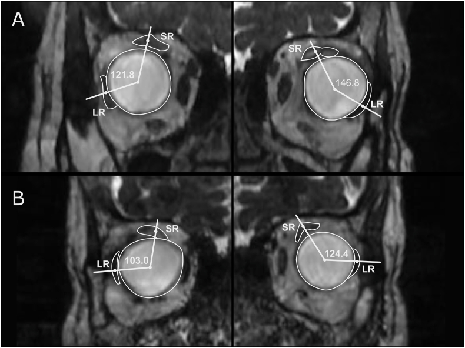
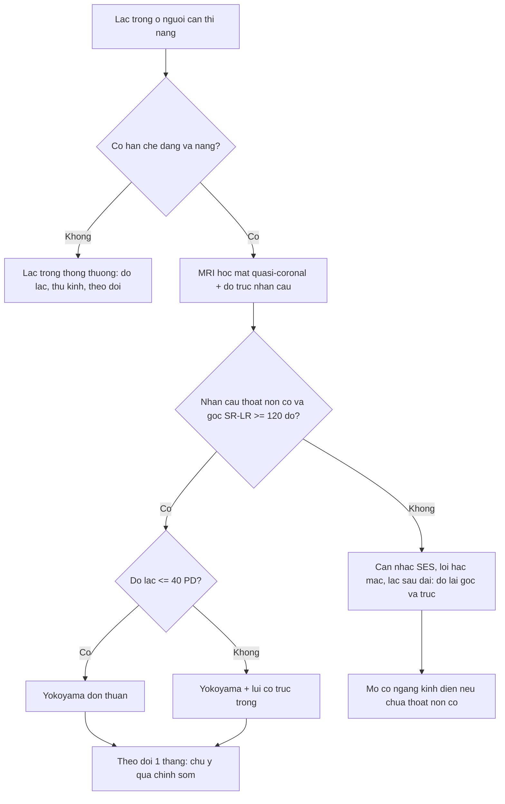
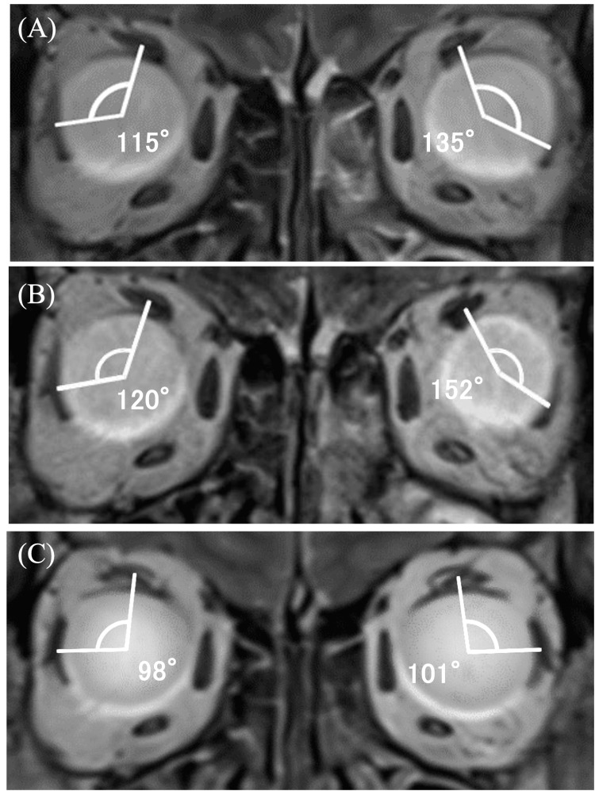
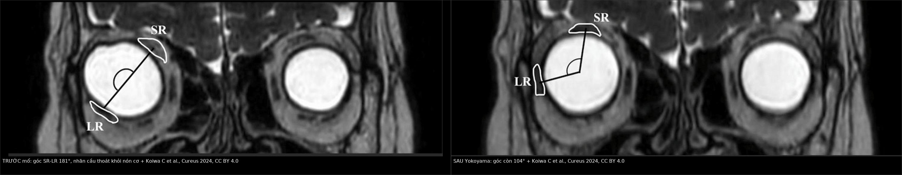
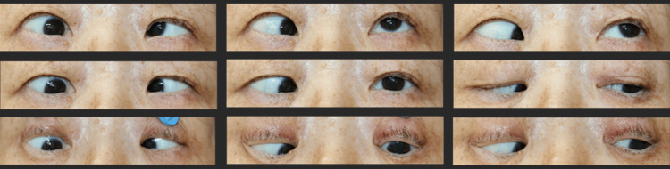
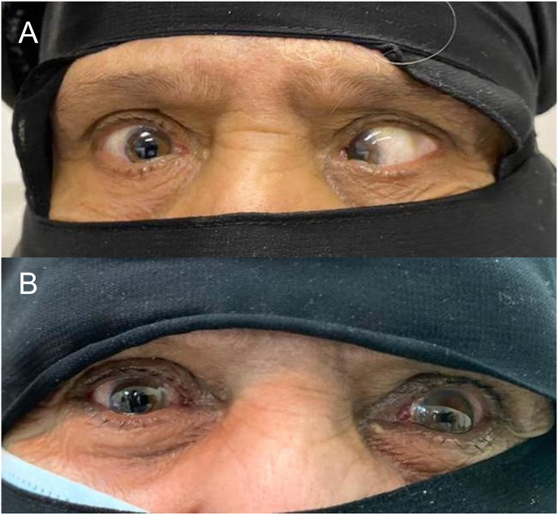

# 3212 — Hội chứng mắt nặng (heavy eye syndrome) ở cận thị cao: lác trong–hạ nhãn cầu tiến triển, góc SR–LR trên MRI / Heavy eye syndrome & myopic strabismus fixus

**Tags:** `pattern:lac-trong` `pattern:ha-nhan-cau` `pattern:han-che-dang` `pattern:han-che-nang-mat` `pattern:mat-nang` `pattern:lech-duong-co` `pattern:lac-tien-trien` `vung:mat` `vung:hoc-mat` `vung:co-van-nhan` `vung:non-co` `anatomy:co-truc-ngoai` `anatomy:co-truc-tren` `anatomy:day-chang-SR-LR` `anatomy:hoang-diem` `protocol:MRI-hoc-mat` `protocol:quasi-coronal` `protocol:do-goc-SR-LR` `protocol:do-truc-nhan-cau` `protocol:luoi-9-huong-nhin` `protocol:CT-hoc-mat` `score:goc-SR-LR` `score:truc-nhan-cau` `score:PD`

**Mức chắc chắn (certainty):** tổng hợp y văn (literature synthesis) — ghép **1 đoàn hệ 68 bệnh nhân lác trong ở người cận thị, 32 người có MRI đủ chất lượng** (Gilhooley MJ, Sarwani O, Johnson G et al., *J Neuroophthalmol* 2026, PMID 42757761, PMC13750804, CC BY 4.0), **1 tổng quan 18 nghiên cứu / 89 bệnh nhân loop myopexy** (Su Y, Shen Q, Fan X, *J Ophthalmol* 2016, PMID 27239338, PMC4863101, CC BY 4.0), **3 ca có MRI trước–sau mổ** (Alarfaj M, Al-Owaid A, Alkhaldi H et al., *Am J Ophthalmol Case Rep* 2022, PMID 35243158, PMC8858879, CC BY 4.0; Koiwa C, Negishi T, Sakemi F et al., *Cureus* 2024, PMID 38741804, PMC11090074, CC BY 4.0; Hirota A, Goseki T, Kunimi K et al., *Cureus* 2025, PMID 40895942, PMC12392025, CC BY 4.0), **2 ca kỹ thuật/thất bại mổ** (*World J Clin Cases* 2022, PMID 36387826, PMC9649532, CC BY-NC; *Medicine* 2022, PMID 36596031, PMC9803451, CC BY; *Case Rep Ophthalmol* 2021, PMID 33613253, PMC7879241, CC BY-NC) và **2 nghiên cứu MRI phân biệt với lác tuổi già** (PLoS One 2025, PMID 40424265, PMC12111637, CC BY; *Jpn J Ophthalmol* 2025, PMID 39903417, PMC11821714, CC BY). Chỗ suy luận hình học ghi rõ "suy luận".

> **Vì sao bài này quan trọng:** đây là nguyên nhân lác **chỉ gặp ở mắt cận thị nặng** nhưng lại **bị mổ như lác trong thông thường** — và mổ sai thì **không đỡ, thậm chí nặng hơn**. Một bệnh nhân đã trải qua **3 lần mổ cắt cơ trực trong** trong **33 năm** mà mắt vẫn dính vào trong–dưới (PMC9649532). Trong khi đó, thủ thuật đúng — **buộc hai bụng cơ trực trên và trực ngoài lại** (Yokoyama) — chỉ cần **một lần** và đưa mắt về vị trí chấp nhận được. Câu hỏi CĐHA rất cụ thể: **nhãn cầu có thoát khỏi nón cơ không, và góc giữa hai cơ rộng bao nhiêu trên MRI?** Con số đó quyết định chọn mổ cơ ngang hay mổ theo cơ chế (loop myopexy).

## 1. Tổng quan bệnh học – cơ chế hình ảnh: vì sao mắt dài lại "dính" vào trong–dưới

### 1.1 Cơ chế: nhãn cầu chui ra khỏi nón cơ ở góc trên–thái dương

- Ba mốc giải phẫu giữ nhãn cầu trong nón cơ: **các ròng rọc cơ (pulleys)**, **vách gian cơ (intermuscular septum)** và — quan trọng nhất ở đây — **dải liên kết giữa cơ trực ngoài và cơ trực trên (SR-LR band)**, một dải mô liên kết chạy giữa hai bụng cơ ở phía sau hốc mắt (PMC4863101; PMC13750804).
- Khi nhãn cầu dài ra (trục nhãn cầu **> 32 mm** được mô tả là mốc "tới hạn" — Aoki và cs., dẫn qua PMC13750804), **cực sau nhãn cầu lồi ra ngoài nón cơ ở góc trên–thái dương (superotemporal)**. Dải SR–LR bị **giãn/rão** theo tuổi, không còn giữ được nhãn cầu → **cơ trực ngoài trượt XUỐNG DƯỚI**, **cơ trực trên trượt VÀO TRONG**, và nhãn cầu "rơi" vào giữa hai cơ (PMC8858879; PMC12392025).
- **Vì sao lác trong + hạ nhãn cầu (esotropia + hypotropia), chứ không phải một hướng?** [suy luận hình học] Đường tác dụng của **LR bị đẩy xuống dưới** có thành phần **hạ nhãn cầu** và mất thành phần **dạng**; đường tác dụng của **SR bị đẩy vào trong** có thành phần **đưa mắt vào trong** và mất thành phần **nâng**. Cộng thêm **hạn chế cơ học** do nhãn cầu căng ép sát cơ và vách gian cơ dư thừa, bệnh nhân có **hạn chế dạng + hạn chế nâng**, cuối cùng mắt **cố định ở tư thế trong–dưới** (myopic strabismus fixus).
- **Tên gọi "heavy eye" là một từ sai lịch sử:** không phải mắt "nặng" do trọng lực, mà do **hỏng bộ giữ cơ học**. Vì vậy phẫu thuật đúng cũng không phải "cắt cơ cho cân" mà là **đưa nhãn cầu trở lại nón cơ**.

### 1.2 Đo cái gì trên ảnh: góc SR–LR (SR-LR displacement angle)

- **Mặt phẳng quasi-coronal** (vuông góc trục hốc mắt), cắt **8 mm trước chỗ nối nhãn cầu–thần kinh thị**; xác định **trọng tâm (centroid)** của nhãn cầu (GC), của bụng cơ trực trên và bụng cơ trực ngoài; kẻ đường **GC–SR** và **GC–LR**; góc giữa hai đường là **góc SR–LR** (PMC13750804, dựa trên phương pháp centroid tự động của Tan & Demer).
- **TẠI SAO góc này tăng:** [suy luận hình học] Hai bụng cơ nằm trên thành nón cơ; khi cực sau nhãn cầu chui vào khe giữa chúng, mỗi bụng cơ bị **đẩy ra xa trọng tâm nhãn cầu** theo hai hướng khác nhau → góc mở rộng. Góc **càng lớn** = nhãn cầu **càng thoát khỏi nón cơ** = cơ chế HES **càng rõ**. Đây là lý do một **con số độ** thay được cho mô tả định tính "cơ bị lệch".
- **Con số tham chiếu (đo cùng phương pháp, cùng bài):**

| Nhóm | Góc SR–LR | Trục nhãn cầu | Nguồn |
|---|---|---|---|
| Không lác (chứng, MRI lâm sàng) | **96,22 ± 1,23°** | **23,94 ± 0,35 mm** | PMC13750804 |
| Cận thị có lác trong (thực hành, trung vị) | **107,5°** | **27,30 mm** | PMC13750804 (n = 32 có MRI) |
| Lác do lồi hắc mạc (staphyloma) | **~109°** | — | dẫn qua PMC13750804 |
| Lác tuổi già (sagging eye syndrome) | **~104°** | — | dẫn qua PMC13750804 |
| **HES điển hình** | **~121°** (ca nặng tới **181°**) | **27–34 mm** | dẫn qua PMC13750804; PMC11090074 |

- **Đọc bảng này đúng cách:** **107,5° không phải ngưỡng chẩn đoán HES** — đó là trung vị của **mọi** bệnh nhân cận thị có lác trong, trong đó chỉ **2/68 (2,9%)** được ghi nhận HES (PMC13750804). Góc **~120° trở lên + nhãn cầu thoát nón cơ** mới là vùng của HES.

### 1.3 Các con số phải nhớ

| Biến số | Số liệu | Nguồn |
|---|---|---|
| Tuổi / khúc xạ / độ lác lúc khám (đoàn hệ thực hành) | **42,4 ± 2,2 tuổi**; SE trung vị **−8,25 D**; lác trung vị **20 PD** (gần và xa) | PMC13750804 |
| Tương quan khúc xạ – độ lác | **r = −0,044, P = 0,76** → **không** có liên hệ | PMC13750804 |
| Tỷ lệ HES trong lác trong ở người cận thị | **2/68 (2,9%)** — đa số vẫn là lác trong thông thường | PMC13750804 |
| Mốc trục nhãn cầu "tới hạn" | **32 mm** (Aoki, dẫn qua) — trên mốc này thay đổi giải phẫu SR–LR mới rõ | PMC13750804 |
| Bằng chứng mổ loop myopexy | **18 nghiên cứu, 89 bệnh nhân, 5–78 tuổi** | PMC4863101 |
| Ngưỡng chọn mổ theo độ lác | **Yokoyama đơn thuần: tới 40Δ**; **Yokoyama + lùi cơ trực trong (MR recession): 12–85Δ** | PMC4863101 |
| Ca trục nhãn cầu dài nhất có MRI | **33,97 mm**; góc **181° → 104°** sau Yokoyama + lùi MR | PMC11090074 |
| Ca có đai củng mạc hai mắt | góc **121,8° / 146,8°** → **103,0° / 124,4°** sau loop myopexy bằng dải silicone | PMC8858879 |
| Tiến triển tự nhiên 7 năm | **115°/135° → 120°/152°**; sau mổ **98°/101°** | PMC12392025 |
| Quá chỉnh sớm sau Yokoyama | ngày 1: **50Δ XT gần / 35Δ xa** → 1 tháng: **10Δ Xp / 4Δ Xp** | PMC12392025 |
| Biến chứng "pulled-in-two" cơ trực trong | lác trong **> 45°**, hạ **> 15°**; sau mổ **45Δ XT**, phải mổ lần 2 | PMC9803451 |
| Lác tuổi già (ARDE) so chứng | **LR sa xuống 5,1°** (p = 0,048); tỷ lệ diện tích **MR/LR +26%** | PMC12111637 |
| SES **không** cận thị | trục nhãn cầu **23,6 ± 0,6 mm**; góc nghiêng LR **22 ± 6°** | PMC11821714 |

### 1.4 Vật lý: vì sao MRI là phương tiện đúng, và vì sao CT chỉ là phương án hai

- **MRI (1,5–3 T, chuỗi T1W hoặc T2W, lát 2–3 mm):** cơ và mỡ hốc mắt **tương phản tự nhiên**; không cần thuốc cản quang để thấy **đường đi bụng cơ**, **dải SR–LR**, **vách gian cơ dư thừa** và **lồi hắc mạc**. Đây là phương tiện duy nhất trả lời được câu hỏi "nhãn cầu có thoát nón cơ **theo hướng nào**". Lưu ý: MRI **không** phải máy đo trục nhãn cầu chính xác như sinh trắc quang — xem bài [429](../429-do-truc-nhan-cau-bang-mri-ct/lesson.md).
- **CT:** thấy cơ và xương, **liều thấp hơn nhiều** so với MRI ở trẻ, nhưng **tương phản mô mềm kém** và chỉ nên dùng khi MRI chống chỉ định/không có. Ca có đai củng mạc cho thấy **vật liệu silicone** có thể gây **giả ảnh và méo đường đi cơ** — một lý do nữa để đọc cả hai bên và so với mô tả lâm sàng.
- **Siêu âm:** hữu ích để loại trừ **bong võng mạc/lồi hắc mạc** ở mắt cận thị nặng, nhưng **không** đo được góc SR–LR.

## 2. Mẫu hình + chẩn đoán phân biệt (gamut)

**Mẫu hình trung tâm:** *"Người lớn cận thị nặng, lác trong **tăng dần** kèm **hạ nhãn cầu**, hạn chế **dạng** và **nâng**; nhãn cầu dài; trên MRI quasi-coronal, **LR bị đẩy xuống dưới – SR bị đẩy vào trong**, góc SR–LR **> 107–120°**, cực sau nhãn cầu **lồi ra ngoài nón cơ**."*

Ba câu hỏi phải trả lời trước khi đặt tên:

1. **Nhãn cầu có thực sự thoát khỏi nón cơ không?** Có → **HES**. Không, chỉ cơ sa nhẹ → nghĩ **lác tuổi già/SES** hoặc lác trong thông thường.
2. **Trục nhãn cầu bao nhiêu, có lồi hắc mạc không?** Dài **> 27 mm** + lồi hắc mạc → nhóm cận thị bệnh lý; nhưng **HES mới cần mổ theo cơ chế**.
3. **Có nguyên nhân khác chồng lên không?** Đai củng mạc cũ, liệt dây VI, bệnh tuyến giáp, nhược cơ, sau mổ cơ trực trong → thay đổi chỉ định.

Gamut theo cơ chế:

- **HES / myopic strabismus fixus:** lác trong + hạ tiến triển, hạn chế dạng + nâng, góc SR–LR rộng, nhãn cầu thoát nón cơ; **có thể một bên hoặc hai bên**.
- **Lác tuổi già / lác xa do sa cơ (sagging eye syndrome, SES; age-related distance esotropia, ARDE):** người lớn tuổi, **không cận thị nặng** (trục **23,6 mm**), lác xa, **LR sa xuống 5,1°** so chứng, **không có nhãn cầu thoát nón cơ** (PMC11821714; PMC12111637).
- **Lác do lồi hắc mạc (staphyloma-related esotropia):** nhãn cầu dài + lồi hắc mạc sau cực; góc ~109°; điều trị có thể chỉ cần cơ ngang nếu chưa thoát nón cơ.
- **Lác sau đai củng mạc/đai vòng:** cơ học do đai + có thể **đồng thời HES** (ca PMC8858879) — đừng quy hết cho đai.
- **Liệt dây VI:** khởi phát **cấp**, lác **không đồng hành** (incomitant), **không** dài nhãn cầu, thường có nguyên nhân thần kinh; MRI để loại trừ.
- **Bệnh mắt tuyến giáp (TED):** **thân cơ to, chừa gân**, hạn chế nâng, lồi mắt; khác hẳn lệch đường đi cơ.
- **Viêm cơ hốc mắt/giả u:** đau, **cả gân**, đáp ứng corticoid; MRI thấy cơ dày + ngấm thuốc.
- **Nhược cơ:** lác **dao động**, mỏi, không hạn chế cố định; không có bất thường giải phẫu trên MRI.
- **Do can thiệp (iatrogenic):** sau **cắt/cắt cụt cơ trực trong**, sau mổ bong võng mạc — bệnh cảnh lác cơ học; cần phân biệt với HES thật (PMC9649532; [1499](../1499-song-thi-lac-sau-mo-bong-vong-mac/lesson.md)).
- **NF1 có loạn sản xương bướm:** lồi mắt **đập theo mạch** + HES — bệnh cảnh hiếm, cần CT/MRI xương (PMC8542118).

**Mnemonic HEA-VY:** **H**igh myopia · **E**longated axial length · **A**ngle SR–LR rộng · **V**ertical hypotropia · **Y**oke (dải SR–LR) hỏng.

## 3. Bảng so sánh phân biệt (ma trận đối chiếu)

| Thực thể (entity) | Hình ảnh điển hình (MRI quasi-coronal / lâm sàng) | Chốt vào (rule-in) | Chốt loại (rule-out) | Gợi ý xác nhận |
|---|---|---|---|---|
| **HES / myopic strabismus fixus** | Nhãn cầu dài **27–34 mm**, cực sau **lồi ra ngoài nón cơ trên–thái dương**; **LR xuống dưới, SR vào trong**; góc **> 107–120°**; hạn chế dạng + nâng | **Nhãn cầu thoát nón cơ + góc SR–LR ≥ ~120° + trục > 27 mm** | Góc bình thường (~96°), không lồi hắc mạc, không hạn chế dạng → lác trong thông thường | MRI quasi-coronal + lưới 9 hướng nhìn; đo góc 2 bên |
| **Lác tuổi già (SES/ARDE)** | Trục nhãn cầu **bình thường (23,6 mm)**, **LR sa 5,1°**, không thoát nón cơ; lác xa | **Tuổi cao + lác xa + trục bình thường + LR sa nhẹ** | Trục > 27 mm, nhãn cầu lồi ra ngoài nón cơ | MRI + đo trục; so chứng cùng tuổi |
| **Lác do lồi hắc mạc** | Lồi hắc mạc sau cực, góc ~**109°**, nhãn cầu dài nhưng **chưa thoát hẳn nón cơ** | **Lồi hắc mạc + góc trung gian 107–115°** | Góc ≥ 120° + nhãn cầu nằm giữa SR–LR → HES | MRI + B-scan/ OCT hậu cực |
| **Lác sau đai củng mạc** | Đai/vật liệu silicone, giả ảnh, cơ bị kéo; **có thể kèm HES** | **Tiền sử đai + hình ảnh vật liệu** | Không có vật liệu, bệnh cảnh điển hình HES | Hỏi tiền sử mổ; MRI cả hai mắt |
| **Liệt dây VI** | Không dài nhãn cầu, không lệch đường cơ; lác **không đồng hành**, hạn chế dạng **một mắt** | **Khởi phát cấp + không đồng hành + MRI sọ bình thường** | Lác tiến triển nhiều năm + nhãn cầu dài + hạn chế cả nâng | Khám thần kinh; MRI sọ–hốc mắt |
| **Bệnh mắt tuyến giáp (TED)** | **Thân cơ to, chừa gân**, cơ dày đối xứng, lồi mắt | **Cơ to chừa gân + bệnh tuyến giáp** | Cơ không to, chỉ **đường đi** lệch | TSH/TRAb; MRI/CT |
| **Viêm cơ hốc mắt** | Cơ dày **cả gân**, ngấm thuốc, đau | **Đau + cả gân + đáp ứng corticoid** | Không đau, cơ không dày | MRI + thử corticoid |
| **Sau cắt/cắt cụt cơ trực trong** | Mất cơ/bụng cơ, xơ dính; lác **cố định** nhiều năm | **Tiền sử mổ cơ, thấy cơ bị cắt** | Cơ còn đủ, chỉ lệch đường đi | Hồ sơ mổ + MRI |

*Bệnh nhân nữ 56 tuổi, đã đặt đai củng mạc hai mắt: (A) trước mổ — góc **121,8°** (phải) và **146,8°** (trái), nhãn cầu lồi ra ngoài nón cơ, **LR bị đẩy xuống dưới, SR vào trong**, vách gian cơ dư thừa; (B) sau loop myopexy bằng dải silicone — góc giảm còn **103,0°** và **124,4°**. Ảnh: Alarfaj M et al., Am J Ophthalmol Case Rep 2022, CC BY 4.0.*
*Lưu ý kỹ thuật: hai mắt được cắt ở **hai mức khác nhau** để lấy đúng bụng cơ — vì vậy đừng so góc giữa hai mắt như hai số tuyệt đối, hãy so **trước–sau trên cùng một mắt**.*

### Ba dấu hiệu "đọc đúng" trên ảnh

- **Cực sau nhãn cầu nằm GIỮA hai bụng cơ, không nằm trong nón:** đây là dấu chốt, mạnh hơn con số góc. Trên lát cắt chuẩn, nhãn cầu "phình" ra khỏi đường nối hai bụng cơ.
- **LR mất vị trí ngang tầm với SR:** bình thường hai bụng cơ gần vuông góc quanh nhãn cầu; trong HES **LR tụt xuống thấp**, góc mở rộng.
- **Vách gian cơ dư thừa + cơ áp sát nhãn cầu:** dấu phụ, giúp phân biệt với lồi hắc mạc đơn thuần.

## 4. Protocol + cách chọn mổ

### 4.1 Trình tự hình ảnh tối thiểu

1. **Lưới 9 hướng nhìn + đo độ lác (PD) gần/xa + test hạn chế cơ học (forced duction)** — trả lời "hạn chế thật hay do liệt".
2. **Đo trục nhãn cầu** bằng sinh trắc quang; nếu không đo được (đục môi trường, mắt bơm dầu/khí) → MRI/CT theo bài [429](../429-do-truc-nhan-cau-bang-mri-ct/lesson.md).
3. **MRI hốc mắt 1,5–3 T**, lát **2–3 mm**, **quasi-coronal** (vuông góc trục hốc mắt) + **axial**; T1W ± T2W **không cần cản quang**; chụp **cả hai hốc mắt** để so.
4. **Đo góc SR–LR** tại lát **8 mm trước chỗ nối nhãn cầu–thần kinh thị**, theo trọng tâm; ghi **số độ cho từng mắt**, cùng mức lát nếu có thể.
5. **Tìm lồi hắc mạc, bong võng mạc, dày củng mạc sau, vật liệu đai** — vì các bệnh này đổi cả chẩn đoán lẫn tiên lượng.
6. **Loại trừ nguyên nhân khác:** TSH/TRAb nếu nghi TED; khám thần kinh nếu lác không đồng hành; test nhược cơ nếu dao động.

### 4.2 Không có hệ phân độ chuẩn hóa — nhưng có ngưỡng quyết định

- **Ngưỡng giải phẫu:** góc **~96°** (bình thường) → **104–109°** (SES, lồi hắc mạc) → **~120° trở lên** (HES điển hình). Góc chỉ có giá trị khi **nhãn cầu thoát nón cơ**.
- **Ngưỡng mổ (theo tổng quan 89 bệnh nhân, PMC4863101):**
  - **Yokoyama đơn thuần** (buộc SR–LR): hiệu quả tới **40Δ** lác trong;
  - **Yokoyama + lùi cơ trực trong**: dùng cho **12–85Δ**;
  - **không lệch đường đi cơ** → mổ cơ ngang kinh điển vẫn hợp lý (thể sớm, chưa thoát nón cơ).
- **Kỹ thuật:** buộc hai bụng cơ **~15 mm sau chỗ bám** (nguyên bản; các ca dùng **12–14 mm**), chỉ không tiêu hoặc **dải silicone**; buộc **một phần bụng cơ** để giảm nguy cơ **thiếu máu đoạn trước**; tránh xuyên củng mạc khi khâu.
- **Sau mổ:** ngày 1 có thể **quá chỉnh rõ** — ca PMC12392025 có **50Δ XT gần / 35Δ xa**, giảm còn **10Δ/4Δ** sau **1 tháng**. **Không mổ lại sớm** vì "quá chỉnh"; theo dõi ít nhất 1 tháng.
- **Điều trị tạm:** lăng kính/tiêm botulinum cho lác nhỏ hoặc chờ mổ; không thay thế được phẫu thuật khi đã cố định.

### 4.3 Vì sao "cắt cơ ngang đơn thuần" thất bại

- Cắt/lùi cơ trực trong chỉ **giải phóng lực kéo ngang**, nhưng **không đưa nhãn cầu trở lại nón cơ**. Nhãn cầu vẫn nằm giữa SR và LR, nên **lực hạ + lực đưa vào trong vẫn còn** → lác tái phát.
- Ca PMC9649532: **3 lần mổ** (cắt cụt cơ trực trong + lùi cơ trực ngoài) trong **33 năm**, **không đỡ lần nào**; sau **Yokoyama hai bên + lùi MR phải**, hai mắt **cân bằng trong 6 tháng**.
- Ngược lại, **Yokoyama không sửa được hạn chế dạng nếu cơ trực trong đã co rút nặng** — ca PMC11090074 phải **lùi MR cùng lúc** vì hạn chế dạng còn lại ngay cuối thì Yokoyama.

## 5. Biến thể bình thường và cạm bẫy

- **Góc SR–LR trên MRI lâm sàng dao động:** ca thực hành **không có điểm cố định thị giác** (không như nghiên cứu), lát cắt dày hơn, đầu xoay nhẹ → cùng một mắt có thể lệch vài độ. Vì vậy **107,5° là trung vị của một đoàn hệ hỗn hợp**, không phải ngưỡng.
- **Hai mắt không cùng mức lát:** tác giả ca PMC8858879 ghi rõ phải lấy **hai mức khác nhau** để thấy bụng cơ hai bên — nghĩa là **so sánh chéo hai mắt có thể sai**. Ưu tiên so **trước–sau** trên cùng mắt.
- **Nhầm với lác trong thông thường:** **97%** bệnh nhân cận thị có lác trong trong đoàn hệ **không** phải HES. Gọi HES tràn lan dẫn tới **mổ nặng hơn cần thiết**; bỏ sót HES dẫn tới **mổ lặp vô ích**.
- **Nhầm hạ nhãn cầu với liệt dây IV/skew deviation:** hạ nhãn cầu trong HES **kèm hạn chế nâng + nhãn cầu dài**; liệt dây IV có **test Bielschowsky** dương và **không** dài nhãn cầu.
- **Bỏ sót bệnh hậu đoạn:** mắt cận thị nặng **> 27 mm** có nguy cơ **bong võng mạc, lồi hắc mạc, bệnh hoàng điểm cận thị**. "Satisfaction of search" khi đã thấy lác là bỏ qua nguyên nhân mù.
- **Đai củng mạc cũ:** vừa gây giả ảnh vừa **có thể là nguyên nhân lác riêng**; ca PMC8858879 cho thấy HES **vẫn xảy ra** trên mắt đã đai — đừng quy hết cho đai, cũng đừng bỏ qua đai.
- **Quá chỉnh sớm sau Yokoyama:** **50Δ XT ngày 1** có thể **tự về 10Δ Xp sau 1 tháng**; mổ lại sớm là sai lầm.
- **Cơ trực trong co rút lâu năm:** nguy cơ **pulled-in-two** (đứt cơ trong khi mổ) — ca PMC9803451 đứt cơ, hậu quả **45Δ XT** và phải mổ lần hai. Đây là lý do **không nên "cắt thêm cơ trực trong"** ở mắt đã mổ nhiều lần.
- **Trục nhãn cầu đo trên MRI ≠ trục nhãn cầu thật:** MRI lâm sàng dày lát, không qua hoàng điểm → **đừng dùng số AL trên MRI để tính IOL** nếu chưa đọc bài [429](../429-do-truc-nhan-cau-bang-mri-ct/lesson.md).

*Nam 59 tuổi, cận thị nặng: (A) lần khám đầu — **115°/135°**; (B) trước mổ, sau **7 năm** — **120°/152°** (lác nặng lên); (C) sau Yokoyama — **98°/101°**. Đây là bằng chứng hình ảnh cho **tiến triển tự nhiên** và cho việc **góc phản ánh mức thoát nón cơ**. Ảnh: Hirota A et al., Cureus 2025, CC BY 4.0.*

*Trái: trước mổ — góc **181°**, cực sau nhãn cầu **nằm ngoài nón cơ**, SR và LR bị đẩy về hai phía đối diện. Phải: sau Yokoyama + lùi cơ trực trong — góc còn **104°**, nhãn cầu trở lại giữa hai bụng cơ. Ảnh ghép letterbox, không crop. Nguồn: Koiwa C et al., Cureus 2024, CC BY 4.0.*

## 6. Tự lượng giá — Blind Quiz

**Ca 1 — Nữ 68 tuổi, cận thị rất nặng, mắt phải "dính" vào trong–dưới.**

- Bối cảnh: mắt phải cố định ở tư thế **trong–dưới**, hạn chế **dạng** và **nâng**; trục nhãn cầu phải **33,97 mm**.
- Câu hỏi: (1) Ba dấu hiệu lâm sàng chốt cơ chế? (2) Cần chụp gì và đo gì? (3) Vì sao **không** chỉ lùi cơ trực trong?

<b>Bấm để hiện đáp án (findings + chẩn đoán)</b>

- **Dấu hiệu:** lác trong + hạ nhãn cầu; hạn chế **dạng** và **nâng**; nhãn cầu **dài 33,97 mm** — bộ ba của **HES/myopic strabismus fixus**.
- **Hình ảnh:** MRI quasi-coronal thấy **cực sau nhãn cầu lồi ra ngoài nón cơ trên–thái dương**, góc **SR–LR 181°** (Hình 3 của bài gốc).
- **Điều trị:** **Yokoyama** (buộc SR–LR) + **lùi cơ trực trong** vì hạn chế dạng còn lại cuối thì; sau mổ góc còn **104°**, còn **lác trong nhỏ** nhưng **dạng qua đường giữa** và bệnh nhân hài lòng.
- **Vì sao không chỉ lùi MR:** lùi MR không đưa nhãn cầu về nón cơ → lực hạ và lực đưa vào trong vẫn còn; đây là lý do các ca chỉ mổ cơ ngang **tái phát**.
- Nguồn: Koiwa C, Negishi T, Sakemi F, Takesue A, Yokoyama T, *Cureus* 2024 (PMID 38741804, PMC11090074), CC BY 4.0.

**Ca 2 — Nữ 56 tuổi, đã đặt đai củng mạc hai mắt vì bong võng mạc, nay lác trong lớn.**

- Bối cảnh: đai củng mạc hai mắt; lác trong góc lớn ở vị trí chính; hạn chế dạng.
- Câu hỏi: (1) Vì sao phải chụp MRI trước khi quyết định mổ? (2) Hai chẩn đoán phân biệt chính? (3) Phẫu thuật nào đã dùng và kết quả?

<b>Bấm để hiện đáp án (findings + chẩn đoán)</b>

- **MRI:** góc **121,8°** (phải) và **146,8°** (trái), nhãn cầu **thoát nón cơ**, **LR xuống dưới – SR vào trong**, vách gian cơ dư thừa → **HES** trên mắt đã đai.
- **Phân biệt:** (a) lác cơ học **do đai**; (b) **HES thật** — hai bệnh có thể **cùng tồn tại**; MRI giúp chọn mổ theo cơ chế.
- **Mổ:** **loop myopexy bằng dải silicone cố định vào củng mạc**; sau mổ góc còn **103,0° / 124,4°**, lác trong lớn được cải thiện, xuất hiện **lác ngoài nhẹ** ở vị trí chính (Hình B của ảnh trên).
- **Bài học:** ở mắt đã đai, **đừng mặc định lác là do đai** — và **đừng mổ cơ ngang** khi nhãn cầu đã thoát nón cơ.
- Nguồn: Alarfaj M, Al-Owaid A, Alkhaldi H, Elkhamary S, Sesma G, *Am J Ophthalmol Case Rep* 2022 (PMID 35243158, PMC8858879), CC BY 4.0.

**Ca 3 — Nam 59 tuổi, lác trong nặng dần trong 7 năm, mổ Yokoyama.**

- Bối cảnh: theo dõi **7 năm**; trước mổ góc **120°/152°**; sau mổ **98°/101°**.
- Câu hỏi: (1) Góc thay đổi thế nào và nói lên điều gì? (2) Ngày đầu sau mổ thấy **50Δ lác ngoài** — xử trí? (3) Khi nào cần mổ lại?

<b>Bấm để hiện đáp án (findings + chẩn đoán)</b>

- **Tiến triển:** **115°/135° → 120°/152°** trong 7 năm = nhãn cầu **thoát nón cơ nhiều hơn**, lác nặng lên; sau mổ **98°/101°** = trở về gần vùng bình thường.
- **Quá chỉnh sớm:** **50Δ XT gần / 35Δ xa ngày 1** → **40Δ/25Δ tuần 1** → **10Δ Xp/4Δ Xp tháng 1**; **không mổ lại** trong giai đoạn này.
- **Khi nào mổ lại:** nếu **lác ngoài/ lác trong tồn tại > 1–3 tháng**, song thị không bù được, hoặc hạn chế cơ học còn — ca PMC9649532 phải mổ lần hai sau **3 tháng**, ca PMC9803451 sau **3 tháng**.
- **Bài học:** **góc SR–LR là chỉ số theo dõi** — không chỉ để chẩn đoán; và **đừng đánh giá kết quả mổ trong tuần đầu**.
- Nguồn: Hirota A, Goseki T, Kunimi K, Kimijima M, Ichibe Y, *Cureus* 2025 (PMID 40895942, PMC12392025), CC BY 4.0.

## Bài liên quan chéo

- [400 – Tổng quan Mắt & thị giác](../400-tong-quan-mat-thi-giac/lesson.md)
- [429 – Đo trục nhãn cầu bằng MRI/CT](../429-do-truc-nhan-cau-bang-mri-ct/lesson.md) (cách đo AL trên ảnh, sai số voxel)
- [1499 – Song thị & lác sau mổ bong võng mạc](../1499-song-thi-lac-sau-mo-bong-vong-mac/lesson.md) (lác cơ học sau mổ mắt)
- [1493 – Biến chứng đai hoàng điểm](../1493-bien-chung-dai-hoang-diem-khi-nao-thao/lesson.md) (đai/vật liệu và cơ vận nhãn)
- [1878 – Bong võng mạc do lỗ hoàng điểm ở mắt cận thị nặng](../1878-bong-vong-mac-lo-hoang-diem-can-thi-nang/lesson.md) (bệnh hậu đoạn ở cùng nhóm bệnh nhân)
- [3207 – Viêm củng mạc](../3207-viem-cung-mac-scleritis/lesson.md) (khi mắt đỏ + đau sau mổ/đai)

> Không dùng để chẩn đoán độc lập khi chưa có người hướng dẫn.
