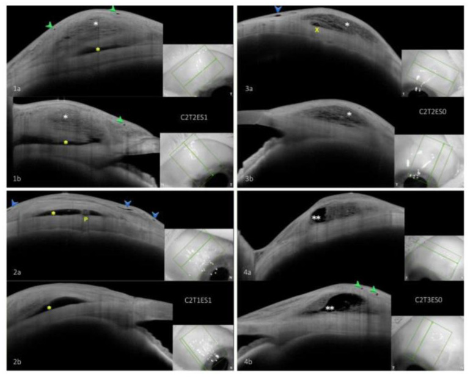
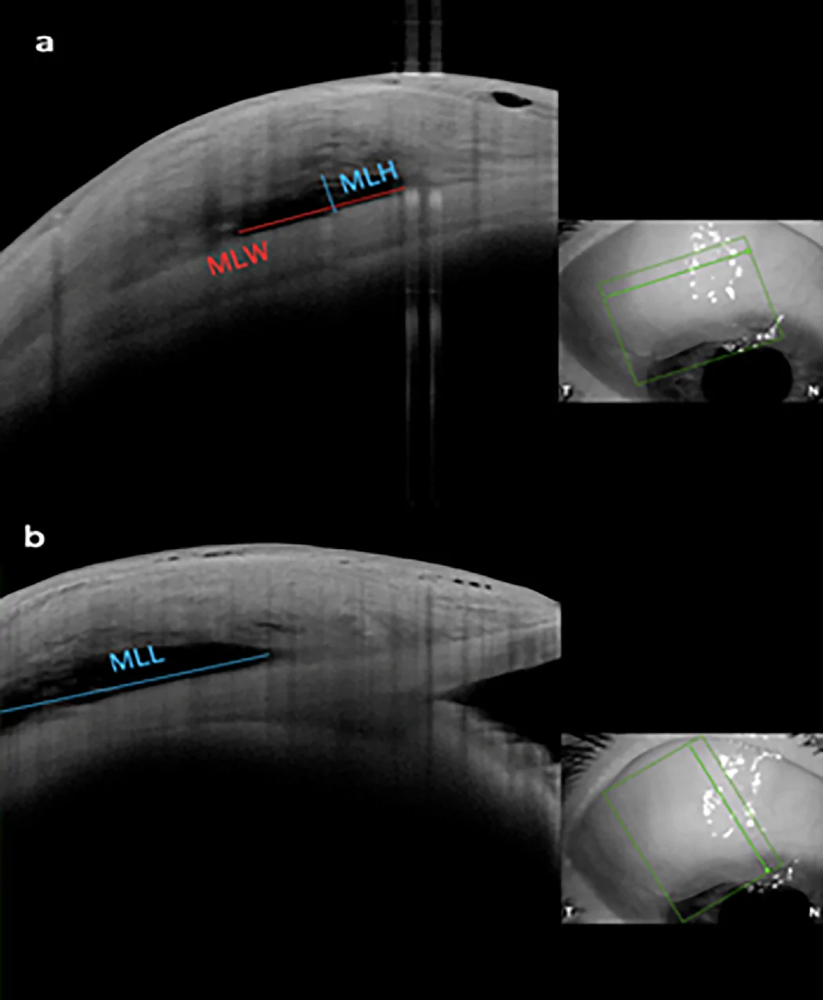
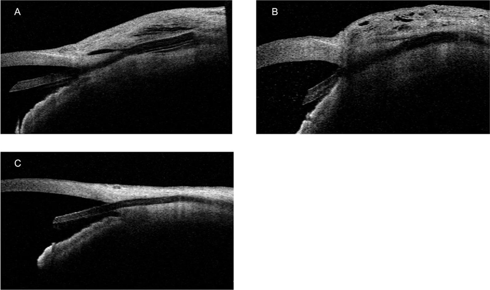
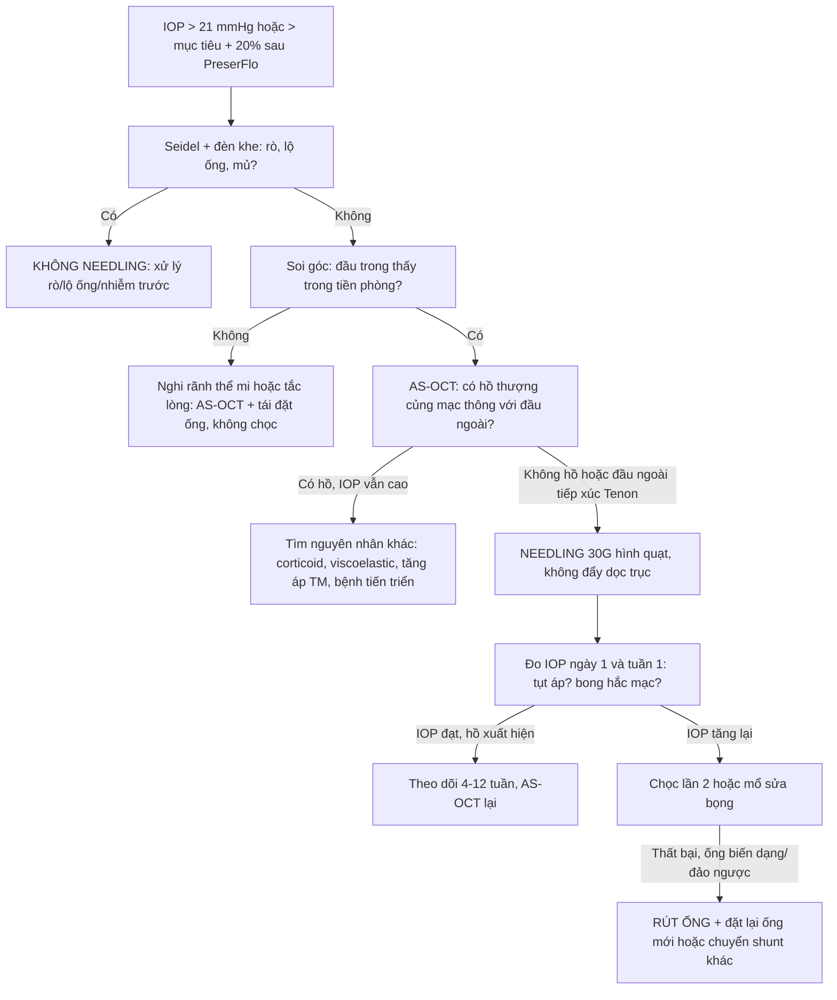
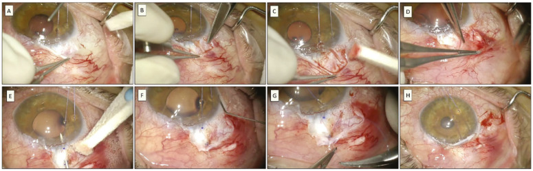
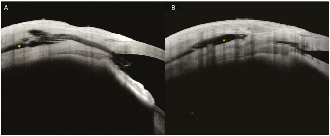

# 3213 — Bọng dẹt sau PreserFlo MicroShunt: hồ thượng củng mạc quyết định, không phải độ dày thành — chọc bọng, rút stent hay rút ống / Flat bleb after PreserFlo MicroShunt

**Tags:** `pattern:bong-det` `pattern:khong-ho-thuong-cung-mac` `pattern:dau-ngoai-tiep-xuc-tenon` `pattern:nang-tenon` `pattern:loi-ong` `pattern:stent-nylon-trong-long` `pattern:ong-trong-cung-mac` `pattern:ong-dao-nguoc` `pattern:lo-ong` `pattern:tut-ong` `pattern:ong-cham-mong-mat` `pattern:bit-dau-trong` `vung:mat` `vung:bong-loc` `vung:cung-mac` `vung:tenon` `vung:tien-phong` `vung:goc-tien-phong` `protocol:AS-OCT` `protocol:gonioscopy` `protocol:needling` `protocol:rut-ong` `score:IOP` `score:chieu-cao-bong` `score:ho-thuong-cung-mac`

**Mức chắc chắn (certainty):** tổng hợp y văn (literature synthesis) — ghép **1 nghiên cứu AS-OCT 51 mắt, chụp ở tuần 4, tìm yếu tố dự báo thành công** (Ishaq T et al., *Transl Vis Sci Technol* 2026, PMID 42949052, PMC13722969, **CC BY 4.0**), **1 đoàn hệ 88 mắt về kiểu lọc trên AS-OCT tháng 1** (Minami T et al., *Adv Ther* 2026, PMID 42518141, PMC13619755, **CC BY-NC 4.0**), **1 so sánh 80 mắt PreserFlo (41) vs XEN (39) bằng AS-OCT** (Hasan SM et al., *Diagnostics* 2023, PMID 37510061, PMC10377986, **CC BY 4.0**), **1 đoàn hệ thực hành 81 mắt theo 2 năm** (Zeier A et al., *Front Ophthalmol* 2026, PMID 42745877, PMC13574660, **CC BY 4.0**), **1 đoàn hệ 40 mắt 1 năm** (Cheng TC et al., *Clin Ophthalmol* 2026, PMID 42454273, PMC13367356, **CC BY-NC 4.0**), **1 nghiên cứu khả thi 23 mắt theo 5 năm** (Batlle JF et al., *J Glaucoma* 2021, PMID 33137019, PMC8041565, **CC BY-NC-ND 4.0** — tác giả thứ nhất **là cố vấn của InnFocus/Santen**, đơn vị sản xuất ống) và **4 ca báo** (di lệch ống sau needling; nhiễm bọng liên quan chỉ stent; tắc lòng do sắc tố khi ống vào rãnh thể mi; lộ/thò ống). Chỗ suy luận ghi rõ "suy luận"; ngưỡng chưa có dữ liệu cho người Việt ghi "chưa rõ".

> **Vì sao bài này quan trọng:** [3209](../3209-bong-loc-sau-xen-gel-stent/lesson.md) dạy đọc bọng **XEN** — ống gelatin **45/63 µm** đặt **ab interno**, không có vạt kết mạc. **PreserFlo MicroShunt** là thiết bị khác về bản chất: **8,5 mm**, lòng **70 µm**, đường kính ngoài **350 µm**, polymer **SIBS**, đặt **ab externo** qua **đường hầm củng mạc có vạt Tenon–kết mạc**, **không có van**, đầu ngoài nằm **~6 mm sau rìa giác mạc** nên bọng **ra sau hơn** bọng XEN. Hệ quả là **không được bê nguyên ngưỡng XEN sang**: trên 80 mắt, bọng PreserFlo **cao hơn** (2,13 vs 1,85 mm), **rộng hơn** (10,31 vs 9,1 mm), **thành dày hơn** (1,60 vs 1,1 mm) và **có hồ thượng củng mạc 92,7% vs 30,8%** (Hasan 2023). Và điều quan trọng nhất: ở PreserFlo, **thành bọng dày KHÔNG dự báo thất bại** — **hồ thượng củng mạc** mới là thứ dự báo thành công (OR **9,76**) (Ishaq 2026). Bài này trả lời 3 câu thực hành: **đọc gì trên AS-OCT**, **khi nào chọc bọng**, và **khi nào phải rút ống** (khác "rút chỉ stent" trong lòng ống).

## 1. Tổng quan bệnh học – cơ chế hình ảnh: một ống 70 µm không van, đặt sau vạt Tenon

### 1.1 Thiết bị và kỹ thuật — các con số quyết định cách đọc bọng

- **Vật liệu và kích thước:** PreserFlo MicroShunt (trước đây là InnFocus MicroShunt) làm bằng **poly(styrene-block-isobutylene-block-styrene) (SIBS)**, **dài 8,5 mm**, **đường kính ngoài 350 µm**, **lòng 70 µm** → thành ống dày **(350 − 70)/2 = 140 µm** mỗi bên (Cheng 2026; Batlle 2021).
- **Không có van.** Khác Ahmed/Baerveldt, ống không có cơ chế tự đóng khi áp lực thấp. Đây là lý do kỹ thuật thường dùng **một sợi chỉ nylon 10-0 luồn trong lòng ống như "van tay"**, rút ra sau khoảng **1 tháng** (Nishigaki 2026).
- **Đường vào ab externo:** rạch kết mạc **fornix-based**, tách **vạt Tenon–kết mạc 8–10 mm ra sau**, đặt **mitomycin C (MMC) 0,2–0,4 mg/mL trong 2–3 phút**, tạo **đường hầm củng mạc**, đưa ống vào tiền phòng **song song với mống mắt** (Cheng 2026).
- **Vị trí đầu ngoài:** nằm dưới kết mạc–Tenon, **~6 mm sau rìa giác mạc** → bọng **ra sau** hơn bọng XEN (trung vị **6,21 ± 1,2 mm** so với **5,21 ± 1,8 mm** sau rìa; Hasan 2023). Đây là lý do **lát cắt AS-OCT đặt 2 mm sau rìa có thể không thấy hồ** — phải quét **dọc trục ống**, không quét theo mốc rìa.
- **Vì sao 140 µm thành ống quan trọng trên AS-OCT:** thành SIBS **tăng hồi âm** và cho **hai đường song song**; lòng 70 µm thường **dưới độ phân giải trục** của nhiều máy, nên **thấy ống ≠ chứng minh lòng thông**. Muốn đánh giá lòng phải phối hợp **soi góc + đáp ứng nhãn áp (intraocular pressure, IOP)**, không chỉ ảnh.

### 1.2 Vật lý: vì sao 70 µm vừa "đủ thoát" vừa "dễ tụt áp" — và vì sao hay có stent

- Theo **Poiseuille**, trở lực **R = 8µL/(πr⁴)**: đường kính tăng gấp đôi thì trở lực giảm **16 lần**.
  - So với **XEN45 (45 µm)**: (70/45)⁴ ≈ **5,9** → PreserFlo có trở lực **~1/6** XEN45 (**suy luận** từ công thức).
  - So với **XEN63 (63 µm)**: (70/63)⁴ ≈ **1,5** → trở lực thấp hơn **~1/3** (**suy luận**).
- **Hệ quả lâm sàng:** lòng rộng hơn + **không van** → **nguy cơ tụt áp sớm cao**. Trong 40 mắt, **17,5%** có **IOP ≤ 5 mmHg** sớm sau mổ, **2,5%** còn tụt áp ở 1 năm nhưng **không mất thị lực** (Cheng 2026). Trong 23 mắt theo 5 năm: **tụt áp thoáng qua 3/23 (13,0%)**, **tiền phòng nông/dẹt 3/23 (13,0%)**, **bong hắc mạc thoáng qua 2/23 (8,7%)**, **máu tiền phòng 2/23 (8,7%)** (Batlle 2021).
- **Vì sao có chỉ stent:** sợi **nylon 10-0** trong lòng 70 µm làm **giảm tiết diện thoát** trong giai đoạn đầu, rồi **rút ở tháng 1** để mở lưu lượng. Trên AS-OCT, chỉ stent là **đường tăng hồi âm mảnh nằm trong lòng ống** — **không phải xơ hóa**. Rút chỉ stent là **một thủ thuật có hậu quả**: ca báo ghi nhận **tụt áp và bong hắc mạc thoáng qua sau rút**, tự khỏi (Nishigaki 2026).
- **Lòng 70 µm vẫn rất dễ tắc:** ca báo ống đặt **nhầm vào rãnh thể mi** cho thấy lòng **không xẹp, không biến dạng**, nhưng bị bít bởi **vật liệu nâu đen chứa nhiều hạt sắc tố** (Takeda 2026) — tức là **sắc tố mống mắt**, không phải fibrin. Kích thước hạt/tơ huyết tương **cùng bậc với 70 µm**, nên "một cục nhỏ" đủ bít.

### 1.3 Vì sao bọng PreserFlo khác bọng XEN — và vì sao "thành dày" là bẫy

- Trên **80 mắt bọng còn chức năng** (41 PreserFlo, 39 XEN), khác biệt có ý nghĩa (Hasan 2023):

| Thông số (AS-OCT) | PreserFlo | XEN | p |
|---|---|---|---|
| Có **hồ thượng củng mạc** | **92,7%** | 30,8% | < 0,001 |
| Chiều cao bọng | **2,13 ± 0,5 mm** | 1,85 ± 0,6 mm | 0,03 |
| Chiều rộng bọng | **10,31 ± 2,3 mm** | 9,1 ± 2,3 mm | 0,02 |
| Chiều dài bọng | **9,13 ± 1,8 mm** | 8,24 ± 1,9 mm | 0,04 |
| Khoảng cách sau rìa | **6,21 ± 1,2 mm** | 5,21 ± 1,8 mm | 0,005 |
| Độ dày thành bọng | **1,60 ± 0,5 mm** | 1,1 ± 0,4 mm | 0,004 |
| **Tenon tăng hồi âm** | **31,7%** | 10,3% | 0,02 |
| Thay đổi dạng hang (cavernous) | 17,1% | **35,9%** | 0,05 |

- **Cơ chế (suy luận có căn cứ):** PreserFlo đi **ab externo** nên có **vạt Tenon–kết mạc** và **đường hầm củng mạc** → thành bọng dày hơn, Tenon xơ hơn; XEN đi **ab interno** xuyên củng mạc, không vạt → thành mỏng hơn, dễ tạo **dạng hang**. Vì vậy **đừng so bọng PreserFlo với bọng XEN bằng cùng một thước**.
- **Phản trực giác quan trọng nhất:** trong 51 mắt PreserFlo, **chiều cao, chiều rộng và độ hồi âm thành bọng KHÔNG liên quan tới thành công**, trong khi **sự hiện diện của hồ thượng củng mạc** liên quan mạnh (**OR 9,76; 95% CI 2,23–42,72**) (Ishaq 2026). Nói cách khác: **thành dày một mình không phải lý do để chọc bọng**.

### 1.4 Đọc bọng để dự báo, không chỉ để mô tả

- **Nghiên cứu then chốt (Ishaq 2026, 51 mắt, chụp AS-OCT ở tuần 4, theo 6 tháng):** thành công hoàn toàn **51%**; nhóm thành công có **hồ dài 3,18 ± 1,59 vs 1,09 ± 1,63 mm**, **rộng 3,04 ± 1,87 vs 0,98 ± 1,4 mm**, **cao 0,33 ± 0,2 vs 0,15 ± 0,22 mm** (p < 0,05 cho cả ba). Mô hình gồm **chiều dài + chiều rộng hồ** đạt **độ chính xác 79,1%** (độ nhạy **80,8%**, độ đặc hiệu **77,3%**).
- **Hướng lọc cũng quan trọng (Minami 2026, 88 mắt, AS-OCT tháng 1):** IOP trung vị **19 → 10 mmHg** lúc 12 tháng; **lọc hướng về rìa giác mạc** giảm nguy cơ thất bại do tăng áp (**HR 0,28–0,57**); **trục nhãn cầu dài** là yếu tố thuận lợi (**HR 0,70 và 0,77**); **tuổi cao** và **glôcôm giả tróc bao** là yếu tố nguy cơ **thất bại do tụt áp** (**HR 1,05 và 3,75**).
- **Hai mặt của cùng một đồng tiền:** bọng càng "thoát tốt" (hồ lớn, hướng rìa) thì càng ít tăng áp — nhưng ở người **già, giả tróc bao**, cùng kiểu bọng đó lại kèm **tụt áp**. Vì vậy kết luận "bọng tốt" phải luôn đi kèm **con số IOP và mục tiêu áp** của bệnh nhân, không chỉ hình ảnh.

## 2. Mẫu hình + chẩn đoán phân biệt theo vị trí (Gamut)

Nguyên tắc: **"bọng dẹt + IOP tăng" phải được định vị theo 4 tầng dọc ống**, từ trong ra ngoài. Bỏ qua một tầng là chọc sai chỗ.

| Tầng | Vị trí | Nguyên nhân hay gặp | Thời điểm |
|---|---|---|---|
| **1. Đầu trong** | Tiền phòng / rãnh thể mi | Ống vào **rãnh thể mi** (quá ra sau) → bít bằng sắc tố; ống **chạm mống mắt**; máu/fibrin; màng đồng tử | **ngày–tuần** |
| **2. Lòng ống** | 70 µm | **Chỉ stent nylon** (cố ý), cục fibrin/máu, sắc tố, gập ống | **ngày–tuần** |
| **3. Đầu ngoài** | Dưới Tenon, ~6 mm sau rìa | **Tiếp xúc/dính đầu ngoài với Tenon**, bao xơ đầu ngoài, ống nằm trong Tenon | **4–12 tuần** |
| **4. Thành bọng** | Kết mạc–Tenon | Xơ hóa lan tỏa, **nang Tenon**, **lộ/thò ống** (đầu xa, thân ống, chỉ khâu), nhiễm bọng | **tuần–năm** |
| **Ngoài ống** | Toàn nhãn cầu | **Tăng IOP do corticoid**, viscoelastic sót, tăng áp tĩnh mạch thượng củng mạc, bệnh glôcôm tiến triển | bất kỳ |

- **Mnemonic "TIP–LUMEN–TIP–WALL"** (đầu trong – lòng – đầu ngoài – thành): mỗi chữ là một câu hỏi trước khi động kim.
- **Phân biệt bọng dẹt do xơ với bọng dẹt do tụt áp:** bọng dẹt + **IOP thấp** = tụt áp (tìm bong hắc mạc, tiền phòng nông); bọng dẹt + **IOP cao** = tắc ở một trong 4 tầng. **Không chọc bọng khi IOP thấp.**
- **Bọng "đẹp" mà IOP cao:** vẫn có thể có **hồ nhưng không thông** (hồ bị vây), ống nằm trong Tenon, hoặc nguyên nhân ngoài ống. Luôn hỏi "hồ có **thông với đầu ngoài** không?" trước khi kết luận.

## 3. Bảng so sánh phân biệt (ma trận đối chiếu)

*Bốn kiểu bọng chức năng sau PreserFlo, chụp **lát cắt tiếp tuyến (a)** và **xuyên tâm (b)**. Mã **C** = nang dưới biểu mô, **T** = thay đổi Tenon, **ES** = hồ thượng củng mạc (1 = có, 0 = không). Chú ý **ES0 vẫn có thể là bọng chức năng** — mã mô tả, không phải điểm tiên lượng. Nguồn: Hasan SM et al., *Diagnostics* 2023 (PMC10377986), Fig. 2, **CC BY 4.0** — nguyên bản.*

| Thực thể (entity) | Hình ảnh điển hình | Chốt vào (rule-in) | Chốt loại (rule-out) | Gợi ý xác nhận |
|---|---|---|---|---|
| **Bọng có hồ thượng củng mạc (chức năng)** | Khoang **giảm hồi âm** dưới kết mạc, bờ rõ, có thể kèm microcyst; thành có thể dày | **Hồ thấy được + hướng về rìa** (HR 0,28–0,57) | Không có hồ + IOP tăng → không phải kiểu này | AS-OCT dọc trục ống, đo hồ; IOP mục tiêu |
| **Bọng dẹt xơ hóa, không hồ** | Không khoảng dịch; Tenon **tăng hồi âm** dày; ống còn đúng vị trí | **Không hồ + IOP > mục tiêu + ống đúng vị trí + Seidel âm** | Có hồ lớn + microcyst → không phải xơ | AS-OCT; needling là điều trị đầu tay |
| **Đầu ngoài tiếp xúc Tenon** | Đầu xa ống **áp vào Tenon**, không có dịch quanh đầu ống; bọng nông | **Đầu xa tiếp xúc Tenon trên AS-OCT + bọng nông + IOP tăng** | Dịch bao quanh đầu xa → không phải tiếp xúc | AS-OCT trước/sau needling (Hình ca 3) |
| **Stent nylon lưu trong lòng** | **Đường tăng hồi âm mảnh trong lòng ống**, ống đúng vị trí; thường < 4–6 tuần | **Thấy chỉ trong lòng + mắt chưa rút stent theo kế hoạch** | Lòng trống trên AS-OCT → không phải stent | Hỏi ngày mổ/kế hoạch rút; đèn khe |
| **Tắc lòng do fibrin/máu/sắc tố** | Ống đúng vị trí nhưng bọng xẹp **nhanh trong ngày–tuần**; **không hồ**; có thể đầu trong không thấy ở tiền phòng | **Bọng xẹp đột ngột, đầu trong không thấy ở tiền phòng** (nghi rãnh thể mi) | Đầu trong rõ trong tiền phòng + hồ còn → không phải tắc lòng | Soi góc; AS-OCT; **không needling mù** |
| **Ống vào rãnh thể mi** | Đầu trong **không thấy ở tiền phòng** trên soi góc; AS-OCT thấy ống **ra sau** so với bè củng mạc | **Đầu trong không thấy ở tiền phòng** + tắc sớm + sắc tố trong lòng | Đầu trong song song mống mắt, cách bè → vị trí đúng | Soi góc; AS-OCT; **tái đặt ống**, không chọc |
| **Nang Tenon** | Một khoang lớn, **thành dày đều**, **không microcyst**, bọng căng | **Khoang đơn độc + thành dày + bọng căng + IOP tăng** | Nhiều microcyst + thành mỏng → bọng chức năng | AS-OCT; needling dễ thất bại → mổ sửa bọng |
| **Ống trong Tenon / không thấy ống** | Ống không nằm ngay dưới kết mạc; ít khoảng dịch | **Ống nằm trong lớp Tenon** + bọng dẹt + IOP tăng | Ống thượng củng mạc, dưới kết mạc → vị trí đúng | AS-OCT xuyên tâm; đèn khe |
| **Ống đảo ngược/tụt sau needling** | **Ống không còn thấy ở tiền phòng** và **không thấy dưới kết mạc**; IOP tăng vọt; trên bàn mổ ống **biến dạng, cứng, nằm trong khoang dưới Tenon** | **Mất ống ở cả hai nơi sau needling + IOP tăng nhanh** | Ống thấy đủ 2 đầu → không phải di lệch | Soi góc + đèn khe + AS-OCT; **rút và đặt lại** |
| **Lộ/thò ống (exposure/extrusion)** | Đầu ống/đầu xa **nhô qua kết mạc**, kết mạc **thiếu máu**, có thể **Seidel dương**, **tan củng mạc** | **Thấy ống qua kết mạc** hoặc **Seidel dương quanh ống** | Kết mạc liền, ống nằm dưới → không lộ | Đèn khe + Seidel; **rút ống ± vá củng mạc** |
| **Nhiễm bọng liên quan chỉ stent** | Bọng viêm, **không rò**, tiền phòng có phản ứng; stent còn lưu lâu | **Stent lưu > 1 tháng + viêm bọng/tiền phòng không rõ nguyên nhân** | Cấy stent âm + không viêm → không quy cho stent | **Rút stent + cấy + kháng sinh** (ca: *S. agalactiae*) |
| **Tăng IOP do corticoid** | Bọng và ống **bình thường**, IOP tăng **2–6 tuần sau tăng corticoid** | **Bọng có hồ + ống đúng vị trí + IOP tăng trong đợt corticoid** | Không hồ/đầu ngoài tiếp xúc → không do thuốc | Giảm/đổi corticoid, đo lại 1–2 tuần |

**Ba câu hỏi theo thứ tự trước khi chọc bọng:**
1. **Đầu trong có trong tiền phòng không?** (soi góc) — không thấy → nghi **rãnh thể mi/tắc lòng**, chọc bọng vô ích.
2. **Có hồ thông với đầu ngoài không?** (AS-OCT) — không có/đầu ngoài tiếp xúc Tenon → **needling hợp lý**.
3. **Có hồ mà IOP vẫn cao?** → tìm **corticoid, viscoelastic sót, tăng áp tĩnh mạch, bệnh tiến triển** trước khi can thiệp.

## 4. Protocol chụp/đo + phân loại + flowchart

### 4.1 Trình tự khám một mắt PreserFlo có IOP tăng

| Bước | Việc làm | Ngưỡng/ghi nhận |
|---|---|---|
| 1 | **IOP** (Goldmann), số thuốc, thị lực | Gọi "tăng" khi **IOP > 21 mmHg** hoặc **> mục tiêu + 20%**; ghi rõ đang dùng corticoid |
| 2 | **Đèn khe**: chiều cao, vòm, mạch, microcyst, vị trí ống, kết mạc thiếu máu | Ghi theo **Jenaer Bleb Grading System**: C0–C2 (kết mạc), T0–T3 (Tenon), ES0–ES1 (hồ thượng củng mạc) |
| 3 | **Seidel** nếu bọng mỏng/ướt/ thấy ống | **Seidel dương = không needling**; xử lý rò/lộ ống trước |
| 4 | **Soi góc** | Đầu trong **trong tiền phòng, song song mống mắt**, không chạm mống mắt, không nằm trong rãnh thể mi |
| 5 | **AS-OCT** dọc trục ống | Đo hồ (dài/rộng/cao), chiều cao–rộng bọng, độ dày thành; ghi **hướng lọc** |
| 6 | **Quyết định** theo flowchart 4.5 | Không chọc khi chưa trả lời xong bước 1–4 |

### 4.2 Protocol AS-OCT (bám theo nghiên cứu đã công bố)

- **Thiết bị:** AS-OCT **swept-source ANTERION** (Ishaq 2026) hoặc **Visante** (time-domain) — cả hai đã dùng cho bọng MIGS.
- **Cách đặt đầu dò:** **nâng nhẹ mí bằng tăm bông**, bệnh nhân nhìn hướng làm lộ tối đa bọng (với bọng góc trên–mũi: nhìn xuống–thái dương); **không tì vào bọng** (tì sẽ làm dẹt bọng giả tạo). **Tắt theo dõi mắt chủ động** để lát cắt không nhảy.
- **Thông số quét:** chiều dài vùng đo **7,5 mm**, chiều rộng điều chỉnh cho phủ hết bọng và **ghi lại**; **45 lát tiếp tuyến + 45 lát xuyên tâm = 90 lát/bọng** (Ishaq 2026; Hasan 2023 dùng cùng khung 7,5 mm/45 lát).
- **4 nhóm thông số bắt buộc:**
  1. **Hồ thượng củng mạc:** chiều dài lớn nhất **MLL**, chiều rộng lớn nhất **MLW**, chiều cao lớn nhất **MLH**.
  2. **Bọng:** chiều cao, chiều rộng, chiều dài lớn nhất.
  3. **Thành bọng** và **lớp Tenon** (hồi âm, dày).
  4. **Vị trí ống** và **hướng lọc** (về rìa hay ra sau).
- **Thời điểm:** **tuần 4** là mốc sớm có giá trị dự báo (Ishaq 2026); **tháng 1** dùng cho nghiên cứu kiểu lọc (Minami 2026). **Trong 4 tuần đầu bọng còn tái định hình** — Hasan 2023 loại trừ bọng < 4 tuần, nên đừng đo rồi kết luận xơ hóa.
- **Độ lặp lại:** cùng người đo, **κ 0,724–0,960** cho biến định tính và **ICC 0,788–0,942** cho hầu hết biến định lượng — **trừ chiều rộng bọng (MBW) ICC 0,599** (trung bình) (Ishaq 2026). Vì vậy **đừng ra quyết định dựa riêng vào chiều rộng bọng**; ưu tiên **hồ** và **xu hướng IOP**.

*Cách đo **hồ thượng củng mạc (episcleral lake)** sau PreserFlo: **(a)** lát tiếp tuyến — **MLW** chiều rộng lớn nhất (đỏ), **MLH** chiều cao lớn nhất (xanh); **(b)** lát xuyên tâm — **MLL** chiều dài lớn nhất. Đây là bộ ba dự báo thành công; **chiều cao/rộng bọng và độ dày thành không dự báo**. Nguồn: Ishaq T et al., *Transl Vis Sci Technol* 2026 (PMC13722969), Fig. 1, **CC BY 4.0** — nguyên bản.*

### 4.3 Phân loại thực hành: C/T/ES và ba kiểu lọc

- **Mã Jenaer (C/T/ES):** C = nang dưới biểu mô (0–2), T = thay đổi Tenon (0–3), ES = hồ thượng củng mạc (0–1). Ví dụ **C2T2ES1** = có nang, Tenon thay đổi vừa, có hồ (Hasan 2023).
- **Ba kiểu lọc trên AS-OCT tháng 1** (Minami 2026):

*(A)* **Hồ thượng củng mạc gần rìa giác mạc** — kiểu thuận lợi nhất (HR thất bại do tăng áp **0,28–0,57**). *(B)* **Dịch kèm microcyst và nhiều lớp trong** — dấu hiệu lọc còn hoạt động. *(C)* **Không có hồ gần rìa** — bọng dẹt, nguy cơ thất bại do tăng áp cao hơn. Nguồn: Minami T et al., *Adv Ther* 2026 (PMC13619755), Fig. 1, **CC BY-NC 4.0** — nguyên bản.*

> **Cảnh báo trung thực:** **chưa có thang điểm AS-OCT riêng cho PreserFlo đã được validate**. C/T/ES là thang **mô tả**; các ngưỡng dự báo (hồ dài > 3 mm, v.v.) đến từ **một nghiên cứu 51 mắt**, chưa ngoại suy được cho mọi bệnh nhân. Không dùng bảng này để tự động quyết định mổ.

### 4.4 Các định nghĩa "thành công" khác nhau — đọc kết quả nghiên cứu phải đối chiếu

| Nghiên cứu | Định nghĩa thành công | Kết quả |
|---|---|---|
| Zeier 2026 (81 mắt, 2 năm) | Hoàn toàn: **IOP ≤ 21 mmHg + giảm ≥ 20%**, không thuốc | **60,2%** (1 năm) và **52,0%** (2 năm) |
| Cheng 2026 (40 mắt, 1 năm) | Hoàn toàn: đạt IOP mục tiêu, không thuốc; có thuốc = bán phần | **82,5%** hoàn toàn, **95,0%** bán phần |
| Minami 2026 (88 mắt, 1 năm) | Ngưỡng **12 / 15 / 18 mmHg** + giảm ≥ 20%, giới hạn dưới **6 mmHg** | **56,8% / 70,5% / 73,9%** (bán phần) |
| Batlle 2021 (23 mắt, 5 năm) | Không thất bại áp lực (6–21 hoặc 6–14 mmHg, giảm ≥ 20%) và không mổ lại | **82,6%** |

- **Vì sao phải ghi rõ ngưỡng:** cùng một mắt có thể "thành công" theo 18 mmHg nhưng "thất bại" theo 12 mmHg. Khi đọc bài, **luôn tìm định nghĩa trước khi so tỉ lệ**.

### 4.5 Thuật toán xử trí

### 4.6 Needling sau PreserFlo: số liệu, kỹ thuật, giới hạn

- **Tần suất thật:** trong 81 mắt thực hành, **20,9%** cần needling, **27,2%** cần can thiệp hậu phẫu, **15,0%** phải mổ glôcôm tiếp (Zeier 2026). Trong nghiên cứu khả thi 23 mắt, chỉ **2/23 (8,7%)** cần needling (Batlle 2021) — **khác biệt lớn giữa nghiên cứu chọn lọc và thực hành**, đừng hứa "hiếm khi phải chọc".
- **Chỉ định:** **không hồ** hoặc **đầu ngoài tiếp xúc Tenon**, ống **đúng vị trí**, đầu trong **thông**, **Seidel âm**, **không nhiễm**.
- **Kỹ thuật (theo ca báo có mô tả):** kim **30G**, vào cách đầu xa vài mm, đi **dưới kết mạc**, động tác **hình quạt** trên và dưới đầu xa để **tách dính với Tenon**; **không đẩy dọc trục ống**, không bơm nước vào tiền phòng qua đường chọc (García-Risco 2026).
- **Theo dõi sau needling:** **IOP ngày 1, tuần 1, tháng 1**; AS-OCT lại **4–12 tuần**. Trong ca báo, sau chọc IOP **tụt còn 6 mmHg**, rồi 1 tháng vẫn < 14 mmHg — **tụt áp sau chọc là có thật**, phải hẹn đo sớm.
- **Giới hạn:** needling chỉ phá **dính/xơ phía ngoài**. Nếu điện trở ở **đầu trong, lòng ống, hoặc ống nằm trong Tenon**, chọc bọng tạo khoang đẹp trên ảnh nhưng **IOP không giảm**.
- **Chất chống xơ:** thực hành **rất khác nhau** và **chưa có thử nghiệm ngẫu nhiên** cho PreserFlo; bài này **không khuyến cáo liều cụ thể**. Nếu dùng 5-FU/MMC, nguyên tắc và liều tham khảo ở [1992](../1992-needling-bong-loc-sau-trabeculectomy/lesson.md).

### 4.7 Khi nào RÚT ỐNG — và phân biệt với "rút chỉ stent"

**Trước hết, hai việc khác nhau:**

| Việc | Đối tượng | Hậu quả tức thì | Chỉ định |
|---|---|---|---|
| **Rút chỉ stent** | Sợi **nylon 10-0 trong lòng 70 µm** | **Mở lưu lượng** → có thể **tụt áp, bong hắc mạc thoáng qua** (ca báo) | Theo kế hoạch (~1 tháng) hoặc khi stent lưu lâu gây **viêm/nhiễm** |
| **Rút ống (explantation)** | **Toàn bộ implant SIBS** | **Đóng đường thoát** → IOP tăng; đường hầm củng mạc có thể rò → tụt áp nếu không đóng kín | **Lộ/thò ống, tan củng mạc, nhiễm, ống biến dạng/đảo ngược, ống không còn chức năng và gây triệu chứng** |

**Chỉ định rút ống (tổng hợp ca báo — chưa có tỉ lệ quần thể):**
1. **Lộ/thò đầu xa hoặc thân ống**, đặc biệt **có Seidel** hoặc **tan củng mạc** → nguy cơ **viêm nội nhãn**. Ba ca lộ ống được mô tả với **3 cơ chế**: **đầu xa thò ra**, **thân ống ăn mòn qua kết mạc**, **kết mạc nứt**; yếu tố nguy cơ gồm **MMC 0,04%**, **mổ mắt nhiều lần**, **Tenon mỏng trong mổ** (Morales-Fernández 2025).
2. **Nhiễm bọng/tiền phòng** không đáp ứng, đặc biệt khi còn **chỉ stent lưu lâu**: ca **80 tuổi**, stent **10-0 nylon** giữ lại ở mắt trái vì IOP ổn, **3,5 tháng** sau xuất hiện sưng mi, đau, xung huyết, viêm tiền phòng **không rò**; **rút stent**, cấy ra ***Streptococcus agalactiae***, kháng sinh tại chỗ + nội nhãn khỏi trong **2 tuần**; sau rút có **tụt áp và bong hắc mạc thoáng qua**, tự khỏi (Nishigaki 2026).
3. **Ống biến dạng, đảo ngược, di lệch** — không thể tái định vị: ca sau needling, ống **đảo ngược hoàn toàn** (phần ngắn lẽ ra ở phía sau lại nằm trước), **cứng và biến dạng**, phải **rút và đặt ống mới** (García-Risco 2026).
4. **Ống không còn chức năng** và gây viêm/khó chịu, trong khi IOP đã kiểm soát bằng thuốc hoặc phẫu thuật khác.

**Kỹ thuật rút (theo mô tả ca):** rạch kết mạc **fornix-based**, bộc lộ toàn bộ ống và đường hầm, **gắp ống ra nguyên khối**, kiểm tra đầu trong; nếu **tan củng mạc** → **vá củng mạc** (mảnh ghép) và cân nhắc đặt ống ở góc khác (García-Risco 2026; Morales-Fernández 2025).

**Trước khi rút, phải trả lời: "Sau khi rút, IOP sẽ được kiểm soát bằng gì?"** Nếu ống còn chức năng, rút = **tăng IOP ngay trong vài ngày**. Nếu ống không chức năng, rút **không làm IOP xấu đi** nhưng **không cải thiện** — cần kế hoạch thuốc/mổ tiếp.

**Lựa chọn thay cho rút hoàn toàn:** nối **"tube-in-tube"** giữa đầu ngoài PreserFlo cũ và một **EyePlate-200** mới, giữ nguyên đường hầm củng mạc; trong ca báo, IOP **40 → 10 mmHg** và ổn định **6 tháng** (Wei 2026). Đây là **kỹ thuật ca báo**, chưa phải chuẩn.

*Các thì mổ sửa: **(A)** rạch kết mạc fornix-based; **(B)** bộc lộ ống **đã di lệch** trong khoang dưới Tenon; **(C)** rút ống ra — ống **đảo ngược hoàn toàn** và biến dạng; **(D–E)** tạo **đường hầm mới bằng kim 25G**; **(F)** đặt ống mới **ab externo**; **(G–H)** kiểm tra lọc và khâu kết mạc–Tenon vào rìa. Nguồn: García-Risco R et al., *Turk J Ophthalmol* 2026 (PMC13294646), Fig. 6, **CC BY-NC-ND 4.0** — **nguyên bản, không crop**.*

### 4.8 PreserFlo và XEN — bảng đối chiếu để không đọc sai bọng

| Đặc điểm | PreserFlo MicroShunt | XEN45/63 |
|---|---|---|
| Vật liệu | **SIBS** | **Gelatin** liên kết ngang |
| Chiều dài | **8,5 mm** | 6 mm |
| Lòng | **70 µm** (ngoài 350 µm) | 45 / 63 µm |
| Van | **Không** (có thể có chỉ stent 10-0) | **Không** |
| Đường vào | **Ab externo**, có vạt Tenon–kết mạc, MMC | **Ab interno**, xuyên củng mạc |
| Vị trí bọng | **~6 mm sau rìa** (ra sau) | ~5 mm sau rìa |
| Đặc trưng AS-OCT | **Hồ thượng củng mạc 92,7%**, thành dày, Tenon tăng hồi âm | Dạng hang nhiều hơn, thành mỏng hơn |
| Thông số dự báo | **Hồ (dài/rộng/cao) + hướng rìa** | **Có khoang nội bọng**; thành dày không tương quan IOP |
| Needling | **20,9–27,2%** (thực hành) | **53,9%** (773 mắt) |
| Rút ống | **Có thể**, nhưng để lại đường hầm 8,5 mm | Có thể, ống ngắn hơn |

## 5. Biến thể bình thường và cạm bẫy

1. **Thành bọng dày không phải thất bại.** Ở 51 mắt PreserFlo, **chiều cao, chiều rộng, độ hồi âm thành** đều **không liên quan** tới thành công; chỉ **hồ** liên quan (OR 9,76) (Ishaq 2026). Chọc bọng vì "thành dày" là **chọc oan** — và có thể **làm ống di lệch**.
2. **Quét sai vị trí → "không có hồ" giả.** Bọng PreserFlo ở **6,21 mm sau rìa** (so với 5,21 mm của XEN). Lát cắt **2 mm sau rìa** có thể **không đi qua hồ**. Phải quét **dọc trục ống** và **ghi lại chiều rộng vùng quét**.
3. **Ấn tăm bông làm dẹt bọng.** Kỹ thuật chuẩn là **nâng nhẹ mí**, không tì vào bọng — nếu tì, bạn đang đo **lực ấn của mình**.
4. **Đo quá sớm.** Trong **4 tuần đầu**, bọng còn tái định hình; Hasan 2023 **loại trừ** bọng < 4 tuần. Mốc có giá trị dự báo là **tuần 4** (Ishaq 2026).
5. **Chỉ stent nylon bị đọc là xơ hóa.** Đường **tăng hồi âm mảnh trong lòng ống** là **chỉ 10-0** — không phải mô xơ. Hỏi ngày mổ và kế hoạch rút stent trước khi kết luận "tắc lòng".
6. **Stent lưu lâu là ổ nhiễm.** Ca 80 tuổi: stent giữ **3,5 tháng** → viêm bọng/tiền phòng, cấy ***S. agalactiae***; rút stent là một phần điều trị, nhưng gây **tụt áp + bong hắc mạc thoáng qua** (Nishigaki 2026).
7. **Needling có thể làm ống đảo ngược/di lệch.** Ca báo: chọc giải phóng đầu xa, IOP **6 mmHg**, rồi **6 tuần sau IOP 50 mmHg**, ống **không còn ở tiền phòng**; mổ ra thấy ống **đảo ngược, cứng, biến dạng** (García-Risco 2026). **Không đẩy dọc trục ống**, không dùng lực mạnh.
8. **Đầu trong không thấy ở tiền phòng ≠ "ống tụt".** Có thể ống vào **rãnh thể mi**: lòng **không xẹp** nhưng bị bít bằng **sắc tố mống mắt**, thất bại sớm (Takeda 2026). Soi góc là bắt buộc trước mọi can thiệp.
9. **Lộ/thò ống có thể xảy ra muộn và âm thầm.** Ba cơ chế: **đầu xa thò**, **thân ống ăn mòn**, **kết mạc nứt**; nguy cơ tăng với **MMC 0,04%**, **mổ nhiều lần**, **Tenon mỏng** (Morales-Fernández 2025). Nhìn kỹ **kết mạc thiếu máu** mỗi lần khám.
10. **Bọng dẹt + IOP đạt mục tiêu = thành công, không phải thất bại.** Đừng chọc/không rút chỉ vì "bọng không đẹp". Quyết định dựa trên **IOP so với mục tiêu**, không dựa trên hình.
11. **Rút ống còn chức năng = tăng IOP.** Phải có kế hoạch hạ áp trước khi rút; nếu rút vì lộ ống mà chưa có phương án, bệnh nhân có thể vào **cơn glôcôm cấp**.
12. **Tụt áp sau rút stent/needling có thể gây bong hắc mạc.** Đo IOP **ngày 1** và hỏi triệu chứng; siêu âm B nếu không thấy đáy mắt.
13. **Đừng quên nguyên nhân ngoài ống:** corticoid (**2–6 tuần** sau tăng liều), viscoelastic sót sau phaco, tăng áp tĩnh mạch thượng củng mạc, bệnh glôcôm tiến triển — bọng có hồ không loại trừ được các nguyên nhân này.

## 6. Tự lượng giá — Blind Quiz

**Ca 1 — Bệnh nhân PreserFlo 4 tuần, IOP 16 mmHg, bọng nhìn "dẹt" trên đèn khe. Nhìn ảnh, mô tả trước khi mở đáp án.**

- Gợi ý lâm sàng: nam 68 tuổi, glôcôm góc mở, đặt PreserFlo 4 tuần, không thuốc, IOP 16 mmHg; bọng "không cao" trên đèn khe.
- Câu hỏi: (1) Trên AS-OCT có gì? (2) Ba thông số đang được đo là gì? (3) Có nên chọc bọng vì "bọng dẹt" không?

<b>Bấm để hiện đáp án (findings + chẩn đoán)</b>

- **Findings:** có **hồ thượng củng mạc (episcleral lake)** — khoang giảm hồi âm dưới kết mạc, bờ rõ; **(a)** lát tiếp tuyến đo **MLW** (chiều rộng lớn nhất) và **MLH** (chiều cao lớn nhất); **(b)** lát xuyên tâm đo **MLL** (chiều dài lớn nhất).
- **Chẩn đoán:** **bọng chức năng có hồ** — đây là kiểu bọng dự báo thành công (OR **9,76**); ở nhóm thành công, hồ dài **3,18 mm** so với **1,09 mm** ở nhóm thất bại.
- **Quyết định:** **KHÔNG chọc.** Bọng dẹt trên đèn khe nhưng **có hồ + IOP đạt mục tiêu** = thành công. Chọc vì "bọng không đẹp" chỉ thêm nguy cơ di lệch ống/nhiễm.
- Nguồn: Ishaq T et al., *Transl Vis Sci Technol* 2026 (PMC13722969), Fig. 1, **CC BY 4.0**.

**Ca 2 — Ba mắt sau PreserFlo, ba kiểu bọng trên AS-OCT tháng 1. Mô tả từng panel trước khi mở đáp án.**

- Gợi ý lâm sàng: cả ba đều là glôcôm góc mở, đo AS-OCT **1 tháng** sau PreserFlo.
- Câu hỏi: Panel nào là kiểu **thuận lợi nhất**? Panel nào **thiếu hồ**? Vì sao "có microcyst" lại là dấu hiệu tốt?

<b>Bấm để hiện đáp án</b>

- **(A) Hồ thượng củng mạc gần rìa** — kiểu **thuận lợi nhất**: lọc hướng về rìa giảm nguy cơ thất bại do tăng áp (**HR 0,28–0,57**).
- **(B) Dịch + microcyst + nhiều lớp trong** — lọc còn hoạt động; các **lớp giảm hồi âm chạy song song bề mặt củng mạc** là đường dẫn lưu.
- **(C) Không có hồ gần rìa** — bọng dẹt, **nguy cơ thất bại do tăng áp cao hơn**; cần đối chiếu IOP và tìm nguyên nhân theo 4 tầng.
- **Lưu ý:** "không hồ" trên một lát cắt **không** đồng nghĩa không hồ trên toàn bọng — phải quét đủ **90 lát** (45 tiếp tuyến + 45 xuyên tâm).
- Nguồn: Minami T et al., *Adv Ther* 2026 (PMC13619755), Fig. 1, **CC BY-NC 4.0**.

**Ca 3 — Bọng nông ở tuần 5, IOP 18 mmHg. Chọc hay không? Nhìn ảnh trước và sau can thiệp.**

- Gợi ý lâm sàng: nam, glôcôm góc mở, PreserFlo; tuần 5 IOP **18 mmHg**, bọng nông; soi góc thấy đầu trong còn trong tiền phòng.
- Câu hỏi: (A) Đầu xa ống đang tiếp xúc gì? (B) Sau chọc có gì thay đổi? (C) Biến chứng nào có thể xảy ra **6 tuần sau** đó?

<b>Bấm để hiện đáp án</b>

- **(A) Trước chọc:** ống còn trong đường hầm, **lòng thông**, nhưng **đầu xa tiếp xúc Tenon**, **bọng nông** (dấu hoa thị vàng) — đúng chỉ định needling.
- **(B) Sau chọc:** **dịch bao quanh đầu xa** (vùng giảm hồi âm), bọng cải thiện; IOP sau chọc **6 mmHg**.
- **(C) Biến chứng muộn:** **6 tuần sau**, IOP **tăng vọt 50 mmHg**, ống **không còn thấy ở tiền phòng**; mổ ra ống **đảo ngược hoàn toàn, cứng, biến dạng**, phải **rút và đặt ống mới** (IOP sau mổ **16 → 12 mmHg**).
- **Bài học:** needling giải quyết được **dính đầu ngoài**, nhưng lực đẩy dọc trục có thể **đảo ngược/đẩy ống ra sau**. Luôn **giữ mũi kim xa ống**, chọc **hình quạt**, và **hẹn đo IOP sớm**.
- Nguồn: García-Risco R et al., *Turk J Ophthalmol* 2026 (PMC13294646), Fig. 3, **CC BY-NC-ND 4.0** — nguyên bản.

## Bài liên quan chéo
- [400 – Tổng quan Mắt & thị giác](../400-tong-quan-mat-thi-giac/lesson.md)
- [3209 – Bọng dẹt sau ống XEN gel stent](../3209-bong-loc-sau-xen-gel-stent/lesson.md) (so sánh trực tiếp: XEN 45/63 µm, ab interno)
- [1992 – Needling bọng lọc sau trabeculectomy](../1992-needling-bong-loc-sau-trabeculectomy/lesson.md) (kỹ thuật kim, 5-FU/MMC)
- [1991 – Rò bọng lọc muộn / viêm nội nhãn](../1991-ro-bong-loc-muon-viem-noi-nhan/lesson.md) (Seidel dương)
- [3206 – Bọng căng sau van dẫn lưu glôcôm](../3206-bong-cang-sau-van-dan-luu-glaucoma/lesson.md) (bao xơ quanh bản van)
- [1996 – Tắc ống van dẫn lưu glôcôm](../1996-tac-tut-ong-van-dan-luu-glaucoma/lesson.md) (đọc ống trên hình ảnh)

## Ảnh
- Tên file: `3213_preserflo-microshunt_<chuỗi>_<PMCID>-Fig<N>.<ext>`. Nguồn + giấy phép từng ảnh trong `images/CREDITS.md`.
- Không dùng ảnh từ Radiopaedia/AuntMinnie/EyeWiki cho bài này; toàn bộ ảnh lấy từ **PMC open access** có giấy phép ghi rõ.

> Không dùng để chẩn đoán độc lập khi chưa có người hướng dẫn.
