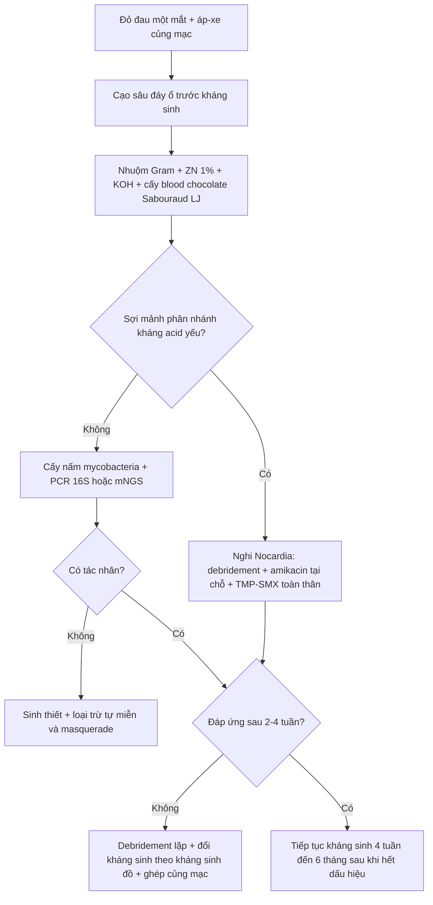
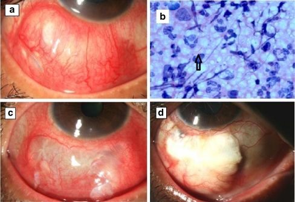
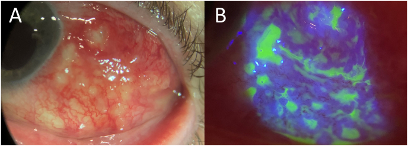
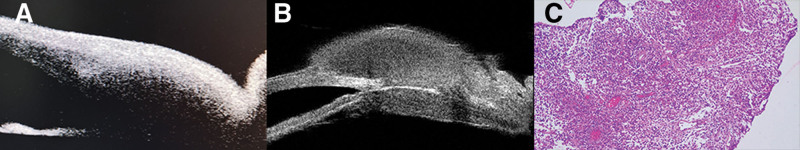

# 3214 — Nhiễm củng mạc do *Nocardia*: áp-xe củng mạc khu trú, sợi mảnh phân nhánh kháng acid và "tổn thương đường hầm" / Nocardia scleritis

**Tags:** `pattern:ap-xe-cung-mac` `pattern:hoai-tu-cung-mac` `pattern:manh-trang-khong-mach` `pattern:soi-khang-acid` `pattern:sau-chan-thuong-nong-nghiep` `pattern:sau-tiem-corticoid` `pattern:sau-mo-mat` `pattern:khong-dap-ung-corticoid` `pattern:ton-thuong-duong-ham` `pattern:mot-mat` `vung:mat` `vung:cung-mac` `vung:ket-mac` `vung:limbus` `vung:tien-phong` `protocol:den-khe` `protocol:AS-OCT` `protocol:UBM` `protocol:cam-mau-cay` `protocol:ZN` `protocol:PCR-16S` `protocol:B-scan` `score:IOP` `incidentaloma:khong`

**Mức chắc chắn (certainty):** tổng hợp y văn (literature synthesis) — dựng từ **1 tổng quan viêm củng mạc nhiễm khuẩn** (*Front Ophthalmol* 2025, **PMC11842368**, CC BY 4.0), **1 loạt 3 ca + tổng quan 23 ca đã công bố** (*J Ophthalmic Inflamm Infect* 2012, **PMC3303001**, CC BY), **1 thuật toán 43 mắt** (*Am J Ophthalmol Case Rep* 2018, **PMC5956651**, CC BY-NC-ND — chỉ đọc số liệu), và **3 báo ca có ảnh** (**PMC9851874** — *N. arthritidis* sau phaco ở người ghép thận; **PMC9666110** — *N. farcinica*, cấy âm nhưng mNGS dương; **PMC4225828** — *N. asteroides* kháng linezolid/TMP-SMX). Nhóm **không có bệnh nhân của mình**; chỗ chưa đủ chắc ghi "chưa rõ". **Không ghi tên tác giả trong bài** — attribution dùng tạp chí + năm + PMCID (tên tác giả đã đối chiếu `authorString` trong `images/CREDITS.md`).

> **Câu chốt:** *Nocardia* là **vi khuẩn Gram dương, kháng acid yếu, mọc thành sợi phân nhánh** — trông như nấm nhưng **không phải nấm**, nên **kháng nấm vô hiệu** và **corticoid làm nặng**. Ba con số phải thuộc: **(1)** viêm củng mạc nhiễm khuẩn chỉ chiếm **5–10%** tổng số viêm củng mạc, nhưng *Nocardia* là **nguyên nhân đứng thứ hai (20%)** ở Ấn Độ (PMC11842368, PMC5956651); **(2)** trong **43 mắt** đã công bố, **83%** khỏi nhưng **75% phải phẫu thuật debridement**, và **20%** âm tính với nhuộm kháng acid (PMC5956651); **(3)** tổn thương có thể là **"đường hầm" (tunnel lesion)** — ổ nhiễm nằm **sâu trong lớp củng mạc** trong khi kết mạc và củng mạc nông **trông sạch**, nên **cạo nông + kháng sinh đơn thuần → tái phát**; đây là lý do **2/3 ca** trong loạt gốc phải **mổ lại nhiều lần** (PMC3303001).

## 1. Tổng quan bệnh học – cơ chế hình ảnh

### 1.1 Vì sao *Nocardia* "giả nấm" và vì sao nhuộm kháng acid lại dương yếu

- *Nocardia* là **trực khuẩn Gram dương, hiếu khí, kỵ khí không bắt buộc**, sinh **sợi mảnh phân nhánh** (filamentous branching rods) đường kính **0,5–1 µm** — mảnh hơn sợi nấm thật (**3–10 µm**) và **không có vách ngăn thật** theo kiểu nấm.
- Thành tế bào chứa **acid mycolic** (chuỗi carbon ngắn hơn *Mycobacterium*), nên **kháng acid yếu**: chỉ giữ màu khi **khử màu bằng HCl 1%** trong **20–60 giây**, không phải acid 3% dùng cho lao. Đây là lý do câu "**ZN 1%**" phải viết rõ trong phiếu xét nghiệm — dùng quy trình lao có thể **âm giả**.
- **Khoảng 20% ca âm tính kháng acid** dù cấy dương (PMC5956651) → **một tiêu bản âm không loại trừ**; phải nhuộm Gram (thấy **cầu/trực khuẩn Gram dương chuỗi ngắn, phân nhánh**) và cấy.
- Trên môi trường thường (blood agar, chocolate agar), khuẩn mọc **chậm 2–7 ngày**, khuẩn lạc **khô, trắng phấn, dạng phấn (chalky)**, có thể **màu cam nhạt** trên Löwenstein–Jensen — dễ bị bỏ qua nếu chỉ ủ **24–48 giờ**.

### 1.2 Vì sao ổ nhiễm nằm sâu: củng mạc không mạch và "tổn thương đường hầm"

- Củng mạc **vô mạch ở lớp nhu mô** (chỉ có mạch ở thượng củng mạc và quanh rìa), cấu tạo **~95% collagen type I**, giàu proteoglycan. Kháng sinh **khuếch tán kém** vào củng mạc; *Nocardia* **tồn tại lâu trong các lá collagen** và tiến triển **âm thầm**.
- **Tổn thương đường hầm (tunnel lesion)**: ổ mủ lan **theo mặt phẳng sâu** giữa các lá củng mạc, trong khi **kết mạc và củng mạc nông trên ổ có thể không viêm** — vì vậy cạo bề mặt có thể **không lấy được vi khuẩn**, và **debridement "đến bờ lành"** vẫn có thể **sót đường hầm** → **tái phát**. Đây là cơ chế được mô tả trong loạt 3 ca (2 ca phải mổ lại) và trong tổng quan 23 ca (PMC3303001).
- Hệ quả hình ảnh: ổ **áp-xe khu trú, bờ rõ, trắng–vàng**, quanh có **mạch máu xung huyết** nhưng **bản thân ổ không có mạch** (mô hoại tử, không phải "ít viêm"); **ổ loét củng mạc** có thể ở **dưới ổ áp-xe**, và **lộ hắc mạc (uveal show)** khi củng mạc mỏng đi.
- **Vì sao đau nhiều:** củng mạc giàu sợi thần kinh cảm giác (nhánh V1) và viêm màng xương quanh củng mạc; đau **nhức sâu, về đêm**, kéo dài **14–70 ngày** trước khi chẩn đoán (PMC5956651).

### 1.3 Các con số phải nhớ (ngưỡng định lượng)

| Biến số | Số liệu | Nguồn |
|---|---|---|
| Viêm củng mạc nhiễm khuẩn / toàn bộ viêm củng mạc | **5–10%** | PMC11842368 (2025) |
| *Nocardia* trong viêm củng mạc tại Ấn Độ | **20%** — nguyên nhân đứng thứ hai | PMC5956651 (2018) |
| *Nocardia* trong viêm giác mạc tại Ấn Độ | **14–25%** | PMC11842368 (2025) |
| Số mắt trong tổng quan lớn nhất | **43 mắt** (1900–2015); **67% nam**; triệu chứng **14–70 ngày** | PMC5956651 |
| Tỷ lệ khỏi | **83%** khi điều trị sớm | PMC5956651 |
| Tỷ lệ phải debridement | **75%** (43 mắt); **17/21** ca khỏi trong y văn cũ cần mổ | PMC5956651, PMC3303001 |
| Âm tính nhuộm kháng acid | **~20%** | PMC5956651 |
| Thời gian kháng sinh toàn thân | **4–8 tuần** (loạt 3 ca); **4 tuần–6 tháng sau khi hết dấu hiệu** (tổng quan) | PMC3303001, PMC11842368 |
| Liều thường dùng | **amikacin 2,5%** nhỏ **mỗi giờ**; **TMP-SMX 800/160 mg** uống **mỗi 12 giờ** | PMC3303001, PMC5956651 |

> **Cạm bẫy định lượng:** "khỏi sau 2 tuần kháng sinh" **không** phải tiêu chuẩn ngừng thuốc. Trong củng mạc vô mạch, nồng độ thuốc thấp và vi khuẩn nằm trong lá collagen; tổng quan khuyến cáo **kéo dài 4 tuần đến 6 tháng SAU khi hết dấu hiệu lâm sàng** (PMC11842368). Ngừng sớm là nguyên nhân tái phát được báo cáo.

## 2. Mẫu hình + chẩn đoán phân biệt theo vị trí (gamut)

### 2.1 Mẫu hình nhận diện

**Bệnh cảnh điển hình:** người lớn **một mắt**, **đau sâu + đỏ dai dẳng 2–10 tuần**, có **áp-xe củng mạc khu trú bờ rõ** ở **củng mạc trước / vùng rìa**, đôi khi **nhiều ổ (multiloculated)**, **mủ qua vết loét kết mạc nhỏ**, **không đáp ứng corticoid** và **nặng lên khi tăng corticoid**. Yếu tố nguy cơ: **chấn thương vật liệu hữu cơ** (cành cây, đất, côn trùng), **mổ mắt gần đây** (phaco, pterygium + MMC, scleral buckle, ghép giác mạc), **tiêm corticoid dưới bao Tenon**, **suy giảm miễn dịch** (ghép tạng, corticoid toàn thân, HIV).

### 2.2 Gamut theo vị trí

| Vị trí | Gamut chính | Dấu hiệu phân biệt then chốt |
|---|---|---|
| **Củng mạc trước / rìa (limbus)** | *Nocardia* · nấm sợi (*Aspergillus*, *Fusarium*) · *Pseudomonas* · mycobacteria không lao · *Acanthamoeba* · dị vật sót | Bờ tổn thương, tốc độ tiến triển, nhuộm/cấy, tiền sử chấn thương hữu cơ |
| **Củng mạc sau ổ mổ (pterygium, phaco, buckle)** | *Nocardia* · *Pseudomonas* · nấm · SINS (vô khuẩn) · hoại tử do depot corticoid · u hạt chỉ khâu | **Mốc thời gian**: depot **3–30 ngày**, SINS trung vị **~251 ngày**; *Nocardia* **2–12 tuần** |
| **Củng mạc quanh mảnh ghép / miệng nối** | Nhiễm mảnh ghép · *Nocardia* · mycobacteria · nấm | Vùng ghép, chỉ khâu, mủ, cấy mảnh ghép |
| **Hốc mắt / hậu đoạn (khi lan sâu)** | Áp-xe hốc mắt · viêm mô tế bào · endophthalmitis · viêm củng mạc sau | Lồi mắt, hạn chế vận nhãn, B-scan/CT/MRI, thị lực |

> **Nguyên tắc:** *Nocardia* **không có dấu hiệu lâm sàng đặc hiệu** (chính loạt 3 ca kết luận như vậy — PMC3303001). Vì thế "gamut" ở đây là **gamut theo bối cảnh + thời gian + xét nghiệm**, không phải "nhìn mặt bắt hình dong".

## 3. Bảng so sánh phân biệt (ma trận đối chiếu)

| Thực thể (entity) | Hình ảnh điển hình | Chốt vào (rule-in) | Chốt loại (rule-out) | Gợi ý xác nhận |
|---|---|---|---|---|
| ***Nocardia* scleritis** | Áp-xe củng mạc **khu trú, bờ rõ**, có thể nhiều ổ, ổ loét dưới áp-xe, mủ qua kết mạc; **một mắt**, dai dẳng **14–70 ngày** | **Sợi mảnh phân nhánh kháng acid yếu (ZN 1%)** hoặc **Gram dương chuỗi ngắn phân nhánh** trên cạo ổ; cấy **khuẩn lạc khô, trắng phấn** 2–7 ngày | **Không loại trừ** bằng ZN âm (**20% âm**) hay cấy âm sớm; **không loại trừ** bằng đáp ứng corticoid (corticoid chỉ làm nặng) | Cạo **sâu đáy ổ** + Gram/ZN 1%/KOH + cấy blood, chocolate, Sabouraud, LJ; **PCR 16S rRNA/mNGS** khi cấy âm |
| **Nấm sợi (*Aspergillus*/*Fusarium*)** | Bờ **"lông vũ" (feathery)**, **tổn thương vệ tinh**, mảng nội mô, mủ tiền phòng; sau chấn thương thực vật | **Sợi nấm thật dày, có vách**, KOH/calcofluor dương; cấy Sabouraud mọc nấm | Sợi **mảnh, không vách, kháng acid yếu** = *Nocardia*, không phải nấm | KOH + calcofluor + cấy Sabouraud; **không** dùng kháng nấm đơn thuần nếu nghi *Nocardia* |
| **Viêm củng mạc do *Pseudomonas*** | Tiến triển **tính bằng giờ–ngày**, mủ **xanh**, hoại tử lan nhanh; sau pterygium/ kính tiếp xúc | Gram âm trực khuẩn, cấy mọc nhanh 24–48 giờ, **đau tăng nhanh** | **Khởi phát > 2 tuần, khu trú, bờ rõ** ít nghĩ *Pseudomonas*; nhưng không loại trừ hoàn toàn | Cấy + kháng sinh đồ; **không chờ kết quả** nếu hoại tử lan |
| **Mycobacteria không lao** | Nốt dai dẳng sau pterygium/ghép, ít mủ, tiến triển **nhiều tuần–tháng** | **ZN dương** (acid 3% hoặc 1%), cấy **LJ mọc chậm > 2 tuần**, PCR *hsp65*/16S | *Nocardia* mọc **nhanh hơn (2–7 ngày)**, khuẩn lạc khô phấn; **không phân biệt được chỉ bằng ZN** | Nuôi cấy **≥ 4–8 tuần**, PCR/sequencing; đừng đóng hồ sơ sau 7 ngày |
| **Viêm củng mạc hoại tử tự miễn (GPA, RA)** | **Đỏ tím sâu**, hoại tử **không mủ**, thường **hai mắt** hoặc có bệnh hệ thống; đau về đêm | Bệnh hệ thống (RA, GPA, ANCA), **đáp ứng corticoid/ức chế miễn dịch**, cấy âm | **Áp-xe khu trú + mủ + một mắt + không đáp ứng corticoid** → không phải tự miễn; **ANCA âm không loại trừ** | ANCA, RF, ANA, khám nội khoa; **sinh thiết/cấy trước khi tăng ức chế miễn dịch** |
| **SINS (surgically induced necrotizing scleritis)** | Hoại tử củng mạc **sau mổ**, không mủ, bờ mỏng; khởi phát **trung vị ~251 ngày** | Tiền sử mổ, **cấy âm**, không đáp ứng kháng sinh, đáp ứng ức chế miễn dịch | **Khởi phát sớm 2–12 tuần + mủ** nghi nhiễm hơn SINS; **SINS có thể xảy ra sau 1 tháng** nên vẫn phải cấy | Loại trừ nhiễm bằng cạo/cấy lặp; sinh thiết |
| **Hoại tử do triamcinolone depot** | **Mảng trắng–xám KHÔNG mạch đúng vị trí tiêm**, ngày **3–30**, tinh thể dưới kết mạc; **không mủ thật** | **Đúng vị trí tiêm + còn tinh thể + AS-OCT thấy tinh thể/lắng đọng**, cấy âm | **Mủ + sợi vi khuẩn + sốt/đau tăng** → nhiễm, không chỉ do thuốc | AS-OCT/UBM tìm tinh thể; cạo/cấy **trước khi kết luận do thuốc** |
| **Dị vật sót / u hạt** | Khối đau mạn, có thể áp-xe tái phát, tiền sử chấn thương nhỏ | **Thấy dị vật trên AS-OCT/UBM/CT**, mủ tái phát cùng vị trí | Không thấy dị vật **không loại trừ** (gỗ, gai cản quang kém) | Siêu âm tần số cao/UBM; mổ thăm dò lấy dị vật + cấy |
| **Masquerade (lymphoma, melanoma)** | Khối **thịt cá hồi**, không đau nhiều, không mủ, không đáp ứng kháng sinh; có thể **một mắt** | Sinh thiết mô học; hình ảnh khối đặc trên UBM/MRI | **Đau + mủ + sợi vi khuẩn** ít nghĩ lymphoma nhưng **không loại trừ** u hoại tử bội nhiễm | Sinh thiết **khi không lành sau điều trị nhiễm** |

- **Ảnh ghép đối chiếu:** `images/composite_ap-xe-den-lanh.jpg` — ba ảnh **CC BY 4.0** (PMC3303001 + PMC9851874 ×2), letterbox giữ nguyên khung, dải đen ghi ca + attribution. Ảnh **không** được crop/kéo giãn.

## 4. Protocol chụp + hệ phân độ/điểm chuẩn hóa

### 4.1 Quy trình chẩn đoán (không có "RADS" cho củng mạc)

Không có hệ phân độ hình ảnh chuẩn hóa cho viêm củng mạc nhiễm khuẩn; quyết định dựa trên **mức xâm lấn giải phẫu** (nông / sâu / thủng) + **tác nhân** + **đáp ứng điều trị**. Quy trình tối thiểu:

1. **Đèn khe + đảo mắt**: đo **kích thước ổ (mm)**, độ sâu, có **mủ tiền phòng**, **phản ứng tiền phòng**, **nhãn áp** (IOP), **thị lực**, **Seidel** nếu có loét.
2. **Cạo ổ (scraping) TRƯỚC khi nhỏ kháng sinh**: lấy **đáy ổ sâu**, không chỉ bề mặt; nhuộm **Gram, ZN 1% HCl, KOH–calcofluor, Giemsa**; cấy **blood agar, chocolate agar, Sabouraud, Löwenstein–Jensen**; **PCR 16S rRNA** hoặc **mNGS** khi cấy âm mà vẫn nghi.
3. **AS-OCT tiền đoạn**: đo **độ dày củng mạc (µm)**, phát hiện **mỏng/thủng**, **lắng đọng tinh thể** (nếu sau tiêm depot), **dịch dưới kết mạc**.
4. **UBM 35–50 MHz**: đánh giá **tổn thương sâu, đường hầm, dị vật**, **mất liên tục echo củng mạc**, **staphyloma**; UBM trong ca *N. farcinica* cho thấy **echo củng mạc không liên tục và mất một số vùng** (PMC9666110).
5. **B-scan**: loại trừ **viêm củng mạc sau**, **bong võng mạc**, **dịch dưới hắc mạc**; CT/MRI hốc mắt chỉ khi nghi **lan hậu đoạn/hốc mắt** hoặc **áp-xe**.
6. **Đánh giá toàn thân**: hỏi **ghép tạng, corticoid/ức chế miễn dịch, HIV, đái tháo đường**; X-quang phổi khi nghi nocardiosis lan tỏa (hiếm nhưng có).

### 4.2 Điều trị cụ thể (ngưỡng và liều)

- **Phẫu thuật là trụ cột**: **bóc toàn bộ mô hoại tử + mủ đến bờ củng mạc lành**, rửa kỹ đáy và bờ; **để kết mạc hở** giúp thuốc thấm (kỹ thuật trong loạt 3 ca — PMC3303001); **debridement lặp** nếu còn mủ (2/3 ca trong loạt gốc).
- **Kháng sinh tại chỗ**: **amikacin 2,5% mỗi giờ** (loạt 3 ca) hoặc **5%** (thuật toán 43 mắt) + **fluoroquinolone mỗi giờ** (ciprofloxacin 0,3% / gatifloxacin 0,3%); **subconjunctival amikacin** quanh ổ sau mổ.
- **Kháng sinh toàn thân**: **TMP-SMX 800/160 mg mỗi 12 giờ** là lựa chọn hàng đầu; **4–8 tuần** trong loạt 3 ca, tổng quan khuyến cáo **≥ 4 tuần đến 6 tháng sau khi hết dấu hiệu**. Khi **kháng TMP-SMX/linezolid**: **amikacin + imipenem** (ca *N. asteroides* kháng linezolid — PMC4225828); **linezolid** chỉ khi cấy chứng minh nhạy.
- **Ghép củng mạc**: khi **mỏng nhiều/lộ hắc mạc/nguy cơ thủng** — **mảnh ghép củng mạc đồng loại** ± **màng ối**, hoặc **vạt kết mạc–Tenon có cuống**; ca *N. farcinica* cần **ghép củng mạc đồng loại + vạt kết mạc** (PMC9666110).
- **Corticoid**: **tránh dùng tại chỗ khi chưa kiểm soát nhiễm** (tổng quan 2025 — PMC11842368); một số tác giả dùng **prednisone toàn thân sau khi nhiễm đã cải thiện rõ** để giảm viêm (ca 43 mắt — PMC5956651). Đây là **điểm chưa đồng thuận**, xem mục 7.
- **Theo dõi**: đèn khe **mỗi 1–2 tuần** giai đoạn đầu; **AS-OCT/UBM** đánh giá độ dày củng mạc; **IOP** (corticoid, tổn thương thể mi); **thị lực**; nếu **không cải thiện sau 2–4 tuần** → **cấy lại + debridement lặp + xem lại chẩn đoán** (nấm/mycobacteria/masquerade).

## 5. Biến thể bình thường và cạm bẫy

- **Pinguecula / phlyctenule**: nốt vàng nhạt hoặc nốt viêm nhỏ ở rìa, **không mủ**, tự giới hạn; **không** cạo mù. Nếu "nốt" đau tăng và có mủ → **không phải pinguecula**.
- **Mỏng củng mạc sau pterygium + MMC**: vùng trắng mỏng không mạch có thể bị đọc là "hoại tử"; hỏi **thời gian sau mổ**, xem **AS-OCT độ dày**, tìm **mủ/sợi vi khuẩn**. *Nocardia* sau pterygium là bối cảnh đã báo cáo (PMC4225828).
- **Hoại tử do depot triamcinolone**: **đúng vị trí tiêm, ngày 3–30, còn tinh thể**, cấy âm; **không** tăng corticoid vì tưởng "viêm" — sẽ làm mỏng/thủng thêm (bài 3210).
- **Corticoid che lấp nhiễm**: bệnh nhân đang nhỏ corticoid có thể **giảm đau, giảm đỏ tạm thời** rồi **bùng phát khi giảm liều**; **không** dùng đáp ứng corticoid để loại trừ nhiễm.
- **ZN âm / cấy âm sớm**: **20% ZN âm** và cấy *Nocardia* có thể **âm nếu ủ < 48–72 giờ** hoặc mẫu nông; **không** kết luận "vô khuẩn" khi chưa cấy đủ **7 ngày** và chưa **PCR/mNGS**.
- **Sót đường hầm**: bờ ngoài "lành" nhưng **đáy sâu còn mủ**; nếu tái phát sau debridement, **mổ thăm dò rộng hơn** thay vì chỉ đổi kháng sinh.
- **Satisfaction of search**: thấy **áp-xe củng mạc** rồi bỏ qua **dị vật gỗ/gai** hoặc **mảnh ghép**; luôn hỏi **chấn thương nhỏ** và soi **UBM**.
- **Tăng nhãn áp do corticoid** và **đục thể thủy tinh** là di chứng thường gặp sau điều trị dài; đo IOP mỗi lần tái khám.

## 6. Tự lượng giá — Blind Quiz ngay trên trang tĩnh (không cần app)

**Ca 1 — Đau, đỏ mắt phải 2,5 tháng sau khi bị cành cây quệt vào**

- Gợi ý lâm sàng: nữ 50 tuổi, chấn thương vật liệu thực vật 2,5 tháng trước; đau + đỏ + chảy nước mắt; đang nhỏ levofloxacin.
- Câu hỏi: (1) Mô tả tổn thương ở **a** và **c**. (2) Hình **b** cho thấy gì và nên nhuộm gì để thấy nó? (3) Vì sao **không được** chỉ nhỏ kháng sinh rồi theo dõi?

<b>Bấm để hiện đáp án (findings + chẩn đoán)</b>

- **Dấu hiệu:** (a) **áp-xe củng mạc khu trú bờ rõ** vùng kết mạc dưới, kèm **ổ loét củng mạc** ngay dưới áp-xe và mạch máu thượng củng mạc giãn; (b) **sợi mảnh, phân nhánh, kháng acid** (mũi tên) trên **Kinyoun 1% H₂SO₄ ×1.000**; (c) sau 3 tuần điều trị, **lộ hắc mạc (uveal show)** do củng mạc mỏng.
- **Chẩn đoán:** **viêm củng mạc do *Nocardia*** — vì sợi mảnh phân nhánh kháng acid yếu + cấy *Nocardia*; **không phải nấm** (sợi nấm dày, có vách) và **không phải viêm tự miễn** (một mắt, có mủ).
- **Xử trí:** **debridement + amikacin 2,5% mỗi giờ + ciprofloxacin + TMP-SMX**, sau đó **ghép củng mạc + màng ối** khi lộ hắc mạc; thị lực cuối **20/20**.
- **Nguồn ảnh:** Sahu SK, Sharma S, Das S, *J Ophthalmic Inflamm Infect* 2012 (PMC3303001), Fig. 1 — **CC BY 4.0**.

**Ca 2 — Đau dữ dội 1 tháng sau phaco ở người ghép thận**

- Gợi ý lâm sàng: nữ 69 tuổi, **ghép thận** đang dùng tacrolimus + mycophenolate + prednisone; phaco cách 1 tháng; đau hằng định, đỏ vùng thái dương, có **mủ** qua các vết loét kết mạc nhỏ.
- Câu hỏi: (1) Tổn thương gợi ý **nhiễm** hay **viêm tự miễn**? (2) Vì sao phải **cạo ổ + cấy** thay vì tăng corticoid? (3) Kể 3 chẩn đoán phân biệt và dấu hiệu loại trừ.

<b>Bấm để hiện đáp án (findings + chẩn đoán)</b>

- **Dấu hiệu:** (A) **áp-xe nhiều ổ (multiloculated)** vùng củng mạc thái dương, **mủ chảy qua vết loét kết mạc**, kết mạc xung huyết; (B) **fluorescein** thấy **nhiều ổ loét kết mạc nhỏ** — cửa ngõ của vi khuẩn.
- **Chẩn đoán:** **viêm củng mạc do *Nocardia arthritidis*** — cấy + Gram xác định; người **suy giảm miễn dịch** là nhóm nguy cơ.
- **Vì sao không tăng corticoid:** corticoid **ức chế miễn dịch tại chỗ**, làm **giảm đau giả tạo** rồi **lan nhiễm**, và ở người ghép tạng có thể dẫn tới **thủng củng mạc/endophthalmitis**; phải **cạo ổ, cấy, rồi debridement**.
- **Phân biệt:** nấm sợi (KOH dương, sợi dày có vách), *Pseudomonas* (mọc nhanh, mủ xanh), viêm củng mạc tự miễn (thường hai mắt, không mủ), SINS (cấy âm, sau mổ, đáp ứng ức chế miễn dịch).
- **Nguồn ảnh:** Abdelmegid O, Thakur S, Cheung AY, *Am J Ophthalmol Case Rep* 2023 (PMC9851874), Fig. 1 — **CC BY 4.0**.

**Ca 3 — "Nốt" củng mạc 6 × 6 mm, cấy âm, nhưng UBM thấy củng mạc mất liên tục**

- Gợi ý lâm sàng: nam 59 tuổi, thợ trang trí, đau đỏ mắt phải > 1 tháng, thường xuyên bị **bụi/cát** vào mắt; khối gồ ở củng mạc **6 × 6 mm** sát rìa mũi; cấy vi khuẩn **âm**.
- Câu hỏi: (1) **a** và **b** cho thấy gì? (2) Cấy âm có loại trừ nhiễm không? (3) Xét nghiệm nào giúp chốt tác nhân, và vì sao phải **mổ + ghép**?

<b>Bấm để hiện đáp án (findings + chẩn đoán)</b>

- **Dấu hiệu:** (a) **AS-OCT**: gồ cục bộ vùng kết mạc/rìa, **mỏng nhu mô giác mạc nông**; (b) **UBM**: khối **echo thấp** dưới kết mạc sát rìa, **echo củng mạc KHÔNG liên tục và mất một số vùng**; (c) mô bệnh học: **viêm cấp–mạn, mô hạt, tăng sinh mô**.
- **Chẩn đoán:** **viêm củng mạc do *Nocardia farcinica*** — **cấy âm**, chốt bằng **metagenomic sequencing (mNGS)**; đây là ca *N. farcinica* đầu tiên gây viêm củng mạc được báo cáo.
- **Cấy âm không loại trừ:** *Nocardia* mọc chậm, dễ bị **vi khuẩn nền** lấn át, và mẫu có thể **nông**; cần **PCR 16S/mNGS**.
- **Vì sao mổ + ghép:** tổn thương đã **phá vỡ củng mạc đến lớp sâu/lộ hắc mạc**, kháng sinh không thể tái tạo thành củng mạc; **debridement + ghép củng mạc đồng loại + vạt kết mạc** để giữ nhãn cầu.
- **Nguồn ảnh:** Hao Z, Dang H, Gao X, Zhang C, Deng A, Tan Y, Ding G, *Medicine (Baltimore)* 2022 (PMC9666110), Fig. 1 — **CC BY 4.0**.

## 7. Câu hỏi nghiên cứu & điểm chưa đồng thuận (tính đến 11/2026)

1. **[Tranh cãi] Phác đồ và thời gian kháng sinh tối ưu cho viêm củng mạc do *Nocardia* là bao lâu — 4–8 tuần như loạt ca, hay 4–6 tháng sau khi hết dấu hiệu như tổng quan?**
   - **Đã biết:** củng mạc vô mạch nên thuốc thấm kém; loạt 3 ca dùng kháng sinh toàn thân **4–8 tuần**, tổng quan 2025 khuyến cáo **kéo dài 4 tuần–6 tháng sau khi hết dấu hiệu**; **75%** ca cần debridement.
   - **Chưa rõ:** không có thử nghiệm ngẫu nhiên so sánh thời gian ngắn vs dài; tiêu chí ngừng thuốc dựa trên lâm sàng, không có biomarker.
   - **Hướng nghiên cứu:** registry đa trung tâm ghi liều–thời gian–tái phát; thử nghiệm thích ứng theo đáp ứng AS-OCT/UBM.
   - **Nguồn:** PMC11842368 (2025); PMC5956651 (2018); PMC3303001 (2012).

2. **[Khác biệt thực hành] Có nên dùng corticoid sau khi đã kiểm soát nhiễm để giảm viêm và cứu thị lực?**
   - **Đã biết:** tổng quan 2025 khuyến cáo **tránh corticoid tại chỗ** khi chưa kiểm soát nhiễm; một thuật toán 43 mắt dùng **prednisone 60 mg/ngày + prednisolone acetate 0,12%** sau khi nhiễm đã cải thiện rõ, bệnh khỏi sau **45 ngày**.
   - **Chưa rõ:** thời điểm bắt đầu, liều, và nguy cơ bùng phát/tái phát; chưa có so sánh có đối chứng.
   - **Hướng nghiên cứu:** cohort có propensity score; thống nhất tiêu chí "nhiễm đã kiểm soát" (hết mủ, cấy âm, AS-OCT ổn định).
   - **Nguồn:** PMC11842368 (2025); PMC5956651 (2018).

3. **[Khoảng trống] Khi cấy âm, xét nghiệm nào đủ nhanh và đủ rẻ để chốt *Nocardia*: PCR 16S rRNA, mNGS, hay MALDI-TOF?**
   - **Đã biết:** ca *N. farcinica* có **cấy âm** nhưng **mNGS dương**, nhờ đó điều trị đúng và ghép củng mạc thành công; PCR 16S giúp định danh loài và kháng sinh đồ phân tử.
   - **Chưa rõ:** độ nhạy/độ đặc hiệu của mNGS trên mẫu cạo củng mạc, chi phí–hiệu quả, và giá trị thay đổi quyết định mổ ở từng mức thu nhập.
   - **Hướng nghiên cứu:** nghiên cứu độ chính xác chẩn đoán + đánh giá chi phí–hiệu quả tại điểm chăm sóc.
   - **Nguồn:** PMC9666110 (2022); PMC11842368 (2025).

## Bài liên quan chéo
- [400 – Tổng quan Mắt & thị giác](../400-tong-quan-mat-thi-giac/lesson.md)
- [3207 – Viêm củng mạc](../3207-viem-cung-mac-scleritis/lesson.md) (đỏ sâu, phenylephrine, AS-OCT MTST)
- [3210 – Hoại tử củng mạc sau tiêm triamcinolone](../3210-viem-cung-mac-hoai-tu-sau-tiem-triamcinolone/lesson.md) (mảng trắng không mạch đúng vị trí tiêm)
- [1461 – Áp-xe dưới màng xương hốc mắt ở trẻ](../1461-ap-xe-duoi-mang-xuong-hoc-mat-o-tre/lesson.md)
- [1460 – Viêm giác mạc do nấm](../1460-viem-giac-mac-do-nam/lesson.md) (bờ lông vũ, vệ tinh)
- [6132 – Viêm giác mạc nhiễm khuẩn liên quan kính tiếp xúc](../6132-viem-giac-mac-kinh-tiep-xuc/lesson.md)
- [3213 – Bọng dẹt sau PreserFlo](../3213-bong-loc-sau-preserflo-microshunt/lesson.md) (nhiễm củng mạc sau mổ)

## Ảnh
- `3214_PMC3303001-12348_2011_43_Fig1_HTML.jpg` — áp-xe củng mạc + sợi kháng acid + lộ hắc mạc + ghép củng mạc (CC BY 4.0).
- `3214_PMC9851874-gr1.jpg` — áp-xe nhiều ổ + fluorescein (CC BY 4.0).
- `3214_bong-cung-mac-lanh_Anh-mau_PMC9851874-Fig2.jpg` — sẹo xơ + mỏng củng mạc sau 6 tháng (CC BY 4.0).
- `3214_sieu-am-AS-OCT_PMC9666110-Fig1.jpg` — AS-OCT + UBM + mô bệnh học (CC BY 4.0).
- `3214_dien-tien-dieu-tri_Anh-mau_PMC9666110-Fig2.jpg` — diễn tiến đến ghép củng mạc (CC BY 4.0).
- `3214_ap-xe-cung-mac_Anh-mau_PMC4225828-Fig1.jpg` — áp-xe củng mạc sau pterygium + MMC (CC BY 4.0).
- `3214_hoai-tu-cung-mac_Anh-mau_PMC4225828-Fig2.jpg` — mỏng củng mạc sau điều trị (CC BY 4.0).
- `3214_va-ghep-cung-mac_Anh-mau_PMC11842368-Fig4.jpg` — debridement + ghép củng mạc (CC BY 4.0; ca viêm củng mạc nhiễm khuẩn chung, không nêu tác nhân).
- `composite_ap-xe-den-lanh.jpg` — ghép 3 ảnh CC BY 4.0, `tools/make_composite.py`.
- Nguồn + giấy phép từng ảnh: `images/CREDITS.md`; link gốc: `sources.md`.

> Không dùng để chẩn đoán độc lập khi chưa có người hướng dẫn.
