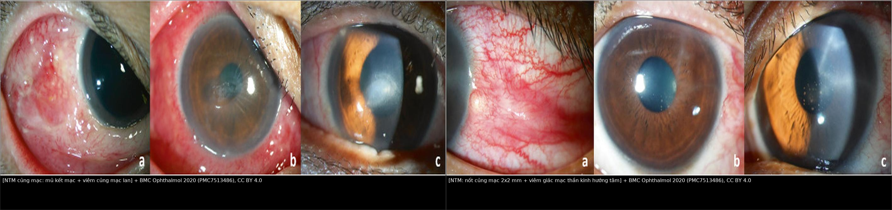
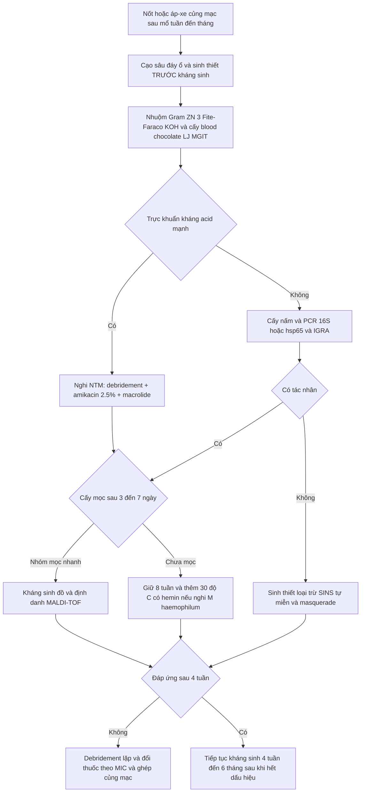
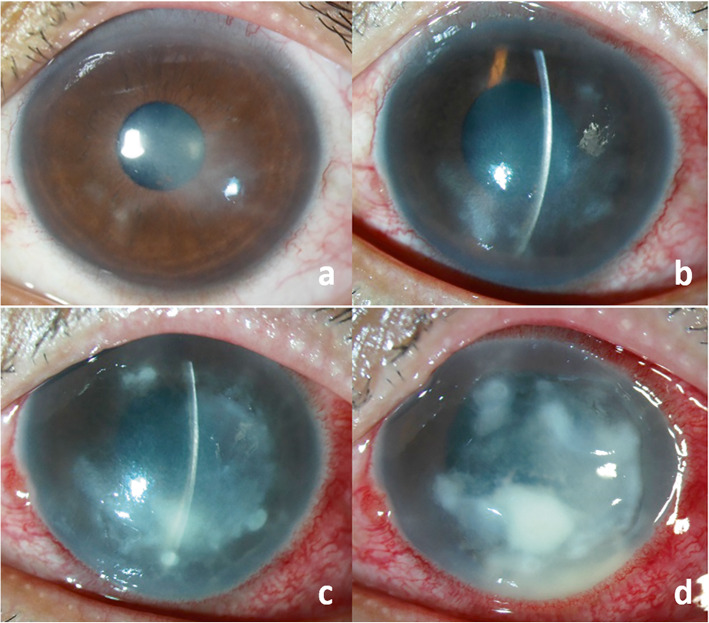
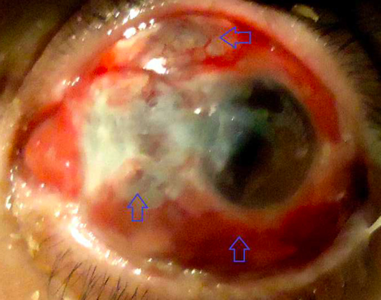
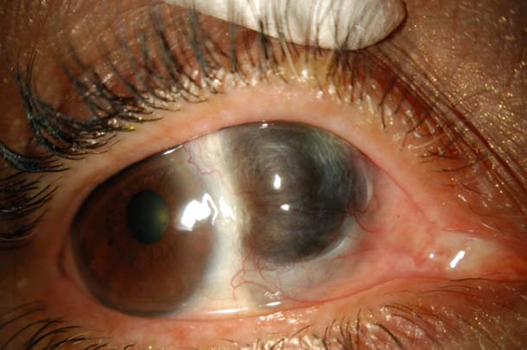
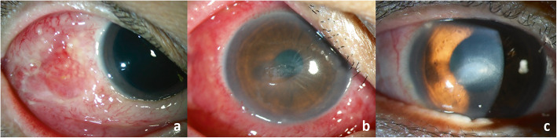
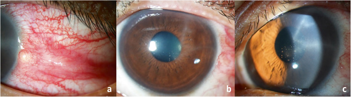
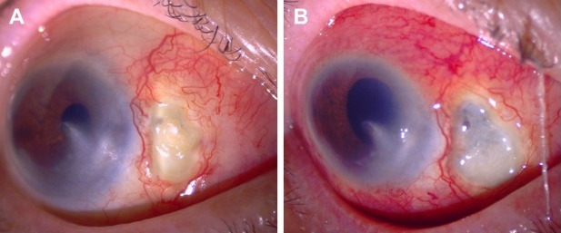

# 3215 — Viêm củng mạc do mycobacteria không lao (NTM): "bản sao chậm" của *Nocardia* sau mổ pterygium / Nontuberculous mycobacterial scleritis

**Tags:** `pattern:not-cung-mac` `pattern:ap-xe-cung-mac` `pattern:manh-trang-khong-mach` `pattern:dai-dang-nhieu-tuan` `pattern:sau-mo-mat` `pattern:sau-pterygium` `pattern:sau-ghep-giac-mac` `pattern:khong-dap-ung-corticoid` `pattern:khang-acid-duong` `pattern:viem-giac-mac-than-kinh-huong-tam` `pattern:mot-mat` `vung:mat` `vung:cung-mac` `vung:limbus` `vung:giac-mac` `vung:ket-mac` `protocol:den-khe` `protocol:AS-OCT` `protocol:UBM` `protocol:cam-mau-cay` `protocol:ZN` `protocol:Fite-Faraco` `protocol:PCR-hsp65` `protocol:PCR-16S` `protocol:MALDI-TOF` `score:IOP` `incidentaloma:khong`

**Mức chắc chắn (certainty):** tổng hợp y văn (literature synthesis) — dựng từ **1 tổng quan NTM mắt** (*Indian J Ophthalmol* 2024, **PMC10841776** — CC BY-NC-SA, chỉ đọc số liệu), **1 tổng quan hệ thống NTM mắt** (*Biomed Res Int* 2015, **PMC4461732**, CC BY), **1 tổng quan mycobacterial keratitis 2026** (*Saudi J Ophthalmol*, **PMC13313647**, CC BY-NC-SA — chỉ đọc số liệu), **1 loạt 2 ca M. haemophilum củng mạc + 15 ca y văn** (*BMC Ophthalmol* 2020, **PMC7513486**, CC BY 4.0 — dùng ảnh), **1 loạt Nocardia sau mổ bề mặt** (*Int Ophthalmol* 2023, **PMC10042929**, CC BY), và **các ca pterygium/giác mạc có ảnh CC BY** (**PMC9979078**, **PMC8491957**, **PMC3345049**). Nhóm **không có bệnh nhân của mình**; chỗ chưa đủ chắc ghi "chưa rõ". **Không ghi tên tác giả trong bài** trừ khi đã đối chiếu `authorString` (xem `images/CREDITS.md`).

> **Câu chốt:** NTM là **trực khuẩn kháng acid MẠNH (acid 3%, Kinyoun, Fite-Faraco)** — cùng họ "trông như nấm" với *Nocardia* nhưng **kháng acid mạnh hơn** và **không đáp ứng TMP-SMX**. Bốn con số phải thuộc: **(1)** NTM chỉ chiếm **12%** viêm củng mạc nhiễm khuẩn, và trong **18 mắt** công bố thì **94,4% khởi phát sau mổ** (scleral buckle **77,8%**, pterygium **1 ca**) với thời gian ủ **1,5–40 tuần** (PMC10841776; PMC4461732); **(2)** **83%** NTM gây bệnh mắt thuộc **Runyon nhóm IV (mọc nhanh)** nhưng **17%** là nhóm mọc chậm — và **M. haemophilum** cần **30–32 °C + hemin/ferric ammonium citrate**, có thể **8 tuần** mới mọc (PMC13313647; PMC7513486); **(3)** khỏi nhiễm **94,1%** nhưng thị lực cuối **≤ 20/200 ở 71,4%** — **88,2% phải mổ kèm thuốc** (PMC4461732); **(4)** kháng sinh phải **kéo dài ≥ 4 tuần đến 6 tháng SAU khi hết dấu hiệu**, và **64% mắt thất bại nội khoa có dùng corticoid** so với **44%** ở nhóm thành công (PMC10841776; PMC13313647).

## 1. Tổng quan bệnh học – cơ chế hình ảnh

### 1.1 Vì sao NTM "giống *Nocardia*" nhưng khác ở ba điểm quyết định

- NTM (nontuberculous mycobacteria, còn gọi atypical mycobacteria) là **trực khuẩn Gram dương, hiếu khí, không di động, không sinh nha bào**, sống trong **nước, đất, không khí, thức ăn** — tức là **môi trường của phòng mổ và bình nước cất**, không phải "bệnh nhân mang mầm".
- **Thành tế bào giàu acid mycolic dài** → **kháng acid MẠNH**: giữ màu với **HCl 3%** (ZN cổ điển) và **Kinyoun**; **Fite-Faraco (Wade-Fite)** là biến thể kháng acid dùng để bắt NTM trên mô. *Nocardia* chỉ **kháng acid yếu (HCl 1%, 20–60 giây)** — vì vậy **"ZN 1%" và "ZN 3%" là hai câu hỏi khác nhau**, và một phòng xét nghiệm dùng quy trình lao có thể **âm giả với *Nocardia*** trong khi **dương rõ với NTM**. Xem [3214](../3214-nocardia-viem-cung-mac/lesson.md).
- **Tốc độ mọc là điểm thứ hai**: Runyon nhóm IV (mọc nhanh: **M. abscessus, M. chelonae, M. fortuitum**) chiếm **83%** NTM gây bệnh mắt; nhóm I–III (mọc chậm) chỉ **17%** (PMC13313647). Vì thế **không thể dùng "cấy mọc sau 2–7 ngày" để loại *Nocardia* và chốt NTM** — nhóm mọc nhanh cũng mọc trong **3–7 ngày**. Điểm tách thật sự là **độ kháng acid, hình thái khuẩn lạc và định danh phân tử**, không phải đồng hồ cấy.
- **Tốc độ mọc của nhóm chậm mới là cạm bẫy**: trong **139 ca** NTM keratitis cấy dương, **91%** mọc trong **10 ngày**, nhưng môi trường phải giữ **tới 8 tuần** cho nhóm mọc chậm (PMC13313647). **M. haemophilum** còn khó hơn: ưa **30–32 °C** (không phải 35–37 °C) và **cần sắt** (hemin hoặc ferric ammonium citrate) — báo cáo ghi **tới 8 tuần** mới thấy khuẩn lạc, và ca đầu tiên trong loạt 2 ca chỉ mọc vì **máu trong mẫu sinh thiết kết mạc cung cấp đủ sắt** (PMC7513486).
- **Kháng sinh không giao nhau**: NTM **không đáp ứng TMP-SMX** (thuốc hàng đầu của *Nocardia*); trụ cột là **amikacin + macrolide (clarithromycin/azithromycin) ± fluoroquinolone**, và **M. abscessus** có thể **kháng macrolide** dù không có đột biến *erm(41)/rrl* — đã báo cáo **MIC clarithromycin > 16 µg/mL** (ca buckle + viêm mô tế bào hốc mắt, PMC12085144). Gọi NTM là *Nocardia* = **điều trị sai thuốc và chậm mổ**.

### 1.2 Vì sao tổn thương nằm ở giường mổ pterygium và vì sao nó "chậm"

- **Củng mạc vô mạch ở lớp nhu mô** (~95% collagen type I): kháng sinh khuếch tán kém, miễn dịch tại chỗ yếu, vi khuẩn **tồn tại trong các lá collagen** và tiến triển âm thầm. Trên nền đó, **pterygium excision + mitomycin C 0,02–0,04% trong 2–3 phút** (hoặc β-irradiation, đốt điện quá mức) tạo ra **vùng củng mạc thiếu mạch nuôi** — đúng nơi mầm NTM từ **dụng cụ, dung dịch, nước cất** bám vào; MMC còn gây **melting/perforation** như biến chứng đã biết (PMC12184863).
- **Lan trong củng mạc (intrascleral dissemination)** là cơ chế được chứng minh ở chính bệnh cảnh pterygium: **18 mắt** viêm củng mạc sau mổ pterygium có **áp-xe củng mạc nhiều ổ**; cấy ổ ban đầu ra **Pseudomonas 12/18**, *Aspergillus* 1, **M. fortuitum 1**, hỗn hợp 4; cấy **các ổ áp-xe sau đó** (15 mắt) cho **cùng vi khuẩn ở 12 mắt** → áp-xe thứ phát là **lan theo lớp củng mạc**, không phải nhiễm mới (Hsiao 1998, PMID 9536876). Hệ quả: **cạo bề mặt hoặc chỉ lấy mủ ổ đầu tiên có thể bỏ sót đường hầm** — cùng logic "tunnel lesion" của *Nocardia* (bài 3214), nên **debridement phải tới bờ củng mạc lành**.
- **Vì sao "chậm"**: NTM sinh sôi chậm hơn *Pseudomonas* (giờ–ngày) và *Nocardia* sau mổ bề mặt (**7–28 ngày**, trung bình **20,5 ± 7,1 ngày** trong 8 mắt, 3 ca sau pterygium — PMC10042929). Với NTM, khởi phát sau **scleral buckle 1,5–40 tuần**, còn sau **pterygium** có thể **2 tuần đến 20 năm** (PMC4461732; PMC12290352). Vì vậy "đỏ + nốt + đau **nhiều tuần** sau mổ" là **cửa sổ của NTM/nấm/TB**, không phải của *Pseudomonas*.
- **Vì sao hình ảnh "ít mủ, bờ không rõ"**: NTM gây **viêm u hạt** (granulomatous) với **mô hạt + đại thực bào** nhiều hơn mủ tự do; trên lâm sàng là **nốt củng mạc hay mảng trắng–xám**, có thể **thoái triển rồi tái phát** khi giảm thuốc. Ở ca có **viêm giác mạc kèm theo**, dấu **viêm thần kinh hướng tâm (radial keratoneuritis)** lần đầu được mô tả cho **M. haemophilum** (PMC7513486) — **bắt chước herpes** và dẫn tới dùng corticoid.

### 1.3 Các con số phải nhớ (ngưỡng định lượng)

| Biến số | Số liệu | Nguồn |
|---|---|---|
| NTM trong viêm củng mạc nhiễm khuẩn | **12%** | PMC10841776 (2024) |
| **18 mắt** NTM scleritis: sau mổ | **94,4%** (17/18); **scleral buckle 77,8%** (14/18); **pterygium 1**, tiêm nội nhãn 1, PPV 1 | PMC4461732 (2015) |
| Khởi phát sau mổ | buckle **1,5–40 tuần**; pterygium **2 tuần–20 năm** | PMC4461732; PMC12290352 (2025) |
| Runyon nhóm IV (mọc nhanh) ở mắt | **83%** (nhóm I–III **17%**) | PMC13313647 (2026) |
| Thời gian cấy dương (139 ca NTM keratitis) | **91% trong 10 ngày**; giữ môi trường **8 tuần** cho nhóm chậm | PMC13313647 |
| **M. haemophilum** | **30–32 °C** + **hemin/ferric ammonium citrate**; tới **8 tuần** | PMC7513486 (2020) |
| *Nocardia* sau mổ bề mặt (8 mắt, 3 pterygium) | **7–28 ngày**, TB **20,5 ± 7,1**; **7/8 mổ lại**, 3 tái phát, 1 múc nội nhãn | PMC10042929 (2023) |
| Viêm củng mạc sau pterygium (18 mắt, 1988–1995) | *Pseudomonas* **12**, *Aspergillus* **1**, **M. fortuitum 1**, hỗn hợp **4**; **12/15** ổ sau cùng vi khuẩn; **4 múc nội nhãn** | PMID 9536876 (1998) |
| Kết cục NTM scleritis | khỏi **94,1%** (16/17); thị lực **≤ 20/200: 71,4%** (10/14) | PMC4461732 |
| Điều trị NTM scleritis | **88,2%** mổ + thuốc; **70,6%** ≥ 2 kháng sinh; **amikacin 70,6%** | PMC4461732 |
| Amikacin nhỏ 2,5% (250 mg/mL) | ức chế **70–90%** chủng in vitro; **moxifloxacin chỉ 14,8%** nhạy (2008–2024) | PMC13313647 |
| Thời gian kháng sinh | **≥ 4 tuần đến 6 tháng SAU khi hết dấu hiệu** | PMC10841776 |
| Corticoid và thất bại điều trị | **64%** mắt thất bại có dùng corticoid vs **44%** mắt khỏi không corticoid | PMC13313647 |
| Ca báo cáo cần can thiệp mổ | **46%** (51/110) | PMC13313647 |
| M. abscessus kháng macrolide (buckle) | clarithromycin **MIC > 16 µg/mL**; **12 ca** MABC buckle trong y văn | PMC12085144 (2025) |
| SISN sau pterygium | khởi phát **1 ngày – > 50 năm**; TB xuất hiện **12 năm** sau pterygium | PMC9979078 (2023) |

> **Cạm bẫy định lượng:** "cấy âm sau 7 ngày" **không** loại trừ NTM. Nhóm mọc nhanh cần **3–7 ngày**, nhóm chậm **> 2 tuần**, và **M. haemophilum** có thể **8 tuần** nếu thiếu sắt/nhiệt độ. Cũng đừng dùng **"ZN 3% dương"** để kết luận lao: **NTM dương với cùng quy trình**.

## 2. Mẫu hình + chẩn đoán phân biệt theo vị trí (gamut)

### 2.1 Mẫu hình nhận diện

**Bệnh cảnh điển hình:** người lớn **một mắt**, **đau nhức sâu + đỏ dai dẳng** xuất hiện **2 tuần–nhiều tháng** sau **pterygium excision (nhất là có MMC)**, **ghép giác mạc**, **scleral buckle**, **phaco** hoặc **chấn thương hữu cơ**; khám thấy **nốt/áp-xe củng mạc bờ không rõ, ít mủ, có thể nhiều ổ**, đôi khi **mảng trắng–xám không mạch**; **giác mạc có thể có thâm nhiễm nông + viêm thần kinh hướng tâm**; **không đáp ứng hoặc nặng lên khi dùng corticoid**. Không sốt, không hạch — **toàn thân im lặng** chính là lý do dễ gọi "viêm củng mạc tự miễn".

### 2.2 Gamut theo vị trí

| Vị trí | Gamut chính | Dấu hiệu phân biệt then chốt |
|---|---|---|
| **Giường mổ pterygium / rìa** | NTM · *Nocardia* · *Pseudomonas* · nấm sợi · SINS · TB · dị vật/chỉ khâu | **Thời gian sau mổ** (ngày–tuần: *Pseudomonas*; **1–4 tuần: *Nocardia***; **tuần–tháng: NTM/nấm**; **tháng–năm: SINS/TB**), mức mủ, kháng acid |
| **Nốt củng mạc đơn độc không tiền sử mổ** | NTM (M. haemophilum) · *Nocardia* · nấm · u hạt chỉ khâu · lymphoma | **Viêm thần kinh hướng tâm + nốt 2 × 2 mm** gợi NTM/ herpes; **cấy âm + AFB dương trên sinh thiết** chốt NTM |
| **Củng mạc quanh mảnh ghép giác mạc** | NTM · *Nocardia* · nấm · nhiễm mảnh ghép · SINS | **Chỉ khâu + mối ghép**, mủ, cấy mảnh ghép; thời gian > 2 tuần nghi NTM |
| **Giác mạc nông ± củng mạc (keratoscleritis)** | NTM · herpes · *Acanthamoeba* · nấm · microsporidia | **Viêm thần kinh hướng tâm** xuất hiện ở cả herpes và NTM; **không đáp ứng acyclovir + AFB dương** → NTM |
| **Củng mạc sâu/hậu đoạn khi lan** | Áp-xe hốc mắt · endophthalmitis · viêm củng mạc sau · viêm mô tế bào hốc mắt (ca M. abscessus buckle) | **Lồi mắt, hạn chế vận nhãn, B-scan/CT/MRI**, thị lực; **phải tháo buckle + kháng sinh toàn thân** |

> **Nguyên tắc:** NTM **không có dấu hiệu lâm sàng đặc hiệu** — kể cả loạt 2 ca M. haemophilum cũng chỉ chốt được bằng **sinh thiết + PCR** sau khi đã chẩn đoán nhầm herpes (PMC7513486). Gamut ở đây là **gamut theo thời gian sau mổ + xét nghiệm**, không phải "nhìn mặt bắt hình dong".

## 3. Bảng so sánh phân biệt (ma trận đối chiếu)

| Thực thể (entity) | Hình ảnh điển hình | Chốt vào (rule-in) | Chốt loại (rule-out) | Gợi ý xác nhận |
|---|---|---|---|---|
| **NTM scleritis (M. abscessus/chelonae/fortuitum)** | **Nốt/áp-xe củng mạc bờ không rõ, ít mủ**, có thể nhiều ổ, dai dẳng **tuần–tháng** sau mổ; giác mạc kèm **viêm thần kinh hướng tâm** | **Trực khuẩn kháng acid MẠNH (ZN 3%/Kinyoun/Fite-Faraco)**, cấy **khuẩn lạc khô–nhăn, mọc 3–7 ngày (nhóm IV)**, PCR *hsp65*/16S hoặc MALDI-TOF | **Cấy âm 7 ngày KHÔNG loại trừ** (giữ 8 tuần); **ZN 1% dương không loại trừ NTM**; **không loại trừ bằng đáp ứng corticoid** | Cạo **đáy ổ sâu** + sinh thiết củng mạc; cấy blood/chocolate/LJ/MGIT **35 °C**; thêm **30 °C + hemin** nếu nghi *M. haemophilum*; PCR khi cấy âm |
| ***Nocardia* scleritis** | Áp-xe củng mạc **khu trú bờ rõ**, mủ qua kết mạc; sau pterygium thường **7–28 ngày** | Sợi **mảnh, phân nhánh, kháng acid YẾU (ZN 1%)**; khuẩn lạc **khô trắng phấn 2–7 ngày** | **Không loại trừ** bằng ZN âm (~20%); **tốc độ mọc không tách được nhóm NTM mọc nhanh** | Cạo + ZN 1% + Gram; cấy 7 ngày; **TMP-SMX** là thuốc hàng đầu (khác NTM) |
| **Lao củng mạc (M. tuberculosis)** | **Hoại tử củng mạc thiếu mạch đúng giường pterygium**, có thể **12 năm** sau mổ; mắt "yên" nhưng mỏng/lộ hắc mạc | **IGRA dương** + hình ảnh SISN kháng trị + đáp ứng **ATT**; AFB/PCR *M. tuberculosis* | **Cấy âm và X-quang phổi âm không loại trừ** (thể kín); **IGRA dương không phân biệt lao hoạt động/tiềm ẩn** | IGRA/PPD, CT ngực, PCR lao trên mô; **ATT thử** ở vùng lưu hành (PMC9979078) |
| **Nấm sợi (*Aspergillus*/*Fusarium*)** | Bờ **"lông vũ"**, tổn thương **vệ tinh**, mảng nội mô; sau chấn thương thực vật | **Sợi nấm dày 3–10 µm, có vách**, KOH/calcofluor dương, cấy Sabouraud | Sợi **mảnh 0,5–1 µm, kháng acid** = mycobacteria, không phải nấm | KOH + calcofluor + Sabouraud; **không dùng kháng nấm đơn thuần** nếu AFB dương |
| ***Pseudomonas* scleritis** | Tiến triển **giờ–ngày**, mủ **xanh**, hoại tử lan nhanh sau pterygium | Gram âm, cấy mọc **24–48 giờ**, đau tăng nhanh | **Khởi phát > 2 tuần + nốt khu trú** ít nghĩ *Pseudomonas* | Cấy + kháng sinh đồ; **không chờ kết quả** nếu hoại tử lan |
| **SINS (vô khuẩn, sau mổ)** | Hoại tử củng mạc **không mủ**, bờ mỏng; pterygium là mổ hay gặp; khởi phát **1 ngày–> 50 năm** | Tiền sử mổ + **cấy âm nhiều lần** + **đáp ứng ức chế miễn dịch** | **Mủ + AFB + không đáp ứng corticoid** → nhiễm, không phải SINS; **SINS có thể trùng với nhiễm** (ca TB) | Cấy/sinh thiết **trước** khi tăng ức chế miễn dịch; IGRA khi kháng trị |
| **U hạt chỉ khâu / dị vật** | Nốt nhỏ **đúng mối chỉ** hoặc sẹo, đau khi ấn; tái phát cùng chỗ | **Thấy chỉ/dị vật** trên đèn khe/AS-OCT/UBM; hết sau gỡ | **Không thấy dị vật không loại trừ** (gỗ, gai); **mủ + AFB** buộc tìm nhiễm | AS-OCT/UBM tần số cao; gỡ + cấy |
| **Masquerade (lymphoma, melanoma)** | Khối **thịt cá hồi**, không mủ, không đau nhiều, không đáp ứng kháng sinh | **Sinh thiết** mô học; hình ảnh khối đặc trên UBM/MRI | **Đau + mủ + AFB** ít nghĩ lymphoma nhưng **u hoại tử bội nhiễm vẫn có thể** | Sinh thiết **khi không lành sau điều trị nhiễm** |

- **Ảnh ghép đối chiếu:** hai ảnh **CC BY 4.0** (PMC7513486, Fig. 1 + Fig. 2), letterbox giữ nguyên khung, dải đen ghi ca + attribution. Ảnh **không** crop/kéo giãn.

*Hai thì của cùng bệnh: **lan tỏa nông** ở người suy giảm miễn dịch và **khu trú sâu** ở người khỏe mạnh — cả hai đều cần **debridement tới bờ lành**, không chỉ kháng sinh.*

## 4. Protocol chụp + hệ phân độ/điểm chuẩn hóa

### 4.1 Quy trình chẩn đoán (không có "RADS" cho củng mạc)

Không có hệ phân độ hình ảnh chuẩn hóa cho viêm củng mạc nhiễm khuẩn; quyết định dựa trên **mức xâm lấn giải phẫu** (nông / sâu / thủng), **tác nhân** và **đáp ứng điều trị**. Quy trình tối thiểu:

1. **Đèn khe + đảo mắt**: đo **kích thước nốt/ổ (mm)**, độ sâu, **số ổ**, có **mủ tiền phòng**, **phản ứng tiền phòng**, **nhãn áp** và **thị lực**; **Seidel** nếu loét. Ghi **số tuần sau mổ** — đây là biến số phân biệt mạnh nhất.
2. **Cạo/sinh thiết TRƯỚC khi nhỏ kháng sinh**: lấy **đáy ổ sâu + bờ**, không chỉ mủ bề mặt (nguyên lý **intrascleral dissemination**); nhuộm **Gram, ZN 3% (Kinyoun), Fite-Faraco, KOH–calcofluor, Giemsa, PAS/GMS**.
3. **Cấy**: **blood agar, chocolate agar, Löwenstein–Jensen, MGIT 35 °C**; **giữ ≥ 8 tuần**; nếu nghi **M. haemophilum** → thêm **30–32 °C + hemin/ferric ammonium citrate**; **PCR *hsp65*/16S rRNA** hoặc **MALDI-TOF** để định danh loài và chọn thuốc.
4. **AS-OCT tiền đoạn**: đo **độ dày củng mạc (µm)**, phát hiện **mỏng/thủng**, **dịch dưới kết mạc**, **lắng đọng tinh thể** (nếu sau tiêm depot — bài 3210).
5. **UBM 35–50 MHz**: tìm **tổn thương sâu, đường hầm, dị vật**, **mất liên tục echo củng mạc**; ca sau tiêm nội nhãn có thể chỉ thấy **"hốc echo thấp" (hypoechoic excavation)** tại chỗ tiêm dù kết mạc chỉ viêm nhẹ (PMC4461732).
6. **B-scan**: loại trừ **viêm củng mạc sau, bong võng mạc, dịch dưới hắc mạc**; **CT/MRI hốc mắt** khi nghi lan hậu đoạn/hốc mắt (ca M. abscessus buckle có **viêm mô tế bào hốc mắt** — PMC12085144).
7. **Toàn thân**: hỏi **ghép tạng, corticoid/ức chế miễn dịch, đái tháo đường, HIV**; **IGRA/PPD + X-quang/CT ngực** khi nghi lao; hỏi kỹ **nguồn nước/dụng cụ** nếu có ca thứ hai trong cùng cơ sở (NTM là mầm **môi trường**).

### 4.2 Điều trị cụ thể (ngưỡng và liều)

- **Phẫu thuật là trụ cột**: **88,2%** mắt NTM scleritis được **mổ + thuốc**, và **13/17** phải **tháo vật liệu + debridement** (PMC4461732); trong **110 ca báo cáo**, **46%** cần can thiệp mổ (PMC13313647). Nguyên tắc: **lấy hết mô hoại tử tới bờ củng mạc lành**, **mở thông đường hầm**, rửa đáy; **gỡ chỉ/dị vật/buckle** nếu có.
- **Kháng sinh tại chỗ**: **amikacin 2,5% (250 mg/mL) mỗi giờ** — ức chế **70–90%** chủng in vitro; **clarithromycin 1%** hoặc **azithromycin 1,5%** mỗi 2 giờ; thêm **moxifloxacin 0,5%** nhưng nhớ **chỉ 14,8%** chủng nhạy moxifloxacin (PMC13313647). **Amikacin đậm đặc gây kích ứng, phù kết mạc, thậm chí hoại tử kết mạc** — giảm tần suất khi biểu mô lành.
- **Kháng sinh toàn thân**: **clarithromycin 500 mg × 2/ngày** hoặc **azithromycin 500 mg/ngày**, phối hợp **amikacin** khi nặng; ca **M. abscessus kháng macrolide** dùng **imipenem 2 g/ngày + amikacin 15 mg/kg/ngày + clofazimine 100 mg/ngày + azithromycin 500 mg/ngày × 4 tuần** sau khi tháo buckle (PMC12085144). **Luôn dựa vào MIC**, không suy từ *Nocardia*.
- **Thời gian**: **≥ 4 tuần đến 6 tháng SAU khi hết dấu hiệu lâm sàng** (PMC10841776); ca M. haemophilum cần kháng sinh **1 năm** và **4 lần ghép giác mạc xuyên** mới sạch (PMC7513486). Ngừng sớm = tái phát.
- **Corticoid**: **tránh tại chỗ khi chưa kiểm soát nhiễm**; **64%** mắt thất bại nội khoa có dùng corticoid so với **44%** ở nhóm khỏi (PMC13313647). Sau khi cấy âm + hết mủ, corticoid **có thể** dùng ngắn để giảm sẹo — nhưng đây là **điểm chưa đồng thuận** (mục 7).
- **Tái tạo thành củng mạc**: **ghép củng mạc đồng loại ± màng ối** hoặc **vạt kết mạc–Tenon có cuống** khi **mỏng nhiều/lộ hắc mạc/nguy cơ thủng**; ca TB sau pterygium cho thấy **mảnh ghép tectonic có thể tan hoàn toàn sau 1 tháng** dù đã làm đúng kỹ thuật (PMC9979078) — cần theo dõi sát tuần đầu.
- **Theo dõi**: đèn khe **mỗi 1–2 tuần** giai đoạn đầu; **AS-OCT/UBM** đo độ dày củng mạc; **IOP**; **thị lực**; nếu **không cải thiện sau 4 tuần** → **cấy lại + debridement lặp + xem lại chẩn đoán** (nấm/lao/masquerade).

## 5. Biến thể bình thường và cạm bẫy

- **Pinguecula / mảng xơ sau pterygium**: vùng trắng–vàng hoặc mỏng **không mủ**, không đau tăng; **không** cạo mủ. Nếu "nốt" **đau tăng + có mủ + đúng giường mổ** → không phải di chứng lành.
- **MMC tạo củng mạc thiếu mạch**: mảng trắng mỏng sau pterygium + MMC có thể bị đọc là "hoại tử vô khuẩn/SINS"; hãy đo **AS-OCT độ dày**, tìm **mủ/AFB**, và nhớ **MMC 0,02–0,04% × 2–3 phút** là yếu tố nguy cơ **melting + nhiễm** (PMC12184863).
- **"Viêm thần kinh hướng tâm = herpes"**: dấu này gặp ở **cả herpes và NTM**; ca M. haemophilum bị điều trị **acyclovir + corticoid** và **nặng lên**, phải **sinh thiết giác mạc** mới thấy **AFB** (PMC7513486). **Không đáp ứng acyclovir sau 1–2 tuần → cấy/PCR NTM**.
- **Cấy âm sau 7 ngày**: **M. haemophilum** cần **30–32 °C + sắt** và tới **8 tuần**; loạt ca trên cho thấy **mọc sau 3 tuần** trong MGIT và chỉ nhờ **máu trong mẫu** cung cấp sắt. **Không đóng hồ sơ "vô khuẩn"** khi AFB dương mà cấy âm — đó là chỉ định **PCR/sequencing có định hướng**.
- **Tái phát khi giảm thuốc**: viêm giác mạc–mống mắt bùng lại sau khi giảm corticoid, với **phù giác mạc trung tâm, KPs không sắc tố, thâm nhiễm nông xám–trắng và mủ tiền phòng** — đây là lúc dễ quay lại "herpes" và tăng corticoid (PMC7513486, Fig. 3).

- **Corticoid che lấp nhiễm**: giảm đau/đỏ tạm thời rồi **bùng phát khi giảm liều**; **không** dùng đáp ứng corticoid để loại trừ nhiễm.
- **Sót đường hầm/ổ thứ phát**: bờ ngoài "lành" nhưng **đáy sâu còn mủ** và **áp-xe mới xuất hiện xa ổ đầu** (12/15 mắt cùng vi khuẩn ở ổ sau — PMID 9536876); tái phát sau debridement → **mổ thăm dò rộng hơn**, không chỉ đổi kháng sinh.
- **Áp-xe ngày 8 sau pterygium**: **nhiều ổ mủ dưới kết mạc + hoại tử kết mạc theo vùng** có thể là **SINS**, *Pseudomonas*, hoặc **NTM** — **cấy trước, corticoid sau**; ca dưới đây cho thấy bệnh cảnh "lai" điển hình (PMC8491957).

- **Di chứng thường gặp**: **mỏng củng mạc/scleromalacia** (ảnh dưới), **dính góc tiền phòng**, **tăng nhãn áp**, **đục thể thủy tinh**, **sẹo giác mạc** — đo IOP và AS-OCT mỗi lần tái khám.

- **Satisfaction of search**: thấy áp-xe rồi bỏ qua **chỉ khâu, mảnh ghép, dị vật gỗ/gai**; luôn hỏi **chấn thương nhỏ** và soi **UBM**.
- **Nhầm NTM với *Nocardia* = sai thuốc**: NTM **không đáp ứng TMP-SMX**; và **"ZN 1% dương" không loại trừ NTM** — phải ghi rõ **nồng độ acid** trong phiếu.
- **Nhầm SINS với nhiễm (và ngược lại)**: SINS cải thiện khi **ức chế miễn dịch**, còn NTM **nặng lên**; nhưng **SINS + lao** có thể cùng tồn tại (ca 76 tuổi, **12 năm** sau pterygium — PMC9979078). **Cấy/sinh thiết trước khi tăng corticoid**.

## 6. Tự lượng giá — Blind Quiz ngay trên trang tĩnh (không cần app)

**Ca 1 — Đỏ, đau mắt phải nhiều tuần ở người viêm khớp dạng thấp, có "mủ" ở kết mạc**

- Gợi ý lâm sàng: nữ **52 tuổi**, **viêm khớp dạng thấp**, đỏ đau một mắt; đang dùng thuốc toàn thân; cạo kết mạc cấy **mycobacteria**.
- Câu hỏi: (1) Mô tả tổn thương ở **a**. (2) Vì sao kháng sinh thường **không đủ** và phải mổ? (3) Cấy cần điều kiện gì để không bỏ sót *M. haemophilum*?

<b>Bấm để hiện đáp án (findings + chẩn đoán)</b>

- **Dấu hiệu:** (a) **nhiều nốt mủ kết mạc (pustules)** + **viêm củng mạc nặng** lan từ **8 đến 10 giờ**, kèm **khuyết biểu mô kết mạc**; (b) sau 2 ngày điều trị kháng NTM: **khuyết biểu mô giác mạc trung tâm không thâm nhiễm** + xung huyết; (c) sau khi khỏi: **sẹo kết mạc + giác mạc mỏng**.
- **Chẩn đoán:** **viêm củng mạc do *Mycobacterium haemophilum*** ở người **suy giảm miễn dịch do bệnh + thuốc** — chốt bằng **cấy + PCR/sequencing**; bệnh **nặng lên dù đã dùng kháng sinh toàn thân và tại chỗ**, chỉ cải thiện rõ **sau debridement**.
- **Vì sao phải mổ:** củng mạc **vô mạch**, thuốc thấm kém, vi khuẩn nằm trong lá collagen; **debridement** lấy mô nhiễm là can thiệp quyết định.
- **Điều kiện cấy:** **30–32 °C**, **hemin/ferric ammonium citrate**, giữ **tới 8 tuần**; nếu không có sắt/nhiệt độ thấp → **cấy âm giả**.
- **Nguồn ảnh:** Pisitpayat P, Sirikul T, Hongmanee P, Santanirand P, Lekhanont K, *BMC Ophthalmol* 2020 (PMC7513486), Fig. 1 — **CC BY 4.0**.

**Ca 2 — "Nốt" củng mạc 2 × 2 mm + nhãn áp 41 mmHg ở người trẻ khỏe mạnh**

- Gợi ý lâm sàng: nam **32 tuổi**, **khỏe mạnh**, đau đỏ mắt trái **5 tuần**; thị lực **20/20**, nhãn áp **15 mmHg** mắt phải và **41 mmHg** mắt trái; **không chấn thương, không mổ, không đeo kính tiếp xúc**.
- Câu hỏi: (1) **a** và **b** cho thấy gì? (2) Vì sao ca này ban đầu bị chẩn đoán **herpes**? (3) Xét nghiệm nào chốt chẩn đoán và bài học là gì?

<b>Bấm để hiện đáp án (findings + chẩn đoán)</b>

- **Dấu hiệu:** (a) **nốt củng mạc 2 × 2 mm** vùng thái dương sát rìa, **giãn mạch thượng củng mạc nông và sâu**; (b) **viêm thần kinh hướng tâm (radial keratoneuritis)** nhiều nhánh vùng thái dương trên — dấu hiệu **lần đầu được mô tả cho *M. haemophilum***.
- **Chẩn đoán:** **viêm củng mạc dạng nốt + viêm giác mạc–mống mắt do *M. haemophilum***; **cấy ban đầu âm**, sinh thiết/mô bệnh học thấy **vi khuẩn kháng acid**, **PCR + sequencing** định danh.
- **Vì sao nhầm herpes:** **viêm thần kinh hướng tâm** là dấu quen thuộc của herpes; bệnh **đỡ tạm** khi dùng corticoid rồi **tái phát nặng** — đúng "bẫy corticoid".
- **Bài học:** **viêm thần kinh hướng tâm không đồng nghĩa herpes**; khi không đáp ứng acyclovir → **cấy/PCR NTM**; điều trị cần **nhiều lần ghép giác mạc xuyên** mới sạch, thị lực cuối **20/70**, không tái phát **1 năm**.
- **Nguồn ảnh:** Pisitpayat P et al., *BMC Ophthalmol* 2020 (PMC7513486), Fig. 2 — **CC BY 4.0**.

**Ca 3 — Hoại tử củng mạc đúng giường pterygium, cấy âm, 12 năm sau mổ**

- Gợi ý lâm sàng: nữ **76 tuổi**, **pterygium mổ 12 năm trước**, đau nhiều + mỏng củng mạc mắt phải; **cấy vi khuẩn, nấm, mycobacteria đều âm**; 2 tháng trước có **viêm củng mạc trước lan tỏa** đáp ứng NSAID.
- Câu hỏi: (1) Mô tả tổn thương **A** và **B**. (2) Cấy âm loại trừ được gì? (3) Xét nghiệm nào đã đổi hướng điều trị?

<b>Bấm để hiện đáp án (findings + chẩn đoán)</b>

- **Dấu hiệu:** (A) **xung huyết thể mi mạnh**, **hoại tử củng mạc thiếu mạch** + **sẹo giác mạc (leukoma)** đúng **giường mổ pterygium** vùng mũi; (B) sau 1 tháng: **hoại tử lan rộng**, bờ củng mạc mỏng dần.
- **Chẩn đoán:** **hoại tử củng mạc sau mổ (SISN) do lao hoạt động** — **IGRA (QuantiFERON-TB Gold) dương** dù **PPD âm**, X-quang/CT ngực và BAL âm; điều trị **ATT + corticoid tại chỗ/toàn thân** → mắt "yên", dù củng mạc vẫn mỏng và **lộ hắc mạc**.
- **Cấy âm không loại trừ gì:** cấy âm **không loại trừ lao** (thể kín, ít vi khuẩn) và **không loại trừ NTM** (nhóm chậm/khó nuôi); đây là lý do phải có **IGRA + PCR trên mô**.
- **Bài học:** **pterygium + MMC để lại củng mạc thiếu mạch vĩnh viễn** — nhiễm/TB/SINS đều có thể xuất hiện **nhiều năm** sau; **mảnh ghép tectonic có thể tan sau 1 tháng** nên cần theo dõi sát.
- **Nguồn ảnh:** Ruiz-Lozano RE, Rodriguez-Garcia A, Colorado-Zavala MF et al., *GMS Ophthalmol Cases* 2023 (PMC9979078), Fig. 1 — **CC BY 4.0**.

## 7. Câu hỏi nghiên cứu & điểm chưa đồng thuận (tính đến 11/2026)

1. **[Tranh cãi] Ở bệnh nhân NTM scleritis sau mổ, kháng sinh kéo dài 4 tuần sau khi hết dấu hiệu có đủ, hay phải 6 tháng như một số khuyến cáo?**
   - **Đã biết:** tổng quan 2024 khuyến cáo **4 tuần–6 tháng sau khi hết dấu hiệu**; loạt 2 ca M. haemophilum cần kháng sinh **1 năm** và **4 lần ghép giác mạc xuyên** mới sạch (PMC10841776; PMC7513486).
   - **Chưa rõ:** không có thử nghiệm so sánh thời gian ngắn/dài; tiêu chí ngừng dựa trên lâm sàng, **không có biomarker**; tỷ lệ tái phát theo từng mốc thời gian chưa được báo cáo đủ.
   - **Hướng nghiên cứu:** registry đa trung tâm ghi **thời gian điều trị – thời điểm cấy âm – tái phát**; thử nghiệm thích ứng theo đáp ứng **AS-OCT/UBM**.
   - **Nguồn:** PMC10841776 (2024); PMC7513486 (2020); PMC4461732 (2015).

2. **[Khoảng trống] Khi AFB dương nhưng cấy âm, quy trình nào đủ nhanh và đủ rẻ để chốt NTM: PCR *hsp65*/16S, MALDI-TOF, hay nuôi bổ sung 30 °C có hemin?**
   - **Đã biết:** **M. haemophilum** cần **30–32 °C + hemin/ferric ammonium citrate**, tới **8 tuần**; PCR/sequencing đã chốt ca khi cấy âm; **91%** NTM keratitis mọc trong **10 ngày** nhưng phải giữ **8 tuần** (PMC7513486; PMC13313647).
   - **Chưa rõ:** độ nhạy/độ đặc hiệu của PCR trên **mẫu cạo củng mạc** (ít vi khuẩn), chi phí–hiệu quả so với nuôi 2 nhiệt độ, và giá trị ở nơi không có MALDI-TOF.
   - **Hướng nghiên cứu:** nghiên cứu độ chính xác chẩn đoán + đánh giá chi phí–hiệu quả tại điểm chăm sóc; chuẩn hóa **phiếu yêu cầu có ghi nhiệt độ và bổ sung sắt**.
   - **Nguồn:** PMC7513486 (2020); PMC13313647 (2026); PMC10841776 (2024).

3. **[Khác biệt thực hành] Có nên mổ sớm (debridement + tháo vật liệu) ngay khi nghi NTM, hay thử nội khoa 4 tuần trước?**
   - **Đã biết:** **88,2%** mắt NTM scleritis được **mổ + thuốc**, **46%** ca báo cáo cần can thiệp; với *Nocardia* sau mổ bề mặt, **7/8** phải mổ lại, **3 tái phát**, **1 múc nội nhãn** — mổ muộn có giá đắt (PMC4461732; PMC13313647; PMC10042929).
   - **Chưa rõ:** thời điểm mổ tối ưu; chưa có tiêu chí "thất bại nội khoa" thống nhất (kích thước nốt? độ dày củng mạc trên AS-OCT? thời gian?), và ở nơi thiếu amikacin 2,5% thì chờ đợi tốn kém hơn.
   - **Hướng nghiên cứu:** cohort tiến cứu so sánh **mổ sớm vs nội khoa trước**, với outcome **giữ nhãn cầu – thị lực – số lần mổ**.
   - **Nguồn:** PMC4461732 (2015); PMC10042929 (2023); PMC3345049 (2012).

## Bài liên quan chéo
- [400 – Tổng quan Mắt & thị giác](../400-tong-quan-mat-thi-giac/lesson.md)
- [3214 – Nhiễm củng mạc do *Nocardia*](../3214-nocardia-viem-cung-mac/lesson.md) (ZN 1%, tunnel lesion, TMP-SMX)
- [3207 – Viêm củng mạc](../3207-viem-cung-mac-scleritis/lesson.md) (đỏ sâu, phenylephrine, AS-OCT MTST)
- [3210 – Hoại tử củng mạc sau tiêm triamcinolone](../3210-viem-cung-mac-hoai-tu-sau-tiem-triamcinolone/lesson.md) (mảng trắng không mạch đúng vị trí tiêm)
- [1460 – Viêm giác mạc do nấm](../1460-viem-giac-mac-do-nam/lesson.md) (bờ lông vũ, vệ tinh)
- [1472 – Viêm giác mạc do *Acanthamoeba*](../1472-viem-giac-mac-acanthamoeba/lesson.md) (viêm thần kinh tỏa tia — bắt chước NTM/herpes)
- [6132 – Viêm giác mạc nhiễm khuẩn liên quan kính tiếp xúc](../6132-viem-giac-mac-kinh-tiep-xuc/lesson.md)

## Ảnh
- `3215_ntm-cung-mac_Anh-mau_PMC7513486-Fig1.jpg` — nốt mủ kết mạc + viêm củng mạc lan (CC BY 4.0).
- `3215_not-cung-mac_Anh-mau_PMC7513486-Fig2.jpg` — nốt củng mạc 2 × 2 mm + viêm thần kinh hướng tâm (CC BY 4.0).
- `3215_tai-phat_Anh-mau_PMC7513486-Fig3.jpg` — tái phát sau giảm thuốc: phù giác mạc, KPs, thâm nhiễm, mủ tiền phòng (CC BY 4.0).
- `3215_hoai-tu-sau-pterygium_Anh-mau_PMC9979078-Fig1.jpg` — hoại tử củng mạc thiếu mạch tại giường pterygium (CC BY 4.0; ca **lao**, dùng làm phân biệt).
- `3215_lo-hac-mac_Anh-mau_PMC9979078-Fig2.jpg` — tiến triển lộ hắc mạc + mảnh ghép tectonic tan (CC BY 4.0).
- `3215_ap-xe-sau-pterygium_Anh-mau_PMC8491957-Fig1.jpg` — nhiều ổ mủ dưới kết mạc ngày 8 sau pterygium (CC BY 4.0).
- `3215_mong-cung-mac_Anh-mau_PMC3345049-Fig1.jpg` — mỏng củng mạc nặng sau debridement viêm củng mạc nhiễm (CC BY 4.0).
- `composite_ntm-cung-mac.jpg` — ghép Fig. 1 + Fig. 2 PMC7513486 (CC BY 4.0), `tools/make_composite.py`.
- Nguồn + giấy phép từng ảnh: `images/CREDITS.md`; link gốc: `sources.md`.

> Không dùng để chẩn đoán độc lập khi chưa có người hướng dẫn.
