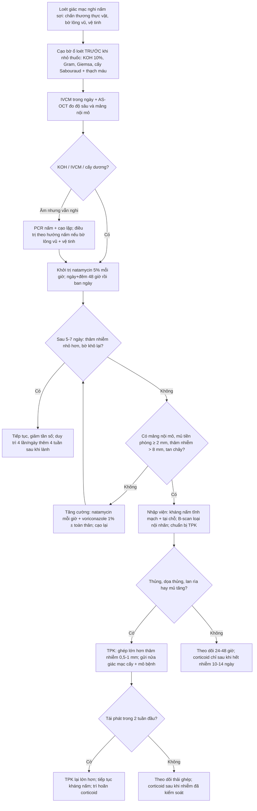
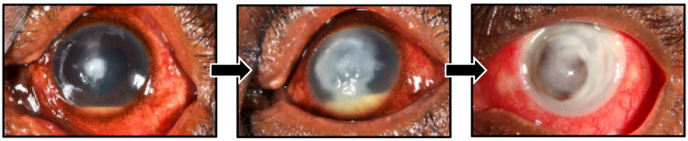
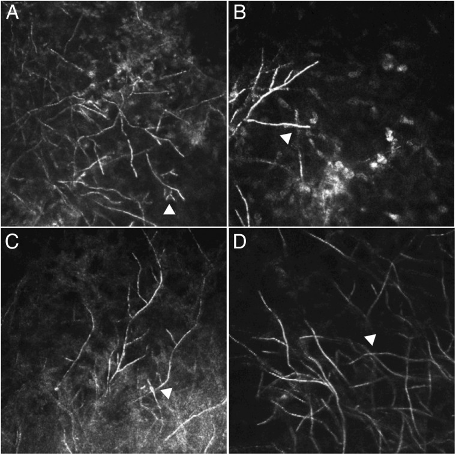
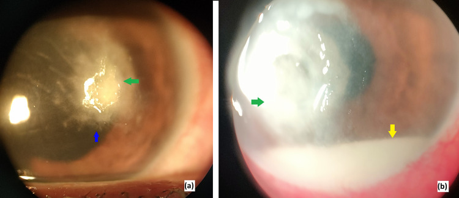

# 3216 — Viêm giác mạc do nấm sợi (*Fusarium*/*Aspergillus*) sau chấn thương thực vật / Filamentous fungal keratitis

**Tags:** `pattern:tham-nhien-giac-mac` `pattern:o-loet-giac-mac` `pattern:bo-long-vu` `pattern:ton-thuong-ve-tinh` `pattern:mang-noi-mo` `pattern:mu-tien-phong` `pattern:sau-chan-thuong-thuc-vat` `pattern:kinh-tiep-xuc` `vung:mat` `vung:giac-mac` `vung:tien-phong` `protocol:den-khe` `protocol:cam-mau-cay` `protocol:KOH` `protocol:IVCM` `protocol:AS-OCT` `protocol:PCR-nam` `incidentaloma:khong`

**Mức chắc chắn (certainty):** tổng hợp y văn (literature synthesis) — dựng từ **642 bệnh nhân viêm giác mạc nhiễm ở Nepal** (*J Fungi* 2022, **PMC9502267**, CC BY 4.0), **tổng quan quản lý nấm sợi** (*J Fungi* 2022, **PMC9605596**, CC BY 4.0), **tổng quan chẩn đoán–điều trị 2024** (*Clin Ophthalmol* 2024, **PMC10788054**, CC BY-NC 3.0), **52 mắt mảng nội mô trên AS-OCT/IVCM** (*Cornea* 2022, **PMC9555760**, CC BY-NC-ND 4.0), **198 mắt ghép điều trị** (*Indian J Ophthalmol* 2019, **PMC6786177**, CC BY-NC-SA 4.0), **40 mắt IVCM + ghép sớm** (*Clin Ophthalmol* 2022, **PMC9288216**, CC BY-NC 3.0), **meta-phân tích 169 nghiên cứu dịch tễ** (*Front Cell Infect Microbiol* 2021, **PMC8428535**, CC BY 4.0), **tổng quan + 3 ca corticoid** (*J Clin Med* 2021, **PMC8001350**, CC BY 4.0) và **IVCM *Fusarium* vs *Aspergillus*** (*Br J Ophthalmol* 2017, **PMC5537506**, CC BY 4.0, DOI 10.1136/bjophthalmol-2016-309656). Nhóm **không có bệnh nhân của mình**; chỗ chưa đủ chắc ghi "chưa rõ". **Không ghi tên tác giả** — attribution dùng tạp chí + năm + PMCID.

> **Câu chốt:** Viêm giác mạc do nấm sợi (filamentous fungal keratitis) là bệnh **"ổ loét nhỏ hơn thâm nhiễm"** — sợi nấm chạy **giữa các lá nhu mô** nên vùng đục lan xa hơn chỗ biểu mô mất, và **không có mạch máu** để đưa thuốc tới. Bốn con số phải thuộc: **(1)** cạo giác mạc nhuộm **KOH** có độ nhạy **85,3%**, **IVCM 89,8%**, còn **cấy chỉ 75,7%** — **cấy âm không loại trừ** (642 bệnh nhân, PMC9502267); **(2)** **natamycin 5%** hơn **voriconazole 1%**: thủng **34 vs 18** (p = 0,02, n = 323) và thị lực tốt hơn **0,18 logMAR** ở 3 tháng (p = 0,006) — MUTT1 (PMC9605596); **(3)** ghép điều trị (TPK) diệt được nhiễm ở **89,9%** nhưng **tái phát 10,1%**, sống ghép trung vị **5,9 tháng**, và **thâm nhiễm càng lớn càng dễ tái phát** (198 mắt, PMC6786177); **(4)** **mảng nội mô** trên AS-OCT: bờ **mờ/lượn sóng 25/28** ca nấm so với **rõ 23/24** ca vi khuẩn (PMC9555760). Bẫy chết người: **corticoid làm nặng và có thể gây thủng**, còn **ngừng corticoid đột ngột** cũng làm bùng phát (PMC8001350).

## 1. Tổng quan bệnh học – cơ chế hình ảnh (TẠI SAO)

### 1.1 Vì sao nấm "ăn" giác mạc theo lớp — và vì sao ổ loét nhỏ hơn thâm nhiễm

- **Giác mạc vô mạch.** Nhu mô giác mạc không có mạch máu; nuôi dưỡng bằng **khuếch tán từ phim nước mắt, màng củng mạc–kết mạc và thủy dịch**. Hệ quả: **kháng nấm thấm rất kém**, và mọi ổ nhiễm sâu đều **chậm lành** so với viêm giác mạc vi khuẩn.
- **Sợi nấm (hyphae) chạy dọc lá collagen.** Sợi nấm xâm nhập qua chỗ biểu mô mất rồi **lan theo mặt phẳng các lá nhu mô**, có thể **vượt xa bờ ổ loét** — đó là lý do trên đèn khe thấy **bờ "lông vũ" (feathery)** và vùng thâm nhiễm **rộng hơn** khuyết biểu mô. Đây là dấu **có giá trị phân biệt** với vi khuẩn, nhưng **không đặc hiệu tuyệt đối** (PMC10788054).
- **Vách nấm có ergosterol.** Polyene (natamycin, amphotericin B) **gắn ergosterol**; azole (voriconazole…) **ức chế tổng hợp ergosterol**. Vì đích là **màng tế bào** chứ không phải thành, các thuốc này chủ yếu **kìm nấm (fungistatic)** — cần **nhiều tuần**, và **Fusarium** có thể vẫn tiến triển **dù điều trị đúng** (Hình 3, PMC9605596).
- **Men tiêu hủy + phản ứng viêm** gây **tan chảy (melting)** và **thủng giác mạc ~10%**; hơn **một nửa** bệnh nhân mất thị lực một mắt (PMC10788054). Toàn cầu **≥ 1 triệu ca/năm**, **~100.000 mắt bị bỏ** vì chẩn đoán muộn (PMC9288216).
- **Vệ tinh (satellite lesions)** là **vi áp-xe** phía trước ổ chính, nơi sợi nấm và bạch cầu tụ lại; gặp ở **> 10%** ca (PMC10788054). **Mủ tiền phòng (hypopyon)** gặp ở **hơn một nửa** ca, phản ánh phản ứng tiền phòng chứ không phải nhiễm đã vào nội nhãn.

### 1.2 Vì sao hình ảnh trông như vậy (đèn khe – AS-OCT – IVCM – cấy)

- **Đèn khe (slit lamp)** — ánh sáng tán xạ trên **sợi nấm + tế bào viêm + phù nhu mô**; bờ lông vũ là **chỗ sợi nấm ở các độ sâu khác nhau**, nên bờ "mờ tua" chứ không phải đường cắt sắc như ổ vi khuẩn. **Bề mặt khô, nhô cao, màu xám–vàng bẩn** là mô hoại tử; **vòng thâm nhiễm xám (immune ring)** là phản ứng miễn dịch, không phải lan nhiễm.
- **AS-OCT (anterior segment OCT)** — độ phân giải trục **~5 µm**, cắt được **mặt sau giác mạc**. **Mảng nội mô (endothelial plaque)** = tế bào viêm/fibrin bám nội mô; trong nấm, **mảng ăn sâu và hoà vào lớp nội mô** → bờ **không rõ, lượn sóng** (**25/28** ca), còn trong vi khuẩn mảng **nằm trên** nội mô → bờ **rõ** (**23/24** ca) (PMC9555760). AS-OCT cũng cho **độ sâu thâm nhiễm (µm)** và **độ dày nhu mô còn lại** — hai số quyết định **có ghép được hay không**.
- **IVCM (in vivo confocal microscopy)** — confocal phản xạ, trường **400 × 400 µm**, thấy **sợi nấm tăng phản xạ** cắt ngang nhu mô. Cả *Fusarium* và *Aspergillus* đều **phân nhánh góc < 78°**, nên **góc phân nhánh KHÔNG phân biệt được hai loài**; sợi chồng nhau có thể giả **góc 90°** (PMC5537506). Giá trị thật của IVCM là **phát hiện nấm nhanh**: độ nhạy **89,8%** trong 642 bệnh nhân (PMC9502267) và **94,7%** ở nhóm nặng (PMC9288216).
- **Cạo giác mạc + cấy** — **KOH 10%** thấy sợi nấm trong **vài phút**, **Gram/Giemsa** bổ trợ; **Sabouraud** mọc **≥ 1 tuần**, độ nhạy **75,7%** (PMC9502267). Vì vậy **cấy âm không loại trừ nấm** — nhất là khi đã nhỏ kháng sinh/kháng nấm trước khi cạo.

### 1.3 Ngưỡng định lượng nằm lòng

| Chỉ số | Ngưỡng / giá trị | Nguồn |
|---|---|---|
| Tần suất nấm trong viêm giác mạc nhiễm | **17–36%** (báo cáo chung); **5–20%** ở Mỹ; **> 50%** ở nước đang phát triển; meta: **0,05%–43,01%** tùy nhóm | PMC10788054, PMC8428535 |
| Tác nhân | ***Fusarium*** rồi ***Aspergillus***; **9,29%** nhiễm phối hợp vi khuẩn | PMC8428535 |
| Độ nhạy chẩn đoán (n = 642) | **KOH 85,3%** · Gram **83,2%** · calcofluor **79,1%** · **smear chung 90,7%** · **IVCM 89,8%** · **cấy 75,7%** | PMC9502267 |
| IVCM ở ca nặng | **94,7%** (36/38) | PMC9288216 |
| Mảng nội mô trên AS-OCT | Nấm: bờ **mờ/lượn sóng 25/28**; vi khuẩn: bờ **rõ 23/24** | PMC9555760 |
| Tổn thương vệ tinh / mủ tiền phòng | Vệ tinh **> 10%**; mủ tiền phòng **> 50%** | PMC10788054 |
| Nguy cơ thủng / mất thị lực | Thủng **~10%**; **> 50%** mất thị lực một mắt | PMC10788054 |
| Natamycin vs voriconazole (MUTT1, n = 323) | Thủng **34 vs 18** (p = 0,02); thị lực **−0,18 logMAR** nghiêng natamycin (p = 0,006) | PMC9605596 |
| Ghép điều trị (198 mắt) | Diệt nhiễm **89,9%** · tái phát **10,1%** · sống ghép trung vị **5,9 tháng** · ghép **< 8 mm** sống tốt hơn (p = 0,026) | PMC6786177 |
| Ghép sớm (40 mắt nặng) | TPK **67,5%** sau **4,2 ± 3,9 ngày**; ghép **8,9 ± 1,9 mm**; bỏ mắt **7,5%**; CDVA **2,0 → 0,96 logMAR** | PMC9288216 |
| Corticoid trước chẩn đoán | Được dùng như điều trị ban đầu ở **1–60%** ca nấm | PMC8001350 |

## 2. Mẫu hình + chẩn đoán phân biệt (gamut)

**Mẫu hình "nấm sợi điển hình":** khởi phát **âm thầm vài ngày–vài tuần** sau **chấn thương thực vật/đất**; **đau ít hơn** vẻ ngoài tổn thương; ổ loét **bề mặt khô, nhô**, **bờ lông vũ**, **thâm nhiễm xám–vàng lan quá bờ loét**, **tổn thương vệ tinh**, **vòng miễn dịch**, **mảng nội mô**, **mủ tiền phòng đặc**; **không cải thiện** (hoặc nặng lên) sau 48–72 giờ kháng sinh.

- **Gamut theo giai đoạn:**
  - **0–7 ngày:** ổ loét **nhỏ, khô, bờ tua nhẹ** + thâm nhiễm nhu mô nông; dễ bị gọi là "trợt giác mạc".
  - **1–3 tuần:** **lan theo lá nhu mô**, **vệ tinh**, **vòng miễn dịch**, **mảng nội mô**, **mủ tiền phòng**; bắt đầu **tan chảy**.
  - **> 3 tuần:** **thủng**, **dính mống mắt**, **tân mạch**, **sẹo đục**; nếu đã thủng hoặc mủ nhiều → **nguy cơ viêm nội nhãn**.
- **Gamut theo "kẻ bắt chước" (quan trọng hơn giai đoạn):**
  - ***Pythium insidiosum*** — oomycete **không có ergosterol**: bờ tua/tentacles, **chấm nội nhu mô**, **rãnh ngoại vi**, **lan rìa sớm**, **không đáp ứng kháng nấm** ([3200](../3200-viem-giac-mac-pythium/lesson.md)).
  - **Microsporidia** — **chấm/trợt biểu mô đa ổ**, cấy âm, rìa fluorescein dương ([3202](../3202-viem-giac-mac-do-microsporidia/lesson.md)).
  - ***Acanthamoeba*** — **đau >> tổn thương**, viêm thần kinh tỏa tia, vòng miễn dịch, **nang vách đôi** trên IVCM ([1472](../1472-viem-giac-mac-acanthamoeba/lesson.md)).
  - ***Nocardia*** — "giả nấm" Gram dương, sợi mảnh **0,5–1 µm**, **kháng acid yếu**, thường ở **củng mạc/rìa** ([3214](../3214-nocardia-viem-cung-mac/lesson.md)).
  - **Vi khuẩn (Pseudomonas, tụ cầu)** — khởi phát **giờ–ngày**, mủ xanh, melting nhanh; ở người đeo kính tiếp xúc ([6132](../6132-viem-giac-mac-kinh-tiep-xuc/lesson.md)).
  - **HSV/VZV** — **đuôi gai thật** có bóng tận cùng, giảm cảm giác; **bùng phát sau corticoid**.
  - ***Candida*** (nấm men) — ổ **"khuy nút áo" (collar button)**, thâm nhiễm **khu trú, đặc**, tiến triển **chậm**, ít vệ tinh; hay gặp ở **giác mạc đã ghép/bề mặt kém**.
  - **Mycobacterium atypicals** — chấm/lông li ti, **chậm hàng tuần**, sau chấn thương/chỉnh mắt.
  - **Không nhiễm trùng** — loét **thần kinh dưỡng**, **CLARE/độc tố**, **loạn dưỡng**, **bệnh mắt khô nặng**: **không được ghép sớm** ([3204](../3204-loet-giac-mac-than-kinh/lesson.md)).

## 3. Bảng so sánh phân biệt (ma trận đối chiếu)

| Thực thể (entity) | Hình ảnh điển hình (đèn khe / AS-OCT / IVCM) | Chốt vào (rule-in) | Chốt loại (rule-out) | Gợi ý xác nhận |
|---|---|---|---|---|
| **Nấm sợi (*Fusarium*/*Aspergillus*)** | Bờ **lông vũ**, bề mặt **khô nhô**, **vệ tinh**, **vòng miễn dịch**, **mảng nội mô bờ mờ/lượn sóng**; IVCM: sợi **tăng phản xạ, phân nhánh < 78°** | **Chấn thương thực vật/đất** + bờ lông vũ + vệ tinh; **KOH dương** hoặc **IVCM dương** | **Khởi phát giờ–ngày + mủ xanh + melting nhanh** → vi khuẩn; **tua + rãnh ngoại vi + chấm nội nhu mô** → *Pythium* | **KOH 10% + Gram + Giemsa**; cấy **Sabouraud**; **IVCM**; **AS-OCT** đo độ sâu; PCR nấm khi cần |
| ***Pythium insidiosum*** | **Tua (tentacles)**, **chấm nội nhu mô**, **lưới**, **rãnh ngoại vi**, **lan rìa sớm**; IVCM: sợi **mảnh, thẳng, phân nhánh vuông góc** | **≥ 2 trong 5 dấu T–D–R–F–L**; **không đáp ứng kháng nấm 5–7 ngày**; tiền sử **nước/nông nghiệp** | **Vệ tinh + bờ lông vũ rõ** → nấm sợi; **vòng Wessely** (11,6% ở nấm, 0% ở Pythium) | Cấy **thạch máu** + Sabouraud; **PCR ITS/18S** ([3200](../3200-viem-giac-mac-pythium/lesson.md)) |
| **Microsporidia** | **Chấm/trợt biểu mô đa ổ**, rìa fluorescein dương; IVCM: **vỏ kép phản xạ mạnh** | **Cấy âm + tổn thương biểu mô dai dẳng**; **modified trichrome/ZN dương** | **Thâm nhiễm nhu mô sâu có mảng nội mô** → không phải thể biểu mô đơn thuần | Nhuộm **modified trichrome 78,6%**, **ZN 89,5%**; IVCM ([3202](../3202-viem-giac-mac-do-microsporidia/lesson.md)) |
| ***Acanthamoeba*** | **Đau >> tổn thương**, viêm thần kinh tỏa tia, vòng; IVCM: **nang vách đôi 10–25 µm** | **Đeo kính + tiếp xúc nước + đau nhiều**; **nang vách đôi** | **Vệ tinh + bờ lông vũ khô** → nấm | IVCM (Se **94%**); cạo + **PCR 18S** ([1472](../1472-viem-giac-mac-acanthamoeba/lesson.md)) |
| **Vi khuẩn (*Pseudomonas*)** | **Mủ xanh–vàng**, melting **giờ**, vành lan, mủ tiền phòng sớm | **Kính tiếp xúc + khởi phát < 24–48 giờ + mủ xanh** | **Tiến triển ngày–tuần, bờ khô tua** → nấm/*Pythium* | Gram, cấy; **đáp ứng kháng sinh trong 24–48 giờ** ([6132](../6132-viem-giac-mac-kinh-tiep-xuc/lesson.md)) |
| **HSV/VZV** | **Đuôi gai thật** có **bóng tận cùng**, giảm cảm giác, ít mủ | **Đuôi gai + bóng tận cùng**; bùng phát sau corticoid | **Thâm nhiễm toàn nhu mô + vệ tinh** → không phải HSV đơn thuần | **PCR HSV** dịch cạo; **không corticoid đơn thuần** |
| ***Candida*** (nấm men) | Ổ **"khuy nút áo"**, thâm nhiễm **khu trú đặc**, ít vệ tinh; thường **giác mạc ghép/bề mặt kém** | **Bề mặt kém + ổ khu trú đặc + tiến triển chậm**; **KOH thấy nấm men/nảy chồi** | **Bờ lông vũ + vệ tinh lan rộng** → nấm sợi | KOH, cấy Sabouraud; **AS-OCT** đánh giá độ sâu |
| **Loét thần kinh dưỡng / CLARE** | **Bờ tròn nhẵn**, không thâm nhiễm lan, **giảm cảm giác**; đau ít | **Giảm cảm giác + bờ nhẵn + không vệ tinh**; **cấy âm** | **Bờ lông vũ + vệ tinh + mảng nội mô** → không phải loét dinh dưỡng | Esthesiometry; **không ghép sớm** ([3204](../3204-loet-giac-mac-than-kinh/lesson.md), [3203](../3203-de-doa-thung-giac-mac/lesson.md)) |

## 4. Protocol chụp/xét nghiệm + phân tầng + flowchart

### 4.1 Quy trình tối thiểu khi nghi nấm sợi

1. **Ảnh đèn khe chuẩn hóa** (khuếch tán + khe hẹp + sau chiếu sáng) **mỗi 24–48 giờ**: ghi **diện thâm nhiễm lớn nhất (mm)**, **độ sâu (%)**, **bờ**, **vệ tinh**, **mủ tiền phòng (mm)**, **mảng nội mô**.
2. **Cạo giác mạc TRƯỚC khi nhỏ thêm thuốc**, lấy ở **bờ ổ loét** (nơi sợi nấm nhiều nhất): **KOH 10%**, **Gram**, **Giemsa**, **calcofluor white** nếu có; **cấy Sabouraud (SDA) + thạch máu**; **PCR ITS** khi cấy âm mà vẫn nghi.
3. **IVCM ngay trong ngày khám** nếu có máy — **không thay** cạo/cấy nhưng rút ngắn chẩn đoán; ghi **hình dạng sợi, góc phân nhánh, mật độ**.
4. **AS-OCT** khi thâm nhiễm **sâu/đục nhiều** hoặc nghi **mảng nội mô**: đo **độ sâu thâm nhiễm (µm)**, **nhu mô còn lại (µm)**, **bờ mảng nội mô** (mờ/lượn sóng vs rõ), **độ dày giác mạc**.
5. **Siêu âm B-scan** trước mọi ca nặng/ghép: loại **viêm nội nhãn**, **dịch kính**; **không dùng OCT hoàng điểm** thay thế.
6. **Hỏi thuốc**: corticoid **toàn thân/tại chỗ/tiêm**, kháng sinh trước đó, **chấn thương thực vật**, **kính tiếp xúc + nước**.

### 4.2 Phân tầng thực hành (không phải thang điểm đã validate) và ngưỡng quyết định

| Tầng | Dấu hiệu | Ngưỡng / hành động |
|---|---|---|
| **1 — Nông, khu trú** | Thâm nhiễm **≤ 1/3 nhu mô**, **< 4 mm**, không mảng nội mô, tiền phòng yên | **Natamycin 5% tại chỗ** + theo dõi **24–48 giờ** |
| **2 — Trung bình** | Thâm nhiễm **1/3–2/3 nhu mô** hoặc **4–8 mm**, có **vệ tinh**, mủ tiền phòng **< 2 mm** | **Natamycin mỗi giờ (ngày)** ± **voriconazole 1%**; **cạo lại** nếu không cải thiện sau **5–7 ngày** |
| **3 — Sâu/đe dọa** | **> 2/3 nhu mô**, **mảng nội mô**, **mủ tiền phòng ≥ 2 mm**, **thâm nhiễm > 8 mm**, **tan chảy** | **Nhập viện**, kháng nấm **mỗi giờ ngày+đêm**, **voriconazole toàn thân**, **dẫn lưu tiền phòng** khi mủ đặc; **chuẩn bị ghép** |
| **4 — Thủng/không kiểm soát** | **Thủng**, **dọa thủng < 1 mm**, **lan rìa**, **mủ tăng dù điều trị**, **nghi nội nhãn** | **Ghép điều trị (TPK)** — ghép **lớn hơn vùng thâm nhiễm 0,5–1 mm**; **graft ≥ 8 mm → nguy cơ thất bại cao hơn** |

- **Vì sao "lớn hơn 8 mm" là mốc xấu:** trong 198 mắt TPK, ghép **< 8 mm** sống tốt hơn ghép **> 8 mm** (p = 0,026), và **thâm nhiễm lớn trước mổ** là yếu tố dự báo **tái phát** mạnh nhất (PMC6786177). Nghĩa là **chờ thâm nhiễm to rồi mới ghép** là tự làm khó.
- **Nguồn của từng ngưỡng trong bảng:** **> 8 mm**, **ghép lớn hơn vùng thâm nhiễm 0,5–1 mm** và **trì hoãn corticoid 10–14 ngày** lấy từ PMC6786177; **mủ tiền phòng ≥ 2 mm**, **1/3–2/3 nhu mô** và **4 mm** là **phân tầng thực hành tự biên** — **chưa có thang điểm được validate**, dùng để trao đổi với phẫu thuật viên, **không phải tiêu chuẩn chốt**.
- **Ghép sớm có cái giá của nó:** loạt **40 mắt nặng** ghép sau **4,2 ± 3,9 ngày** cho kết quả tốt (**bỏ mắt 7,5%**, CDVA **2,0 → 0,96 logMAR**) nhưng đây là **ca nặng đã vào viện**, **không** chứng minh mọi ca nên ghép sớm (PMC9288216).

### 4.3 Điều trị — liều và thời gian

- **Natamycin 5% (first-line):** **1 giọt mỗi giờ cả ngày và đêm trong 48 giờ**, sau đó **mỗi giờ ban ngày**; giảm tần số theo đáp ứng; khi đã lành **4 lần/ngày thêm 4 tuần** (PMC9605596). Phải **lắc kỹ** (hỗn dịch).
- **Voriconazole 1% (10 mg/mL)** pha từ bột tiêm: **bảo quản lạnh, dùng trong 48 giờ**; hiệu quả **kém hơn natamycin** ở *Fusarium* (MUTT1) nhưng hữu ích khi **natamycin không có** hoặc **thâm nhiễm sâu** (PMC9605596).
- **Chlorhexidine 0,2%** là lựa chọn thay thế khi **không có natamycin** (PMC9605596).
- **Toàn thân:** voriconazole/itraconazole khi **sâu, mảng nội mô, chuẩn bị ghép**; **theo dõi gan–thận**, tương tác thuốc.
- **Tiêm nội nhu mô/nội tiền phòng:** dành cho ca **không đáp ứng, chờ ghép**; bằng chứng còn **yếu**, liều và số lần **chưa thống nhất** (PMC9605596).
- **Corticoid:** **không khởi trị** khi nhiễm chưa kiểm soát. Nếu bệnh nhân **đã dùng corticoid**, **không ngừng đột ngột** — giảm liều từ từ **cùng với kháng nấm**, vì ngừng đột ngột gây **bùng phát** (PMC8001350).
- **Thời gian điều trị:** tính **tuần–tháng** (thường **6–12 tuần** sau khi hết thâm nhiễm hoạt động), **không dừng khi hết mủ**.

### 4.4 Khi nào **KHÔNG** mổ

- **Nhiễm còn hoạt động** mà chỉ **thâm nhiễm nông, khu trú** → **ghép sớm không cải thiện thị lực** và đưa nhiễm vào tiền phòng.
- **Loét thần kinh dưỡng/CLARE** bị đọc thành nấm → ghép làm **thủng thêm** ([3204](../3204-loet-giac-mac-than-kinh/lesson.md)).
- **Chưa loại trừ nội nhãn** → phải **B-scan** trước; nếu có nội nhãn, cần **cắt dịch kính + tiêm nội nhãn**, không chỉ TPK.

## 5. Biến thể bình thường và cạm bẫy

- **"Cấy âm là không phải nấm"** — sai: cấy chỉ **75,7%** (PMC9502267); **KOH/IVCM** cao hơn. Cạo **sau khi đã nhỏ thuốc** làm giảm độ nhạy.
- **"Đã đỡ sau kháng sinh"** — không loại trừ: **9,29%** ca nấm **nhiễm phối hợp** vi khuẩn; kháng sinh diệt phần vi khuẩn làm ổ loét "sạch" giả tạo (PMC8428535).
- **Corticoid — hai mặt:** dùng trước chẩn đoán gặp ở **1–60%** ca và **làm nặng/thủng**; nhưng **ngừng đột ngột** cũng gây **bùng phát** → **giảm liều từ từ + kháng nấm** (PMC8001350).
- **AS-OCT: "bờ rõ" không đồng nghĩa vi khuẩn** — mảng nội mô nấm có bờ **mờ/lượn sóng ở 25/28** ca, nhưng **không phải tất cả**; **không dùng một dấu để chốt** (PMC9555760).
- **IVCM: góc 90° là giả** — hai sợi chồng nhau tạo góc vuông giả; cả hai loài đều **< 78°**, nên **không phân loài bằng góc** (PMC5537506).
- **"Thấy nấm là ghép"** — sai: **TPK tái phát 10,1%**, sống ghép **5,9 tháng**, và **thâm nhiễm lớn** làm kết quả xấu đi (PMC6786177). Ghép đúng lúc, **không ghép muộn**.
- **Bỏ sót "mảng nội mô"**: soi đèn khe bị **thâm nhiễm che** → phải **AS-OCT** ở **vùng rìa ổ loét** (PMC9555760); có mảng nội mô đổi **phân tầng** và **tiên lượng**.
- **Satisfaction of search:** thấy sợi nấm rồi dừng — **quên** loại *Pythium* (**không đáp ứng kháng nấm**), **quên B-scan**, **quên hỏi corticoid**.

## 6. Tự lượng giá — Blind Quiz ngay trên trang tĩnh

**Ca 1 — *Fusarium* tiến triển dù điều trị natamycin 5% ngay từ đầu**

- Gợi ý lâm sàng: ca *Fusarium* trong bài gốc — **được nhập viện và điều trị natamycin 5% ngay**, không chờ kết quả cấy.
- Câu hỏi: (a) Dấu hiệu nào trên ảnh 1 khiến nghĩ nấm? (b) Vì sao ảnh 2 nặng hơn dù đã điều trị? (c) Ảnh 3 là biến chứng gì và **cần làm gì ngay**?

<b>Bấm để hiện đáp án (findings + chẩn đoán)</b>

- Ảnh 1: ổ loét **trung tâm, bề mặt khô, bờ tua**, thâm nhiễm **lan quá bờ** — mẫu hình nấm sợi.
- Ảnh 2: **thâm nhiễm dày lên + mủ tiền phòng tăng** sau 1 tuần dù **natamycin 5%** — *Fusarium* có thể tiến triển **dù điều trị đúng** (PMC9605596).
- Ảnh 3: **thủng giác mạc** sau 3 tuần. Xử trí: **ghép điều trị (TPK) / vá bằng keo hoặc màng ối tùy kích thước**, cấy nửa giác mạc, **B-scan loại nội nhãn** ([3203](../3203-de-doa-thung-giac-mac/lesson.md)).
- Bài học: *Fusarium* có thể **tiến triển và thủng dù điều trị natamycin sớm, đúng liều** → phải **khám lại mỗi 24–48 giờ**, chuẩn bị ghép, **không chờ đáp ứng hoàn toàn**.
- Nguồn ảnh: *J Fungi* 2022, Fig. 4 (PMC9605596), CC BY 4.0.

**Ca 2 — IVCM ở bệnh nhân nghi nấm, KOH âm lần đầu**

- Gợi ý lâm sàng: bệnh nhân **nghi nấm giác mạc**, **KOH lần đầu âm**; IVCM được thực hiện cùng ngày.
- Câu hỏi: (a) Ảnh cho thấy cấu trúc gì? (b) Có phân biệt được *Fusarium* với *Aspergillus* bằng hình này không? (c) Bước tiếp theo?

<b>Bấm để hiện đáp án (findings + chẩn đoán)</b>

- Hình: **sợi nấm tăng phản xạ**, phân nhánh; (A) *Aspergillus flavus* — phân nhánh **đôi (dichotomous)**; (B–D) *Fusarium* — sợi dày hơn, chồng nhau. **Mọi góc phân nhánh đều < 78°**.
- **Không phân loài bằng góc phân nhánh**; mũi tên (B) chỉ **góc 90° giả** do hai sợi chồng nhau (PMC5537506).
- Bước tiếp theo: **cạo lại + cấy Sabouraud/PCR ITS**, tiếp tục **natamycin 5%**; **IVCM dương** đủ để **khởi trị theo nấm** dù KOH âm (độ nhạy IVCM **89,8–94,7%**; PMC9502267, PMC9288216).
- Nguồn ảnh: *Br J Ophthalmol* 2017, Fig. 1 (PMC5537506), CC BY 4.0.

**Ca 3 — hai ổ loét "giống nhau", một nấm một vi khuẩn**

- Gợi ý lâm sàng: hai ổ loét **cùng kích thước** trong hình so sánh (a) và (b) của bài gốc; chẩn đoán đã được xác nhận bằng vi sinh.
- Câu hỏi: (a) Ảnh nào là nấm? (b) Dấu hiệu nào **không** đủ để chốt? (c) Xét nghiệm nào giải quyết?

<b>Bấm để hiện đáp án (findings + chẩn đoán)</b>

- (a) **Nấm**: bờ **lông vũ**, thâm nhiễm **lan quá bờ**; (b) **vi khuẩn**: bờ rõ hơn, **mủ tiền phòng** nổi bật.
- **Không đủ để chốt** bằng hình thái: độ đặc hiệu thấp; **9,29%** ca nấm có vi khuẩn phối hợp (PMC8428535).
- Giải quyết: **KOH + Gram + cấy + IVCM**; nếu **âm mà vẫn nghi**, **PCR** và **điều trị theo hướng nấm** khi có **bờ lông vũ + vệ tinh + chấn thương thực vật**.
- Nguồn ảnh: *Clin Ophthalmol* 2024, Fig. 2 (PMC10788054), CC BY-NC 3.0.

## 7. Câu hỏi nghiên cứu & điểm chưa đồng thuận (tính đến 11/2026)

1. **[Tranh cãi] Ở viêm giác mạc nấm sợi đã kiểm soát nhiễm, corticoid tại chỗ có giảm sẹo/thải ghép mà không làm bùng phát không?**
   - **Đã biết:** corticoid là **yếu tố nguy cơ** và được dùng trước chẩn đoán ở **1–60%** ca; **ngừng đột ngột** gây nặng lên, nên khuyến nghị **giảm liều từ từ cùng kháng nấm** (PMC8001350).
   - **Chưa rõ:** thời điểm **bắt đầu lại** corticoid sau khi hết thâm nhiễm hoạt động, liều và đối tượng **nguy cơ thấp** chưa có RCT.
   - **Hướng nghiên cứu:** RCT mù đôi **corticoid sớm vs muộn** sau khi cấy âm, outcome **thị lực + tái phát + thủng**.
   - **Nguồn:** PMC8001350; PMC9605596.

2. **[Khác biệt thực hành] Ghép điều trị "sớm" hay "sau khi nội khoa thất bại" ở nấm sợi nặng?**
   - **Đã biết:** loạt ghép sớm (**4,2 ± 3,9 ngày**) ở 40 mắt nặng: bỏ mắt **7,5%**, CDVA **2,0 → 0,96 logMAR** (PMC9288216); loạt 198 mắt ghép sau thất bại nội khoa: diệt nhiễm **89,9%**, tái phát **10,1%**, sống ghép **5,9 tháng** (PMC6786177).
   - **Chưa rõ:** hai quần thể khác nhau (trung tâm tuyến ba vs bệnh viện mắt), **không so sánh trực tiếp**; ngưỡng **kích thước/độ sâu** để ghép sớm chưa thống nhất.
   - **Hướng nghiên cứu:** đoàn hệ tiến cứu phân tầng theo **diện thâm nhiễm + mảng nội mô**, so **ghép sớm vs trì hoãn**.
   - **Nguồn:** PMC9288216; PMC6786177.

3. **[Khoảng trống] Có ngưỡng hình ảnh (AS-OCT/IVCM) đủ tin cậy để quyết định mổ mà không cần chờ đáp ứng lâm sàng?**
   - **Đã biết:** AS-OCT phân biệt **bờ mảng nội mô** nấm vs vi khuẩn (**25/28 vs 23/24**) (PMC9555760); IVCM độ nhạy **89,8–94,7%** (PMC9502267, PMC9288216).
   - **Chưa rõ:** chưa có **cut-off µm độ sâu/nhu mô còn lại** được **validate đa trung tâm**; dữ liệu AS-OCT hiện **cỡ mẫu nhỏ**, chưa có nhóm chứng.
   - **Hướng nghiên cứu:** nghiên cứu **diagnostic accuracy** đa trung tâm, mù người đọc, so AS-OCT/IVCM với **mô bệnh học giác mạc cắt bỏ**.
   - **Nguồn:** PMC9555760; PMC9502267; PMC9288216.

## Bài liên quan chéo

- [400 – Tổng quan Mắt & thị giác](../400-tong-quan-mat-thi-giac/lesson.md)
- [3200 – Viêm giác mạc do *Pythium insidiosum*: "bắt chước nấm" nhưng **không đáp ứng kháng nấm**](../3200-viem-giac-mac-pythium/lesson.md)
- [3202 – Viêm giác mạc do microsporidia: cấy âm, chấm biểu mô đa ổ](../3202-viem-giac-mac-do-microsporidia/lesson.md)
- [1472 – Viêm giác mạc do *Acanthamoeba*: đau >> tổn thương, nang vách đôi](../1472-viem-giac-mac-acanthamoeba/lesson.md)
- [3214 – Nhiễm *Nocardia* củng mạc: "giả nấm", sợi mảnh kháng acid yếu](../3214-nocardia-viem-cung-mac/lesson.md)
- [6132 – Viêm giác mạc do kính tiếp xúc (vi khuẩn): khởi phát giờ, mủ xanh](../6132-viem-giac-mac-kinh-tiep-xuc/lesson.md)
- [3203 – Đe dọa thủng & thủng giác mạc: keo, màng ối, nút Tenon hay ghép xuyên](../3203-de-doa-thung-giac-mac/lesson.md)
- [3204 – Loét giác mạc do thần kinh: bờ nhẵn, giảm cảm giác, không ghép sớm](../3204-loet-giac-mac-than-kinh/lesson.md)
- [3201 – Sẹo giác mạc sau loét đã lành: chọn ghép theo độ sâu](../3201-seo-giac-mac-ghep/lesson.md)
- [449 – Chấn thương mắt & dị vật: CT là đầu tay](../449-chan-thuong-mat-dich-vat/lesson.md)

## Ảnh

- Tên file: `3216_viem-giac-mac-nam-soi_<mô tả>_<PMCID>.jpg`. Nguồn + giấy phép từng ảnh trong `images/CREDITS.md`.
- 4 ảnh đều **tải được** (CC BY 4.0 / CC BY-NC 3.0); **không ghép composite** vì 3 ảnh thuộc **3 bài, 3 bệnh nhân khác nhau** và ảnh so sánh nấm–vi khuẩn đã là **cặp ghép sẵn của tác giả**; giữ nguyên nhãn và chú giải gốc.

> Không dùng để chẩn đoán độc lập khi chưa có người hướng dẫn.
