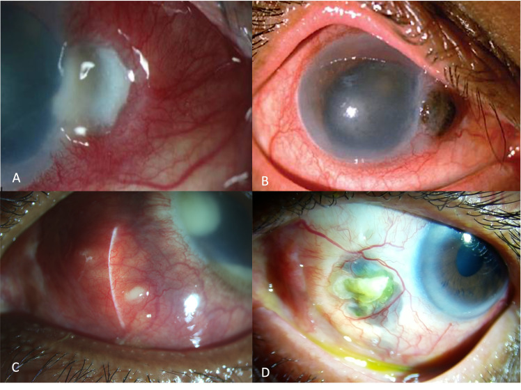
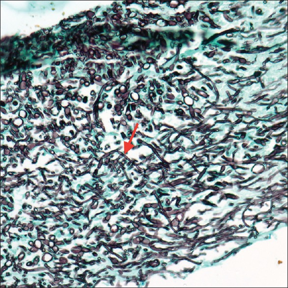
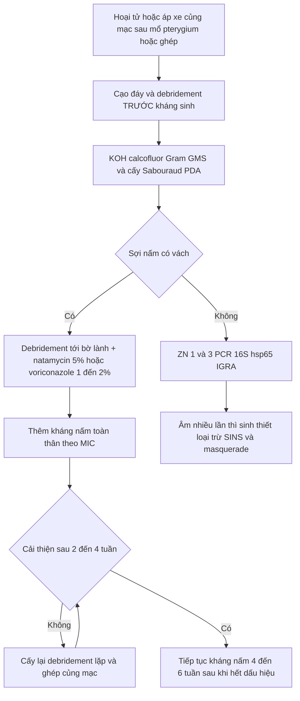
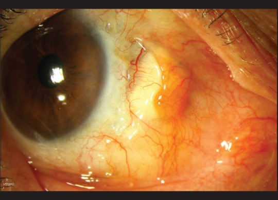
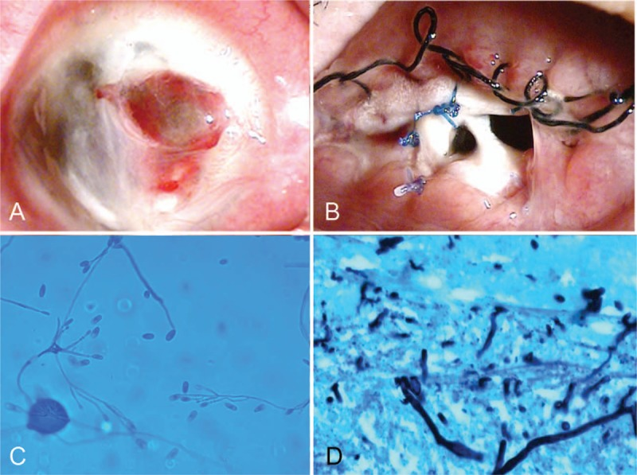
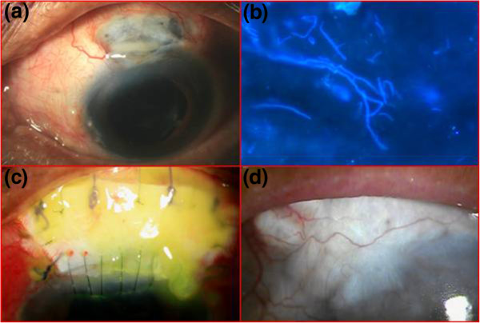
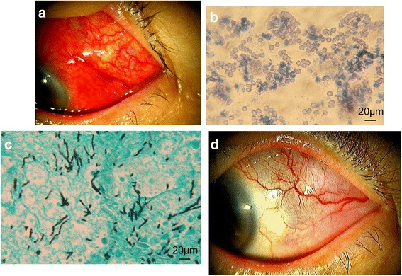
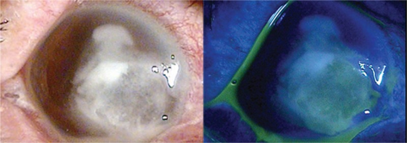

# 3217 — Viêm củng mạc do nấm sợi sau mổ pterygium/ghép: bờ "lông vũ", vệ tinh, mảng nội mô / Filamentous fungal scleritis after pterygium surgery

**Tags:** `pattern:hoai-tu-cung-mac` `pattern:ap-xe-cung-mac` `pattern:bo-long-vu` `pattern:ton-thuong-ve-tinh` `pattern:mang-noi-mo` `pattern:sau-pterygium` `pattern:sau-ghep-giac-mac` `pattern:sau-tiem-corticoid` `pattern:khong-dap-ung-corticoid` `pattern:soi-nam-co-vach` `pattern:dai-dang-nhieu-tuan` `pattern:mot-mat` `vung:mat` `vung:cung-mac` `vung:limbus` `vung:giac-mac` `vung:ket-mac` `protocol:den-khe` `protocol:KOH` `protocol:calcofluor` `protocol:GMS` `protocol:Sabouraud` `protocol:PCR-ITS` `protocol:AS-OCT` `protocol:UBM` `protocol:B-scan` `protocol:cam-mau-cay` `score:IOP` `incidentaloma:khong`

**Mức chắc chắn (certainty):** tổng hợp y văn (literature synthesis) — dựng từ **1 loạt 42 mắt viêm củng mạc nhiễm khuẩn** (*Middle East Afr J Ophthalmol* 2015, **PMC4411618**, CC BY-NC-SA 3.0 — chỉ đọc số liệu), **3 tổng quan viêm củng mạc nhiễm** (*Clin Ophthalmol* 2013 **PMC3821753**; *Indian J Ophthalmol* 2020 **PMC7690484**; *Front Ophthalmol* 2025 **PMC11842368**, CC BY 4.0 — dùng ảnh), **1 tổng quan 2025** (*Ther Adv Ophthalmol* **PMC12290352**, CC BY-NC 4.0 — chỉ số liệu), và **4 ca có ảnh CC BY**: *Bipolaris* + *Pseudomonas* sau pterygium + MMC (**PMC5151160**, CC BY-NC-SA 3.0), nấm củng mạc giả SINS sau mổ phaco (**PMC3917516**, CC BY 2.0), *Scedosporium apiospermum* sau tiêm dưới Tenon (**PMC5809823**, CC BY 4.0), *Scedosporium aurantiacum* keratoscleritis → thủng → múc nội nhãn (**PMC6635299**, CC BY 4.0). Nhóm **không có bệnh nhân của mình**; chỗ chưa đủ chắc ghi "chưa rõ". **Không ghi tên tác giả trong bài** — attribution ghi tạp chí + năm + PMCID (đối chiếu `authorString` ở `images/CREDITS.md`).

> **Câu chốt:** Nấm sợi ở củng mạc không phải "loét giác mạc lan ra" mà là **nhiễm trú trong mô collagen vô mạch** — nên nó **im lặng nhiều tuần đến nhiều năm**, **không đáp ứng corticoid**, và chỉ lộ ra khi **cạo/debridement tới bờ lành**. Bốn con số phải thuộc: **(1)** nấm chiếm **5–38%** viêm củng mạc nhiễm ở nước nhiệt đới, **23,8% (10/42 mắt)** trong loạt Ấn Độ và là **tác nhân thường gặp nhất** (PMC7690484; PMC4411618); **(2)** sau mổ, **thời gian ủ 1 tuần–36 năm**, dài nhất sau **pterygium**; sau tiêm dưới Tenon, **nấm khởi phát 2–3 tháng** còn **vi khuẩn < 1 tháng** (PMC3821753; PMC5809823); **(3)** nấm củng mạc cần **nhiều lần debridement**, điều trị trung bình **92 ngày (20 ngày–1 năm)**, **2/10 mắt tái phát**, và **chỉ 18%** viêm củng mạc nhiễm đáp ứng **thuốc đơn thuần** (PMC4411618; PMC11842368); **(4)** MIC không cứu được mắt: *S. aurantiacum* có **voriconazole MIC 1 µg/mL** (thấp) nhưng vẫn **thủng giác mạc sau 3 tháng** và phải **múc nội nhãn** (PMC6635299). Bẫy chết người: **gọi là SINS → cho corticoid** (PMC3917516).

## 1. Tổng quan bệnh học – cơ chế hình ảnh (TẠI SAO)

### 1.1 Vì sao củng mạc là "bể chứa" của nấm sợi

- Củng mạc **vô mạch ở lớp nhu mô**, **~95% là collagen type I** xếp thành bó dày, **rất ít tế bào** và **không có hệ bạch mạch**. Thuốc nhỏ thấm theo **khuếch tán** qua một ma trận collagen đặc → nồng độ tại ổ rất thấp, dù nhỏ mỗi giờ.
- Sợi nấm mọc **giữa các bó collagen** (chạy theo đường ít đề kháng), **không gây phản ứng viêm tương xứng**: mô học chỉ thấy **viêm u hạt + mô hạt**, ít mủ tự do. Vì vậy trên đèn khe tổn thương là **mảng/nốt trắng–vàng, bờ không rõ**, và **"ít mủ" không loại trừ nấm**.
- Nấm có thể **tồn tại dạng "ngủ" (quiescent) hàng tháng–hàng năm** trong củng mạc rồi bùng khi có **corticoid, chấn thương nhỏ, phẫu thuật mới hoặc giảm miễn dịch**. Đây là lý do **thời gian ủ sau mổ 1 tuần–36 năm**, dài nhất sau **pterygium** (PMC3821753; PMC11842368).
- **Hệ quả điều trị:** kháng nấm chỉ **kìm nấm**, còn **cắt bỏ mô nhiễm** mới làm giảm tải nấm và mở đường cho thuốc thấm. Vì thế **chỉ 18%** viêm củng mạc nhiễm khỏi bằng thuốc đơn thuần (PMC11842368), và trong **10 mắt nấm củng mạc** của loạt Ấn Độ, **tất cả** đều cần **nhiều lần debridement** phối hợp thuốc (PMC4411618).

### 1.2 Vì sao đúng giường mổ pterygium — và vì sao có "mảng canxi"

- **Pterygium excision + mitomycin C 0,02–0,04% trong 2–3 phút** (hoặc **β-irradiation**, đốt điện quá mức, để **bare sclera**) tạo ra **vùng củng mạc thiếu mạch nuôi vĩnh viễn** + **biểu mô/kết mạc phủ không hoàn chỉnh**. Đó là nơi **bào tử nấm từ dụng cụ, dung dịch, bụi, đất** bám vào và **không bị đào thải**.
- **Mảng canxi hóa (calcified plaque)** còn lại sau đợt viêm cũ là **giá thể (nidus)** cho nấm: ca *Bipolaris* dưới đây có **pterygium + MMC 5 năm trước**, **một đợt viêm củng mạc do *Enterobacter* + *Curvularia* 2 năm trước** để lại **mảng canxi**, rồi **mủ vàng dính chặt mảng canxi** khi tái nhiễm — phải **cắt bỏ cả mảng** mới sạch (PMC5151160).
- **Bare sclera bị khuyến cáo** đúng vì lý do này; nếu buộc phải để củng mạc trần thì cần **ghép kết mạc tự thân** hoặc **vật liệu che phủ** (PMC11842368; PMC3821753).
- **Nhiễm hỗn hợp là quy luật, không phải ngoại lệ:** ca *Bipolaris* còn mọc **Pseudomonas aeruginosa**; loạt *Scedosporium*/*Lomentospora* có **4/8 (50%)** đồng nhiễm vi khuẩn (PMC5151160; PMC12507171).

### 1.3 Vì sao "bờ lông vũ" và "ổ vệ tinh" — bản đồ lan, không phải "viêm mạnh"

- **Bờ toả tua/lông vũ (feathery margin):** đầu sợi nấm **đi trước** đám thâm nhiễm bạch cầu 1–2 mm; vì sợi mọc theo **lá collagen** nên rìa tổn thương **không đều, tua ra**, còn giữa ổ **đậm** do tế bào viêm. Khi nấm từ củng mạc **vượt rìa vào giác mạc (keratoscleritis)**, dấu này hiện rõ trên giác mạc — cùng cơ chế đã mô tả ở [3216](../3216-viem-giac-mac-nam-soi/lesson.md) và [1460](../1460-viem-giac-mac-do-nam/lesson.md).
- **Ổ vệ tinh (satellite lesion) = lan trong củng mạc (intrascleral dissemination), không phải nhiễm mới:** trong **18 mắt** áp-xe nhiều ổ sau pterygium, cấy **ổ ban đầu** ra *Pseudomonas* **12/18**, *Aspergillus* **1**, *M. fortuitum* **1**, hỗn hợp **4**; cấy **các ổ xuất hiện sau** (15 mắt) cho **cùng vi khuẩn ở 12 mắt** (PMID 9536876). Vì thế ổ mới cách ổ đầu **3–4 mm quanh rìa** là **cùng một đường hầm**, và **cạo mỗi ổ bề mặt là bỏ sót**.
- **Dải đen hình cung (black arc band):** sau khi tổn thương hoá, củng mạc mỏng tới mức **lộ hắc mạc** — dấu hiệu **đã lan theo đường vòng**, cảnh báo **nguy cơ thủng** (PMC3821753; PMC11842368).
- **Mảng nội mô (endothelial plaque):** khi nấm **xuyên hết nhu mô giác mạc**, nấm + tế bào viêm **lắng ở mặt sau giác mạc**. Trên AS-OCT, mảng nội mô do nấm có **bờ mờ/lượn sóng 25/28 mắt** so với **bờ rõ 23/24 mắt** vi khuẩn (dẫn qua 3216, PMC9555760) — tức **mảng nội mô + mủ tiền phòng** là dấu **đã qua giới hạn nhỏ giọt**.

### 1.4 Vì sao nhìn thấy nấm: vật lý của KOH, calcofluor, GMS và AS-OCT/UBM

| Công cụ | Nguyên lý vật lý | Điều trần thuật trên lâm sàng | Giới hạn |
|---|---|---|---|
| **KOH 10–20%** | **Phá keratin/tế bào** (KOH làm tan tương bào), để lại **vách nấm chitin** khúc xạ | Sợi **có vách, phân nhánh**, đường kính **2–10 µm** | Không phân biệt loài; **âm giả** nếu cạo nông |
| **Calcofluor white** | Gắn **chitin/cellulose**, phát huỳnh quang **xanh** khi kích thích **~340–400 nm** | Sợi sáng xanh trên nền tối, **nhạy hơn KOH** | Cần đèn huỳnh quang; **dương giả** với sợi chỉ, bông |
| **GMS (Grocott)** | Oxy hoá polysaccharide thành aldehyd → **bạc đen–xanh** | Sợi nấm **đen** trên nền **xanh**, thấy cả trong mô hoại tử | Cần sinh thiết; **không** nói được loài |
| **Cấy Sabouraud/PDA** | Môi trường chọn lọc + nhiệt độ **28–37 °C** | Khuẩn lạc **bông xốp, có/không sắc tố**; *Scedosporium* **21 ngày** mới đủ đặc điểm | **Cấy âm không loại trừ**; nấm chậm có thể **3–4 tuần** |
| **PCR ITS + β-tubulin** | Khuếch đại vùng **ITS** (loài gần) và **β-tubulin/BUT** (loài chính xác) | Định danh **loài** khi hình thái không đủ | Không có **clinical breakpoint** chuẩn cho nấm sợi |
| **AS-OCT (~1310 nm)** | Giao thoa ánh sáng cận hồng ngoại, phân giải trục **~5–20 µm** | **Đo độ dày củng mạc (µm)**, mảng nội mô, mức mỏng, dịch dưới kết mạc | Không xuyên qua mô viêm dày/hoại tử đặc |
| **UBM 35–50 MHz** | Siêu âm tần số cao, phân giải trục **~35–50 µm**, xuyên **4–5 mm** | **Đường hầm, áp-xe sâu, dị vật**, mất liên tục echo củng mạc sau kết mạc đục | Không đo được chi tiết bề mặt như OCT |
| **B-scan / CT–MRI** | Siêu âm 10 MHz / X-quang–từ trường | **Viêm củng mạc sau, bong võng mạc, lan hốc mắt** | Không dùng để chẩn đoán tác nhân |

### 1.5 Các con số phải nhớ (ngưỡng định lượng)

| Biến số | Số liệu | Nguồn |
|---|---|---|
| Viêm củng mạc nhiễm / toàn bộ viêm củng mạc | **5–10%** | PMC3821753; PMC11842368 |
| Viêm củng mạc nhiễm tại trung tâm Ấn Độ | **17,87% (42/235)** | PMC4411618 |
| Nấm trong viêm củng mạc nhiễm (nhiệt đới) | **5–38%**; loạt Zia **25%**; loạt Ấn Độ **23,8% (10/42)** | PMC7690484; PMC4411618 |
| Thời gian ủ sau mổ | **1 tuần–36 năm**; SINS tới **51 năm**; dài nhất sau **pterygium** | PMC3821753; PMC11842368 |
| Sau tiêm dưới Tenon: vi khuẩn vs nấm | vi khuẩn **< 1 tháng**; nấm **2–3 tháng**; tần suất chung **0,04%** | PMC5809823 |
| Thời gian có triệu chứng trước khi đến khám | chung **31,8 ± 34,5 ngày** (2–180); **nấm 54 ngày** | PMC4411618 |
| Đặc điểm lâm sàng (55 mắt) | xung huyết **98%**, **hoại tử củng mạc 93%**; áp-xe cách rìa **3–4 mm** | PMC3821753 |
| Điều trị nấm củng mạc (10 mắt) | **nhiều lần debridement**; trung bình **92 ngày** (20 ngày–1 năm); tái phát **2/10** | PMC4411618 |
| Corticoid tại chỗ lúc vào viện (nhóm nấm) | **6/10** (40% cả nhóm nấm dùng corticoid) | PMC4411618 |
| Đáp ứng thuốc đơn thuần (viêm củng mạc nhiễm) | **18%** | PMC11842368 |
| *Scedosporium*/*Lomentospora* trong oculomycosis | **8/1.099 (0,7%)**; lành trung bình **90 ngày** (21–180); **66,6%** cần mổ | PMC12507171 |
| *Scedosporium aurantiacum*: MIC (µg/mL) | amphotericin B **16** · itraconazole **16** · posaconazole **2** · **voriconazole 1** · caspofungin **8** · micafungin **8** | PMC6635299 |
| Nấm da sẫm màu (dematiaceous) có sắc tố thấy được | **27,2%** | PMC5151160 |
| Nhiễm hỗn hợp *Scedosporium* + vi khuẩn | **4/8 (50%)** | PMC12507171 |

> **Cạm bẫy định lượng:** "cấy âm sau 7 ngày" **không** loại trừ nấm củng mạc — môi trường phải giữ **3–4 tuần** (khuẩn lạc *Scedosporium* đã **21 ngày** mới đủ đặc điểm), và **cạo nông** cho lượng nấm dưới ngưỡng phát hiện.

## 2. Mẫu hình + chẩn đoán phân biệt theo vị trí (gamut)

### 2.1 Mẫu hình nhận diện

**Bệnh cảnh điển hình:** người lớn, **một mắt**, **đau nhức sâu + đỏ dai dẳng nhiều tuần–nhiều tháng** sau **pterygium excision (nhất là có MMC/β-irradiation)**, **ghép giác mạc**, **phaco**, **tiêm dưới Tenon corticoid**, **buckle** hoặc **chấn thương hữu cơ**; khám thấy **hoại tử/áp-xe củng mạc vàng–trắng**, **bờ toả tua**, có thể **nhiều ổ vệ tinh quanh rìa**, **mảng canxi ở đáy**, **mủ tiền phòng**, và **thâm nhiễm giác mạc kèm bờ lông vũ/mảng nội mô** khi đã lan qua rìa. **Không sốt, không hạch** — toàn thân im lặng, nên hay bị gọi "viêm củng mạc tự miễn" hoặc "SINS".

### 2.2 Gamut theo vị trí và theo mốc thời gian

| Vị trí | Gamut chính | Dấu hiệu phân biệt then chốt |
|---|---|---|
| **Giường mổ pterygium/bare sclera** | nấm sợi · NTM · *Nocardia* · *Pseudomonas* · SINS · lao · dị vật | **Thời gian sau mổ** (ngày–tuần: *Pseudomonas*; **1–4 tuần: *Nocardia***; **tuần–tháng: nấm**; **tháng–năm: NTM/SINS/lao**); **mảng canxi ở đáy** gợi nấm tái nhiễm |
| **Quanh mối ghép giác mạc** | nấm · NTM · *Nocardia* · nhiễm mảnh ghép · SINS | **Chỉ khâu + mối ghép**, mủ, cấy mảnh ghép; **nấm** thường **> 2 tuần** và **bờ toả tua** |
| **Khoang dưới Tenon sau tiêm corticoid** | *Scedosporium*/*Lomentospora* · *Staphylococcus* · *Nocardia* · nấm khác | **Áp-xe dưới Tenon đúng vị trí tiêm**; **nấm 2–3 tháng**, vi khuẩn **< 1 tháng**; MRI thấy **ổ tăng tín hiệu quanh nhãn cầu** |
| **Giác mạc nông ± củng mạc (keratoscleritis)** | nấm sợi · herpes · *Acanthamoeba* · NTM | **Bờ lông vũ + vệ tinh + mảng nội mô** → nấm; **đuôi gai có bóng** → herpes; **đau nhiều hơn tổn thương + vòng** → *Acanthamoeba* |
| **Sau mổ buckle** | nấm · NTM · *Pseudomonas* · nhiễm vật liệu | **Lộ buckle + mủ**, cấy vật liệu; nấm thường **chậm** |
| **Hậu đoạn/hốc mắt khi lan** | áp-xe hốc mắt · viêm củng mạc sau · endophthalmitis | **Lồi mắt, hạn chế vận nhãn, B-scan/CT/MRI**; cần **tháo vật liệu + kháng nấm toàn thân** |

> **Nguyên tắc:** gamut này là **gamut theo thời gian + xét nghiệm**, không phải "nhìn mặt bắt hình dong". Riêng nấm, **không có dấu hiệu nào đặc hiệu** — ca *Scedosporium* sau tiêm dưới Tenon bị điều trị vi khuẩn 3 ngày rồi chụp CT vì nghi "nhiễm quanh nhãn cầu", chỉ chốt được sau **chọc dẫn lưu + cấy** (PMC5809823).

## 3. Bảng so sánh phân biệt (ma trận đối chiếu)

| Thực thể (entity) | Hình ảnh điển hình | Chốt vào (rule-in) | Chốt loại (rule-out) | Gợi ý xác nhận |
|---|---|---|---|---|
| **Nấm sợi (*Aspergillus*/*Fusarium*/*Bipolaris*/*Scedosporium*)** | **Hoại tử/áp-xe củng mạc vàng–trắng, bờ toả tua**, mủ dính **mảng canxi**, **ổ vệ tinh quanh rìa**, lan giác mạc **bờ lông vũ + mảng nội mô** | **Sợi nấm có vách trên KOH/calcofluor/GMS**, cấy nấm, **PCR ITS/β-tubulin** | **Cấy âm 7 ngày KHÔNG loại trừ** (giữ 3–4 tuần); **không loại trừ bằng đáp ứng corticoid** | Cạo **đáy ổ + mảng canxi** trước kháng sinh; **Sabouraud/PDA 28 °C**, giữ **4 tuần** |
| **NTM (mycobacteria không lao)** | Nốt/áp-xe **ít mủ, bờ không rõ**, dai dẳng tuần–tháng; **viêm thần kinh hướng tâm** khi có keratitis | **Trực khuẩn kháng acid MẠNH (ZN 3%/Fite-Faraco)**, cấy **3–7 ngày (nhóm IV)** hoặc tới **8 tuần** | **Không loại trừ** bằng cấy âm sớm; **không dùng TMP-SMX** | Xem [3215](../3215-ntm-viem-cung-mac-sau-pterygium/lesson.md); PCR *hsp65* |
| ***Nocardia*** | Áp-xe **khu trú bờ rõ**, mủ qua kết mạc; sau pterygium **7–28 ngày** | Sợi **mảnh phân nhánh, kháng acid YẾU (ZN 1%)**; khuẩn lạc khô trắng **2–7 ngày** | **ZN 1% âm (~20%) không loại trừ**; **"ZN 3% dương" không phân biệt được NTM** | Xem [3214](../3214-nocardia-viem-cung-mac/lesson.md); **TMP-SMX** là thuốc hàng đầu |
| ***Pseudomonas*/*Staphylococcus*** | Hoại tử **lan theo giờ–ngày**, mủ **xanh/đặc**, đau tăng nhanh | Gram/cấy mọc **24–48 giờ** | **Khởi phát > 2 tuần + bờ toả tua** ít nghĩ *Pseudomonas* | Cấy + kháng sinh đồ; **không chờ** nếu hoại tử lan |
| **SINS (vô khuẩn sau mổ)** | Hoại tử củng mạc **không mủ**, bờ mỏng, đúng mối mổ; khởi phát **1 ngày–51 năm** | Tiền sử mổ + **cấy âm nhiều lần** + **đáp ứng ức chế miễn dịch** | **Mủ + sợi nấm + không đáp ứng corticoid** → nhiễm, không phải SINS | **Cấy/sinh thiết TRƯỚC** khi tăng ức chế miễn dịch |
| **Lao củng mạc** | Hoại tử **thiếu mạch** đúng giường pterygium, mắt "yên" nhưng **mỏng/lộ hắc mạc** | **IGRA dương** + đáp ứng **ATT**; AFB/PCR lao trên mô | **Cấy âm + X-quang phổi âm không loại trừ** (thể kín) | IGRA/PPD, CT ngực; ATT thử ở vùng lưu hành |
| **Nấm men (*Candida*)** | Thâm nhiễm **dưới biểu mô**, biểu mô **còn nguyên**, bờ **kém rõ**, **ít vệ tinh**; sau ghép/kính tiếp xúc/suy giảm miễn dịch | **Nấm men nảy chồi** trên Gram/PAS; cấy mọc **2–3 ngày** | **Bờ lông vũ + vệ tinh + sợi có vách** → nấm sợi, không phải *Candida* | Cấy + định danh; **fluconazole** khác phổ với nấm sợi |
| **U hạt chỉ khâu/dị vật** | Nốt nhỏ **đúng mối chỉ**, đau khi ấn, tái phát cùng chỗ | **Thấy chỉ/dị vật** trên đèn khe/UBM; hết sau gỡ | **Không thấy dị vật không loại trừ** (gỗ, gai) | UBM tần số cao; gỡ + cấy |
| **Masquerade (lymphoma, melanoma, "occult fungal scleritis")** | Khối **thịt cá hồi**, không mủ, không đau nhiều; hoặc **ổ nốt kín đáo không viêm rầm rộ** | **Sinh thiết** mô học; nấm "ẩn" chỉ lộ khi **nhuộm GMS/PAS** | **Đau + mủ + sợi nấm** ít nghĩ lymphoma, nhưng **u hoại tử bội nhiễm** vẫn có thể | Sinh thiết **khi không lành sau điều trị nhiễm** |

*Hai mức của cùng bệnh cảnh: **A** — ổ vàng trên **bare sclera** sau pterygium; **B** — khi chẩn đoán muộn, **thủng giác mạc–củng mạc**. Ảnh từ tổng quan viêm củng mạc nhiễm (PMC11842368, CC BY 4.0); **tác nhân không nêu trong chú thích gốc** — dùng để dạy **vị trí và biến chứng**, không gán tác nhân.*

*Nhuộm **Grocott (GMS)** bắt polysaccharide thành tế bào nấm → sợi **đen** trên nền **xanh**. Ca *Bipolaris* sau pterygium + MMC; cấy đồng thời mọc **Pseudomonas** (PMC5151160, CC BY-NC-SA 3.0).*

## 4. Protocol chụp + hệ phân độ/điểm chuẩn hóa

### 4.1 Không có "RADS" cho củng mạc — dùng phân độ giải phẫu + vi sinh

Không tồn tại hệ phân độ hình ảnh chuẩn hóa cho viêm củng mạc nhiễm. Quyết định dựa trên **3 trục**: **(1) độ sâu** (nông / tới lớp sâu / thủng), **(2) diện tích và số ổ (mm, mm²)**, **(3) tác nhân + MIC**. Quy trình tối thiểu:

1. **Đèn khe + đảo mắt**: đo **kích thước ổ (mm)**, **số ổ**, **khoảng cách tới rìa**, **độ mỏng ước tính (% bề dày)**, **mảng canxi**, **mủ tiền phòng**, **nhãn áp**, **thị lực**. Ghi **số tuần sau mổ/tiêm** — biến số phân biệt mạnh nhất.
2. **Cạo + debridement TRƯỚC kháng sinh**: lấy **đáy ổ sâu + bờ + mảng canxi** (nguyên lý **lan trong củng mạc**), không chỉ mủ bề mặt. Nhuộm **Gram, KOH 10–20%, calcofluor, GMS/PAS, Giemsa**.
3. **Cấy**: **Sabouraud dextrose, potato dextrose, blood/chocolate agar, brain-heart infusion**; ủ **28 °C và 35–37 °C**, giữ **3–4 tuần** (khuẩn lạc *Scedosporium* **21 ngày**). Định danh bằng **PCR ITS + β-tubulin** hoặc **MALDI-TOF**.
4. **AS-OCT tiền đoạn**: đo **độ dày củng mạc (µm)**, phát hiện **mỏng/doạ thủng**, **dịch dưới kết mạc**, **mảng nội mô** khi lan giác mạc.
5. **UBM 35–50 MHz**: tìm **đường hầm, áp-xe sâu, dị vật**, **mất liên tục echo củng mạc** — đặc biệt khi kết mạc đục không soi được.
6. **B-scan** (viêm củng mạc sau, bong võng mạc, dịch dưới hắc mạc); **CT/MRI hốc mắt** khi nghi lan hậu đoạn/hốc mắt — ca sau tiêm dưới Tenon có **ổ tăng tín hiệu quanh nhãn cầu** trên MRI T2 (PMC5809823).
7. **Toàn thân**: hỏi **ghép tạng, corticoid/ức chế miễn dịch, đái tháo đường, HIV, tiêm/nghiện**, nghề **làm vườn/nông nghiệp**; **IGRA + CT ngực** khi nghi lao; nếu có **ca thứ hai cùng cơ sở** → kiểm **dụng cụ/dung dịch** (nấm là mầm môi trường).

### 4.2 Điều trị cụ thể (ngưỡng và liều)

- **Phẫu thuật là trụ cột:** **debridement tới bờ củng mạc lành**, **cắt bỏ mảng canxi**, **mở thông đường hầm**, để **củng mạc trần** cho thuốc thấm; **lặp lại** khi (1) có ổ mới, (2) chưa có chẩn đoán vi sinh, (3) không đáp ứng sau **2–4 tuần** (PMC4411618; PMC11842368). Nấm củng mạc cần **nhiều lần debridement** trong loạt 10 mắt (PMC4411618).
- **Kháng nấm tại chỗ:** **natamycin 5% mỗi giờ khi thức** (nấm sợi; hàng đầu theo MUTT I — xem [3216](../3216-viem-giac-mac-nam-soi/lesson.md)); **voriconazole 1% mỗi 1–2 giờ** (dùng **2%** trong ca nặng — PMC6635299); **amphotericin B 0,125–0,15% mỗi 1–4 giờ** — nhưng **hạn chế với *Scedosporium*/*Lomentospora*** (amphotericin B **MIC 16 µg/mL** ở ca *S. aurantiacum* — PMC6635299).
- **Kháng nấm toàn thân:** **ketoconazole 200 mg × 2/ngày** (PMC4411618) hoặc **400 mg/ngày** khi nặng (PMC5151160); **itraconazole 100 mg × 2/ngày** (PMC3917516); **voriconazole 200 mg × 2/ngày uống** hoặc **4 mg/kg IV mỗi 12 giờ** (PMC6635299; PMC5809823). **Chọn theo MIC**, không suy từ loài khác.
- **Thời gian:** **không có ngưỡng thống nhất** — thực hành trong các ca: **10 tuần** (*Bipolaris*, PMC5151160), **2 tháng tại chỗ + 1 tháng toàn thân** (*S. apiospermum*, PMC5809823), **9 tuần toàn thân** (*S. aurantiacum*, PMC6635299), trung bình **92 ngày** (PMC4411618). Nguyên tắc an toàn: **tiếp tục ≥ 4–6 tuần sau khi hết dấu hiệu** (điểm chưa đồng thuận — mục 7).
- **Corticoid:** **chống chỉ định tại chỗ khi chưa kiểm soát nhiễm** (PMC7690484). Khi cần giảm viêm mà không dùng steroid: **cyclosporine A 0,1% × 2/ngày** (PMC3917516) hoặc **2% × 4/ngày** (PMC5151160) — cyclosporine A có **tác dụng ức chế nấm in vitro**.
- **Tái tạo thành củng mạc:** ghép khi **mỏng nhiều/doạ thủng/lộ hắc mạc**: **củng mạc đồng loại bảo quản 7,5 × 11 mm** (PMC3917516), **Tutoplast** (PMC5151160), **Tenon tự thân/màng ối**; nhớ **mảnh ghép có thể tan** khi nền thiếu mạch (PMC9979078 qua [3215](../3215-ntm-viem-cung-mac-sau-pterygium/lesson.md)) và **màng ối có thể tan sau 10 ngày** khi còn nhiễm hoạt động (PMC6635299).
- **Thủng/không kiểm soát:** ghép tectonic giữ nhãn cầu; nếu vẫn **hoại tử lan + đau** → **múc nội nhãn (evisceration/enucleation)** để cứu mô hốc mắt (PMC6635299).
- **Theo dõi:** đèn khe **1–2 tuần/lần** giai đoạn đầu; **AS-OCT độ dày củng mạc**, **IOP**, **thị lực**; **cấy lại** nếu không cải thiện sau **2–4 tuần** hoặc có ổ mới.

## 5. Biến thể bình thường và cạm bẫy

- **"Đây là SINS" — cái bẫy nguy hiểm nhất.** Cả hai đều là **hoại tử đúng mối mổ**, đều xuất hiện **muộn**. Khác biệt: SINS **không mủ**, **cấy âm nhiều lần**, **đỡ khi ức chế miễn dịch**; nấm **có mủ/sợi nấm**, **nặng lên khi dùng corticoid**. Ca 72 tuổi sau phaco được chẩn đoán SINS, dùng **corticoid toàn thân + tại chỗ**, chỉ chốt được khi **cạo ổ → KOH/calcofluor thấy sợi nấm** (PMC3917516). **Cấy/sinh thiết trước, corticoid sau.**
- **Mảng canxi bị bỏ lại = tái phát.** Ca *Bipolaris* đã có **một đợt viêm củng mạc do *Curvularia* 2 năm trước** để lại **mảng canxi**; mủ vàng **dính chặt mảng** — phải **cắt cả mảng** và **ghép củng mạc** mới khỏi (PMC5151160). Đừng chỉ "hút mủ".
- **Sắc tố nâu không đáng tin:** chỉ **27,2%** nhiễm nấm da sẫm màu thấy **sắc tố nâu** trên lâm sàng — **không có sắc tố không loại trừ** *Bipolaris*/*Curvularia* (PMC5151160).
- **Cấy âm không loại trừ:** cần **3–4 tuần**, **2 nhiệt độ**, mẫu **đủ sâu**. Ca *Scedosporium* có **smear ban đầu chỉ thấy bào tử tròn/bầu dục, KHÔNG thấy sợi**, mãi sau mới mọc khuẩn lạc (PMC5809823) — nếu chỉ tìm "sợi" sẽ bỏ sót.
- **Đồng nhiễm:** *Pseudomonas* + *Bipolaris* trong cùng ổ (PMC5151160); **50%** ca *Scedosporium*/*Lomentospora* có vi khuẩn kèm (PMC12507171). Điều trị "một tác nhân" là **thất bại một nửa**.
- **Không dùng amphotericin B đơn thuần cho *Scedosporium*/*Lomentospora*:** MIC amphotericin B **16 µg/mL** so với **voriconazole 1 µg/mL**; *Lomentospora prolificans* thường **đa kháng** (PMC6635299; PMC12507171). Đổi thuốc theo **MIC**, không theo thói quen "nhỏ amphotericin B".
- **Ngừng thuốc sớm → tái phát tại chỗ:** ca *S. apiospermum* tái phát **đúng 1 tháng** sau khi ngừng voriconazole tại chỗ, phải **chọc dẫn lưu 3 lần** (PMC5809823). Trước khi ngừng: **hết mủ + cấy âm + AS-OCT ổn định**, và **theo dõi ít nhất 3–6 tháng**.
- **"Ổ vệ tinh là nhiễm mới":** không — **12/15** ổ xuất hiện sau cho **cùng vi khuẩn** với ổ đầu (PMID 9536876). Ổ mới = **lan theo đường hầm**, cần **debridement rộng hơn**, không chỉ đổi kháng sinh.
- **Ghép không bảo vệ khỏi tái phát:** mảnh ghép củng mạc có thể **conjunctivalize tốt** (ảnh dưới) nhưng vẫn phải tiếp tục kháng nấm và theo dõi; màng ối **tan sau 10 ngày** khi nhiễm còn hoạt động (PMC6635299).

*Kết cục tốt của ca *Bipolaris* + *Pseudomonas*: **Tutoplast** + natamycin/voriconazole/ketoconazole **10 tuần**; ảnh này là lý do phải **ghép che phủ** khi củng mạc mỏng doạ thủng (PMC5151160, CC BY-NC-SA 3.0).*

*Mặt trái của bệnh: *S. aurantiacum* kháng trị dù **voriconazole MIC 1 µg/mL**, dẫn tới **thủng giác mạc** rồi **hoại tử củng mạc quanh mảnh ghép** — phải **múc nội nhãn**. (PMC6635299, CC BY 4.0; (C),(D) là hình vi nấm của cùng bài.)*

## 6. Tự lượng giá — Blind Quiz ngay trên trang tĩnh (không cần app)

**Ca 1 — 72 tuổi, 6 tuần sau mổ phaco: hoại tử củng mạc đúng đường hầm, được chẩn đoán "SINS"**

- Gợi ý lâm sàng: nam **72 tuổi**, phaco **6 tuần** trước, đau + mờ từ **ngày thứ 5**; đã dùng **corticoid toàn thân và tại chỗ** ở tuyến trước, không đỡ; thị lực **đếm ngón tay 2,5 m**.
- Câu hỏi: (1) Mô tả **a**. (2) Vì sao ban đầu nghĩ SINS và điều đó nguy hiểm thế nào? (3) **b** chốt chẩn đoán gì, và **c–d** là gì?

<b>Bấm để hiện đáp án (findings + chẩn đoán)</b>

- **Dấu hiệu:** (a) **hoại tử củng mạc khu trú bờ rõ** sau **mép sau vết mổ**, có **mủ trên bề mặt**, xung huyết quanh ổ — đúng "SINS"; (b) **sợi nấm** trên **KOH + calcofluor white (×400)**, sáng xanh, có vách; (c) **ngày 1 sau ghép củng mạc** 7,5 × 11 mm; (d) **5 tháng**: mảnh ghép **mạch hoá tốt**.
- **Chẩn đoán:** **viêm củng mạc do nấm sau mổ phaco**, giả **SINS**.
- **Vì sao nguy hiểm:** SINS được điều trị bằng **corticoid** — chính là yếu tố làm nấm **bùng phát và thủng**. Ca này nặng lên khi dùng steroid; chỉ **cạo ổ + soi KOH** mới đổi hướng.
- **Điều trị:** debridement + **ghép củng mạc** + **natamycin 5% mỗi giờ** + **itraconazole 100 mg × 2/ngày** + **cyclosporine 0,1%** thay corticoid; **ngừng kháng nấm ngày 18** sau ghép vì hết dấu hiệu hoạt động; thị lực **6/36** lúc 5 tháng.
- **Nguồn ảnh:** *J Med Case Rep* 2013 (PMC3917516), Fig. 1 — **CC BY 2.0**; tác giả Sahu SK và cs. (đối chiếu `authorString`).

**Ca 2 — 75 tuổi, 2 tháng sau tiêm dưới Tenon triamcinolone: áp-xe dưới Tenon, "smear không có sợi nấm"**

- Gợi ý lâm sàng: nam **75 tuổi**, làm vườn, tiêm dưới Tenon điều trị phù hoàng điểm; **2 tháng** sau đau + đỏ mắt trái; kháng sinh uống/nhỏ **3 ngày** không đỡ; thị lực **0,15**; CT hốc mắt thấy **ổ tăng đậm quanh nhãn cầu**.
- Câu hỏi: (1) **a** mô tả gì và vì sao đúng vị trí? (2) **b** có sợi nấm không — điều đó nói gì về giá trị của smear? (3) **c** là gì và tại sao phải mổ?

<b>Bấm để hiện đáp án (findings + chẩn đoán)</b>

- **Dấu hiệu:** (a) **áp-xe dưới Tenon góc trên–thái dương**, đúng nơi tiêm, kèm **xung huyết thể mi**; (b) smear Gram: **nhiều tế bào viêm + cấu trúc tròn/bầu dục giống bào tử**, **KHÔNG thấy sợi nấm**; (c) **GMS** mô củng cắt bỏ: **sợi nấm có vách phân nhánh** trong củng mạc; (d) sau điều trị: **giảm viêm, còn phù hoàng điểm**.
- **Chẩn đoán:** **viêm củng mạc do *Scedosporium apiospermum* sensu stricto** sau tiêm dưới Tenon — chốt bằng **cấy + PCR ITS/β-tubulin** và **MIC**: voriconazole thấp (nhạy), **amphotericin B kém**.
- **Bài học smear:** **không thấy sợi không loại trừ nấm** — dịch áp-xe có thể chỉ chứa **bào tử**; phải **sinh thiết mô củng mạc** và nhuộm **GMS/PAS**.
- **Điều trị:** **voriconazole 1% tại chỗ + voriconazole toàn thân**, **debridement 2 lần** (ngày 1 và ngày 18 vì áp-xe mới); **tái phát 1 tháng sau ngừng tại chỗ** → chọc dẫn lưu **3 lần**, dùng lại voriconazole **2 tuần**; thị lực cuối **0,2**.
- **Nguồn ảnh:** *BMC Ophthalmol* 2018 (PMC5809823), Fig. 1 — **CC BY 4.0**; tác giả Todokoro D và cs.

**Ca 3 — 70 tuổi, chấn thương đất 10 ngày: loét giác mạc + mủ tiền phòng, đổi thuốc theo MIC mà vẫn thủng**

- Gợi ý lâm sàng: nữ **70 tuổi**, **đất bắn vào mắt 10 ngày**, đã nhỏ moxifloxacin/ofloxacin **1 tuần** không đỡ; thị lực **đếm ngón tay**, **mủ tiền phòng 1,5 mm**, nhãn áp **10 mmHg**.
- Câu hỏi: (1) Mô tả tổn thương và 3 chẩn đoán phân biệt. (2) Vì sao **đổi từ amphotericin B/fluconazole sang voriconazole**? (3) Vì sao vẫn thủng dù MIC voriconazole thấp?

<b>Bấm để hiện đáp án (findings + chẩn đoán)</b>

- **Dấu hiệu:** **khuyết biểu mô lớn + thâm nhiễm nhu mô + ly giải/mỏng giác mạc**, **mủ tiền phòng 1,5 mm**; huỳnh quang xác nhận **khuyết biểu mô rộng**. Ngày 4: **ổ vệ tinh mới** phía trên–thái dương, **mủ tăng 2,0 mm**.
- **Chẩn đoán:** **viêm giác mạc–củng mạc do *Scedosporium aurantiacum*** (KOH thấy sợi; cấy + **ITS** định danh 100%). Phân biệt: **nấm sợi khác**, **Pseudomonas**, **herpes** (đuôi gai), *Acanthamoeba*.
- **Vì sao đổi thuốc:** *Scedosporium* **nhạy voriconazole hơn** amphotericin B/fluconazole; MIC: **voriconazole 1**, posaconazole 2, **amphotericin B 16**, itraconazole 16 µg/mL → dùng **voriconazole 2% tại chỗ + 4 mg/kg IV mỗi 12 giờ**, sau đó **200 mg uống mỗi 12 giờ**.
- **Vì sao vẫn thủng:** MIC **in vitro không dự đoán được kết cục** khi **thuốc không tới được mô hoại tử vô mạch** và **không có breakpoint chuẩn cho nấm sợi**. Sau **3 tháng**: **thủng giác mạc** → evisceration; tiếp đó **hoại tử củng mạc quanh mảnh ghép** → **enucleation**. Tổng **9 tuần voriconazole toàn thân** mới kiểm soát nhiễm.
- **Nguồn ảnh:** *Medicine (Baltimore)* 2019 (PMC6635299), Fig. 1 — **CC BY 4.0**; tác giả Kim H và cs.

## 7. Câu hỏi nghiên cứu & điểm chưa đồng thuận (tính đến 11/2026)

1. **[Tranh cãi] Có nên khởi đầu kháng nấm NGAY khi nghi nấm củng mạc (chấn thương đất, mảng canxi, bờ toả tua) hay chờ bằng chứng vi sinh?**
   - **Đã biết:** một tổng quan lập luận **không dùng kháng nấm theo kinh nghiệm** vì vi khuẩn vẫn là nguyên nhân thường gặp nhất và đáp ứng kháng nấm chậm, làm mất thời gian nếu chẩn đoán sai; nhưng cùng bài ghi nhận **nấm là yếu tố tiên lượng xấu** và **chỉ 18%** khỏi bằng thuốc đơn thuần (PMC11842368). Ca *Bipolaris* và *Scedosporium* đều đã **trì hoãn** vì điều trị vi khuẩn trước (PMC5151160; PMC5809823).
   - **Chưa rõ:** chưa có thử nghiệm so sánh **kháng nấm sớm vs chờ cấy**; chưa xác định nhóm nào (mảng canxi? chấn thương hữu cơ? đã dùng corticoid?) đủ nguy cơ để điều trị sớm.
   - **Hướng nghiên cứu:** cohort tiến cứu ghi **thời điểm bắt đầu kháng nấm – thời gian tới debridement đầu – tỷ lệ thủng/múc nội nhãn**, phân tầng theo yếu tố nguy cơ.
   - **Nguồn:** PMC11842368 (2025); PMC5151160 (2016); PMC5809823 (2018); PMC7690484 (2020).

2. **[Khoảng trống] Thời điểm ngừng kháng nấm sau khi hết dấu hiệu: 2 tuần, 4–6 tuần hay tới 3 tháng — và dựa trên dấu hiệu nào?**
   - **Đã biết:** thực hành rất khác nhau: ngừng **ngày 18** sau ghép khi hết hoạt động (PMC3917516); **2 tháng tại chỗ + 1 tháng toàn thân** rồi **tái phát sau 1 tháng** (PMC5809823); **9 tuần toàn thân** (PMC6635299); trung bình **92 ngày** trong loạt 10 mắt (PMC4411618). Không có biomarker nào được kiểm chứng.
   - **Chưa rõ:** tiêu chí khách quan (AS-OCT độ dày củng mạc? cấy âm? hết mảng canxi?) và **thời gian theo dõi tối thiểu** sau ngừng thuốc.
   - **Hướng nghiên cứu:** registry đa trung tâm ghi **thời điểm cấy âm, AS-OCT, thời điểm ngừng, tái phát**; thử nghiệm thích ứng theo đáp ứng hình ảnh.
   - **Nguồn:** PMC3917516 (2013); PMC5809823 (2018); PMC6635299 (2019); PMC4411618 (2015).

3. **[Khác biệt thực hành] Chọn thuốc theo "thói quen sẵn có" (natamycin 5% ± amphotericin B) hay theo MIC (voriconazole)?**
   - **Đã biết:** natamycin 5% là chuẩn cho **nấm sợi ở giác mạc** (MUTT I), nhưng với *Scedosporium*/*Lomentospora* **amphotericin B kém** (MIC **16 µg/mL**) trong khi **voriconazole 1 µg/mL**; nhiều nơi **không có** kháng nấm đồ và **không có voriconazole** (PMC6635299; PMC12507171; PMC11842368).
   - **Chưa rõ:** không có **clinical breakpoint** chuẩn cho nấm sợi (CLSI M38-A2/EUCAST chỉ cho MIC), nên "nhạy in vitro" **không đảm bảo** lành; chưa rõ ngưỡng MIC nào đủ để **đổi thuốc** hoặc **mổ sớm**.
   - **Hướng nghiên cứu:** nghiên cứu **MIC – kết cục lâm sàng** theo loài, đặc biệt *Scedosporium*/*Lomentospora*; đánh giá **chi phí–hiệu quả** của kháng nấm đồ ở nơi thuốc khan hiếm.
   - **Nguồn:** PMC6635299 (2019); PMC12507171 (2025); PMC11842368 (2025); PMC12290352 (2025).

## Bài liên quan chéo
- [400 – Tổng quan Mắt & thị giác](../400-tong-quan-mat-thi-giac/lesson.md)
- [3215 – Viêm củng mạc do NTM sau pterygium](../3215-ntm-viem-cung-mac-sau-pterygium/lesson.md) (cấy chậm, kháng acid mạnh, amikacin/macrolide)
- [3214 – Nhiễm củng mạc do *Nocardia*](../3214-nocardia-viem-cung-mac/lesson.md) (ZN 1%, đường hầm, TMP-SMX)
- [3216 – Viêm giác mạc do nấm sợi](../3216-viem-giac-mac-nam-soi/lesson.md) (bờ lông vũ, vệ tinh, mảng nội mô, natamycin)
- [1460 – Viêm giác mạc do nấm](../1460-viem-giac-mac-do-nam/lesson.md) (MUTT I, IVCM, TPK)
- [3207 – Viêm củng mạc](../3207-viem-cung-mac-scleritis/lesson.md) (đỏ sâu, phenylephrine, AS-OCT)
- [3210 – Hoại tử củng mạc sau tiêm triamcinolone](../3210-viem-cung-mac-hoai-tu-sau-tiem-triamcinolone/lesson.md)
- [1472 – Viêm giác mạc do *Acanthamoeba*](../1472-viem-giac-mac-acanthamoeba/lesson.md)
- [6132 – Viêm giác mạc nhiễm khuẩn liên quan kính tiếp xúc](../6132-viem-giac-mac-kinh-tiep-xuc/lesson.md)

## Ảnh
- `3217_hoai-tu-sau-pterygium_Anh-mau_PMC11842368-Fig2.jpg` — hoại tử củng mạc sau pterygium + thủng (CC BY 4.0).
- `3217_soi-nam-GMS_PMC5151160-Fig2.jpg` — GMS: sợi nấm phân nhánh trong mủ (CC BY-NC-SA 3.0).
- `3217_ghep-cung-mac_Anh-mau_PMC5151160-Fig3.jpg` — mảnh ghép củng mạc biểu mô hoá (CC BY-NC-SA 3.0).
- `3217_mu-tren-mang-xo_Anh-mau_PMC5151160-Fig1.jpg` — mủ vàng trên mảng canxi + củng mạc mỏng (CC BY-NC-SA 3.0).
- `3217_hoai-tu-duong-ham_Anh-mau_PMC3917516-Fig1.jpg` — 4 panel: hoại tử dọc đường hầm, KOH/calcofluor, ghép, 5 tháng (CC BY 2.0).
- `3217_ap-xe-duoi-tenon_Anh-mau_PMC5809823-Fig1.jpg` — 4 panel: áp-xe dưới Tenon, smear, GMS, sau điều trị (CC BY 4.0).
- `3217_khuan-lac_PMC5809823-Fig3.jpg` — khuẩn lạc *Scedosporium* trên PDA **21 ngày** (CC BY 4.0).
- `3217_Scedosporium-keratoscleritis_Anh-mau_PMC6635299-Fig1.jpg` — keratoscleritis: ly giải + mủ tiền phòng (CC BY 4.0).
- `3217_bien-chung-thung-giac-mac_Anh-mau_PMC6635299-Fig2.jpg` — 3 tháng: thủng giác mạc, hoại tử củng mạc (CC BY 4.0).
- Nguồn + giấy phép từng ảnh: `images/CREDITS.md`; link gốc: `sources.md`.

> Không dùng để chẩn đoán độc lập khi chưa có người hướng dẫn.
