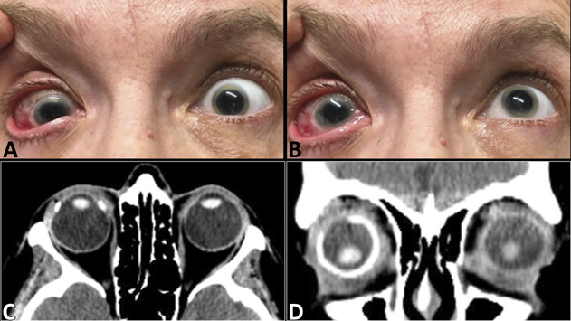
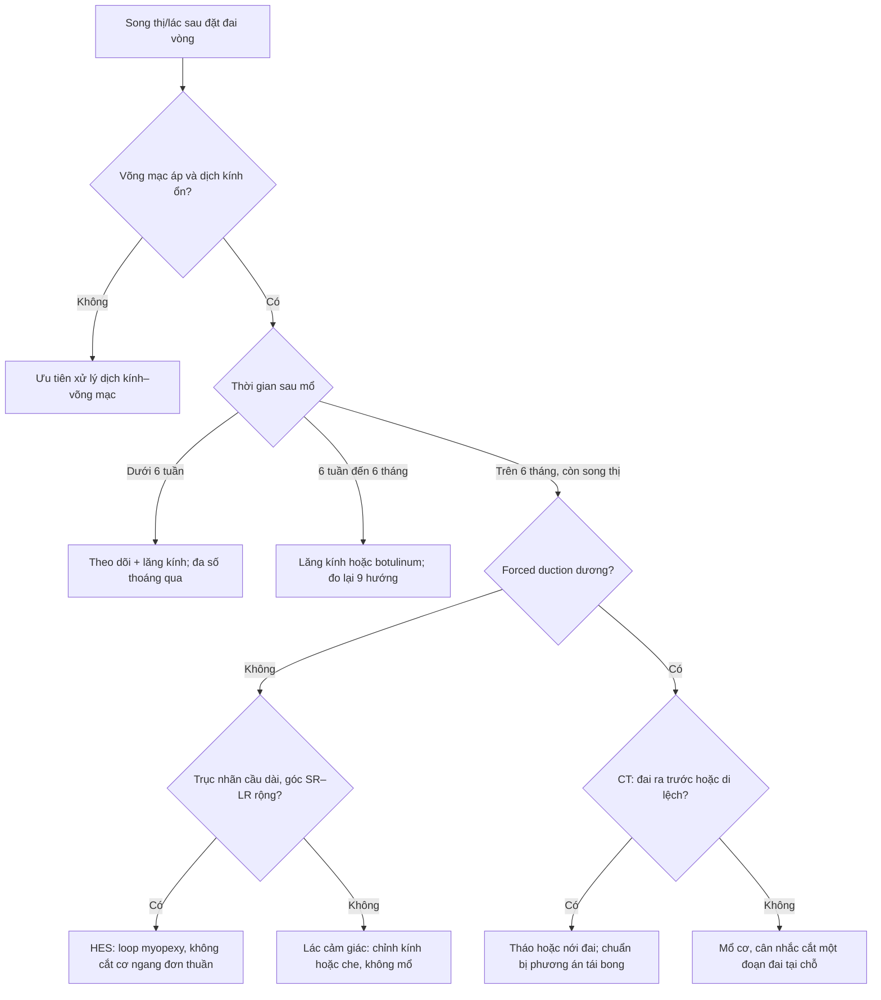
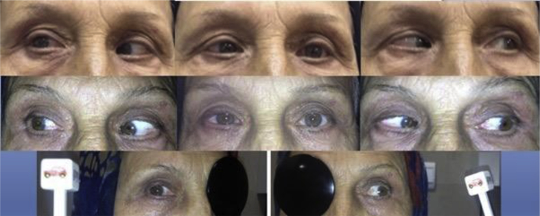

# 3218 — Lác trong do đai vòng quanh củng mạc: đai kéo cơ, đai di chuyển, hay hội chứng mắt nặng? / Encircling-band esotropia

**Tags:** `pattern:lac-trong` `pattern:han-che-dang` `pattern:nhin-doi` `pattern:ha-nhan-cau` `pattern:han-che-van-nhan` `vung:mat` `vung:hoc-mat` `vung:co-van-nhan` `anatomy:co-truc-ngoai` `anatomy:co-truc-trong` `anatomy:cung-mac` `protocol:CT-hoc-mat` `protocol:MRI-hoc-mat` `protocol:luoi-9-huong-nhin` `protocol:forced-duction` `score:PD` `score:goc-SR-LR` `incidentaloma:dai-silicon`

**Mức chắc chắn (certainty):** tổng hợp y văn (literature synthesis) — ghép **loạt 264 ca chỉ đặt đai vòng** (*Ophthalmologe* 2003, PMID 12955443), **206 mắt** theo dõi 6–36 tháng (*J Curr Ophthalmol* 2019, PMC6611860), **1.030 ca** đặt đai (*Retina* 2012, PMID 22466475), **sổ đăng ký 25.169 mắt** (*J AAPOS* 2025, PMC12185234), **116 ca** PPV + đai (*Ophthalmol Retina* 2018, PMID 31047585), **311 ca** (*Br J Ophthalmol* 1987, PMC1041218), **821 ca** (*J Fr Ophtalmol* 2007, PMID 17978674), các loạt **mổ lác sau đặt đai** (18 ca — PMC4562672; 25 ca — PMC3870881; 23 ca — PMID 29981929; 12 ca — PMID 30625364), **tháo đai** (40 mắt — PMC7738227; 1.493 mắt — PMID 27911111; 86 mắt — PMID 37531997), **1 ca đai trượt ra trước có CT** (PMC9750093) và **17 ca** nghi độc tính thuốc tê (PMID 11039422). Nhóm **không có bệnh nhân của mình**; chỗ suy luận đánh dấu **[suy luận]**.

> **Ranh giới với bài đã có:** [1499](../1499-song-thi-lac-sau-mo-bong-vong-mac/lesson.md) trả lời song thị/lác **KHÔNG do đai** (cảm giác – aniseikonia – di lệch võng mạc – dầu silicon); [1493](../1493-bien-chung-dai-hoang-diem-khi-nao-thao/lesson.md) phủ **biến chứng của đai hoàng điểm** và nguyên tắc tháo đai; [3212](../3212-hoi-chung-mat-nang-can-thi-cao/lesson.md) phủ **hội chứng mắt nặng (HES)**. Bài này chỉ trả lời **một câu**: *sau khi đặt đai vòng, mắt lác trong (hoặc lệch dọc) — cơ chế nào, đo gì trên CT/MRI, và khi nào nới/tháo đai thay vì mổ cơ.*

> **Câu chốt — năm con số phải thuộc:** **(1)** Đai vòng **tự nó** gây song thị ở tư thế nguyên phát **7%** (18/264) lúc 6 tháng, trong đó **55% là lác trong + lệch dọc**; khúc xạ đổi trung bình **−2,0 D** (PMID 12955443). **(2)** Sau mổ đai nói chung, lác **3,8%** (39/1.030; **2,7% do hạn chế cơ học**) và **3,39%** (7/206) — **không** phụ thuộc loại đai hay vị trí đai (PMID 22466475; PMC6611860); sổ đăng ký lớn ghi song thị **2,73%**, lác **1,79%**, mổ lác **≤ 0,27%** (PMC12185234). **(3)** Song thị dai dẳng sau PPV + đai chỉ **5,2%** (6/116) và thường là **lệch dọc nhỏ 3–5 PD**, xử lý bằng lăng kính (PMID 31047585). **(4)** Mổ cơ **không tháo đai**: thành công vận động **74%** (PMID 29981929); **cắt một đoạn đai** tại chỗ mổ cơ: **92%**, không tái bong (PMID 30625364); **tháo toàn bộ đai vòng**: tái bong **25% (4/16) vs 0% (0/24)** với đai đoạn, p = 0,020 (PMC7738227). **(5)** Vì vậy **tháo đai không phải thủ thuật "chữa lác"** — nó là đánh đổi lấy nguy cơ tái bong, và chỉ có lợi khi **đai là nguyên nhân cơ học chứng minh được**.

## 1. Tổng quan bệnh học – cơ chế hình ảnh

### 1.1 Đai vòng "chạm" vào cơ vận nhãn ở đâu

- **Vật liệu và vị trí:** đai silicon đặc, điển hình **rộng 2,5 mm hoặc 4 mm (#41)**, luồn **dưới cả bốn cơ trực** quanh **xích đạo** nhãn cầu rồi siết bằng ống silicon; có thể cố định qua **đường hầm củng mạc (scleral belt loop)** thay vì khâu mũi chữ U (ca lâm sàng PMC9750093 dùng **đai #41 rộng 4 mm** qua belt loop 4 góc).
- **Hai tác động cơ học cùng lúc:**
  1. **Siết vòng xích đạo** → nhãn cầu bị ép theo chu vi, **tiền phòng nông hơn**, **thể thủy tinh dày hơn ≥ 6 tuần** → **dịch chuyển khúc xạ về phía cận thị**, trung bình **−2,0 D** (PMID 835668; PMID 12955443). Lưu ý phản biện: A-scan **30 mắt** cho thấy đai + độn silicon cứng **không** làm trục nhãn cầu dài ra **dự đoán được** — phần lớn thay đổi khúc xạ đến từ **nông tiền phòng/dày thể thủy tinh**, không phải "mắt dài ra" (PMID 835668).
  2. **Đai chen giữa cơ và củng mạc**, làm **cung tiếp xúc (arc of contact)** của cơ đổi và tạo **sẹo xơ quanh đai** — đây là nguồn gốc của **lác hạn chế**.
- **TẠI SAO đai gây lác mà không chỉ gây cận thị:** cơ trực phải **trượt** trên củng mạc khi mắt quay. Một dải vật liệu + xơ hóa vòng quanh xích đạo biến **mặt trượt** thành **dây neo**: cơ không còn trượt tự do, và **bất kỳ cơ nào bị dính vào đai đều mất một phần biên độ**. Vì vậy cùng một đai có thể cho **lác trong** (hạn chế dạng), **hạ nhãn** (đai/độn dưới cơ trực dưới) hoặc **hạn chế mọi hướng** (đai di chuyển ra trước) — hướng lác **không** do "đai kéo mắt vào trong" mà do **cơ nào bị neo**.

### 1.2 Bốn con đường dẫn tới lác sau đai — và dấu chốt của từng đường

| Cơ chế | Vì sao mắt lệch | Dấu chốt lâm sàng | Trên ảnh |
|---|---|---|---|
| **1. Dính mỡ – sẹo quanh cơ (fat adherence)** | Bóc Tenon/mỡ quanh mắt khi đặt đai → dải xơ giữa **cơ – bao Tenon – mỡ hốc mắt**; cơ không trượt | **Hạn chế nhiều hướng**, forced duction (+), không đau, xuất hiện **vài tuần–vài tháng** sau mổ | CT: không thấy đai di lệch; MRI: cơ dính vào mỡ, mất lớp mỡ sáng quanh cơ |
| **2. "Dây neo" do đai (leash effect)** | Đai nâng cơ khỏi củng mạc + xơ hóa **trước chỗ bám** → chiều dài hiệu dụng của cơ giảm | **Lác trong + hạn chế dạng** đơn độc, forced duction (+) theo một hướng | CT: **đai nằm đúng xích đạo**, không di lệch; MRI: đường đi cơ bị kéo thẳng |
| **3. Đai di chuyển/lộ ra trước** | Đường hầm củng mạc bục, khâu bung, nhiễm → đai **trượt ra trước**, kéo **nhiều cơ** về phía rìa | **Đau + song thị cấp**, hạn chế **mọi hướng**, có thể thấy đai dưới kết mạc | **CT: đai ra trước xích đạo/chạm rìa** (PMC9750093); siêu âm sinh học thấy vật liệu sát củng mạc trước |
| **4. Cơ yếu do thiếu máu/độc tính thuốc tê** | Cryo + thắt cơ hoặc **thuốc tê tại chỗ gây độc cơ** → xơ teo cơ | **Lệch dọc (hạ nhãn)**, góc lác **không tương xứng**, forced duction có thể **âm tính sớm** | MRI: cơ **mỏng, teo**; không có đai di lệch |
| **5. Cảm giác (aniseikonia/bệnh hoàng điểm)** | Ảnh hai mắt khác kích thước hoặc lệch điểm vàng — **trục mắt thẳng** | **Song thị khi hai mắt, hết khi che một mắt**, góc lác **0–vài PD**, nghiệm pháp lăng kính thất bại | OCT/đáy mắt: bệnh hoàng điểm; không hạn chế vận nhãn (bài 1499) |
| **6. HES ở mắt cận thị nặng** | Nhãn cầu dài chui khỏi nón cơ: **LR trượt xuống, SR trượt vào trong** | **Lác trong + hạ nhãn tiến triển**, hạn chế dạng và nâng, trục dài (thường **> 27 mm**, mốc “tới hạn” **32 mm**) | **MRI: góc SR–LR > 107°** (PMC13750804; bài 3212) |

- **Vì sao "lác trong" lại là thể được nhắc nhiều nhất trong loạt chỉ đặt đai:** trong **18 ca** song thị sau đai vòng, **55% là lác trong kèm lệch dọc** (PMID 12955443). Ngược lại, khi có **độn dưới cơ trực dưới**, thể thường gặp là **hạ nhãn** — **14/17** ca mổ lác sau đặt đai có forced duction (+) và hạ nhãn đứng đầu (PMID 11039422). Nghĩa là **hướng lác phản ánh vị trí vật liệu**, không phải bản chất "đai vòng".

### 1.3 Vì sao phải chỉnh kính trước khi nghĩ đến mổ

- Đai làm **khúc xạ cận thị hơn ~ −2,0 D** và có thể gây **anisometropia** giữa hai mắt → **aniseikonia** → song thị **kiểu cảm giác** chồng lên lác thật. Loạt 264 ca khuyến nghị **chỉnh kính đầy đủ sớm** để "bù cảm giác" cho lệch trục (PMID 12955443).
- **Hệ quả thực hành:** một bệnh nhân "lác trong 6 PD + song thị" sau đai có thể **hết song thị** chỉ bằng kính đúng, trước khi can thiệp cơ hoặc đai.

### 1.4 Vì sao CT thấy đai còn MRI thấy "lỗ trống"

- **CT:** silicon đặc có **tỷ trọng 1,1–1,2 g/cm³** nên **cản tia hơn mô mềm** → hiện **dải đậm** quanh nhãn cầu (mặt phẳng **coronal** thấy **vòng**, mặt phẳng **axial** thấy **hai chấm/đoạn** ở hai bên xích đạo). Độ đậm **không cần cản quang**; khung xương không cần cửa sổ xương. **[suy luận từ tỷ trọng — chưa có ngưỡng HU chuẩn hóa]**
- **Bọt silicon xốp (sponge)** khác hẳn: có **khí trong lỗ** → đậm độ **thấp**, dễ bị đọc nhầm là **khí mô mềm/áp-xe** nếu không biết tiền sử.
- **MRI:** silicon **không có proton di động** → **tín hiệu trống trên mọi chuỗi xung**, kèm **giả ảnh cảm ứng từ** quanh đai. Vì vậy MRI **không dùng để đo đai**, nhưng là phương tiện đúng để đo **đường đi cơ**, **góc SR–LR**, và loại trừ **nguyên nhân hốc mắt** (khối, dầu silicon trong cơ).
- **Cạm bẫy vật lý:** trên CT, **thể tích một phần (partial volume)** ở cực trên/dưới nhãn cầu có thể làm đai trông "dày" hoặc "đứt"; luôn đọc **hai mặt phẳng trực giao** trước khi kết luận đai di lệch.

## 2. Mẫu hình + chẩn đoán phân biệt theo thời điểm và hướng lệch

- **Theo thời điểm:**
  - **0–2 tuần:** phù mô mềm, đau, hạn chế do **phản ứng viêm**; đai **trượt ra trước** (đau + hạn chế mọi hướng) là ca cấp cứu cơ học.
  - **1–6 tháng:** **dính mỡ/sẹo** đang hình thành; nhiều ca **tự cải thiện** (đến **50%** lác thoáng qua — PMC6611860).
  - **> 6 tháng:** lác **tồn tại**; lúc này mới đủ dữ kiện để quyết định **nới/tháo đai** hay **mổ cơ**.
  - **Nhiều năm:** đai hydrogel **muộn**, đai lộ/nhiễm, hoặc **HES** tiến triển trên mắt cận thị nặng.
- **Theo hướng lệch:**
  - **Lác trong + hạn chế dạng** → dây neo cơ/dính phía trong hoặc đai siết; phân biệt **HES** (trục dài, góc SR–LR rộng).
  - **Hạ nhãn ± lác trong** → độn/đai dưới cơ trực dưới hoặc độc tính thuốc tê (PMID 11039422).
  - **Hạn chế mọi hướng + đau** → đai di chuyển ra trước/lộ (PMC9750093).
  - **Góc rất nhỏ 3–5 PD, chỉ lệch dọc** → thường **microdeviation**, lăng kính đủ (PMID 31047585).
  - **Không hạn chế + song thị khi hai mắt** → cảm giác/aniseikonia (bài 1499).

## 3. Bảng so sánh phân biệt (ma trận đối chiếu)

| Thực thể (entity) | Hình ảnh điển hình | Chốt vào (rule-in) | Chốt loại (rule-out) | Gợi ý xác nhận |
|---|---|---|---|---|
| **Lác do dây neo đai (leash)** | CT: đai đúng xích đạo; MRI: cơ thẳng, dính củng mạc trước chỗ bám | **Tiền sử đai + lác trong/hạn chế một hướng + forced duction (+)**; đau không có | **Không hạn chế thụ động** → không phải cơ chế cơ học | Forced duction; CT coronal đo vị trí đai so với xích đạo |
| **Đai di chuyển ra trước** | **CT: đai ra trước xích đạo, sát rìa**; đai thấy dưới kết mạc | **Đau + song thị cấp + hạn chế mọi hướng**; đai lệch trên CT | Đau nhẹ, hạn chế một hướng, đai đúng vị trí → không phải | CT axial + coronal; thăm dò thì đầu |
| **Dính mỡ (fat adherence)** | MRI: mất lớp mỡ sáng quanh cơ, cơ dính vào mỡ/hốc mắt | **Hạn chế nhiều hướng vài tuần sau mổ**, forced duction (+) lan tỏa | Đai di lệch rõ trên CT → nguyên nhân là đai, không chỉ dính | MRI T1 fat-sat; đo góc lác 9 hướng |
| **Cơ yếu/độc tính thuốc tê** | MRI: cơ teo, mỏng; CT không bất thường | **Hạ nhãn**, mổ dưới **gây tê tại chỗ**, góc không tương xứng | Forced duction (+) mạnh + đai lệch → cơ học | So sánh độ dày cơ hai bên trên MRI |
| **HES (hội chứng mắt nặng)** | **MRI: góc SR–LR > 107°**, nhãn cầu dài, LR trượt xuống | **Lác trong + hạ nhãn tiến triển** ở mắt cận thị nặng (**> 27 mm**; mốc “tới hạn” **32 mm**), không đau | Đai lệch/forced duction khu trú → do đai (bài 3212) | MRI quasi-coronal 8 mm trước chỗ nối thị thần kinh |
| **Lác cảm giác/aniseikonia** | OCT/đáy mắt: bệnh hoàng điểm; CT/MRI bình thường | **Song thị hai mắt, hết khi che một mắt**, góc 0–vài PD, không hạn chế | Forced duction (+) hoặc góc lớn → không phải cảm giác | Kính lỗ kim, NAT/aniseikonia, OCT (bài 1499) |
| **Lệch do mất bù heterophoria sẵn có** | Không tổn thương trên ảnh | **Lác trước mổ đã có** (heterophoria), xuất hiện sau khi mắt còn lại được chỉnh | Lác mới hoàn toàn sau mổ + hạn chế → do mổ | Hồ sơ khám trước mổ; test che |

*Hình: (A, B) hạ nhãn phải **40 PD**, hạn chế nâng mắt 1 tháng sau mổ đai; (C, D) CT hốc mắt — đai silicon **di chuyển ra trước**, kéo cơ dưới–trong–ngoài tới rìa dưới. Nguồn: PMC9750093, **CC BY-NC-ND 4.0** (nguyên bản, không cắt/ghép).*

## 4. Protocol chụp + ngưỡng quyết định

### 4.1 Trình tự tối thiểu (lâm sàng trước, ảnh sau)

1. **Xác nhận võng mạc áp** (soi đáy mắt ± B-scan/OCT). Không mổ lác khi võng mạc bong hoặc có lỗ chưa xử lý.
2. **Đo lệch trục:** cover test + lăng kính, **9 hướng nhìn**, ghi **PD** ở xa và gần; đo **góc lác trước–sau mổ đai** nếu có.
3. **Forced duction test** — chuẩn vàng phân biệt **hạn chế cơ học** với **cơ yếu**. Đây là bước quyết định **có nên can thiệp đai hay không**.
4. **Khúc xạ + aniseikonia** — chỉnh kính tối ưu trước khi kết luận "song thị do lác".
5. **Chụp ảnh** khi: đau + song thị cấp, hạn chế không giải thích được, nghi đai di lệch/lộ/nhiễm, hoặc trước mổ cơ để lập bản đồ cơ–đai.

### 4.2 Chọn modality

- **CT hốc mắt không cản quang, lát ≤ 1 mm, dựng axial + coronal:** câu hỏi chính là **"đai có nằm đúng xích đạo không, có ra trước không"**. Chỉ định khi **đau, hạn chế mọi hướng, nghi đai trượt/lộ**.
- **MRI hốc mắt 1,5–3 T, T1 ± fat-sat, T2 fat-sat, lát 2 mm:** khi cần **đường đi cơ, góc SR–LR** (loại trừ HES), hoặc **loại trừ nguyên nhân hốc mắt**. Đai cho **tín hiệu trống** — không cố đo đai trên MRI.
- **Siêu âm B-scan:** xác nhận võng mạc áp và vị trí vật liệu **sát củng mạc phía trước** khi CT không sẵn có; tránh ấn đầu dò mạnh trên mắt vừa mổ.

### 4.3 Ngưỡng và định nghĩa "thành công"

- **Thời gian chờ:** không can thiệp cơ/đai trong **6 tuần đầu** nếu võng mạc áp, không đau, không lộ đai — vì **tới 50%** lác thoáng qua (PMC6611860) và **5,2%** song thị dai dẳng thường chỉ **3–5 PD** (PMID 31047585).
- **Mốc quyết định:** song thị còn sau **6 tháng** + forced duction (+) là chỉ định **can thiệp cơ học**.
- **Định nghĩa thành công vận động** hay dùng: **lệch ngang ≤ 10 PD và lệch dọc ≤ 4 PD** (PMC3870881; PMC4562672); loạt cắt một đoạn đai dùng chặt hơn: **≤ 8 PD ngang, ≤ 2 PD dọc, < 5° xoắn** (PMID 30625364).
- **Đánh đổi tháo đai:** tái bong **10%** chung; **đai vòng 25%** so với **đai đoạn 0%** (p = 0,020) (PMC7738227); thời điểm tháo càng sớm càng nguy hiểm — chi tiết trong bài 1499.
- **Kỳ vọng kết quả:** mổ cơ **không tháo đai** → **74%** thành công vận động, **94%** cải thiện song thị (PMID 29981929); **cắt một đoạn đai** tại chỗ mổ cơ → **92%**, không tái bong trong loạt nhỏ (PMID 30625364); **tháo đai + mổ cơ** → **62,5%** so với **10%** khi giữ đai (n = 18, p = 0,04; PMC4562672) nhưng loạt **25 ca** khác **không** thấy lợi ích của tháo đai (PMC3870881). **[Tranh cãi — xem mục 7]**
- **HES:** góc **SR–LR > 107°** + trục nhãn cầu dài → **loop myopexy**, không cắt cơ ngang đơn thuần (PMC13750804; bài 3212).

### 4.4 Sơ đồ quyết định

## 5. Biến thể bình thường và cạm bẫy

- **Lệch dọc nhỏ 3–5 PD sau đai là "bình thường có triệu chứng":** **6/116** ca, đa số **không cần mổ**, lăng kính đủ và **không thay đổi khi theo dõi** (PMID 31047585). Đừng đẩy bệnh nhân vào mổ cơ vì một lệch vi thể.
- **Lác thoáng qua 1–6 tuần:** phù mi, phù Tenon, đau làm hạn chế giả; **tới 3–50%** trong y văn (PMC6611860). Chụp CT ngay tuần đầu **không** phân biệt được phù với dính.
- **Đừng đọc đai xốp là "khí/áp-xe":** sponge silicon có khí trong lỗ → đậm độ thấp; so với **tiền sử mổ** và **hình dạng khối** (bờ đều, khu trú dưới cơ).
- **Đừng chẩn đoán HES chỉ vì "mắt cận thị + lác trong":** HES cần **trục dài** và **góc SR–LR rộng trên MRI**; một mắt cận thị **−8 D** với đai vẫn có thể lác do **dây neo** (PMC13750804; bài 3212).
- **Đừng tháo đai "cho nhanh":** tháo đai không sửa được lác do **sẹo phì đại** (PMID 12955443) và làm tăng tái bong, nhất là **đai vòng tháo sớm** (PMC7738227).
- **Đừng mổ cơ mà không kiểm tra đai:** mổ cơ trên mắt có đai mà **bỏ qua đai di lệch** dẫn tới **thất bại 90%** trong loạt giữ đai của PMC4562672 (đối lập với 62,5% khi tháo) — hoặc tệ hơn: **mở nhầm khoang**, chảy máu, làm đai bong thêm.
- **Song thị một mắt (monocular):** do bệnh hoàng điểm/loạn dưỡng — **không phải** chỉ định mổ cơ; hỏi "che một mắt còn đôi không?".

## 6. Tự lượng giá — Blind Quiz

**Ca 1 — 52 tuổi, 4 tháng sau đặt đai vòng vì bong võng mạc. Nhìn thẳng thấy mắt phải lệch vào trong; khi nhìn sang phải mắt phải không ra hết.**

- Gợi ý lâm sàng: võng mạc áp, không đau; forced duction **hạn chế dạng**.
- Câu hỏi: (1) Mô tả lệch trục và hướng hạn chế? (2) Ba chẩn đoán phân biệt? (3) Dấu hiệu nào chốt cơ chế?

<b>Bấm để hiện đáp án (findings + chẩn đoán)</b>

- **Dấu hiệu:** lác trong mắt phải; **hạn chế dạng** rõ, các hướng khác gần đủ → lệch **không tương xứng**, không có dấu thần kinh.
- **Chẩn đoán:** **lác trong hạn chế sau đặt đai** (dây neo/dính quanh cơ trực ngoài). Phân biệt: **HES** (trục dài, hạn chế nâng kèm), **lác cảm giác** (không hạn chế), **đai di chuyển ra trước** (đau, hạn chế mọi hướng).
- **Chốt:** **forced duction (+) theo hướng dạng** + CT đai đúng xích đạo → cơ chế cơ học tại chỗ, không phải HES.
- **Xử trí trong ca này:** **botulinum toxin** làm giảm lác trong và cải thiện dạng (ảnh dưới); lăng kính/botulinum trước, mổ cơ ± cắt một đoạn đai nếu còn sau 6 tháng.
- **Nguồn ảnh:** PMC6611860 Fig. 1, **CC BY-NC-ND 4.0** (nguyên bản).

**Ca 2 — 54 tuổi, 1 tháng sau PPV + đai vòng, đau mắt tăng dần và nhìn đôi; mắt phải lệch xuống rõ, quay mọi hướng đều đau và hạn chế.**

- Gợi ý lâm sàng: đai #41 rộng 4 mm qua đường hầm củng mạc; forced duction hạn chế **mọi hướng**.
- Câu hỏi: (1) Vì sao hạn chế **mọi hướng** chứ không một hướng? (2) CT (C, D) cho thấy gì? (3) Xử trí và nguy cơ?

<b>Bấm để hiện đáp án (findings + chẩn đoán)</b>

- **Dấu hiệu:** **hạ nhãn 40 PD**, hạn chế nâng và hạn chế cả dạng/khép; đau khi cử động; kết mạc xung huyết, có nếp kết mạc phủ rìa dưới.
- **CT:** đai silicon **ra trước xích đạo**, kéo **cơ dưới – trong – ngoài** về phía rìa dưới; không có áp-xe hốc mắt.
- **Chẩn đoán:** **đai trượt ra trước do bục đường hầm củng mạc** — hạn chế mọi hướng vì **nhiều cơ bị kéo + dính củng mạc trước chỗ bám**, không phải một cơ.
- **Xử trí:** tháo đai + gỡ dính; đau và vận nhãn cải thiện **ngay ngày đầu**; võng mạc áp ở **6 tháng**. Nguy cơ: **tái bong** (10% chung, **25%** nếu tháo đai vòng — PMC7738227).
- **Nguồn ảnh:** PMC9750093 Fig. 1, **CC BY-NC-ND 4.0** (nguyên bản, 4 panel).

## 7. Câu hỏi nghiên cứu & điểm chưa đồng thuận (tính đến 11/2026)

1. **[Tranh cãi] Ở bệnh nhân lác sau đặt đai, tháo/nới đai cùng lúc mổ cơ có cải thiện kết quả trục so với mổ cơ đơn thuần không?**
   - **Đã biết:** loạt **18 ca** thấy **62,5%** thành công khi tháo đai so với **10%** khi giữ (p = 0,04; PMC4562672); nhưng loạt **25 ca** không thấy lợi ích (72% chung; PMC3870881) và **23 ca** mổ cơ **không tháo đai** đạt **74%** (PMID 29981929).
   - **Chưa rõ:** khác biệt do **chỉ định tháo** (đai lệch/lộ vs đai đúng vị trí), cỡ mẫu nhỏ, và định nghĩa thành công khác nhau (≤ 8 PD vs ≤ 10 PD).
   - **Hướng nghiên cứu:** đoàn hệ tiến cứu phân tầng theo **vị trí đai trên CT** và **forced duction**, cùng một định nghĩa đầu ra.
   - **Nguồn:** PMC4562672 (2013); PMC3870881 (2013); PMID 29981929 (2018).

2. **[Khoảng trống] Tiêu chuẩn hình ảnh nào xác định "đai là nguyên nhân" đủ để chỉ định tháo — khoảng cách đai–xích đạo, đai–rìa, hay độ dày dính trên MRI?**
   - **Đã biết:** ca bục đường hầm củng mạc có **CT thấy đai ra trước** và tháo đai giải quyết triệu chứng (PMC9750093); không có loạt nào đo **mm** vị trí đai so với xích đạo để dự báo kết quả.
   - **Chưa rõ:** ngưỡng **mm** di lệch ra trước; giá trị của MRI với **tín hiệu trống** của đai; mức độ dính quanh cơ (fat adherence) đo được bao nhiêu.
   - **Hướng nghiên cứu:** nghiên cứu độ chính xác chẩn đoán, đối chiếu CT/MRI với **thì đầu** và kết quả sau tháo/nới đai.
   - **Nguồn:** PMC9750093 (2023); doi:10.1097/ICB.0000000000001104.

3. **[Khác biệt thực hành] Sau đai vòng, nên theo dõi + lăng kính 6 tháng rồi mới can thiệp, hay tháo đai sớm ở ca đau + song thị cấp?**
   - **Đã biết:** **50%** lác thoáng qua và **5,2%** song thị dai dẳng thường nhỏ, đáp ứng lăng kính (PMC6611860; PMID 31047585); ngược lại **12 ca** có song thị > 3 tháng được **tháo đai đầu tay**, **6/12** hồi phục thị giác hai mắt (PMID 17978674), và **86,6%** ca tháo đai hết triệu chứng nhưng **tái bong 6,56%** (PMID 37531997).
   - **Chưa rõ:** ca nào "chờ được" và ca nào **phải tháo sớm** (đau nhiều, đai lộ, hạn chế mọi hướng) — chưa có tiêu chí thống nhất.
   - **Hướng nghiên cứu:** registry theo dõi dọc, phân tầng theo **thời điểm can thiệp** và **mức độ hạn chế**.
   - **Nguồn:** PMID 37531997 (2024); PMID 17978674 (2007); PMC6611860 (2019).

## Bài liên quan chéo

- [1499 — Song thị và lác sau mổ bong võng mạc KHÔNG do đai](../1499-song-thi-lac-sau-mo-bong-vong-mac/lesson.md)
- [1493 — Biến chứng đai hoàng điểm: khi nào tháo](../1493-bien-chung-dai-hoang-diem-khi-nao-thao/lesson.md)
- [3212 — Hội chứng mắt nặng (HES) ở cận thị cao](../3212-hoi-chung-mat-nang-can-thi-cao/lesson.md)
- [429 — Đo trục nhãn cầu bằng MRI/CT](../429-do-truc-nhan-cau-bang-mri-ct/lesson.md)
- [1878 — Bong võng mạc lỗ hoàng điểm: đai hay cắt dịch kính](../1878-bong-vong-mac-lo-hoang-diem-can-thi-nang/lesson.md)

## Ảnh

- `images/3218_PMC6611860-Fig1.jpg` — 9 hướng nhìn trước/sau botulinum (PMC6611860, Fig. 1, **CC BY-NC-ND 4.0**).
- `images/3218_PMC9750093-Fig1.jpg` — hạ nhãn 40 PD + CT đai ra trước (PMC9750093, Fig. 1, **CC BY-NC-ND 4.0**).
- Cả hai dùng **nguyên bản**, không crop/ghép (điều kiện **ND**); chi tiết trong `images/CREDITS.md`.

> Không dùng để chẩn đoán độc lập khi chưa có người hướng dẫn.
