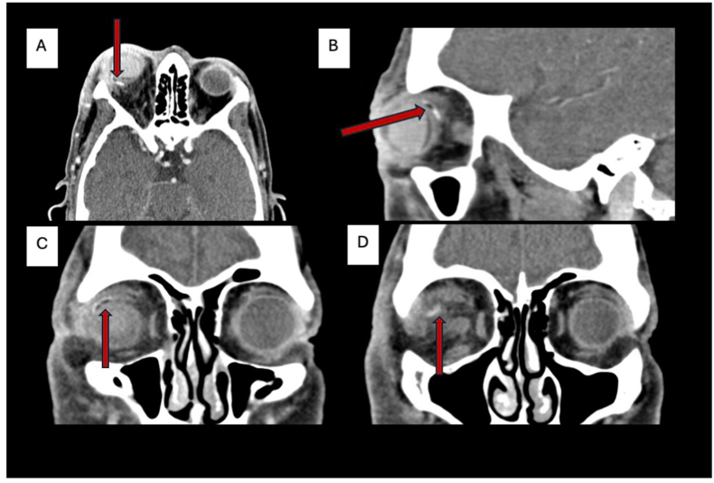
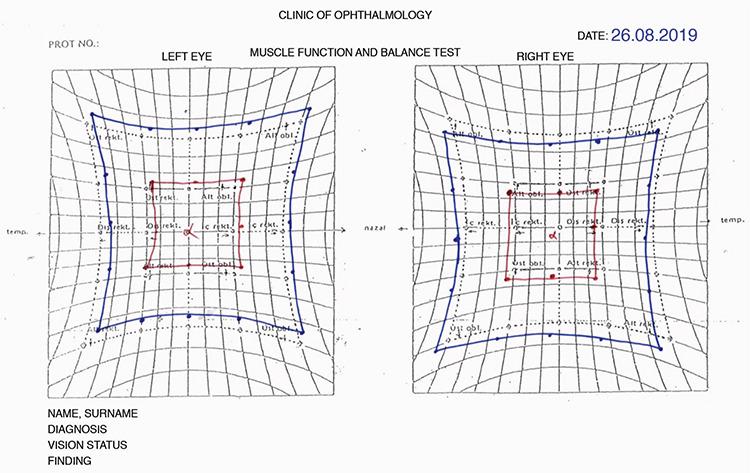

# 3219 — Song thị và hạn chế vận nhãn sau đặt van/ống lọc glôcôm: bản van ép cơ, bao xơ co kéo, hay van di lệch? / Diplopia and motility restriction after glaucoma drainage device

**Tags:** `pattern:nhin-doi` `pattern:han-che-van-nhan` `pattern:lech-truc` `pattern:ha-nhan-cau` `pattern:loi-mat` `vung:mat` `vung:hoc-mat` `vung:co-van-nhan` `anatomy:co-truc-tren` `anatomy:co-truc-ngoai` `anatomy:co-truc-duoi` `anatomy:ban-van` `protocol:CT-hoc-mat` `protocol:MRI-hoc-mat` `protocol:luoi-9-huong-nhin` `protocol:forced-duction` `score:PD` `score:goc-SR-LR` `incidentaloma:ban-van-glaucoma`

**Mức chắc chắn (certainty):** tổng hợp y văn (literature synthesis) — ghép **đoàn hệ 9.614 bệnh nhân ghép cặp** (van dẫn lưu so với không đặt van; *Can J Ophthalmol* 2026, PMID 42722340), **211 mắt van Ahmed** (*Turk J Ophthalmol* 2021, PMC7931660), **977 mắt van Molteno** (*J Binocul Vis Ocul Motil* 2020, PMID 32186470), **705 ca mổ glôcôm** (*PLoS One* 2025, PMC12574868), **nghiên cứu MRI hốc mắt 7 mắt** (PMID 34058906), **27 mắt MRI bản van** (PMC4671622), **36 mắt MRI bọng van** (PMID 37066864), **9 ca mổ lác sau van** (PMID 18413516), **ca giảm kích thước bản van** (PMC6750293), **25 trẻ mổ lác sau/cùng lúc đặt van** (PMID 30885808), **15 mắt trẻ mổ cơ ngang đồng thời đặt van** (PMC10763056) và **12.637 trẻ glôcôm** (PMC12398833). Nhóm **không có bệnh nhân của mình**; chỗ suy luận đánh dấu **[suy luận]**.

> **Ranh giới với bài đã có:** [1993](../1993-that-bai-needling-van-dan-luu/lesson.md) trả lời **chọn van nào** và mô tả bản van trên CT/MRI; [3206](../3206-bong-cang-sau-van-dan-luu-glaucoma/lesson.md) phủ **bao xơ quanh bản làm tăng nhãn áp**; [1996](../1996-tac-tut-ong-van-dan-luu-glaucoma/lesson.md) phủ **ống bít/tụt**; [3218](../3218-lac-trong-do-dai-vong-cung-mac/lesson.md) phủ lác sau **đai vòng củng mạc**; [3212](../3212-hoi-chung-mat-nang-can-thi-cao/lesson.md) phủ **hội chứng mắt nặng (HES)**. Bài này chỉ trả lời **một câu**: *sau khi đặt van/ống lọc, bệnh nhân nhìn đôi hoặc mắt hạn chế quay — cơ chế nào, đo gì trên 9 hướng nhìn và CT/MRI, và khi nào chỉnh kính/lăng kính, khi nào mổ cơ ± xử lý bản van.*

> **Câu chốt — năm con số phải thuộc:** **(1)** So với người glôcôm không đặt van (9.614 ca mỗi nhóm sau ghép cặp), đặt van làm **song thị 2,03% vs 0,49% ở 1 năm** và **3,01% vs 1,26% ở 5 năm**; **lác 1,4% vs 0,52%** và **2,54% vs 1,16%**; **aHR song thị 2,08 (1 năm) / 1,61 (5 năm)** (PMID 42722340). **(2)** Van Ahmed FP7: **10/211 = 4,7%** song thị, khởi phát **14,5 ± 12,3 ngày (1–30)**, **10/10 là song thị ĐỨNG**, lệch trung bình **8,4 ± 1,4 PD** ngang và **7,1 ± 8,8 PD** dọc, **tự hết sau 5,1–6,1 tháng** (PMC7931660). **(3)** Van Molteno: **32/977 = 3,3%**, **62,5% tự hết**; bản **trên–mũi** cho **hạ nhãn** ở **2/6** ca (PMID 32186470). **(4)** MRI 7 mắt sau van: **không ca nào bản van lệch**, nhưng **góc SR–LR 101,6° ± 8,1** ở nhóm song thị so với **94,7° ± 17,6** ở nhóm không song thị (PMID 34058906); **thể tích bọng Baerveldt 478,8 ± 84,2 mm³ vs Ahmed 161,1 ± 52,3 mm³** (PMC4671622). **(5)** Mổ lác sau van: **bóc vỏ xơ + giảm kích thước bản** làm **hết song thị 5/9, cải thiện rõ 3/9** (PMID 18413516); ở trẻ, **bóc vỏ xơ quanh van 82%**, góc lác giảm **41%** nhưng **0/11** đạt tiêu chuẩn thành công chặt sau van (PMID 30885808).

## 1. Tổng quan bệnh học – cơ chế hình ảnh

### 1.1 Bản van nằm ở đâu và "chạm" vào cơ nào

- **Cấu tạo:** van dẫn lưu glôcôm (glaucoma drainage device, GDD) gồm **bản (plate/endplate)** cố định vào củng mạc **8–10 mm sau rìa**, nối với **ống silicon** đưa vào **tiền phòng** hoặc **rãnh thể mi**. Bản điển hình **trên–thái dương**, luồn dưới **cân Tenon** và thường nằm **giữa cơ trực trên (SR) và cơ trực ngoài (LR)** — tức ngay trong vùng cử động của hai cơ này.
- **Kích thước khác nhau:** Ahmed FP7 **184 mm²**, Baerveldt BG 101-350 **350 mm²** (bản 250 mm² cho mắt nhỏ), Molteno **133–230 mm²** tuỳ model. Diện tích bản quyết định **thể tích bao xơ** và **mức chèn cơ học**: MRI 27 mắt cho thấy **bọng quanh Baerveldt 478,8 ± 84,2 mm³** so với **Ahmed 161,1 ± 52,3 mm³** (p = 0,0093), kèm **nhãn áp 6 tháng 12,2 ± 0,7 vs 16,7 ± 1,2 mmHg** (p = 0,0026) (PMC4671622; chi tiết chọn van ở bài 1993).
- **Bao xơ (capsule):** sau **4–8 tuần**, quanh bản hình thành **vỏ xơ** dày, co rút. Đây là "van sinh học" giữ thủy dịch — nhưng cũng là **dây neo** kéo cơ và củng mạc. Đo trên mắt Ahmed: vỏ xơ dày **2,48 ± 0,42 mm**, hai lớp với tỉ lệ **3 : 1**, gần như không còn viêm (bài 3206).

### 1.2 Vì sao đặt van gây song thị — năm cơ chế, không phải một

| Cơ chế | Vì sao mắt lệch | Dấu chốt lâm sàng | Trên ảnh |
|---|---|---|---|
| **1. Hiệu ứng khối (mass effect)** | Bản + bọng chiếm chỗ vùng trên–thái dương, **đẩy cơ ra khỏi củng mạc**, đổi **cung tiếp xúc**; cơ mất một phần biên độ | Lệch **không tương xứng**, hạn chế **một–hai hướng**, không đau, xuất hiện **sớm** | CT: bản đúng vị trí, **không di lệch**; MRI: đường đi cơ bị đẩy, **góc SR–LR đổi** |
| **2. Bao xơ co kéo (capsule/Faden-like)** | Vỏ xơ quanh bản dính **cơ – củng mạc – bản**, co theo thời gian → **chiều dài hiệu dụng của cơ giảm** | Hạn chế **tiến triển sau vài tuần–vài tháng**, forced duction (+) | MRI: dải xơ dày quanh bản, cơ dính; **không có ngưỡng mm chuẩn hoá** |
| **3. Chấn thương cơ/Tenon + dính mỡ (fat adherence)** | Bóc kết mạc–Tenon, đặc biệt khi **đặt bản dưới cơ** hoặc **mổ lại** → dải xơ giữa cơ và mỡ hốc mắt | Hạn chế **nhiều hướng**, xuất hiện **vài tuần sau mổ**, forced duction (+) lan toả | MRI: mất lớp mỡ sáng quanh cơ; CT không thấy |
| **4. Bản van di lệch/lộ/nhiễm** | Khâu bản bung, chỉ dùng **keo fibrin**, ống gập → bản **trượt ra trước/sau**, kéo nhiều cơ; nhiễm → viêm hốc mắt | **Đau + sốt + lồi mắt + hạn chế mọi hướng**, có thể thấy bản/ống dưới kết mạc, IOP dao động | **CT: bản ra trước hoặc ra sau xích đạo** (ca PMC13182783); MRI: bản lệch, mô viêm quanh |
| **5. Cảm giác/khúc xạ (aniseikonia)** | Nhãn áp và khúc xạ đổi sau mổ, hai mắt khác kích thước ảnh — **trục mắt thẳng** | **Song thị khi hai mắt, hết khi che một mắt**, góc 0–vài PD, **không hạn chế vận nhãn** | OCT/đáy mắt: bệnh hoàng điểm; CT/MRI bình thường (bài 1499) |

- **TẠI SAO song thị sau van thường là lệch ĐỨNG:** bản nằm **trên–thái dương**, ngay dưới **SR** và cạnh **LR**; vỏ xơ co kéo hai cơ này trước tiên. Trong loạt Ahmed 10 ca, **10/10 song thị đứng**, **hạ nhãn trung bình 7,1 PD**, kèm **hạn chế dạng −2 ở 4/10** (PMC7931660). Ngược lại, bản **dưới–thái dương** cho **lệch dọc kiểu tăng nhãn** (ca Baerveldt 350: **4Δ hypertropia** ngay ngày sau mổ; PMC6750293), còn bản **trên–mũi** cho **hạ nhãn** (2/6 ca Molteno; PMID 32186470). **Hướng lệch phản ánh cơ bị neo, không phải "van luôn kéo mắt xuống".**
- **TẠI SAO thời điểm quan trọng:** tuần đầu là **phù – máu tụ – thao tác cơ**; 1–6 tháng là **bao xơ đang co**; sau 6 tháng là **sẹo cố định**. Loạt Ahmed ghi nhận khởi phát **14,5 ± 12,3 ngày** và **tự hết sau 5,1–6,1 tháng** (PMC7931660); loạt Molteno **62,5% tự hết** (PMID 32186470). Vì vậy phần lớn song thị sớm **không cần mổ**.

### 1.3 Vì sao CT thấy bản van còn MRI thấy "lỗ trống" và bọng sáng

- **CT:** bản silicon/polypropylene **đậm hơn mô mềm** và thường có **vỏ xơ + cặn canxi** bám → hiện **dải tăng đậm độ** vùng trên–thái dương, rõ nhất ở **mặt phẳng coronal** (bản cắt ngang thành dải) và **axial** (dải dọc bờ ngoài nhãn cầu). Không cần cản quang để thấy bản; cản quang giúp đánh giá **vỏ xơ viêm** và **áp-xe**. **Không có ngưỡng HU chuẩn hoá cho bản van** — đừng đo HU để kết luận vị trí.
- **MRI:** bản silicon **không có proton di động** → **tín hiệu trống** trên mọi chuỗi xung, kèm **giả ảnh cảm ứng từ**; **bọng thủy dịch** quanh bản **tăng tín hiệu T2** rất mạnh. Trên **3D-FIESTA 3 T**, bản hiện **giảm tín hiệu**, bọng **tăng tín hiệu trên và dưới bản** ở **100% mắt**; thể tích bọng đo được **563 ± 390 mm³**, bọng **hai lớp ở 94%** (PMC4671622; PMID 37066864). MRI là phương tiện đúng để đo **đường đi cơ, góc SR–LR, thể tích bọng** và loại trừ **khối/áp-xe hốc mắt** — **không** để đo bản.
- **Cạm bẫy vật lý:** **thể tích một phần (partial volume)** ở cực trên/dưới nhãn cầu làm bản trông "đứt" hoặc "dày"; luôn đọc **hai mặt phẳng trực giao**. Trên MRI, **tín hiệu trống** của bản dễ bị gọi nhầm là **khí** hoặc **vôi hoá**.

## 2. Mẫu hình + chẩn đoán phân biệt theo thời điểm và hướng lệch

- **Theo thời điểm sau đặt van:**
  - **0–2 tuần:** phù mi – máu tụ – thao tác cơ; **đau + sốt + lồi mắt** = nghi **nhiễm hốc mắt/bản di lệch** → CT ngay.
  - **2 tuần–3 tháng:** bao xơ đang hình thành; **song thị đứng ± hạn chế dạng/nâng**; đa số **tự giảm**.
  - **3–6 tháng:** còn song thị + forced duction (+) → cân nhắc **mổ cơ ± xử lý bản**.
  - **> 6 tháng:** sẹo cố định; kết quả mổ kém hơn, đặc biệt ở trẻ.
- **Theo hướng lệch:**
  - **Hạ nhãn + hạn chế nâng** → bản/độn **trên** hoặc bao xơ dính SR; phân biệt **HES** nếu mắt cận thị nặng, trục dài (bài 3212).
  - **Tăng nhãn + hạn chế hạ** → bản **dưới–thái dương** (PMC6750293).
  - **Lác ngoài + hạn chế dạng** → bản/dính vùng **LR**; gặp trong loạt Ahmed (8,4 PD exotropia).
  - **Hạn chế mọi hướng + đau** → **bản di lệch/lộ/nhiễm** hoặc **áp-xe hốc mắt**.
  - **Góc nhỏ, không hạn chế, chỉ song thị hai mắt** → **cảm giác/aniseikonia** hoặc **heterophoria mất bù**.
- **Theo tuổi:** trẻ glôcôm có **lác 9,19% ở 1 năm và 18,89% ở 5 năm** (glôcôm nguyên phát), **20,40% / 31,39%** (glôcôm thứ phát); nguy cơ so với trẻ khoẻ **aHR 7,95 và 14,51** (PMC12398833). Trẻ **không báo song thị** — dấu hiệu là **nghiêng đầu, nháy mắt, lác thấy được, chậm phát triển thị giác hai mắt**.

## 3. Bảng so sánh phân biệt (ma trận đối chiếu)

| Thực thể (entity) | Hình ảnh điển hình | Chốt vào (rule-in) | Chốt loại (rule-out) | Gợi ý xác nhận |
|---|---|---|---|---|
| **Bao xơ/khối bản van (mass effect – capsule)** | CT: bản đúng vị trí, vỏ xơ dày; MRI: cơ bị đẩy/dính, **góc SR–LR đổi** | **Tiền sử đặt van + lệch không tương xứng + forced duction (+)**; không đau, không sốt | **Không hạn chế thụ động** → không phải cơ học | Forced duction; MRI T1/T2 fat-sat; so sánh 9 hướng |
| **Bản van di lệch ra trước/sau** | **CT: bản ra trước xích đạo hoặc ra sau cực sau nhãn cầu**; đau, lồi mắt | **Đau + song thị cấp + hạn chế mọi hướng + bản lệch trên CT** | Đau nhẹ, hạn chế một hướng, bản đúng vị trí → không phải | CT axial + coronal lát ≤ 1 mm; thăm dò thì đầu |
| **Nhiễm hốc mắt/áp-xe quanh bản** | CT: mô mềm quanh bản thâm nhiễm, **ổ dịch viền ngấm thuốc ± khí**; MRI: hạn chế khuếch tán | **Sốt + đau + lồi mắt + hạn chế mọi hướng + IOP dao động** | Không sốt, không lồi mắt, ổ dịch mỏng thành đều → bọng dịch | CT cản quang; cấy dịch; phối hợp glôcôm–mắt |
| **Hội chứng Brown (dây chằng bó trên chèn)** | CT/MRI bình thường; **hạn chế nâng khi nhìn vào trong** | **Hạn chế nâng–vào trong + tiếng "click"**, sau mổ vùng trên–mũi | Hạn chế nâng cả khi nhìn thẳng/ngoài → không điển hình Brown | Nghiệm pháp forced duction; MRI gân bó trên |
| **HES (hội chứng mắt nặng)** | **MRI: góc SR–LR > 107°**, nhãn cầu dài **> 27 mm**; LR trượt xuống, SR vào trong | **Lác trong + hạ nhãn tiến triển** ở mắt cận thị nặng, không đau | Bản van đúng vị trí + forced duction khu trú → do van | MRI quasi-coronal; đo trục (bài 3212) |
| **Bệnh mắt Graves (TED)** | **MRI: thân cơ to, CHỪA gân**, cơ trong–dưới hay bị | **Lồi mắt hai bên + hạn chế nâng + dấu viêm**, tiền sử tuyến giáp | Một bên, không lồi, có van → nghĩ van trước | MRI/CT hốc mắt; TSH/TRAb (bài 421) |
| **Lác cảm giác/aniseikonia** | OCT/đáy mắt: bệnh hoàng điểm; CT/MRI bình thường | **Song thị hai mắt, hết khi che một mắt**, góc 0–vài PD, không hạn chế | Forced duction (+) hoặc góc lớn → không phải cảm giác | Kính lỗ kim, test lăng kính, OCT (bài 1499) |
| **Yếu cơ do chấn thương/thuốc tê** | MRI: cơ **mỏng, teo**; CT bình thường | **Lệch không tương xứng, forced duction âm sớm**, sau mổ dưới gây tê | Forced duction (+) mạnh + bản lệch → cơ học | So sánh độ dày cơ hai bên trên MRI |

*Hình: (A) axial, (B) sagittal, (C–D) coronal — **bản van Ahmed (mũi tên đỏ) nằm sau xích đạo/cực sau nhãn cầu**, kèm phù mô mềm quanh hốc mắt và lồi mắt. Đây là biến chứng **di lệch ra sau** sau đặt van, không phải bao xơ đơn thuần. Nguồn: PMC13182783, **CC BY-NC-ND 4.0** (nguyên bản, không cắt/ghép).*

## 4. Protocol chụp + ngưỡng quyết định

### 4.1 Trình tự tối thiểu (lâm sàng trước, ảnh sau)

1. **Đo nhãn áp + soi tiền phòng/kết mạc:** loại trừ **hạ áp – bít ống – lộ ống – nhiễm** trước khi quy cho "lác".
2. **Đo lệch trục:** cover test + lăng kính, **9 hướng nhìn**, ghi **PD** ở xa và gần; đo **góc lác trước–sau đặt van**; ghi rõ **song thị khi hai mắt hay một mắt**.
3. **Forced duction test** — chuẩn vàng phân biệt **hạn chế cơ học** với **cơ yếu**; quyết định **có nên mổ cơ/bản**.
4. **Khúc xạ + aniseikonia:** chỉnh kính tối ưu trước khi kết luận "song thị do van".
5. **Chụp ảnh** khi: **đau, sốt, lồi mắt, hạn chế mọi hướng, IOP dao động**, nghi **bản di lệch/lộ/nhiễm**, hoặc **trước mổ cơ** để lập bản đồ bản–cơ.

### 4.2 Chọn modality

- **CT hốc mắt không cản quang, lát ≤ 1 mm, dựng axial + coronal:** câu hỏi chính là **"bản có đúng vị trí không, có ra trước/ra sau không, có ổ dịch quanh bản không"**. Thêm **cản quang** khi nghi **nhiễm/áp-xe**. Đo **khoảng cách bản–rìa**, **bản–chỗ bám cơ**, **độ dày vỏ xơ** (chưa có ngưỡng chuẩn).
- **MRI hốc mắt 1,5–3 T, T1 ± fat-sat, T2 fat-sat, 3D-FIESTA/CISS, lát 2 mm:** khi cần **đường đi cơ, góc SR–LR, thể tích bọng**, hoặc loại trừ **khối/áp-xe**. Bản cho **tín hiệu trống** — không đo bản trên MRI. Van silicon/polypropylene **không từ tính**, chụp được, nhưng có **giả ảnh**; kiểm tra nhãn thiết bị nếu có kim loại.
- **Siêu âm B-scan:** xác nhận **bọng dịch**, vị trí bản/ống khi CT không sẵn có; tránh ấn đầu dò mạnh trên mắt vừa mổ.

### 4.3 Ngưỡng và định nghĩa "thành công"

- **Thời gian chờ:** không can thiệp cơ/bản trong **3 tháng đầu** nếu không đau, không nhiễm, võng mạc áp, IOP ổn — vì **62,5%** (Molteno) và phần lớn ca Ahmed **tự hết sau 5–6 tháng** (PMID 32186470; PMC7931660).
- **Mốc quyết định:** song thị còn sau **6 tháng** + **forced duction (+)** = chỉ định **mổ cơ học**; nếu **góc nhỏ, không hạn chế** → lăng kính/che, **không mổ**.
- **Định nghĩa thành công vận động** hay dùng: **lệch ngang ≤ 10 PD và lệch dọc ≤ 4 PD** (PMID 30885808; PMC10763056).
- **Kết quả mổ:** bóc vỏ xơ + **giảm kích thước bản** → **hết song thị 5/9, cải thiện rõ 3/9**, IOP không tăng sau mổ (PMID 18413516). Ca giảm kích thước bản Baerveldt: **4Δ → 2Δ** sau 1 năm, IOP **15–20 mmHg** (PMC6750293). Ở trẻ sau van: **bóc vỏ xơ 82%**, góc giảm **41%**, **0/11 đạt tiêu chuẩn chặt**; mổ đồng thời với đặt van: **79% cải thiện**, **29% đạt tiêu chuẩn** (PMID 30885808); mổ cơ ngang đồng thời: **38% thành công lác**, **69% thành công van** (PMC10763056).
- **Nguy cơ khi xử lý bản:** tháo/giảm bản có thể **mất kiểm soát IOP**; chỉ làm khi **bản là nguyên nhân cơ học chứng minh** và có **phối hợp bác sĩ glôcôm**. **[Tranh cãi — mục 7]**

### 4.4 Sơ đồ quyết định

```mermaid
flowchart TD
  A["Song thị/hạn chế vận nhãn sau đặt van"] --> B{"Đau, sốt, lồi mắt, IOP dao động?"}
  B -->|"Có"| C["CT hốc mắt ≤ 1 mm ± cản quang: bản lệch? áp-xe?"]
  C -->|"Bản lệch/ổ dịch"| D["Hội chẩn glôcôm–mắt: tháo/tái định vị bản + kháng sinh"]
  C -->|"Bản đúng vị trí, không ổ dịch"| E["Điều trị viêm; đo lại 9 hướng sau 2–4 tuần"]
  B -->|"Không"| F{"Thời gian sau mổ"}
  F -->|"Dưới 3 tháng"| G["Theo dõi + lăng kính; đa số tự hết"]
  F -->|"3–6 tháng"| H["Đo 9 hướng + forced duction"]
  H -->|"Forced duction &#40;+&#41;"| I{"MRI: cơ dính/bản chèn?"}
  I -->|"Có"| J["Mổ cơ ± bóc vỏ xơ/giảm bản; chuẩn bị phương án IOP"]
  I -->|"Không rõ"| K["MRI 3D-FIESTA: góc SR–LR, loại trừ HES"]
  H -->|"Forced duction &#40;−&#41;"| L["Lác cảm giác/aniseikonia: kính, lăng kính, che"]
```

## 5. Biến thể bình thường và cạm bẫy

- **Song thị thoáng qua 1–6 tuần là "bình thường có triệu chứng":** phù mi/Tenon và đau làm hạn chế giả; **62,5%** ca Molteno và phần lớn ca Ahmed tự hết (PMID 32186470; PMC7931660). Đừng mổ cơ trong giai đoạn này.
- **Đừng đọc bản van trên CT là "dị vật/dịch":** bản tăng đậm độ là **thiết bị có chủ đích**; so với **tiền sử mổ** và **hình dạng dải đều**. Chỉ gọi **áp-xe** khi có **ổ dịch viền ngấm thuốc ± khí** và bệnh cảnh sốt/đau.
- **Đừng đọc tín hiệu trống trên MRI là "khí/vôi":** đó là bản silicon; xem **vị trí giải phẫu** và **tiền sử**.
- **Đừng chẩn đoán HES chỉ vì "mắt cận thị + lác trong":** HES cần **trục dài** và **góc SR–LR rộng**; mắt cận thị có van vẫn có thể lác do **bao xơ** (PMID 34058906; bài 3212).
- **Đừng bỏ qua ptosis:** sụp mi sau mổ glôcôm **3,7%**, kết hợp lác **1,0%** (PMC12574868); mí sụp làm **giả hạ nhãn** trên ảnh, đo mí trước khi kết luận.
- **Đừng quy mọi song thị cho van:** **heterophoria mất bù**, đục thể thủy tinh, bệnh hoàng điểm, **aniseikonia** sau thay đổi khúc xạ đều gây song thị với **trục thẳng**.
- **Trẻ:** không hỏi được song thị; tìm **nghiêng đầu, lác, nháy mắt, amblyopia**; lác ở trẻ glôcôm **18,89% / 5 năm** (nguyên phát) và **31,39%** (thứ phát) (PMC12398833) — chụp/đo sớm để bảo vệ thị giác hai mắt.

## 6. Tự lượng giá — Blind Quiz

**Ca 1 — Nam 67 tuổi, 2 ngày sau đặt van Ahmed mắt phải: đau, sốt, rét run, mắt lồi; IOP 34 mmHg; có mủ ở cùng đồ trên.**

- Gợi ý lâm sàng: van đặt trên–thái dương, **bản không khâu cố định**, chỉ khâu mảnh ghép.
- Câu hỏi: (1) Mô tả vị trí bản trên CT? (2) Ba chẩn đoán phân biệt của đau + lồi mắt + hạn chế vận nhãn? (3) Xử trí?

<b>Bấm để hiện đáp án (findings + chẩn đoán)</b>

- **Dấu hiệu:** (A) axial — **bản tăng đậm độ nằm sau xích đạo**, phù mô mềm quanh hốc mắt, lồi mắt; (B) sagittal — bản sát **cực sau nhãn cầu**; (C–D) coronal — bản lệch xuống dưới–ra sau, không có ổ dịch viền rõ.
- **Chẩn đoán:** **bản van di lệch ra sau** sau đặt van, kèm **viêm mô tế bào hốc mắt** do nhiễm liên cầu nhóm A; phân biệt **áp-xe hốc mắt**, **máu tụ sau nhãn cầu**, **viêm mô tế bào do chính van**.
- **Chốt:** bản không cố định + CT thấy bản sau cực sau + cấy mủ **liên cầu tan huyết nhóm A**.
- **Xử trí:** kháng sinh IV, **tháo toàn bộ bản + ống** qua đường mở hốc mắt; cải thiện sau 2 ngày; theo dõi IOP và nhiễm.
- **Nguồn ảnh:** PMC13182783 Fig. 1, **CC BY-NC-ND 4.0** (nguyên bản 4 panel).

**Ca 2 — Nữ 52 tuổi, 14 ngày sau đặt van Ahmed mắt phải, nhìn đôi khi đọc sách; không đau, IOP 14 mmHg, võng mạc áp.**

- Gợi ý lâm sàng: song thị **đứng**, tăng khi nhìn gần; hạn chế dạng −2; forced duction hạn chế nhẹ.
- Câu hỏi: (1) Hess chart cho thấy gì? (2) Cơ chế nào hợp lý nhất? (3) Có cần mổ ngay không?

<b>Bấm để hiện đáp án (findings + chẩn đoán)</b>

- **Dấu hiệu:** ô thị trường mắt phải **co nhỏ** so với mắt trái trên Hess chart → **giảm chức năng vận nhãn mắt có van**, phù hợp **hạn chế dạng/nâng**; không có dấu thần kinh.
- **Chẩn đoán:** **song thị do hạn chế cơ học sau đặt van** (hiệu ứng khối + bao xơ sớm), chưa có bản di lệch; phân biệt **HES** (trục dài, góc SR–LR rộng), **lác cảm giác** (không hạn chế), **Brown** (hạn chế nâng–vào trong).
- **Chốt:** không đau, không sốt, CT/MRI bản đúng vị trí, forced duction hạn chế nhẹ → **cơ chế cơ học nhẹ, còn khả năng tự hồi phục**.
- **Xử trí:** theo dõi + **lăng kính**; trong loạt 10 ca, song thị tự hết sau **5,1–6,1 tháng**, 3 ca cần lăng kính (PMC7931660). Chỉ mổ nếu còn sau 6 tháng + forced duction (+).
- **Nguồn ảnh:** PMC7931660 Fig. 1 (bệnh nhân 6, ngày 14), **CC BY 2.5** (nguyên bản).

## 7. Câu hỏi nghiên cứu & điểm chưa đồng thuận (tính đến 11/2026)

1. **[Tranh cãi] Ở bệnh nhân song thị do van dẫn lưu, bóc vỏ xơ + giảm kích thước bản có cải thiện trục lác bền vững hơn mổ cơ đơn thuần mà không mất kiểm soát nhãn áp không?**
   - **Đã biết:** loạt **9 ca** bóc vỏ xơ + giảm bản cho **5/9 hết song thị, 3/9 cải thiện rõ**, IOP không tăng (PMID 18413516); ca Baerveldt 350 giảm bản đạt **2Δ** sau 1 năm, IOP **15–20 mmHg** (PMC6750293); ở trẻ, mổ cơ sau van chỉ **0/11 đạt tiêu chuẩn chặt** (PMID 30885808).
   - **Chưa rõ:** chọn **bóc vỏ xơ đơn thuần**, **giảm bản**, hay **tháo bản** theo vị trí/diện tích bản; nguy cơ mất kiểm soát IOP theo mức giảm bản; khác biệt do cỡ mẫu nhỏ và định nghĩa thành công khác nhau.
   - **Hướng nghiên cứu:** đoàn hệ tiến cứu phân tầng theo **diện tích bản** và **mức bóc vỏ xơ**, cùng một định nghĩa đầu ra (PD + IOP + thuốc).
   - **Nguồn:** PMID 18413516 (2008); PMC6750293 (2019); PMID 30885808 (2019).

2. **[Khoảng trống] Tiêu chuẩn hình ảnh nào xác định "bản/bao xơ là nguyên nhân" đủ để mổ — khoảng cách bản–cơ, độ dày vỏ xơ, hay góc SR–LR?**
   - **Đã biết:** MRI 7 mắt sau van **không thấy bản lệch** ở cả nhóm song thị và không song thị, nhưng **góc SR–LR 101,6° ± 8,1 vs 94,7° ± 17,6** (PMID 34058906); MRI 27 mắt đo được **thể tích bọng** và **vị trí bản** (PMC4671622); **chưa có ngưỡng mm/độ** dự báo song thị.
   - **Chưa rõ:** ngưỡng **mm** bản–chỗ bám cơ, **độ dày vỏ xơ** trên MRI/CT, giá trị của **MRI động (dynamic)** khi cơ co.
   - **Hướng nghiên cứu:** nghiên cứu độ chính xác chẩn đoán, đối chiếu MRI với **thì mổ** và kết quả trục lác; chuẩn hoá protocol 3D-FIESTA.
   - **Nguồn:** PMID 34058906 (2022); PMC4671622 (2015); PMID 37066864 (2023).

3. **[Khác biệt thực hành] Ở trẻ glôcôm cần đặt van, có nên mổ cơ ngang ĐỒNG THỜI hay chờ sau khi đặt van rồi mới mổ lác?**
   - **Đã biết:** mổ đồng thời **15 mắt**: lác thành công **38%**, van thành công **69%**, góc ngang giảm từ **38,3 ± 9,4 PD** (PMC10763056); mổ sau van **25 trẻ**: góc giảm **41%**, cải thiện **64%** nhưng **0/11 đạt tiêu chuẩn chặt** (PMID 30885808); nguy cơ lác ở trẻ glôcôm **18,89–31,39% / 5 năm** (PMC12398833).
   - **Chưa rõ:** chọn bệnh nhi nào mổ đồng thời (góc lớn, amblyopia, tuổi), ảnh hưởng của **vỏ xơ quanh van** lên kết quả dài hạn, và nguy cơ **tăng IOP** khi mổ cơ cùng lúc.
   - **Hướng nghiên cứu:** RCT/đoàn hệ tiến cứu theo **thời điểm mổ cơ** và **tuổi**, đầu ra gồm **góc lác, thị lực hai mắt, IOP, số thuốc**.
   - **Nguồn:** PMC10763056 (2024); PMID 30885808 (2019); PMC12398833 (2025).

## Bài liên quan chéo

- [3218 — Lác trong do đai vòng quanh củng mạc: đai kéo cơ, đai di chuyển hay HES?](../3218-lac-trong-do-dai-vong-cung-mac/lesson.md)
- [3212 — Hội chứng mắt nặng (HES) ở cận thị cao](../3212-hoi-chung-mat-nang-can-thi-cao/lesson.md)
- [1499 — Song thị và lác sau mổ bong võng mạc KHÔNG do đai](../1499-song-thi-lac-sau-mo-bong-vong-mac/lesson.md)
- [1993 — Thất bại needling: trabeculectomy lại hay van dẫn lưu (Ahmed vs Baerveldt)](../1993-that-bai-needling-van-dan-luu/lesson.md)
- [3206 — Bọng căng sau van dẫn lưu glôcôm: pha tăng áp hay bao xơ thật](../3206-bong-cang-sau-van-dan-luu-glaucoma/lesson.md)
- [1996 — Tắc/tụt ống van dẫn lưu glôcôm](../1996-tac-tut-ong-van-dan-luu-glaucoma/lesson.md)
- [1461 — Áp-xe dưới màng xương hốc mắt ở trẻ](../1461-ap-xe-duoi-mang-xuong-hoc-mat-o-tre/lesson.md)
- [421 — Lồi mắt Graves](../421-loi-mat-Graves/lesson.md)

## Ảnh

- `images/3219_song-thi-han-che-van-nhan_CT_PMC13182783-Fig1.jpg` — CT 4 mặt phẳng: bản van Ahmed di lệch ra sau (PMC13182783, Fig. 1, **CC BY-NC-ND 4.0**).
- `images/3219_song-thi-han-che-van-nhan_Hess_PMC7931660-Fig1.jpg` — Hess chart ngày 14 sau van Ahmed (PMC7931660, Fig. 1, **CC BY 2.5**).
- Cả hai dùng **nguyên bản**, không crop/ghép (điều kiện ND của ảnh CT); chi tiết trong `images/CREDITS.md`.

> Không dùng để chẩn đoán độc lập khi chưa có người hướng dẫn.
