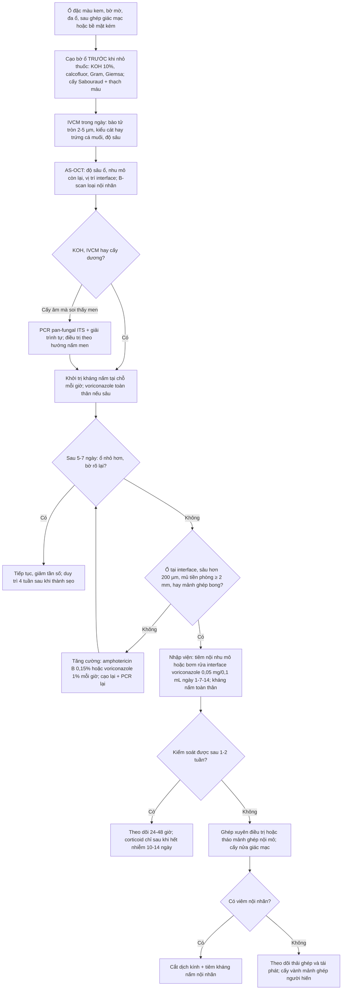
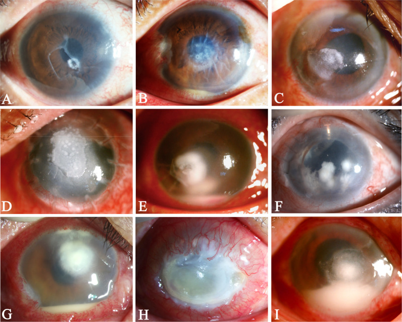
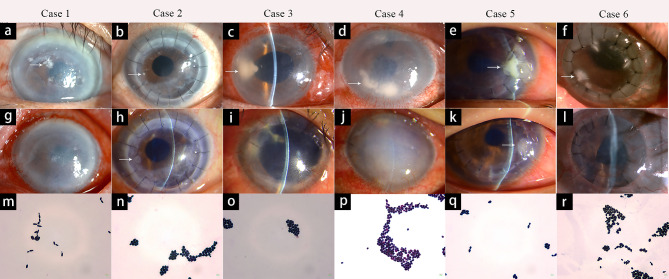
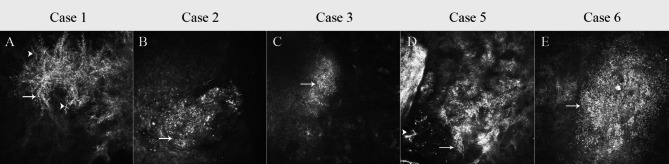

# 3220 — Viêm giác mạc do nấm men *Candida* / *Candida* (yeast) keratitis

**Tags:** `pattern:tham-nhien-giac-mac` `pattern:tham-nhien-da-o` `pattern:khuy-nut-ao` `pattern:bo-mo` `pattern:mau-kem` `pattern:mu-tien-phong` `pattern:tan-mach-giac-mac` `pattern:sau-ghep-giac-mac` `pattern:interface-ghep` `pattern:nhiem-nam-men` `vung:mat` `vung:giac-mac` `vung:tien-phong` `protocol:den-khe` `protocol:KOH` `protocol:calcofluor` `protocol:cam-mau-cay` `protocol:IVCM` `protocol:AS-OCT` `protocol:PCR-nam` `incidentaloma:khong`

**Mức chắc chắn (certainty):** tổng hợp y văn (literature synthesis) — dựng từ **40 mắt *Candida* keratitis** (*Transl Vis Sci Technol* 2025, **PMC11760754**, CC BY-NC-ND 4.0), **6 ca sau ghép giác mạc kèm IVCM** (*BMC Ophthalmol* 2023, **PMC10476318**, CC BY 4.0), **mô học *Candida* khu trú so với *Fusarium* lan toả** (*J Fungi* 2025, **PMC12471080**, CC BY 4.0), **5 mắt sau ghép trong 789 bệnh nhân** (*Indian J Ophthalmol* 2022, **PMC9023991**, CC BY-NC-SA 4.0), **8 ca cấy âm — PCR dương** (*J Ophthalmic Inflamm Infect* 2025, **PMC12106856**, CC BY 4.0) và **ca *Candida* muộn 3 năm trong mảnh ghép DSEK** (*Am J Ophthalmol Case Rep* 2026, **PMC13400759**, CC BY-NC 4.0). Nhóm **không có bệnh nhân của mình**; số nào chưa kiểm chứng ghi "chưa rõ". **Không ghi tên tác giả** — attribution dùng tạp chí + năm + PMCID.

> **Câu chốt:** *Candida* là **nấm men, không có sợi thật** — nên nó **không "chạy" theo lá nhu mô** như *Fusarium* mà **ở yên tại chỗ cửa vào**, tạo **ổ đặc khu trú màu kem, bờ mờ**, và chính vì thế **cấy dễ âm, IVCM dễ bỏ sót, bác sĩ dễ gọi là viêm giác mạc vi khuẩn/HSV**. Bốn con số phải thuộc: **(1)** tần suất **~1 ca/1 triệu người/năm**, nhưng **48–76%** phải can thiệp phẫu thuật (PMC11760754); **(2)** trong 40 mắt, **IVCM thấy bào tử 37/37 (92,5%)**, bào tử chỉ **4,2 ± 1,7 µm²** và **pseudohyphae chỉ 12 mắt (32,4%)** — **không có "sợi" không loại trừ** (PMC11760754); **(3)** chẩn đoán **trung bình 94,2 ± 81,6 ngày**, chỉ **37,5%** được gọi đúng là nấm ngay từ đầu, **27,5%** bị điều trị như **HSV** (PMC11760754); **(4)** **45% (18/40)** phải **ghép xuyên điều trị**, và chỉ **20%** đạt thị lực **≥ 20/200** lúc cuối (PMC11760754). Bẫy chết người: **corticoid làm nặng**, còn **"cấy âm" không loại trừ** — phải **PCR/khuếch đại** khi soi thấy cấu trúc dạng men mà cấy trắng (PMC12106856).

## 1. Tổng quan bệnh học – cơ chế hình ảnh (TẠI SAO)

### 1.1 Nấm men khác nấm sợi ở đâu — và vì sao khác biệt đó đổi cả hình ảnh lẫn điều trị

- **Hình thái:** *Candida* sinh sản bằng **nảy chồi (budding)** → **bào tử (blastoconidia) đường kính 2–5 µm**, có thể tạo **pseudohyphae** (chuỗi tế bào nảy chồi chưa tách, **không phải sợi thật có vách**). Trên IVCM, bào tử đo được **4,2 ± 1,7 µm²** (1,5–9,5 µm²), pseudohyphae **58,2 ± 33,0 µm dài × 2,1 ± 0,3 µm rộng** (PMC11760754) — so với sợi *Fusarium*/**Aspergillus** **151–152 µm dài × 2,5–2,6 µm rộng** trong cùng nghiên cứu. Nghĩa là: **chiều dài ngắn hơn ~⅓**, còn **bề rộng gần như nhau** — **không phân biệt bằng "độ dày"**, chỉ phân biệt bằng **hình thái và cách sắp xếp**.
- **Vì sao tổn thương khu trú:** mô học cắt giác mạc trong ghép cấp cứu cho thấy *C. albicans* **chỉ xâm nhập quanh đúng cửa vào**, không lan toả toàn bề dày, trong khi *Fusarium falciforme* **lan toả toàn bề dày** (PMC12471080). Đây là **cơ sở mô bệnh học** của hình ảnh "**ổ đặc, bờ mờ, giới hạn rõ hơn nấm sợi**" trên đèn khe — và cũng là lý do **ghép điều trị ở *Candida* hay thành công hơn**: lấy trọn ổ là lấy trọn nhiễm.

- **Vì sao vẫn nguy hiểm dù khu trú:** (a) **giác mạc vô mạch** — kháng nấm thấm kém, nhất là khi ổ nằm **sâu > 200 µm** hoặc **trong mặt phân cách mảnh ghép**; (b) *Candida* tạo **biofilm** trên chỉ khâu, mảnh ghép và ống silicon; (c) **75%** bệnh nhân trong loạt 40 mắt có **≥ 2 yếu tố nguy cơ** cùng lúc (PMC11760754).
- **Bối cảnh dịch tễ:** **~1 ca/1 triệu người/năm**; **48% (Houston)** và **76% (Vancouver)** phải mổ (PMC11760754). Sau ghép giác mạc, nhiễm nấm chiếm **63%** các nhiễm sau ghép trong 4 năm của Eye Bank Association of America, và ở **ghép nội mô (EK)** tác nhân thường gặp nhất là ***Candida*** (PMC10476318). Tại Ấn Độ: **31/789 bệnh nhân** có nhiễm mảnh ghép, trong đó **5 ca là *Candida*** (PMC9023991).

### 1.2 Vì sao ảnh trông như vậy (đèn khe – IVCM – AS-OCT – mô học)

- **Đèn khe:** bào tử và tế bào viêm tán xạ ánh sáng → **ổ trắng–kem đặc**, bề mặt **có thể còn biểu mô** (khác nấm sợi hay có khuyết biểu mô khô nhô). Trong 40 mắt: **đa ổ 42,5%**, **màu kem 42,5%**, **bờ mờ 50%**, **tân mạch 77,5%**, **mủ tiền phòng 32,5%**, khuyết biểu mô chỉ **32,5%** (PMC11760754). Vì **bờ mờ + ít đau tương xứng**, tổn thương hay bị đọc là **viêm giác mạc HSV** hoặc **vi khuẩn nhẹ**.
- **IVCM (confocal):** bào tử **tròn, tăng phản xạ mạnh** vì thành giàu **chitin/β-glucan** và **không có melanin**; hai kiểu sắp xếp: **"cát" rải rác (89,2%)** và **"trứng cá muối" (caviar-like) tụ đám (51,4%)**. Ở **nhu mô sâu/nội mô**, đám bào tử mất nét → **"mây mờ"**, dễ bị bỏ qua (PMC11760754). IVCM còn cho **độ sâu**: bào tử **229,1 ± 174,7 µm** (60–630 µm), pseudohyphae **161,5 ± 109,1 µm** (PMC11760754) — **độ sâu > 200 µm là yếu tố dự báo kết cục xấu**.
- **AS-OCT:** đo **độ dày nhu mô còn lại**, vị trí **mặt phân cách** và **mảng nội mô** — cần trước khi quyết định ghép. Sau **DSEK/DMEK**, ổ ở **mặt phân cách** nằm sau mảnh ghép → **đèn khe thấy mờ nhưng không rõ độ sâu**, còn AS-OCT thấy **ổ tăng phản xạ khu trú tại interface** (PMC10476318).

- **Xét nghiệm:** cạo giác mạc **KOH + calcofluor** thấy **bào tử nảy chồi**, **Gram/Giemsa** thấy **tế bào men Gram dương**; **cấy Sabouraud/thạch máu** mọc **2–5 ngày**. Trong 40 mắt: **soi trực tiếp dương 86,2% (25/29)**, **cấy dương 83,8% (30/36)** (PMC11760754). **Cấy âm vẫn có thể là *Candida***: 8 ca cấy âm hoàn toàn, **PCR + giải trình tự** xác định **C. albicans 7 ca** và *Citeromyces matriensis* 1 ca (PMC12106856).

### 1.3 Ngưỡng định lượng nằm lòng

| Chỉ số | Ngưỡng / giá trị | Nguồn |
|---|---|---|
| Tần suất | **~1/1.000.000 người/năm** | PMC11760754 |
| Can thiệp phẫu thuật | **48%** (Houston) – **76%** (Vancouver) | PMC11760754 |
| Tuổi / giới (n = 40) | **55,1 ± 14,8** tuổi (23–81); nam **57,5%** | PMC11760754 |
| Yếu tố nguy cơ | corticoid tại chỗ **52,5%**; phẫu thuật nội nhãn **47,5%**; bệnh hệ thống **35,0%**; bề mặt nhãn cầu kém **31,7%**; chấn thương **25,0%**; **≥ 2 yếu tố 75,0%** | PMC11760754 |
| Trễ chẩn đoán | **94,2 ± 81,6 ngày** (7–360); ≤ 1 tháng chỉ **30,0%**; > 6 tháng **20,0%** | PMC11760754 |
| Chẩn đoán ban đầu | đúng "nấm" **37,5%**; nhầm vi khuẩn **27,5%**; nhầm HSV **27,5%** | PMC11760754 |
| Kích thước ổ loét | **5,5 ± 3,0 mm**; **> 6 mm 40,0%** | PMC11760754 |
| Dấu lâm sàng | đa ổ **42,5%**; màu kem **42,5%**; bờ mờ **50%**; tân mạch **77,5%**; mủ tiền phòng **32,5%** | PMC11760754 |
| Soi trực tiếp / cấy | **86,2%** (25/29) / **83,8%** (30/36) | PMC11760754 |
| Loài (37 chủng) | ***C. parapsilosis* 20** · *C. albicans* 9 · *C. tropicalis* 5 · *C. glabrata* 3 | PMC11760754 |
| IVCM | bào tử **37/37 (92,5%)**; pseudohyphae **12 (32,4%)**; phát hiện ngay lần đầu **81,1%**, phải quét lại mới thấy **17,5%** | PMC11760754 |
| Kích thước trên IVCM | bào tử **4,2 ± 1,7 µm²**; pseudohyphae **58,2 ± 33,0 × 2,1 ± 0,3 µm**, độ cong **1,16 ± 0,10** | PMC11760754 |
| Độ sâu | bào tử **229,1 ± 174,7 µm** (60–630); pseudohyphae **161,5 ± 109,1 µm** | PMC11760754 |
| Dự báo kết cục xấu | **màu kem, bờ mờ, mủ tiền phòng, mật độ tế bào viêm > 1.000/mm², độ sâu > 200 µm** (P < 0,05) | PMC11760754 |
| Kết cục (n = 40) | lành có sẹo **55,0%**; **ghép xuyên 45,0%** (7,75–11,75 mm); tái phát cần ghép lần 2 **2 ca**; **1 ca** viêm nội nhãn, **1 ca** múc nội nhãn; **chỉ 20%** đạt ≥ 20/200 | PMC11760754 |
| Sau ghép (6 ca) | khởi phát **1–9 tháng**; IVCM dương **5/6**; khỏi **5/6** trong **45–60 ngày**; thị lực cuối **HM–20/80** | PMC10476318 |
| Sau ghép (Ấn Độ) | **5/789** bệnh nhân; ghép lại **5/5**, corticoid kéo dài **5/5**, khuyết biểu mô **4/5**; **2/5 múc nội nhãn** | PMC9023991 |
| Cấy âm | **8/8** cấy âm nhưng **PCR dương** (*C. albicans* 7); lành sẹo **5/8**, thất bại ghép 1, teo nhãn 1 | PMC12106856 |

## 2. Mẫu hình + chẩn đoán phân biệt (gamut)

**Mẫu hình "nấm men điển hình":** bệnh nhân **đã ghép giác mạc / có bề mặt nhãn cầu kém / dùng corticoid kéo dài**; khởi phát **âm thầm nhiều tuần–tháng**, **đau và đỏ ít hơn vẻ ngoài tổn thương**; **ổ đặc màu kem–trắng, bờ mờ, khu trú hoặc đa ổ**, có thể **ở mặt phân cách mảnh ghép nội mô**; **tân mạch xung quanh**; **mủ tiền phòng** khi nặng; **không cải thiện** sau kháng sinh/kháng virus.

- **Gamut theo bối cảnh (quan trọng hơn hình thái):**
  - **Giác mạc ghép nội mô (DSEK/DMEK)** — ổ ở **mặt phân cách**, không khuyết biểu mô, có thể **im lặng nhiều năm** sau ghép; đây là gamut số 1 của *Candida* (PMC10476318, PMC13400759).
  - **PKP / ghép xuyên** — ổ **quanh chỉ khâu** hoặc trong mảnh ghép, **thường có tân mạch**.
  - **Bề mặt kém / SJS / bệnh mắt khô nặng / phơi nhiễm** — nhiều ổ, bờ mờ, **dễ nhầm loét thần kinh dưỡng bội nhiễm**.
  - **Giác mạc nguyên vẹn** — hiếm; thường kèm **corticoid tại chỗ, tiểu đường, suy giảm miễn dịch, chấn thương thực vật**.
- **Gamut theo "kẻ bắt chước":**
  - **Vi khuẩn (*Pseudomonas*, tụ cầu)** — khởi phát **giờ–ngày**, mủ xanh, tan chảy nhanh; *Candida* **chậm hàng tuần** ([6132](../6132-viem-giac-mac-kinh-tiep-xuc/lesson.md)).
  - **Nấm sợi (*Fusarium*/*Aspergillus*)** — **bờ lông vũ, vệ tinh, mảng nội mô**, sau **chấn thương thực vật**; mô học **lan toả toàn bề dày** ([3216](../3216-viem-giac-mac-nam-soi/lesson.md)).
  - **HSV/VZV** — **đuôi gai thật**, giảm cảm giác, **bùng phát sau corticoid**; nhưng *Candida* cũng **bùng phát sau corticoid** → đây là cặp nhầm hay gặp nhất (**27,5%** điều trị như HSV — PMC11760754).
  - ***Acanthamoeba*** — **đau >> tổn thương**, viêm thần kinh toả tia, **nang vách đôi** trên IVCM ([1472](../1472-viem-giac-mac-acanthamoeba/lesson.md)).
  - **Microsporidia** — **chấm/trợt biểu mô đa ổ**, cấy âm, nhuộm **modified trichrome/ZN** ([3202](../3202-viem-giac-mac-do-microsporidia/lesson.md)).
  - ***Pythium insidiosum*** — **tua, chấm nội nhu mô, rãnh ngoại vi**, **không đáp ứng kháng nấm** ([3200](../3200-viem-giac-mac-pythium/lesson.md)).
  - **Loét thần kinh dưỡng / CLARE** — **bờ nhẵn, giảm cảm giác, không thâm nhiễm lan** ([3204](../3204-loet-giac-mac-than-kinh/lesson.md)).
  - **Phản ứng mảnh ghép (graft rejection) / KP** — **đường Kernet–Preuschat**, phù nội mô lan; *Candida* ở interface **không có KP dày** mà có **ổ đặc khu trú** — nhưng **hai thứ có thể cùng tồn tại**.

## 3. Bảng so sánh phân biệt (ma trận đối chiếu)

| Thực thể (entity) | Hình ảnh điển hình (đèn khe / IVCM / AS-OCT) | Chốt vào (rule-in) | Chốt loại (rule-out) | Gợi ý xác nhận |
|---|---|---|---|---|
| ***Candida*** (nấm men) | **Ổ đặc màu kem, bờ mờ, đa ổ (42,5%)**, tân mạch **77,5%**, mủ tiền phòng **32,5%**; IVCM: **bào tử tròn 2–5 µm tăng phản xạ**, xếp **"cát" (89,2%)** hoặc **"trứng cá muối" (51,4%)** | **Sau ghép nội mô/bề mặt kém + corticoid kéo dài + tiến triển tuần–tháng**; **IVCM thấy bào tử** hoặc **KOH thấy men nảy chồi** | **Bờ lông vũ + vệ tinh lan rộng** → nấm sợi; **khởi phát giờ–ngày + mủ xanh** → vi khuẩn | **KOH + calcofluor + Gram/Giemsa**, cấy Sabouraud/thạch máu, **PCR khi cấy âm**; IVCM; AS-OCT đo độ sâu |
| **Nấm sợi (*Fusarium*)** | **Bờ lông vũ**, bề mặt khô nhô, **vệ tinh**, **mảng nội mô bờ mờ/lượn sóng**; IVCM: **sợi dài 151 µm** | **Chấn thương thực vật** + bờ lông vũ; mô học **lan toả toàn bề dày** | **Không sợi, chỉ bào tử 2–5 µm** → *Candida* | KOH/IVCM; cấy; PCR ITS ([3216](../3216-viem-giac-mac-nam-soi/lesson.md)) |
| **Vi khuẩn (*Pseudomonas*)** | **Mủ xanh–vàng**, tan chảy **giờ**, vành lan, mủ tiền phòng sớm | **Khởi phát < 24–48 giờ + kính tiếp xúc + mủ xanh** | **Tiến triển tuần–tháng, bờ mờ khô** → không phải vi khuẩn | Gram, cấy; **đáp ứng kháng sinh 24–48 giờ** |
| **HSV** | **Đuôi gai thật có bóng tận cùng**, giảm cảm giác, ít mủ, **bùng phát sau corticoid** | **Đuôi gai + bóng tận cùng**; PCR HSV dương | **Ổ đặc màu kem + tân mạch + bào tử trên IVCM** → không phải HSV | **PCR HSV**; **không corticoid đơn thuần** ([3205](../3205-loet-giac-mac-do-thuoc-te-bak/lesson.md)) |
| ***Acanthamoeba*** | **Đau >> tổn thương**, viêm thần kinh toả tia, vòng Wessely; IVCM **nang vách đôi 10–25 µm** | **Kính tiếp xúc + nước + đau nhiều**; nang vách đôi | **Bào tử 2–5 µm đơn lẻ, không vách đôi** | IVCM (Se **94%**), PCR 18S ([1472](../1472-viem-giac-mac-acanthamoeba/lesson.md)) |
| **Microsporidia** | **Chấm/trợt biểu mô đa ổ**, rìa fluorescein dương; IVCM **vỏ kép phản xạ mạnh** | **Cấy âm + tổn thương biểu mô dai dẳng**; modified trichrome/ZN dương | **Thâm nhiễm nhu mô đặc + mủ tiền phòng** → không phải thể biểu mô | Nhuộm trichrome **78,6%**, ZN **89,5%** ([3202](../3202-viem-giac-mac-do-microsporidia/lesson.md)) |
| **Loét thần kinh dưỡng / CLARE** | **Bờ tròn nhẵn**, không thâm nhiễm lan, **giảm cảm giác**, đau ít | **Giảm cảm giác + bờ nhẵn + cấy âm** | **Thâm nhiễm đặc + bào tử** → không phải loét dinh dưỡng | Esthesiometry; **không ghép sớm** ([3204](../3204-loet-giac-mac-than-kinh/lesson.md)) |
| **Phản ứng mảnh ghép (rejection)** | **KP dày, phù nội mô lan**, đường Kernet–Preuschat; đáp ứng corticoid | **KP + phù lan + đáp ứng corticoid trong 1–2 tuần** | **Ổ đặc khu trú tại interface, không KP** → nhiễm | AS-OCT + IVCM + cấy; **không tăng corticoid khi chưa loại nhiễm** |

## 4. Protocol chụp/xét nghiệm + phân tầng + flowchart

### 4.1 Quy trình tối thiểu khi nghi *Candida*

1. **Ảnh đèn khe chuẩn hoá mỗi 24–48 giờ**: ghi **đường kính ổ lớn nhất (mm)**, **số ổ**, **màu (kem/trắng)**, **bờ (mờ/rõ)**, **tân mạch**, **mủ tiền phòng (mm)**, **vị trí so với mặt phân cách mảnh ghép**.
2. **Cạo giác mạc TRƯỚC khi nhỏ thêm thuốc**, lấy ở **bờ ổ**: **KOH 10% + calcofluor white**, **Gram**, **Giemsa**; **cấy Sabouraud (22–25 °C) + thạch máu (37 °C)**; **giữ cấy ≥ 2 tuần** trước khi trả âm.
3. **PCR nấm (pan-fungal ITS) + giải trình tự** khi **soi thấy cấu trúc dạng men mà cấy âm** — 8 ca trong PMC12106856 đều **cấy âm, PCR dương**.
4. **IVCM ngay trong ngày khám** nếu có máy: tìm **bào tử tròn 2–5 µm tăng phản xạ**, ghi **kiểu xếp (cát vs trứng cá muối)**, **độ sâu (µm)**, **có/không pseudohyphae**; nhớ **quét lặp nhiều lớp** — **17,5%** chỉ thấy sau khi quét lại (PMC11760754).
5. **AS-OCT** mọi ca có **mảnh ghép nội mô/ổ sâu**: đo **độ sâu ổ**, **nhu mô còn lại**, **vị trí interface**, **mảng nội mô**.
6. **Siêu âm B-scan** trước mọi ca nặng/ghép: loại **viêm nội nhãn**, đánh giá dịch kính.
7. **Sau ghép: cấy vành mảnh ghép (donor rim)** khi có bất kỳ ổ mới — *Candida* có thể **lây từ người hiến** và **im lặng 3 năm** trong mảnh ghép DSEK (PMC13400759).
8. **Hỏi thuốc**: corticoid tại chỗ/toàn thân/tiêm nội nhãn, kháng sinh/kháng virus trước đó, tiểu đường, suy giảm miễn dịch.

### 4.2 Phân tầng thực hành (không phải thang điểm đã validate)

| Tầng | Dấu hiệu | Ngưỡng / hành động |
|---|---|---|
| **1 — Nông, khu trú** | Ổ **≤ 1/3 nhu mô**, **< 4 mm**, không mủ tiền phòng, không ở interface | **Kháng nấm tại chỗ** (amphotericin B 0,15% hoặc voriconazole 1% hoặc natamycin 5%) **mỗi giờ ban ngày**; khám lại **24–48 giờ** |
| **2 — Trung bình** | Ổ **4–8 mm**, **đa ổ**, **1/3–2/3 nhu mô**, mủ tiền phòng **< 2 mm**, có tân mạch | Kháng nấm **mỗi giờ** ± **voriconazole toàn thân**; **cạo lại** nếu không cải thiện sau **5–7 ngày** |
| **3 — Sâu / interface** | **> 2/3 nhu mô**, **độ sâu > 200 µm**, **ổ tại mặt phân cách**, mủ tiền phòng **≥ 2 mm** | **Nhập viện**; kháng nấm tại chỗ **+ toàn thân**; **tiêm nội nhu mô/interface voriconazole 0,05 mg/0,1 mL**; **chuẩn bị ghép** |
| **4 — Không kiểm soát / thủng / nội nhãn** | **Thủng, doạ thủng, mủ tăng dù điều trị, lan nội nhãn** | **Ghép xuyên điều trị (TPK)** hoặc **tháo mảnh ghép nội mô**; **cắt dịch kính + tiêm nội nhãn** nếu có nội nhãn; cấy nửa giác mạc cắt bỏ |

- **Nguồn của ngưỡng:** **độ sâu > 200 µm** và **mật độ tế bào viêm > 1.000/mm²** là yếu tố dự báo kết cục xấu có ý nghĩa thống kê (PMC11760754); **kích thước ghép 7,75–11,75 mm** và **45% phải ghép** lấy từ cùng loạt 40 mắt; **liều tiêm nội nhu mô/interface 0,05 mg/0,1 mL, 0,1 mL** và **nhắc lại ngày 1–7–14** lấy từ PMC10476318. Các mốc **4 mm**, **1/3–2/3 nhu mô**, **mủ ≥ 2 mm** là **phân tầng thực hành tự biên** — trao đổi với phẫu thuật viên, **không phải tiêu chuẩn chốt**.
- **Vì sao "interface" là mốc riêng:** mảnh ghép nội mô tạo **khoang kín không có mạch**, kháng nấm tại chỗ **không tới được**; ổ ở interface vì thế cần **bơm rửa interface hoặc tiêm nội nhu mô**, và nếu **mảnh ghép bong/di lệch** thì **lấy mảnh ghép** (1 trong 6 ca — PMC10476318).

### 4.3 Điều trị — thuốc, liều, thời gian

- **Amphotericin B 0,15%** tại chỗ: lựa chọn **kinh điển cho nấm men** (polyene gắn **ergosterol** — *Candida* nhạy, **đề kháng thấp** theo PMC12471080); dùng trong loạt cấy âm (PMC12106856). **Pha mỗi 24–48 giờ, bảo quản lạnh, tránh ánh sáng**; có thể **kích ứng/độc biểu mô** khi dùng dày.
- **Voriconazole 1%** tại chỗ **mỗi giờ** hoặc **natamycin 5%** — là phác đồ của cả hai loạt lớn (PMC11760754, PMC10476318). **Voriconazole toàn thân 400 mg × 2/ngày** khi **sâu/interface** (PMC10476318, PMC11760754).
- **Tiêm nội nhu mô / bơm rửa interface voriconazole 0,05 mg/0,1 mL** (tổng ~0,1 mL), **nhắc ngày 1–7–14** — dùng cho **interface/deep**; bằng chứng là **loạt ca**, chưa có RCT (PMC10476318).
- **Thời gian:** trung bình **55 ± 51 ngày** trong loạt 40 mắt; **không dừng khi hết mủ**, duy trì **≥ 4 tuần sau khi ổ đã thành sẹo ổn định** (PMC11760754).
- **Corticoid:** **không khởi trị** khi chưa kiểm soát nhiễm; nếu đang dùng thì **giảm liều từ từ cùng kháng nấm** (bùng phát sau corticoid là bối cảnh kinh điển — xem mục 5). Sau khi nhiễm đã lành **≥ 10–14 ngày** mới cân nhắc corticoid để giảm sẹo/thải ghép.

### 4.4 Khi nào **KHÔNG** mổ

- **Ổ nông, khu trú, còn đáp ứng** → ghép sớm **không cải thiện thị lực** mà đưa nhiễm vào tiền phòng; **5/6** ca sau ghép trong PMC10476318 khỏi **hoàn toàn bằng nội khoa trong 45–60 ngày**.
- **Chưa loại trừ nội nhãn** → **B-scan** trước; nếu có nội nhãn phải **cắt dịch kính + tiêm nội nhãn**, không chỉ TPK.
- **Ổ đang trong đợt corticoid** → **giảm corticoid từ từ trước**, không mổ khi nhiễm còn bùng phát.
- **Tổn thương không nhiễm** (loét thần kinh dưỡng, CLARE, loạn dưỡng) bị đọc thành nấm → ghép làm **thủng thêm** ([3204](../3204-loet-giac-mac-than-kinh/lesson.md)).

## 5. Biến thể bình thường và cạm bẫy

- **"Cấy âm là không phải nấm men"** — sai: **8/8** ca trong PMC12106856 cấy âm nhưng **PCR dương** (*C. albicans* 7). Cạo **sau khi đã nhỏ thuốc** và **cấy trả sớm** làm giảm độ nhạy.
- **"IVCM âm là loại trừ"** — sai: **17,5%** ca chỉ thấy bào tử **sau khi quét lặp nhiều lớp**; ở **nhu mô sâu/nội mô**, đám bào tử thành **"mây mờ"** (PMC11760754).
- **"Không thấy sợi nấm nên không phải nấm"** — sai: *Candida* **chỉ có bào tử ± pseudohyphae**; pseudohyphae chỉ **32,4%** số mắt. Đây chính là lý do IVCM **không thể dùng tiêu chí "sợi"** như với nấm sợi.
- **"Đã đỡ sau kháng sinh/kháng virus"** — không loại trừ: **27,5%** ca bị điều trị như **HSV**, **27,5%** như **vi khuẩn** trước khi chẩn đoán đúng (PMC11760754).
- **Corticoid — hai mặt:** là **yếu tố nguy cơ số 1** (**52,5%**) và làm ổ lan nhanh; nhưng **ngừng đột ngột** cũng gây bùng phát → **giảm liều từ từ cùng kháng nấm**.
- **Gọi ổ ở interface là "thải ghép"** — **KP dày + phù lan** mới là thải ghép; **ổ đặc khu trú tại interface, không KP** là nhiễm. Tăng corticoid trong trường hợp này **làm mù mắt**.
- **Sau ghép nhiều năm vẫn phải nghĩ *Candida***: ca **im lặng 3 năm** trong mảnh ghép DSEK ở người **dùng implant corticoid** (PMC13400759); **ghép lại là yếu tố nguy cơ 5/5** trong loạt Ấn Độ (PMC9023991).
- **Satisfaction of search:** thấy "nấm" rồi dừng — **quên** loại **nội nhãn** (B-scan), **quên** cấy vành ghép, **quên** kiểm tra **mảnh ghép có bong/di lệch**.
- **Ảnh hưởng của loài:** ***C. parapsilosis*** chiếm **20/37** chủng, **tân mạch 90%**, hay có **bào tử hình que ngắn**; ***C. tropicalis*** hay **màu kem + bờ mờ + mủ** (60% mỗi dấu); ***C. glabrata*** bào tử **nhỏ nhất (2,8 ± 0,9 µm²)** (PMC11760754). **Không chẩn đoán loài bằng hình ảnh** — chỉ gợi ý.

## 6. Tự lượng giá — Blind Quiz ngay trên trang tĩnh

**Ca 1 — ổ đặc màu kem ở mắt đã ghép, "đã nhỏ kháng sinh 2 tuần không đỡ"**

- Gợi ý lâm sàng: bệnh nhân trong loạt 40 mắt *Candida*, **52,5% dùng corticoid tại chỗ** và **47,5% đã phẫu thuật nội nhãn**; **27,5%** từng được điều trị như HSV.
- Câu hỏi: (a) Ảnh nào cho thấy **mủ tiền phòng**? (b) Dấu nào khiến nghĩ **nấm men** hơn nấm sợi? (c) Hai xét nghiệm **tại chỗ** cần làm ngay?

<b>Bấm để hiện đáp án (findings + chẩn đoán)</b>

- (a) **G** và **I** — mức mủ tiền phòng trắng, nằm ngang; mủ gặp ở **32,5%** ca.
- (b) **Ổ đặc màu kem, bờ mờ, đa ổ, có tân mạch** nhưng **không bờ lông vũ, không vệ tinh, không mảng nội mô bờ lượn sóng**; tiến triển **tuần–tháng**.
- (c) **Cạo bờ ổ: KOH 10% + calcofluor + Gram** và **cấy Sabouraud/thạch máu**; kèm **IVCM** trong ngày. Nếu cấy âm mà soi thấy men → **PCR pan-fungal**.
- Nguồn ảnh: *Transl Vis Sci Technol* 2025, Fig. 2 (PMC11760754), CC BY-NC-ND 4.0.

**Ca 2 — sáu mắt sau ghép: ba PKP, ba DSAEK**

- Gợi ý lâm sàng: khởi phát **1–9 tháng** sau ghép; tất cả **đều dùng corticoid tại chỗ sau mổ**.
- Câu hỏi: (a) Ổ ở **hàng trên** khác ổ vi khuẩn ở điểm nào? (b) Hàng dưới là gì? (c) Vì sao ca **DSAEK** lại nguy hiểm hơn?

<b>Bấm để hiện đáp án (findings + chẩn đoán)</b>

- (a) **Ổ đặc khu trú, ít đau, ít phản ứng**, có ca **không khuyết biểu mô** (case 4) — khác vi khuẩn (mủ xanh, tan chảy nhanh). Có ca **bờ tua** (case 1) nên **không phân biệt được bằng hình thái**.
- (b) **Nhuộm Gram cạo giác mạc** — tế bào men Gram dương, có chồi (m, n, o, p, q, r).
- (c) Ổ **tại mặt phân cách**: khoang kín, không mạch → kháng nấm tại chỗ **không tới**; phải **bơm rửa interface voriconazole** hoặc **tháo mảnh ghép**. Trong loạt này **5/6 khỏi trong 45–60 ngày**, **1 ca phải lấy mảnh ghép**.
- Nguồn ảnh: *BMC Ophthalmol* 2023, Fig. 1 (PMC10476318), CC BY 4.0.

**Ca 3 — IVCM ở mắt nghi nấm, KOH lần đầu âm**

- Gợi ý lâm sàng: bệnh nhân **sau ghép**, tổn thương **sâu/interface**, KOH lần đầu **không thấy sợi nấm**.
- Câu hỏi: (a) Cấu trúc trong ảnh là gì? (b) Vì sao **không có sợi** mà vẫn là nấm? (c) Đo được gì và để làm gì?

<b>Bấm để hiện đáp án (findings + chẩn đoán)</b>

- (a) **Bào tử tròn tăng phản xạ, 2–5 µm, tụ đám** (mũi tên); ảnh D có thêm **pseudohyphae** (đầu mũi tên) dạng **dải sáng có hạt**.
- (b) *Candida* là **nấm men** — sinh sản bằng **nảy chồi**, **không tạo sợi thật**; pseudohyphae chỉ gặp ở **32,4%** mắt.
- (c) Đo **kích thước bào tử**, **kiểu xếp (cát/trứng cá muối)** và **độ sâu**: bào tử trung bình **229,1 ± 174,7 µm**, và **> 200 µm** là yếu tố dự báo **kết cục xấu** → đổi phân tầng, cân nhắc **tiêm nội nhu mô/interface**.
- Nguồn ảnh: *BMC Ophthalmol* 2023, Fig. 2 (PMC10476318), CC BY 4.0.

## 7. Câu hỏi nghiên cứu & điểm chưa đồng thuận (tính đến 11/2026)

1. **[Tranh cãi] Ở viêm giác mạc do *Candida*, amphotericin B 0,15% có tốt hơn natamycin 5% hoặc voriconazole 1% tại chỗ không?**
   - **Đã biết:** cả ba thuốc đều được dùng; loạt 40 mắt dùng **voriconazole 1% hoặc natamycin 5%** vẫn có **45% phải ghép** (PMC11760754), trong khi loạt cấy âm dùng **natamycin 5% hoặc amphotericin B 0,15%** cho **62,5% lành sẹo** (PMC12106856); *Candida* **đề kháng kháng nấm nhìn chung thấp** (PMC12471080).
   - **Chưa rõ:** **không có RCT** so trực tiếp ba thuốc; chưa rõ **liều/tần suất tối ưu của amphotericin B 0,15%** và **độc tính biểu mô** khi dùng mỗi giờ.
   - **Hướng nghiên cứu:** RCT đa trung tâm so **amphotericin B 0,15% vs natamycin 5%**, outcome **thời gian thành sẹo, tỷ lệ ghép, thị lực 3 tháng**.
   - **Nguồn:** PMC11760754; PMC12106856; PMC12471080.

2. **[Khác biệt thực hành] *Candida* ở mặt phân cách mảnh ghép nội mô: điều trị nội khoa giữ mảnh ghép hay tháo mảnh ghép ngay?**
   - **Đã biết:** loạt 6 ca dùng **voriconazole tại chỗ + bơm rửa interface + voriconazole toàn thân**: **5/6 khỏi**, **1 ca phải lấy mảnh ghép** (PMC10476318); loạt Ấn Độ **2/5 phải múc nội nhãn** (PMC9023991); có ca **im lặng 3 năm** rồi mới bùng phát (PMC13400759).
   - **Chưa rõ:** **ngưỡng kích thước/độ sâu interface** để chọn **giữ** hay **tháo**; **số lần bơm rửa** tối ưu; ảnh hưởng của **việc giữ mảnh ghép nhiễm** lên **sống ghép 5 năm**.
   - **Hướng nghiên cứu:** đoàn hệ tiến cứu phân tầng theo **diện interface (mm) + độ sâu AS-OCT**, so **giữ + bơm rửa** vs **tháo sớm**, outcome **sống ghép + thị lực + tái phát**.
   - **Nguồn:** PMC10476318; PMC9023991; PMC13400759.

3. **[Khoảng trống] Có tiêu chuẩn IVCM nào đủ tin cậy để chẩn đoán *Candida* mà không cần cấy?**
   - **Đã biết:** bào tử **tròn, 2–5 µm, tăng phản xạ**, xếp **"cát" 89,2%** hoặc **"trứng cá muối" 51,4%**, độ sâu **229,1 ± 174,7 µm**; IVCM dương **37/37** nhưng **17,5%** chỉ thấy khi quét lại (PMC11760754); loạt sau ghép IVCM dương **5/6** (PMC10476318).
   - **Chưa rõ:** **chưa có cut-off kích thước/mật độ/độ sâu được validate đa trung tâm**; **không phân biệt được loài**; giá trị của IVCM ở **giác mạc đã ghép dày/đục** còn thấp.
   - **Hướng nghiên cứu:** nghiên cứu **diagnostic accuracy** mù người đọc, đối chiếu IVCM với **PCR giải trình tự** trên cùng mẫu cạo, tính **Se/Sp** theo từng loài.
   - **Nguồn:** PMC11760754; PMC10476318; PMC12106856.

## Bài liên quan chéo

- [400 – Tổng quan Mắt & thị giác](../400-tong-quan-mat-thi-giac/lesson.md)
- [3216 – Viêm giác mạc do nấm sợi: bờ lông vũ + vệ tinh + mảng nội mô](../3216-viem-giac-mac-nam-soi/lesson.md)
- [3217 – Viêm củng mạc do nấm sợi sau pterygium: hoại tử bờ toả tua](../3217-viem-cung-mac-nam-soi-sau-pterygium/lesson.md)
- [3202 – Viêm giác mạc do microsporidia: chấm biểu mô đa ổ, cấy âm](../3202-viem-giac-mac-do-microsporidia/lesson.md)
- [3200 – Viêm giác mạc do *Pythium insidiosum*: "bắt chước nấm", không đáp ứng kháng nấm](../3200-viem-giac-mac-pythium/lesson.md)
- [1472 – Viêm giác mạc do *Acanthamoeba*: đau >> tổn thương, nang vách đôi](../1472-viem-giac-mac-acanthamoeba/lesson.md)
- [6132 – Viêm giác mạc do kính tiếp xúc (vi khuẩn): khởi phát giờ, mủ xanh](../6132-viem-giac-mac-kinh-tiep-xuc/lesson.md)
- [3203 – Đe dọa thủng & thủng giác mạc: keo, màng ối, nút Tenon hay ghép xuyên](../3203-de-doa-thung-giac-mac/lesson.md)
- [3204 – Loét giác mạc do thần kinh: bờ nhẵn, giảm cảm giác, không ghép sớm](../3204-loet-giac-mac-than-kinh/lesson.md)
- [3201 – Sẹo giác mạc sau loét đã lành: chọn ghép theo độ sâu](../3201-seo-giac-mac-ghep/lesson.md)
- [1445 – Bong mảnh ghép DSAEK/DMEK: rebubble hay theo dõi](../1445-bong-manh-ghep-dsaek-dmek-rebubble/lesson.md)

## Ảnh

- Tên file: `3220_viem-giac-mac-nam-men-candida_<mô tả>_<PMCID>.jpg`. Nguồn + giấy phép từng ảnh trong `images/CREDITS.md`.
- **5 ảnh đều tải được**: 2 ảnh **CC BY-NC-ND 4.0** (PMC11760754 — **nguyên bản, KHÔNG crop/ghép**), 2 ảnh **CC BY 4.0** (PMC10476318), 1 ảnh **CC BY 4.0** (PMC12471080).
- **Không tạo composite**: các ảnh thuộc **4 bài, 4 nhóm bệnh nhân khác nhau**, trong đó 2 ảnh **CC BY-NC-ND** cấm phái sinh — ghép sẽ vi phạm giấy phép.

> Không dùng để chẩn đoán độc lập khi chưa có người hướng dẫn.
