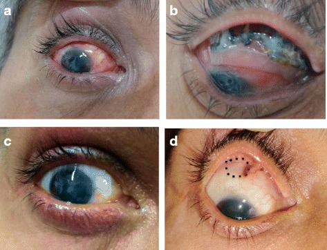
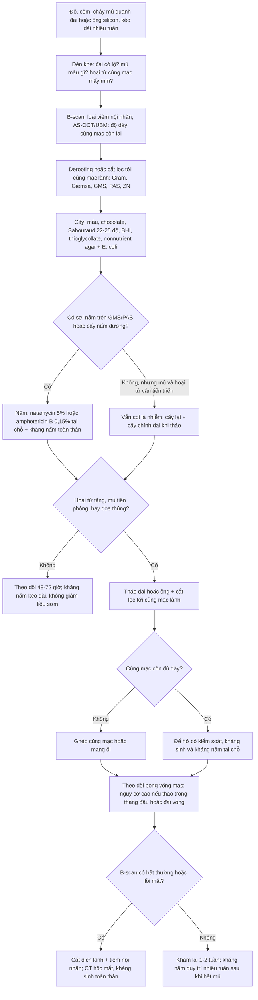
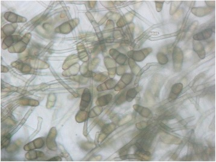
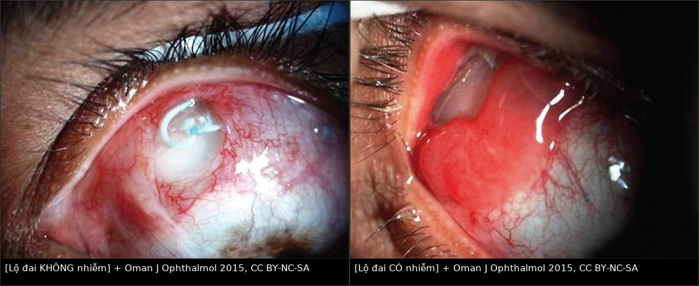
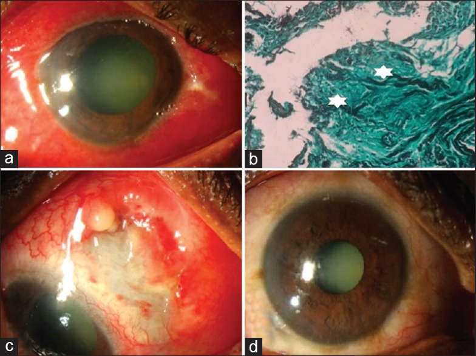
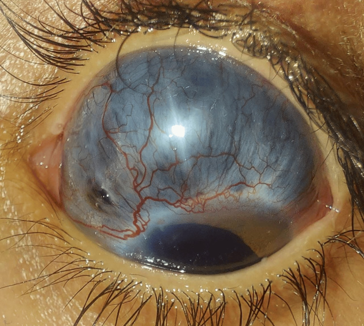

# 3221 — Viêm củng mạc do nấm sau đặt đai / ống silicon (fungal scleritis over a scleral explant)

**Tags:** `pattern:o-mu-cung-mac` `pattern:hoai-tu-cung-mac` `pattern:lo-vat-lieu` `pattern:dau-sau-mo` `pattern:tham-nhien-quanh-vat-lieu` `pattern:nhiem-nam-cung-mac` `pattern:biofilm` `vung:mat` `vung:cung-mac` `vung:ket-mac` `protocol:den-khe` `protocol:cao-cung-mac` `protocol:deroofing` `protocol:AS-OCT` `protocol:UBM` `protocol:B-scan` `protocol:cam-mau-cay` `protocol:Sabouraud` `protocol:GMS` `protocol:PAS` `incidentaloma:khong`

**Mức chắc chắn (certainty):** tổng hợp y văn (literature synthesis) — dựng từ **42 mắt viêm củng mạc nhiễm khuẩn/nấm** trong đó **10 mắt do nấm** và **18 mắt sau phẫu thuật dịch kính–võng mạc có đai** (*Middle East Afr J Ophthalmol* 2015, **PMC4411618**, CC BY-NC-SA 3.0); **40 ca viêm củng mạc sau mổ dịch kính/đai** ở Moorfields (*Eye (Lond)* 2025, **PMC12209405**, CC BY 4.0); **102 mắt tháo đai** (*Oman J Ophthalmol* 2015, **PMC4738662**, CC BY-NC-SA 3.0); **35 mắt tháo đai / 2.375 mắt đặt đai** (*Int J Retina Vitreous* 2026, **PMC13326349**, CC BY 4.0); **40 mắt tháo đai** (*Korean J Ophthalmol* 2020, **PMC7738227**, CC BY-NC 4.0); **ca *Curvularia* trên đai 14 năm** (*BMC Ophthalmol* 2018, **PMC5807820**, CC BY 4.0); hai bài tổng quan viêm củng mạc nhiễm (**PMC12290352**, CC BY-NC 4.0; **PMC11842368**, CC BY 4.0) và cơ chế **biofilm** trên đai củng mạc (**PMC4384075**, CC BY 4.0). Nhóm **không có bệnh nhân của mình**; số nào chưa kiểm chứng ghi "chưa rõ". **Không ghi tên tác giả** — attribution dùng tạp chí + năm + PMCID.

> **Câu chốt:** Đai/ống silicon là **vật liệu ngoại lai nằm sát củng mạc vô mạch** — nơi kháng sinh và kháng nấm **không tới được** vì giới hạn khuếch tán và vì **biofilm**; nấm lại **mọc chậm** nên bệnh cảnh điển hình là **"đỏ–cộm–chảy mủ dai dẳng nhiều tuần đến nhiều năm sau mổ, kháng sinh không đỡ"**, và **chỉ tháo bỏ vật liệu + cắt lọc mới cắt được nhiễm**. Năm con số phải thuộc: **(1)** nhiễm là lý do tháo đai hàng đầu — **34%** ca tháo đai, trung vị **2,4 tháng** sau đặt (*vs* **12,6 tháng** ở ca không nhiễm, p = 0,006) (PMC13326349); **(2)** trong **102 mắt tháo đai**, **79,4%** lộ đai kèm nhiễm lâm sàng, nhưng **nấm chỉ 2,94% (3/102)** — **hiếm nhưng tiên lượng xấu nhất** (PMC4738662); **(3)** viêm củng mạc sau đai gặp **45/100.000 ca đai/năm** (so với **5/100.000** sau cắt dịch kính), xuất hiện **muộn (trung vị 33,4 tuần)**, **hoại tử 47%** và **59% phải tháo đai** (PMC12209405); **(4)** cấy từ đai/mủ **rất hay âm** — chỉ **6% (1/17)** ca sau đai ở Moorfields dương (PMC12209405), trong khi cấy **chính mảnh đai tháo ra** cho **88,2% dương** (PMC4738662); **(5)** nấm củng mạc **chậm hơn hẳn**: **54 ngày** triệu chứng trước khi được chẩn đoán và **92 ngày** điều trị (so với **29 ngày** với tụ cầu) (PMC4411618). Bẫy chết người: **corticoid làm bùng phát** — ca *Aspergillus* ở Moorfields được **methylprednisolone IV + ciclosporin** một tháng trước khi nhận ra nấm (PMC12209405).

## 1. Tổng quan bệnh học – cơ chế hình ảnh (TẠI SAO)

### 1.1 Vì sao đúng "đai + nấm" lại thành một ổ nhiễm không tự khỏi

- **Củng mạc vô mạch (avascular sclera):** nhu mô củng mạc gần như **không có mao mạch** — nuôi dưỡng nhờ **màng bồ đào** phía trong và **mạng thượng củng mạc (episcleral plexus)** rất thưa phía ngoài. Kháng sinh/kháng nấm toàn thân vì thế **khuếch tán vào củng mạc kém**, và mọi **khoang chết** quanh vật liệu ngoại lai là "vùng cấm" của thuốc.
- **Biofilm:** đai silicon/silicone sponge là **bề mặt không sống (abiotic)** — điều kiện lý tưởng để vi sinh vật bám thành **màng sinh học (biofilm)**; ma trận polymer tạo **gradient oxy–dinh dưỡng**, vi sinh vật ở sâu chuyển sang trạng thái **ngủ/dung nạp thuốc**, nên **nồng độ ức chế tối thiểu (MIC) đo trong phòng xét nghiệm không dự báo được đáp ứng tại chỗ** (PMC4384075). Đây là **lý do cơ học** của câu "kháng nấm đơn thuần không bao giờ khỏi khi còn đai".
- **Vì sao nấm chứ không chỉ vi khuẩn:** bào tử nấm trong không khí/bụi/đất bám vào **chỉ khâu, sponge, ống silicon** trong mổ; **corticoid tại chỗ sau mổ** làm giảm miễn dịch bề mặt và **che dấu viêm**; khí hậu **nóng ẩm** làm tỷ lệ nấm cao hơn hẳn (Ấn Độ: nấm **23,8%** ca viêm củng mạc nhiễm — PMC4411618; tổng quan phương Tây: **11–13%** — PMC12290352). **40%** ca nấm củng mạc đang dùng corticoid tại chỗ/toàn thân lúc nhập viện (PMC4411618).
- **Vì sao hoại tử (melt):** nấm xâm nhập **mạch máu nhỏ của thượng củng mạc** → viêm mạch, huyết khối, **nhồi máu củng mạc từng ổ** → mô chết trắng–vàng, không ngấm fluorescein hoặc **mất lớp nhu mô** nhìn thấy **màng bồ đào xanh xám** bên dưới. Trong viêm củng mạc nhiễm nói chung, **hoại tử củng mạc gặp ~93%**, **sung huyết kết mạc ~98%** (PMC12290352).
- **Vì sao "mủ đen" lại là manh mối:** nấm **dematiaceous (nấm tối màu)** như ***Curvularia***, *Alternaria* có **melanin trong vách** → đám mủ/hoại tử **nâu–đen** chứ không trắng ngà; ca *Curvularia* trên đai xuất hiện **14 năm** sau mổ với **"black deposits"** trên đai lộ (PMC5807820). Gặp mủ đen quanh vật liệu → **nghĩ nấm tối màu**, không phải "dịch tiết khô".

- **Vì sao hình ảnh "giống SINS/thải ghép" dù là nhiễm:** cả hai đều là **viêm củng mạc khu trú đúng vị trí mổ**, cùng đỏ, cùng đau, cùng có thể hoại tử. Khác biệt **không nằm ở hình thái** mà ở **thời gian – đáp ứng corticoid – kết quả cấy**. Trong loạt Moorfields, **62,5%** ca viêm củng mạc sau mổ **không hoại tử**, và chỉ **1/17 (6%)** ca sau đai cấy dương — nghĩa là **đa số là SINS vô khuẩn**, nhưng **ca nhiễm nằm trong số đó và không thể loại trừ bằng mắt** (PMC12209405).

### 1.2 Ngưỡng định lượng nằm lòng

| Chỉ số | Giá trị | Nguồn |
|---|---|---|
| Viêm củng mạc nhiễm / tổng ca scleritis | **5–10%** | PMC12290352; PMC11842368 |
| Phẫu thuật là yếu tố nguy cơ | **58–83%** ca viêm củng mạc nhiễm | PMC12290352 |
| Tác nhân | vi khuẩn **86–87%**; **nấm 11–13%** (Ấn Độ: **23,8%**) | PMC12290352; PMC4411618 |
| Dấu lâm sàng | sung huyết kết mạc **98%**; **hoại tử củng mạc 93%** | PMC12290352 |
| Số ổ (42 mắt) | **1 ổ 78,5%** · **đa ổ 14,2%** · **lan toả 7,1%** | PMC4411618 |
| Chỉ định tháo đai (n = 35/2.375 mắt = **1,5%**) | **nhiễm 34%** · đau 31% | PMC13326349 |
| Thời gian đặt → tháo đai | nhiễm **2,4 tháng** *vs* không nhiễm **12,6 tháng** (**p = 0,006**) | PMC13326349 |
| Tháo đai (n = 102 mắt) | lộ đai + nhiễm **79,4%**; **nấm 2,94% (3/102)**; **thủng nhãn cầu 13,7%**; **bong võng mạc tái phát 6,9%** | PMC4738662 |
| Viêm củng mạc sau đai (17 ca) | tần suất **45/100.000 ca đai/năm** (KTC 95%: 24,4–82,5); xuất hiện **33,4 tuần** (trung vị); hoại tử **47%**; **tháo đai 59%**; cấy dương **6%**; tái phát **29%** | PMC12209405 |
| Viêm củng mạc sau cắt dịch kính (23 ca) | **5/100.000 ca/năm** (3,4–7,5); xuất hiện **3,6 tuần**; hoại tử **26%** | PMC12209405 |
| Nấm củng mạc (10 mắt) | triệu chứng **31,8 ± 34,5 ngày** chung, **nấm 54 ngày**; điều trị **92 ngày** (20 ngày–1 năm); tái phát **3/10**; corticoid lúc vào **40%** | PMC4411618 |
| Kết cục nấm củng mạc | BCVA **> 6/18: 41,6%**; 6/18–6/60: 33%; **< 6/60: 25%**; **múc nội nhãn ~13%** | PMC12290352 |
| Bong võng mạc sau tháo đai | **10%** (4/40); **đai vòng 25% (4/16)** *vs* **đai đoạn 0% (0/24)**, p = 0,020 | PMC7738227 |
| Bong võng mạc sau tháo đai (loạt 2026) | **11% (4/35)**; **3/4 ca xảy ra khi tháo trong tháng đầu** | PMC13326349 |
| Lộ đai KHÔNG nhiễm (n = 40) | **57,5%** ca tháo đai; lộ đai + nhiễm **17,5%** | PMC7738227 |

## 2. Mẫu hình + chẩn đoán phân biệt (gamut)

**Mẫu hình "nấm trên đai":** mắt **đã đặt đai/ống silicon** (thường **nhiều tháng đến nhiều năm** trước), **đỏ–cộm–chảy mủ tái diễn**, kháng sinh nhỏ **nhiều đợt không khỏi**; trên đèn khe: **đai lộ ra** (qua kết mạc mỏng/khuyết), quanh đai **mủ trắng ngà hoặc nâu đen**, **củng mạc hoại tử trắng–vàng**, mủ tiền phòng nhẹ; **đau ít hơn vẻ ngoài** vì mắt đã nhiều lần mổ; **B-scan sạch** (chưa nội nhãn).

- **Gamut theo vật liệu:**
  - **Đai củng mạc (scleral buckle)** — silicon sponge/tire, dễ **lộ–di lệch–nhiễm** nhất; đây là gamut chính của bài này.
  - **Ống silicon dẫn lưu (glaucoma drainage device)** — nhiễm muộn quanh bản/ống, có thể có **màng biofilm** dày.
  - **Dầu silicon nội nhãn (silicone oil)** — mặt **vô khuẩn** của cùng câu chuyện: **u hạt phản ứng dị vật (foreign-body granuloma)** ở **sclerotomy/kết mạc** ("salmon patch"), **không có mủ, không có nấm**, đáp ứng với **cắt bỏ** chứ không phải kháng sinh (PMC9365975).
  - **Chỉ khâu/vòng** — ổ nhỏ quanh nút chỉ, thường tụ cầu.
- **Gamut theo tác nhân (nấm):** ***Aspergillus*** (được nêu là tác nhân nấm hay gặp nhất trong viêm củng mạc nhiễm — tổng quan PMC3821753), ***Curvularia***/**nấm tối màu** ("mủ đen" — PMC5807820), ***Scedosporium***, ***Fusarium***, ***Candida*** (thường từ mảnh ghép/nhiễm nội sinh), ***Paecilomyces***.
- **Gamut theo hình thái ổ:** **1 ổ** (78,5%) → **đa ổ** (14,2%) → **lan toả toàn vùng rìa** (7,1%) (PMC4411618, toàn bộ 42 mắt). **Đa ổ/lan toả** gợi ý **nhiễm** hơn là SINS; **1 ổ đúng trên đai** gợi ý **cả hai**.
- **Gợi nhớ BUCKLE:** **B**iofilm (màng sinh học trên vật liệu) · **U**nvascular sclera (củng mạc vô mạch) · **C**orticosteroid (corticoid che dấu + làm nặng) · **K**eratitis/conjunctival breakdown (kết mạc mỏng là cửa vào) · **L**ate & long (biểu hiện muộn, diễn tiến dài) · **E**xplant (phải lấy vật liệu).

## 3. Bảng so sánh phân biệt (ma trận đối chiếu)

| Thực thể (entity) | Hình ảnh điển hình (đèn khe / AS-OCT / B-scan) | Chốt vào (rule-in) | Chốt loại (rule-out) | Gợi ý xác nhận |
|---|---|---|---|---|
| **Nấm củng mạc trên đai** | Đai lộ + **mủ trắng ngà/nâu đen**, củng mạc **hoại tử từng ổ**, **đa ổ 14,2%**; tiến triển **nhiều tuần–năm**; B-scan sạch | **Vật liệu ngoại lai + đỏ/mủ dai dẳng > 4 tuần + kháng sinh thất bại**; **GMS/PAS thấy sợi nấm** hoặc **cấy Sabouraud dương** | **Khởi phát < 1 tuần + mủ vàng xanh + đau nhiều** → nghĩ vi khuẩn; **đáp ứng corticoid trong 1–2 tuần** → nghĩ SINS | **Deroofing + cạo bờ ổ + cấy đai**, Sabouraud 22–25 °C **giữ ≥ 2 tuần**, GMS/PAS; **cấy chính đai** (88,2% dương — PMC4738662) |
| **Vi khuẩn (*Pseudomonas*/*Staph*)** | Mủ **vàng–xanh**, tan chảy nhanh **ngày**, đau nhiều, mủ tiền phòng sớm; hay **quanh chỉ khâu** | **Khởi phát ngày + mủ xanh + Gram dương/âm trên smear** | **Tiến triển tuần–tháng, bờ khô, mủ nâu đen** → không phải vi khuẩn thường | Gram + cấy; **chính loạt tháo đai** cho *S. epidermidis* **41,2%** (PMC4738662) |
| **NTM (*M. chelonae*/*M. abscessus*)** | Ổ **dai dẳng, ít mủ**, **nhiều nốt nhỏ**, có thể **viêm mô tế bào hốc mắt**; đáp ứng kém kháng sinh thường | **Thất bại nhiều đợt kháng sinh + cấy Gram "câm"**; **ZN/auramine dương** | **Cấy nấm dương + sợi nấm trên GMS** → loại NTM | **Cấy mycobacteria 37 °C ≥ 4 tuần**, PCR *rpoB*; **tháo đai + phác đồ nhiều thuốc** (PMC12085144) |
| **Nocardia** | **Áp-xe có điểm nhọn (pointed abscess)**, đa ổ, lan theo đường mạch; hay sau **chấn thương đất/cây** | **Điểm nhọn + đa ổ + Gram dương hình sợi phân nhánh**; **không đáp ứng kháng sinh thường** | **Sợi nấm có vách trên GMS** → nấm thật, không phải *Nocardia* | **Nonnutrient agar + E. coli overlay**, kháng sinh đồ; **amikacin** |
| **SINS (viêm củng mạc hoại tử sau mổ, vô khuẩn)** | **Hoại tử đúng vết mổ**, bờ **trắng–xám**, **không mủ**, không tấy; **62,5%** ca sau mổ **không hoại tử** | **Không đau tương xứng + cấy âm + đáp ứng corticoid/NSAID**; **xuất hiện muộn (33,4 tuần sau đai)** | **Mủ + hoại tử lan + cấy nấm dương** → nhiễm; **tăng corticoid làm nặng** → nhiễm | **Cấy + GMS trước khi tăng corticoid**; AS-OCT đo độ dày; theo dõi 1–2 tuần (PMC12209405) |
| **U hạt dị vật do dầu silicon (vô khuẩn)** | Nốt **hồng–salmon** dưới kết mạc ở **sclerotomy**, không mủ, không hoại tử; tiền sử **dầu silicon** | **Nốt ở sclerotomy + không mủ + cấy âm + tiền sử dầu silicon** | **Mủ + hoại tử củng mạc + sợi nấm** → nhiễm | **Sinh thiết: đại bào + giọt dầu**; cắt bỏ là điều trị (PMC9365975) |
| **Lộ đai đơn thuần (không nhiễm)** | Đai lộ nhưng **kết mạc quanh còn trong**, chỉ cộm–vướng | **Lộ đai + không mủ + cấy âm + không hoại tử** | **Đỏ tím lan + mủ + hoại tử** → không phải "lộ đơn thuần" | Theo dõi; **57,5%** ca tháo đai vì lộ đơn thuần (PMC7738227) |
| **Viêm nội nhãn (endophthalmitis)** | **Mủ tiền phòng dày, fibrin, giảm thị lực nhanh**; B-scan có **dày dịch kính/hạt** | **Thị lực tụt nhanh + mủ tiền phòng + B-scan bất thường** | **B-scan sạch + thị lực ổn định** | **B-scan mọi ca**; nếu có → **cắt dịch kính + tiêm nội nhãn**, không chỉ tháo đai |

### Dấu hiệu đọc ảnh theo thứ tự (đừng bỏ bước)

1. **Vật liệu có lộ không** — lộ là điều kiện cần, **không phải** điều kiện đủ (lộ đơn thuần **57,5%** ca tháo đai — PMC7738227).
2. **Quanh vật liệu có mủ/hoại tử không** — mủ + hoại tử mới là "nhiễm", và **màu mủ** đổi chẩn đoán (nâu đen → nấm tối màu).
3. **Bề dày củng mạc còn lại** (AS-OCT/UBM) — quyết định **có cần mảnh ghép củng mạc** hay không.
4. **Tiền phòng và dịch kính** (B-scan) — quyết định **có phải mổ nội nhãn**.

## 4. Protocol chụp/xét nghiệm + phân tầng + flowchart

### 4.1 Quy trình tối thiểu khi nghi nhiễm quanh đai

1. **Ảnh đèn khe chuẩn hoá mỗi 24–72 giờ**: đo **diện tích hoại tử (mm²)**, ghi **màu mủ**, **số ổ**, **độ lộ của đai (mm)**, **mủ tiền phòng (mm)**.
2. **B-scan** mọi ca: loại **viêm nội nhãn**; ghi **dày dịch kính/hạt**.
3. **AS-OCT/UBM** khi cần đo **độ dày củng mạc còn lại** và **độ sâu ổ** trước khi cắt lọc/ghép.
4. **Cạo/deroofing để lấy bệnh phẩm TRƯỚC khi nhỏ thêm thuốc**: **deroofing nốt** hoặc **cắt lọc ổ loét** tới **củng mạc lành** (kỹ thuật: rạch kết mạc quanh tổn thương, **deroof** bằng lưỡi 15, lấy mô hoại tử, **cạo đáy và bờ**) — vừa **chẩn đoán** vừa **giảm tải nấm** (PMC4411618).
5. **Cấy trên bộ môi trường đầy đủ**: **thạch máu, thạch chocolate, Sabouraud dextrose (22–25 °C), potato dextrose, BHI, thioglycollate, nonnutrient agar + E. coli overlay** (cho *Nocardia*); **cấy chính đai/ống tháo ra** — đây là mẫu cho **độ nhạy cao nhất (88,2%)** (PMC4738662).
6. **Nhuộm**: **Gram, Giemsa, GMS (Grocott), PAS** trên mô cắt lọc; **ZN/auramine** nếu nghi NTM/*Nocardia*.
7. **CT hốc mắt có cản quang** khi có **lồi mắt, hạn chế vận nhãn, đau hốc mắt** — tìm **viêm mô tế bào hốc mắt** (đã gặp với *M. abscessus* trên đai — PMC12085144).
8. **Hỏi thuốc**: corticoid tại chỗ/toàn thân, số đợt kháng sinh đã dùng, thời điểm mổ đặt đai, **vật liệu** (sponge/tire/vòng/ống).

### 4.2 Phân tầng thực hành (không phải thang điểm đã validate)

| Tầng | Dấu hiệu | Ngưỡng / hành động |
|---|---|---|
| **1 — Lộ đai, chưa nhiễm** | Đai lộ, **không mủ**, **không hoại tử**, cấy âm | Vệ sinh, kháng sinh dự phòng, **theo dõi 1–2 tuần**; **chưa tháo đai** vì nguy cơ bong võng mạc |
| **2 — Nhiễm nông quanh vật liệu** | Mủ quanh đai, **hoại tử < 3 mm**, chưa vào tiền phòng | **Deroofing + cạo + cấy**, kháng sinh/kháng nấm tại chỗ; **khám lại 48–72 giờ** |
| **3 — Nhiễm có hoại tử củng mạc** | **Hoại tử ≥ 3 mm**, mủ tiền phòng, **đau tăng dù điều trị** | **Tháo đai + cắt lọc tới củng mạc lành** + kháng nấm toàn thân; **cân nhắc mảnh ghép củng mạc** |
| **4 — Doạ thủng / thủng / nội nhãn / hốc mắt** | **Lộ màng bồ đào**, **thủng**, **B-scan bất thường**, **lồi mắt/hạn chế vận nhãn** | **Mổ cấp: tháo đai + cắt lọc + ghép củng mạc/màng ối**; **cắt dịch kính + tiêm nội nhãn** nếu nội nhãn; **kháng sinh/kháng nấm toàn thân + CT hốc mắt** |

- **Nguồn của ngưỡng:** **tháo đai 59%** ca viêm củng mạc sau đai và **3/4 ca bong võng mạc tái phát xảy ra khi tháo trong tháng đầu** → **tháo sớm khi chưa cần là đánh đổi có thật** (PMC12209405, PMC13326349); **cấy đai cho 88,2% dương** (PMC4738662); **corticoid đang dùng ở 40%** ca nấm (PMC4411618). Các mốc **3 mm hoại tử** và **48–72 giờ** là **phân tầng thực hành tự biên** — trao đổi trực tiếp với phẫu thuật viên, **không phải tiêu chuẩn chốt**.

### 4.3 Điều trị — nguyên tắc, thuốc, liều

- **Nguyên tắc số 1: lấy vật liệu.** *In vitro* không có "kháng nấm nào phá được biofilm trên đai"; loạt 102 mắt cho thấy **tháo đai + cắt lọc** là điểm chuyển của hầu hết ca (PMC4738662), và **59%** ca viêm củng mạc sau đai phải tháo đai (PMC12209405).
- **Kháng nấm tại chỗ:** **natamycin 5%** mỗi 30 phút–1 giờ (phác đồ của loạt 10 mắt nấm — PMC4411618); **amphotericin B 0,15%** thay thế; **voriconazole 1%** khi nghi *Aspergillus*/*Scedosporium*.
- **Kháng nấm toàn thân:** **ketoconazole 200 mg × 2/ngày** (phác đồ loạt Ấn Độ — PMC4411618); **itraconazole** khi tái phát; **voriconazole** là lựa chọn hiện hành cho *Aspergillus* (khuyến cáo tổng quan — PMC11842368). **Thời gian: trung bình 92 ngày** (20 ngày–1 năm) trong loạt nấm — **dài gấp ~3 lần** tụ cầu (**29 ngày**) (PMC4411618).
- **Cắt lọc lặp lại:** **nhiều lần** ở nấm để **giảm tải** và **tăng thấm thuốc** (PMC4411618); ghép củng mạc/màng ối khi **doạ thủng** — **5%** ca sau đai cần mảnh ghép củng mạc (PMC12209405), **23,5%** trong loạt viêm củng mạc nhiễm nói chung (PMC3227473).
- **Corticoid:** **không khởi trị** trước khi loại nhiễm; nếu đang dùng → **giảm liều từ từ cùng kháng nấm**, **không cắt đột ngột** (bùng phát). Ca *Aspergillus* ở Moorfields là **bài học ngược**: được **methylprednisolone IV + ciclosporin** một tháng vì "SINS" trước khi nhận ra nhiễm nấm (PMC12209405).

### 4.4 Khi nào **KHÔNG** tháo đai

- **Lộ đai đơn thuần, không mủ, không hoại tử, cấy âm** → **57,5%** ca tháo đai trong loạt 40 mắt là vì lý do này, và **tháo đai mang theo 10–11% nguy cơ bong võng mạc tái phát** (PMC7738227, PMC13326349). **Theo dõi + vệ sinh** trước.
- **Đai vòng (encircling)** → nguy cơ bong **25% (4/16)** so với **0%** với đai đoạn (PMC7738227) — nếu buộc phải tháo, **chuẩn bị tái thông** và hẹn theo dõi sát.
- **Mắt độc nhất, thị lực còn tốt, tổn thương nông** → cân nhắc **deroofing + kháng nấm** trước, tháo đai khi **thất bại 1–2 tuần**.
- **Chưa loại nội nhãn** → **B-scan trước**; nội nhãn phải xử lý **bằng cắt dịch kính**, không chỉ tháo đai.

## 5. Biến thể bình thường và cạm bẫy

- **"Đai lộ là phải tháo"** — sai: lộ đai **không nhiễm** chiếm **57,5%** ca tháo đai ở một loạt, nghĩa là phần lớn ca tháo **không phải vì nhiễm** (PMC7738227); trong loạt Moorfields **59%** ca viêm củng mạc sau đai có tháo đai, **nhưng 6/17 ca không nhiễm** (PMC12209405).
- **"Cấy âm là loại trừ nấm"** — sai nặng: **chỉ 1/17 (6%)** ca sau đai ở Moorfields cấy dương, và ca *Aspergillus* nằm trong nhóm **cấy âm/không nghĩ tới** (PMC12209405). Cấy **chính mảnh đai** cho **88,2%** dương (PMC4738662) — **vật liệu tháo ra là bệnh phẩm, đừng bỏ**.
- **"Đau nhiều mới là nhiễm"** — sai: nấm củng mạc diễn tiến **chậm** (triệu chứng **54 ngày** trước chẩn đoán), đau có thể **âm ỉ** vì mắt đã nhiều lần mổ (PMC4411618).
- **Corticoid — bẫy số 1:** làm **giảm đau và giảm đỏ tạm thời**, khiến bác sĩ tưởng "SINS đáp ứng thuốc", trong khi nấm **lan theo chiều sâu**; ca Moorfields được **methylprednisolone IV + ciclosporin** cả tháng trước khi chẩn đoán (PMC12209405). **Quy tắc: không tăng corticoid khi chưa có GMS/cấy âm.**
- **"Mủ đen là máu khô/dị vật"** — có thể là **nấm tối màu (dematiaceous)**: ca *Curvularia* có **black deposits** trên đai lộ **14 năm** sau mổ, và **cấy ra nấm** (PMC5807820).
- **Bỏ sót "satisfaction of search":** thấy đai lộ rồi dừng — **quên B-scan** (nội nhãn), **quên cấy đai**, **quên khám hốc mắt** (viêm mô tế bào — PMC12085144), **quên mảnh ghép củng mạc** khi đã lộ màng bồ đào.
- **Nhầm với SINS rồi tăng corticoid** — SINS là chẩn đoán **loại trừ**: viêm củng mạc sau mổ **62,5% không hoại tử**, xuất hiện **muộn 33,4 tuần**, và **cấy âm** ở đa số; nhưng **"đa số vô khuẩn" không cho phép bỏ qua ca nhiễm** (PMC12209405).
- **Silicone oil ≠ đai:** nốt **salmon** ở sclerotomy sau dầu silicon là **u hạt dị vật vô khuẩn** — **cắt bỏ**, không kháng sinh (PMC9365975). Gọi nhầm là nhiễm → kháng sinh dài vô ích; gọi nhầm u hạt là "nhiễm" khi có mủ thật → **bỏ sót nấm**.

## 6. Tự lượng giá — Blind Quiz ngay trên trang tĩnh

**Ca 1 — "đai lộ 14 năm, mủ đen, đã nhỏ kháng sinh 4 tuần không đỡ"**

- Gợi ý lâm sàng: nam **45 tuổi**, mổ bong võng mạc **14 năm** trước, mắt **không còn nhận biết ánh sáng**; đỏ–cộm–chảy mủ **1 tháng**; khám thấy **đai lộ, di lệch ra trước**.
- Câu hỏi: (a) Dấu nào trong ảnh khiến nghĩ **nấm** hơn vi khuẩn? (b) Vì sao **14 năm** mới biểu hiện? (c) Bước điều trị quyết định là gì?

<b>Bấm để hiện đáp án (findings + chẩn đoán)</b>

- (a) **Mủ/hoại tử NÂU–ĐEN** phủ trên đai (ảnh b) — sắc tố **melanin** của **nấm tối màu (dematiaceous)**, khác mủ vàng–xanh của vi khuẩn; kết mạc quanh đai đỏ tím nhưng **không tan chảy nhanh**.
- (b) Vì **biofilm trên silicon**: bào tử bám từ lúc mổ, tồn tại **nhiều năm** ở trạng thái ngủ, bùng phát khi **kết mạc mỏng/lộ đai** (PMC4384075); ca này **14 năm** sau mổ (PMC5807820).
- (c) **Tháo đai** + gửi **chính đai** đi cấy + kháng nấm (ca gốc: tháo đai rồi điều trị kháng nấm thành công — PMC5807820). Không có đai thì kháng nấm **không thể diệt biofilm**.

- Nguồn ảnh: *BMC Ophthalmol* 2018, Fig. 1 và Fig. 2 (PMC5807820), CC BY 4.0.

**Ca 2 — lộ đai: nhiễm hay không nhiễm?**

- Gợi ý lâm sàng: cả hai mắt **đều có đai lộ**; một mắt chỉ **cộm–vướng**, mắt kia **đỏ–đau–chảy mủ**.
- Câu hỏi: (a) Ảnh nào là **nhiễm**? (b) Dấu hiệu nào phân biệt? (c) Vì sao **không** tháo đai ngay ở mắt không nhiễm?

<b>Bấm để hiện đáp án (findings + chẩn đoán)</b>

- (a) **Ảnh phải** — lộ đai **có nhiễm**: kết mạc quanh đai **đỏ tím, phù, có mủ**; ảnh trái: kết mạc **còn trong**, đai lộ cơ học.
- (b) **Mức viêm quanh vật liệu + mủ**, không phải "đai có lộ". Lộ đơn thuần **57,5%** ca tháo đai; lộ + nhiễm **17,5%** (PMC7738227).
- (c) **Tháo đai mang 10–11% nguy cơ bong võng mạc tái phát**, và **3/4 ca bong xảy ra khi tháo trong tháng đầu** (PMC7738227, PMC13326349); đai vòng còn **25%**. Vì thế **chỉ tháo khi có nhiễm/hoại tử/doạ thủng**.
- Nguồn ảnh: *Oman J Ophthalmol* 2015, Fig. 1–2 (PMC4738662), CC BY-NC-SA 3.0 — ảnh ghép letterbox.

**Ca 3 — nấm củng mạc được chẩn đoán sau nhiều tuần "viêm củng mạc"**

- Gợi ý lâm sàng: bệnh nhân trong loạt **10 mắt nấm củng mạc**; **40%** đang dùng corticoid lúc vào; triệu chứng kéo dài **trung bình 54 ngày**.
- Câu hỏi: (a) Ảnh (b) là gì và thấy gì? (b) Vì sao **không được** tăng corticoid ở thời điểm này? (c) **Hai** việc phải làm cùng lúc với deroofing?

<b>Bấm để hiện đáp án (findings + chẩn đoán)</b>

- (a) **GMS (Grocott methenamine silver)** của mô củng mạc cắt lọc — **sợi nấm** (sao trắng) nhuộm đen trên nền xanh; đây là **chốt mô học**.
- (b) Corticoid **che dấu và làm nặng nhiễm nấm**; ca *Aspergillus* ở Moorfields được **methylprednisolone IV + ciclosporin** cả tháng trước khi chẩn đoán (PMC12209405). Chỉ dùng corticoid **sau khi** đã kiểm soát nhiễm và **giảm liều từ từ**.
- (c) **(1)** Gửi **cạo + mô cắt lọc** đi **Gram/Giemsa/GMS/PAS** và **cấy Sabouraud 22–25 °C** (giữ ≥ 2 tuần); **(2)** khởi **kháng nấm tại chỗ** (natamycin 5% mỗi 30 phút–1 giờ) ± **toàn thân** (ketoconazole/voriconazole), **đồng thời** chuẩn bị **tháo đai** nếu đai còn.
- Nguồn ảnh: *Middle East Afr J Ophthalmol* 2015, Fig. 1 (PMC4411618), CC BY-NC-SA 3.0.

**Ca 4 — hoại tử củng mạc rộng sau mổ dịch kính, "đã hết nhiễm"**

- Gợi ý lâm sàng: nam **45 tuổi**, **đái tháo đường**, mổ dịch kính vì bong võng mạc biến chứng; **3 tháng** sau mổ đỏ–đau tăng dần.
- Câu hỏi: (a) Mô tả tổn thương? (b) Chẩn đoán phân biệt **hai** đầu? (c) Dấu hiệu nào bắt buộc phải **mổ/mảnh ghép** ngay?

<b>Bấm để hiện đáp án (findings + chẩn đoán)</b>

- (a) **Hoại tử củng mạc lan (scleromalacia pre-perforans)**: vùng củng mạc **mỏng trắng–xám**, thấy **màu màng bồ đào** bên dưới, bờ **không đều**, quanh vùng mổ.
- (b) **SINS (vô khuẩn)** *vs* **nhiễm (nấm/NTM/vi khuẩn)** — phân biệt bằng **cấy + GMS** và **đáp ứng điều trị**, **không bằng hình thái**; ở đây bệnh nhân **đái tháo đường** là yếu tố nguy cơ cho **cả hai**.
- (c) **Lộ màng bồ đào/doạ thủng** → **cắt lọc + ghép củng mạc hoặc màng ối** ngay, kèm kháng sinh/kháng nấm theo cấy; **đừng chờ "hết viêm"** vì củng mạc đã mất lớp chịu lực.
- Nguồn ảnh: *Cureus* 2025, Fig. 1 (PMC12104689), CC BY 4.0.

## 7. Câu hỏi nghiên cứu & điểm chưa đồng thuận (tính đến 11/2026)

1. **[Tranh cãi] Ở viêm củng mạc nấm quanh đai, tháo vật liệu NGAY có tốt hơn thử kháng nấm + cắt lọc trước?**
   - **Đã biết:** **59%** ca viêm củng mạc sau đai phải tháo đai, và phần lớn ca nhiễm chỉ ổn định **sau khi** tháo (PMC12209405); loạt 102 mắt coi **tháo đai + cắt lọc** là chuẩn (PMC4738662); nhưng tháo đai mang **10–11%** nguy cơ bong võng mạc, **25%** nếu là đai vòng (PMC7738227, PMC13326349).
   - **Chưa rõ:** **không có RCT** so **tháo sớm** *vs* **kháng nấm + cắt lọc trước**; chưa rõ **ngưỡng diện tích hoại tử** nào thì lợi ích tháo vượt nguy cơ bong.
   - **Hướng nghiên cứu:** đoàn hệ tiến cứu phân tầng theo **diện tích hoại tử (mm²) + loại đai (vòng/đoạn)**, outcome **giữ nhãn cầu, thị lực, bong võng mạc**.
   - **Nguồn:** PMC12209405; PMC4738662; PMC7738227.

2. **[Khoảng trống] Có xét nghiệm nào đủ nhạy để chẩn đoán nấm củng mạc mà không cần cấy dương?**
   - **Đã biết:** cấy từ đai/mủ **rất hay âm** (**6%**, 1/17 — PMC12209405) trong khi cấy **chính mảnh đai** cho **88,2%** (PMC4738662); **GMS/PAS** trên mô cắt lọc là chốt mô học (PMC4411618); nấm củng mạc **chậm** (54 ngày) và điều trị **92 ngày** (PMC4411618).
   - **Chưa rõ:** **vai trò PCR pan-fungal/ITS trên mô cắt lọc và trên biofilm đai** chưa được đánh giá tiền cứu; chưa có **cut-off số sợi nấm/mật độ** trên GMS.
   - **Hướng nghiên cứu:** nghiên cứu **diagnostic accuracy** mù, so **PCR ITS + NGS** với **cấy mảnh đai** trên cùng mẫu, tính **Se/Sp** theo từng loài.
   - **Nguồn:** PMC12209405; PMC4738662; PMC4411618.

3. **[Khác biệt thực hành] Thời điểm và cách tháo đai khi có nhiễm: tháo "toàn bộ + cắt lọc" hay "cắt bớt + giữ đai" ở mắt độc nhất?**
   - **Đã biết:** **79,4%** ca tháo đai vì lộ đai kèm nhiễm; **thủng nhãn cầu 13,7%** và **bong võng mạc 6,9%** sau tháo (PMC4738662); **3/4 ca bong xảy ra khi tháo trong tháng đầu** (PMC13326349).
   - **Chưa rõ:** **chưa có dữ liệu** cho chiến lược **cắt bớt đai (partial buckle removal)** hoặc **giữ đai + bọc màng ối** ở mắt độc nhất; thực hành khác nhau rõ giữa trung tâm (Moorfields tháo 59%, Ấn Độ tháo gần như toàn bộ ca lộ đai).
   - **Hướng nghiên cứu:** khảo sát thực hành đa trung tâm + đoàn hệ **mắt độc nhất**, outcome **giữ nhãn cầu/thị lực/bong võng mạc**.
   - **Nguồn:** PMC4738662; PMC13326349; PMC12209405.

## Bài liên quan chéo

- [400 – Tổng quan Mắt & thị giác](../400-tong-quan-mat-thi-giac/lesson.md)
- [3217 – Viêm củng mạc do nấm sợi sau pterygium: hoại tử bờ toả tua](../3217-viem-cung-mac-nam-soi-sau-pterygium/lesson.md)
- [3216 – Viêm giác mạc do nấm sợi: bờ lông vũ + vệ tinh + mảng nội mô](../3216-viem-giac-mac-nam-soi/lesson.md)
- [3214 – Viêm củng mạc do *Nocardia*: áp-xe điểm nhọn, đa ổ](../3214-nocardia-viem-cung-mac/lesson.md)
- [3215 – NTM viêm củng mạc sau pterygium: cấy "câm", ZN dương](../3215-ntm-viem-cung-mac-sau-pterygium/lesson.md)
- [3210 – Viêm củng mạc hoại tử sau tiêm triamcinolone: corticoid là bẫy](../3210-viem-cung-mac-hoai-tu-sau-tiem-triamcinolone/lesson.md)
- [3203 – Đe dọa thủng & thủng giác mạc: keo, màng ối, nút Tenon hay ghép xuyên](../3203-de-doa-thung-giac-mac/lesson.md)
- [3218 – Lác trong sau đai vòng củng mạc: mổ cơ trên mắt đã đai](../3218-lac-trong-do-dai-vong-cung-mac/lesson.md)
- [3213 – Bong võng mạc sau Preserflo MicroShunt](../3213-bong-loc-sau-preserflo-microshunt/lesson.md)
- [3220 – Viêm giác mạc do nấm men *Candida*: IVCM bào tử 2–5 µm](../3220-viem-giac-mac-nam-men-candida/lesson.md)

## Ảnh

- Tên file: `3221_<slug>_<mô tả>_<PMCID>.jpg`. Nguồn + giấy phép từng ảnh trong `images/CREDITS.md`.
- **4 ảnh gốc + 1 ảnh ghép**: 2 ảnh **CC BY 4.0** (PMC5807820, PMC12104689), 1 ảnh **CC BY-NC-SA 3.0** (PMC4411618), 1 ảnh ghép từ **CC BY-NC-SA 3.0** (PMC4738662 — chia sẻ tương tự, ghi nguồn đầy đủ).
- **Không tải ảnh từ bài CC BY-NC-ND** (PMC7966824) — chỉ trích số liệu mô tả.

> Không dùng để chẩn đoán độc lập khi chưa có người hướng dẫn.
