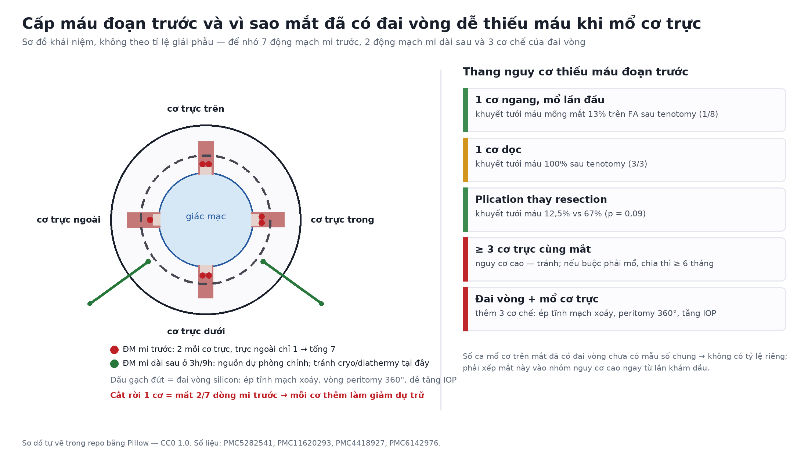
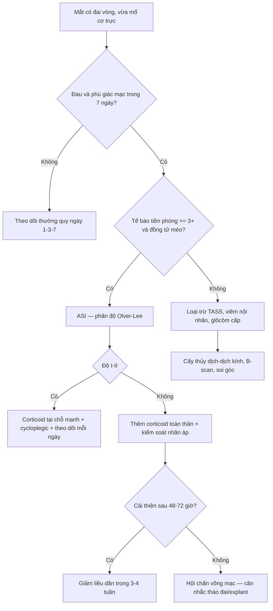
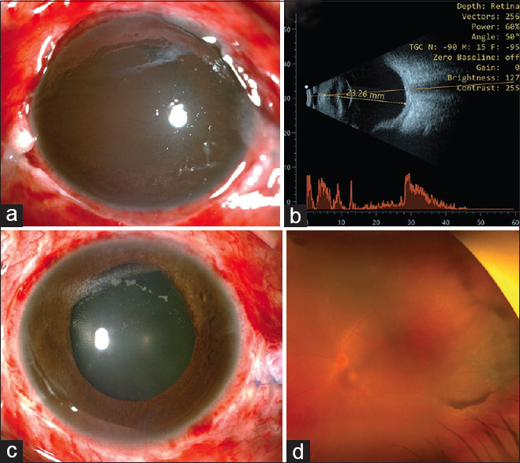
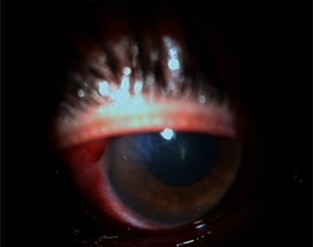
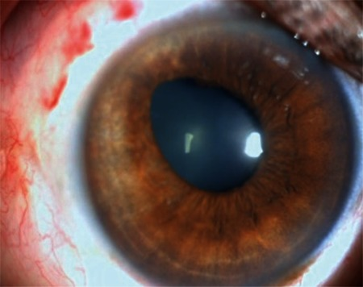

# 3222 — Thiếu máu đoạn trước sau mổ cơ trực trên mắt đã đặt đai vòng / Anterior segment ischemia after rectus surgery in a buckled eye

**Tags:** `pattern:phu-giac-mac` `pattern:te-bao-tien-phong` `pattern:dong-tu-meo` `pattern:di-nguyen-mong-mat` `pattern:ha-nhan-ap` `pattern:tang-nhan-ap` `vung:mat` `vung:giac-mac` `vung:co-van-nhan` `anatomy:dong-mach-mi-truoc` `anatomy:co-truc` `protocol:iris-FA` `protocol:AS-OCTA` `score:Olver-Lee` `incidentaloma:dai-silicon`

**Mức chắc chắn (certainty):** tổng hợp y văn (literature synthesis) — ghép **3 ca lâm sàng có ảnh** (tuổi 18 — PMC11620293; 46 — PMC5282541; 60 — PMID 27124792), **tổng quan Pineles 2018** (PMC5811735), **nghiên cứu tưới máu mống mắt bằng FA** (14 bệnh nhân — PMC4418927), **OCTA 10 mắt** (PMC6142976) và **99 mắt SS-AS-OCTA** (PMC13657135), cùng **ca ASI sau đai vòng** (PMID 22550771; PMC11999081). Nhóm **không có bệnh nhân của mình**; chỗ suy luận đánh dấu **[suy luận]**.

> **Ranh giới với bài đã có:** [3218](../3218-lac-trong-do-dai-vong-cung-mac/lesson.md) trả lời *lác/hạn chế vận nhãn sau đai*; [1499](../1499-song-thi-lac-sau-mo-bong-vong-mac/lesson.md) trả lời *song thị cảm giác sau mổ bong võng mạc*; [3219](../3219-song-thi-han-che-van-nhan-sau-van-loc-glocom/lesson.md) là *song thị sau van glôcôm*. Bài này chỉ trả lời **một câu**: *mắt đã có đai vòng, vừa mổ cơ trực, nay phù giác mạc + tiền phòng phản ứng + đồng tử méo — có phải thiếu máu đoạn trước, chấm điểm thế nào, và xử trí ra sao?*

> **Câu chốt — sáu con số phải thuộc:** **(1)** Đoạn trước được nuôi bởi **7 động mạch mi trước (anterior ciliary artery, ACA)** — **2 cho mỗi cơ trực, riêng cơ trực ngoài chỉ 1** — cộng **2 động mạch mi dài sau (long posterior ciliary artery, LPCA)**; cắt rời một cơ = mất **2/7** dòng mi trước (PMC5282541). **(2)** Tần suất ASI có triệu chứng sau mổ lác **1/13.000 – 1/30.000**, và **được cho là thấp hơn thực tế** vì thể nhẹ không chẩn đoán (PMC5282541; PMC13657135). **(3)** Nguy cơ tăng vọt khi **> 3 cơ trực trong một lần mổ** hoặc **mổ cơ trực lần hai trong vòng 6 tháng** (PMC5282541). **(4)** Trên FA mống mắt, **khuyết tưới máu gặp 67% sau tenotomy so với 12,5% sau plication**; với **cơ trực dọc là 100% (3/3) so với 25% (1/4)** (PMC4418927). **(5)** OCTA mống mắt đo được mức giảm **57% → 55%** toàn mống mắt và **56% → 53%** ở góc phần tư cạnh cơ mổ, ngay **ngày 1** (PMC6142976). **(6)** Đa số hồi phục tưới máu trong **2 tuần**, chậm nhất **12 tuần**; nhưng **đồng tử méo và teo mống mắt từng vùng là di chứng thường tồn tại** (PMC5282541; PMC11620293).

## 1. Tổng quan bệnh học – cơ chế hình ảnh

### 1.1 Vì sao đoạn trước "sống" bằng 7 nhánh nhỏ

- **Giải phẫu:** mỗi cơ trực mang **các động mạch mi trước** đi trên thân cơ rồi **xuyên củng mạc gần chỗ bám** để vào **vòng động mạch lớn của mống mắt (major arterial circle of the iris)**. Có **7 ACA**: **trực trên, trực dưới, trực trong mỗi cơ 2 nhánh; trực ngoài chỉ 1**. Nguồn dự phòng là **2 LPCA** đi vào ở kinh tuyến **3 giờ và 9 giờ** (PMC5282541; PMC11620293).
- **Vì sao cắt cơ lại nguy hiểm:** khi **cắt rời (disinsert) một cơ trực**, toàn bộ ACA trên thân cơ bị cắt theo — không phải "bóc tách nhẹ" mà là **mất một nhánh động mạch tận**. Một cơ ngang thường **không đủ** gây triệu chứng vì LPCA và tuần hoàn bàng hệ của kết mạc–Tenon bù được; nhưng mỗi cơ thêm vào **ăn vào dự trữ**, và **cơ trực dọc có tác động lớn hơn cơ ngang** lên tuần hoàn đoạn trước (PMC5282541; PMC5811735).

*Sơ đồ tự vẽ (CC0): đếm 7 ACA — trực ngoài chỉ 1 nhánh — và 3 cơ chế cộng thêm của đai vòng. Không theo tỉ lệ giải phẫu.*

### 1.2 Ba cơ chế riêng của đai vòng: vì sao "mắt đã có đai" là một mắt khác

Đai vòng không chỉ là "một miếng silicon dưới cơ". Nó làm giảm tưới máu đoạn trước bằng **ba đường độc lập**:

1. **Ép tĩnh mạch xoáy (vortex vein)** → ứ huyết hắc mạc, giảm chênh áp lực động–tĩnh mạch, giảm dòng vào đoạn trước (PMID 22550771).
2. **Vòng rạch kết mạc 360° (peritomy)** cắt **tuần hoàn kết mạc–Tenon quanh rìa** — đúng lớp mạch bàng hệ bù cho ACA; đường rạch **fornix** giữ được một phần tuần hoàn này (PMC11620293).
3. **Tăng nhãn áp trong và sau mổ** (đặc biệt khi **không dẫn lưu dịch dưới võng mạc**, bơm hơi/khí, hoặc siết đai quá tay) → giảm áp lực tưới máu; cộng thêm **cryo/diathermy dày ở 3 giờ và 9 giờ** có thể chạm chính **LPCA** (PMC11620293).

- **Hệ quả thực hành:** một mắt đã có đai vòng bước vào mổ cơ với **dự trữ đã bị tiêu một phần**; mổ **1 cơ trực dọc** ở mắt này không tương đương mổ 1 cơ trực dọc ở mắt lành. Văn liệu **không có mẫu số** cho riêng nhóm "đai vòng + mổ cơ", nên phải xếp **nguy cơ cao** ngay từ đầu (PMC11620293; PMID 22550771).

### 1.3 Vì sao các dấu hiệu lại là phù giác mạc, tế bào tiền phòng và đồng tử méo

- **Mống mắt và thể mi thiếu máu** → hàng rào máu–thủy dịch vỡ → **protein và bạch cầu tràn vào tiền phòng**: thấy **flare, tế bào 3–4+, fibrin**, có thể **máu thoáng qua (streak hyphema)** (PMC11620293; PMC5282541).
- **Nội mô giác mạc** sống bằng **glucose và oxy từ thủy dịch**; khi thủy dịch giảm tưới máu, bơm Na⁺/K⁺-ATPase của nội mô yếu đi → **phù giác mạc, nếp gấp Descemet, striate keratopathy**. Vì vậy **phù giác mạc là dấu sớm và nổi bật nhất**, đôi khi xuất hiện trước cả tế bào (PMC11620293).
- **Cơ vòng mống mắt (sphincter)** thiếu máu → **đồng tử giãn giữa, méo, mất trương lực**, thường **không đáp ứng với ánh sáng** và **không hồi phục hoàn toàn** (PMC5282541; PMID 27124792).
- **Thể mi thiếu máu** → giảm sản xuất thủy dịch → **nhãn áp thấp**; nhưng giai đoạn viêm có thể **tăng nhãn áp** (ca 1: **30 mmHg** ngày 4) do phản ứng viêm và mảnh vỡ tế bào. Vì vậy **không được dùng nhãn áp để loại trừ ASI** (PMC11620293).
- **Mạn tính:** thiếu oxy kéo dài → **VEGF** → **rubeosis mống mắt**, glôcôm tân mạch; **đục thể thủy tinh trong 3 tháng** ở thể nặng; hiếm nhất là **phthisis bulbi** (PMID 22550771; PMC5282541).

### 1.4 Vì sao thể nhẹ nhiều hơn người ta tưởng

- **FA mống mắt** ở 14 bệnh nhân cho thấy **khuyết tưới máu sau tenotomy 67% (4/6)** so với **12,5% (1/8) sau plication**; riêng **cơ trực dọc: 100% (3/3) sau tenotomy so với 25% (1/4) sau plication** (p = 0,09 và 0,14 — cỡ mẫu nhỏ) (PMC4418927).
- **SS-AS-OCTA** ở **99 mắt mổ cơ ngang**: thay đổi **nhẹ và khu trú** sau mổ 1 cơ, **rộng hơn và thoáng qua** sau mổ phối hợp cơ chéo; **về gần mức nền sau 1 tháng**; **không ca nào ASI lâm sàng** (PMC13657135).
- **Kết luận:** "khuyết tưới máu" là **hiện tượng thường gặp và thường im lặng**; **ASI lâm sàng** mới là biến cố hiếm. Việc của bác sĩ là **phân biệt thể im lặng với thể có triệu chứng**, và **không để thể nhẹ tiến triển thành thể nặng** ở mắt đã có đai.

## 2. Mẫu hình + chẩn đoán phân biệt theo thời điểm và mức độ

**Mẫu hình (pattern):** *mắt vừa mổ cơ trực, trong 7 ngày đầu xuất hiện phù giác mạc + phản ứng tiền phòng mạnh nhưng **không có mủ tiền phòng**, **dịch kính trong**, **đồng tử méo/giãn**.*

- **Theo thời điểm:**
  - **12–24 giờ:** nghĩ **TASS (toxic anterior segment syndrome)** hoặc **phản ứng cryo** hơn là ASI; ASI thường rõ dần **ngày 2–5** (trong 3 ca: ngày 1, ngày 4, ngày 6).
  - **Ngày 2–7:** **ASI** là chẩn đoán chính ở mắt có **≥ 1 cơ trực dọc, ≥ 2 cơ cùng mắt, hoặc có đai vòng**.
  - **Sau 1–3 tháng:** **teo mống mắt từng vùng, đồng tử méo, đục thể thủy tinh** = di chứng; xuất hiện **rubeosis** là dấu tiên lượng xấu.
- **Theo mức độ (Olver–Lee):** **độ I** giảm tưới máu mống mắt; **độ II** thêm dấu hiệu đồng tử; **độ III** thêm viêm màng bồ đào; **độ IV** thêm bệnh giác mạc (keratopathy) (PMC5282541).
- **Theo cơ chế:** thiếu máu **do cắt cơ** (ACA) · **do đai** (tĩnh mạch xoáy + peritomy) · **do tăng nhãn áp** · **do cryo 3/9 giờ** (LPCA) · **do bệnh nền** (đái tháo đường, tăng huyết áp, bệnh hồng cầu hình liềm, tăng độ quánh máu, Basedow, xạ trị đầu–cổ, liệu pháp estrogen) (PMC5282541; PMC11620293; PMC10656632).

**Gamut theo bối cảnh mắt có đai:**

1. Mổ cơ trực **dọc** (SR/IR) — nguy cơ cao nhất.
2. Mổ **≥ 2 cơ** cùng mắt, hoặc **mổ lại < 6 tháng**.
3. **Đai siết quá tay**, **peritomy 360°**, **không dẫn lưu dịch**, **cryo diện rộng**.
4. Bệnh nền làm giảm dòng: **hồng cầu hình liềm**, **Basedow**, **đái tháo đường**, **tăng huyết áp**, **estrogen**.

## 3. Bảng so sánh phân biệt (ma trận đối chiếu)

| Thực thể (entity) | Hình ảnh / dấu lâm sàng điển hình | Chốt vào (rule-in) | Chốt loại (rule-out) | Gợi ý xác nhận |
|---|---|---|---|---|
| **ASI** | Phù giác mạc + nếp Descemet, tế bào 3–4+, fibrin, đồng tử giãn méo, có thể hạ hoặc tăng nhãn áp; khởi phát **ngày 1–6** | **Đồng tử méo/giãn không đáp ứng + phù giác mạc + phản ứng tiền phòng nặng sau mổ cơ trực**, dịch kính trong | **Không có mủ tiền phòng, không viêm dịch kính**; nhưng **không loại trừ** nếu hai bệnh cùng tồn tại | FA mống mắt (**khuyết tưới máu**), SS-AS-OCTA (**giảm mật độ mạch**), phân độ Olver–Lee |
| **TASS** | Phù giác mạc **lan từ rìa tới rìa**, xuất hiện **12–24 giờ**, phản ứng tiền phòng nhưng **đồng tử còn tròn**, đáp ứng corticoid nhanh | **Cùng lô vật tư/thuốc, nhiều mắt trong cùng ngày** | **Đồng tử méo + teo mống mắt từng vùng** không do TASS | Bệnh sử vật tư, đáp ứng corticoid trong 24–48 giờ |
| **Viêm nội nhãn** | **Đau tăng**, mủ tiền phòng, **viêm dịch kính**, siêu âm có **echo dày trong dịch kính** | **Mủ tiền phòng + viêm dịch kính** trên siêu âm | **Dịch kính trong** trên B-scan làm ít khả năng, **không loại trừ tuyệt đối** | Cấy thủy dịch/dịch kính, B-scan, nội soi dịch kính |
| **Glôcôm cấp / UGH sau đai** | Tiền phòng **nông**, nhãn áp cao, đau; UGH có **máu tiền phòng** và tăng nhãn áp | **Tiền phòng nông + nhãn áp cao đơn thuần**, hết sau khi hạ nhãn áp | **Đồng tử méo + phù giác mạc không tương xứng mức nhãn áp** | Đo nhãn áp, soi góc, siêu âm sinh học |
| **Ngộ độc thuốc / khô giác mạc** | Chấm nhuộm biểu mô, phù nhẹ, **không phản ứng tiền phòng** | **Chỉ tổn thương biểu mô**, hết khi ngừng thuốc | **Tế bào tiền phòng 3+ và đồng tử méo** | Soi đèn khe sau ngừng thuốc 48 giờ |
| **Tắc động mạch mắt (OAO)** | Mù nặng, **không điểm đỏ anh đào**, hắc mạc không đổ đầy trên ICGA | **Thị lực mất gần hoàn toàn + dấu võng mạc/hắc mạc** | **Thị lực còn tốt, đáy mắt bình thường** loại trừ | [278](../278-tac-dong-mach-mat/lesson.md) — FA/ICGA |
| **Viêm màng bồ đào sau cryo** | Tế bào tiền phòng, **không teo mống mắt**, đỡ sau 3–5 ngày corticoid | **Không có khuyết tưới máu mống mắt** | **Teo mống mắt từng vùng** về sau | Theo dõi 1–3 tháng, FA nếu nghi |

## 4. Protocol chụp/đánh giá + hệ phân độ

### 4.1 Trước mổ — đếm cơ, đếm nguồn máu, đếm bệnh nền

- **Đếm cơ trực sẽ cắt rời** trong **một** lần mổ: **≥ 3 cơ** là ngưỡng cảnh báo; nếu cần hơn, **chia thì ≥ 6 tháng** để tuần hoàn bàng hệ hình thành (PMC5282541).
- **Ghi nhận đai vòng:** đai **#240/#279**, vị trí, độ căng, số mối khâu; hỏi **cryo/diathermy** trước đó ở **3 giờ và 9 giờ** (PMC11620293).
- **Bệnh nền:** đái tháo đường, tăng huyết áp, **hồng cầu hình liềm** (làm **điện di huyết sắc tố** khi có chỉ định — ca 1 đã làm và bình thường), bệnh tăng độ quánh, **Basedow**, xạ trị đầu–cổ, **estrogen** (PMC5282541; PMC10656632).
- **Đo nền:** thị lực, nhãn áp, độ sâu tiền phòng, **đường kính/độ tròn đồng tử**, soi đèn khe có đèn khe hẹp, chụp ảnh.

### 4.2 Trong mổ — bốn việc giảm nguy cơ

1. **Giữ mạch mi:** dùng **plication** thay resection, **tenotomy bán phần/chẻ thân cơ**, hoặc **kéo cơ mà không cắt rời chỗ bám** — plication giữ được mạch mi và giảm khuyết tưới máu (PMC4418927; PMC5811735).
2. **Tránh 3 giờ và 9 giờ:** hạn chế **cryo/diathermy** ở hai kinh tuyến này để bảo vệ **LPCA** (PMC11620293).
3. **Kiểm soát nhãn áp:** **dẫn lưu dịch dưới võng mạc** hoặc **chọc tiền phòng** khi cần độ cao đai; **không siết đai quá tay**; tránh **adrenaline nội nhãn** (PMC11620293).
4. **Rạch kết mạc tiết chế:** ưu tiên **đường rạch fornix** và **peritomy giới hạn** ở mắt nguy cơ cao (PMC11620293).

### 4.3 Sau mổ — theo dõi và hình ảnh

- **Khám đèn khe ngày 1, 3, 7** ở mắt **đai vòng + ≥ 1 cơ trực dọc** hoặc **≥ 2 cơ**: ghi **tế bào/flare, phù giác mạc, độ tròn đồng tử, nhãn áp, độ sâu tiền phòng**.
- **FA mống mắt (iris fluorescein angiography):** chuẩn vàng để thấy **khuyết tưới máu từng vùng**; chụp **trước mổ** khi có thể và **ngày 1–3** khi nghi (PMC4418927; PMID 22550771).
- **SS-AS-OCTA (bước sóng ~1050 nm):** đo **mật độ mạch (%)** theo **góc phần tư**, so sánh **trước–sau**; không xâm lấn, tốt hơn FA ở **mống mắt sẫm màu**; chưa có **ngưỡng lâm sàng** (PMC6142976; PMC13657135).
- **AS-OCT:** đo **độ dày giác mạc** để theo dõi phù và đáp ứng điều trị **[suy luận từ nguyên lý — chưa có ngưỡng riêng cho ASI]**.
- **B-scan siêu âm 10 MHz:** khi không nhìn rõ đáy mắt — **dịch kính trong** làm ASI khả năng hơn, **echo dày/viêm dịch kính** đổi hướng sang **viêm nội nhãn** (PMC11620293; PMID 27124792).
- **CT hốc mắt:** chỉ khi nghi **đai di lệch/lộ** hoặc khối hốc mắt (xem [3218](../3218-lac-trong-do-dai-vong-cung-mac/lesson.md)).

### 4.4 Phân độ Olver–Lee và xử trí

| Độ | Dấu hiệu | Xử trí trong y văn | Theo dõi |
|---|---|---|---|
| **I** | Giảm tưới máu mống mắt, chưa có dấu đồng tử | Corticoid tại chỗ, cycloplegic; bỏ **adrenaline/sympathomimetic** | Đèn khe ngày 1–3; FA/OCTA nếu có |
| **II** | Thêm **đồng tử giãn/méo** | Như độ I + theo dõi sát nhãn áp | 1 tuần, 1 tháng |
| **III** | Thêm **viêm màng bồ đào** (tế bào 4+, fibrin) | **Corticoid toàn thân** + tại chỗ + cycloplegic | 48–72 giờ/lần đến khi hết fibrin |
| **IV** | Thêm **bệnh giác mạc** (phù nặng, nếp Descemet) | Như độ III; **cân nhắc tháo đai** nếu không cải thiện | Theo dõi 3 tháng vì nguy cơ đục thể thủy tinh |

- **Thuốc theo ca đã báo:** ca 1 dùng **prednisolone tại chỗ mỗi giờ**, **atropine 3 lần/ngày**, **moxifloxacin 6 lần/ngày**, **timolol 2 lần/ngày**, **prednisolone uống 40 mg giảm liều** (PMC11620293); ca 2 dùng **dexamethasone 0,1%/5 mL 16 lần/ngày**, **cyclopentolate 3 lần/ngày**, **fluocortolone uống 20 mg × 3 lần/ngày** (PMC5282541). **Không có RCT** cho phác đồ này — xem mục 7.
- **Tháo đai/explant** dành cho **thể nặng không đáp ứng**; đây là đánh đổi có thật: tháo **đai vòng** làm **tái bong 25% (4/16)** so với **0% (0/24)** khi chỉ cắt một đoạn đai (p = 0,020; PMC7738227 — số liệu đã đối chiếu ở bài [3218](../3218-lac-trong-do-dai-vong-cung-mac/lesson.md)).

## 5. Biến thể bình thường và cạm bẫy

- **"Tế bào" sau cryo:** bụi sắc tố và tế bào viêm sau cryo có thể trông như phản ứng mạnh; **đồng tử méo + phù giác mạc + teo mống mắt từng vùng** mới là dấu của ASI. Đừng chẩn đoán ASI chỉ vì "tiền phòng có tế bào".
- **Khuyết tưới máu im lặng:** FA sau tenotomy cho **khuyết tới 67%** mà **không triệu chứng** — **không được** gọi mọi khuyết tưới máu là ASI lâm sàng, nhưng **cũng không được bỏ** ở mắt có đai (PMC4418927).
- **Nhãn áp cao đánh lừa:** ca 1 có **nhãn áp 30 mmHg** ngày 4; tăng nhãn áp **không loại trừ** ASI và cũng **không đủ** gọi glôcôm cấp. Phải đọc **độ sâu tiền phòng + đồng tử + mức phù giác mạc** cùng lúc (PMC11620293).
- **Hạ nhãn áp đánh lừa:** hạ nhãn áp do **thể mi thiếu máu** dễ bị gán cho **rò cyclodialysis** hoặc **bong hắc mạc**; siêu âm giúp phân biệt **bong hắc mạc thanh dịch** (xem [1484](../1484-bong-hac-mac-sau-mo-mat/lesson.md)).
- **Hai bệnh cùng lúc:** đã có ca **ASI + viêm nội nhãn MRSA** ở bệnh nhân Basedow **6 ngày** sau mổ cơ, với **FA mống mắt mất tưới máu** và **viêm dịch kính** trên siêu âm (PMID 27124792). **Dịch kính trong không loại trừ viêm nội nhãn** khi lâm sàng nặng.
- **Sai lầm hay gặp (satisfaction of search):** thấy phù giác mạc → nghĩ "TASS/độc tính thuốc" → **bỏ qua đồng tử méo**; hoặc thấy đau nhiều → nghĩ viêm nội nhãn → **bỏ qua thiếu máu** ở mắt vừa mổ cơ dọc.
- **Cạm bẫy điều trị:** nhỏ **adrenaline nội nhãn** để giãn đồng tử trong mổ ở mắt nguy cơ cao là yếu tố thúc đẩy ASI (PMC11620293); **prostaglandin** làm tăng viêm — tránh trong giai đoạn cấp **[suy luận dược lý]**.

## 6. Tự lượng giá — Blind Quiz

**Ca 1 — Nam 18 tuổi, hội chứng thận hư dùng corticoid 15 năm, được đặt đai #279 + đai vòng #240 kèm cryo vì bong võng mạc. Ngày 4 sau mổ: đau nhẹ, mắt đỏ, nhìn mờ; tiền phòng tế bào 4+, flare 3+, nhãn áp 30 mmHg, không mủ tiền phòng.**

- Gợi ý lâm sàng: siêu âm **dịch kính trong**, võng mạc áp; không sốt.
- Câu hỏi: (1) Ba chẩn đoán phân biệt hàng đầu? (2) Dấu nào trên ảnh giúp chuyển chẩn đoán sang **thiếu máu đoạn trước**? (3) Vì sao **không** đặt ống dẫn lưu tiền phòng ngay?

<b>Bấm để hiện đáp án (findings + chẩn đoán)</b>

- **Dấu hiệu:** (a) **phù giác mạc lan tỏa + nếp Descemet**, tiền phòng tế bào 4+; (c) ngày 11 còn **fibrin co và teo mống mắt vùng trên**; (b) siêu âm **dịch kính trong**, võng mạc áp.
- **Chẩn đoán:** **ASI thể nhẹ–trung bình** sau đai vòng + cryo (không có mủ tiền phòng, dịch kính trong). Phân biệt: **TASS do adrenaline nội nhãn**, **viêm nội nhãn**, **viêm do cryo**.
- **Chốt:** **đồng tử méo + teo mống mắt từng vùng** khi giác mạc đã trong — dấu này không có trong TASS/viêm do cryo.
- **Xử trí trong ca này:** corticoid tại chỗ mỗi giờ + atropine + kháng sinh dự phòng + timolol, corticoid uống giảm liều; **không chọc tiền phòng** vì không có mủ và siêu âm không gợi viêm dịch kính. Sau 6 tuần: thị lực **3/60**, **teo mống mắt vùng trên**, nhãn áp kiểm soát.
- **Nguồn ảnh:** PMC11620293 Fig. 2, **CC BY-NC-SA 4.0** (nguyên bản, giữ đủ 4 panel a–d).

**Ca 2 — Nam 46 tuổi, liệt dây VI sau tai nạn. Đã khép trực trong 6 mm; 10 tháng sau mổ chuyển toàn bộ thân trực trên và trực dưới ra trực ngoài kèm chỉ Foster. Ngày 1 sau mổ: phù giác mạc, nếp Descemet, tiền phòng 3+ tế bào, đồng tử giãn méo, nhãn áp hơi thấp, thị lực 20/40.**

- Gợi ý lâm sàng: không đau nhiều, không mủ tiền phòng, đáy mắt bình thường.
- Câu hỏi: (1) Đếm số ACA bị cắt trong hai thì mổ? (2) Vì sao **trực dọc** nguy hiểm hơn trực ngang? (3) Điều trị và tiên lượng di chứng?

<b>Bấm để hiện đáp án (findings + chẩn đoán)</b>

- **Dấu hiệu:** phù giác mạc + nếp Descemet, **3+ tế bào**, **đồng tử giãn méo**, **hạ nhãn áp nhẹ**, thị lực 20/40.
- **Số ACA:** thì 1 cắt trực trong = **2 ACA**; thì 2 cắt rời **trực trên + trực dưới** = **4 ACA**; tổng **6/7 ACA** trong **10 tháng** — vượt xa ngưỡng "3 cơ trực" và **mổ lại trong vòng 6 tháng không được tôn trọng**.
- **Chẩn đoán:** **ASI độ II–III** (có dấu đồng tử + viêm màng bồ đào).
- **Xử trí:** dexamethasone tại chỗ 16 lần/ngày + cyclopentolate + fluocortolone uống; **1 tuần** hết phù giác mạc, **1 tháng** thị lực **20/20**, hết song thị, **còn đồng tử méo**.
- **Bài học:** nếu buộc phải mổ thêm cơ ở mắt đã mổ, **chờ ≥ 6 tháng** và **giữ mạch mi** (plication/tenotomy bán phần) (PMC5282541; PMC4418927).
- **Nguồn ảnh:** PMC5282541 Fig. 2, **CC BY 4.0** (nguyên bản).

*Đáp án mở rộng: 1 tháng sau, giác mạc trong, chỉ còn **đồng tử méo** — di chứng thường tồn tại (PMC5282541 Fig. 3, CC BY 4.0).*

**Ca 3 — Bệnh nhân liệt dây VI, mắt đã đặt đai vòng; cần mổ cả trực trên và trực dưới. Trên sơ đồ dưới đây, hãy đếm nguồn máu còn lại và nêu 4 biện pháp giảm nguy cơ.**

- Gợi ý: mắt đã có peritomy 360° và đai siết vừa phải; nhãn áp trước mổ 16 mmHg.
- Câu hỏi: (1) Cắt rời SR + IR mất bao nhiêu ACA? (2) Vì sao **đai** làm ngưỡng nguy cơ thấp hơn? (3) Bốn việc phải làm khác đi?

<b>Bấm để hiện đáp án (findings + chẩn đoán)</b>

- **Đếm:** SR **2** + IR **2** = **4/7 ACA** bị cắt; **LPCA** còn nhưng đã bị **ép bởi đai** và **peritomy 360°** làm mất bàng hệ kết mạc.
- **Vì sao đai làm nặng:** ba cơ chế cộng dồn — **ép tĩnh mạch xoáy**, **mất tuần hoàn quanh rìa**, **tăng nhãn áp khi không dẫn lưu** (PMID 22550771; PMC11620293).
- **Bốn việc khác đi:** (1) **plication/tenotomy bán phần** thay cắt rời; (2) **dẫn lưu dịch hoặc chọc tiền phòng** để giữ nhãn áp thấp; (3) **tránh cryo/diathermy 3 và 9 giờ**; (4) **không dùng adrenaline nội nhãn**, **rạch fornix giới hạn**, và **cân nhắc mổ từng cơ cách ≥ 6 tháng**.
- **Nguồn ảnh:** sơ đồ tự vẽ trong repo, **CC0 1.0** (số liệu PMC5282541, PMC11620293, PMC4418927, PMC6142976).

## 7. Câu hỏi nghiên cứu & điểm chưa đồng thuận (tính đến 11/2026)

1. **[Tranh cãi] Ở mắt đã đặt đai vòng cần mổ ≥ 2 cơ trực, tháo đai trước có giảm ASI nhiều hơn nguy cơ tái bong võng mạc không?**
   - **Đã biết:** ASI sau đai vòng đã được báo cáo với **rubeosis** và với **NAION** (PMID 22550771; PMC11999081); tháo **đai vòng** làm **tái bong 25% (4/16) vs 0% (0/24)** khi chỉ cắt một đoạn (PMC7738227).
   - **Chưa rõ:** **không có nghiên cứu nào** so sánh "tháo đai rồi mổ cơ" với "giữ đai và mổ cơ có bảo tồn mạch mi"; ngưỡng số cơ và độ căng đai để đổi chiến lược cũng chưa có.
   - **Hướng nghiên cứu:** đoàn hệ tiến cứu/registry mắt đai vòng có mổ cơ, đầu ra **ASI lâm sàng + FA/OCTA + tái bong**; hoặc Delphi đồng thuận về thứ tự thủ thuật.
   - **Nguồn:** PMC11620293 (2024); PMC11999081 (2025); PMC7738227.

2. **[Khoảng trống] Ngưỡng mật độ mạch mống mắt trên SS-AS-OCTA nào dự báo ASI lâm sàng?**
   - **Đã biết:** OCTA đo được **giảm 2% toàn mống mắt** và **2,6% ở góc phần tư cạnh cơ mổ** ngay ngày 1 ở **10 mắt** (PMC6142976); ở **99 mắt** mổ cơ ngang, thay đổi **thoáng qua, về nền sau 1 tháng**, **không ca ASI** (PMC13657135).
   - **Chưa rõ:** chưa có **ngưỡng %** hay **diện tích khuyết tưới máu** phân biệt "giảm sinh lý" với "nguy cơ ASI"; giá trị tiên lượng ở **mắt có đai** và ở **cơ trực dọc** chưa được nghiên cứu.
   - **Hướng nghiên cứu:** nghiên cứu độ chính xác chẩn đoán, chụp OCTA **trước mổ + ngày 1 + tuần 1**, đối chiếu với **FA mống mắt** và biến cố lâm sàng.
   - **Nguồn:** PMC6142976 (2018); PMC13657135 (2026); PMC4418927 (2015).

3. **[Khác biệt thực hành] Corticoid toàn thân và thời điểm tháo đai trong ASI nặng: dùng ngay hay chờ 48–72 giờ?**
   - **Đã biết:** ba ca dùng **corticoid tại chỗ + toàn thân** và hồi phục thị lực trong **1 tuần–1 tháng**, còn **đồng tử méo** (PMC11620293; PMC5282541); ca nặng được khuyến cáo **tháo đai/explant** (PMC11620293).
   - **Chưa rõ:** **không có RCT**; thời điểm tháo đai, liều corticoid tối ưu và tiêu chí "không đáp ứng" khác nhau giữa các trung tâm.
   - **Hướng nghiên cứu:** RCT/đoàn hệ tiến cứu phân tầng theo **độ Olver–Lee**, so sánh **corticoid toàn thân sớm** với **tháo đai sớm**, đầu ra **thị lực 3 tháng + nhãn áp + rubeosis**.
   - **Nguồn:** PMC11620293 (2024); PMC5282541 (2017); PMID 27124792 (2017).

## Bài liên quan chéo

- [3218 — Lác trong do đai vòng quanh củng mạc: đai kéo cơ, đai di chuyển hay HES?](../3218-lac-trong-do-dai-vong-cung-mac/lesson.md)
- [1499 — Song thị và lác sau mổ bong võng mạc KHÔNG do đai](../1499-song-thi-lac-sau-mo-bong-vong-mac/lesson.md)
- [1493 — Biến chứng đai hoàng điểm: khi nào tháo đai](../1493-bien-chung-dai-hoang-diem-khi-nao-thao/lesson.md)
- [1484 — Bong hắc mạc sau mổ mắt](../1484-bong-hac-mac-sau-mo-mat/lesson.md)
- [3212 — Hội chứng mắt nặng (HES) ở cận thị cao](../3212-hoi-chung-mat-nang-can-thi-cao/lesson.md)
- [3219 — Song thị và hạn chế vận nhãn sau van dẫn lưu glôcôm](../3219-song-thi-han-che-van-nhan-sau-van-loc-glocom/lesson.md)
- [3221 — Viêm củng mạc do nấm sau đặt đai/ống silicon](../3221-viem-cung-mac-nam-sau-buckle/lesson.md)
- [278 — Tắc động mạch mắt (OAO)](../278-tac-dong-mach-mat/lesson.md)
- [411 — Siêu âm nhãn cầu](../411-sieu-am-nhan-cau/lesson.md)

## Ảnh

- `images/3222_asi-doan-truoc_SlitLamp_PMC11620293-Fig2.jpg` — ca 18 tuổi: (a) phù giác mạc ngày 4; (b) siêu âm dịch kính trong; (c) ngày 11 còn fibrin và teo mống mắt; (d) đáy mắt (PMC11620293, Fig. 2, **CC BY-NC-SA 4.0**, nguyên bản).
- `images/3222_asi-doan-truoc_SlitLamp_PMC11620293-Fig3.jpg` — 6 tuần: teo mống mắt vùng trên, đáy mắt và OCT hoàng điểm (PMC11620293, Fig. 3, **CC BY-NC-SA 4.0**).
- `images/3222_asi-doan-truoc_SlitLamp_PMC5282541-Fig2.jpg` — ngày 1 sau mổ 3 cơ trực: phù giác mạc, nếp Descemet, đồng tử méo, 3+ tế bào (PMC5282541, Fig. 2, **CC BY 4.0**).
- `images/3222_asi-doan-truoc_SlitLamp_PMC5282541-Fig3.jpg` — 1 tháng: hết phù, còn đồng tử méo (PMC5282541, Fig. 3, **CC BY 4.0**).
- `images/3222_asi-doan-truoc_So-do-cap-mau_CC0.png` — sơ đồ cấp máu đoạn trước và thang nguy cơ, **tự vẽ (CC0 1.0)**.

> Không dùng để chẩn đoán độc lập khi chưa có người hướng dẫn.
