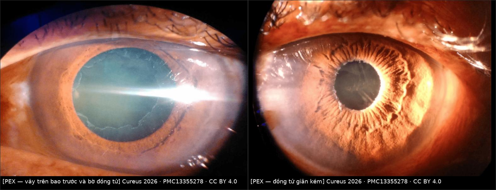
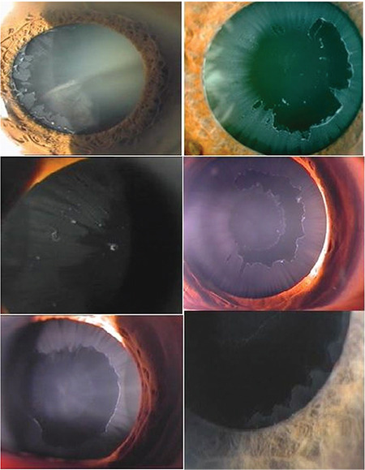
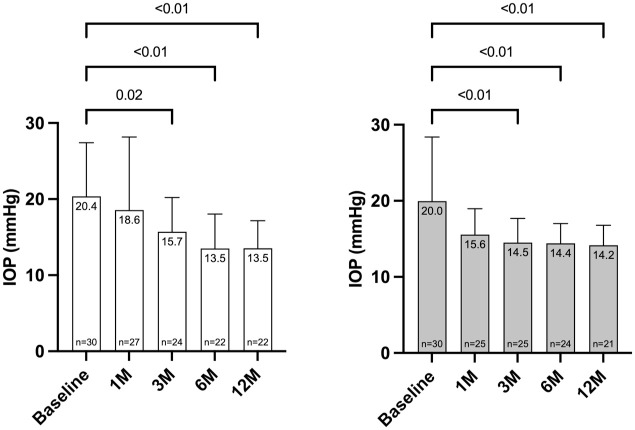
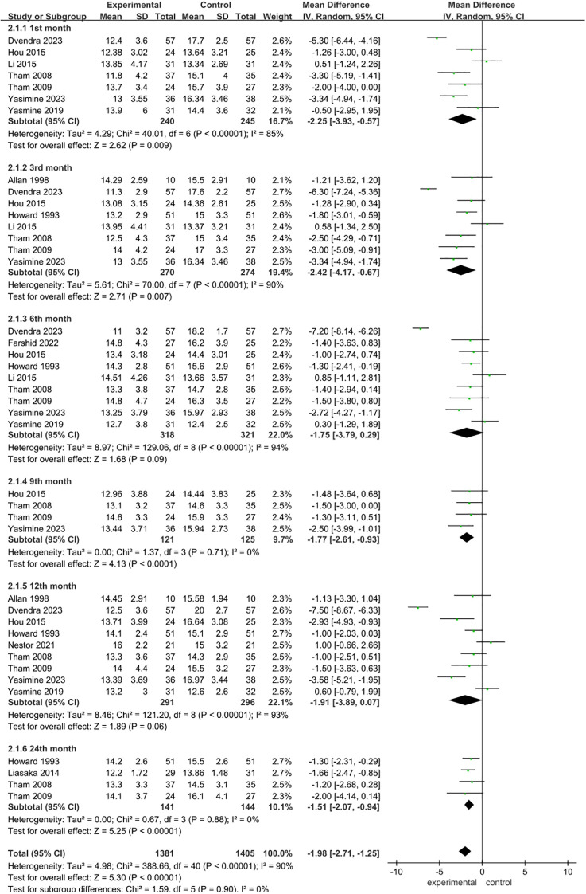
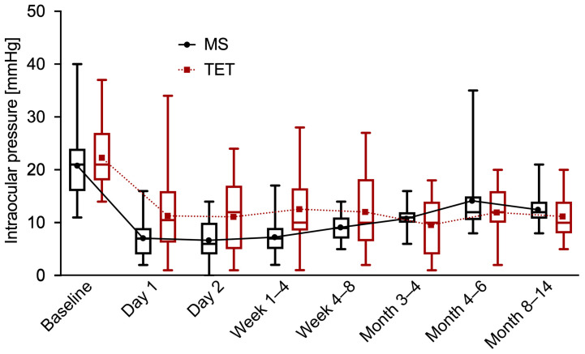
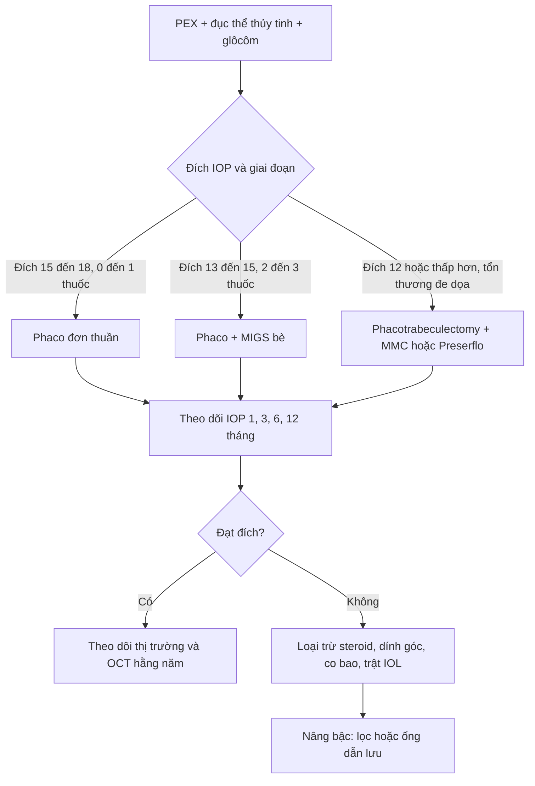

# 3223 — Phaco ở mắt PEX có glôcôm: phaco đơn thuần, phaco + MIGS hay phaco + trabeculectomy / Cataract surgery in pseudoexfoliation glaucoma

**Tags:** `pattern:bong-vay-bao-truoc` `pattern:goc-tien-phong-tang-sac-to` `pattern:dong-tu-gian-kem` `pattern:iop-khong-dat-dich` `vung:mat` `vung:tien-phong` `vung:goc-tien-phong` `vung:the-thuy-tinh` `protocol:gonioscopy` `protocol:AS-OCT` `protocol:UBM` `protocol:OCT-RNFL` `score:khong` `incidentaloma:khong`

**Mức chắc chắn (certainty):** tổng hợp y văn (literature synthesis) — dựng từ **1 phân tích gộp 14 RCT** về phaco + phẫu thuật lọc góc so với phaco đơn thuần (*Front Ophthalmol* 2026, **PMC13283822**, CC BY 4.0), **1 phân tích gộp 14 nghiên cứu / 624 mắt** về goniotomy và GATT trong glôcôm bong vảy (*Front Med* 2026, **PMC13013039**, CC BY 4.0), **1 Cochrane 2026** về MIGS bè củng mạc (**PMC13386461**), **1 đoàn hệ IRIS 28.196 + 28.196 mắt** (*Ophthalmology* 2026, DOI 10.1016/j.ophtha.2025.09.012), **1 đoàn hệ 485 mắt PXF** (*Ophthalmology* 2026, DOI 10.1016/j.ophtha.2026.04.010), các so sánh trực tiếp trong PEXG: **KDB so với hút bè 30 + 30 mắt** (*Ther Adv Ophthalmol* 2026, **PMC12775301**, CC BY 4.0), **Hydrus 25 mắt PXG so với 49 mắt POAG** (*J Clin Med* 2026, **PMC13607743**, CC BY 4.0), **Preserflo so với trabeculectomy 31 + 29 mắt** (*J Clin Med* 2023, **PMC10141576**, CC BY 4.0), **GATT so với trabeculectomy ở PEXG nặng 31 + 31 mắt** (DOI 10.1007/s00417-023-06246-3), **trabeculectomy so với phacotrabeculectomy 96 PEXG + 114 POAG** (DOI 10.1007/s10792-021-02169-2). Nhóm **không có bệnh nhân của mình**; chỗ chưa đủ chắc ghi "chưa rõ". **Không ghi tên tác giả** — attribution = tạp chí + năm + PMCID/DOI.

> **Câu chốt:** PEXG **không phải POAG nặng hơn** — đây là **hỏng cấu trúc bè củng mạc** do vật liệu bong vảy, nên **phaco đơn thuần chỉ hạ được vài mmHg**, **MIGS hạ thêm nhưng dừng ở trung bình 13–15 mmHg**, còn **đích ≤ 12 mmHg vẫn cần lọc**. Bốn nhóm số phải thuộc: **(1)** phaco đơn thuần ở mắt PXF hạ **4,5 mmHg** so với **2,35 mmHg** ở chứng (PMC8101166) và **3 mmHg** trong đoàn hệ 485 mắt (DOI 10.1016/j.ophtha.2026.04.010); **(2)** phaco + lọc góc hơn phaco đơn thuần **1,98 mmHg** và **0,69 thuốc**, nhưng **biến chứng RR 2,66** (PMC13283822); **(3)** trong PEXG, **KDB hạ 6,9 mmHg** so với **hút bè 5,8 mmHg**, đổi lại **mổ lại 13,3% so với 6,7%** (PMC12775301); **(4)** **Preserflo và trabeculectomy tương đương** ở PEXG (thành công hoàn toàn **83,9% so với 82,8%**), nhưng **thành công với đích < 12 mmHg của GATT chỉ 82,5% so với 92,0% của trabeculectomy** (DOI 10.1007/s00417-023-06246-3). Bẫy chết người: **đặt đích theo thói quen "phaco + MIGS cho mọi ca"** — ở PEXG tiến triển nhanh, IOP 15 mmHg vẫn là **thất bại**.

## 1. Tổng quan bệnh học – cơ chế hình ảnh (TẠI SAO)

### 1.1 Vì sao PEXG khác POAG — chỗ hỏng nằm ở bè củng mạc, không chỉ ở áp lực

- PEX là bệnh **lắng đọng vật liệu ngoại bào toàn thân**, gặp ở **60–70 triệu người**, **khoảng 1/3** phát triển glôcôm (PMC13466095). Đây là **nguyên nhân glôcôm thứ phát thường gặp nhất trên thế giới** (PMC8101166).
- Trong PEXG, bè củng mạc (trabecular meshwork) bị **hai tầng tổn thương**: **tắc cơ học** do vật liệu fibrillar bám vào khe bè, và **loạn dưỡng chất nền ngoại bào** làm bè xơ hóa, mất đàn hồi; kèm **thiếu máu cục bộ/ stress oxy hóa** (PMC13466095). Vì vậy **IOP thường cao hơn và bệnh nặng hơn POAG** cùng mức tổn thương thị trường (PMC13466095).
- Hệ quả **không đối xứng với POAG**: trên **485 mắt PXF**, tỉ lệ mới mắc glôcôm thị trường **26,5% trong 4 năm** ở mắt không tăng nhãn áp và **37,5%** ở mắt có tăng nhãn áp; **87,3%** mắt cuối cùng có glôcôm **không từng ghi nhận tăng nhãn áp** ở bất kỳ lần khám nào (DOI 10.1016/j.ophtha.2026.04.010). Nghĩa là **một IOP 16 mmHg không loại trừ glôcôm** — phải đọc thị trường và OCT.
- Trên **28.196 mắt PXG so với 28.196 mắt POAG** (IRIS): tỉ lệ tích lũy phải mổ glôcôm sau 4 năm **13,6% so với 8,6%**; trong số ca mổ đầu tiên, **lọc (trabeculectomy/ống dẫn lưu) chiếm 51,2% ở PXG so với 39,0% ở POAG**, còn **stent bè 31,3% so với 44,5%** (DOI 10.1016/j.ophtha.2025.09.012). Tức là **thực hành thế giới đã nghiêng về lọc ở PXG**, không phải vì "PEX khó" mà vì **đích áp lực thấp hơn**.

### 1.2 Phaco làm hạ IOP bao nhiêu — và vì sao ở PEX lại hạ nhiều hơn

- **Cơ chế:** lấy thể thủy tinh làm **sâu tiền phòng**, **mở rộng góc**, **cuốn trôi vật liệu PEX và sắc tố** khỏi bè, và **tăng khả năng thoát thủy dịch** (outflow facility); trên AS-OCT/Scheimpflug, góc mở thêm **13,83° ở PXS so với 10,47° ở chứng** (p = 0,039) (PMC8784454 — chỉ đọc số liệu, không dùng ảnh).
- **Định lượng:** ở mắt PXF, phaco hạ IOP từ **14,70 xuống 10,20 mmHg** (−4,50), so với **12,87 xuống 10,51 mmHg** (−2,35) ở chứng; mức hạ **tương quan với IOP trước mổ** (r = 0,84) (PMC8101166). Trong đoàn hệ 485 mắt PXF, **lấy thể thủy tinh đơn thuần** hạ từ **15,8 xuống 12,9 mmHg** (−3,0) sau 1 năm, thuốc **0,40 → 0,28** (DOI 10.1016/j.ophtha.2026.04.010).
- **Vì sao không đủ:** hạ **3–4,5 mmHg** chỉ có nghĩa khi **đích áp lực trung bình 15–18 mmHg** và **thuốc ít**. Ở mắt đã có **tổn thương thị trường tiến triển**, mức hạ này không đưa được IOP xuống **≤ 12 mmHg** — ngưỡng mà các tổng quan gọi là "low teens or lower" và khuyến cáo **chuyển sang lọc** (PMC13413391).
- **Cái giá:** PEX làm tăng **IOP ≥ 22 mmHg sau phaco RR 1,6 (1,1–2,3)** và **trật IOL cần mổ lại RR 7,3 (4,4–12,2)** (PMC12935656, dẫn qua bài 1512). Vì vậy "phaco đơn thuần" ở PEX **không phải lựa chọn trung tính** — vẫn phải theo dõi IOP và bao.

### 1.3 Vì sao MIGS hợp lý — nhưng vì sao không thay được lọc

- **Hợp lý về cơ chế:** nếu IOP tăng do **tắc bè + vật liệu PEX**, thì **cắt bỏ/bắc cầu vùng bè** (goniotomy, GATT, stent bè) đúng chỗ. Số liệu PEXG xác nhận: **KDB + phaco hạ 6,9 mmHg (33,8%)**, thuốc **2,0 → 1,0**; **hút bè + phaco hạ 5,8 mmHg (28%)**, thuốc **2,0 → 1,4** (PMC12775301). **Hydrus + phaco** ở PXG hạ **19,2 → 14,6 mmHg** (−4,6) và **−1,09 thuốc**, không khác POAG (PMC13607743).
- **Giới hạn 1 — đường ra xa:** cả **bè đã thoái hóa** lẫn **thành Schlemm** bị xơ (PMC12775301 bàn luận), nên sau khi mở bè, áp lực vẫn bị chặn ở **đường ra tĩnh mạch**. Hệ quả: MIGS trong PEXG thường **dừng ở 13–15 mmHg**, hiếm khi đạt **≤ 12 mmHg** (PMC13413391).
- **Giới hạn 2 — hiệu quả không bền:** gộp **14 nghiên cứu / 624 mắt XFG**, GATT ± phaco chỉ hạ **2,07 mmHg ở 12 tháng**, giảm **2,54 thuốc**; goniotomy + phaco hạ **2,13 mmHg**, giảm **0,96 thuốc**; **GATT đơn thuần không duy trì được hạ áp ở 6 và 12 tháng** (p > 0,05) (PMC13013039). Cochrane 2026 (10 RCT, 639 mắt) xếp bằng chứng **thấp/rất thấp**: so với phaco đơn thuần, MIGS bè củng mạc **có thể tăng số mắt không cần thuốc ngắn hạn** nhưng **không còn khác biệt ở trung hạn**, và **tăng nguy cơ chảy máu RR 13,42** (PMC13386461).
- **Giới hạn 3 — biến chứng tại chỗ:** trong 624 mắt XFG, **xuất huyết tiền phòng 47,6%** và **tăng IOP thoáng qua 17,0%** (PMC13013039). Đây là lý do phải **hẹn khám sớm** và **không đọc nhầm máu tiền phòng là "biến chứng nặng"** — nhưng cũng không được bỏ qua vì nó che tầm nhìn hậu phẫu.

### 1.4 Vì sao trabeculectomy vẫn là chuẩn khi cần đích thấp

- **Hiệu quả:** trong PEXG, **Preserflo** hạ **20,8 → 12,4 mmHg** (thành công hoàn toàn **83,9%**, có điều kiện **90,3%**); **trabeculectomy** hạ **22,3 → 11,1 mmHg** (hoàn toàn **82,8%**, có điều kiện **93,1%**); thuốc về **0,2 so với 0,3** (PMC10141576). Nghĩa là **cả hai đều đưa được IOP về 11–12 mmHg**, điều MIGS bè không làm được.
- **So với MIGS ở bệnh nặng:** trong PEXG **nặng**, GATT và trabeculectomy giảm IOP **53,1% so với 53,0%** (p = 0,98), nhưng **thành công với đích < 12 mmHg là 82,5% so với 92,0%** (p = 0,035) (DOI 10.1007/s00417-023-06246-3). Đây là con số quyết định: **cùng mức giảm phần trăm, nhưng xác suất đạt đích thấp khác nhau**.
- **Phacotrabeculectomy không tệ hơn trabeculectomy:** **96 mắt PEXG và 114 mắt POAG**, theo dõi tới **9 năm**, thành công và biến chứng **không khác** giữa hai bệnh và giữa hai kiểu mổ (DOI 10.1007/s10792-021-02169-2). Vì vậy **không cần mổ hai thì** chỉ vì "sợ phối hợp nặng hơn" — nhưng phải chấp nhận **theo dõi bọng lọc sát** và **nguy cơ hạ nhãn áp**.
- **Đánh đổi:** phaco + lọc góc hơn phaco đơn thuần **1,98 mmHg** và **0,69 thuốc**, nhưng **biến chứng RR 2,66 (1,82–3,89)**; thị lực sớm **kém hơn 0,07 logMAR** ở nhóm không dùng MMC (PMC13283822). Tức là **lợi ích áp lực phải trả bằng biến chứng** — chỉ đáng khi đích thấp.

### 1.5 Con số phải nhớ (ngưỡng định lượng)

| Biến số | Số liệu | Nguồn |
|---|---|---|
| PEX toàn cầu | **60–70 triệu người**; **~1/3** glôcôm | PMC13466095 |
| PXF → glôcôm thị trường 4 năm | **26,5%** không tăng nhãn áp; **37,5%** có tăng nhãn áp; **87,3%** ca glôcôm không từng ghi nhận IOP cao | DOI 10.1016/j.ophtha.2026.04.010 |
| PXG phải mổ glôcôm sau 4 năm | **13,6%** so với **8,6%** POAG; lọc là mổ đầu tiên **51,2% so với 39,0%** | DOI 10.1016/j.ophtha.2025.09.012 |
| Phaco đơn thuần ở PXF | **−4,50 mmHg** (PXF) so với **−2,35** (chứng); **−3,0 mmHg** trong đoàn hệ 485 mắt | PMC8101166; DOI 10.1016/j.ophtha.2026.04.010 |
| Phaco + lọc góc so với phaco | IOP **−1,98 mmHg**; thuốc **−0,69**; biến chứng **RR 2,66** | PMC13283822 |
| KDB + phaco so với hút bè + phaco ở PEXG | **−6,9 so với −5,8 mmHg**; thành công hoàn toàn **30,8% so với 12,2%**; mổ lại **13,3% so với 6,7%** | PMC12775301 |
| GATT/goniotomy trong XFG (624 mắt) | GATT ± phaco **−2,07 mmHg**, **−2,54 thuốc** ở 12 tháng; xuất huyết tiền phòng **47,6%**, tăng IOP **17,0%** | PMC13013039 |
| Hydrus + phaco ở PXG | **19,2 → 14,6 mmHg**; **−1,09 thuốc** (không khác POAG) | PMC13607743 |
| Preserflo so với trabeculectomy ở PEXG | **20,8 → 12,4** so với **22,3 → 11,1 mmHg**; hoàn toàn **83,9% so với 82,8%** | PMC10141576 |
| GATT so với trabeculectomy ở PEXG nặng | Giảm **53,1% so với 53,0%**; thành công **< 12 mmHg: 82,5% so với 92,0%** (p = 0,035) | DOI 10.1007/s00417-023-06246-3 |
| Trabeculectomy/phacotrabeculectomy ở PEXG | **96 PEXG + 114 POAG**, tới **9 năm**: thành công và biến chứng **không khác** | DOI 10.1007/s10792-021-02169-2 |
| PEX sau phaco | **IOP ≥ 22 mmHg RR 1,6**; **trật IOL cần mổ lại RR 7,3** | PMC12935656 |

## 2. Mẫu hình + chẩn đoán phân biệt theo vị trí (gamut)

### 2.1 Năm biến quyết định — hỏi trước khi chọn mổ

1. **Đích IOP cá thể hóa:** mắt còn thị lực trung tâm, tổn thương ngoại vi → có thể chấp nhận **trung bình 15 mmHg**; tổn thương **đe dọa điểm cố định** hoặc tiến triển nhanh → cần **≤ 12 mmHg** (PMC13413391).
2. **Giai đoạn glôcôm:** OCT RNFL/GCC + thị trường 24-2; ghi **tốc độ tiến triển** (dB/năm) chứ không chỉ MD.
3. **Gánh nặng thuốc và tuân thủ:** **≥ 3 thuốc** hoặc **không nhỏ được thuốc** (bề mặt nhãn cầu khô, run tay, sa sút trí tuệ) → nghiêng về can thiệp.
4. **Góc và bao:** gonioscopy (dính góc, tăng sắc tố), **đồng tử giãn kém**, **phacodonesis**, độ dày bao trước; AS-OCT/UBM khi cần — vì PEX là **bệnh của dây chằng Zinn** (bài 1512).
5. **Tuổi thọ và mong muốn:** **Preserflo** ít xâm lấn, hồi phục nhanh nhưng **theo dõi hạ áp**; trabeculectomy mạnh hơn nhưng **cần khám bọng lọc nhiều lần** (PMC10141576; PMC13413391).

### 2.2 Gamut "IOP cao + đục thể thủy tinh ở người già"

- **PEXG:** vảy bờ đồng tử/bao trước, **đồng tử giãn kém không đối xứng**, **phacodonesis**, góc mở nhưng **tăng sắc tố bè**, hai bên không đối xứng (bài 1512).
- **POAG:** không vảy, đồng tử giãn bình thường, góc mở, tiến triển chậm hơn.
- **Glôcôm góc đóng/ phacomorphic:** tiền phòng nông, góc hẹp, thể thủy tinh dày — **phaco có thể là điều trị chính** (bài 1452) và **MIGS ở góc đóng có ngưỡng PAS riêng** (bài 1985).
- **Phacolytic/ lens particle:** tiền phòng đục như sữa, hạt/tinh thể, **góc MỞ** — lấy thể thủy tinh cấp (bài 1452).
- **Viêm màng bồ đào/ glôcôm do steroid:** tế bào tiền phòng, tiền sử nhỏ corticoid; **IOP tăng sau phaco không được mặc định là PEX tiến triển**.
- **Glôcôm tân mạch:** rubeosis, tiền sử ĐTĐ/tắc tĩnh mạch trung tâm — **không đặt MIGS bè** khi chưa xử lý tân mạch.
- **Glôcôm do thể thủy tinh lệch/ sa vào tiền phòng:** PEX là nguyên nhân nền hay gặp, nhưng **trật IOL muộn** cũng tạo bệnh cảnh "IOP tăng sau mổ" (bài 1512).

### 2.3 Gamut "IOP không đạt đích sau phaco + đặt MIGS"

- **Bít bè còn lại/ tái lắng PEX:** IOP tăng dần sau 3–12 tháng, góc còn sắc tố, không có dấu viêm.
- **Đáp ứng steroid:** tăng IOP **2–8 tuần** sau mổ, giảm khi ngừng corticoid — **bắt buộc loại trừ trước khi kết luận thất bại**.
- **Dính góc/ PAS mới:** phaco gây viêm, tyndall; gonioscopy thấy dính.
- **Co bao trước/ trật IOL:** **capsular phimosis** làm IOL lệch, gây cận thị/ loạn thị và đôi khi **góc đóng**; PEX là yếu tố nguy cơ (bài 1512).
- **Bọng lọc xơ/ rò:** sau trabeculectomy — cần **needling** hoặc đặt lại (bài 1992).
- **Sai đích ngay từ đầu:** đặt **MIGS** cho mắt cần **≤ 12 mmHg** — đây là "thất bại do chọn phương án", không phải do kỹ thuật.

### 2.4 Phân tầng thực hành (không phải guideline)

| Nhóm | Đặc điểm | Lựa chọn hợp lý | Vì sao |
|---|---|---|---|
| **A – Nhẹ** | IOP đạt đích bằng **0–1 thuốc**, thị trường/OCT ổn định, đích **15–18 mmHg** | **Phaco đơn thuần** (hoặc phaco + MIGS nếu muốn giảm thuốc) | Phaco đã hạ **3–4,5 mmHg**; thêm MIGS chỉ hơn **~2 mmHg** nhưng thêm **xuất huyết/ tăng IOP thoáng qua** |
| **B – Trung bình** | **2–3 thuốc**, đích **13–15 mmHg**, góc nhìn rõ, không tiến triển nhanh | **Phaco + MIGS** (stent nếu ưu tiên ít xuất huyết; goniotomy nếu cần hạ nhiều hơn) | KDB **−6,9 mmHg**, Hydrus **−4,6 mmHg**; Cochrane: lợi ích ngắn hạn, bằng chứng thấp |
| **C – Nặng/ tiến triển** | Tổn thương **đe dọa điểm cố định**, đích **≤ 12 mmHg**, **≥ 3 thuốc**, tuân thủ kém | **Phacotrabeculectomy + MMC** hoặc **Preserflo/ ống dẫn lưu** | Preserflo/ trab đưa IOP về **11–12 mmHg**; GATT chỉ **82,5%** đạt **< 12 mmHg** so với **92,0%** của trab |
| **D – Không phù hợp lọc** | Bề mặt nhãn cầu kém, không theo dõi bọng được, tuổi rất cao | **Phaco + Preserflo** hoặc **phaco + MIGS** với đích chấp nhận **trung bình 15** | Preserflo **83,9%** thành công hoàn toàn, ít xâm lấn hơn trab |

## 3. Bảng so sánh phân biệt (ma trận đối chiếu)

| Thực thể (entity) | Hình ảnh/ dữ liệu điển hình | Chốt vào (rule-in) | Chốt loại (rule-out) | Gợi ý xác nhận |
|---|---|---|---|---|
| **Phaco đơn thuần** | Không đặt thêm dụng cụ; IOP hậu phẫu **giảm 3–4,5 mmHg**, thuốc gần như không đổi | **Đích 15–18 mmHg + 0–1 thuốc + không tiến triển** | **Đích ≤ 12 mmHg**, **≥ 3 thuốc**, tổn thương trung tâm → không đủ | Đo IOP **1–3–6–12 tháng**, thị trường 6–12 tháng |
| **Phaco + MIGS stent (Hydrus/ iStent)** | Stent trong Schlemm; PXG **−4,6 mmHg**, **−1,09 thuốc**; ít xuất huyết hơn goniotomy | **Đích trung bình 13–15 mmHg**, góc nhìn rõ, cần giảm thuốc, ưu tiên hồi phục nhanh | **Góc dính > 180°**, **đích ≤ 12**, không thấy bè khi soi góc | Gonioscopy sau mổ, AS-OCT góc, IOP ngày 1/ tuần 1 |
| **Phaco + goniotomy/ GATT (KDB, Trabectome, GATT)** | Cắt/ mở bè **90–360°**; PEXG **−5,8 đến −6,9 mmHg**; **xuất huyết tiền phòng 47,6%**, tăng IOP **17,0%** | **Đích 13–15 mmHg**, cần hạ nhiều hơn stent, góc mở tốt | **Đích ≤ 12**, **rối loạn đông/ chống đông**, giác mạc đục không soi góc | Soi góc kiểm tra vị trí cắt, IOP ngày 1, siêu âm khi máu nhiều |
| **Phacotrabeculectomy + MMC** | Bọng lọc; PEXG **82,8%** thành công hoàn toàn, **93,1%** có điều kiện, IOP **~11 mmHg** | **Đích ≤ 12 mmHg**, tổn thương đe dọa, **≥ 3 thuốc**, tiến triển nhanh | **Không theo dõi bọng được**, **bề mặt nhãn cầu nặng**, **nguy cơ hạ áp cao** | Bọng lọc (height/ vascularity), IOP, OCT hoàng điểm tìm CME |
| **Phaco + Preserflo/ ống dẫn lưu** | Ống silicone; PEXG **83,9%** hoàn toàn, IOP **12,4 mmHg**; hạ áp sớm thường gặp | **Cần đích thấp nhưng trab không phù hợp**, hoặc **thất bại trab trước đó** | **Tiền phòng nông**, **viêm hoạt động**, **glôcôm tân mạch chưa xử lý** | IOP ngày 1–7, siêu âm tiền phòng, kiểm tra ống |

*Trái: vật liệu bong vảy dạng sợi trên **bao trước** và **bờ đồng tử**. Phải: **đồng tử giãn kém** sau nhỏ thuốc giãn — dấu hiệu làm ca mổ khó và gợi ý **yếu dây chằng Zinn**. Nguồn: *Cureus* 2026 (PMC13355278), Fig. 1 và Fig. 2, **CC BY 4.0**; ghép letterbox bằng `tools/make_composite.py`, không crop/ kéo giãn.*

*Ba vùng kinh điển: **đĩa trung tâm**, **vùng sạch** nơi mống mắt tì vào bao, **vòng ngoại vi**; hình thái có thể không điển hình hoặc chỉ còn một vùng. Nguồn: *Turk J Ophthalmol* 2023 (PMC10442753), Fig. 5, **CC BY-NC-ND 4.0** — dùng **nguyên bản, không sửa**.*

### 3.1 Đọc biểu đồ KDB so với hút bè — lợi ích và cái giá

*30 + 30 mắt PEXG sau ghép điểm xu hướng: **KDB** hạ **20,4 → 13,5 mmHg** (−6,9; 33,8%), **hút bè** hạ **20,0 → 14,2 mmHg** (−5,8; 28%) ở 12 tháng. Nhưng **thành công hoàn toàn 30,8% so với 12,2%** và **mổ lại 13,3% so với 6,7%** — KDB hạ nhiều hơn nhưng **không "miễn phí"**. Nguồn: *Ther Adv Ophthalmol* 2026 (PMC12775301), Fig. 1, CC BY 4.0, nguyên bản.*

### 3.2 Đọc forest plot phaco + lọc góc so với phaco đơn thuần

*14 RCT (bệnh nhân glôcôm nguyên phát có đục thể thủy tinh, **không riêng PEX**): chênh lệch IOP tổng **−1,98 mmHg (CI −2,71 đến −1,25)**; lợi thế rõ ở **tháng 1, 3, 9 và 24**, không đạt ý nghĩa ở **tháng 6 và 12** (I² 90–94%). Biến chứng **RR 2,66**. Đây là **bằng chứng nền** để nói "thêm lọc chỉ hơn ~2 mmHg" — và là lý do **không được ngoại suy nguyên số sang PEXG nặng**. Nguồn: *Front Ophthalmol* 2026 (PMC13283822), Fig. 4, CC BY 4.0.*

### 3.3 Preserflo so với trabeculectomy — hai con đường đưa IOP về 11–12 mmHg

*31 mắt Preserflo và 29 mắt trabeculectomy: **20,8 → 12,4** so với **22,3 → 11,1 mmHg** sau 1 năm; thành công hoàn toàn **83,9% so với 82,8%**. Hạ áp sớm là biến chứng hay gặp nhất của Preserflo. Nguồn: *J Clin Med* 2023 (PMC10141576), Fig. 1, CC BY 4.0, nguyên bản.*

## 4. Protocol chụp/ đánh giá + hệ phân độ và ngưỡng xử trí

### 4.1 Trước mổ — bộ tối thiểu

- **IOP:** đo **≥ 2 lần khác buổi** (dao động ngày đêm ở PEXG có thể **5–8 mmHg**); ghi **thuốc đang dùng + số lần nhỏ**.
- **Góc:** gonioscopy **360°**, ghi **dính góc (PAS)**, **tăng sắc tố bè**, **màng PEX**; chụp ảnh góc nếu có.
- **Thị trường:** Humphrey **24-2** (hoặc 10-2 nếu tổn thương trung tâm); tính **tốc độ tiến triển**.
- **OCT:** **RNFL + GCC**; đối chiếu với đĩa thị; PEXG có thể **mỏng RNFL nhanh hơn** POAG cùng IOP (PMC13466095).
- **Đo sinh trắc:** AL, K, **độ sâu tiền phòng**, **độ dày thể thủy tinh**; đánh giá **đồng tử giãn kém**, **phacodonesis**, **bao trước**; **UBM** khi nghi yếu dây chằng (bài 1512).
- **Bề mặt nhãn cầu + nội mô giác mạc:** nếu **≥ 3 thuốc** hoặc khô mắt nặng → cân nhắc **đổi sang can thiệp** thay vì thêm thuốc.
- **Đích IOP bằng văn bản:** ghi rõ **"đích 15"** hay **"đích ≤ 12"** — đây là biến quyết định chọn mổ, không phải cảm tính.

### 4.2 Trong mổ — điểm riêng của PEX

- **Đồng tử:** giãn bằng cơ học (móc/ Malyugin); **không tăng áp lực tưới quá mức**.
- **Dây chằng:** nếu **phacodonesis/ đứt zonule** → **CTR** (hoặc CTS/ Cionni nếu > 180°), giảm xoay nhân, cân nhắc **không đặt IOL trong bao** khi bao yếu nặng (bài 1512).
- **MIGS:** soi góc **trực tiếp** trước khi cắt; **KDB 90–120°** đủ cho đa số; **GATT** khi cần 360° và góc nhìn tốt; **ngừng chống đông** theo phác đồ, chuẩn bị **rửa tiền phòng** vì xuất huyết **47,6%**.
- **Trabeculectomy:** **MMC 0,2–0,4 mg/mL trong 1–3 phút**, khâu giác mạc **2–3 mũi rời**, kiểm tra **rò sớm**; ở PEX **tránh khâu quá chặt** vì bao Tenon xơ.
- **Preserflo:** **MMC 0,4 mg/mL 2–3 phút**, đặt **2–3 mm sau rìa giác mạc**, kiểm tra **không cấn mống mắt/ thể mi**.

### 4.3 Sau mổ — lịch theo dõi tối thiểu

| Thời điểm | Việc phải làm | Ngưỡng báo động |
|---|---|---|
| **Ngày 1** | IOP, tiền phòng, máu tiền phòng, bọng lọc, ống/ stent | IOP **> 30 mmHg** hoặc **< 5 mmHg**; máu đầy tiền phòng |
| **Tuần 1** | IOP, độ sâu tiền phòng, bọng lọc, đáp ứng viêm | **Tiền phòng dẹt + IOP cao** → nghi misdirection/ bít ống |
| **Tháng 1** | IOP, thuốc, OCT hoàng điểm nếu thị lực giảm | **CME**, **IOP tăng do steroid** |
| **Tháng 3–6** | IOP, thị trường, OCT RNFL, kiểm tra IOL | **IOP không đạt đích**, **IOL lệch**, **co bao** |
| **Tháng 12 và hằng năm** | IOP, thị trường, OCT, soi góc | **Tiến triển thị trường** dù IOP "ổn định" |

### 4.4 Sơ đồ quyết định

## 5. Biến thể bình thường và cạm bẫy

- **"PEX biến mất sau phaco":** phaco cuốn trôi vật liệu khỏi bao và bè; **mắt đã mổ không còn vảy** không loại trừ PEX — **soi mắt bên kia**, hỏi tiền sử, xem **vảy trên IOL/ mặt trước dịch kính** (PMC10442753).
- **Sắc tố trên nội mô giác mạc:** có thể là **PEX** hoặc **sắc tố mống mắt** sau chấn thương/ viêm; phân biệt bằng **vị trí (bờ đồng tử vs lan tỏa)**, **hình dạng (vảy vs chấm)**, và **tăng sắc tố bè** khi soi góc.
- **IOP tăng sau phaco:** **đáp ứng steroid** (2–8 tuần), **viscoelastic còn lại** (ngày 1), **máu tiền phòng** gây tắc bè, **PEX tiến triển**. Đừng gọi tất cả là "PEX nặng lên" — **thử giảm corticoid** trước khi quyết định mổ lại.
- **Xuất huyết tiền phòng sau goniotomy/ GATT:** **47,6%** — thường tự tiêu, nhưng **che tầm nhìn** và có thể **tăng IOP**; không chọc rửa trừ khi **máu đầy + IOP cao kéo dài**.
- **Tăng IOP thoáng qua sau MIGS:** **17,0%**; phân biệt với **thất bại thật** bằng **đáp ứng thuốc và xu hướng 1–3 tháng** (PMC13013039).
- **Yếu dây chằng không có phacodonesis:** phacodonesis là dấu **muộn**; **không có rung không loại trừ** — chuẩn bị CTR và **theo dõi trật IOL muộn** (bài 1512).
- **Một IOP bình thường không loại trừ glôcôm:** **87,3%** mắt PXF cuối cùng có glôcôm **không từng ghi nhận tăng nhãn áp** (DOI 10.1016/j.ophtha.2026.04.010). Đừng đợi IOP cao mới điều trị.
- **Đích áp lực "theo thói quen":** đặt **MIGS** cho mắt cần **≤ 12 mmHg** là **thất bại được lập trình**; ngược lại, **trabeculectomy** cho mắt nhẹ, đích 18 mmHg là **quá tay** (PMC13413391).

## 6. Tự lượng giá — Blind Quiz

**Ca 1 — Cụ bà 74 tuổi, đục thể thủy tinh hai bên, IOP 24 mmHg mắt phải đang dùng 1 thuốc. Nhìn ảnh trước, mô tả trước khi mở đáp án.**

- Gợi ý lâm sàng: đồng tử **không giãn đều** sau nhỏ tropicamide/ phenylephrine; mắt trái IOP 17 mmHg.
- Câu hỏi: Dấu hiệu chính ở bờ đồng tử và bao trước? Ba chẩn đoán phân biệt? Cần làm gì **trước khi quyết định chỉ phaco**?

<b>Bấm để hiện đáp án (findings + chẩn đoán)</b>

- Dấu hiệu: **vảy trắng dạng sợi** ở **bờ đồng tử** và rải trên **bao trước**; **đồng tử giãn kém**; mắt đối bên có thể có vảy dù IOP bình thường.
- Chẩn đoán: **hội chứng bong vảy bao thể thủy tinh (PEX)** — vật liệu fibrillar lắng trên bao và bè, gây **tắc thoát thủy dịch** và **yếu dây chằng Zinn** (bài 1512).
- Phân biệt: **IFIS** (bờ tròn đều, không vảy, tiền sử α1-antagonist), **dính sau** (đồng tử méo, dải dính), **xơ cơ thắt do tuổi/ ĐTĐ** (đối xứng, không vảy).
- Việc cần làm: **soi góc** (PAS, sắc tố bè), **thị trường 24-2 + OCT RNFL/GCC**, hỏi **thuốc và tuân thủ**, ghi **đích IOP**. Nếu đích **15–18 mmHg** và chưa tiến triển → **phaco đơn thuần** hợp lý; nếu đích **≤ 12 mmHg** → **phacotrabeculectomy/ Preserflo**, không chỉ phaco.
- Nguồn ảnh: *Cureus* 2026 (PMC13355278), Fig. 1–2, CC BY 4.0.

**Ca 2 — Cùng bệnh nhân, sau khi giãn đồng tử tối đa, thấy hình ảnh sau. Đây là hiện tượng gì và vì sao có ba vùng?**

- Gợi ý: hình thái thay đổi theo mức giãn đồng tử và theo vị trí mống mắt tì vào bao.
- Câu hỏi: Mô tả ba vùng? Vì sao vùng giữa lại "sạch"? Điều này có ý nghĩa gì cho kế hoạch mổ?

<b>Bấm để hiện đáp án (findings + chẩn đoán)</b>

- Dấu hiệu: **đĩa trung tâm** (trong đồng tử), **vùng sạch** (nơi mống mắt tì vào bao), **vòng ngoại vi** (dưới mống mắt) — kinh điển của PEX.
- Cơ chế: vật liệu lắng theo **dòng thủy dịch** và theo **vùng tiếp xúc mống mắt–bao**; vùng mống mắt tì vào bao bị **"lau" sạch** khi đồng tử co giãn.
- Ý nghĩa: xác nhận PEX **trước mổ**; cảnh báo **yếu zonule** và **đồng tử giãn kém** → chuẩn bị **móc đồng tử, CTR**, và **theo dõi trật IOL muộn** (bài 1512).
- Nguồn ảnh: *Turk J Ophthalmol* 2023 (PMC10442753), Fig. 5, CC BY-NC-ND 4.0, nguyên bản.

**Ca 3 — Hai nhóm PEXG được phaco + KDB hoặc phaco + hút bè. Nhìn biểu đồ, trả lời trước khi mở đáp án.**

- Gợi ý: 30 + 30 mắt sau ghép điểm xu hướng; theo dõi 12 tháng.
- Câu hỏi: Nhóm nào hạ IOP nhiều hơn? Khác biệt có ý nghĩa thống kê không? Vì sao vẫn có thể chọn hút bè?

<b>Bấm để hiện đáp án (findings + chẩn đoán)</b>

- Dấu hiệu: **KDB** hạ **20,4 → 13,5 mmHg** (−6,9; 33,8%); **hút bè** hạ **20,0 → 14,2 mmHg** (−5,8; 28%); khác biệt IOP **không có ý nghĩa** (p = 0,12).
- Điểm quyết định: **thành công hoàn toàn 30,8% so với 12,2%**, có điều kiện **51,3% so với 32,6%**; nhưng **mổ lại 13,3% so với 6,7%**.
- Kết luận: KDB hạ nhiều hơn và đạt thành công nhiều hơn, **đổi lại nguy cơ phải mổ thêm**; hút bè là lựa chọn khi ưu tiên **ít xâm lấn/ ít xuất huyết**, chấp nhận **IOP cao hơn** hoặc **nhiều thuốc hơn**.
- Nguồn ảnh: *Ther Adv Ophthalmol* 2026 (PMC12775301), Fig. 1, CC BY 4.0.

## 7. Câu hỏi nghiên cứu & điểm chưa đồng thuận (tính đến 11/2026)

1. **[Tranh cãi] Ở PEXG trung bình–nặng kèm đục thể thủy tinh, phaco + MIGS bè có không thua phaco + trabeculectomy về tỉ lệ đạt đích ≤ 12 mmHg sau 24 tháng không?**
   - **Đã biết:** GATT đạt **82,5%** so với trabeculectomy **92,0%** ở đích **< 12 mmHg** trong một so sánh 31 + 31 mắt PEXG nặng; Cochrane 2026 xếp bằng chứng MIGS bè là **thấp/ rất thấp**, không có RCT riêng cho PEX.
   - **Chưa rõ:** thiếu RCT **ở PEXG** so sánh trực tiếp MIGS với lọc; các phân tích gộp PEX chủ yếu là **nghiên cứu quan sát**, hơn **60% số mắt từ Thổ Nhĩ Kỳ**.
   - **Hướng nghiên cứu:** RCT đa trung tâm ở PEXG, outcome **tỉ lệ đạt đích ≤ 12 mmHg**, **số thuốc**, **mổ lại**, **tiến triển thị trường** ở 24 tháng.
   - **Nguồn:** DOI 10.1007/s00417-023-06246-3 (2024); PMC13386461 (2026); PMC13013039 (2026).

2. **[Tranh cãi] PEX có thật sự làm giảm tỉ lệ thành công của trabeculectomy so với POAG không?**
   - **Đã biết:** một so sánh **96 PEXG + 114 POAG** theo dõi tới **9 năm** không thấy khác biệt về thành công/ biến chứng; nhưng nghiên cứu Preserflo dẫn lại rằng thành công trab ở PEXG **thấp hơn POAG**, và IRIS cho thấy PXG **mổ lại nhiều hơn** (10,8% so với 7,9%).
   - **Chưa rõ:** khác biệt có thể do **mức IOP trước mổ, thời gian theo dõi, tiêu chí thành công** và **kinh nghiệm phẫu thuật**, chứ không phải bản chất PEX.
   - **Hướng nghiên cứu:** phân tích gộp có **điều chỉnh IOP nền và tiêu chí thành công**, hoặc registry có **propensity score** cho PEXG vs POAG sau trab.
   - **Nguồn:** DOI 10.1007/s10792-021-02169-2 (2022); PMC10141576 (2023); DOI 10.1016/j.ophtha.2025.09.012 (2026).

3. **[Khác biệt thực hành] Khi nào phaco đơn thuần là đủ ở PEXG — và ngưỡng nào buộc phải thêm lọc?**
   - **Đã biết:** lấy thể thủy tinh đơn thuần hạ **3,0–4,5 mmHg**; phaco + lọc góc chỉ hơn **1,98 mmHg** nhưng **biến chứng RR 2,66**; tổng quan 2026 khuyến cáo lọc khi cần **"low teens or lower"**, đặc biệt có **tổn thương đe dọa điểm cố định**.
   - **Chưa rõ:** chưa có ngưỡng **IOP/ MD/ tốc độ tiến triển** được ngoại kiểm để quyết định "phaco đủ" hay "phải lọc"; thực hành khác nhau rất nhiều giữa các trung tâm.
   - **Hướng nghiên cứu:** nghiên cứu quyết định (decision analysis) và registry theo **đích IOP ghi trước mổ**, so sánh **tỉ lệ đạt đích** thay vì chỉ IOP trung bình.
   - **Nguồn:** DOI 10.1016/j.ophtha.2026.04.010 (2026); PMC13283822 (2026); PMC13413391 (2026).

> 2–3 mục; mỗi mục bắt buộc có **Nguồn** (PMCID/DOI). Không đặt ngân sách thời gian cứng; không bịa tranh cãi.

## Bài liên quan chéo
- [1512 – PEX trước phaco: vảy bao trước, phacodonesis, đứt dây chằng, CTR và trật IOL muộn](../1512-pseudoexfoliation-truoc-phaco/lesson.md)
- [1508 – IFIS: đồng tử nhỏ do α1-antagonist, phân biệt với PEX](../1508-hoi-chung-mong-mat-dan-hoi-ifis/lesson.md)
- [1452 – Glôcôm do thể thủy tinh chưa mổ: phacolytic, lens particle](../1452-glaucom-do-the-thuy-tinh-chua-mo/lesson.md)
- [1448 – Glôcôm ác tính sau mổ nội nhãn: tiền phòng dẹt, IOP cao](../1448-glaucoma-ac-tinh-sau-mo-noi-nhan/lesson.md)
- [1985 – MIGS ở glôcôm góc đóng: ngưỡng PAS và giới hạn của phaco + MIGS](../1985-migs-glocom-goc-dong/lesson.md)
- [1935 – Đục thể thủy tinh sau MIGS](../1935-duc-the-thuy-tinh-sau-migs/lesson.md)
- [1983 – Đục thể thủy tinh sau trabeculectomy](../1983-duc-the-thuy-tinh-sau-trabeculectomy/lesson.md)
- [1992 – Needling bọng lọc sau trabeculectomy](../1992-needling-bong-loc-sau-trabeculectomy/lesson.md)
- [442 – OCT trong glôcôm: RNFL/GCC](../442-glaucoma-OCT/lesson.md)
- [400 – Tổng quan Mắt & thị giác](../400-tong-quan-mat-thi-giac/lesson.md)

## Ảnh
- Tên file: `3223_pex-glaucoma_<Modality>_<SourceID>.jpg`; nguồn + giấy phép từng ảnh trong `images/CREDITS.md`.
- Ảnh CC BY-NC-ND (PMC10442753) dùng **nguyên bản**, không crop/ ghép/ đổi màu.
- Composite chỉ ghép 2 ảnh **CC BY 4.0** (PMC13355278) bằng `tools/make_composite.py`.

> Không dùng để chẩn đoán độc lập khi chưa có người hướng dẫn.
