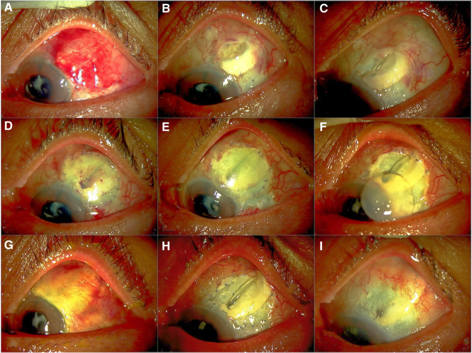
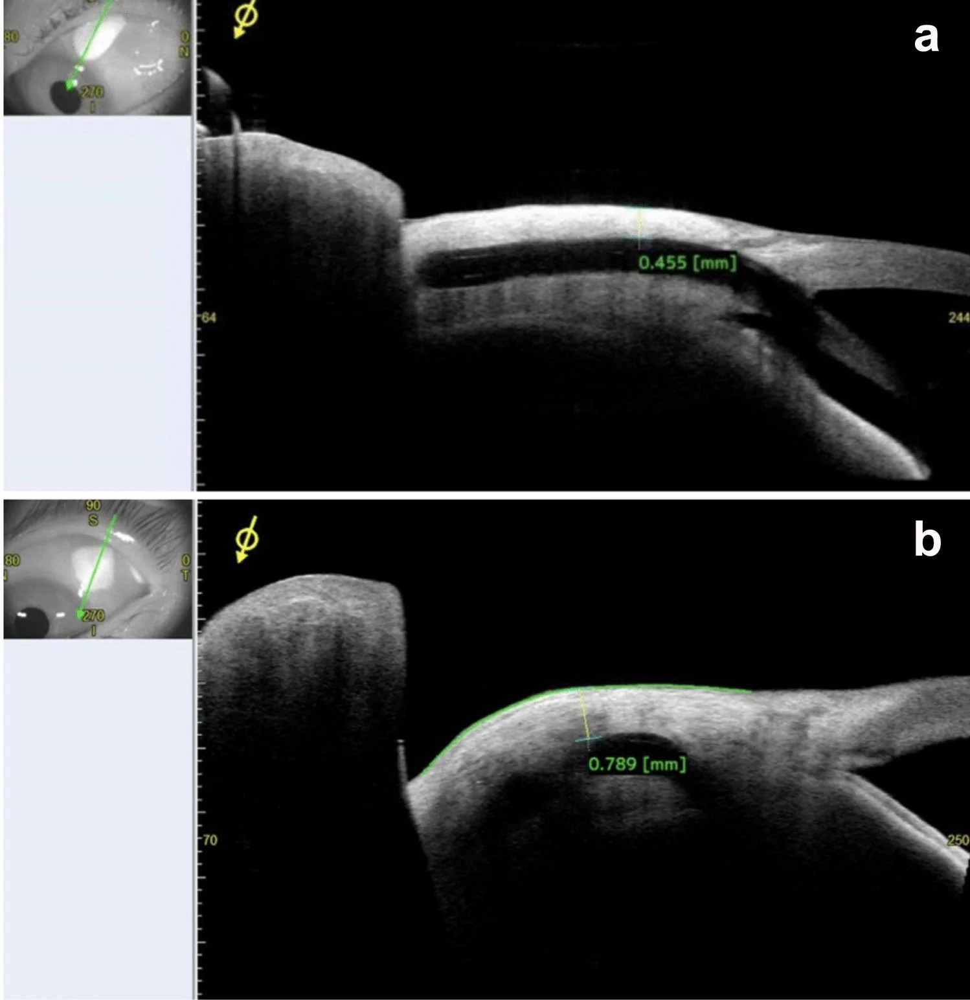
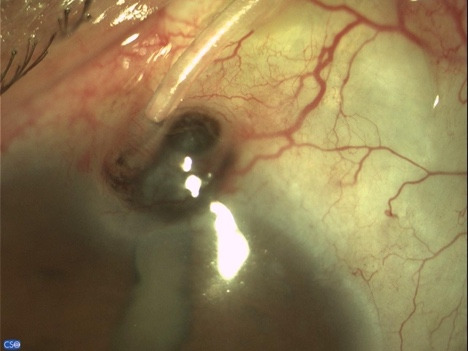
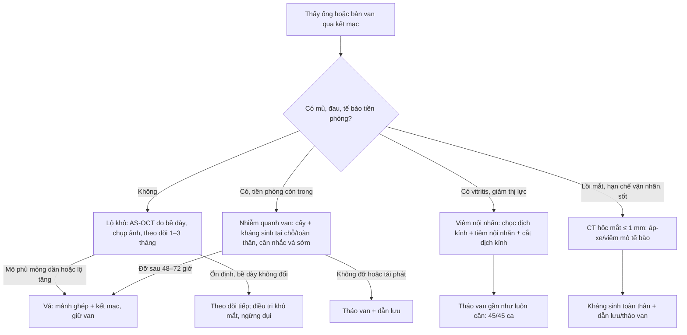
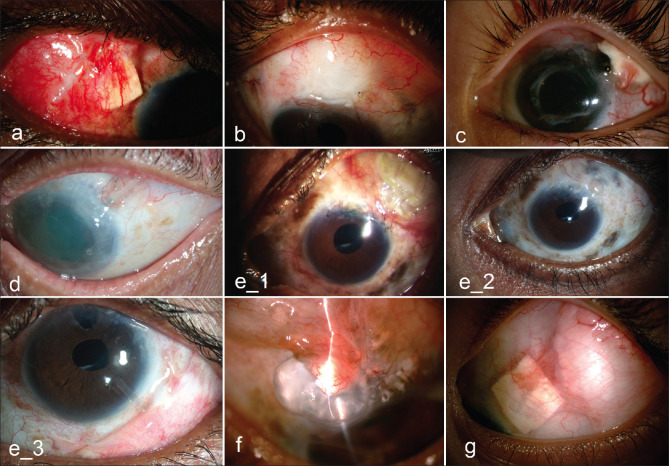
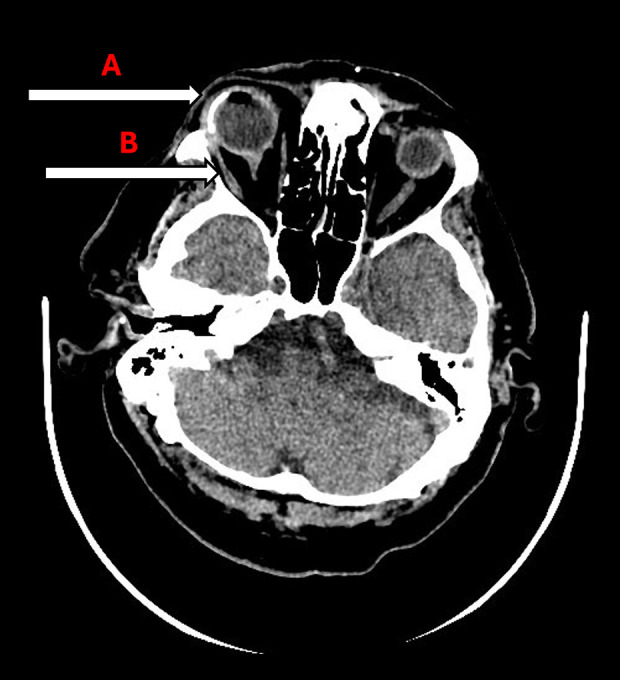

# 3224 — Lộ ống/bản van dẫn lưu glôcôm muộn: mảnh ghép đã tiêu, kết mạc mỏng, hay ổ nhiễm đã lan vào nhãn cầu? / Late glaucoma drainage device exposure and peri-implant infection

**Tags:** `pattern:lo-vat-lieu` `pattern:lo-ong-van` `pattern:lo-ban-van` `pattern:nhien-quanh-van` `pattern:mu-tien-phong` `pattern:loi-mat` `pattern:phu-mo-hoc-mat` `vung:mat` `vung:ket-mac` `vung:cung-mac` `vung:tien-phong` `vung:hoc-mat` `anatomy:van-dan-luu-glaucoma` `anatomy:manh-ghep-cung-mac` `protocol:AS-OCT` `protocol:UBM` `protocol:CT-hoc-mat` `protocol:seidel` `protocol:cay-dich-kinh` `score:IOP` `incidentaloma:van-dan-luu`

**Mức chắc chắn (certainty):** tổng hợp y văn (literature synthesis) — ghép **đoàn hệ 12.849 bệnh nhân đặt van** so với **9.006 trabeculectomy** và **3.097 đai củng mạc** (PMID 42768080), **405 mắt Baerveldt** đo AS-OCT (PMID 42018117), **76 mắt vá lộ ống** (PMID 38982302), **45 mắt viêm nội nhãn sau van** (PMID 41666950), **12,5 triệu thủ thuật IRIS** (PMID 41985695), **101 mắt viêm nội nhãn sau mổ glôcôm** (PMID 41346232), **84 mắt** so sánh vật liệu vá (PMC12274542), **50 mắt** AS-OCT mảnh ghép (PMC12583483), **26 mắt** AS-OCT màng ngoài tim (PMC12095395), **1.303 mắt** đặt van không mảnh ghép (PMC12013324) và các ca lâm sàng có ảnh. Nhóm **không có bệnh nhân của mình**; chỗ suy luận đánh dấu **[suy luận]**.

> **Ranh giới với bài đã có:** [3219](../3219-song-thi-han-che-van-nhan-sau-van-loc-glocom/lesson.md) trả lời **song thị/hạn chế vận nhãn** sau van; [3206](../3206-bong-cang-sau-van-dan-luu-glaucoma/lesson.md) phủ **bao xơ quanh bản làm tăng nhãn áp**; [1996](../1996-tac-tut-ong-van-dan-luu-glaucoma/lesson.md) phủ **ống bít/tụt**; [1993](../1993-that-bai-needling-van-dan-luu/lesson.md) phủ **chọn van/needling**; [1991](../1991-ro-bong-loc-muon-viem-noi-nhan/lesson.md) phủ **rò bọng lọc sau trabeculectomy** (không có vật liệu). Bài này chỉ trả lời **một câu**: *kết mạc trên ống/bản van đã rách hoặc mảnh ghép đã tiêu — khi nào chỉ vá, khi nào phải tháo toàn bộ, và đọc gì trên AS-OCT/CT để quyết định?*

> **Câu chốt — sáu con số phải thuộc:** **(1)** Viêm nội nhãn sau đặt van: **0,82% / 1,57% / 1,87%** ở **1 / 3 / 5 năm** (12.849 bệnh nhân), so với **0,47% / 0,78% / 0,96%** sau trabeculectomy; nguy cơ 30 ngày sau van chỉ **0,075% (1/1.333)** (PMID 42768080; PMID 41985695). **(2)** Trong **45 mắt** viêm nội nhãn sau van, **73% đang lộ ống hoặc bản** lúc chẩn đoán và **18% vừa vá lộ ống trước đó** → **91% gắn với lộ vật liệu**; khởi phát **trung vị 4 năm (6 tuần – 11 năm)**; **cấy dương 51%**; **cả 45 mắt cuối cùng đều phải tháo van**, chỉ **22% đạt ≥ 20/200** (PMID 41666950). **(3)** Tỉ lệ lộ ống sau Baerveldt: **12/405 = 2,96%** (theo dõi trung bình **630,7 ngày**), với **glôcôm tân mạch OR 5,03** và **đặt ống vào tiền phòng OR 6,07** (PMID 42018117). **(4)** Vá lộ ống giữ được van: sống **không tái lộ 76,2% / 72,7% / 54,7%** ở **1 / 2 / 4 năm**; **đã vá 1 lần trước đó HR 3,06**, **mảnh ghép màng ngoài tim HR 3,43**; **đổi vị trí ống vào tiền phòng/rãnh thể mi: 0/9 tái lộ** (PMID 38982302). **(5)** AS-OCT đo được **bề dày kết mạc–củng mạc trên ống**: **trung vị 190 µm (54–552)** ở mắt nguy cơ cao; mảnh ghép màng ngoài tim mỏng **42,1 µm/tháng**, còn **1.020 → 564 µm** sau 12 tháng (vs **1.575 → 1.380 µm** với cân mạc) và **5 ca lộ ống vs 0** (PMID 43018021; PMC12583483). **(6)** Vật liệu vá: cân mạc **4/43 = 9,3%** lộ so với mảnh giác mạc **1/41 = 2,4%** trong 18 tháng (ở góc trên: **4 vs 0**, p = 0,045) (PMC12274542).

## 1. Tổng quan bệnh học – cơ chế hình ảnh

### 1.1 Ống và bản van được phủ bằng gì — "mái nhà" chỉ dày vài trăm micromet

- **Cấu trúc:** van dẫn lưu glôcôm (glaucoma drainage device, GDD) gồm **bản** (plate) khâu vào củng mạc **8–10 mm sau rìa**, nối với **ống silicon** đi qua củng mạc vào **tiền phòng** hoặc **rãnh thể mi**. Đoạn ống ngoài củng mạc chỉ được che bởi **mảnh ghép (patch graft)** — củng mạc đồng loại, giác mạc, màng ngoài tim, cân mạc — rồi đến **Tenon + kết mạc**.
- **Con số quyết định:** AS-OCT trên 22 mắt Ahmed có ống nằm "nông" lâm sàng cho thấy bề dày kết mạc–củng mạc **trên ống** chỉ **trung vị 190 µm (54–552 µm)**, và **mỏng dần theo thời gian** (ρ = −0,44; p = 0,034) — nhóm **≥ 5 năm** còn **119 µm (64–227)** so với **273 µm** ở nhóm **≤ 1 năm** (PMID 43018021). **190 µm là bề dày của một tờ giấy** — đây là lý do tuyệt đối không được "chọc dò" hay "nắn" vùng này.
- **Ống đặt ở đâu quyết định độ dày mái nhà:** AS-OCT cùng một mắt cho **0,455 mm** khi ống vào **tiền phòng** và **0,789 mm** khi ống qua **pars plana** (PMC13616009, Fig. 1); trên 405 mắt Baerveldt, bề dày trên ống **tiền phòng mỏng hơn** rãnh thể mi (p = 0,039) và **pars plana** (p < 0,001) (PMID 42018117). **Đây là cơ sở giải phẫu của OR 6,07 cho ống tiền phòng.**

### 1.2 TẠI SAO vật liệu lộ ra — bốn cơ chế, và tại sao nó là "cửa sau" vào nhãn cầu

| Cơ chế | Vì sao mái nhà mỏng đi | Dấu chốt lâm sàng |
|---|---|---|
| **1. Tiêu mảnh ghép (graft resorption)** | Mảnh ghép không có mạch, bị thấm dịch và tế bào viêm; màng ngoài tim mỏng **42,1 µm/tháng** (PMC12583483) | Thấy ống **qua mảnh ghép mờ đục**, không đau, không mủ |
| **2. Kết mạc–Tenon mỏng do thuốc/mổ trước** | Mitomycin C, mổ glôcôm nhiều lần, đốt thể mi, đái tháo đường → kết mạc mất mạch, co rút | Kết mạc **trắng bệch, dính, không di động** quanh ống |
| **3. Cọ xát cơ học** | Mi chặt (xơ cứng bì), dụi mắt, kính áp tròng, ống nông | Lộ **từng đoạn**, tiến triển chậm nhiều tháng |
| **4. Viêm tại chỗ (nhiễm trùng/viêm củng mạc/HZO)** | Viêm làm tan củng mạc và mảnh ghép từ bên dưới; Herpes zoster tái hoạt **ẩn** gây lộ **tái phát nhiều lần** dù đã vá | Đau, đỏ, mủ, mảnh ghép trắng đục; có thể kèm **loét giác mạc giả nhánh** (PMC11688080) |

- **TẠI SAO lộ ống nguy hiểm hơn rò bọng lọc:** bọng lọc là **khoang dưới kết mạc**, còn ống silicon là **vật liệu ngoại lai xuyên thẳng vào nội nhãn**. Khi kết mạc rách, vi khuẩn **đi theo mặt ngoài ống** vào tiền phòng — không cần thủng củng mạc mới. Bằng chứng dịch tễ: **91%** các ca viêm nội nhãn sau van có **lộ vật liệu** hoặc **vừa vá lộ** (PMID 41666950), trong khi viêm nội nhãn sau đai củng mạc (không thông vào nội nhãn) chỉ **0,39% ở 5 năm** (PMID 42768080).
- **TẠI SAO kháng sinh đơn thuần thường thất bại:** vi khuẩn bám thành **màng sinh học (biofilm)** trên silicon, và ổ nhiễm có thể nằm **quanh bản van trong hốc mắt** — nơi thuốc nhỏ và thuốc tiêm khó tới. Trong loạt 45 mắt, **cấy dương 51%** với phổ rộng (**S. epidermidis 4, S. aureus 3, liên cầu 2, mycobacteria 4, gram âm 8, nấm 2**) và **tất cả đều phải tháo van** dù ban đầu chỉ tiêm nội nhãn (PMID 41666950). Mycobacteria và nấm là lý do **phải cấy mẫu đặc biệt**, không chỉ cấy thường.

### 1.3 Vì sao "muộn" — đường cong thời gian

- Lộ ống xuất hiện **17,2 ± 18,0 tháng** sau đặt van trong loạt 64 mắt (PMID 27099461) và **12,25 ± 6,36 tháng** trong loạt 8 mắt (PMC11451231); nhưng **viêm nội nhãn** lại có **trung vị 4 năm** (PMID 41666950) — nghĩa là **lộ ống tồn tại nhiều năm** trước khi nhiễm. Vì vậy **lộ ống không phải biến chứng "đã qua"** mà là **nguy cơ tích lũy**.
- **Tại sao thời gian dài:** mảnh ghép mỏng dần từ từ (**42,1 µm/tháng**), kết mạc mỏng dần theo năm (**273 → 119 µm**), và mỗi đợt viêm kết mạc là một lần "thử" hàng rào.

### 1.4 Vật lý của ba phương tiện chẩn đoán

| Phương tiện | Nguyên lý | Trả lời câu gì | Giới hạn |
|---|---|---|---|
| **AS-OCT (swept-source ~1310 nm)** | Giao thoa ánh sáng; phân giải trục **~5–10 µm**, không tiếp xúc | **Còn hay mất** lớp kết mạc trên ống; **bề dày µm**; mảnh ghép còn hay tiêu | Không xuyên qua mảnh ghép dày/đục; cần ống nằm nông mới đo được |
| **UBM (50 MHz)** | Siêu âm tần số cao, xuyên qua mảnh ghép đục | Vị trí ống trong **rãnh thể mi**, bản van, ổ dịch quanh bản | Cần tiếp xúc nước, khó qua kết mạc sẹo |
| **CT hốc mắt ≤ 1 mm** | Đậm độ tia X | **Lan vào hốc mắt**: lồi mắt, thâm nhiễm mỡ, cơ to, ổ áp-xe, viêm mô tế bào | Silicon gần đậm độ mô mềm → **không dùng để xác định lộ ống**; chỉ dùng cho **biến chứng hốc mắt** |

- **B-scan 10 MHz** khi môi trường trong suốt bị mất: **hạt lấm tấm dịch kính** (vitritis) + dày thành nhãn cầu + bong hắc mạc nông = viêm nội nhãn (ca PMC13270879: **B-scan** cho hạt dịch kính dày, dày thành nhãn cầu, bong hắc mạc nông; **CT** cho lồi mắt + thâm nhiễm mỡ hốc mắt + cơ trực ngoài to).

## 2. Mẫu hình + chẩn đoán phân biệt theo vị trí (gamut)

- **Mẫu hình trung tâm:** *vật liệu ngoại lai nhìn thấy được qua kết mạc* ± mủ ± viêm. Ba câu hỏi theo thứ tự: **(1) lộ ở đâu — ống hay bản? (2) có nhiễm tại chỗ không? (3) đã vào nội nhãn/hốc mắt chưa?**
- **Theo vị trí:**
  - **Sát rìa (1–3 mm):** lộ ống tại củng mạc quanh rìa — hay gặp nhất, dễ thấy, dễ vá; nhưng **gần tiền phòng nhất** nên nguy cơ vào nội nhãn cao.
  - **Giữa củng mạc (3–8 mm):** lộ ống trên đường đi tới bản; mảnh ghép tiêu từng đoạn.
  - **Xích đạo/sau xích đạo:** **lộ bản van** — mảng trắng–xám lớn, ít đau, dễ bị bỏ qua vì nằm dưới mi; nguy cơ **nhiễm hốc mắt**.
  - **Cùng đồ trên:** lộ ống + **dẫn lưu ra cùng đồ** → dễ nhầm với **lệ đạo** hoặc nang kết mạc.
- **Theo mức độ nhiễm (thang thực hành, [suy luận]):** **A. lộ khô** (không mủ, không Seidel) → **B. nhiễm quanh van** (đỏ, mủ, đau, tiền phòng còn trong) → **C. nhiễm nội nhãn/hốc mắt** (vitritis, giảm thị lực, lồi mắt, hạn chế vận nhãn). **Mỗi bậc đổi hoàn toàn cách xử trí** — đây là điểm khác biệt lớn nhất so với "rò bọng lọc" (bài 1991).
- **Gamut "mảng trắng/vàng trên ống":** mảnh ghép đục–vôi hóa · lộ ống khô · mủ dưới mảnh ghép · nang kết mạc (inclusion cyst) · hạt dị vật (foreign-body granuloma) · lộ chỉ khâu.

*Chín ảnh cùng một mắt (ngày 02/08/2020 → 27/02/2021): A sau đặt van; B–C kết mạc và mảnh ghép củng mạc đồng loại **đục, khô, tiêu dần** rồi **lộ ống**; D–F vá lại bằng mảnh giác mạc + kết mạc tự thân → **tiêu hoàn toàn**; G–H vá lần ba bằng mảnh giác mạc + kết mạc mắt đối diện → **tiêu tiếp**; I cắt bỏ ống. Nguồn: *Medicine (Baltimore)* 2024 (PMC11688080), CC BY 4.0.*

## 3. Bảng so sánh phân biệt (ma trận đối chiếu)

| Thực thể (entity) | Hình ảnh điển hình | Chốt vào (rule-in) | Chốt loại (rule-out) | Gợi ý xác nhận |
|---|---|---|---|---|
| **Lộ ống khô, không nhiễm** | Ống silicon **trong suốt** thấy rõ dưới kết mạc mỏng; không mủ, không đau; **Seidel (−)** | **Thấy ống + không mủ + không vitritis**; AS-OCT: **mất lớp kết mạc trên ống** | Còn lớp kết mạc liên tục (dù mỏng) → **chưa lộ**, chỉ theo dõi | AS-OCT dọc toàn bộ ống; đo chiều dài lộ (mm) |
| **Lộ ống + nhiễm quanh van (blebitis-like)** | Đỏ, **mủ vàng–xanh** quanh ống, đau; tiền phòng **còn trong** | **Mủ tại chỗ + cấy kết mạc dương**; **không tế bào dịch kính** | Vitritis, giảm thị lực nhanh → đã là nội nhãn | Cấy mủ + tiền phòng; AS-OCT xem mảnh ghép còn hay mất |
| **Lộ bản van (plate exposure)** | Mảng trắng–xám lớn vùng xích đạo, **kết mạc quanh mỏng, trắng bệch**; thường **không đau** | **Thấy bản qua kết mạc**; UBM/AS-OCT: **không còn mô phủ**; sờ thấy cạnh bản | Chỉ mảnh ghép trắng đục nhưng **kết mạc còn liên tục** | UBM 50 MHz; CT nếu có lồi mắt/hạn chế vận nhãn |
| **Nhiễm hốc mắt quanh bản** | Lồi mắt, hạn chế vận nhãn, đau sâu, sốt; CT: **thâm nhiễm mỡ, cơ to, ổ dịch** | **CT có thâm nhiễm mỡ/cơ + lộ bản/ống**; cấy dịch hốc mắt | CT bình thường + không lộ → nghĩ nguyên nhân khác (bài 1461) | CT ≤ 1 mm ± cản quang; hội chẩn glôcôm–tạo hình |
| **Viêm nội nhãn muộn sau van** | Giảm thị lực + đau + **tế bào/mủ tiền phòng + vitritis**; **73% có lộ vật liệu** | **Vitritis + cấy dịch kính**; B-scan hạt dịch kính | Chỉ mủ tiền phòng không vitritis → nhiễm tại chỗ | Chọc dịch kính **trước** kháng sinh; cấy cả mycobacteria/nấm |
| **Viêm nội nhãn KHÔNG lộ vật liệu (27%)** | Vitritis + van **nguyên vẹn** trên lâm sàng | **Cấy dịch kính dương**; AS-OCT xác nhận kết mạc còn liên tục | Có lộ ở bất kỳ đâu (khám cả **4 góc**, lật mi) → quay lại hàng trên | AS-OCT toàn bộ ống; **không loại trừ chỉ vì "van không lộ"** |
| **Lộ chỉ khâu (suture erosion)** | Sợi chỉ nylon xanh–trắng nhô qua kết mạc, **không có ống** | **Thấy chỉ, không thấy ống**; AS-OCT: vật liệu **rất mảnh, thẳng** | Ống silicon **trong suốt, đường kính ~0,6 mm, cong** | Bóc chỉ, vá kết mạc; không tháo van |
| **Nang kết mạc sau vá (inclusion cyst)** | Nang trong, **dưới mảnh ghép**, lớn dần sau vá lộ ống | **Nang xuất hiện sau mổ vá**; chọc ra dịch trong | Nang **có mủ** → áp-xe, không phải nang đơn thuần | AS-OCT: vách nang; theo dõi sát (đã có ca **viêm nội nhãn** sau nang — PMC5015635) |

*AS-OCT (CASIA2) cắt dọc ống tại chỗ vào củng mạc. **(a)** ống vào **tiền phòng**: mô phủ **0,455 mm**; **(b)** ống qua **pars plana**: mô phủ **0,789 mm**. Đo từ mặt kết mạc đến bờ ngoài ống. Đây là "mái nhà" duy nhất giữa nội nhãn và vi khuẩn ngoài mắt. Nguồn: *Jpn J Ophthalmol* 2026 (PMC13616009), CC BY 4.0.*

### 3.1 Ranh giới quan trọng: lộ vật liệu ≠ nhiễm, và "trông lành" ≠ đã khỏi

- **Lộ ống mạn có thể biểu mô hóa:** ống nằm dưới lớp kết mạc mỏng **đã phủ biểu mô** trông như "đã liền" (ảnh dưới) — nhưng lớp phủ chỉ còn vài chục micromet và **không có Tenon**, nên vẫn là điểm yếu. Không được coi là "ổn định" mà ngừng theo dõi **[suy luận]**.
- **Seidel âm không loại trừ nhiễm:** rò lượng nhỏ có thể âm giả; và nhiễm có thể đi **theo mặt ngoài ống** mà không có dòng chảy nhìn thấy.

*Ống silicon trong suốt bắt đầu từ rìa, chạy trên vùng củng mạc **mỏng, lộ sắc tố hắc mạc**, kết mạc quanh **sẹo, xung huyết, phủ không đều** — lộ ống mạn đã được biểu mô hóa một phần. Nguồn: *Rom J Ophthalmol* 2024 (PMC11007568), CC BY 2.0.*

## 4. Protocol chụp/đo + hệ phân độ và ngưỡng xử trí

### 4.1 Trình tự đọc — 6 bước, dưới 15 phút

1. **Đèn khe + fluorescein 2%:** đo **chiều dài lộ (mm)**, vị trí (cách rìa bao nhiêu mm), **Seidel**. Nghi ngờ "rò giả" từ **lệ đạo** ở cùng đồ trên–thái dương → **tiêm trypan blue vào tiền phòng**, xem thuốc đi **dọc ống ra cùng đồ** (PMC12284709) — kỹ thuật này phân biệt được **rò van thật** với **lệ đạo** khi fluorescein không đủ.
2. **AS-OCT dọc toàn bộ ống:** đo bề dày mô phủ (µm) tại điểm **mỏng nhất**; so với mắt bên và so với lần trước. Ngưỡng tham khảo: **≤ 200 µm** là "mái nhà giấy" (trung vị nhóm nguy cơ cao **190 µm**) — **[suy luận]**, chưa có ngưỡng đồng thuận.
3. **UBM 50 MHz** nếu nghi **lộ bản** hoặc ống trong **rãnh thể mi** (AS-OCT không tới).
4. **B-scan 10 MHz** khi không thấy đáy mắt: tìm **hạt dịch kính, dày thành, bong hắc mạc nông**.
5. **CT hốc mắt ≤ 1 mm (± cản quang)** khi **lồi mắt, hạn chế vận nhãn, đau sâu, sốt**: tìm thâm nhiễm mỡ, cơ to, ổ áp-xe, viêm mô tế bào. CT **không** dùng để chứng minh lộ ống.
6. **Vi sinh trước kháng sinh:** cấy **mủ kết mạc + dịch tiền phòng (0,1 mL) ± dịch kính**; yêu cầu **cấy mycobacteria và nấm** vì phổ này có thật (4 mycobacteria, 2 nấm/45 mắt — PMID 41666950).

### 4.2 Ba tầng quyết định (sơ đồ)

### 4.3 Vá giữ van — hiệu quả thật và yếu tố thất bại

- **Sống không tái lộ:** **76,2% (1 năm), 72,7% (2 năm), 54,7% (4 năm)** trên 76 mắt (PMID 38982302) → **vá là giải pháp hợp lý nhưng không phải "vá một lần là xong"**; gần **một nửa** tái lộ sau 4 năm.
- **Yếu tố tăng thất bại:** khoảng cách từ lúc đặt ống đến lúc vá **ngắn** (HR 2,87) · **đã vá 1 lần** (HR 3,06) · **mảnh ghép màng ngoài tim người** (HR 3,43). Ngược lại, **đổi vị trí ống vào tiền phòng hoặc rãnh thể mi: 0/9 tái lộ** (PMID 38982302).
- **Chọn vật liệu:** cân mạc **9,3%** lộ so với mảnh **giác mạc 2,4%** (p = 0,184; ở góc trên **4 vs 0**, p = 0,045 — PMC12274542); màng ngoài tim mỏng nhanh **42,1 µm/tháng** và **5 ca lộ** (PMC12583483); vật liệu tổng hợp EverPatch cho **sống không lộ 83,5% vs 88,4%** với củng mạc đồng loại ở 12 tháng (khác biệt không ý nghĩa — PMC13073034). **Kết luận thực hành:** ưu tiên **củng mạc/giác mạc đồng loại dày**, tránh mảnh mỏng ở mắt nguy cơ cao **[suy luận]**.
- **Kỹ thuật khi kết mạc đã cạn:** túi dưới kết mạc (pocket technique — PMID 38587450), **hai đường hầm củng mạc ngắn** (8/8 không tái lộ sau **41,25 ± 26,54 tháng** — PMC11451231), vạt kết mạc cuống từ **cùng đồ trên** khi kết mạc thiếu máu do MMC (PMC12746280), mảnh giác mạc + **hai lớp màng ối** (PMC12790098).

### 4.4 Khi nào PHẢI tháo

- **Viêm nội nhãn:** trong 45 mắt, **tất cả** đều tháo van cuối cùng (PMID 41666950), và trong loạt 101 mắt viêm nội nhãn sau mổ glôcôm thì **97% khởi đầu chỉ tiêm nội nhãn** (PMID 41346232) → **đừng hứa "giữ được van"** với bệnh nhân khi đã có vitritis.
- **Nhiễm quanh van không đáp ứng 48–72 giờ** hoặc **tái phát**: 2 ca cắt ống/3 ca tháo toàn bộ trong loạt 1.303 mắt (PMC12013324).
- **Lộ bản + tan củng mạc/viêm củng mạc**: tháo bản, có thể **giữ ống** đặt lại dưới kết mạc lành (PMC13771629) hoặc **thay bằng microshunt** trong cùng thì (PMC13631603).
- **Mắt chỉ còn một mắt, thị lực còn tốt:** cân nhắc **vá bảo tồn trước**, vì tháo van = mất kiểm soát nhãn áp và có thể mù do glôcôm **[suy luận]** — nhưng không được trì hoãn khi có vitritis.

## 5. Biến thể bình thường và cạm bẫy

- **"Tube trace" — ống nhìn thấy nhưng CHƯA lộ:** kết mạc còn liên tục, chỉ mỏng; AS-OCT xác nhận **biểu mô còn nguyên**. Đây là **biến thể theo dõi**, không phải chỉ định mổ. Mổ ở mắt còn kết mạc liên tục làm **mất thêm kết mạc** và tạo vòng xoáy tái lộ.
- **Mảnh ghép đục/vôi hóa** trông như "vật liệu lộ": AS-OCT thấy **mô phủ còn trên mảnh ghép** → không can thiệp.
- **Rò giả từ lệ đạo:** cùng đồ trên–thái dương là nơi **cả ống van và lệ đạo** cùng đổ; fluorescein không phân biệt được nước mắt và thủy dịch → **trypan blue tiền phòng** (PMC12284709).
- **Bỏ sót lộ BẢN** vì chỉ khám vùng ống: bản nằm **8–10 mm sau rìa, dưới mi**; phải **lật mi, cho mắt liếc đối diện**, và chụp ảnh 4 góc.
- **Bỏ sót nhiễm nội nhãn vì "van không lộ" (27%)**: vitritis có thể là **đường máu** hoặc từ ổ nhiễm bản kín đáo; **không loại trừ** dựa vào lâm sàng bề mặt.
- **Nang kết mạc sau vá:** nang trong dưới mảnh ghép có thể **nhiễm** và gây **viêm nội nhãn** (ca trẻ 2 tuổi — PMC5015635); khi vá phải **bóc sạch biểu mô** quanh ống và **khâu cố định mảnh ghép**.
- **Chụp CT rồi kết luận "không có gì":** silicon gần đậm độ mô mềm; CT **âm tính không loại trừ lộ ống**, chỉ loại trừ **biến chứng hốc mắt**.

*Chín ảnh mổ/đèn khe: (a) vạt kết mạc; (b) kết mạc **mỏng, nhợt**; (c) **hở củng mạc** sau bóc nang Tenon; (d) **lộ ống không đáp ứng điều trị bảo tồn**; (e₁) **lộ hoàn toàn bản van Ahmed đặt ra trước**; (e₂) **củng mạc mỏng lan rộng sau tháo van**; (e₃) van thứ hai đặt ở góc dưới–thái dương; (f) **bản van lộ hoàn toàn**; (g) đặt lại van dưới. Nguồn: *Indian J Ophthalmol* 2023 (PMC10683691), CC BY-NC-SA 4.0.*

*CT lát trục không cản quang ở ca **viêm toàn nhãn + viêm mô tế bào hốc mắt 12 ngày sau đặt van Paul**: (A) **lồi mắt phải + dày mô mềm trước vách**; (B) **cơ trực ngoài to nhẹ**, thâm nhiễm mỡ hốc mắt; thị thần kinh bình thường. CT **không thấy ống/bản** — giá trị của CT là **chứng minh lan ra hốc mắt**, không phải tìm vật liệu. Nguồn: *Am J Case Rep* 2026 (PMC13270879), CC BY-NC-ND 4.0.*

## 6. Tự lượng giá — Blind Quiz

**Ca 1 — Nam 72 tuổi, glôcôm tân mạch, đặt van Ahmed 1 năm, nay "mắt đỏ, chảy nước mắt" nhưng không đau, thị lực không đổi.**

- Câu hỏi: mô tả cấu trúc đi qua củng mạc? Lớp phủ còn hay mất? Ba chẩn đoán phân biệt? Bước tiếp theo?

<b>Bấm để hiện đáp án (findings + chẩn đoán)</b>

- **Dấu hiệu:** ống silicon **trong suốt** chạy từ rìa ra sau trên vùng củng mạc **mỏng, lộ sắc tố hắc mạc**; kết mạc quanh **sẹo, xung huyết, phủ không đều** — **lộ ống mạn đã biểu mô hóa một phần**.
- **Chẩn đoán:** **lộ ống khô (không nhiễm)** — chưa có mủ, không vitritis. Phân biệt: lộ chỉ khâu · mảnh ghép vôi hóa · nang kết mạc.
- **Vì sao không mổ ngay:** còn lớp phủ, không nhiễm; nhưng **bề dày chỉ vài chục µm** nên phải **AS-OCT đo** và **theo dõi 1–3 tháng**, dặn bỏ dụi mắt, điều trị khô mắt.
- **Nguồn ảnh:** *Rom J Ophthalmol* 2024 (PMC11007568), CC BY 2.0.

**Ca 2 — Nam 66 tuổi, glôcôm tân mạch do đái tháo đường, 2 tháng sau đặt van: vùng trên–thái dương có mảng trắng rộng, không đau, nhãn áp 14 mmHg.**

- Câu hỏi: cấu trúc nào đang lộ? Vì sao **không đau** mà vẫn nguy hiểm? Đo gì trước khi quyết định?

<b>Bấm để hiện đáp án (findings + chẩn đoán)</b>

- **Dấu hiệu:** **bản van (plate) lộ hoàn toàn**, kết mạc quanh **mỏng, nhợt, dính**, củng mạc bên dưới **mỏng** — tương ứng panel **e₁/f** của hình.
- **Chẩn đoán:** **lộ bản van mạn** — không đau vì không có viêm cấp, nhưng **bản là "cửa" vào hốc mắt**: nhiễm có thể lan thành **viêm mô tế bào/áp-xe hốc mắt** mà không cần vào nội nhãn.
- **Đo trước khi quyết định:** **UBM 50 MHz** (mô phủ quanh bản), **AS-OCT** đoạn ống, **CT hốc mắt** nếu lồi mắt/hạn chế vận nhãn; cấy nếu có mủ.
- **Nguồn ảnh:** *Indian J Ophthalmol* 2023 (PMC10683691), CC BY-NC-SA 4.0.

**Ca 3 — Nam 77 tuổi, 12 ngày sau đặt van Paul: đau nhiều, mi sưng, hạn chế vận nhãn, thị lực còn nhận biết ánh sáng.**

- Câu hỏi: hai bất thường trên CT? Chẩn đoán? Xử trí và vì sao **không thể tháo van** trong thì đầu?

<b>Bấm để hiện đáp án (findings + chẩn đoán)</b>

- **Dấu hiệu:** (A) **lồi mắt + dày mô mềm trước vách**; (B) **cơ trực ngoài to nhẹ + thâm nhiễm mỡ hốc mắt**. B-scan kèm theo: **hạt dịch kính dày, dày thành nhãn cầu, bong hắc mạc nông**.
- **Chẩn đoán:** **viêm toàn nhãn (panophthalmitis) + viêm mô tế bào hốc mắt** sau đặt van — biến chứng **12 ngày**, cấy **âm tính**, điều trị **kháng sinh nội nhãn + toàn thân rồi cắt dịch kính**; **không tháo được van** vì viêm dính nặng, thị lực cuối **20/250**.
- **Bài học:** nhiễm sau van có thể **biểu hiện bằng hình ảnh hốc mắt** trước khi thấy lộ vật liệu; **CT là chốt để định mức lan**, không phải để tìm ống.
- **Nguồn ảnh:** *Am J Case Rep* 2026 (PMC13270879), CC BY-NC-ND 4.0 — nguyên bản, không cắt/ghép.

## 7. Câu hỏi nghiên cứu & điểm chưa đồng thuận (tính đến 11/2026)

1. **[Tranh cãi] Ở mắt đặt van dẫn lưu glôcôm, vật liệu che ống nào giảm lộ ống nhiều nhất trong 12–24 tháng?**
   - **Đã biết:** mảnh **giác mạc** ít lộ hơn **cân mạc** (2,4% vs 9,3%; góc trên 0/41 vs 4/39, p = 0,045); **cân mạc** mỏng **42,1 µm/tháng** so với **màng ngoài tim**; vật liệu tổng hợp tương đương củng mạc đồng loại ở 12 tháng (83,5% vs 88,4%).
   - **Chưa rõ:** các so sánh đều **hồi cứu, một trung tâm, cỡ mẫu 19–105 mắt**, khác **thời điểm đo** và **định nghĩa lộ** → chưa xếp hạng được vật liệu.
   - **Hướng nghiên cứu:** RCT hoặc đoàn hệ tiến cứu phân tầng theo **vị trí ống (tiền phòng vs pars plana)** và **bề dày AS-OCT lúc 3 tháng**.
   - **Nguồn:** PMC12274542 (2025); PMC12583483 (2025); PMC13073034 (2026).

2. **[Khoảng trống] Khi đã có viêm nội nhãn sau van, có nhóm bệnh nhân nào giữ được van an toàn bằng cắt dịch kính sớm thay vì tháo?**
   - **Đã biết:** loạt **45 mắt** phải tháo **100%** và chỉ **22%** đạt ≥ 20/200; một ca báo cáo **giữ van thành công** nhờ cắt dịch kính sớm + rút ống khỏi tiền phòng rồi đặt lại, hồi phục thị lực **7 tháng**.
   - **Chưa rõ:** không có tiêu chí chọn (mức vitritis, loại vi khuẩn, thời điểm cắt dịch kính), nên ca thành công không khái quát được.
   - **Hướng nghiên cứu:** registry đa trung tâm ghi **thời gian tới cắt dịch kính, loại tác nhân, tình trạng lộ vật liệu** làm biến số.
   - **Nguồn:** PMID 41666950 (2026); PMC7132143 (2020).

3. **[Khác biệt thực hành] Ngưỡng AS-OCT nào buộc phải vá trước khi lộ?**
   - **Đã biết:** mô phủ trên ống ở mắt nguy cơ cao **trung vị 190 µm (54–552)** và mỏng dần theo năm (**273 → 119 µm** ở nhóm ≥ 5 năm); mắt **lộ ống** có mảnh ghép mỏng hơn có ý nghĩa **tại 3 và 6 tháng** (p = 0,013; p = 0,005).
   - **Chưa rõ:** **không có ngưỡng µm** được đồng thuận; 190 µm là **mô tả của nhóm chọn lọc**, không phải ngưỡng can thiệp; đo phụ thuộc máy và vị trí đặt cửa sổ.
   - **Hướng nghiên cứu:** nghiên cứu **độ chính xác chẩn đoán** với ngưỡng ứng viên (150/200/250 µm), kết cục là **lộ ống trong 12 tháng**, có mù và cùng một giao thức AS-OCT.
   - **Nguồn:** PMC13616009 (2026); PMC12095395 (2025).

## Bài liên quan chéo

- [3219 – Song thị & hạn chế vận nhãn sau van dẫn lưu glôcôm](../3219-song-thi-han-che-van-nhan-sau-van-loc-glocom/lesson.md) *(bản van di lệch/nhiễm — mặt cơ học)*
- [3206 – Bọng căng sau van dẫn lưu: bao xơ và tăng nhãn áp](../3206-bong-cang-sau-van-dan-luu-glaucoma/lesson.md)
- [1996 – Tắc và tụt ống van dẫn lưu: AS-OCT/UBM](../1996-tac-tut-ong-van-dan-luu-glaucoma/lesson.md)
- [1993 – Chọn van & needling bọng lọc](../1993-that-bai-needling-van-dan-luu/lesson.md)
- [1991 – Rò bọng lọc muộn & viêm nội nhãn liên quan bọng](../1991-ro-bong-loc-muon-viem-noi-nhan/lesson.md) *(so sánh có/không vật liệu ngoại lai)*
- [1461 – Áp-xe dưới màng xương hốc mắt ở trẻ](../1461-ap-xe-duoi-mang-xuong-hoc-mat-o-tre/lesson.md) *(DDx hốc mắt)*

> Không dùng để chẩn đoán độc lập khi chưa có người hướng dẫn.
