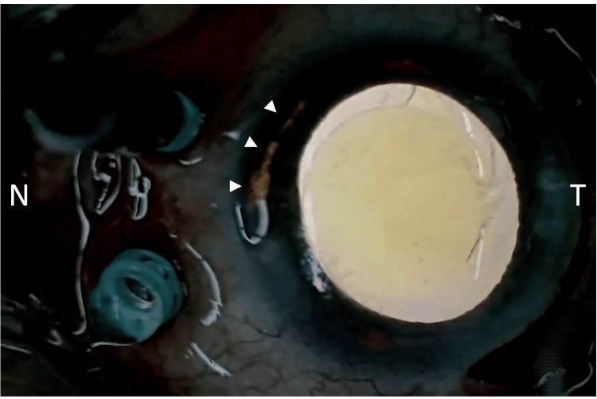
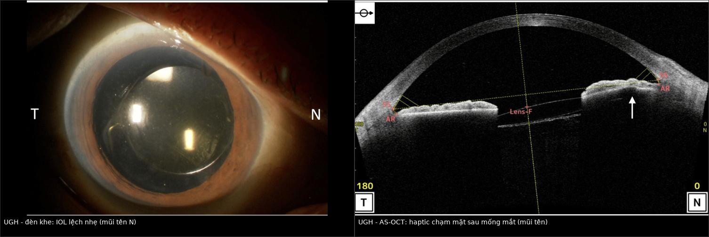
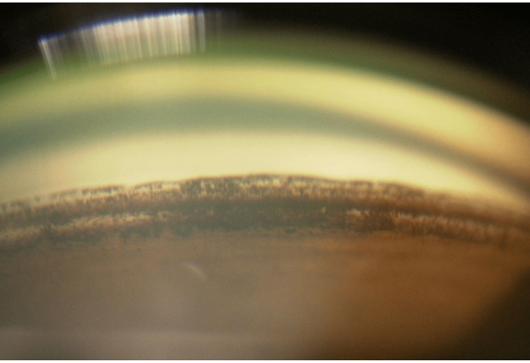
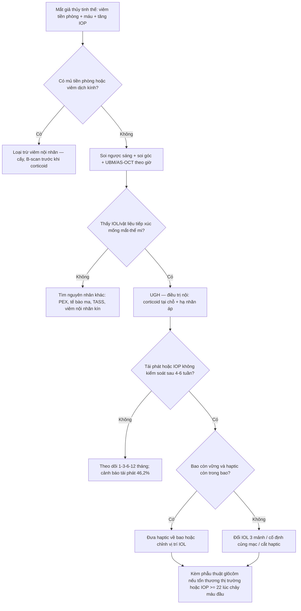
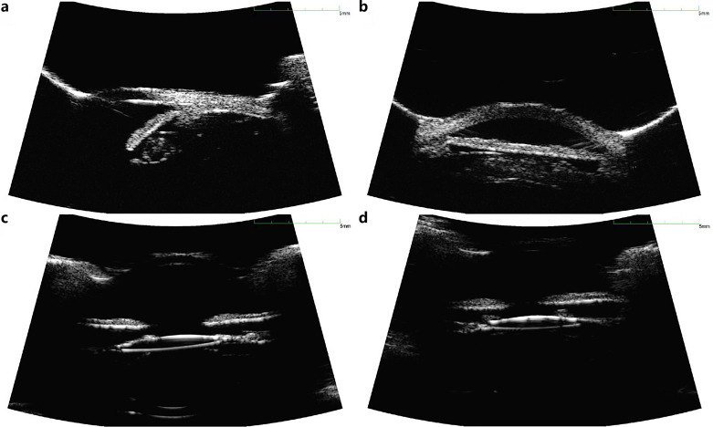
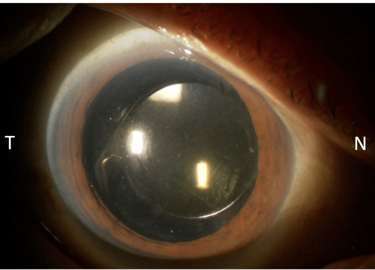
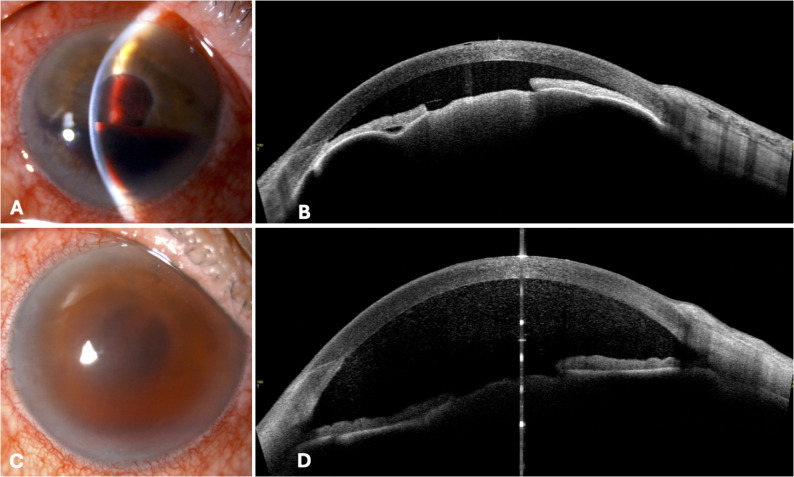
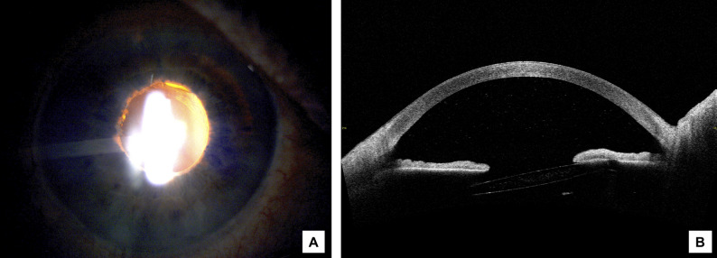

# 3225 — Hội chứng UGH sau đặt IOL/vật liệu ngoại lai: viêm – glôcôm – máu tiền phòng / Uveitis-Glaucoma-Hyphema syndrome

**Tags:** `pattern:te-bao-tien-phong` `pattern:mau-tien-phong` `pattern:tang-nhan-ap` `pattern:khuyet-mong-mat` `pattern:di-nguyen-mong-mat` `pattern:viem-mang-bo-dao` `vung:mat` `vung:tien-phong` `vung:mong-mat` `vung:the-thuy-tinh` `anatomy:goc-tien-phong` `anatomy:the-mi` `anatomy:mong-mat` `protocol:UBM` `protocol:AS-OCT` `protocol:gonioscopy` `score:IOP` `incidentaloma:ong-dan-luu`

**Mức chắc chắn (certainty):** tổng hợp y văn (literature synthesis) — ghép **đoàn hệ 232 mắt** (PMID 42595287), **nghiên cứu bệnh–chứng 71 ca** (PMID 32511897), **14 mắt sau mổ IOL** (PMC7270258), **9 mắt chụp UBM** (PMID 12036685), **đoàn hệ 77 mắt IOL thứ phát** (PMID 42258065), cùng **3 ca có ảnh** (PMC13241279, PMC10715750, PMC13335230). Nhóm **không có bệnh nhân của mình**; chỗ suy luận đánh dấu **[suy luận]**.

> **Ranh giới với bài đã có:** [3222](../3222-thieu-mau-doan-truoc-sau-mo-co-truc-dai-vong/lesson.md) trả lời *phù giác mạc + phản ứng tiền phòng sau mổ cơ trực ở mắt có đai vòng* (thiếu máu đoạn trước); [3221](../3221-viem-cung-mac-nam-sau-buckle/lesson.md) là *nhiễm nấm quanh đai/ống silicon*; [3224](../3224-lo-ong-van-dan-luu-glaucoma/lesson.md) là *lộ ống van glôcôm*; [3223](../3223-pex-glaucoma-phaco-migs-trab/lesson.md) là *chọn phẫu thuật ở PEX có glôcôm*. Bài này chỉ trả lời **một câu**: *mắt đã đặt IOL/vật liệu, nay **viêm tiền phòng tái phát + máu + tăng nhãn áp** — có phải UGH không, tìm bằng hình ảnh nào, và khi nào phải mổ?*

> **Câu chốt — sáu con số phải thuộc:** **(1)** Tần suất UGH **0,4–1,2%** sau đặt IOL (giảm từ **2,2–3%** thời IOL tiền phòng cứng) (PMC11032181; PMC13241279); nhưng ở **IOL thứ phát không còn bao** là **18,2% (14/77)** — **36,4%** với cố định bằng chỉ củng mạc so với **4,5%** với IOL kẹp mống mắt, **RR 8,0** (PMID 42258065). **(2)** Trong **232 mắt**, **92,2%** là IOL hậu phòng, **76,2%** nằm ở rãnh thể mi; trong nhóm rãnh có ghi nhận cấu hình, **67,3%** là IOL một mảnh; thời gian từ mổ đến chẩn đoán **trung vị 4,8 năm**; **46,2%** tái phát; **77,2%** phải mổ (PMID 42595287). **(3)** Dấu hình ảnh hay gặp: **IOL–mống mắt/thể mi tiếp xúc 77,3%**, **sắc tố 59,3%**, **khuyết mống mắt (TID) 50,0%**, **xuất huyết nội nhãn 48,7%** — nên **thiếu một dấu không loại trừ** (PMID 42595287). **(4)** **Ít hơn 10%** bệnh nhân có đủ bộ ba kinh điển viêm–glôcôm–máu tiền phòng (PMC10715750). **(5)** Mổ IOL **giải quyết 77%**; **IOP ≥ 22 mmHg ở lần chảy máu đầu** dự báo cần thuốc hạ nhãn áp về sau (**AUC 0,80**) và **51%** người không có glôcôm trước đó vẫn cần điều trị glôcôm (PMID 32511897). **(6)** **Tăng nhãn áp tồn tại 59,3%** dù đã điều trị — UGH không chỉ là "viêm thoáng qua" mà là **bệnh mạn của góc tiền phòng** (PMID 42595287).

## 1. Tổng quan bệnh học – cơ chế hình ảnh

### 1.1 Cơ chế gốc: cọ xát cơ học, không phải nhiễm trùng

- **Vật liệu ngoại lai cọ vào mống mắt/thể mi/góc** → vỡ hàng rào máu–thủy dịch (blood–aqueous barrier) → **protein, bạch cầu, hồng cầu và sắc tố** vào tiền phòng. Hồng cầu và hạt sắc tố **bít lỗ bè**, cộng thêm viêm làm giảm thoát dịch → **tăng nhãn áp**. Cọ xát lặp lại từng nhịp tạo **khuyết mống mắt (transillumination defect, TID)** đúng kinh tuyến của haptic; máu thoáng qua gọi là **microhyphema**.
- **Vì sao lại đúng chỗ haptic:** haptic IOL hậu phòng nằm ở **rãnh thể mi** tựa vào **mặt sau mống mắt** hoặc **pars plicata**; một mảnh IOL một mảnh đặt ở rãnh (ngoài bao, off-label) có **haptic cứng, hướng ra ngoài** nên cọ mạnh hơn IOL ba mảnh. Trong bao **không** bảo đảm an toàn: **vòng Soemmering**, **rách bao ngoại vi**, **PEX/phacodonesis** đều đẩy bao–IOL ra trước chạm mống mắt (PMC10715750; PMC11032181; PMC13335230).
- **Vì sao có glôcôm:** hai tầng — **(a)** tắc nghẽn bè cấp bởi hồng cầu/sắc tố/viêm, hồi phục một phần; **(b)** tổn thương bè mạn do sắc tố + viêm tái diễn, giải thích **59,3% tăng nhãn áp tồn tại** và **51%** cần thuốc hạ áp dù UGH đã "khỏi" (PMID 42595287; PMID 32511897).

*Đèn khe ngược sáng: khuyết mống mắt (đầu mũi tên) ở vùng mũi, nơi haptic IOL cọ vào mặt sau mống mắt. Nguồn: Cureus 2026 (PMC13241279), Fig. 4, CC BY 4.0, nguyên bản.*

### 1.2 Vì sao "UGH" là một phổ, không phải bộ ba cố định

- **Bộ ba kinh điển** (viêm + glôcôm + máu tiền phòng) chỉ gặp ở **< 10%**; thể **không đầy đủ** (chỉ tăng nhãn áp + tế bào, hoặc chỉ máu vi thể + sắc tố) phổ biến hơn nhiều (PMC10715750).
- **Thể hiện đại** có thể là **phù hoàng điểm dạng nang (CME)**, **tăng nhãn áp "không rõ nguyên nhân"**, hoặc **xuất huyết dịch kính tái phát** — khác mô tả ban đầu của Ellingson 1978 (PMID 36476057). Vì vậy UGH nằm trong chẩn đoán phân biệt của **mọi mắt giả thủy tinh thể tăng nhãn áp một bên**.
- **UGH plus** = UGH + **xuất huyết dịch kính**; gặp ở IOL cố định củng mạc và dễ bị gọi nhầm là "viêm màng bồ đào + glôcôm" (PMC13126986).

### 1.3 Dịch tễ học hiện đại: IOL hậu phòng ở rãnh là trung tâm

- **232 mắt/226 bệnh nhân** (2015–2025): tuổi trung bình **68,4 ± 13,7**; **92,2%** IOL hậu phòng; trong số đó **76,2%** ở rãnh; trong nhóm rãnh có ghi nhận cấu hình, **67,3%** là IOL một mảnh. **Trung vị 4,8 năm** sau mổ mới chẩn đoán — nghĩa là **bác sĩ nhãn khoa tổng quát là người đầu tiên gặp**, không phải phẫu thuật viên (PMID 42595287).
- **Nhóm nguy cơ cao đặc biệt:** IOL thứ phát không có bao — **36,4%** với cố định bằng chỉ củng mạc so với **4,5%** với IOL kẹp mống mắt (p = 0,0006; **RR 8,0**, KTC 95% 1,9–33,3) (PMID 42258065). **[suy luận]** Vì mẫu nhỏ và chỉ 14 ca, KTC rất rộng; con số này định hướng theo dõi, không dùng để chọn kỹ thuật tuyệt đối.

### 1.4 Vì sao UBM và AS-OCT nhìn được thứ đèn khe bỏ sót

- **UBM 35–50 MHz:** phân giải trục **~50 µm**, xuyên qua mống mắt sắc tố, thấy **haptic nằm ở rãnh hay pars plicata**, **vòng Soemmering**, **nang thể mi**, **khoảng cách IOL–mặt sau mống mắt**. Trong **9 mắt UGH**, UBM phát hiện **bất thường vị trí IOL ở 9/9**: **4 haptic chạm biểu mô sắc tố mống mắt**, **3 chạm pars plicata**, **1 sa vào góc cạnh bọng lọc**, 2 haptic còn trong bao (PMID 12036685). Đây là lý do UBM được xem là **chuẩn để tìm nguyên nhân cơ học**.
- **AS-OCT (ss-OCT):** phân giải cao hơn, thấy **lõm mặt sau mống mắt do haptic** và **độ nghiêng IOL**; nhưng **biểu mô sắc tố mống mắt phản xạ mạnh**, che cấu trúc phía sau, nên **bình thường trên AS-OCT không loại trừ** và phải quét đúng kinh tuyến nghi ngờ (PMC13241279).
- **Đo được, nhưng chưa có ngưỡng:** chưa có nghiên cứu xác định **khoảng cách IOL–mống mắt** hoặc **diện tích tiếp xúc** nào dự báo UGH lâm sàng; các bài chỉ mô tả **tiếp xúc/ biến dạng mống mắt** định tính (PMID 12036685; PMID 24314407). Xem mục 7.

## 2. Mẫu hình + chẩn đoán phân biệt theo thời điểm và thiết bị

**Mẫu hình (pattern):** *mắt giả thủy tinh thể MỘT BÊN, tái phát nhiều đợt nhìn mờ – đỏ – đau nhẹ; tiền phòng có tế bào và sắc tố; có thể thấy máu lắng ở góc; nhãn áp tăng từng đợt; đáy mắt thường trong; đúng kinh tuyến có TID hoặc IOL lệch nhẹ.*

- **Theo thời điểm (Kang 2026):**
  - **Khởi phát sớm ≤ 1 năm:** nghi **IOL lệch/sai vị ngay sau mổ**, **mảnh thể thủy tinh sót** (bài [1442](../1442-manh-the-thuy-tinh-con-sot/lesson.md)), phản ứng sau mổ.
  - **Trung gian 1–10 năm:** thể điển hình của **haptic rãnh thể mi**, **rách bao ngoại vi**, **vòng Soemmering**.
  - **Muộn > 10 năm:** **PEX/phacodonesis**, **sa bao–IOL**, **Soemmering ring**; tái phát nhiều hơn (PMID 42595287; PMC10715750).
- **Theo thiết bị:**
  - **IOL tiền phòng cứng (lịch sử):** cọ góc + thể mi, thường đủ bộ ba.
  - **IOL hậu phòng một mảnh đặt rãnh (off-label):** haptic cứng, đầu haptic chạm mống mắt.
  - **IOL ba mảnh ở rãnh:** haptic mảnh, ít cọ hơn nhưng vẫn có thể.
  - **IOL cố định củng mạc/kẹp mống mắt:** UGH plus, xuất huyết dịch kính.
  - **Vật liệu glôcôm:** ống Ahmed, **Hydrus**, **iStent** — đầu vật liệu cọ mống mắt/góc (PMC11362883; PMC8850205; PMC8921949).
  - **Không có IOL mới:** **vòng Soemmering** sau mổ trong bao, **mảnh thể thủy tinh sót**, **nang thể mi**.
- **Theo vị trí tổn thương (gamut):**
  - **Mặt sau mống mắt/rãnh thể mi** → haptic IOL, vòng Soemmering, nang thể mi.
  - **Pars plicata** → haptic sa ra sau, cọ thể mi, đôi khi kèm xuất huyết dịch kính.
  - **Góc tiền phòng** → ống van, đầu microstent, IOL tiền phòng, haptic sa vào góc.
  - **Trong bao** → rách bao ngoại vi, IOL nghiêng, phacodonesis.
- **Mnemonic "HARDWARE":** **H**aptic cọ mống mắt · **A**hmed/ống van · **R**ách bao ngoại vi · **D**islocation (sa bao–IOL) · **W**obble (phacodonesis/PEX) · **A**symmetry (một mắt) · **R**ecurrent bleeding · **E**ndoscopy/UBM để tìm.

## 3. Bảng so sánh phân biệt (ma trận đối chiếu)

| Thực thể (entity) | Hình ảnh / dấu lâm sàng điển hình | Chốt vào (rule-in) | Chốt loại (rule-out) | Gợi ý xác nhận |
|---|---|---|---|---|
| **UGH do IOL** | TID đúng kinh tuyến haptic, sắc tố góc dưới, tế bào tiền phòng, microhyphema, IOL lệch nhẹ; tái phát từng đợt | **Tiếp xúc IOL–mống mắt/thể mi trên UBM/AS-OCT + TID cùng kinh tuyến + tái phát sau giảm corticoid** | **Không có tiếp xúc và không có TID** làm ít khả năng, nhưng **không loại trừ** nếu imaging bỏ sót kinh tuyến | UBM 35–50 MHz quét theo giờ; AS-OCT; soi góc; chụp ngược sáng |
| **UGH do vật liệu glôcôm** | Đầu ống/microstent cọ mống mắt; tăng nhãn áp không đáp thuốc; máu tiền phòng | **Thấy đầu vật liệu chạm mống mắt/góc + triệu chứng cùng vị trí** | **Vật liệu nằm xa mống mắt, không tiếp xúc** | Soi góc, UBM/AS-OCT vùng ống; kiểm tra vị trí đầu ống |
| **UGH do vòng Soemmering (SR-UGH)** | Khối tròn ở rìa bao sau đẩy mặt sau mống mắt ra trước; **có thể không có TID**; IOL vẫn trong bao | **UBM thấy vòng Soemmering tiếp xúc/đẩy mống mắt** | **Không thấy khối rìa bao và không tiếp xúc** | UBM; AS-OCT; so sánh với khối mống mắt |
| **Viêm màng bồ đào tăng nhãn áp một bên** | KP mịn, **KP sắc tố**, dính sau, phản ứng tiền phòng; không có TID theo kinh tuyến haptic | **KP sắc tố (Se 89%, Sp 84%) + teo mống mắt** gợi UGH hơn | **Không có thiết bị nội nhãn** hoặc **tiếp xúc IOL rõ ràng** | Xét nghiệm HLA-B27, HSV/CMV, lao/giang mai khi không điển hình |
| **TASS** | Phù giác mạc **lan từ rìa tới rìa**, khởi phát **12–24 giờ**, đồng tử còn tròn, nhiều mắt cùng lô | **Cùng lô vật tư/thuốc, nhiều mắt cùng ngày** | **TID khu trú + IOL lệch + tái phát muộn** không do TASS | Bệnh sử vật tư; đáp ứng corticoid nhanh |
| **Viêm nội nhãn** | Đau tăng, **mủ tiền phòng**, viêm dịch kính, siêu âm echo dày | **Mủ tiền phòng + viêm dịch kính** | **Dịch kính trong** làm ít khả năng, **không loại trừ tuyệt đối** | Cấy thủy dịch/dịch kính; B-scan; nội soi dịch kính |
| **PEX / phân tán sắc tố** | Sắc tố góc, TID **360° hoặc nhiều cung**, thường **hai mắt**; PEX có mảng bong vảy bao | **TID lan rộng + hai mắt + PEX trên bao trước** | **TID khu trú một kinh tuyến + tiếp xúc haptic** | Soi góc, đèn khe sau giãn, UBM |
| **Glôcôm tế bào hồng cầu "ma"** | Tiền phòng có **tế bào kaki**, **không flare**, góc mở; tiền sử xuất huyết dịch kính | **Tế bào sẫm màu, không viêm, sau xuất huyết dịch kính** | **Có tế bào viêm + flare + TID khu trú** | Soi tươi; B-scan; [1457](../1457-glaucom-te-bao-hong-cau-sau-xuat-huyet-dich-kinh/lesson.md) |
| **Thiếu máu đoạn trước (ASI)** | Phù giác mạc + tế bào 3–4+ + **đồng tử méo/giãn** sau mổ cơ trực, mắt có đai vòng | **Bối cảnh mổ cơ trực/đai vòng + đồng tử méo** | **Có IOL/vật liệu cọ mống mắt + TID đúng kinh tuyến** | [3222](../3222-thieu-mau-doan-truoc-sau-mo-co-truc-dai-vong/lesson.md); FA/OCTA mống mắt |

*Trái: đèn khe chỉ thấy IOL lệch nhẹ về mũi (N) — rất dễ bỏ qua. Phải: AS-OCT cùng mắt cho thấy haptic làm biến dạng mặt sau mống mắt (mũi tên). Nguồn: Cureus 2026 (PMC13241279), Fig. 1 và Fig. 3, CC BY 4.0; ảnh ghép letterbox, không crop.*

**Đọc thêm dấu chứng trên soi góc:** sắc tố dày ở góc dưới, có thể thành **đường sắc tố** kiểu Sampaolesi, là hệ quả của hồng cầu/sắc tố đổ ra tiền phòng lâu ngày.

*Soi góc cho thấy sắc tố dày đặc ở góc dưới — dấu của phân tán sắc tố/hồng cầu mạn, không đặc hiệu nhưng rất gợi ý khi một bên. Nguồn: Cureus 2026 (PMC13241279), Fig. 2, CC BY 4.0, nguyên bản.*

## 4. Protocol chụp/đánh giá + phân loại và ngưỡng xử trí

### 4.1 Khám đèn khe — làm đủ 6 việc, ghi bằng giờ

1. **Đếm tế bào/flare** và tìm **máu vi thể** (soi đèn khe hẹp, ánh sáng mảnh).
2. **Soi ngược sáng toàn chu vi** tìm TID; ghi **giờ** và **số cung** — đây là bản đồ để quét UBM/AS-OCT.
3. **Soi góc (gonioscopy)** tìm máu, sắc tố, haptic/đầu ống trong góc.
4. **Đo nhãn áp** nhiều thời điểm; ghi **IOP lúc chảy máu đầu tiên** vì **≥ 22 mmHg** là yếu tố tiên lượng cần thuốc hạ áp (**AUC 0,80**) (PMID 32511897).
5. **Đánh giá IOL:** loại (một mảnh/ba mảnh), vị trí (bao/rãnh), **phacodonesis**, nghiêng, sa bao; tìm **vòng Soemmering**.
6. **Đo flare bằng flare meter** và **mật độ nội mô** khi có: ca điển hình có flare **45,0 pc/msec** so với **9,1** mắt bên và ECD **1.426** so với **2.342 tế bào/mm²** (PMC13241279) — hữu ích để theo dõi khách quan.

### 4.2 UBM — chuẩn để tìm nguyên nhân cơ học

- **Đầu dò 35–50 MHz**, quét **theo đúng giờ có TID** và **đối xứng**, cả trục ngang và dọc; đánh giá: **haptic nằm ở bao hay rãnh**, **chạm biểu mô sắc tố mống mắt**, **chạm pars plicata**, **sa vào góc**, **vòng Soemmering**, **nang thể mi**, **khoảng cách IOL–mống mắt**.
- **Không có ngưỡng mm được thẩm định:** mô tả **tiếp xúc** và **biến dạng mống mắt** là chính; đo để so sánh giữa các lần, không dùng một con số để chẩn đoán (PMID 12036685; PMID 24314407).

### 4.3 AS-OCT — nhanh, không xâm lấn, nhưng có điểm mù

- Quét **lát ngang qua vùng nghi ngờ** (thường là kinh tuyến 3 hoặc 9 giờ, nơi haptic hay cọ), tìm **lõm mặt sau mống mắt**, **IOL nghiêng**, **tiếp xúc optic–mống mắt**.
- **Điểm mù:** **biểu mô sắc tố mống mắt phản xạ cao** che cấu trúc sau mống mắt; nếu AS-OCT bình thường mà lâm sàng nghi, **phải làm UBM** (PMC13241279).

### 4.4 Phân loại và lưu đồ xử trí

- **Theo thời điểm:** sớm **≤ 1 năm** · trung gian **1–10 năm** · muộn **> 10 năm** (PMID 42595287).
- **Theo mức đầy đủ:** **UGH đầy đủ** (viêm + tăng IOP + máu) · **UGH không đầy đủ** (chỉ 2/3) · **UGH plus** (thêm xuất huyết dịch kính) (PMC10715750; PMC13126986).

| Lựa chọn | Chỉ định | Giới hạn / bẫy | Kết quả trong y văn |
|---|---|---|---|
| **Corticoid tại chỗ + thuốc hạ nhãn áp** | Mọi ca khi chưa có tổn thương thị trường; cầu nối trước mổ | Không giải quyết nguyên nhân cơ học; **tái phát khi giảm liều** | Là điều trị nền; **51%** vẫn cần thuốc hạ áp về sau (PMID 32511897) |
| **Đưa haptic về bao / chỉnh vị trí** | Bao còn nguyên, không xơ hóa, haptic còn lấy được | Bao xơ, dính, đã YAG bao sau → khó giữ | Trong **14 mắt**, uveitis và hyphema **hết ở tất cả ca có biểu hiện**; IOP **26,4 → 14,7 mmHg**; BCVA **0,45 → 0,76** (PMC7270258) |
| **Đổi IOL** | IOL sai thiết kế/vị trí, bao không giữ được, tái phát | Mổ phức tạp hơn; nguy cơ tổn thương nội mô, rách bao | **77%** giải quyết UGH sau các loại mổ IOL (PMID 32511897) |
| **Cắt haptic (haptic amputation)** | Cọ khu trú, không thể đưa haptic về bao | Cần nội soi/thấy rõ; có thể để lại mảnh | Ca báo cáo thành công; ít dữ liệu hàng loạt (PMC11032181) |
| **Lấy vòng Soemmering + đổi IOL** | SR-UGH, IOL còn trong bao | Phải lấy sạch SR; nên đổi sang IOL ba mảnh | Ca SR-UGH hết đợt "trắng mắt", IOP **12 mmHg**, ổn định **18 tháng** (PMC10715750) |
| **Phẫu thuật glôcôm kèm** | Tổn thương thị trường, IOP cao kéo dài, bè đã tổn thương | Không thay thế việc loại bỏ cọ xát | **59,3%** còn tăng nhãn áp dù điều trị; **77,2%** phải mổ (PMID 42595287) |

*UBM 4 panel: (a, b) vòng Soemmering ở rìa bao sau đẩy mặt sau mống mắt ra trước; (c, d) sau lấy vòng Soemmering + đổi IOL ba mảnh, không còn khối chạm mống mắt. Nguồn: Case Rep Ophthalmol 2023 (PMC10715750), Fig. 2, CC BY-NC 4.0, nguyên bản.*

## 5. Biến thể bình thường và cạm bẫy

- **"IOL trông cân" không loại trừ UGH:** ca điển hình chỉ **lệch nhẹ về mũi** trên đèn khe; chẩn đoán nhờ **AS-OCT/UBM** thấy haptic chạm mống mắt (PMC13241279). Đừng chờ IOL lệch rõ.
- **TID không bắt buộc:** chỉ **50,0%** có TID trong đoàn hệ 232 mắt (PMID 42595287); ca SR-UGH có thể **không có TID** (PMC10715750). Thiếu TID **không loại trừ**.
- **Khuyết mống mắt không đặc hiệu:** TID **không nhiều hơn** ở UGH so với nhóm IOL lệch không UGH; **loại khuyết** mới khác (PMID 32511897). Đừng chẩn đoán chỉ vì có TID.
- **Thuốc chống đông không phải yếu tố nguy cơ:** không tăng ở nhóm UGH (PMID 32511897). Đừng đổ lỗi cho warfarin/DOAC.
- **Bẫy "viêm đáp ứng corticoid":** corticoid làm dịu đợt viêm, bác sĩ kết luận "viêm màng bồ đào tự miễn"; khi giảm liều **tái phát + IOP tăng** — hỏi lại **tiền sử mổ đặt IOL/vật liệu** ở mọi ca viêm tiền phòng một bên.
- **IOP lúc chảy máu đầu là tiên lượng, không phải chẩn đoán:** **≥ 22 mmHg** dự báo cần thuốc hạ áp (**AUC 0,80**) (PMID 32511897); nhưng UGH vẫn có thể có IOP bình thường giữa các đợt.
- **PEX + phacodonesis = IOL sa muộn:** ở người PEX, **sa bao–IOL** làm haptic cọ mống mắt; UGH có thể là **dấu báo** của sa bao, không chỉ là vấn đề bề mặt (PMC13335230; [1512](../1512-pseudoexfoliation-truoc-phaco/lesson.md)).
- **IOL một mảnh ở rãnh là off-label:** nguy cơ cọ cao; nhưng **IOL trong bao vẫn có thể gây UGH** qua **rách bao ngoại vi** hoặc **vòng Soemmering** — đừng chỉ hỏi "IOL nằm ở đâu" mà hỏi "có gì đang đẩy nó ra trước".
- **Vật liệu glôcôm cũng gây UGH:** đừng chỉ nhìn IOL; kiểm tra **đầu ống Ahmed**, **Hydrus**, **iStent** (PMC11362883; PMC8850205; PMC8921949).
- **AS-OCT bình thường không loại trừ:** mống mắt sắc tố chặn tia; **UBM là bạn** (PMC13241279; PMID 12036685).
- **Đừng nhầm với ASI:** ASI sau mổ cơ trực có **đồng tử méo/giãn**, **phù giác mạc**, bối cảnh **đai vòng**; UGH có **TID đúng kinh tuyến + IOL/vật liệu tiếp xúc** ([3222](../3222-thieu-mau-doan-truoc-sau-mo-co-truc-dai-vong/lesson.md)).
- **Sau cố định củng mạc, có thể gặp reverse pupillary block:** tiền phòng **sâu bất thường**, mống mắt vồng ra sau, IOL chạm mống mắt — cơ chế van một chiều, xử trí bằng **laser iridotomy**, không phải UGH điển hình (PMC13335230).

## 6. Tự lượng giá — Blind Quiz

**Ca 1 — Nam 80 tuổi, 30 tháng sau phaco + IOL một mảnh "không biến chứng". Nhãn áp tăng dần, đã dùng 3 thuốc; nay nhìn mờ đột ngột, IOP 32 mmHg, BCVA 0,4; máu tiền phòng đã tan khi đến.**

- Gợi ý lâm sàng: soi góc thấy sắc tố dày ở góc dưới; đáy mắt bình thường; không sốt, không mủ tiền phòng.
- Câu hỏi: (1) Ba chẩn đoán phân biệt? (2) Đèn khe gần như bình thường thì tìm gì tiếp? (3) Vì sao không chỉ tăng thuốc hạ nhãn áp?

<b>Bấm để hiện đáp án (findings + chẩn đoán)</b>

- **Dấu hiệu:** IOL **lệch nhẹ về mũi**; soi góc **sắc tố dày góc dưới**; AS-OCT cùng mắt cho thấy **haptic mũi làm biến dạng mặt sau mống mắt** (ảnh trong mục 3).
- **Chẩn đoán:** **UGH do haptic đặt nhầm vào rãnh thể mi**, tiến triển **30 tháng** sau mổ. Phân biệt: **viêm màng bồ đào tăng nhãn áp** (không có tiếp xúc IOL), **PEX** (TID lan rộng, hai mắt), **glôcôm nguyên phát** (không có viêm/máu).
- **Vì sao không chỉ tăng thuốc:** nguyên nhân là **cọ xát cơ học**; thuốc chỉ che triệu chứng. Ca này được **đưa haptic về bao + đặt van Ahmed** vì đã có tổn thương thị trường; 3 tháng sau **IOP 13 mmHg**, IOL cân, AS-OCT hết tiếp xúc (PMC13241279).
- **Nguồn ảnh:** Cureus 2026 (PMC13241279), Fig. 1, **CC BY 4.0**, nguyên bản.

**Ca 2 — Nữ 77 tuổi, PEX, phaco 10 năm trước, tiền sử cắt dịch kính vì lỗ hoàng điểm. Đau dữ dội, thị lực không còn thấy ánh sáng, IOP 50 mmHg, tiền phòng nông, máu tiền phòng độ II và cục máu bít đồng tử.**

- Gợi ý: siêu âm B không thấy khối dịch kính, võng mạc áp; không dùng chống đông.
- Câu hỏi: (1) Cơ chế góc đóng cấp ở đây? (2) Vì sao không chỉ điều trị như glôcôm góc đóng nguyên phát? (3) Sau khi hạ áp, cần tìm gì để chẩn đoán nguyên nhân?

<b>Bấm để hiện đáp án (findings + chẩn đoán)</b>

- **Dấu hiệu:** phù giác mạc nhẹ, **tiền phòng nông**, **máu tiền phòng độ II**, **cục máu bít đồng tử**, IOP **50 mmHg**; AS-OCT xác nhận **góc đóng do cục máu**.
- **Chẩn đoán:** **UGH do sa bao–IOL muộn trên nền PEX**, biến chứng **pupillary block do cục máu**. Đây là thể **không điển hình** — UGH thường gây glôcôm góc mở.
- **Xử trí:** **laser iridotomy** giải quyết cơn cấp (tiền phòng sâu lại, góc mở, IOP giảm); sau đó **lấy bao–IOL sa + cố định IOL bằng Yamane**. Một tuần sau xuất hiện **reverse pupillary block**, lại xử trí bằng **laser iridotomy**; 6 tháng sau **BCVA 20/40, IOP 13 mmHg** (PMC13335230).
- **Bài học:** ở mắt PEX đã phaco, **máu tiền phòng + góc đóng** phải nghĩ **UGH/sa bao–IOL**, không chỉ glôcôm góc đóng.
- **Nguồn ảnh:** BMC Ophthalmol 2026 (PMC13335230), Fig. 1, **CC BY-NC-ND 4.0**, nguyên bản, không crop/ghép.

**Ca 3 — Cùng bệnh nhân ca 2, hai tuần sau khi máu tiền phòng tan. Đèn khe ngược sáng thấy khuyết mống mắt vùng trên mũi và một lỗ iridotomy; AS-OCT thấy IOL tiếp xúc mặt sau mống mắt.**

- Gợi ý: IOL nằm trong bao nhưng bao–IOL sa ra trước; không còn máu tiền phòng; IOP đã hạ sau iridotomy.
- Câu hỏi: (1) Vì sao TID chỉ thấy rõ sau khi máu tan? (2) Dấu này xác nhận cơ chế gì? (3) Điều trị triệt để và biến chứng cần lưu ý sau mổ?

<b>Bấm để hiện đáp án (findings + chẩn đoán)</b>

- **Dấu hiệu:** **TID vùng trên mũi** đúng nơi bao–IOL sa ra trước; **AS-OCT** xác nhận **tiếp xúc IOL–mặt sau mống mắt**; lỗ iridotomy còn thông.
- **Chẩn đoán:** **UGH do sa bao–IOL muộn trên nền PEX**; TID là dấu của cọ xát mạn, chỉ lộ ra khi máu và viêm đã giảm. Đây là **cùng một bệnh**, không phải "viêm mống mắt đơn thuần".
- **Xử trí:** **lấy bao–IOL + cố định IOL bằng Yamane**; 6 tháng sau **BCVA 20/40, IOP 13 mmHg**, không tái phát máu/viêm. **Biến chứng cần lưu ý:** **reverse pupillary block** sau cố định củng mạc (tiền phòng sâu bất thường, mống mắt vồng ra sau) — xử trí bằng **laser iridotomy** (PMC13335230).
- **Bài học:** ở mắt PEX, **TID khu trú + tiếp xúc IOL–mống mắt** là bằng chứng cơ học; điều trị phải **loại bỏ nguồn cọ xát**, không chỉ hạ nhãn áp.
- **Nguồn ảnh:** BMC Ophthalmol 2026 (PMC13335230), Fig. 2, **CC BY-NC-ND 4.0**, nguyên bản, không crop/ghép.

## 7. Câu hỏi nghiên cứu & điểm chưa đồng thuận (tính đến 11/2026)

1. **[Tranh cãi] Ở mắt UGH tái phát, đưa haptic về bao có tương đương đổi IOL về kiểm soát nhãn áp và tái phát dài hạn không?**
   - **Đã biết:** mổ IOL giải quyết **77%** ca (PMID 32511897); chỉnh vị trí ở **14 mắt** đưa IOP **26,4 → 14,7 mmHg** và BCVA **0,45 → 0,76** (PMC7270258); tái phát vẫn **46,2%** trong đoàn hệ 232 mắt (PMID 42595287).
   - **Chưa rõ:** chưa có RCT so sánh **chỉnh vị trí** với **đổi IOL**; tỷ lệ tái phát theo từng kỹ thuật và ngưỡng "bao còn đủ tốt" chưa thống nhất.
   - **Hướng nghiên cứu:** đoàn hệ tiến cứu phân tầng theo vị trí haptic và tình trạng bao, đầu ra **tái phát + IOP 12 tháng + phẫu thuật glôcôm kèm**.
   - **Nguồn:** PMID 32511897 (2021); PMID 42595287 (2026); PMC7270258 (2020).

2. **[Khoảng trống] Ngưỡng khoảng cách/diện tích tiếp xúc IOL–mống mắt trên UBM/AS-OCT nào dự báo UGH có triệu chứng?**
   - **Đã biết:** UBM phát hiện bất thường vị trí IOL **9/9 mắt** UGH, gồm haptic chạm biểu mô sắc tố, pars plicata và góc (PMID 12036685); AS-OCT thấy lõm mống mắt nhưng bị biểu mô sắc tố che (PMC13241279).
   - **Chưa rõ:** chưa có nghiên cứu định lượng **mm tiếp xúc** hoặc **% biến dạng mống mắt** phân biệt "tiếp xúc im lặng" với UGH lâm sàng; cũng chưa rõ giá trị tiên lượng ở IOL trong bao.
   - **Hướng nghiên cứu:** nghiên cứu độ chính xác chẩn đoán, chụp UBM/AS-OCT trước và sau mổ, đối chiếu với đợt tái phát và IOP.
   - **Nguồn:** PMID 12036685 (2002); PMID 24314407 (2013); PMC13241279 (2026).

3. **[Khác biệt thực hành] Khi nào đặt phẫu thuật glôcôm cùng lúc với sửa IOL, và thời gian điều trị nội trước mổ là bao lâu?**
   - **Đã biết:** **59,3%** còn tăng nhãn áp sau điều trị và **51%** không có glôcôm trước đó vẫn cần thuốc hạ áp (PMID 42595287; PMID 32511897); nhiều ca được đặt van cùng lúc với chỉnh IOL (PMC13241279).
   - **Chưa rõ:** không có ngưỡng thống nhất về **thời gian corticoid/thuốc hạ áp trước mổ**, tiêu chí **đặt van/trabeculectomy cùng thì** hay **hai thì**, và hiệu quả ở mắt đã có tổn thương thị trường.
   - **Hướng nghiên cứu:** RCT/đoàn hệ so sánh **sửa IOL đơn thuần** với **sửa IOL + phẫu thuật glôcôm cùng thì**, đầu ra **IOP 12 tháng, số thuốc, thị trường, biến chứng**.
   - **Nguồn:** PMID 42595287 (2026); PMID 32511897 (2021); PMC13241279 (2026).

## Bài liên quan chéo

- [3222 — Thiếu máu đoạn trước sau mổ cơ trực trên mắt có đai vòng](../3222-thieu-mau-doan-truoc-sau-mo-co-truc-dai-vong/lesson.md)
- [3221 — Viêm củng mạc do nấm sau đặt đai/ống silicon](../3221-viem-cung-mac-nam-sau-buckle/lesson.md)
- [3224 — Lộ ống/bản van dẫn lưu glôcôm muộn & nhiễm quanh van](../3224-lo-ong-van-dan-luu-glaucoma/lesson.md)
- [3223 — Phaco ở mắt PEX có glôcôm: phaco, MIGS hay lọc](../3223-pex-glaucoma-phaco-migs-trab/lesson.md)
- [3219 — Song thị và hạn chế vận nhãn sau van dẫn lưu glôcôm](../3219-song-thi-han-che-van-nhan-sau-van-loc-glocom/lesson.md)
- [1457 — Glôcôm tế bào hồng cầu "ma" sau xuất huyết dịch kính](../1457-glaucom-te-bao-hong-cau-sau-xuat-huyet-dich-kinh/lesson.md)
- [1425 — Viêm nội nhãn sau tiêm nội nhãn](../1425-viem-noi-nhan-sau-tiem-noi-nhan/lesson.md)
- [1454 — Đặt IOL ở mắt đã phacolytic: trong bao, rãnh thể mi hay không đặt](../1454-dat-iol-mat-phacolytic/lesson.md)
- [1512 — PEX trước phaco: đồng tử giãn kém, phacodonesis, đứt dây chằng Zinn](../1512-pseudoexfoliation-truoc-phaco/lesson.md)
- [1442 — Mảnh thể thủy tinh còn sót trong tiền phòng](../1442-manh-the-thuy-tinh-con-sot/lesson.md)
- [411 — Siêu âm nhãn cầu](../411-sieu-am-nhan-cau/lesson.md)

## Ảnh

- `images/3225_ugh_SlitLamp_PMC13241279-Fig1.jpg` — đèn khe: IOL lệch nhẹ về mũi (Cureus 2026, PMC13241279, Fig. 1, **CC BY 4.0**, nguyên bản).
- `images/3225_ugh_Gonioscopy_PMC13241279-Fig2.jpg` — soi góc: sắc tố dày góc dưới (PMC13241279, Fig. 2, **CC BY 4.0**).
- `images/3225_ugh_AS-OCT_PMC13241279-Fig3.jpg` — AS-OCT: haptic chạm mặt sau mống mắt (PMC13241279, Fig. 3, **CC BY 4.0**).
- `images/3225_ugh_Transillumination_PMC13241279-Fig4.jpg` — khuyết mống mắt đúng kinh tuyến haptic (PMC13241279, Fig. 4, **CC BY 4.0**).
- `images/3225_ugh_UBM_PMC10715750-Fig2.jpg` — UBM trước/sau lấy vòng Soemmering (Case Rep Ophthalmol 2023, PMC10715750, Fig. 2, **CC BY-NC 4.0**, nguyên bản).
- `images/3225_ugh_Hyphema_PMC13335230-Fig1.jpg` — máu tiền phòng độ II + cục máu bít đồng tử (BMC Ophthalmol 2026, PMC13335230, Fig. 1, **CC BY-NC-ND 4.0**, nguyên bản, không crop/ghép).
- `images/3225_ugh_SlitLamp-ASOCT_PMC13335230-Fig2.jpg` — TID + AS-OCT tiếp xúc IOL–mống mắt (PMC13335230, Fig. 2, **CC BY-NC-ND 4.0**, nguyên bản, không crop/ghép).
- `images/composite_ugh_den-khe_AS-OCT.jpg` — ảnh ghép đèn khe + AS-OCT, từ **CC BY 4.0** (PMC13241279), letterbox không crop.

> Không dùng để chẩn đoán độc lập khi chưa có người hướng dẫn.
