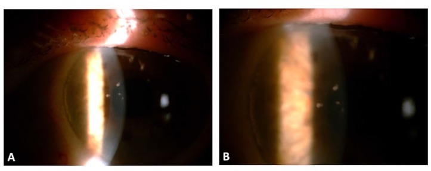
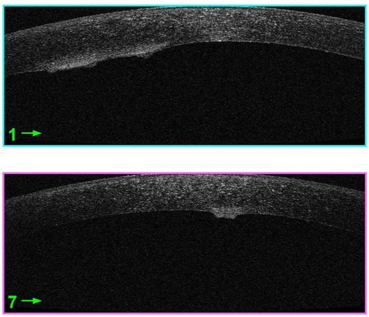
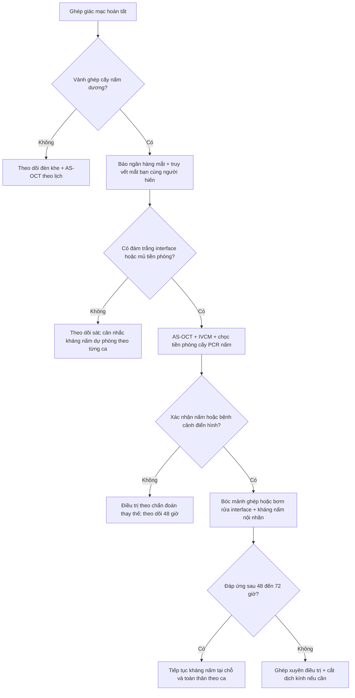
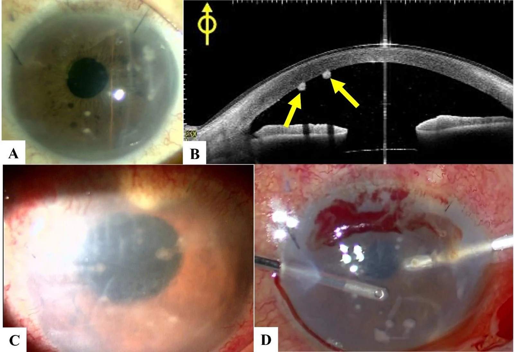
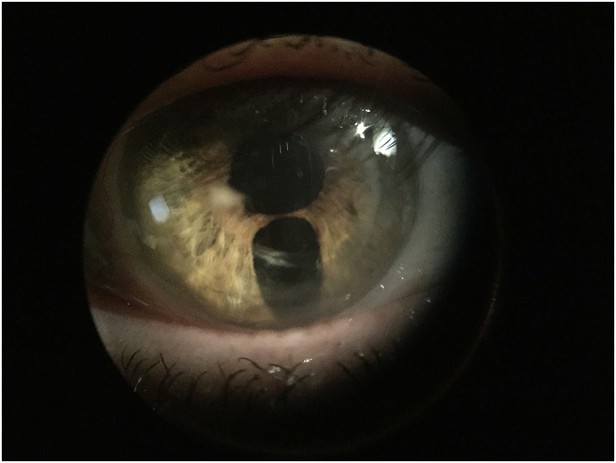
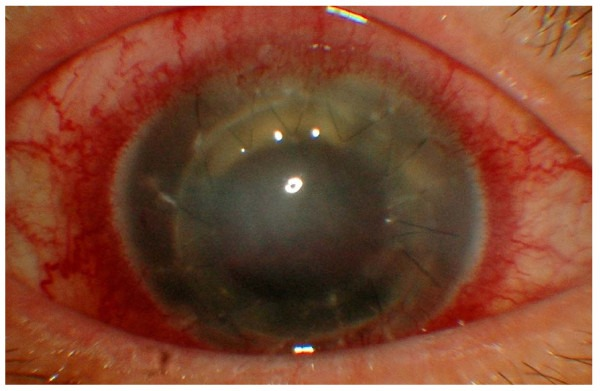
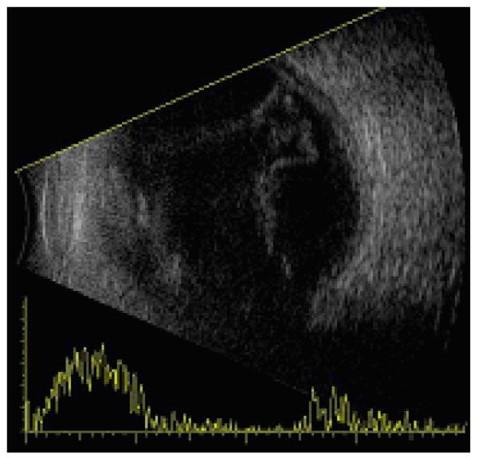

# 3226 — Nấm lây từ người hiến sau ghép giác mạc / Donor-to-host fungal transmission

**Tags:** `pattern:interface-ghep` `pattern:tham-nhien-trang` `pattern:mu-tien-phong` `pattern:viem-noi-nhan` `pattern:sau-ghep-giac-mac` `pattern:nhiem-nam-men` `pattern:lay-tu-nguoi-hien` `pattern:thai-ghep` `vung:mat` `vung:giac-mac` `vung:tien-phong` `vung:dich-kinh` `protocol:AS-OCT` `protocol:IVCM` `protocol:cam-mau-vanh-ghep` `protocol:cay-moi-truong` `protocol:PCR-nam` `protocol:truy-vet-ngan-hang-mat` `incidentaloma:khong`

**Mức chắc chắn (certainty):** tổng hợp y văn (literature synthesis) — dựng từ **báo cáo EBAA 2007–2014** (*Cornea* 2016, **DOI 10.1097/ICO.0000000000000869**), **báo cáo EBAA 2007–2010 về nhiễm nấm sau ghép** (*Cornea* 2013, **DOI 10.1097/ICO.0b013e31825e83bf**), **phân tích gộp 17.614 mảnh ghép** (*Ophthalmology* 2007, **DOI 10.1016/j.ophtha.2006.09.006**), **đoàn hệ 3.414 ca** (*Ophthalmology* 2017, **DOI 10.1016/j.ophtha.2016.09.017**), **đoàn hệ 9.620 ca** (*Int Ophthalmol* 2021, **DOI 10.1007/s10792-020-01641-9**), **đoàn hệ 1.276 vành ghép** (*Ocul Immunol Inflamm* 2022, **DOI 10.1080/09273948.2020.1841806**), **6.592 ca của Eversight** (*JAMA Ophthalmol* 2017, **DOI 10.1001/jamaophthalmol.2017.3797**), **11 ca dùng mảnh ghép cấy dương** (*Graefes Arch Clin Exp Ophthalmol* 2019, **DOI 10.1007/s00417-018-4200-9**), **loạt 99 ca DSAEK** (*Cornea* 2016, **DOI 10.1097/ICO.0000000000000778**) và các **ca nguyên văn cùng người hiến cho hai người nhận** (**PMC5834345**, **DOI 10.1097/APO.0b013e31825608af**, **DOI 10.1097/ICO.0b013e318183a3e3**). Nhóm **không có bệnh nhân của mình**; số nào nguồn không đưa ghi "chưa rõ". **Không ghi tên tác giả** — attribution dùng **tạp chí + năm + PMCID/DOI**.

> **Câu chốt:** đây **không phải "nhiễm nấm sau mổ" thông thường** mà là **mầm nấm đi theo mảnh ghép từ người hiến** — vành củng mạc–giác mạc là nơi **duy nhất có thể cấy được mầm bệnh trước khi nó vào mắt người nhận**. Bốn con số phải thuộc: **(1)** EBAA 2007–2014: **354.930 mảnh ghép**, viêm nội nhãn **99 ca (0,028%)**, viêm giác mạc **66 ca (0,019%)**, trong đó ***Candida* chiếm 65% viêm nội nhãn và 81% viêm giác mạc** (DOI 10.1097/ICO.0000000000000869); **(2)** vành ghép cấy nấm dương **1,25–2,1%** ở các đoàn hệ lớn, nhưng **0/145** và **0/16** ca nhiễm ở hai đoàn hệ không dự phòng — nghĩa là **cấy dương KHÔNG đồng nghĩa nhiễm** (DOI 10.1007/s10792-020-01641-9; DOI 10.1080/09273948.2020.1841806); **(3)** khi vành ghép dương, nguy cơ nhiễm nội nhãn ở mắt ghép nội mô ước **~7% (1/15)** và xác suất viêm nội nhãn nấm theo Bayes **~3%** (DOI 10.1097/ICO.0000000000002505; DOI 10.1016/j.ophtha.2006.09.006); **(4)** mảnh ghép **cùng một người hiến** có thể lây cho **cả hai người nhận**, xuất hiện **7 ngày đến 2 năm** sau mổ, và **73% (16/22) vành ghép "mắt bạn" cấy dương, 67% (10/15) người nhận mắt bạn bị nhiễm** (DOI 10.1097/ICO.0b013e31825e83bf). Bẫy chết người: **vành ghép âm không loại trừ** và **tăng corticoid vì "thải ghép" làm nấm bùng lên**.

## 1. Tổng quan bệnh học – cơ chế hình ảnh (TẠI SAO)

### 1.1 Vì sao mảnh ghép giác mạc lại mang nấm — và vì sao "vành ghép" là mẫu bệnh phẩm then chốt

- **Giác mạc người hiến là mô vô mạch**, không có hàng rào miễn dịch tại chỗ; nấm đến từ **kết mạc/bề mặt nhãn cầu người hiến**, từ **dung dịch bảo quản** hoặc từ **nhiễm khuẩn hệ thống của người hiến**. Sau khi lấy, mô được lưu **hạ nhiệt 2–8 °C trong Optisol-GS** (tối đa khuyến cáo **14 ngày**) hoặc **nuôi cấy cơ quan 30–37 °C** tùy ngân hàng mắt. **Lạnh không diệt nấm** — nó chỉ làm chậm phát triển; khi mô được **làm ấm** để trephine hoặc để **cắt trước (pre-cut) cho DSAEK/DMEK**, nấm có điều kiện phát triển trở lại (DOI 10.1001/jamaophthalmol.2017.3797).
- **Vành củng mạc–giác mạc (corneoscleral rim)** là phần mô còn lại sau khi khoét mảnh ghép trung tâm. Vì mầm nấm thường **khu trú ở rìa/bề mặt**, cấy vành ghép là cách **duy nhất phát hiện mầm bệnh trước khi mắt người nhận có triệu chứng**. Tuy vậy, vành ghép **không đại diện hoàn toàn cho trung tâm mảnh ghép**: ca âm vành ghép vẫn có viêm nội nhãn *C. glabrata* (**PMC2891680**), nên **âm tính không loại trừ**.
- **Vì sao ghép nội mô (EK) nguy cơ hơn ghép xuyên (PK):** mảnh ghép nội mô được **áp vào mặt sau giác mạc**, tạo một **khoang mặt phân cách (interface)** kín, ít tế bào miễn dịch và ít kháng nấm thấm tới. Đây là **ổ kín** cho nấm phát triển chậm — mô hình "**abscess trong khoang kín**". Bằng chứng: EK chiếm **63%** các ca viêm nội nhãn/viêm giác mạc sau ghép trong EBAA 2007–2014 (DOI 10.1097/ICO.0000000000000869), và mô EK đã qua xử lý có **vành ghép cấy nấm dương 1,14% vs 0,37%** ở mô không xử lý — **gấp 3 lần** (P = 0,009; DOI 10.1001/jamaophthalmol.2017.3797).

### 1.2 Vì sao *Candida* chiếm ưu thế — và vì sao hình ảnh lại "im lặng"

- *Candida* là **nấm men**, sinh sản bằng **nảy chồi**, tạo **bào tử 2–5 µm** và có thể có **pseudohyphae**; khác nấm sợi (*Fusarium*, *Aspergillus*) có sợi thật dài. Nấm men **bám và tồn tại tốt trên bề mặt nhãn cầu**, **sống được qua lạnh**, và **phát triển khi nhiệt độ tăng** — đúng điều kiện của quy trình ngân hàng mắt.
- Trong **EBAA 2007–2014**, *Candida* là tác nhân của **65%** viêm nội nhãn và **81%** viêm giác mạc sau ghép (DOI 10.1097/ICO.0000000000000869). Trong các đoàn hệ vành ghép dương, *Candida* chiếm **56,3%** (40/71; DOI 10.1016/j.ophtha.2016.09.017) và **87,6%** (127/145; DOI 10.1007/s10792-020-01641-9).
- **Vì sao hình ảnh nghèo nàn:** *Candida* ở mặt phân cách **không tạo sợi nhô ra**, không phá biểu mô, không gây đau tương xứng. Trên đèn khe, tổn thương chỉ là **đám trắng–kem, bờ mờ, nằm sau mảnh ghép**; nếu mảnh ghép còn trong, người khám dễ đọc là **phù mảnh ghép/thải ghép**. Đây là lý do **trễ chẩn đoán** và là lý do phải **chủ động tìm** ở mắt có vành ghép dương.

### 1.3 Vì sao khởi phát có thể MUỘN tới 1–3 năm

- Nấm nằm trong **khoang mặt phân cách vô mạch**, bị **biofilm** bao quanh, tốc độ nhân đôi chậm; **kháng nấm tại chỗ thấm kém** vào mảnh ghép và mặt phân cách. Khi nấm đủ số lượng hoặc hàng rào miễn dịch suy giảm, tổn thương mới lan ra.
- Ca nguyên văn: **1 năm** sau DSEK dù đã dự phòng và điều trị kháng nấm 1 năm, vẫn tái phát và phải ghép xuyên (**PMC7184523**); **2 năm** sau DMEK với vành ghép chỉ mọc **một khuẩn lạc** *C. albicans/dubliniensis*, không dự phòng (DOI 10.1097/ICO.0000000000002892); **3 năm** sau DSEK (**PMC13400759**, đã dẫn trong bài 3220); **146 ngày** sau PK với vành ghép *C. glabrata* dương (DOI 10.1097/01.ico.0000164777.80879.07).
- Ngược lại, thể **sớm** thường gặp sau EK: **trung vị 49,2 ngày** trong loạt 24 ca viêm giác mạc mặt phân cách sau DSAEK (DOI 10.1097/ICO.0000000000001636), và có ca **17 ngày** sau DMEK (**PMC13524929**), **7 ngày** ở một trong hai người nhận cùng người hiến (DOI 10.1097/APO.0b013e31825608af).

### 1.4 Ngưỡng định lượng nằm lòng

| Chỉ số | Ngưỡng / giá trị | Nguồn |
|---|---|---|
| Nhiễm nấm sau ghép (EBAA 2007–2014) | viêm nội nhãn **0,028%** (99/354.930); viêm giác mạc **0,019%** (66/354.930); *Candida* **65% / 81%** | DOI 10.1097/ICO.0000000000000869 |
| Nhiễm nấm sau ghép (EBAA 2007–2010) | **1,4 ca/10.000** mảnh ghép (31/221.664); EK **0,022%** vs PK **0,012%** (P = 0,076) | DOI 10.1097/ICO.0b013e31825e83bf |
| Vành ghép cấy nấm dương | **1,25%** (16/1.276); **1,5%** (145/9.620); **2,1%** (71/3.414); **0,73%** (5/684) | DOI 10.1080/09273948.2020.1841806; DOI 10.1007/s10792-020-01641-9; DOI 10.1016/j.ophtha.2016.09.017; PMC9244863 |
| Vành ghép dương → nhiễm ở người nhận | **0/145**; **0/16**; **4/71 (5,6%)** viêm giác mạc; **2/7 (28,6%)** viêm giác mạc mặt phân cách trong loạt DSAEK | DOI 10.1007/s10792-020-01641-9; DOI 10.1080/09273948.2020.1841806; DOI 10.1016/j.ophtha.2016.09.017; DOI 10.1097/ICO.0000000000000778 |
| Nguy cơ khi vành ghép nấm dương | viêm nội nhãn nấm **~3%** (Bayes); nhiễm nội nhãn ở EK **~7% (1/15)** | DOI 10.1016/j.ophtha.2006.09.006; DOI 10.1097/ICO.0000000000002505 |
| Mắt bạn cùng người hiến | **73% (16/22)** vành ghép cấy dương; **67% (10/15)** người nhận bị nhiễm | DOI 10.1097/ICO.0b013e31825e83bf |
| Thời điểm khởi phát | sớm **7–28 ngày**; DSAEK trung bình **49,2 ngày**; muộn **1–3 năm** | DOI 10.1097/APO.0b013e31825608af; DOI 10.1097/ICO.0000000000001636; PMC7184523; DOI 10.1097/ICO.0000000000002892 |
| Mô EK đã xử lý | vành ghép nấm dương **1,14% vs 0,37%** (P = 0,009) | DOI 10.1001/jamaophthalmol.2017.3797 |
| Thời gian tử vong → bảo quản | nhóm nhiễm **18,08 giờ** (18,08–20,90) vs không nhiễm **12,27 giờ** (9,32–20,47) — chỉ là **gợi ý**, chưa phải ngưỡng | DOI 10.1007/s00417-018-4200-9 |
| Độ nhạy của cấy vành ghép | **67%** (KTC 95%: 47–83%), độ đặc hiệu **85%**; RR viêm nội nhãn **12** (5–29) | DOI 10.1016/j.ophtha.2006.09.006 |
| Kết cục viêm giác mạc mặt phân cách sau DSAEK | **79%** *Candida*; **79%** phải ghép xuyên; thị lực cuối **0,44 logMAR** | DOI 10.1097/ICO.0000000000001636 |
| DTH sau DSAEK/DMEK | **9 ca**, **8/9 do nấm**, **100% phải can thiệp**, thị lực cuối **≥ 20/200** | DOI 10.1177/11206721221085853 |

> **Đọc bảng này đúng cách:** các đoàn hệ **không dự phòng** cho thấy **nguy cơ tuyệt đối rất thấp**, còn các loạt **chọn ca nặng** cho thấy **nguy cơ tương đối cao**. Vì vậy "vành ghép dương" là **tín hiệu nguy cơ**, không phải **chẩn đoán nhiễm**.

## 2. Mẫu hình + chẩn đoán phân biệt theo vị trí và thời điểm (Gamut)

### 2.1 Theo thời điểm

- **Sớm (≤ 6 tuần):** đám trắng **đa ổ, bờ mờ** ở **mặt phân cách** sau DSAEK/DMEK; thường **không khuyết biểu mô**, đau nhẹ, mắt đỏ ít. Có thể tiến triển thành **mủ tiền phòng, viêm dịch kính** trong vài ngày. Đây là kiểu **dễ nhầm nhất với thải ghép nội mô** vì mảnh ghép phù, nhưng **phù mảnh ghép không giải thích được đám trắng khu trú**.
- **Muộn (> 6 tuần – 3 năm):** **đám mờ sâu, vàng–trắng, bờ không đều** ở mặt phân cách hoặc nhu mô sau; mắt **không đỏ**, thị lực giảm dần; dễ bị đọc là **thất bại mảnh ghép, thải ghép mạn, loạn dưỡng**. Ca **2 năm** sau DMEK chỉ có **một khuẩn lạc** trên vành ghép lúc mổ (DOI 10.1097/ICO.0000000000002892) là ví dụ điển hình của "**mầm ngủ**".

### 2.2 Theo vị trí

- **Mặt phân cách (interface, EK):** *Candida* lây từ người hiến; **vi khuẩn** (Staphylococcus, Streptococcus); **NTM** (*M. abscessus/chelonae*); **nấm sợi**; **dịch mặt phân cách**; **màng Descemet còn sót**; **mảnh ghép gấp/lật**; **thải ghép**.
- **Nhu mô/nội mô (PK, DALK):** *Candida*, nấm sợi, **áp-xe chỉ khâu**, **tái hoạt HSV**, **thải ghép**, **màng đồng tử–giác mạc**.
- **Tiền phòng/dịch kính:** viêm nội nhãn nấm (đục dịch kính, màng fibrin, hypopyon), viêm nội nhãn vi khuẩn, **TASS** (12–48 giờ, phù limbus-to-limbus, không viêm dịch kính).

### 2.3 Gamut "đám trắng ở mặt phân cách sau ghép nội mô"

- **Lây từ người hiến (nấm men)** — có vành ghép dương, cùng người hiến, khởi phát 1–8 tuần hoặc muộn.
- **Nhiễm vi khuẩn mặt phân cách** — khởi phát **1–7 ngày**, mủ đặc, đau nhiều, cấy tiền phòng dương.
- **NTM** — khởi phát **1,5–40 tuần**, tổn thương dạng **nốt/áp-xe**, cấy vi khuẩn khô mọc 3–7 ngày, **không đáp ứng kháng sinh thường**.
- **Nấm sợi** — thường sau **chấn thương thực vật**, có **sợi/tua**, bờ lông vũ; ít khi lây từ người hiến nhưng có thể.
- **Thải ghép nội mô** — **KP dày, phù lan tỏa**, không có ổ khu trú; đáp ứng corticoid trong 24–48 giờ.
- **Dịch mặt phân cách** — **hồi âm trống** trên AS-OCT, không tăng phản xạ; thường liên quan **nhãn áp cao** hoặc **mảnh ghép bong**.
- **Màng Descemet còn sót** — dải **tăng phản xạ mảnh, cuộn**, không tiến triển.
- **TASS** — **12–48 giờ**, phù **limbus-to-limbus**, dịch kính trong, cấy âm, đáp ứng corticoid.

**Mnemonic DONOR** (chỉ để nhớ, không phải tiêu chuẩn): **D**onor rim dương · **O**nset trễ (ngày–năm) · **N**agging (dai dẳng, ít đau) · **O**pacity tại interface · **R**efractory (không đáp ứng corticoid).

## 3. Bảng so sánh phân biệt (ma trận đối chiếu)

| Thực thể (entity) | Hình ảnh điển hình | Chốt vào (rule-in) | Chốt loại (rule-out) | Gợi ý xác nhận |
|---|---|---|---|---|
| **Nấm men lây từ người hiến (DTH *Candida*)** | Đám trắng–kem **đa ổ, bờ mờ** ở mặt phân cách; AS-OCT **tăng phản xạ tại interface**; muộn có mảng nội mô | **Vành ghép cấy nấm dương + cùng loài** ở người nhận; **mắt bạn cùng người hiến bị nhiễm**; khởi phát **1–8 tuần** sau EK | **Không có vành ghép dương và không có mắt bạn** không loại trừ (ca âm vành ghép); **đám trắng không tiến triển sau 48 giờ corticoid** gợi ý không phải thải ghép | Cấy/PCR tiền phòng–dịch kính; **so khớp chủng** với vành ghép; AS-OCT; IVCM |
| **Thải ghép nội mô** | **KP dày lan tỏa**, phù mảnh ghép; **không ổ khu trú**; có thể đường Kernet | **Đáp ứng corticoid rõ trong 24–48 giờ**; **KP dày + phù lan** | **Ổ trắng khu trú + mủ tiền phòng** → không phải thải ghép đơn thuần | Đáp ứng điều trị; AS-OCT; cấy nếu nghi |
| **Nhiễm vi khuẩn mặt phân cách** | Mủ đặc, vàng, **đau nhiều**, khởi phát **1–7 ngày**; tiền phòng có thể mủ | **Khởi phát rất sớm + mủ + cấy Gram dương** | **Khởi phát > 2 tuần + ít đau + bờ mờ** → nghĩ nấm/NTM | Cấy tiền phòng, nhuộm Gram; kháng sinh đồ |
| **NTM mặt phân cách** | Nốt/áp-xe nhỏ, dai dẳng, **không đáp ứng kháng sinh thường**; có thể lan dọc đường hầm | **Cấy NTM (khuẩn lạc khô, 3–7 ngày)**; tiền sử mổ/ghép | **Cấy âm 7 ngày không loại trừ** (giữ 8 tuần) | Cấy NTM 30–32 °C, PCR, sinh thiết |
| **Nấm sợi** | **Sợi/tua**, bờ lông vũ, vệ tinh, mảng nội mô; thường sau chấn thương thực vật | **KOH/IVCM thấy sợi có vách**; cấy nấm sợi | **Chỉ bào tử men, không sợi** → nghĩ *Candida* | KOH, calcofluor, cấy Sabouraud, PCR ITS |
| **Dịch mặt phân cách** | **Vùng hồi âm trống** dưới mảnh ghép trên AS-OCT; mảnh ghép có thể bong | **AS-OCT hồi âm trống + nhãn áp cao/bong mảnh ghép** | **Tăng phản xạ + đám trắng** → không phải dịch đơn thuần | AS-OCT; đo nhãn áp; rebubble nếu bong |
| **TASS** | **12–48 giờ**, phù **limbus-to-limbus**, dịch kính trong, cấy âm | **Khởi phát ≤ 48 giờ + phù lan + đáp ứng corticoid** | **> 2 tuần + ổ khu trú + mủ** → không phải TASS | Cấy âm; đáp ứng corticoid; loại trừ nấm |

*Hai mức phóng đại đèn khe: **nhiều đám trắng trong mặt phân cách mảnh ghép–giường ghép 28 ngày sau DMEK** (A: toàn cảnh; B: phóng đại). Đây là mẫu hình "đám trắng khu trú, bờ mờ" — không có khuyết biểu mô lớn, nên dễ bị đọc là phù mảnh ghép. Nguồn: *Br J Ophthalmol* 2019, Fig. 1 (PMC6579547), CC BY-NC 4.0 — nguyên bản.*

*AS-OCT cùng ca: **vật liệu tăng phản xạ nằm ngay trước màng Descemet**, trong vùng mảnh ghép DMEK — xác nhận tổn thương ở **mặt phân cách**, không phải trong nhu mô lành. AS-OCT giúp đo độ dày, độ lan và chọn đường vào để bóc mảnh ghép. Nguồn: *Br J Ophthalmol* 2019, Fig. 2 (PMC6579547), CC BY-NC 4.0 — nguyên bản.*

### 3.1 Đọc AS-OCT đúng — ba câu hỏi

1. **Tổn thương tăng hay giảm phản xạ?** **Tăng phản xạ** = tế bào viêm/nấm/mảnh vụn; **giảm phản xạ** = dịch. Đám nấm thường **tăng phản xạ nhưng không đồng nhất**, có thể có **bóng che** phía sau.
2. **Tổn thương ở đâu so với màng Descemet?** Trước Descemet trong vùng mảnh ghép = **interface**; sau Descemet = tiền phòng; trong nhu mô = nhu mô. Vị trí quyết định **đường vào để bóc** và tiên lượng.
3. **Mảnh ghép còn áp hay đã bong?** Bong kèm dịch **giảm phản xạ** gợi ý **interface fluid/bong**; bong kèm **đám tăng phản xạ** gợi ý **nhiễm** — không rebubble đơn thuần.

### 3.2 "Bằng chứng ngoài mắt" — vành ghép và mắt bạn

- **Vành ghép** là chứng cứ **trước khi có tổn thương**: ghi nhận **loài nấm, thời gian mọc, môi trường cấy**. Nếu vành ghép dương, hãy **coi mắt ghép là "mắt có nguy cơ"**, không phải "mắt đã nhiễm".
- **Mắt bạn (mate cornea)** là chứng cứ **dịch tễ mạnh nhất** cho lây từ người hiến: **cùng người hiến, cùng loài, cùng thời điểm** — thậm chí **cùng chủng** trên giải trình tự (PMC5834345). Khi một mắt bị nhiễm nấm sau ghép, **phải truy vết mắt còn lại ngay**, kể cả khi mắt đó chưa có triệu chứng.
- **Tiêu chuẩn "proven DTH"** trong y văn: **cùng tác nhân** phân lập được từ **vành ghép/môi trường bảo quản** và từ **mô/mủ của người nhận**, lý tưởng là **cùng chủng bằng molecular typing**; hoặc **mắt bạn cùng người hiến bị nhiễm cùng tác nhân**. "Probable" = vành ghép dương + bệnh cảnh phù hợp, không có nguồn khác.

## 4. Protocol chụp/khám + phân độ và thuật toán xử trí

### 4.1 Phía ngân hàng mắt (trước khi mảnh ghép rời ngân hàng)

- **Sàng lọc người hiến:** hỏi **nhiễm khuẩn huyết/nhiễm nấm hệ thống**, **viêm màng não**, **bệnh truyền nhiễm**, thời gian **tử vong → lấy mô**; loại trừ/nhãn "nguy cơ cao" theo tiêu chuẩn ngân hàng.
- **Cấy vành ghép + cấy môi trường bảo quản** (Sabouraud/CHROMagar Candida, thạch máu); ghi **thời điểm lấy mẫu** (trước hay sau trephine), **thời gian lưu**, **số lần làm ấm**.
- **Truy xuất nguồn gốc:** số hiến, mắt bạn, nơi gửi; **báo cáo phản ứng bất lợi** cho ngân hàng mắt nguồn và EBAA khi có nhiễm ở người nhận (DOI 10.1097/ICO.0b013e31825e83bf).

### 4.2 Phía lâm sàng (sau ghép)

- **Khám đèn khe có optic section** ở mọi lần tái khám: tìm **đám trắng ở mặt phân cách**, **mủ tiền phòng**, **đau không tương xứng**, **phù mảnh ghép không đáp ứng corticoid**.
- **AS-OCT** mọi ca nghi: đo **độ dày, độ lan, vị trí so với Descemet**, phát hiện **bong/dịch**.
- **IVCM** nếu có: tìm **bào tử tròn 2–5 µm, pseudohyphae** tại interface; **không thấy không loại trừ** (phải quét nhiều vùng).
- **B-scan** khi không thấy đáy mắt hoặc nghi viêm dịch kính.
- **Lấy bệnh phẩm trước khi đổi thuốc:** chọc tiền phòng (và dịch kính nếu cần), **cấy + PCR nấm**, nhuộm Gram/KOH/calcofluor; **cấy mảnh ghép đã bóc** + mô bệnh học nếu phải tháo.

### 4.3 Thuật toán (Mermaid)

> Mermaid chỉ là **trình tự tư duy**, không phải guideline chính thức: **ngưỡng "48–72 giờ"** là mốc thực hành thường dùng để đánh giá đáp ứng, chưa có RCT riêng cho DTH nấm.

### 4.4 Điều trị — nguyên tắc và bằng chứng

- **Chẩn đoán mô học/cấy trước khi leo thang**, nhưng **không chờ kết quả** nếu có **mủ tiền phòng + đám trắng interface** ở mắt có vành ghép dương.
- **EK interface keratitis:** **bóc mảnh ghép (lenticule) + bơm rửa interface + kháng nấm nội nhãn** là trục; loạt 24 ca DSAEK cho thấy **79%** cuối cùng vẫn phải **ghép xuyên** (DOI 10.1097/ICO.0000000000001636). Bóc sớm giúp **giảm lượng nấm** và **lấy mô để cấy**.
- **Kháng nấm tại chỗ:** **amphotericin B 0,15%** nhỏ giờ; **voriconazole 1%** nhỏ; **voriconazole 0,05 mg/0,1 mL** bơm rửa/tiêm nội nhãn (liều dùng trong báo cáo ca, không phải liều chuẩn hóa); **amphotericin B 5 µg** tiêm nội nhãn cho viêm nội nhãn (**PMC2891680**).
- **Toàn thân:** azole (fluconazole/voriconazole) khi tổn thương sâu, viêm dịch kính hoặc không kiểm soát tại chỗ; **không dùng corticoid đơn thuần** khi chưa loại trừ nấm.
- **Dự phòng sau vành ghép dương:** **chưa có RCT**; một đoàn hệ cho thấy dự phòng làm giảm viêm giác mạc **15,8% → 1,9%** nhưng **P = 0,056** (DOI 10.1016/j.ophtha.2016.09.017), trong khi hai đoàn hệ khác **không có ca nhiễm nào dù đa số không dự phòng** (DOI 10.1007/s10792-020-01641-9; DOI 10.1080/09273948.2020.1841806). Bàn luận "**pro–con**" trong *Cornea* 2021 tóm gọn: **cấy vành ghép hữu ích để cảnh báo**, nhưng **dự phòng toàn thân cho mọi ca dương** có **NNT ~15** và nhiều tác dụng phụ (DOI 10.1097/ICO.0000000000002505; DOI 10.1097/ICO.0000000000002718).
- **Bổ sung kháng nấm vào môi trường bảo quản:** nghiên cứu in vitro cho thấy **caspofungin/voriconazole** giảm phát triển *Candida* trong Optisol-GS, nhưng **chưa có RCT trên người** và **Optisol-GS hiện không chứa kháng nấm** (DOI 10.1001/jamaophthalmol.2017.3797; DOI 10.1136/bjophthalmol-2019-314664).

## 5. Biến thể bình thường và cạm bẫy

- **Cạm bẫy 1 — "vành ghép âm nên không phải nấm":** ca *C. glabrata* viêm nội nhãn **2 tuần** sau PK với **vành ghép và môi trường bảo quản đều âm** (**PMC2891680**). Âm tính có thể do **mẫu ít, nấm nằm trong trung tâm mảnh ghép, hoặc đã dùng kháng nấm**. Không loại trừ.
- **Cạm bẫy 2 — "vành ghép dương nên phải mổ":** **0/145** (DOI 10.1007/s10792-020-01641-9) và **0/16** (DOI 10.1080/09273948.2020.1841806) ca nhiễm dù phần lớn không dự phòng. **Cấy dương là cảnh báo, không phải chỉ định mổ.**
- **Cạm bẫy 3 — tăng corticoid vì "thải ghép":** đám trắng khu trú + mủ tiền phòng ở mắt sau EK **không phải** thải ghép đơn thuần; **corticoid làm nấm bùng lên**. Nếu đã tăng corticoid mà **tổn thương to hơn sau 24–48 giờ**, đổi hướng chẩn đoán ngay.
- **Cạm bẫy 4 — bỏ qua mắt bạn:** cùng một người hiến có thể cho **hai mảnh ghép**; một mắt nhiễm nghĩa là mắt kia **phải được khám và cấy lại**. Ca **hai người nhận cùng chủng *C. albicans*** (PMC5834345) và **cùng *C. glabrata* trong 1 ngày** (DOI 10.1097/ICO.0b013e318183a3e3) chứng minh điều này.
- **Cạm bẫy 5 — "muộn quá nên không thể do ghép":** đã có ca **1 năm** (PMC7184523), **2 năm** (DOI 10.1097/ICO.0000000000002892), **3 năm** (PMC13400759). **Thời gian không loại trừ.**
- **Cạm bẫy 6 — chẩn đoán bằng CT/MRI:** tổn thương ở **mặt phân cách** chỉ thấy trên **đèn khe/AS-OCT/IVCM**; CT/MRI không có vai trò trong chẩn đoán viêm giác mạc mặt phân cách, chỉ dùng khi nghi lan hốc mắt/nội sọ.
- **Cạm bẫy 7 — "cultures mọc nấm = nhiễm":** vành ghép có thể nhiễm **bào tử thoáng qua**; cần **bệnh cảnh + tổn thương tương ứng** mới gọi là nhiễm.
- **Biến thể bình thường:** **đám mờ nhỏ ở interface do mảnh vụn/máu** sau EK có thể thoáng qua; **nếp gấp mảnh ghép** tạo dải tối, không tăng phản xạ; **Descemet còn sót** tạo dải mảnh — không tiến triển, không mủ.

## 6. Tự lượng giá — Blind Quiz

**Ca 1 — 72 tuổi, DMEK vì loạn dưỡng Fuchs, ngày 17 sau mổ: nhìn mờ, đau nhẹ. Vành ghép lúc mổ cấy *Candida albicans*. Nhìn ảnh, mô tả trước.**

- Hỏi: tổn thương nằm ở đâu? AS-OCT xác nhận điều gì? Ba chẩn đoán phân biệt? Bước tiếp theo?

<b>Bấm để hiện đáp án (findings + chẩn đoán)</b>

- **(a)** Đèn khe: **đám trắng ở mặt phân cách mảnh ghép–giường ghép**, mảnh ghép còn áp, không có khuyết biểu mô lớn.
- **(b)** AS-OCT: **vật liệu tăng phản xạ ở mặt sau mảnh ghép, trước Descemet** (mũi tên) — tổn thương **trong interface**, không phải nhu mô lành.
- **Chẩn đoán:** **viêm giác mạc mặt phân cách do *Candida* lây từ người hiến** — vành ghép dương cùng loài, khởi phát **17 ngày**, mẫu hình interface điển hình.
- **Phân biệt:** thải ghép nội mô (KP dày lan, đáp ứng corticoid), nhiễm vi khuẩn (mủ đặc, 1–7 ngày), NTM (nốt dai dẳng), nấm sợi (sợi/tua), dịch interface (hồi âm trống).
- **Bước tiếp theo:** **AS-OCT + IVCM + chọc tiền phòng cấy/PCR nấm**; **bóc mảnh ghép + bơm rửa interface + kháng nấm nội nhãn**; báo ngân hàng mắt và **truy vết mắt bạn**; không tăng corticoid đơn thuần.
- Nguồn ảnh: *Sci Rep* 2026, Fig. 1 (PMC13524929), CC BY 4.0.

**Ca 2 — 68 tuổi, DSEK 1 năm trước, vành ghép dương nấm nhưng không dự phòng; nay mờ dần, không đau. Ảnh đèn khe:**

- Hỏi: vì sao khởi phát muộn? Cần hỏi gì về người hiến? Phân biệt với thất bại mảnh ghép?

<b>Bấm để hiện đáp án (findings + chẩn đoán)</b>

- **Findings:** **đám thâm nhiễm trắng ở mặt phân cách gần bờ đồng tử**, bờ không đều, mắt không đỏ; mảnh ghép còn áp nhưng nhu mô quanh mờ.
- **Chẩn đoán:** **viêm giác mạc mặt phân cách khởi phát muộn do nấm lây từ người hiến** — vành ghép dương trước đó là chứng cứ; nấm tồn tại trong **khoang interface vô mạch/biofilm** nên có thể bùng phát sau **1 năm** dù đã dự phòng.
- **Vì sao muộn:** mầm nấm số lượng thấp + kháng nấm thấm kém + không có mạch máu tại interface; khi hàng rào miễn dịch giảm hoặc nấm đủ số lượng thì lan.
- **Phân biệt:** thất bại mảnh ghép (phù lan, không ổ khu trú), thải ghép mạn (KP dày), màng Descemet còn sót (dải mảnh), dịch interface (hồi âm trống).
- **Cần hỏi:** **kết quả cấy vành ghép và môi trường**, loài nấm, **mắt bạn cùng người hiến** có bị gì không, thời gian lưu mảnh ghép, có làm ấm/cắt trước không.
- Nguồn ảnh: *Am J Ophthalmol Case Rep* 2020, Fig. 1 (PMC7184523), CC BY-NC-ND 4.0 — nguyên bản.

**Ca 3 — 63 tuổi, PK 2 tuần, đái tháo đường, dùng dexamethasone toàn thân; đau tăng, mủ tiền phòng, áp-xe chỉ khâu. Vành ghép và môi trường bảo quản âm. Ảnh đèn khe + B-scan:**

- Hỏi: vành ghép âm có loại trừ nấm? Chẩn đoán? Vì sao B-scan cần làm?

<b>Bấm để hiện đáp án (findings + chẩn đoán)</b>

- **Findings:** **nhiều áp-xe chỉ khâu + mảng trắng sau màng Descemet + mủ tiền phòng** ở mắt PK; B-scan cho thấy **áp-xe dịch kính, võng mạc còn áp**.

- **Chẩn đoán:** **viêm nội nhãn *Candida glabrata* sau PK** — cấy tiền phòng và dịch kính dương dù **vành ghép và môi trường bảo quản âm**. Đây là ca chứng minh **âm vành ghép KHÔNG loại trừ**.
- **Vì sao âm:** mầm nấm có thể nằm **trong trung tâm mảnh ghép**, số lượng dưới ngưỡng cấy, hoặc bị ức chế bởi kháng sinh trong môi trường; người nhận **suy giảm miễn dịch** (dexamethasone toàn thân, đái tháo đường) tạo điều kiện phát triển.
- **B-scan:** xác định **mức lan vào dịch kính**, loại trừ bong võng mạc, hướng dẫn **cắt dịch kính/tiêm nội nhãn**.
- **Điều trị trong ca:** amphotericin B tại chỗ + tiêm nội nhãn + toàn thân; thị lực cuối kém vì mảnh ghép mờ.
- Nguồn ảnh: *BMC Ophthalmol* 2010, Fig. 1–2 (PMC2891680), CC BY 2.0.

## 7. Câu hỏi nghiên cứu & điểm chưa đồng thuận (tính đến 11/2026)

1. **[Tranh cãi] Ở người ghép giác mạc, cấy vành ghép nấm thường quy có giảm viêm giác mạc/viêm nội nhãn so với chỉ cấy khi nghi ngờ không?**
   - **Đã biết:** cấy dương dự báo nguy cơ (RR 12; độ nhạy 67%) nhưng nguy cơ tuyệt đối thấp, và 0/145–0/16 ca nhiễm ở hai đoàn hệ.
   - **Chưa rõ:** lợi ích thực của sàng lọc toàn bộ so với theo dõi lâm sàng.
   - **Hướng nghiên cứu:** đoàn hệ tiến cứu có nhóm so sánh, phân tích chi phí–hiệu quả.
   - **Nguồn:** DOI 10.1016/j.ophtha.2006.09.006; DOI 10.1007/s10792-020-01641-9; DOI 10.1097/ICO.0000000000002505.

2. **[Khác biệt thực hành] Sau vành ghép nấm dương, dự phòng kháng nấm cho mọi ca hay chỉ theo dõi?**
   - **Đã biết:** một đoàn hệ giảm viêm giác mạc 15,8% → 1,9% nhưng P = 0,056; hai đoàn hệ khác không có ca nhiễm dù đa số không dự phòng.
   - **Chưa rõ:** chọn bệnh nhân, đường dùng, thời gian và độc tính.
   - **Hướng nghiên cứu:** RCT phân tầng theo loại ghép và loài nấm.
   - **Nguồn:** DOI 10.1016/j.ophtha.2016.09.017; DOI 10.1080/09273948.2020.1841806; DOI 10.1097/ICO.0000000000002718.

3. **[Khoảng trống] Bổ sung kháng nấm vào môi trường bảo quản lạnh có giảm lây từ người hiến mà không độc cho nội mô không?**
   - **Đã biết:** caspofungin/voriconazole giảm *Candida* in vitro; Optisol-GS hiện không có kháng nấm; chưa có RCT trên người.
   - **Chưa rõ:** nồng độ, thuốc, độc tính nội mô và hiệu quả trên lâm sàng.
   - **Hướng nghiên cứu:** thử nghiệm in vitro chuẩn hóa + RCT đa trung tâm.
   - **Nguồn:** DOI 10.1001/jamaophthalmol.2017.3797; DOI 10.1136/bjophthalmol-2019-314664; DOI 10.1080/08820538.2022.2095873.

## Bài liên quan chéo
- [3220 – Viêm giác mạc do nấm men *Candida*](../3220-viem-giac-mac-nam-men-candida/lesson.md) (nhận diện *Candida* trên đèn khe/IVCM; điều trị)
- [3216 – Viêm giác mạc do nấm sợi](../3216-viem-giac-mac-nam-soi/lesson.md) (phân biệt nấm sợi – nấm men)
- [1460 – Viêm giác mạc do nấm: tổng quan](../1460-viem-giac-mac-do-nam/lesson.md)
- [1445 – Bong mảnh ghép DSAEK/DMEK & rebubble](../1445-bong-manh-ghep-dsaek-dmek-rebubble/lesson.md) (phân biệt dịch interface – nhiễm)
- [495 – Nấm ngoại sinh sau mổ/tiêm vs TASS](../495-viem-noi-nhan-nam-ngoai-sinh-vs-TASS/lesson.md)
- [3214 – *Nocardia* viêm củng mạc](../3214-nocardia-viem-cung-mac/lesson.md) (vi khuẩn kháng acid yếu, tổn thương dai dẳng)

## Ảnh
- Ảnh dùng trong bài nằm ở `images/`; nguồn, giấy phép và phái sinh ghi từng dòng trong `images/CREDITS.md`.
- Không tải ảnh từ nguồn không rõ giấy phép; ca không có ảnh hợp phép chỉ dẫn link trong `sources.md`.

> Không dùng để chẩn đoán độc lập khi chưa có người hướng dẫn.
