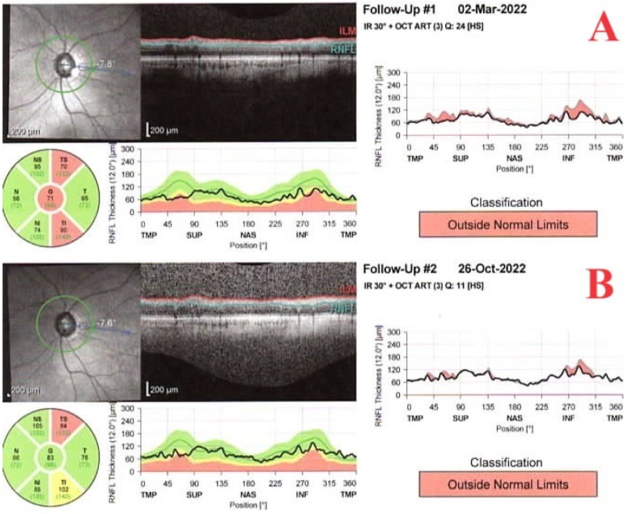
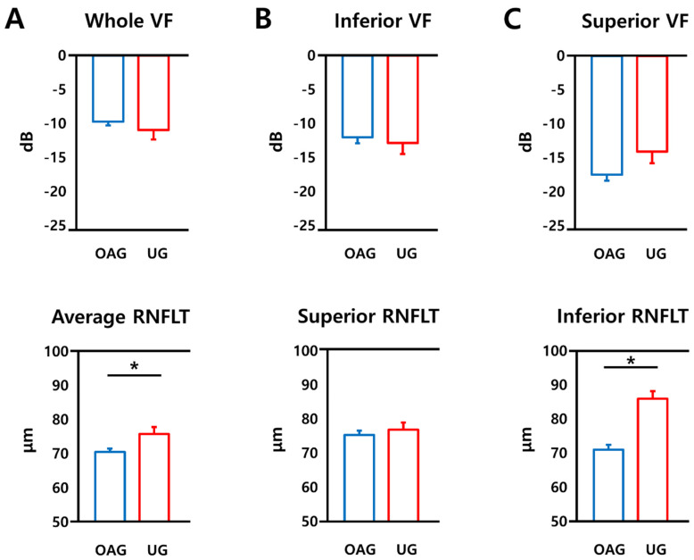
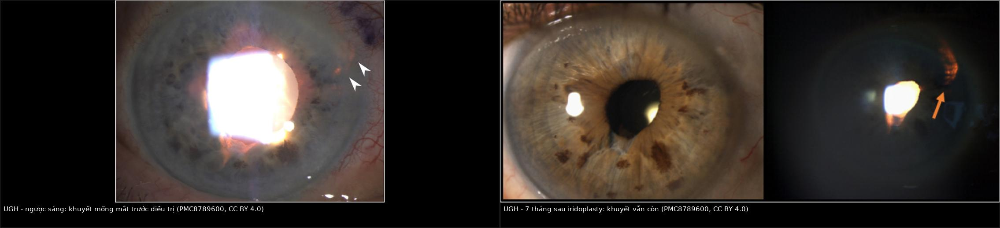
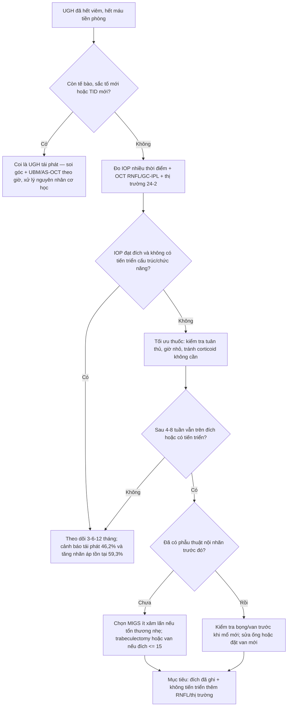
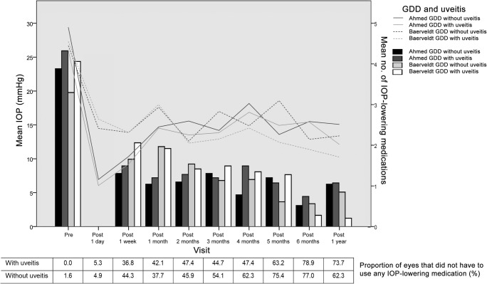

# 3227 — Theo dõi dài hạn sau hội chứng UGH đã giải quyết: nhãn áp, OCT RNFL và ngưỡng phẫu thuật glôcôm / Long-term follow-up after resolved uveitis–glaucoma–hyphema syndrome

**Tags:** `pattern:tang-nhan-ap` `pattern:iop-khong-dat-dich` `pattern:teo-rnfl` `pattern:khuyet-mong-mat` `pattern:di-nguyen-mong-mat` `vung:mat` `vung:tien-phong` `vung:goc-tien-phong` `vung:dia-thi` `vung:than-kinh-thi` `anatomy:goc-tien-phong` `anatomy:dia-thi` `protocol:OCT-RNFL` `protocol:thi-truong` `protocol:gonioscopy` `protocol:AS-OCT` `score:IOP-dich` `incidentaloma:khong`

**Mức chắc chắn (certainty):** tổng hợp y văn (literature synthesis) — ghép **đoàn hệ 232 mắt UGH** (PMID 42595287), **nghiên cứu bệnh–chứng 71 ca** (PMID 32511897), **14 mắt sau chỉnh/đổi IOL** (PMC7270258), **28 mắt Carlevale** (PMID 36749924), **đoàn hệ 205 mắt glôcôm do viêm so với 4.600 mắt POAG** (PMID 31251907), **69 mắt UG so với 138 mắt OAG** (PMC8465069), **76 + 135 mắt RNFL OCT** (PMID 25439601), **RCT PTVT 155 mắt** (PMC11416337), **phân tích gộp 24 nghiên cứu về van dẫn lưu** (PMC6323086), **phân tích gộp 16 bài về kiểm soát viêm và van** (PMID 31418636), **van ở trẻ 50 mắt** (PMID 36822573). Nhóm **không có bệnh nhân của mình**; chỗ suy luận đánh dấu **[suy luận]**.

> **Ranh giới với bài đã có:** [3225](../3225-hoi-chung-ugh-sau-dat-dai-ong-silicon/lesson.md) trả lời *chẩn đoán UGH cấp: tìm cọ xát ở đâu, UBM/AS-OCT nào, khi nào sửa IOL*; [3223](../3223-pex-glaucoma-phaco-migs-trab/lesson.md) là *chọn phẫu thuật ở PEX có glôcôm*; [442](../442-glaucoma-OCT/lesson.md) là *nguyên lý OCT trong glôcôm*; [1411](../1411-tang-nhan-ap-do-corticoid-noi-nhan/lesson.md) là *tăng nhãn áp do corticoid nội nhãn*. Bài này chỉ trả lời **một câu**: *mắt UGH đã hết viêm, hết máu — **theo dõi nhãn áp và thị thần kinh thế nào, đọc OCT ra sao, và khi nào phải mổ glôcôm?*

> **Câu chốt — sáu con số phải thuộc:** **(1)** Sau khi UGH "giải quyết", **59,3%** vẫn còn tăng nhãn áp; IOP trung vị chỉ giảm **19,8 → 15,0 mmHg** ở 12 tháng, **46,2%** tái phát và **77,2%** phải can thiệp (PMID 42595287). **(2)** **51%** người **không có glôcôm trước đó** vẫn cần thuốc hạ nhãn áp; **IOP ≥ 22 mmHg ở lần chảy máu đầu** dự báo điều này với **AUC 0,80** (PMID 32511897). **(3)** Sau chỉnh/đổi IOL, IOP **26,4 → 14,7 mmHg** và thuốc **1,7 → 0,8** — nhưng **14%** vẫn phải mổ glôcôm thêm trong 6 tháng (PMC7270258; PMID 36749924). **(4)** Glôcôm do viêm tiến triển nhanh hơn POAG: **−0,49 so với −0,37 dB/năm**, "tiến triển nhanh" (**≥ 1,5 dB/năm**) gặp **11% so với 7%**, **RR 1,9** (PMID 31251907). **(5)** RNFL **dày giả tạo khi viêm**: **140,5 µm** (viêm hoạt động) so với **107,8** (lắng) và **95,3** (bình thường); cùng mức mất thị trường, mắt viêm còn RNFL **75,8 µm** so với **70,5 µm** ở POAG (PMID 25439601; PMC8465069). **(6)** Van dẫn lưu hạ **44,9%** IOP, gộp 24 nghiên cứu **−17,8 mmHg** và **−2,2 thuốc**; thành công 1 năm **95,1%** nếu viêm được kiểm soát tốt so với **81,6%** nếu không (PMC6323086; PMID 31418636).

## 1. Tổng quan bệnh học – cơ chế hình ảnh (TẠI SAO)

### 1.1 Vì sao nhãn áp vẫn cao sau khi UGH đã "hết" — hai tầng tổn thương

- **Tầng cấp (hồi phục được):** hồng cầu, sắc tố và protein viêm **bít lỗ bè**; khi hết máu và hết viêm, một phần đường thoát mở lại — đó là lý do IOP trung vị giảm được **19,8 → 15,0 mmHg** ở 12 tháng (PMID 42595287).
- **Tầng mạn (không hồi phục):** sắc tố và viêm tái diễn gây **xơ hóa bè, mất tế bào nội mô bè và dính góc**; vì vậy **59,3%** vẫn tăng nhãn áp dù UGH đã "giải quyết", và **51%** người trước đó không có glôcôm vẫn phải dùng thuốc hạ áp (PMID 42595287; PMID 32511897).
- **Vì sao IOP lúc chảy máu đầu lại tiên lượng:** mức chảy máu phản ánh **cường độ cọ xát cơ học** — cọ càng mạnh thì lượng hồng cầu/sắc tố đổ vào bè càng lớn và tổn thương bè càng nặng. Trên 71 ca, **IOP ≥ 22 mmHg ở lần chảy máu đầu** dự báo cần điều trị glôcôm về sau với **AUC 0,80** (PMID 32511897). Đây là **yếu tố tiên lượng**, không phải tiêu chuẩn chẩn đoán.
- **Ở mắt glôcôm do viêm nói chung**, tăng nhãn áp mới xuất hiện với tốc độ **14,4%/năm** cho ngưỡng **≥ 21 mmHg** và **5,1%/năm** cho ngưỡng **≥ 30 mmHg**; gần **30%** cuối cùng cần phẫu thuật (PMC10931771). Nghĩa là **mỗi lần khám là một lần sàng lọc**, không phải "khám lại cho yên tâm".

### 1.2 Vì sao không được đọc RNFL khi mắt còn viêm

- Viêm làm **phù sợi trục và tăng tín hiệu lớp sợi**; trên 76 mắt viêm không glôcôm, RNFL trung bình toàn cầu là **140,5 µm khi viêm hoạt động**, **107,8 µm khi lắng**, so với **95,3 µm** ở mắt bình thường (PMID 25439601). Một "RNFL dày" trong đợt viêm **không phải là mắt khỏe** — nó là **nhiễu đo**.
- Vì vậy OCT chỉ có giá trị khi **mắt lắng viêm**, và **baseline phải lấy trong giai đoạn lắng**. Đây là lý do thực hành: đặt lịch OCT chủ động **2–4 tuần sau khi hết tế bào tiền phòng**, không chụp trong đợt cấp **[suy luận từ cơ chế và khuyến cáo "chụp khi lắng" — PMC10931771]**.

*Hai lần chụp cách nhau 8 tháng (03/2022 và 10/2022) trên cùng một mắt: RNFL trung bình **121 µm** (A) rồi **93 µm** (B), cả hai đều bị máy xếp "outside normal limits". Chú thích gốc ghi A = trước, B = trong đợt viêm, trong khi bài lại nói viêm hoạt động làm RNFL **dày** — nên cặp ảnh này được dùng đúng với điều nó chứng minh: **biên độ dao động của phép đo ở một mắt có viêm có thể tới 28 µm**, lớn hơn tốc độ mất sợi của glôcôm hàng chục lần. Nguồn: J Clin Med 2024 (PMC10931771), Fig. 3, CC BY 4.0, nguyên bản.*

### 1.3 Vì sao cấu trúc và chức năng lệch nhau ở mắt viêm

- So **69 mắt glôcôm do viêm** với **138 mắt glôcôm góc mở** đã ghép theo RNFL trung bình: mất thị trường tương đương (**MD −10,97 so với −9,72 dB**, p = 0,310) nhưng **RNFL trung bình 75,8 so với 70,5 µm** (p = 0,008) và **RNFL dưới 86,0 so với 71,0 µm** (p < 0,001); GC-IPL trung bình lại tương đương (PMC8465069).
- Nghĩa là ở mắt có tiền sử viêm, **RNFL "còn dày" không đồng nghĩa đĩa thị còn khỏe**: một phần mất thị trường đến từ **phù hoàng điểm, đục thể thủy tinh, dính đồng tử** chứ không chỉ từ mất tế bào hạch; và RNFL nền của mắt viêm (thường trẻ hơn) vốn dày hơn. Vì vậy **phải đọc cả RNFL, GC-IPL, thị trường và đĩa thị**, không dựa vào một con số.

*Hàng trên: MD toàn bộ/dưới/trên tương đương giữa glôcôm góc mở (OAG, xanh) và glôcôm do viêm (UG, đỏ). Hàng dưới: RNFL trung bình và RNFL dưới **dày hơn có ý nghĩa ở UG** (dấu *). Bài học: ở mắt viêm, **"RNFL bình thường" không loại trừ glôcôm**. Nguồn: J Clin Med 2021 (PMC8465069), Fig. 1, CC BY 4.0, nguyên bản.*

### 1.4 Vì sao dao động nhãn áp quan trọng hơn một con số IOP

- Trong **205 mắt glôcôm do viêm** so với **4.600 mắt POAG**, tốc độ mất thị trường là **−0,49 so với −0,37 dB/năm**; **11% so với 7%** là "tiến triển nhanh" (định nghĩa **MD mất ≥ 1,5 dB/năm**), **RR 1,9**; nhóm tiến triển nhanh có **biên độ và độ dao động IOP cao hơn** (PMID 31251907).
- Trong RCT PTVT (155 mắt), mắt có **IOP trung bình 14–17,5 mmHg** mất thị trường nhanh hơn mắt **< 14 mmHg** (**−0,59 so với −0,27 dB/năm**, p = 0,012); mắt chỉ đạt **IOP < 18 mmHg ở 50–75% số lần khám** mất **−0,90 dB/năm** so với **−0,29 dB/năm** khi đạt 100% số lần (PMC11416337). Tức là **"trung bình 16 mmHg" có thể là thất bại** nếu nó dao động và chỉ đạt đích ở một nửa số lần khám.

## 2. Mẫu hình + chẩn đoán phân biệt theo thời điểm và cơ chế

**Mẫu hình (pattern):** *mắt giả thủy tinh thể, tiền phòng **im lặng** (không tế bào, không máu), nhưng IOP **22–30 mmHg** hoặc IOP "ổn" chỉ nhờ **≥ 2 thuốc**; đĩa thị lõm dần, RNFL/GC-IPL mỏng dần, thị trường xấu dần; thường có **khuyết mống mắt (TID)** cũ và **sắc tố ở góc**.*

- **Theo thời điểm sau khi UGH hết:**
  - **≤ 3 tháng:** bè **chưa hồi phục** sau đợt tắc hồng cầu/sắc tố; **tăng nhãn áp do corticoid** còn tiếp diễn; bọng/van mới mổ chưa ổn định.
  - **3–12 tháng:** **bè tổn thương mạn** (thể tích bè giảm, dính góc); **UGH tái phát âm thầm** (chỉ tế bào + sắc tố, không máu); PEX bộc lộ; dính sau mống mắt.
  - **> 12 tháng:** **tái phát cơ học muộn** — vòng Soemmering, sa bao–IOL, pseudophacodonesis; **glôcôm tế bào ma** sau xuất huyết dịch kính; **góc đóng do dính**; **thất bại bọng/van**.
- **Theo cơ chế (gamut):**
  - **Bè củng mạc (trabecular):** tổn thương sau UGH, sắc tố, tế bào ma, PEX, steroid response.
  - **Góc tiền phòng (angle):** dính góc trước (PAS) sau viêm, IOL/van trong góc, mống mắt vồng.
  - **Mặt sau mống mắt/rãnh thể mi:** cọ xát tái diễn (nguồn gốc UGH chưa được loại bỏ).
  - **Đường thoát nhân tạo:** tắc ống, tụt ống, bao xơ quanh bản van, suy bọng.
  - **Đĩa thị/RNFL:** mất sợi tiến triển **không tương xứng** với IOP đo được — dấu hiệu IOP ban đêm/dao động.

## 3. Bảng so sánh phân biệt (ma trận đối chiếu)

| Thực thể (entity) | Hình ảnh / dấu lâm sàng điển hình | Chốt vào (rule-in) | Chốt loại (rule-out) | Gợi ý xác nhận |
|---|---|---|---|---|
| **Tăng nhãn áp tồn tại sau UGH (bè tổn thương)** | Tiền phòng im lặng, góc mở, **sắc tố góc dưới**, không tế bào; IOP 20–28; RNFL mỏng tiến triển | **Không tế bào/không máu ≥ 3 tháng + IOP trên đích + RNFL/thị trường xấu dần** | **Có tế bào, sắc tố mới, máu vi thể** → nghĩ tái phát, không phải "di chứng" | Soi góc, OCT RNFL/GC-IPL khi lắng, thị trường 24-2 |
| **UGH tái phát âm thầm** | Chỉ **tế bào 1+**, **sắc tố mới**, **TID mới** cùng kinh tuyến haptic; IOP dao động; không nhất thiết có máu | **TID mới hoặc sắc tố mới đúng kinh tuyến + đáp ứng corticoid rồi tái phát khi giảm liều** | **Không tế bào, không sắc tố mới, không TID mới** trong 6–12 tháng | Soi ngược sáng toàn chu vi, UBM/AS-OCT theo giờ ([3225](../3225-hoi-chung-ugh-sau-dat-dai-ong-silicon/lesson.md)) |
| **Tăng nhãn áp do corticoid** | IOP tăng **2–8 tuần** sau tăng liều/tái chích implant; góc mở, tiền phòng trong; hết khi giảm thuốc | **IOP giảm ≥ 20% sau giảm/ngừng corticoid** | **Tế bào + sắc tố + TID mới** → UGH tái phát | Thử giảm corticoid có kiểm soát; [1411](../1411-tang-nhan-ap-do-corticoid-noi-nhan/lesson.md) |
| **Glôcôm tế bào ma (ghost cell)** | Tiền phòng **tế bào sẫm màu, không flare**, góc mở; tiền sử xuất huyết dịch kính/UGH plus | **Tế bào "ma" lơ lửng + IOP cao + không viêm** | **Flare + tế bào viêm + TID** → UGH | Soi tươi, B-scan, [1457](../1457-glaucom-te-bao-hong-cau-sau-xuat-huyet-dich-kinh/lesson.md) |
| **Glôcôm PEX** | Vảy bong vảy bao trước, sắc tố **360°/nhiều cung**, hai mắt, đồng tử giãn kém | **PEX trên bao + TID lan rộng + hai mắt** | **TID khu trú một kinh tuyến + IOL tiếp xúc** | Đèn khe sau giãn, soi góc, [3234](../3234-pex-khong-glaucoma-theo-doi-slt-phaco-som/lesson.md) |
| **Góc đóng do dính (PAS) sau viêm** | Dính góc trước, mống mắt vồng, tiền phòng nông một vùng, IOP tăng khi dùng thuốc giãn | **PAS ≥ 180° + tiền phòng nông + IOP tăng sau giãn** | **Góc mở toàn chu vi** | Soi góc, AS-OCT/UBM góc, [3225](../3225-hoi-chung-ugh-sau-dat-dai-ong-silicon/lesson.md) |
| **Thất bại bọng lọc/van** | Bọng dẹt/xơ, ống bít, IOP bò lên 2–8 tuần sau mổ | **AS-OCT: mất khoang dịch dưới bọng; hoặc đầu ống bít/tụt** | **Bọng còn khoang dịch + đầu ống trong tiền phòng** | AS-OCT bọng, siêu âm cao tần, [3206](../3206-bong-cang-sau-van-dan-luu-glaucoma/lesson.md), [1996](../1996-tac-tut-ong-van-dan-luu-glaucoma/lesson.md) |
| **IOP "cao giả" do giác mạc dày** | Giác mạc dày, không lõm đĩa, không mỏng RNFL, không khuyết thị trường | **Đo lại bằng nhãn áp kế không tiếp xúc/tonometer hiệu chỉnh theo CCT** | **Lõm đĩa + RNFL mỏng + khuyết thị trường tương ứng** | Pachymetry, đĩa thị, OCT |

*Trái: TID (mũi tên trắng) đúng nơi haptic IOL cọ mống mắt. Phải: 7 tháng sau laser iridoplasty, UGH đã hết triệu chứng nhưng **TID vẫn còn** (mũi tên cam) — khuyết mống mắt là **sẹo vĩnh viễn**, không phải dấu hiệu bệnh đang hoạt động. Ảnh ghép letterbox, không crop; nguồn: Am J Ophthalmol Case Rep 2022 (PMC8789600), Fig. 1 và Fig. 3, CC BY 4.0.*

## 4. Protocol theo dõi + ngưỡng xử trí

### 4.1 Sáu việc mỗi lần khám (ghi giờ, cùng khung giờ)

1. **BCVA + IOP** — đo **cùng khung giờ** mỗi lần; ghi cả IOP **đỉnh đã biết** (sáng/chiều) và số thuốc.
2. **Đèn khe:** đếm **tế bào/flare**, tìm **máu vi thể** (chùm sáng hẹp), **sắc tố trên mặt trước IOL**.
3. **Soi ngược sáng toàn chu vi:** vẽ bản đồ **TID theo giờ**; so với bản đồ lần trước — **TID mới** là dấu cọ xát đang tiếp diễn.
4. **Soi góc:** sắc tố, máu, **PAS**, đầu van/ống, haptic trong góc.
5. **Đánh giá IOL:** trong bao/rãnh, nghiêng, **pseudophacodonesis**, **vòng Soemmering**, sa bao.
6. **Cấu trúc + chức năng:** **OCT RNFL và GC-IPL** + **thị trường 24-2 SITA** — chỉ lấy OCT khi mắt lắng viêm.

### 4.2 Lịch theo dõi theo mức nguy cơ

| Mức | Tiêu chí | Lịch khám | OCT + thị trường |
|---|---|---|---|
| **Thấp** | IOP < 18 mmHg **không thuốc**, RNFL/GC-IPL và thị trường bình thường, UGH do một đợt đã xử lý nguyên nhân | 1 tháng → 3 tháng → 6 tháng → mỗi 12 tháng | Năm đầu: 6 và 12 tháng; sau đó mỗi 12 tháng |
| **Trung bình** | IOP 19–24 mmHg hoặc **1 thuốc**, RNFL mỏng nhẹ, chưa có khuyết thị trường | Mỗi 3 tháng trong năm đầu, sau đó 4–6 tháng | Mỗi 6 tháng |
| **Cao** | **IOP ≥ 22 mmHg lúc chảy máu đầu**, **≥ 2 thuốc**, RNFL/GC-IPL mỏng, có khuyết thị trường, UGH tái phát | 1–2 tháng/lần trong 6 tháng đầu, sau đó 3 tháng | Mỗi 3–6 tháng; thêm **đo IOP nhiều thời điểm** |

- **[suy luận]** Bảng này là **khung thực hành** dựng từ các yếu tố tiên lượng đã có nguồn (**IOP ≥ 22 lúc chảy máu đầu**, **59,3% tăng nhãn áp tồn tại**, **46,2% tái phát**, **21,7% phải mổ glôcôm trong 34,9 tháng**), **không phải** khuyến cáo từ một RCT về khoảng cách khám (PMID 32511897; PMID 42595287; PMC8465069).

### 4.3 Đọc OCT đúng cách ở mắt có tiền sử viêm

- **Chỉ chụp khi lắng:** tế bào tiền phòng **0** và không có đợt viêm trong **≥ 4 tuần**; nếu buộc phải chụp trong đợt viêm, **đánh dấu là không dùng để so sánh** (PMID 25439601; PMC10931771).
- **Hai baseline** trong vòng 1–2 tháng khi mắt ổn định, **cùng máy, cùng phần mềm**; dùng **cùng một loại scan** (vòng quanh đĩa 3,4 mm + macular GC-IPL).
- **Ngưỡng tham chiếu:**
  - Mất theo tuổi ở mắt bình thường: **−2,4 µm/thập kỷ** (RNFL trung bình) và **−4,3 µm/thập kỷ** ở góc phần tư trên — tức khoảng **−0,24 µm/năm** (PMC2946985).
  - **Tiến triển nhanh trên GCC/GC-IPL: ≤ −1 µm/năm** — nhóm này mất thị trường trung tâm **−0,34 so với −0,10 dB/năm** (PMC9856692).
  - **Tiến triển nhanh trên thị trường: MD mất ≥ 1,5 dB/năm** (PMID 31251907).
- **Không chẩn đoán tiến triển bằng một lần chụp:** cần **≥ 3 lần đo** và kiểm tra **artifact, lệch vòng quét, chất lượng tín hiệu**; nếu nghi ngờ, chụp lại sau 3 tháng.

### 4.4 Đích nhãn áp — bốn mức và cách áp

| Mức đích | Định nghĩa (theo tiêu chí thử nghiệm) | Dùng khi |
|---|---|---|
| **Quy ước** | IOP **≤ 21 mmHg** và **giảm ≥ 20%** so với nền | Mắt chưa có tổn thương thị trường, nguy cơ thấp |
| **A** | **≤ 18 mmHg** và giảm **> 20%** | Có yếu tố nguy cơ, RNFL mỏng nhẹ |
| **B** | **≤ 15 mmHg** và giảm **> 25%** | Tổn thương thị trường nhẹ–trung bình, mắt trẻ |
| **C** | **≤ 12 mmHg** và giảm **> 30%** | Tổn thương tiến triển nhanh, đĩa thị nguy cơ cao |

*(Bốn mức này là cách các thử nghiệm định nghĩa "thành công theo đích" — PMC11342670. Trong thực hành, chọn đích theo **mức tổn thương + tốc độ tiến triển + tuổi thọ dự kiến**, rồi ghi đích vào hồ sơ để lần sau đánh giá đúng.)*

### 4.5 Khi nào mổ — ngưỡng và lựa chọn

- **Chỉ định (theo thứ tự chắc chắn):** (a) **tiến triển cấu trúc/chức năng** dù đã dùng thuốc tối đa dung nạp; (b) **IOP không đạt đích đã ghi** ở ≥ 2 lần khám liên tiếp; (c) **không dung nạp/không tuân thủ** được thuốc; (d) **nguy cơ cao**: IOP ≥ 22 mmHg lúc chảy máu đầu + RNFL mỏng + đang giảm nhanh (PMID 32511897; PMID 31251907).
- **Không mổ chỉ vì "IOP 22"** ở mắt chưa có tổn thương và OCT/thị trường ổn định; ngược lại **không chờ** khi thị trường đang mất **≥ 1,5 dB/năm**.

| Lựa chọn | Kết quả trong y văn | Giới hạn / bẫy |
|---|---|---|
| **Thuốc tại chỗ** | Nền tảng; duy trì được ở một phần bệnh nhân | **59,3%** vẫn tăng nhãn áp; **51%** cần thuốc sau UGH (PMID 42595287; PMID 32511897) |
| **MIGS (goniotomy/GATT/stent bè)** | Hạ IOP vừa, giữ kết mạc cho mổ sau | Ít dữ liệu riêng ở UGH; đích thấp **≤ 12 mmHg** thường không đạt |
| **Trabeculectomy + MMC** | Thành công có thuốc **67%** ở glôcôm do viêm | Thất bại do xơ hóa, viêm; nguy cơ hypotony |
| **Van dẫn lưu (Ahmed/Baerveldt)** | Thành công có thuốc **75%**; hạ **44,9%** IOP; gộp 24 nghiên cứu **−17,8 mmHg**, **−2,2 thuốc** | **95,1% so với 81,6%** thành công 1 năm tùy kiểm soát viêm; phù hoàng điểm **13,2%**, hypotony **15,8%**; ở trẻ thành công **98%/87%/59%** ở 1/5/15 năm (PMID 28134460; PMC6323086; PMID 31418636; PMID 36822573) |
| **Cyclophotocoagulation** | Cứu cánh khi thị lực kém, nhiều lần mổ thất bại | Không hồi phục, nguy cơ hypotony; không dùng khi còn thị lực tốt |

*Đường: IOP trung bình; cột: số thuốc hạ nhãn áp. Cả bốn nhóm đều giảm mạnh sau 1 tuần và ổn định quanh **12–15 mmHg**; nhóm viêm dùng van Ahmed (đường xám liền) vẫn cao hơn nhóm không viêm. Bảng dưới: **0%** mắt có viêm dùng được **0 thuốc** trước mổ, **73,7%** ở 1 năm; nhóm không viêm **62,3%**. Nguồn: Graefes Arch Clin Exp Ophthalmol 2018 (PMC6323086), Fig. 1, CC BY 4.0, nguyên bản.*

## 5. Biến thể bình thường và cạm bẫy

- **"Hết viêm = hết bệnh":** sai. **59,3%** còn tăng nhãn áp sau khi UGH giải quyết; **51%** người không có glôcôm trước đó vẫn cần thuốc (PMID 42595287; PMID 32511897). Mỗi lần khám là một lần đo IOP + đọc đĩa thị.
- **Đọc OCT trong đợt viêm:** RNFL có thể **dày 140,5 µm** khi viêm so với **95,3 µm** bình thường; biên độ ở cùng một mắt tới **28 µm** (PMID 25439601; PMC10931771). Không gọi tiến triển, cũng không gọi "ổn định".
- **RNFL dày ở mắt viêm:** cùng MD, mắt viêm có RNFL **75,8 µm** so với **70,5 µm** ở POAG; **RNFL bình thường không loại trừ glôcôm** (PMC8465069).
- **TID là sẹo, không phải bệnh đang hoạt động:** TID vẫn còn **7 tháng sau iridoplasty** khi UGH đã hết (PMC8789600). Chỉ **TID mới** hoặc **sắc tố mới** mới là dấu cọ xát tiếp diễn.
- **UGH tái phát không nhất thiết có máu:** thể **không đầy đủ** chỉ có tế bào + sắc tố + IOP tăng; **< 10%** có đủ bộ ba ([3225](../3225-hoi-chung-ugh-sau-dat-dai-ong-silicon/lesson.md); PMC10715750). Đừng chờ hyphema.
- **Quy công IOP tăng cho "di chứng UGH":** nếu đang tăng corticoid hoặc vừa chích implant, **tăng nhãn áp do corticoid** là DDx hàng đầu ([1411](../1411-tang-nhan-ap-do-corticoid-noi-nhan/lesson.md)); thử giảm corticoid có kiểm soát trước khi quy cho bè tổn thương.
- **IOP 15 mmHg vẫn có thể là thất bại:** trong PTVT, nhóm IOP trung bình **14–17,5 mmHg** mất thị trường nhanh hơn nhóm **< 14 mmHg** (**−0,59 so với −0,27 dB/năm**); chỉ đạt **< 18 mmHg ở 50–75% số lần khám** thì mất **−0,90 dB/năm** (PMC11416337). Đích phải ghi bằng **số + % số lần đạt**.
- **Bỏ qua dao động:** nhóm tiến triển nhanh ở mắt viêm có **biên độ/độ dao động IOP cao hơn** (PMID 31251907) — đo nhiều thời điểm quan trọng hơn một lần đo đẹp.
- **Ngừng thuốc quá sớm sau đổi IOL:** dù UGH hết ở tất cả ca, số thuốc chỉ giảm **1,7 → 0,8**, tức **một nửa số mắt vẫn còn thuốc**; và **14%** vẫn phải mổ glôcôm thêm trong 6 tháng (PMC7270258; PMID 36749924).
- **Không kiểm tra đường thoát nhân tạo:** IOP bò lên sau 2–8 tuần ở mắt có van/bọng thường là **tắc ống, bao xơ hoặc tụt ống**, không phải "glôcôm nặng lên" ([3206](../3206-bong-cang-sau-van-dan-luu-glaucoma/lesson.md); [1996](../1996-tac-tut-ong-van-dan-luu-glaucoma/lesson.md)).
- **Sai số do giác mạc:** giác mạc dày làm IOP đo cao giả; luôn đọc đĩa thị + RNFL + thị trường trước khi tăng thuốc.

## 6. Tự lượng giá — Blind Quiz

**Ca 1 — Nam 68 tuổi, UGH sau đặt IOL đã được xử lý 6 tháng trước; nay tiền phòng im lặng, IOP 19 mmHg không thuốc. Hai lần chụp RNFL cách nhau 8 tháng (A và B) cho kết quả 121 µm rồi 93 µm.**

- Gợi ý: lần chụp A thực hiện khi mắt còn tế bào tiền phòng; lần B sau 6 tuần điều trị corticoid, mắt lắng.
- Câu hỏi: (1) Đây có phải mất 28 µm sợi thần kinh trong 8 tháng? (2) Hai nguyên nhân nào làm RNFL thay đổi mà không phải glôcôm? (3) Lần sau nên chụp khi nào và so sánh với mốc nào?

<b>Bấm để hiện đáp án (findings + chẩn đoán)</b>

- **Dấu hiệu:** RNFL trung bình **121 µm** (A) rồi **93 µm** (B); cả hai bị xếp "outside normal limits", nhưng hướng khác nhau — A **dày hơn** bình thường, B có **mỏng theo cung** (S 71, TS 78, T 78, TI 82 µm).
- **Chẩn đoán:** **dao động do viêm**, không phải mất sợi cấp. Viêm hoạt động làm RNFL **dày** (140,5 µm so với 95,3 µm bình thường — PMID 25439601); 28 µm trong 8 tháng là **biên độ nhiễu**, lớn hơn tốc độ mất sợi của glôcôm (khoảng **−0,24 µm/năm** do tuổi — PMC2946985) hàng chục lần.
- **Xử trí:** lấy **baseline mới khi mắt lắng hoàn toàn**, chụp lại 3 tháng, đối chiếu **cùng máy**; theo dõi thêm **thị trường 24-2** và **GC-IPL**; không tăng thuốc chỉ vì một lần chụp.
- **Nguồn ảnh:** J Clin Med 2024 (PMC10931771), Fig. 3, **CC BY 4.0**, nguyên bản.

**Ca 2 — Nữ 62 tuổi, UGH đã đổi IOL 4 tháng trước, tiền phòng im lặng nhưng IOP 24 mmHg trên 3 thuốc, RNFL dưới mỏng. Được đặt van dẫn lưu. Hình dưới là IOP và số thuốc trong 1 năm.**

- Gợi ý: đường liền là van Ahmed, đường chấm là Baerveldt; nhóm xám là bệnh nhân có viêm.
- Câu hỏi: (1) IOP và số thuốc thay đổi thế nào sau 1 năm? (2) Vì sao IOP lại nhích lên ở tháng 1–2? (3) Nếu IOP vẫn 20 mmHg ở tháng 6 thì làm gì?

<b>Bấm để hiện đáp án (findings + chẩn đoán)</b>

- **Dấu hiệu:** sau 1 tuần IOP giảm mạnh rồi **ổn định 12–15 mmHg**; số thuốc giảm dần, đến 1 năm **73,7%** mắt có viêm dùng **0 thuốc** (so với **0%** trước mổ); nhóm không viêm **62,3%**.
- **Vì sao nhích lên tháng 1–2:** **pha tăng áp (hypertensive phase)** sau đặt van — bản van bị bao xơ non; thường tự giới hạn và **không đồng nghĩa thất bại** ([3206](../3206-bong-cang-sau-van-dan-luu-glaucoma/lesson.md)).
- **Nếu IOP 20 mmHg ở tháng 6:** kiểm tra **bít/tụt ống, bao xơ quanh bản**; nếu trục trặc cơ học thì sửa ống/van; nếu không, cân nhắc thêm thuốc hoặc mổ lại. Ở glôcôm do viêm, van thành công **95,1%** khi viêm kiểm soát tốt so với **81,6%** khi không — kiểm soát viêm là một phần của điều trị IOP (PMID 31418636).
- **Nguồn ảnh:** Graefes Arch Clin Exp Ophthalmol 2018 (PMC6323086), Fig. 1, **CC BY 4.0**, nguyên bản.

**Ca 3 — Nam 79 tuổi, UGH do haptic IOL cọ mống mắt; đã laser iridoplasty. Bảy tháng sau: không tế bào, không máu, IOP 18 mmHg trên 2 thuốc; soi ngược sáng vẫn thấy khuyết mống mắt cũ.**

- Gợi ý: bản đồ TID lần này **giống hệt** lần trước, không có khuyết mới; RNFL và thị trường ổn định so với baseline 6 tháng.
- Câu hỏi: (1) Khuyết mống mắt còn đó có nghĩa điều trị thất bại? (2) Còn giữ 2 thuốc hay thử giảm? (3) Lần khám sau cần làm gì để phát hiện tái phát sớm?

<b>Bấm để hiện đáp án (findings + chẩn đoán)</b>

- **Dấu hiệu:** TID **không đổi** so với trước, **không có TID mới**; tiền phòng im lặng; IOP trong đích.
- **Chẩn đoán:** **UGH đã giải quyết, còn sẹo mống mắt** — TID là **di chứng vĩnh viễn**, không phải dấu hiệu đang cọ xát. Trong ca nguồn, UGH hết triệu chứng và theo dõi tới **7 tháng** (PMC8789600).
- **Về thuốc:** không ngừng đột ngột. **51%** bệnh nhân không có glôcôm trước đó vẫn cần thuốc sau khi UGH hết (PMID 32511897); giảm từng thuốc một, đo IOP **2–4 tuần** sau mỗi lần giảm, và chỉ giảm khi RNFL/thị trường ổn định.
- **Lần sau:** soi ngược sáng **toàn chu vi** để tìm **TID mới**; soi góc tìm **sắc tố mới**; OCT + thị trường theo lịch nguy cơ; nhắc bệnh nhân quay lại ngay nếu **mờ đột ngột, đau, đỏ**.
- **Nguồn ảnh:** Am J Ophthalmol Case Rep 2022 (PMC8789600), Fig. 1 + Fig. 3, **CC BY 4.0**; ảnh ghép letterbox, không crop.

## 7. Câu hỏi nghiên cứu & điểm chưa đồng thuận (tính đến 11/2026)

1. **[Tranh cãi] Ở mắt UGH đã giải quyết với IOP 20–24 mmHg trên 2–3 thuốc và RNFL mỏng nhẹ, phẫu thuật glôcôm sớm có giữ được thị trường tốt hơn tiếp tục nội khoa không?**
   - **Đã biết:** **77,2%** mắt UGH phải can thiệp và **59,3%** còn tăng nhãn áp; glôcôm do viêm mất thị trường **−0,49 dB/năm**, nhanh hơn POAG (PMID 42595287; PMID 31251907).
   - **Chưa rõ:** chưa có RCT so sánh **mổ sớm** với **nội khoa tối ưu** ở đúng nhóm UGH đã hết viêm; ngưỡng IOP nào đủ để mổ khi RNFL còn mỏng nhẹ chưa thống nhất.
   - **Hướng nghiên cứu:** RCT/đoàn hệ tiến cứu phân tầng theo IOP lúc chảy máu đầu và tốc độ mất RNFL, đầu ra **MD 2 năm + số lần mổ**.
   - **Nguồn:** PMID 42595287 (2026, DOI 10.1016/j.ajo.2026.08.016); PMID 32511897 (2021, DOI 10.1111/aos.14477); PMID 31251907 (2019, DOI 10.1016/j.ajo.2019.06.004).

2. **[Khoảng trống] Ngưỡng tiến triển trên OCT nào đáng tin ở mắt có tiền sử viêm màng bồ đào, khi RNFL bị nhiễu bởi phù và khác biệt cấu trúc–chức năng?**
   - **Đã biết:** ngưỡng **GCC ≤ −1 µm/năm** được xác lập trên đoàn hệ glôcôm hỗn hợp, không riêng mắt viêm; RNFL viêm hoạt động **140,5 µm** so với **95,3 µm** bình thường (PMC9856692; PMID 25439601).
   - **Chưa rõ:** chưa có nghiên cứu xác thực ngưỡng µm/năm riêng cho mắt sau UGH; chưa rõ giá trị của **GC-IPL** so với RNFL khi có phù hoàng điểm từng đợt.
   - **Hướng nghiên cứu:** đoàn hệ tiến cứu chụp OCT lặp lại **khi lắng viêm**, đối chiếu với thị trường và quyết định mổ, báo cáo độ lặp lại (test–retest).
   - **Nguồn:** PMC9856692 (2023); PMID 25439601 (2015); PMC8465069 (2021).

3. **[Khác biệt thực hành] Sau khi UGH hết và sau đổi IOL, khi nào giảm/ngừng thuốc hạ nhãn áp và ai cần mổ glôcôm cùng thì?**
   - **Đã biết:** sau đổi IOL, thuốc giảm **1,7 → 0,8** nhưng **14%** vẫn phải mổ glôcôm trong 6 tháng; **51%** cần thuốc sau UGH (PMC7270258; PMID 36749924; PMID 32511897).
   - **Chưa rõ:** không có quy trình giảm thuốc theo bậc, không có tiêu chí "mổ cùng thì với đổi IOL" hay "hai thì"; thực hành khác nhau giữa trung tâm.
   - **Hướng nghiên cứu:** khảo sát thực hành (Delphi) + đoàn hệ ghi lại **thời điểm giảm thuốc, IOP sau mỗi bậc, tỷ lệ mổ bổ sung**.
   - **Nguồn:** PMC7270258 (2020); PMID 36749924 (2024); PMID 32511897 (2021).

## Bài liên quan chéo

- [3225 — Hội chứng UGH sau đặt IOL/vật liệu ngoại lai: viêm – glôcôm – máu tiền phòng](../3225-hoi-chung-ugh-sau-dat-dai-ong-silicon/lesson.md)
- [3223 — Phaco ở mắt PEX có glôcôm: phaco, MIGS hay lọc](../3223-pex-glaucoma-phaco-migs-trab/lesson.md)
- [3234 — PXF không glôcôm: theo dõi, SLT hay phaco sớm](../3234-pex-khong-glaucoma-theo-doi-slt-phaco-som/lesson.md)
- [442 — Glaucoma: OCT RNFL/GCC và góc tiền phòng](../442-glaucoma-OCT/lesson.md)
- [441 — OCT hoàng điểm](../441-OCT-hoang-diem/lesson.md)
- [1457 — Glôcôm tế bào hồng cầu "ma" sau xuất huyết dịch kính](../1457-glaucom-te-bao-hong-cau-sau-xuat-huyet-dich-kinh/lesson.md)
- [1411 — Tăng nhãn áp do corticoid nội nhãn](../1411-tang-nhan-ap-do-corticoid-noi-nhan/lesson.md)
- [3206 — Bọng căng sau van dẫn lưu glôcôm](../3206-bong-cang-sau-van-dan-luu-glaucoma/lesson.md)
- [1996 — Tắc/tụt ống van dẫn lưu glôcôm](../1996-tac-tut-ong-van-dan-luu-glaucoma/lesson.md)
- [1992 — Needling bọng lọc sau trabeculectomy](../1992-needling-bong-loc-sau-trabeculectomy/lesson.md)
- [3224 — Lộ ống/bản van dẫn lưu glôcôm muộn & nhiễm quanh van](../3224-lo-ong-van-dan-luu-glaucoma/lesson.md)
- [1425 — Viêm nội nhãn sau tiêm nội nhãn](../1425-viem-noi-nhan-sau-tiem-noi-nhan/lesson.md)
- [411 — Siêu âm nhãn cầu](../411-sieu-am-nhan-cau/lesson.md)

## Ảnh

- `images/3227_ugh-theo-doi_OCT-RNFL_PMC10931771-Fig3.jpg` — RNFL cùng mắt: 121 µm rồi 93 µm (J Clin Med 2024, PMC10931771, Fig. 3, **CC BY 4.0**, nguyên bản).
- `images/3227_ugh-theo-doi_Structure-Function_PMC8465069-Fig1.jpg` — MD so với RNFL/GC-IPL ở OAG và UG (J Clin Med 2021, PMC8465069, Fig. 1, **CC BY 4.0**, nguyên bản).
- `images/3227_ugh-theo-doi_IOP-meds_PMC6323086-Fig1.jpg` — IOP và số thuốc 1 năm sau van dẫn lưu (Graefes Arch Clin Exp Ophthalmol 2018, PMC6323086, Fig. 1, **CC BY 4.0**, nguyên bản).
- `images/3227_ugh-theo-doi_SlitLamp_PMC8789600-Fig1.jpg` — TID trước điều trị (Am J Ophthalmol Case Rep 2022, PMC8789600, Fig. 1, **CC BY 4.0**).
- `images/3227_ugh-theo-doi_SlitLamp_PMC8789600-Fig3.jpg` — TID 7 tháng sau iridoplasty (PMC8789600, Fig. 3, **CC BY 4.0**).
- `images/composite_ugh_theo-doi_TID-truoc-sau.jpg` — ảnh ghép TID trước/sau, letterbox không crop, từ **CC BY 4.0** (PMC8789600).

> Không dùng để chẩn đoán độc lập khi chưa có người hướng dẫn.
