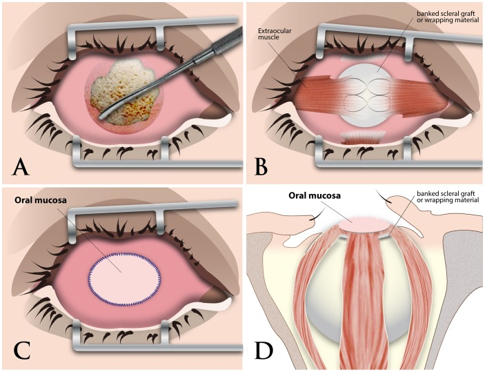
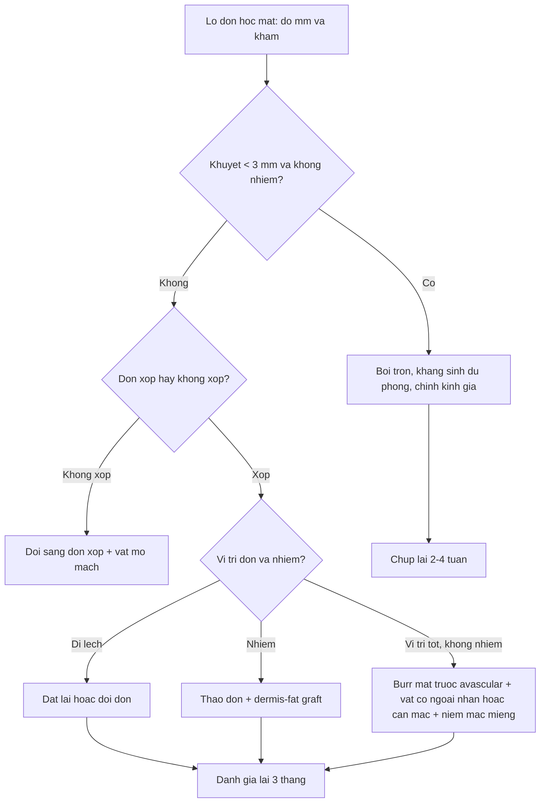
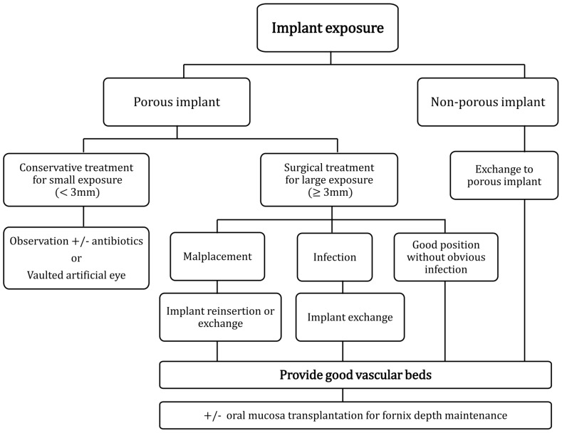
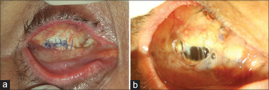
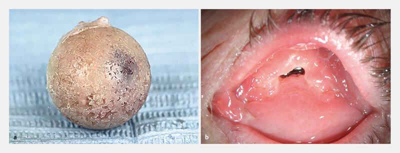
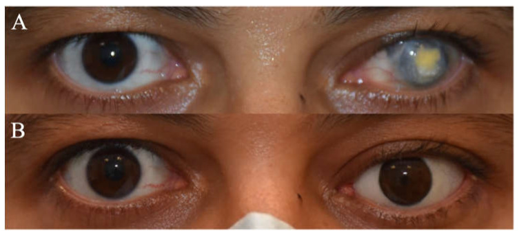

# 3228 — Lộ độn hốc mắt muộn sau múc nhãn cầu: vá niêm mạc, thay độn hay tháo độn? / Late orbital implant exposure after enucleation

**Tags:** `pattern:lo-don-hoc-mat` `pattern:khuyet-niem-mac` `pattern:nhiem-vat-lieu` `pattern:di-lech-don` `vung:hoc-mat` `vung:mat` `vung:ket-mac` `protocol:MRI-tuong-phan` `protocol:CT-hoc-mat` `score:MRI-vascularization` `incidentaloma:khong`

**Mức chắc chắn (certainty):** tổng hợp y văn (literature synthesis) — dựng từ tổng quan hốc mắt không nhãn cầu **2021** (PMC8354770), loạt **93 mắt** lộ độn sau evisceration (PMC6611290), loạt **37 mắt** và gộp **58 nghiên cứu** về độn xốp (PMC5516469), thuật toán **7 ca** lộ độn lớn (PMC3783467), **6 ca** lộ độn hydroxyapatite kinh điển (DOI 10.1016/s0161-6420(94)31112-2), ca tháo độn **14 tháng** (PMC12020655), ca **78 tuổi** lộ độn sau evisceration (PMC7442098), loạt **82 hốc mắt** 2025 (PMC12608243) và các nghiên cứu MRI tương phản (PMID 12544792, PMID 10964823, PMID 7535979). Nhóm **không có bệnh nhân của mình**; chỗ chưa đủ chắc ghi "chưa rõ". **Không ghi tên tác giả** — attribution dùng tạp chí + năm + PMCID/DOI.

> **Vị trí trong thư viện:** [1515](../1515-theo-doi-hoc-mat-sau-muc-nhan-cau/lesson.md) trả lời *một khối mới trong hốc mắt đã múc là sẹo, độn nhiễm hay tái phát melanoma*; [3224](../3224-lo-ong-van-dan-luu-glaucoma/lesson.md) phủ *lộ ống–bản van dẫn lưu glôcôm*. Bài này trả lời câu hỏi hẹp hơn nhưng gặp hằng ngày: **một vùng niêm mạc tiền vách rách, nhìn thấy độn — đo bao nhiêu mm thì theo dõi, bao nhiêu thì mổ, mổ cách nào, và khi nào phải tháo độn?**
>
> **Câu chốt:** **(1)** Lộ độn gặp ở **0,9–11%** ca múc nhãn cầu/evisceration (PMC12020655); gộp **58 nghiên cứu** cho độn xốp là **7,1%**, hydroxyapatite **4%** trong **802 ca** (PMC5516469). **(2)** Lộ **< 3 mm** có thể tự lành; **≥ 3 mm** thường **không** tự lành và cần can thiệp — ngưỡng này đến từ **6 ca** hydroxyapatite (DOI 10.1016/s0161-6420(94)31112-2) và được dùng trong thuật toán **7 ca** (PMC3783467), **không phải** từ thử nghiệm ngẫu nhiên. **(3)** Trên MRI có gadolinium, phần độn **không ngấm thuốc phía trước ("cold zone")** = thiếu mô xơ–mạch tại chỗ lộ (DOI 10.1016/s0161-6420(94)31112-2); đây là **dấu hiệu cơ chế**, không phải tiêu chuẩn chẩn đoán — chẩn đoán lộ độn là **lâm sàng**.

## 1. Tổng quan bệnh học – cơ chế hình ảnh

### 1.1 Định nghĩa: "lộ độn" khác "tháo độn" (extrusion) ở đâu?

**Lộ độn hốc mắt (implant exposure)** = mất tính toàn vẹn của các lớp **kết mạc – Tenon – củng mạc** phía trước độn, làm **bề mặt độn nhìn thấy được**. Bất kỳ **kích thước khuyết** nào cũng được tính, kể cả khi độn đã **lồi ra ngoài** (định nghĩa dùng trong loạt 93 mắt, PMC6611290). Vì vậy "lộ" và "tháo độn" là **hai đầu của một phổ**: khuyết niêm mạc → lộ một phần → độn bị đẩy ra hoàn toàn.

Ba câu hỏi lâm sàng quyết định mọi thứ: **(1) khuyết rộng bao nhiêu mm? (2) độn còn đúng vị trí và còn được nuôi không? (3) có nhiễm hay không?**

### 1.2 TẠI SAO tiền vách là điểm yếu của độn xốp

Độn xốp (hydroxyapatite – HA, polyethylene xốp – PP) không phải mô sống: nó chỉ ổn định khi **mô xơ–mạch mọc vào các lỗ xốp** (fibrovascular ingrowth). Quá trình này **hướng tâm (centripetal)**: bắt đầu từ **chu vi** và từ **các kênh khoan**, rồi tiến dần vào trung tâm (PMID 7535979). Hệ quả:

- **Phần trước của độn là vùng đến sau cùng** và cũng là nơi chịu **áp lực của kính giả** trực tiếp nhất, với lớp Tenon mỏng nhất. Khi mô xơ–mạch không tới được, bề mặt trước chỉ có một lớp niêm mạc mỏng dính vào vật liệu cứng → **loét → lộ**.
- **Độn di lệch ra trước** làm căng lớp phủ, tạo **điểm tì** lên bờ độn; đây là lý do **vá trực tiếp thường thất bại nếu chưa xử lý di lệch** (PMC8354770).
- **Bề mặt xốp có gai (spicules)** cọ vào kết mạc, đặc biệt ở độn HA không bọc; **peg** xuyên qua độn tạo đường vào vi khuẩn và chấn thương mạn (PMC3783467, PMC8354770).
- **Mô nền kém**: xạ hốc mắt, hóa trị chu phẫu (retinoblastoma), nhiều lần mổ trước, chấn thương, khô mắt nặng — đều làm chậm lành và tăng lộ (PMC5516469).

### 1.3 Vật lý hình ảnh: vì sao MRI tương phản nhìn được "độn sống"

- **Độn HA/PP không có proton linh động** → trên mọi chuỗi MRI, bản thân độn là **vùng tín hiệu trống** (signal void). Vì vậy mọi **tín hiệu tăng bên trong độn phải đến từ mô của cơ thể** lấp vào lỗ xốp.
- **Gadolinium rút ngắn T1** của mô xơ–mạch (mao mạch + khoảng ngoại bào) → vùng đã được nuôi **ngấm thuốc**, vùng chưa được nuôi **không ngấm**. Đo **tỉ lệ diện tích ngấm thuốc ở xích đạo** trên mặt cắt trục và vành là cách bán định lượng mức xơ–mạch hóa (PMID 10964823).
- **Thứ tự thời gian:** với HA, **2–7 tuần** sau đặt, **15/21** mắt chỉ có ngấm ở **vành** (độ I hoặc thấp hơn); **9–15 tuần**, **14/14** mắt đã có ngấm tới **trung tâm**, **11** mắt ngấm **đồng nhất**; **31–69 tuần**, **5** mắt độ III và **5** mắt độ IV (PMID 12544792). Với PP, **10/10** mắt đã có ngấm từ **1,5 tháng**, **8/10** tiến triển hướng tâm chủ yếu trong **6 tháng đầu**, **không ca nào ngấm hoàn toàn sau 12 tháng**, **2 ca ngừng tiến triển** (PMID 10964823).
- **"Cold zone" phía trước:** ở **2 ca** lộ HA được chụp gadolinium, vùng **không ngấm thuốc phía trước** tương ứng đúng chỗ **thất bại xơ–mạch hóa** và chỗ lộ (DOI 10.1016/s0161-6420(94)31112-2). Đây là **dấu hiệu sinh học của mô không được nuôi**, không phải ổ áp-xe: áp-xe có **viền ngấm thuốc + dịch/hơi**, còn cold zone **ăn khớp với bề mặt độn** và không có khối.
- **Cạm bẫy:** ngấm thuốc **bình thường** của mô xơ–mạch có thể bị đọc nhầm là **u tái phát hoặc nhiễm**; nghiên cứu **10 mắt** HA nhấn mạnh bác sĩ chẩn đoán hình ảnh phải biết kiểu ngấm này để **không gọi u** (DOI 10.1007/bf00596547). Ngược lại, sau xạ hoặc sau mổ, mô xơ **ngấm chậm và ít** — so với MRI nền quan trọng hơn một lần chụp đơn độc.

### 1.4 Các con số phải nhớ

- **Tần suất lộ độn:** **0,9–11%** sau múc nhãn cầu/evisceration (PMC12020655); **7,1%** gộp cho độn xốp từ **58 nghiên cứu**; HA **4%** trong **802 ca** theo dõi **15 năm**; PP **3,3% (4/120)** tại Wilmer, **một nửa** trong số đó là trẻ retinoblastoma có **hóa trị chu phẫu** (PMC5516469).
- **Trẻ em:** mòn kết mạc **36,84%**, lộ độn **15,70%** trong một loạt nhi (PMC5516469) — cao hơn hẳn người lớn.
- **Evisceration:** y văn ghi **0–67%**, phản ánh khác biệt kỹ thuật – vật liệu – định nghĩa (PMC6611290).
- **Thời điểm:** sớm **2–8 tuần** (DOI 10.1016/s0161-6420(94)31112-2); trong loạt **32 mắt lộ**, trung bình **20 tháng**, khoảng **1–61 tháng** (PMC6611290); lộ muộn sau **peg** có thể sau nhiều năm (PMC8354770).
- **Triệu chứng:** **53%** có triệu chứng hốc mắt; **đau 28%**, **chảy dịch 25%**, **chảy máu 15,6%** (PMC6611290). Nghĩa là **gần một nửa ca lộ không đau** — không được đợi đau mới khám.
- **Kích thước độn:** **20–22 mm** ở người lớn, **18–20 mm** ở trẻ (PMC5516469); loạt 2025 gồm **82 hốc mắt** dùng độn trung bình **20,5 mm (18–23 mm)**, **58,4%** là độn xốp (PMC12608243).
- **Yếu tố kỹ thuật:** khâu cơ trực **đầu–cuối (end-to-end)** có tỉ lệ lộ **2,0%** so với khâu **orthoptic 9,6%**; phân tích cho thấy kiểu orthoptic làm nguy cơ lộ **cao gấp 8,11 lần** (PMC5516469, PMC8354770).

## 2. Mẫu hình + chẩn đoán phân biệt theo vị trí (gamut)

**Mẫu hình trung tâm:** *một khuyết niêm mạc tiền vách ở hốc mắt đã mất nhãn cầu, nhìn thấy bề mặt độn; có thể kèm chảy dịch, đau, hoặc hoàn toàn im lặng.*

Bốn câu hỏi phải trả lời trước khi chọn cách xử trí:

1. **Khuyết rộng bao nhiêu mm?** đo **hai chiều lớn nhất** bằng thước/đèn khe; **< 3 mm** hay **≥ 3 mm** là ngưỡng thực hành (DOI 10.1016/s0161-6420(94)31112-2; PMC3783467).
2. **Độn xốp hay không xốp, có peg không?** độn xốp lộ vì thiếu xơ–mạch hóa; độn không xốp lộ vì **độn di lệch/áp lực** và thường cần **đổi sang độn xốp** (PMC3783467).
3. **Có nhiễm không?** mủ, khí trong hốc mắt, phù mi, đau tăng, sốt; cấy dịch tiết **trước** khi dùng kháng sinh.
4. **Độn còn đúng vị trí không?** độn lệch ra trước/dưới, cùng đồ nông, kính giả không còn vừa → **nguyên nhân cơ học chưa xử lý thì vá sẽ hỏng**.

**Gamut theo cơ chế (không theo "chất liệu độn"):**

- **Thiếu xơ–mạch hóa trước độn (avascular anterior segment)** — độn xốp, "cold zone" trên MRI, lộ khô, không mủ.
- **Cơ học/áp lực:** độn quá to so với hốc mắt, Tenon mỏng, độn di lệch ra trước, kính giả không vừa, bệnh nhân **dụi mắt**.
- **Nhiễm độn:** mủ, chảy dịch mạn, đau, phù; cấy độn tháo ra mọc **S. aureus, Prevotella, nấm** (PMC12020655).
- **Peg:** lộ muộn quanh chân peg, độn xốp **mất mô xơ–mạch quanh peg**, đau khi lắp kính.
- **Mô nền kém:** sau **xạ hốc mắt**, **hóa trị** (đặc biệt retinoblastoma), nhiều lần mổ, chấn thương, khô mắt nặng.
- **Tái phát u:** khối đặc **đẩy độn**, không phải khuyết niêm mạc; gặp sau múc nhãn cầu vì melanoma (xem [1515](../1515-theo-doi-hoc-mat-sau-muc-nhan-cau/lesson.md)).
- **Không phải lộ độn:** nang kết mạc khổng lồ (dịch, không ngấm thuốc), u hạt mạch máu (pyogenic granuloma), co rút hốc mắt (fornix nông, niêm mạc liền), viêm mô tế bào hốc mắt (phù lan tỏa, không khuyết).

## 3. Bảng so sánh phân biệt (ma trận đối chiếu)

| Thực thể (entity) | Hình ảnh/lâm sàng điển hình | Chốt vào (rule-in) | Chốt loại (rule-out) | Gợi ý xác nhận |
|---|---|---|---|---|
| **Lộ độn do thiếu xơ–mạch hóa** | Khuyết niêm mạc **khô**, bề mặt độn xốp lộ, không mủ; MRI tương phản: **cold zone phía trước**, phần sau ngấm thuốc | **Khuyết + độn xốp + cold zone khớp chỗ lộ + không nhiễm** | Ngấm thuốc **đồng nhất tới mặt trước**, không khuyết → không phải lộ do thiếu mạch | MRI T1 FS + gadolinium; đo mm; theo dõi 2–4 tuần nếu < 3 mm |
| **Lộ độn do cơ học/di lệch** | Độn lệch ra trước/dưới, cùng đồ nông, kính giả không vừa; khuyết ở **đỉnh độn** hoặc bờ chịu lực | **Độn di lệch + khuyết ở điểm tì + tiền sử độn to/nhiều mổ** | Độn trung tâm, khuyết nhỏ không di lệch → nghĩ thiếu mạch đơn thuần | So ảnh cũ, đo vị trí độn trên CT/MRI; thử chỉnh kính giả |
| **Nhiễm độn** | Chảy mủ/dịch đục mạn, đau, phù mi, khí trong hốc mắt; khuyết bẩn, mô hạt | **Mủ + đau + phù + cấy dương + khí/dịch quanh độn** | Khuyết khô, không đau, không mủ → không nhiễm | Cấy dịch tiết **trước** kháng sinh; CT tìm khí/dịch; cấy độn nếu tháo |
| **Lộ quanh peg** | Lộ **muộn**, khu trú quanh chân peg; đau khi lắp kính; độn xốp quanh peg **không ngấm thuốc** | **Peg + lộ sát chân peg + đau khi gắn kính** | Lộ xa peg, không dùng peg → không phải nguyên nhân peg | Tháo peg, MRI đánh giá xơ–mạch quanh kênh; thường phải vá + bỏ peg |
| **Lộ sau xạ/hóa trị** | Tiền sử xạ hốc mắt hoặc hóa trị; niêm mạc **nhợt, khô, mỏng**, lộ tiến triển chậm | **Tiền sử xạ/hóa trị + mô nền kém + lộ tái phát nhiều lần** | Mô niêm mạc hồng, ẩm, lộ đơn độc → nghĩ cơ học/thiếu mạch | Hỏi liều xạ, thời điểm; MRI mô mềm; tránh vá mỏng trên nền xạ |
| **Tái phát melanoma hốc mắt** | **Khối đặc** đẩy độn, T1 tăng/T2 giảm nếu sắc tố, ngấm không đều; có thể kèm đau | **Khối mới + đẩy độn + tín hiệu melanin + so với MRI nền** | Chỉ khuyết niêm mạc, không khối → không phải tái phát | Sinh thiết có kiểm soát; staging; xem 1515 |
| **Nang kết mạc khổng lồ** | Cấu trúc **dịch thuần**, vỏ mỏng, không ngấm thuốc; gặp 3–7% người đặt độn | **Tín hiệu dịch, không phần đặc ngấm thuốc** | Có phần đặc/ngấm thuốc → không phải nang đơn thuần | Siêu âm/CT; chọc hút nếu cần |
| **U hạt mạch máu (pyogenic granuloma)** | Nốt đỏ, dễ chảy máu ở bờ khuyết hoặc cùng đồ; không phải bề mặt độn | **Nốt mạch máu + chảy máu khi chạm** | Bề mặt vật liệu cứng, không nốt → không phải u hạt | Cắt bỏ + mô học nếu tái phát |

*Hình vẽ minh họa (không phải ảnh bệnh nhân): (A) độn xốp lộ với bề mặt gai; (B) vạt cơ trực đặt lên mặt trước độn, có mảnh củng mạc/vật liệu bọc; (C) mảnh niêm mạc miệng phủ; (D) mặt cắt cho thấy cơ và mảnh ghép tạo **giường mạch** trước độn. Nguồn: *PLoS One* 2013, Fig. 1, PMC3783467, CC BY 3.0.*

## 4. Protocol chụp + hệ phân độ/điểm chuẩn hóa

### 4.1 Khám và đo (quyết định hơn mọi hình ảnh)

- **Đo khuyết:** hai chiều lớn nhất bằng thước mm hoặc đèn khe; ghi **vị trí** (đỉnh độn, bờ trên/dưới, quanh peg) và **độ sâu** (chỉ niêm mạc hay tới Tenon/củng mạc).
- **Đánh giá độn:** còn trung tâm? di lệch? bề mặt xốp lộ gai? **peg** còn hay đã tháo?
- **Đánh giá nhiễm:** mủ, mùi, phù mi, đau, sốt; **cấy dịch tiết trước kháng sinh**; nếu độn đã lộ rộng, cấy mô độn khi tháo.
- **Đánh giá kính giả:** khớp, độ dày, có điểm tì; **bỏ kính tạm** vài ngày có thể làm khuyết nhỏ liền lại.
- **Đánh giá mô nền:** xạ, hóa trị, khô mắt, blepharitis, bệnh mô liên kết.

### 4.2 MRI hốc mắt có tương phản — "độn còn sống không?"

- **Máy:** 1,5–3 T, **cuộn bề mặt (surface coil)**; FOV từ bờ trước hốc mắt tới đỉnh.
- **Chuỗi tối thiểu:** **T1** · **T2 fat-sat** · **T1 fat-sat sau gadolinium** (trục + vành) · có thể thêm **DWI/ADC** nếu nghi tái phát.
- **Lát ≤ 2–3 mm**; đo **diện tích ngấm thuốc ở xích đạo** trên mặt cắt trục và vành (phần trăm diện tích), tránh vùng hoại tử/vôi.
- **Thời điểm:** chưa có lịch chuẩn. Dữ liệu thực hành: **1,5 tháng** đã thấy ngấm với PP (PMID 10964823); **9–15 tuần** đa số HA có ngấm trung tâm (PMID 12544792). Nếu dự định **đặt peg**, chỉ đặt sau khi **trung tâm đã ngấm thuốc** — đây là khuyến cáo từ chính nghiên cứu MRI (PMID 12544792).
- **Đọc "cold zone":** vùng **không ngấm phía trước**, khớp với chỗ lộ, gợi ý **thiếu xơ–mạch hóa** tại chỗ (DOI 10.1016/s0161-6420(94)31112-2). Đừng gọi là áp-xe nếu không có viền ngấm/dịch.

### 4.3 CT và siêu âm — khi nào dùng

- **CT** (lát ≤ 1 mm, cửa sổ xương + mô mềm): xác định **vị trí, di lệch, kích thước độn**, quan hệ với **sàn/đỉnh hốc mắt** và xương; tìm **khí/dịch quanh độn** khi nghi nhiễm. HA cản quang mạnh (gần xương), PP cản quang yếu hơn — biết vật liệu để không nhầm độn với mảnh xương.
- **Siêu âm:** hạn chế sau độn; hữu ích khi không MRI được, tìm dịch/nang.

### 4.4 Phân độ thực hành

| Thang | Định nghĩa | Ngưỡng xử trí |
|---|---|---|
| **Kích thước khuyết** | **< 3 mm** vs **≥ 3 mm**; thêm mức "lộ tới xích đạo/độn lồi ra ngoài" | **< 3 mm**: bôi trơn, kháng sinh dự phòng, chỉnh kính giả, theo dõi 2–4 tuần; **≥ 3 mm**: can thiệp (DOI 10.1016/s0161-6420(94)31112-2; PMC3783467) |
| **MRI xơ–mạch hóa (HA)** | **I**: chỉ viền; **II**: ổ ngoại vi; **III**: ổ tới trung tâm; **IV**: đồng nhất; **V**: đồng nhất đậm | **Chưa có ngưỡng điều trị**; dùng để **quyết định thời điểm peg** và phát hiện độn không tiến triển (PMID 12544792) |
| **Nhiễm** | Không nhiễm / nhiễm định vị / nhiễm lan tỏa kèm phù mi, khí | **Nhiễm định vị**: kháng sinh + vá; **nhiễm lan tỏa/độn bẩn**: **tháo độn + dermis-fat graft** (PMC8354770) |

### 4.5 Đường đi quyết định

*Thuật toán của nhóm tác giả 7 ca: **< 3 mm** → bảo tồn (bôi trơn ± kháng sinh, kính giả "vaulted"); **≥ 3 mm** → mổ, phân nhánh **di lệch** (đặt lại/đổi độn), **nhiễm** (đổi độn), **vị trí tốt không nhiễm** (tạo giường mạch ± niêm mạc miệng). Độn không xốp → **đổi sang độn xốp**. Nguồn: *PLoS One* 2013, Fig. 3, PMC3783467, CC BY 3.0.*

### 4.6 Phòng ngừa — số liệu đáng nhớ

- **Khâu cơ đầu–cuối** thay vì orthoptic: **2,0% vs 9,6%**; orthoptic **8,11 lần** nguy cơ (PMC5516469, PMC8354770).
- **Đóng Tenon và kết mạc hai lớp** được khuyến cáo để giảm căng, nhưng một nghiên cứu **không** thấy khác biệt với đóng một lớp ở độn acrylic — **còn tranh cãi** (PMC8354770).
- **Kích thước độn** phù hợp: **20–22 mm** người lớn, **18–20 mm** trẻ; độn quá to làm căng mô phủ (PMC5516469).
- **Bọc độn** (củng mạc, màng ngoài tim, cân nạng, màng polyglactin) giúp khâu cơ và giảm cọ xát; tuy vậy loạt lớn HA **không bọc** vẫn có tỉ lệ lộ thấp (PMC8354770).
- **Tarsorrhaphy tạm** **3–5 ngày** sau evisceration/đặt độn thì hai, **tới 3 tuần** sau dermis-fat graft (PMC8354770).
- **Peg** chỉ đặt sau khi **trung tâm ngấm thuốc** trên MRI; peg làm tăng lộ muộn (PMC8354770, PMID 12544792).
- **Kính giả** đúng khớp, thay khi biến dạng; điều trị khô mắt/viêm bờ mi.

## 5. Biến thể bình thường và cạm bẫy

- **Vành ngấm thuốc quanh độn là bình thường.** Mô xơ–mạch mọc vào chu vi độn ngấm thuốc mạnh, đều, ôm mặt độn; gọi đây là "u" là lỗi thường gặp (DOI 10.1007/bf00596547; xem thêm 1515).
- **"Cold zone" không phải áp-xe.** Áp-xe có **viền ngấm thuốc** và **dịch/hơi**; cold zone là vùng **không ngấm** khớp bề mặt độn, không có khối.
- **Không đợi đau.** **47%** ca lộ không có triệu chứng trong loạt 93 mắt; khám định kỳ hốc mắt và kính giả mới phát hiện được (PMC6611290).
- **Lộ < 3 mm không đồng nghĩa "lành chắc".** Ngưỡng này từ **6 ca** và thuật toán **7 ca**; nếu khuyết **tăng kích thước**, **đau**, **chảy mủ** hoặc **độn lồi** → can thiệp sớm, không chờ đủ 3 mm.
- **Vá trực tiếp/mảnh củng mạc/màng niêm mạc có tỉ lệ thất bại cao** nếu **độn còn di lệch ra trước** — phải xử lý nguyên nhân cơ học trước (PMC8354770).
- **Độn xốp không miễn nhiễm lộ:** gộp **58 nghiên cứu** vẫn **7,1%**; đừng hứa "độn xốp là hết biến chứng" (PMC5516469).
- **Cấy mủ dương không tự chứng minh nhiễm độn:** tụ cầu trên bề mặt lộ có thể chỉ là **cư trú**; nhưng nếu **mủ + đau + khuyết rộng** thì coi là nhiễm cho tới khi loại trừ (PMC12020655).
- **Sau múc nhãn cầu vì melanoma, mọi khuyết không lành phải soi kỹ bờ và sau độn:** tái phát có thể biểu hiện như "lộ độn không liền" — sinh thiết khi có khối/bờ dày (1515).
- **"Thỏa mãn tìm kiếm":** thấy độn lộ là dừng, bỏ sót **di lệch độn, peg gãy, nang sau độn, tái phát ở đỉnh hốc mắt**.

## 6. Tự lượng giá — Blind Quiz

**Ca 1 — Hai tháng sau evisceration, hốc mắt chảy dịch và kính giả không còn vừa.**

- Gợi ý lâm sàng: nữ **78 tuổi**, tiền sử **2 lần ghép giác mạc xuyên** (30 năm trước), mắt phải thủng giác mạc tự phát; đã **evisceration + độn silicon 16 mm** cấp cứu. Hai tháng sau: **hội chứng rãnh trên sâu** và **lộ độn**.
- Câu hỏi: (1) Mô tả khuyết và bề mặt độn. (2) Vì sao độn **16 mm** lại là yếu tố nguy cơ? (3) Xử trí?

<b>Bấm để hiện đáp án (findings + chẩn đoán)</b>

- **Findings:** (a) kết mạc–củng mạc **mòn thành vệt**, bờ khuyết rõ, mô hạt quanh; (b) **bề mặt độn silicon lộ ra**, màu nâu xám, không mủ đặc; cùng đồ nông.
- **Vì sao 16 mm:** độn nhỏ hơn so với thể tích hốc mắt sau **keratectomy** làm **rãnh trên sâu**, mô phủ thiếu căng và **di lệch ra trước**; độn quá nhỏ không lấp được thể tích, độn quá to lại căng mô — cả hai đều tăng lộ (PMC7442098).
- **Xử trí:** **tháo độn silicon**, đặt **dermis-fat graft 25 × 20 mm** lấy vùng quanh rốn, khâu từng lớp vào Tenon–kết mạc, đặt conformer, **tarsorrhaphy** + băng ép **36 giờ**; một tháng sau hốc mắt ổn định.
- **Bài học:** lộ độn **sớm** sau evisceration thường do **mô phủ kém + độn không vừa**, không phải "nhiễm"; với độn không xốp đã lộ, **đổi sang độn xốp hoặc DFG** tốt hơn vá mỏng.
- Nguồn: *Taiwan Journal of Ophthalmology* 2020, Fig. 2, **PMC7442098**, CC BY-NC-SA 4.0.

**Ca 2 — Mười bốn tháng sau múc nhãn cầu vì melanoma hắc mạc, độn tự rơi ra sau 2 ngày viêm.**

- Gợi ý lâm sàng: nữ **61 tuổi**, múc nhãn cầu trái vì melanoma hắc mạc **7,5 mm**, đặt **độn Medpor 20 mm**; sau mổ có đợt viêm kết mạc–mi, cấy **S. aureus**; kính giả ít di động; **14 tháng** sau đột ngột lộ nhanh rồi **độn rơi ra**.
- Câu hỏi: (1) Mô tả bề mặt độn sau khi rơi. (2) Vì sao độn **không dính mô**? (3) Xử trí và phòng ngừa?

<b>Bấm để hiện đáp án (findings + chẩn đoán)</b>

- **Findings:** (a) độn **20 mm** hình cầu, bề mặt **vàng xám, không có mô xơ–mạch bám**, nhiều lỗ xốp lộ; (b) hốc mắt sau tháo **sạch, niêm mạc hồng**, không khối.
- **Vì sao không dính:** độn **không được xơ–mạch hóa** (avascular), có thể do **nhiễm khuẩn định vị mạn** (cấy độn: **S. aureus, Prevotella denticola, Penicillium**); mô xơ–mạch không vào được lỗ xốp → độn chỉ nằm trong hốc mắt, không tích hợp.
- **Xử trí:** **tháo độn** (đã xảy ra tự nhiên), kháng sinh toàn thân + tại chỗ; đề nghị **dermis-fat graft** để phục hồi thể tích — bệnh nhân từ chối.
- **Phòng ngừa:** theo dõi sát **độ di động của kính giả** (giảm là dấu sớm của mất tích hợp); điều trị viêm kết mạc–mi dai dẳng; **không đặt peg** khi chưa có ngấm thuốc trung tâm.
- **Bài học:** lộ độn có thể **tiến triển cấp** dù trước đó chỉ "chảy dịch nhẹ"; **MRI loại áp-xe không loại được mất tích hợp**.
- Nguồn: *Klinische Monatsblätter für Augenheilkunde* 2025, Fig. 2, **PMC12020655**, CC BY 4.0.

**Ca 3 — Sau múc nhãn cầu, bệnh nhân hỏi "mắt giả của tôi có bình thường không?".**

- Gợi ý lâm sàng: bệnh nhân **chấn thương xuyên thủng mắt trái**, nhiều lần ghép giác mạc thất bại; đã **múc nhãn cầu + đặt độn + kính giả chỉnh màu**. Ảnh (A) trước mổ, (B) sau khi lắp kính giả.
- Câu hỏi: (1) Những gì là **bình thường** trong ảnh B? (2) Ba dấu hiệu **báo động** cần khám ngay? (3) Vì sao không được gọi "độn lộ" chỉ vì thấy bờ độn trên ảnh?

<b>Bấm để hiện đáp án (findings + chẩn đoán)</b>

- **Bình thường:** kính giả **che kín cùng đồ**, mi **khép kín**, không lộ bề mặt độn, không chảy dịch; độ cầu và màu tương xứng mắt lành; cùng đồ đủ sâu để giữ kính.
- **Báo động:** **đau mới/tăng**, **chảy mủ hoặc dịch mạn**, **khuyết niêm mạc nhìn thấy độn**; thêm **kính giả rơi/lệch**, **chảy máu**, **khối mới**.
- **Vì sao không gọi lộ:** "lộ" là **khuyết niêm mạc**, không phải "nhìn thấy độn qua khe mi"; ảnh B là **kết quả thẩm mỹ bình thường**, không phải biến chứng.
- **Bài học:** mục tiêu của phục hồi hốc mắt là **thể tích + cùng đồ + che phủ + di động**, không phải "có độn là xong"; kiểm tra định kỳ cả **mặt trong mi** và **bờ cùng đồ**.
- Nguồn: *Journal of Clinical Medicine* 2025, Fig. 1, **PMC12608243**, CC BY 4.0.

## 7. Câu hỏi nghiên cứu & điểm chưa đồng thuận (tính đến 11/2026)

1. **[Tranh cãi] Ngưỡng 3 mm để phân biệt "theo dõi" với "mổ" ở lộ độn hốc mắt có đúng ở độn xốp hiện đại và ở trẻ em?**
   - **Đã biết:** ngưỡng **< 3 mm** được nêu từ **6 ca** HA (DOI 10.1016/s0161-6420(94)31112-2) và dùng trong thuật toán **7 ca** (PMC3783467); ca lộ **16 mm** sau evisceration được xử trí bằng DFG (PMC7442098). Chưa có thử nghiệm so sánh.
   - **Chưa rõ:** tỉ lệ tự lành thật của khuyết **2–3 mm**; ảnh hưởng của **vật liệu xốp mới** và **tuổi trẻ** (lộ **15,70%** ở trẻ) lên ngưỡng này.
   - **Hướng nghiên cứu:** đoàn hệ tiến cứu ghi **kích thước khuyết ban đầu**, vật liệu, thời gian tới lành; phân tích sống còn theo mm.
   - **Nguồn:** PMC3783467; DOI 10.1016/s0161-6420(94)31112-2; PMC7442098.

2. **[Khác biệt thực hành] Có nên chụp MRI tương phản trước khi đặt peg hoặc trước khi quyết định thay độn?**
   - **Đã biết:** MRI gadolinium thấy **ngấm trung tâm ở 14/14** mắt HA sau **9–15 tuần** (PMID 12544792), nhưng PP **không ngấm hoàn toàn sau 12 tháng** ở **10** mắt (PMID 10964823); **2/10** ca ngừng tiến triển. Hiện **không có lịch chuẩn**.
   - **Chưa rõ:** ngưỡng **% diện tích ngấm** đủ để đặt peg an toàn; giá trị tiên đoán lộ của "cold zone" ở độn PP; chi phí–lợi ích so với khám lâm sàng.
   - **Hướng nghiên cứu:** nghiên cứu độ chính xác chẩn đoán, đối chiếu MRI với mô học độn tháo ra; tiêu chuẩn STARD.
   - **Nguồn:** PMID 12544792 (DOI 10.1097/00002341-200301000-00006); PMID 10964823 (DOI 10.1016/s0161-6420(00)00249-9); PMID 7535979 (DOI 10.1016/s0002-9394(14)71228-0).

3. **[Khoảng trống] Độn xốp có thực sự giảm lộ so với độn không xốp khi cùng kỹ thuật và cùng cỡ?**
   - **Đã biết:** gộp **58 nghiên cứu** cho độn xốp **7,1%**, HA **4%** trong **802 ca**; PP **3,3%** ở Wilmer nhưng **một nửa** là trẻ có hóa trị; evisceration ghi **0–67%** (PMC5516469, PMC6611290). Tổng quan 2021 vẫn kết luận **không đủ bằng chứng chọn một loại độn** (PMC8354770).
   - **Chưa rõ:** tỉ lệ lộ **theo vật liệu** khi kiểm soát kỹ thuật khâu cơ, bọc độn, cỡ độn và thời gian theo dõi; vai trò của **độ xốp** và **kích thước lỗ**.
   - **Hướng nghiên cứu:** thử nghiệm ngẫu nhiên/registry đa trung tâm với **cùng quy trình mổ** và **theo dõi ≥ 5 năm**, báo cáo riêng trẻ em.
   - **Nguồn:** PMC5516469; PMC8354770; PMC12020655.

## Bài liên quan chéo
- [1515 – Theo dõi hốc mắt sau múc nhãn cầu vì melanoma hắc mạc: sẹo, độn hay tái phát](../1515-theo-doi-hoc-mat-sau-muc-nhan-cau/lesson.md)
- [3224 – Lộ ống/bản van dẫn lưu glôcôm muộn & nhiễm quanh van](../3224-lo-ong-van-dan-luu-glaucoma/lesson.md)
- [448 – U hắc mạc: melanoma vs névus vs di căn](../448-u-hac-mac/lesson.md)
- [1510 – Hội chứng khoang hốc mắt cấp](../1510-hoi-chung-khoang-hoc-mat/lesson.md)
- [1506 – Dị vật hốc mắt tồn lưu: giả ảnh kim loại và cạm bẫy CT](../1506-di-vat-hoc-mat-ton-luu/lesson.md)
- [400 – Tổng quan Mắt & thị giác](../400-tong-quan-mat-thi-giac/lesson.md)

## Ảnh
- `images/3228_lo-don-hoc-mat_Clinical_PMC7442098.jpg` — Fig. 2, *Taiwan Journal of Ophthalmology* 2020, **PMC7442098**, **CC BY-NC-SA 4.0** (nguyên bản, không cắt ghép).
- `images/3228_lo-don-hoc-mat_Clinical_PMC12020655.jpg` — Fig. 2, *Klinische Monatsblätter für Augenheilkunde* 2025, **PMC12020655**, **CC BY 4.0**.
- `images/3228_lo-don-hoc-mat_Algorithm_PMC3783467.jpg` — Fig. 3, *PLoS One* 2013, **PMC3783467**, **CC BY 3.0**.
- `images/3228_lo-don-hoc-mat_Diagram_PMC3783467.jpg` — Fig. 1, *PLoS One* 2013, **PMC3783467**, **CC BY 3.0**.
- `images/3228_lo-don-hoc-mat_Clinical_PMC12608243.jpg` — Fig. 1, *Journal of Clinical Medicine* 2025, **PMC12608243**, **CC BY 4.0**.

> Không dùng để chẩn đoán độc lập khi chưa có người hướng dẫn.
