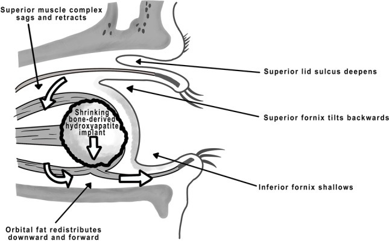
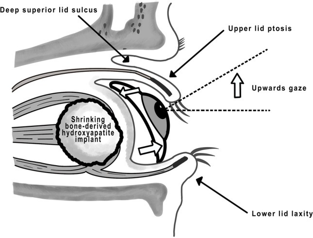
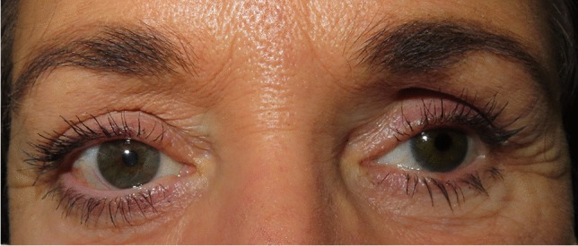
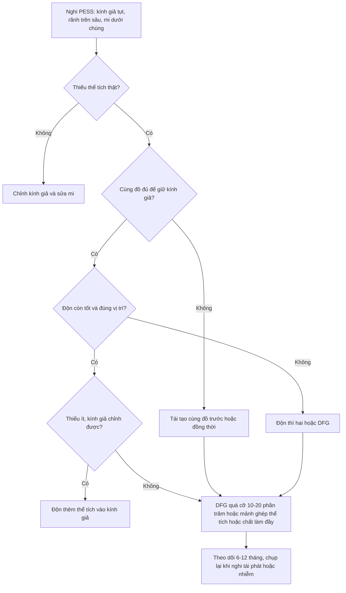
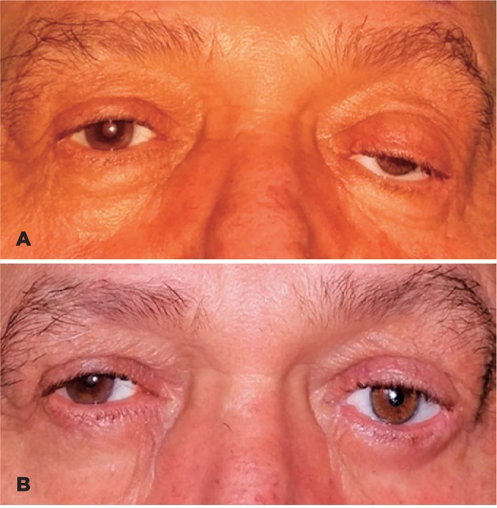

# 3229 — Hội chứng hốc mắt sau múc nhãn cầu: enophthalmos, rãnh trên sâu và kính giả lệch / Post-enucleation socket syndrome (PESS)

**Tags:** `pattern:hoc-mat-sau-muc` `pattern:enophthalmos` `pattern:thieu-the-tich-hoc-mat` `pattern:rach-cung-do` `vung:hoc-mat` `vung:mat` `vung:mi` `protocol:CT-hoc-mat` `protocol:MRI-hoc-mat` `protocol:MRI-T1-fat-sat` `score:hertel` `incidentaloma:khong`

**Mức chắc chắn (certainty):** tổng hợp y văn (literature synthesis) — dựng từ định nghĩa cơ chế mới **2022** (PMC9325822), loạt **21 hốc mắt** đeo kính giả lâu năm (PMC11984438), tổng quan **127 bài** (PMC8354770), **31 bệnh nhân** tiêm calcium hydroxyapatite theo dõi **10 năm** (PMC10795969), **62 hốc mắt** ghép mỡ–bì (PMID 30208137), **175 hốc mắt** trong 15 năm (PMC12608243) và các loạt tăng thể tích bằng mảnh ghép (PMID 24569426, PMID 10432524). Nhóm **không có bệnh nhân của mình**; chỗ chưa đủ chắc ghi "chưa rõ". **Không ghi tên tác giả** — attribution dùng tạp chí + năm + PMCID/PMID.

> **Vị trí trong thư viện:** [3228](../3228-lo-don-hoc-mat-sau-muc-nhan-cau/lesson.md) trả lời *khi nào một vùng niêm mạc tiền vách rách và lộ độn*; [1515](../1515-theo-doi-hoc-mat-sau-muc-nhan-cau/lesson.md) trả lời *khi nào một khối mới trong hốc mắt đã múc là tái phát melanoma*; [400](../400-tong-quan-mat-thi-giac/lesson.md) là bản đồ hệ Mắt. Bài này trả lời câu hỏi thường gặp hơn cả: **hốc mắt đã lành, không lộ độn, không nhiễm — nhưng mắt giả ngày càng tụt, rãnh trên sâu, mi dưới chùng; thiếu bao nhiêu thể tích thì can thiệp, can thiệp bằng gì, và đọc CT/MRI thế nào để không mổ oan?**
>
> **Câu chốt:** **(1)** PESS không chỉ là "thiếu thể tích": trong **21 người đeo kính giả trung bình 9,4 năm**, **21/21 thiếu thể tích**, nhưng **14/21 còn di lệch thể tích** (9 hướng dưới–trong, 5 dưới–ngoài), **18/21 sụp mi**, **15/21 rãnh trên sâu**, **11/21 thiếu cùng đồ dưới** (PMC11984438). **(2)** Định nghĩa **2022** dựa trên CT/MRI phân giải cao và mô bệnh: **không có teo mỡ** đơn thuần, mà là **dịch chuyển xoay vòng mô hốc mắt** (trên→sau, sau→dưới) + **co rút cơ ngoại nhãn** + **tiêu xương độn hydroxyapatite** (PMC9325822). **(3)** Xử trí theo bậc: **chỉnh kính giả → tăng thể tích (DFG/độn thì hai/chất làm đầy) → tái tạo cùng đồ và mi**; DFG nên **quá cỡ 10–20%**, hoại tử **2,9%** (thì đầu) và **4,5%** (thì hai), nang **tới 11%**, hẹp cùng đồ muộn **20%** (PMC8354770).

## 1. Tổng quan bệnh học – cơ chế hình ảnh

### 1.1 PESS là gì — và vì sao định nghĩa cũ không còn đủ

**Hội chứng hốc mắt sau múc nhãn cầu (post-enucleation socket syndrome, PESS)** được Tyers và Collin mô tả năm **1982** bằng bốn dấu lâm sàng: **enophthalmos**, **rãnh trên sâu (deep superior sulcus)**, **sụp mi** và **mi dưới chùng**. Định nghĩa đó thuần mô tả, giả định cơ chế là **teo mỡ hốc mắt** sau khi mất nhãn cầu.

Định nghĩa **2022** (PMC9325822) giữ nguyên các dấu lâm sàng nhưng đổi cơ chế và bổ sung các thành tố bị bỏ sót:

- **cùng đồ trên nghiêng ra sau (backward tilt of the superior fornix)**;
- **cùng đồ dưới nông hơn**;
- **kính giả nghiêng ra sau, liếc lên và tì vào mi dưới**;
- **không đeo được kính giả** trong ca nặng.

Điểm cần nhớ: **PESS là một hội chứng biến thiên**, không phải một mức độ cố định. Cùng một bệnh nhân có thể thiếu thể tích ít nhưng **di lệch thể tích nhiều**, hoặc ngược lại.

### 1.2 TẠI SAO: dịch chuyển xoay vòng, co rút cơ, và tiêu độn — không phải "teo mỡ" đơn thuần

Sau khi lấy nhãn cầu, hốc mắt mất "quả bóng" trung tâm giữ các mô theo hình nan hoa. Ba quá trình xảy ra đồng thời:

1. **Dịch chuyển xoay vòng (rotatory displacement).** Phức hợp cơ trên và mô trên **sa xuống và co rút ra sau** → **rãnh trên sâu**, **cùng đồ trên nghiêng ra sau**. Mỡ hốc mắt **tái phân bố xuống dưới và ra trước** → **cùng đồ dưới nông**, **mi dưới dài và chùng**. Đây là mô tả trên CT/MRI độ phân giải cao và mô bệnh của **2022** (PMC9325822).
2. **Co rút cơ ngoại nhãn.** Cơ mất điểm bám vào nhãn cầu nên co về phía đỉnh hốc mắt, kéo mô quanh độn ra sau.
3. **Tiêu xương độn hydroxyapatite (HA).** HA có thể bị **hoạt tính giống hủy cốt bào** làm nhỏ dần thể tích theo năm (PMC9325822, Fig. 2). Vì vậy một độn "20 mm" đặt cách đây 10 năm **không còn là 20 mm** — đây là lý do PESS có thể tiến triển **dù không có biến cố nào**.

**Phản biện quan trọng:** teo mỡ từng là cơ chế chính thức trong sách giáo khoa, và một số loạt vẫn mô tả "mỡ hốc mắt teo" (PMC11984438). Tuy nhiên, các nghiên cứu **CT/MRI phân giải cao và mô bệnh** dẫn trong PMC9325822 **không tìm thấy teo mỡ**; cái mất là **vị trí và hình dạng** của mỡ, không nhất thiết là **thể tích mỡ**. Trên thực hành, điều này đổi câu hỏi từ *"mỡ mất bao nhiêu?"* sang *"mô đang nằm ở đâu, và độn còn đúng chỗ không?"*.

### 1.3 Vật lý hình ảnh: vì sao CT đo được thể tích, MRI đọc được mô và độn

- **CT:** mỡ hốc mắt **−50 đến −100 HU**, cơ **+40 đến +60 HU**, xương **> 200 HU**, độn HA/polyethylene và kính giả **rất cao**. Nhờ chênh HU, có thể **tách mỡ – cơ – độn – kính giả** rồi **đo thể tích từng thành phần** bằng ngưỡng (segmentation). Hốc mắt người lớn **~30 cm³** (PMC4813623), trong đó **~40% là mỡ** (PMID 33085447). Đây là lý do CT là modality chính khi cần **con số thể tích**, không phải chỉ "nhìn thấy tụt".
- **MRI:** mỡ **sáng trên T1** và **tối trên T2 fat-sat**; cơ **trung gian**; **độn HA/polyethylene là vùng tín hiệu trống** vì không có proton linh động. Vì vậy **mọi tín hiệu bên trong độn phải đến từ mô cơ thể** — mô xơ–mạch mọc vào lỗ xốp sẽ **ngấm gadolinium**, còn phần chưa mọc mạch **không ngấm**. Trên MRI, một **viền ngấm đều, mỏng, ôm sát độn** là mô xơ–fibrovascular bình thường; **ngấm dày, không đều, kèm phù mỡ** gợi **nhiễm**; **khối đẩy độn** gợi **tái phát/u** (PMC9325822, PMC8354770).
- **Kính giả:** **tín hiệu trống trên MRI**, **cản quang mạnh trên CT**. Đây là cạm bẫy: nếu đo thể tích "cả hốc mắt" mà không loại kính giả, một hốc mắt **thiếu thể tích thật** có thể trông **bình thường**.

### 1.4 Các con số phải nhớ

- **Thiếu thể tích:** **21/21** người đeo kính giả lâu năm (trung bình **9,4 ± 6,8 năm**) có thiếu thể tích; **14/21** có **di lệch** kèm theo (PMC11984438).
- **Sụp mi:** **18/21** trong loạt trên (PMC11984438); tổng quan ghi **2–25%** bệnh nhân hội chứng hốc mắt (PMC8354770).
- **Rãnh trên sâu:** **15/21**; **thiếu cùng đồ dưới 11/21**; **mi dưới chùng 6/21** (PMC11984438).
- **Enophthalmos theo vật liệu độn:** sau **4 năm**, độn **PMMA** tụt **4 mm**, độn **HA tích hợp** tụt **1,5 mm** so với mắt bên kia (**43 mắt**, PMC4813623). Đây là bằng chứng quan sát, không phải RCT.
- **Ngưỡng lâm sàng:** chênh **Hertel > 2 mm** được coi là có ý nghĩa (StatPearls 2025, PMID 33085447). Trong hốc mắt đã múc, đo **đỉnh kính giả**, không đo giác mạc.
- **Trẻ em:** thể tích hốc mắt tăng **1–2%/năm** tới cuối tuổi thiếu niên (**292 hốc mắt**, PMC8883635). Độn **không lớn theo** — vì vậy trẻ múc mắt sớm có nguy cơ PESS tiến triển và cần **đổi độn theo tuổi**.
- **Cỡ độn:** người lớn **20–22 mm**; độn nhỏ **13–16 mm** làm thiếu thể tích rõ hơn (PMC12608243).

## 2. Mẫu hình + chẩn đoán phân biệt theo vị trí (gamut)

**Mẫu hình trung tâm:** *hốc mắt đã múc nhãn cầu, không lộ độn, không nhiễm, nhưng kính giả ngày càng tụt vào — kèm rãnh trên sâu, sụp mi, mi dưới chùng và cùng đồ dưới nông.*

Sáu nhóm nguyên nhân, xếp theo **cơ chế** chứ không theo tên bệnh:

1. **Thiếu thể tích đơn thuần:** không có độn, độn quá nhỏ, hoặc mô mỡ mất theo tuổi/xạ trị. Hốc mắt **đối xứng về hình dạng** nhưng **nông hơn toàn bộ**.
2. **Di lệch thể tích:** mô còn nhưng **dồn xuống dưới** (dưới–trong hoặc dưới–ngoài) — trên CT thấy **khoang trên rỗng, mô dồn về góc dưới**; đây là nhóm **hay bị bỏ sót nhất** vì "vẫn còn mỡ" (PMC11984438: 9 dưới–trong, 5 dưới–ngoài).
3. **Bất thường độn:** độn **tiêu dần** (HA), **di lệch**, **lộ** (bài 3228), **nhiễm** — mỗi thứ có hình ảnh riêng nhưng đều làm mất thể tích hiệu dụng.
4. **Co rút cùng đồ (contracted socket):** thiếu **diện niêm mạc** chứ không chỉ thiếu **thể tích**; kính giả **không giữ được** dù hốc mắt đầy. Phân độ **I–IV** (mục 4).
5. **Bất thường mi:** **sụp mi giả** do mất điểm tựa kính giả, **sụp mi thật** do cơ nâng mi, **mi dưới chùng** do kính giả tì lâu năm, **entropion/ectropion**.
6. **Bên đối diện:** **lồi mắt** (bệnh tuyến giáp, u hốc mắt) làm mắt đã múc **trông tụt** dù thể tích bên múc bình thường — luôn đo **hai bên**.

**Mnemonic "SOCKET":** **S**ulcus (rãnh trên sâu) · **O**rbit volume loss (thiếu thể tích) · **C**ontracture (co rút cùng đồ) · **K**eloid/fibrosis sau xạ · **E**nophthalmos · **T**ilt of prosthesis (kính nghiêng ra sau).

*Hình do tác giả vẽ, tái sử dụng theo CC BY 4.0 — Graefes Arch Clin Exp Ophthalmol 2022 (PMC9325822), Fig. 2.*

*Cùng nguồn (PMC9325822, Fig. 3), CC BY 4.0. Đây là "hình học" cần mô tả trong báo cáo: kính giả không chỉ tụt mà còn xoay và tì vào mi dưới.*

## 3. Bảng so sánh phân biệt (ma trận đối chiếu)

| Thực thể (entity) | Hình ảnh điển hình | Chốt vào (rule-in) | Chốt loại (rule-out) | Gợi ý xác nhận |
|---|---|---|---|---|
| **PESS — thiếu thể tích** | Hốc mắt nông đều, rãnh trên sâu, kính giả tụt và nghiêng ra sau; CT: thể tích bên múc **nhỏ hơn bên lành**, mô mỡ ít nhưng **không dồn một góc** | **Rãnh trên sâu + kính giả tụt > 2 mm + không có khối/viêm**; CT thể tích giảm | Có **khối đẩy độn**, **ngấm thuốc bất thường**, **đau/chảy mủ** → không phải PESS đơn thuần | Hertel, ảnh chuẩn hóa, CT thể tích (mục 4) |
| **PESS — di lệch thể tích** | Khoang trên rỗng, mô dồn **dưới–trong** hoặc **dưới–ngoài**; kính giả lệch trục | **CT: mô mỡ tập trung một góc dưới**, thể tích tổng có thể **bình thường** | Thể tích giảm đều, không dồn góc → thiếu thể tích đơn thuần | CT dựng 3D, so sánh hai bên |
| **Lộ độn (bài 3228)** | **Nhìn thấy bề mặt độn** qua khuyết niêm mạc; chảy dịch, đau | **Khuyết niêm mạc tiền vách + thấy độn** | Niêm mạc liên tục → không phải lộ | Đèn khe; MRI nếu nghi nhiễm |
| **Nhiễm độn** | Đau, chảy mủ, viêm mô mềm quanh độn; CT **dày mô mềm quanh độn**, MRI **ngấm dày không đều + phù mỡ** | **Đau + chảy mủ + viêm quanh độn** | Không đau, không tiết dịch, ngấm đều mỏng → không nhiễm | Cấy, MRI tương phản; cân nhắc tháo độn |
| **Co rút cùng đồ** | Kính giả **không giữ được**, cùng đồ nông/không có, seo co kéo; hốc mắt có thể **đầy** | **Không đeo được kính giả + cùng đồ nông**; phân độ I–IV | Cùng đồ đủ sâu, chỉ tụt thể tích → PESS | Đo độ sâu cùng đồ bằng thước |
| **Tái phát/u hốc mắt (bài 1515)** | **Khối mô mềm** đẩy độn, T1↑/T2↓ nếu melanoma, ngấm thuốc; có thể đau | **Khối mới + đẩy độn + ngấm không đều** | Không khối, mô xơ vành đều → không tái phát | MRI T1 fat-sat + gadolinium; sinh thiết khi nghi |
| **Lồi mắt bên đối diện** | Mắt lành **lồi ra**, mắt múc trông tụt tương đối; Hertel hai bên chênh nhưng bên múc không đổi | **Hertel bên lành tăng + bệnh tuyến giáp/u** | Bên múc cũng tụt theo thời gian → PESS thật | Hertel, CT/MRI hai hốc mắt, TSH/FT4 |

*Ảnh lâm sàng, CC BY 4.0 — Graefes Arch Clin Exp Ophthalmol 2022 (PMC9325822), Fig. 1. Đây là "chân dung" cần nhận ra trước khi mở CT.*

## 4. Protocol chụp + hệ phân độ/điểm chuẩn hóa

### 4.1 Lâm sàng trước, hình ảnh sau

- **Ảnh chuẩn hóa:** chính diện, nhìn thẳng, hai góc 45°, có/không đeo kính giả; cùng ánh sáng và khoảng cách.
- **Hertel:** đo **đỉnh kính giả** ở bên múc, so với **đỉnh giác mạc** bên lành; chênh **> 2 mm** là đáng kể (PMID 33085447).
- **Độ sâu cùng đồ:** thước đo cùng đồ (hoặc que đầu tù) ở **cùng đồ trên và dưới**, ghi mm; so với bên lành nếu còn.
- **Mi:** **MRD1/MRD2**, độ chùng mi dưới (kéo mi xuống rồi thả), có **entropion/ectropion**, có **hở mi khi ngủ**.
- **Chức năng:** kính giả có **giữ được** không, có **tụt khi nói/cười** không, có **đau/tiết dịch** không.

### 4.2 Chọn modality

- **CT hốc mắt (lát ≤ 1 mm, cửa sổ mô mềm + xương):** đầu tay khi cần **đo thể tích** và **vị trí độn**. Không cản quang nếu chỉ PESS; **có cản quang** khi nghi nhiễm/u hoặc trước mổ. Đo **thể tích hốc mắt hai bên** bằng ngưỡng, **tách kính giả và độn** khỏi mô mềm; ghi **đường kính, vị trí, mật độ độn**; tìm **gãy sàn/thành**, **hội chứng xoang lặng**, **vôi hóa/dị vật**.
- **MRI hốc mắt:** **T1, T2 fat-sat, T1 fat-sat sau gadolinium** (đúng phụ lục Mắt của `PROMPT_SYNTHESIZER.md`). Dùng khi: nghi **nhiễm độn** (ngấm dày không đều, phù mỡ), nghi **tái phát/u** (khối, DWI/ADC), cần đánh giá **độ xơ–mạch hóa của độn** (ngấm trung tâm hay chỉ vành), hoặc **đỉnh hốc mắt/thần kinh thị**. **Không dùng MRI để đo thể tích** thay CT.
- **Siêu âm:** hạn chế; có thể thấy **nang kết mạc**, **dịch quanh độn**, nhưng không thay CT/MRI.

### 4.3 Phân độ co rút cùng đồ (dùng chung với PESS)

| Độ | Đặc điểm | Hướng xử trí |
|---|---|---|
| **I** | Co rút tối thiểu, **mi dưới chùng ngang**, cùng đồ dưới bị kéo; độn đẩy ra trước | **Conformer tăng dần** + chỉnh kính giả |
| **II** | Co rút **cùng đồ trên và/hoặc dưới**, **entropion** mi trên/dưới | Conformer + **mảnh ghép niêm mạc**/da; sửa entropion |
| **III** | Seo co kéo lan rộng, **không đeo được kính giả** | **Tái tạo cùng đồ** (niêm mạc miệng/da), có thể **độn thì hai** |
| **IV** | **Phimosis khe mi**, co rút **tái phát**, hốc mắt **đã xạ** | Tái tạo phức hợp ± vạt; tiên lượng kém, **nhiều thì** |

*(Phân độ theo PMC8354770; bài không có phân độ PESS riêng đã được validate — xem mục 7.)*

### 4.4 Thuật toán xử trí

### 4.5 Các con số của điều trị

- **DFG (dermis-fat graft):** quá cỡ **10–20%**; hoại tử **2,9%** thì đầu và **4,5%** thì hai; nang **tới 11%**; **hẹp cùng đồ muộn 20%**, **rãnh trên sâu 13%** (PMC8354770). Loạt **62 hốc mắt**: **hở mi 22,6%**, **hoại tử 17,7%**, **u hạt 12,9%**, **teo nhỏ 12,9%**; tỉ lệ giữ kính giả **79% → 88,7%** (PMID 30208137).
- **Calcium hydroxyapatite tiêm:** **31 bệnh nhân**, enophthalmos tương đối **14,16 ± 2,15 mm**; thể tích tăng **+3,35 ± 0,91 mL** ở 6 tháng và **+2,97 ± 1,35 mL** ở 10 năm; **2 lần độn lộ**, **2 sụp mi** (PMC10795969). Đây là lựa chọn **bán vĩnh viễn**, không thay thế DFG khi thiếu nhiều.
- **Mảnh ghép thể tích + niêm mạc:** **24 bệnh nhân**, enophthalmos giảm **3,3 ± 1,26 mm**, cùng đồ dưới sâu thêm **5,0 ± 0,86 mm** (PMID 24569426).
- **HA–tricalcium phosphate trong mỡ hốc mắt:** **10 bệnh nhân**, Hertel **12,7 → 14,0 mm**, thể tích kính giả **2,7 → 1,8 mL** (PMID 10432524).
- **Chất làm đầy:** giảm enophthalmos **~2 mm** nhưng **hấp thu nhanh hơn ở hốc mắt**; 2 bệnh nhân mất thể tích đáng kể **sau 6 tháng** (PMC8354770).
- **Thứ tự:** **sửa thể tích trước, sửa mi sau** — nếu làm ngược, mi sẽ bị chỉnh quá tay khi thể tích còn thiếu (PMC8354770).

*Ảnh lâm sàng, CC BY 4.0 — Arq Bras Oftalmol 2020 (PMC11984438), Fig. 3 (cắt dải chú thích ở đáy). Đây là kết quả **một thì DFG**, không phải "độn to hơn".*

## 5. Biến thể bình thường và cạm bẫy

- **Bất đối xứng nhẹ là bình thường.** Hốc mắt đã múc **không bao giờ đối xứng hoàn toàn**; đừng gọi PESS chỉ vì chênh **1 mm** hay một nếp mi khác. Ngưỡng thực hành: **Hertel > 2 mm**, **kính giả tụt khi nói/cười**, hoặc **không giữ được kính**.
- **Sụp mi giả vs sụp mi thật.** Nếu nâng kính giả lên (hoặc tháo kính) mà mi **vẫn sụp** → sụp mi **thật**; nếu mi **trở lại bình thường** → sụp mi **giả** do mất điểm tựa. Sửa sai loại = mổ mi không cải thiện.
- **Bên đối diện lồi mắt.** Bệnh tuyến giáp hoặc u hốc mắt bên lành làm bên múc **trông tụt**; luôn đo **hai bên** và hỏi triệu chứng toàn thân.
- **CT "bình thường" vì kính giả.** Kính giả cản quang mạnh; nếu đo cả hốc mắt mà không tách kính giả, thể tích có thể **giả bình thường**. Phải **segment riêng** kính giả, độn và mô mềm.
- **HA tiêu dần ≠ nhiễm.** Cả hai đều làm mất thể tích; **nhiễm** có **đau, chảy mủ, ngấm dày không đều + phù mỡ**, còn **tiêu HA** im lặng, ngấm vành đều. Đừng tháo độn chỉ vì "độn nhỏ hơn trên phim".
- **Đừng bỏ qua sàn hốc mắt.** Gãy sàn cũ, **hội chứng xoang lặng**, hoặc độn đặt quá thấp có thể là nguyên nhân **thật** của tụt mắt; nếu chỉ làm to kính giả sẽ thất bại.
- **Hốc mắt đã xạ:** nguy cơ **co rút, hoại tử mảnh ghép, hẹp cùng đồ** cao hơn; tiên lượng và số thì khác hẳn hốc mắt lành (PMC8354770).
- **Trẻ em:** hốc mắt tăng **1–2%/năm** (PMC8883635); độn không lớn theo. Trẻ **múc mắt trước 3 tuổi** cần **theo dõi thể tích định kỳ** và **đổi độn**, không chỉ thay kính giả to hơn.
- **"Satisfaction of search":** thấy rãnh trên sâu là dừng lại, bỏ sót **khối đẩy độn**, **gãy sàn**, **nang kết mạc**, **dị vật**. Luôn đọc **toàn bộ** CT/MRI, không chỉ vùng tụt.

## 6. Tự lượng giá — Blind Quiz

**Ca 1 — Nữ 51 tuổi, đã múc nhãn cầu trái 8 năm, đến vì "mắt giả ngày càng tụt và hay bị lệch". Nhìn ảnh, mô tả trước khi đọc đáp án.**

- Gợi ý: không đau, không chảy mủ, niêm mạc liên tục, không thấy độn.
- Câu hỏi: (1) các dấu hiệu chính? (2) ba chẩn đoán phân biệt? (3) bước tiếp theo rẻ nhất và hữu ích nhất?

<b>Bấm để hiện đáp án (findings + chẩn đoán)</b>

- **Dấu hiệu:** **rãnh trên sâu** bên trái, **kính giả tụt vào** so với mắt phải, **kính nghiêng ra sau**, **liếc lên**, **mi dưới bị tì**; không có khuyết niêm mạc, không thấy độn.
- **Chẩn đoán:** **PESS** — thiếu thể tích + di lệch xoay vòng; đây là ca minh họa của định nghĩa 2022 (PMC9325822).
- **Phân biệt:** (a) **độn quá nhỏ/tiêu HA**; (b) **co rút cùng đồ** (nếu không giữ được kính); (c) **bên đối diện lồi mắt**; (d) **tái phát/u** (không có khối, nhưng vẫn phải loại).
- **Bước tiếp theo:** **ảnh chuẩn hóa + Hertel + đo cùng đồ**; nếu cần con số → **CT hốc mắt ≤ 1 mm** đo thể tích, tách kính giả/độn; **MRI** chỉ khi nghi nhiễm/u.
- **Nguồn ảnh:** Graefes Arch Clin Exp Ophthalmol 2022 (PMC9325822), Fig. 1, CC BY 4.0.

**Ca 2 — Nam 50 tuổi, hốc mắt trái đã múc, không độn, kính giả tụt dần 3 năm. Ảnh A trước mổ, ảnh B sau 3 tháng.**

- Gợi ý: không có độn, không nhiễm, cùng đồ còn đủ.
- Câu hỏi: (1) thiếu gì? (2) vì sao chọn DFG mà không đặt độn thì hai? (3) hai biến chứng phải tư vấn?

<b>Bấm để hiện đáp án (findings + chẩn đoán)</b>

- **Dấu hiệu:** (A) **thiếu thể tích toàn bộ**, **rãnh trên sâu**, **kính giả tụt**; (B) hốc mắt **đầy hơn**, kính giả **cân xứng**, mi trên bớt sụp.
- **Vì sao DFG:** không có độn → DFG vừa **tăng thể tích**, vừa **tạo lớp đệm cho niêm mạc** và **có thể lớn theo trẻ**; tránh nguy cơ **lộ/tiêu** của vật liệu nhân tạo. DFG nên **quá cỡ 10–20%** vì sẽ teo một phần (PMC8354770).
- **Biến chứng phải tư vấn:** **hoại tử mảnh ghép** (2,9% thì đầu, 4,5% thì hai), **nang** (tới 11%), **hẹp cùng đồ muộn** (20%), **rãnh trên sâu tái phát** (13%), **hở mi** (22,6% trong loạt 62 hốc mắt) (PMC8354770, PMID 30208137).
- **Nguồn ảnh:** Arq Bras Oftalmol 2020 (PMC11984438), Fig. 3, CC BY 4.0.

**Ca 3 — Trẻ 8 tuổi, múc nhãn cầu lúc 3 tuổi vì retinoblastoma; nay kính giả tụt rõ, không đau, không lộ độn. Hỏi: tại sao tụt, chụp gì, và điều trị khác người lớn ở đâu?**

<b>Bấm để hiện đáp án</b>

- **Tại sao tụt:** hốc mắt trẻ **tăng thể tích 1–2%/năm** tới cuối tuổi thiếu niên (PMC8883635), trong khi **độn không lớn theo**; mô mềm và xương cùng thay đổi → PESS tiến triển.
- **Chụp gì:** **CT hốc mắt ≤ 1 mm** đo thể tích hai bên, đánh giá **kích thước/vị trí độn**, **sàn và thành hốc mắt**; **MRI** nếu nghi tái phát (trẻ RB) hoặc nhiễm.
- **Khác người lớn:** ưu tiên **đổi độn lớn hơn** theo tuổi, không chỉ làm kính giả to; DFG có ưu thế **có thể lớn theo trẻ**; theo dõi **thể tích định kỳ** tới khi hết tăng trưởng.

## 7. Câu hỏi nghiên cứu & điểm chưa đồng thuận (tính đến 11/2026)

1. **[Tranh cãi] Ở người đã múc nhãn cầu, PESS là do teo mỡ hốc mắt hay do dịch chuyển xoay vòng mô hốc mắt?**
   - **Đã biết:** định nghĩa 1982 dựa trên teo mỡ; nghiên cứu 2022 dùng CT/MRI phân giải cao và mô bệnh **không thấy teo mỡ**, thay vào đó là **dịch chuyển xoay vòng + co rút cơ + tiêu HA** (PMC9325822).
   - **Chưa rõ:** các loạt lâm sàng vẫn mô tả "mỡ teo" và dùng thuật ngữ cũ (PMC11984438); chưa có nghiên cứu **đo thể tích mỡ** tiến cứu trên cùng bệnh nhân để phân định.
   - **Hướng nghiên cứu:** cohort tiến cứu **CT/MRI thể tích + mô bệnh** ở người múc mắt, so sánh trước–sau và với mắt lành.
   - **Nguồn:** PMC9325822 (2022); PMC11984438 (2020).

2. **[Khoảng trống] Ngưỡng thể tích hốc mắt nào trên CT đủ để chỉ định tăng thể tích, và ngưỡng đó có khác nhau theo tuổi và vật liệu độn?**
   - **Đã biết:** Hertel chênh **> 2 mm** là ngưỡng lâm sàng (PMID 33085447); các loạt dùng **CT thể tích** nhưng chủ yếu **mô tả** (PMC11984438); thể tích hốc mắt tăng **1–2%/năm** ở trẻ (PMC8883635).
   - **Chưa rõ:** chưa có **cut-off thể tích (mL hoặc % so với bên lành)** được validate để quyết định mổ; chưa rõ ngưỡng cho trẻ đang lớn và cho từng loại độn.
   - **Hướng nghiên cứu:** nghiên cứu **diagnostic accuracy** của CT volumetry, xây dựng đường cong theo tuổi, so với quyết định mổ và kết cục kính giả.
   - **Nguồn:** PMC11984438 (2020); PMC8883635 (2022); PMC9325822 (2022).

3. **[Khác biệt thực hành] DFG, độn thì hai hay chất làm đầy calcium hydroxyapatite nên là lựa chọn đầu tay cho PESS thiếu thể tích trung bình?**
   - **Đã biết:** DFG có tỉ lệ giữ kính giả **79% → 88,7%** nhưng biến chứng đáng kể (hoại tử **17,7%**, teo nhỏ **12,9%**) (PMID 30208137); CAHY tiêm giữ thể tích **+2,97 mL ở 10 năm** nhưng có **2 lần độn lộ** (PMC10795969); tổng quan khuyến cáo **cá thể hóa** (PMC8354770).
   - **Chưa rõ:** không có **RCT** so sánh trực tiếp ba lựa chọn; khác biệt về **thể tích thiếu**, **hốc mắt đã xạ**, **tuổi** và **kinh nghiệm phẫu thuật viên** chưa được kiểm soát.
   - **Hướng nghiên cứu:** RCT hoặc registry tiến cứu theo **thể tích thiếu trên CT**, outcome **giữ kính giả, hài lòng, biến chứng, số thì mổ**.
   - **Nguồn:** PMC10795969 (2024); PMID 30208137 (2018); PMC8354770 (2021).

## Bài liên quan chéo

- [400 – Tổng quan hệ Mắt & thị giác](../400-tong-quan-mat-thi-giac/lesson.md)
- [3228 – Lộ độn hốc mắt muộn sau múc nhãn cầu](../3228-lo-don-hoc-mat-sau-muc-nhan-cau/lesson.md) (lộ độn — kẻ bắt chước PESS)
- [1515 – Theo dõi hốc mắt sau múc nhãn cầu vì melanoma hắc mạc](../1515-theo-doi-hoc-mat-sau-muc-nhan-cau/lesson.md) (khối mới — tái phát/u)
- [3234 – PXF không glôcôm](../3234-pex-khong-glaucoma-theo-doi-slt-phaco-som/lesson.md) (bệnh cảnh mắt khác có "theo dõi dài hạn" — tham khảo cách lập lịch)

> Không dùng để chẩn đoán độc lập khi chưa có người hướng dẫn.
