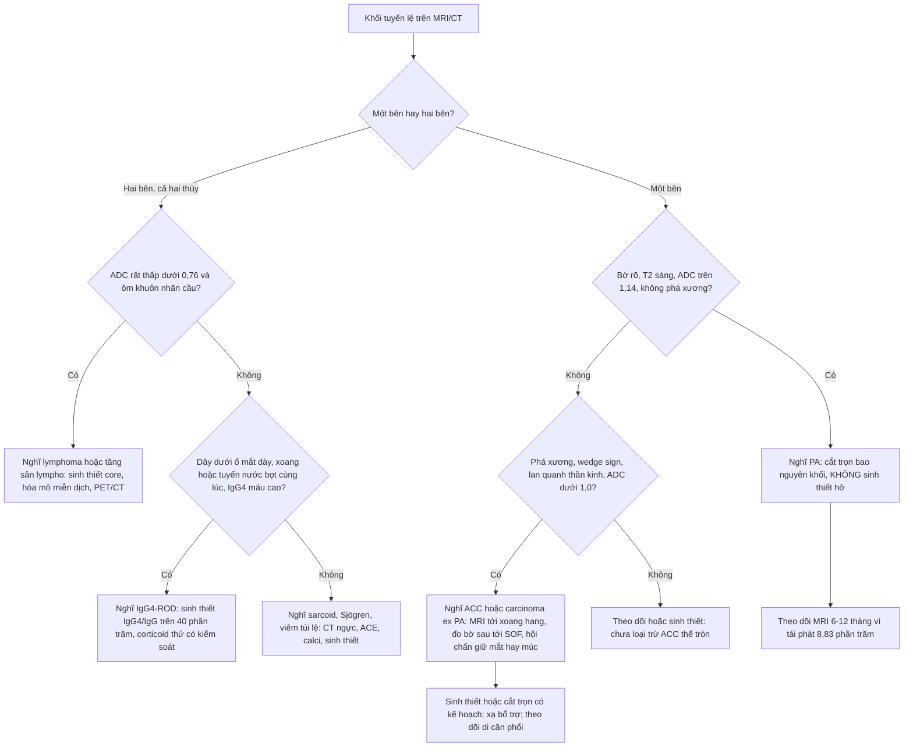
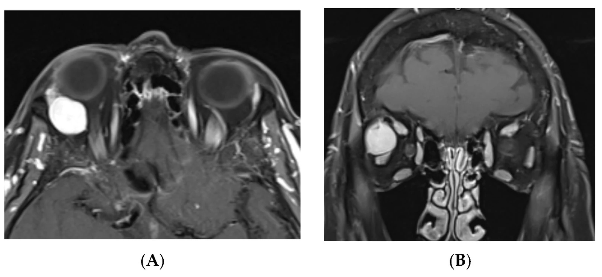
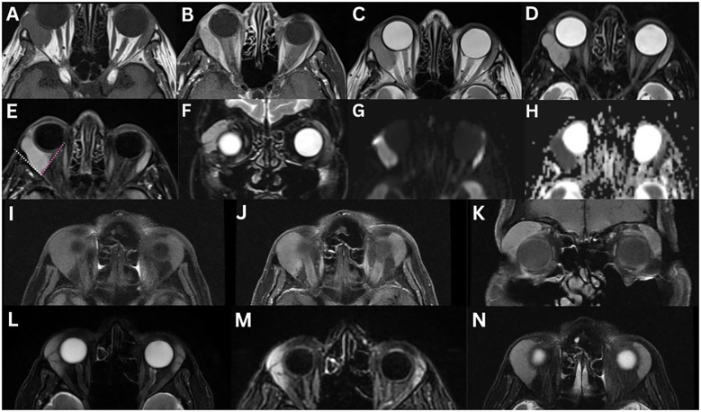
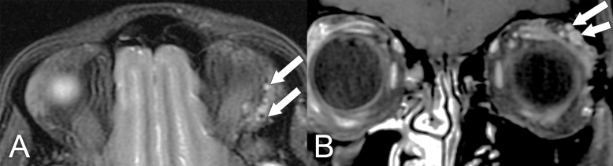

# 3230 — Khối tuyến lệ: u biểu mô – lymphoma – IgG4 trên MRI/CT / Lacrimal gland mass

**Tags:** `pattern:khoi-hoc-mat` `pattern:tuyen-le-to` `pattern:di-lan-xuong` `pattern:wedge-sign` `pattern:hoai-tu-trung-tam` `pattern:xam-lan-than-kinh` `pattern:hai-ben-doi-xung` `vung:mat` `vung:hoc-mat` `protocol:MRI-hoc-mat` `protocol:CT-lat-mong` `protocol:DWI-ADC` `protocol:T1-fat-sat` `protocol:DCE` `score:ADC-cutoff` `incidentaloma:khong`

**Mức chắc chắn (certainty):** tổng hợp y văn (literature synthesis) — dựng từ **bài tổng quan hình ảnh tuyến lệ 2025** (*Front Ophthalmol*, **PMC12819838**, CC BY 4.0) với **bảng 1 và 15 hình ca mẫu**, **39 ca ACC có MRI – mổ** (*Cancers* 2026, **PMC13604454**, CC BY 4.0), **27 PA + 16 ACC đối chiếu CT/MRI** (*Arq Bras Oftalmol* 2023, **PMC11826722**, CC BY 4.0), **44 khối tuyến lệ có ADC** (*J Magn Reson Imaging* 2014, DOI 10.1002/jmri.24392), **28 ca ADC lymphoma vs viêm** (*Indian J Ophthalmol* 2024, **PMC11573044**, CC BY-NC-SA 4.0), **meta-analysis tái phát PA 963 bệnh nhân** (*Orbit* 2024, DOI 10.1080/01676830.2023.2269252 — dùng số liệu, không dùng ảnh) và **89 ca "sa tuyến lệ" có mô bệnh** (*Int J Ophthalmol* 2025, **PMC12120461**). Nhóm **không có bệnh nhân của mình**; số nào chưa kiểm chứng ghi "chưa rõ". **Không ghi tên tác giả** — attribution dùng tạp chí + năm + PMCID.

> **Câu chốt:** khối tuyến lệ chỉ có **4 câu hỏi làm thay đổi điều trị**: **(1) một bên hay hai bên? (2) một thùy hay cả hai thùy? (3) T2/ADC thuộc nhóm nào? (4) có xâm lấn xương – thần kinh – cơ ngoài nhãn cầu không?** Bốn con số phải thuộc: **(a)** u biểu mô tuyến lệ **< 1/1.000.000 người/năm**; **u tuyến đa hình (pleomorphic adenoma, PA) = 12–25%** tổng u tuyến lệ còn **UTBM tuyến dạng nang (adenoid cystic carcinoma, ACC) ≈ 60%** u ác (PMC12819838); **(b)** **ADC PA 1,37 ± 0,22** vs **u ác 1,03 ± 0,19** vs **lymphoma 0,55 ± 0,06** × 10⁻³ mm²/s; ngưỡng **1,14** tách lành/ác chỉ đạt **Se 80% – Sp 100%**, ngưỡng **0,76** tách nhóm lympho khỏi viêm giả u (Se/Sp **100%**) trên **44 ca** (DOI 10.1002/jmri.24392); **(c)** **"wedge sign" KHÔNG đặc hiệu u ác**: gặp **66,7% ACC** nhưng **87,5% lymphoma** và **84,8% IgG4** (PMC12819838); **(d)** ACC **ăn xương 75% / phá xương 34%** trong khi PA **tái tạo xương 67% nhưng xâm lấn xương chỉ 2,2%** (PMC12819838, PMC11826722). Bẫy chết người: **ACC hoàn toàn có thể tròn, bờ rõ, ngấm đều như PA** (PMC13604454) — bờ rõ **không** loại trừ ác; và **chọc hở bao PA làm tái phát 8,83%**, trong đó **47,09%** ca tái phát có **vỏ giả rách**.

## 1. Tổng quan bệnh học – cơ chế hình ảnh (TẠI SAO)

### 1.1 Tuyến lệ là "tuyến nước bọt phụ" — nên gamut của nó cũng là gamut tuyến nước bọt + gamut hạch

- **Giải phẫu:** tuyến lệ nằm **ngoài nón** (extraconal), góc trên–ngoài hốc mắt, trong **hố xương trán (lacrimal fossa)**; chia **thùy ổ mắt** (lớn, sau–trên) và **thùy mi** (nhỏ, trước–dưới) bởi **sừng bên cân cơ nâng mi trên** — mốc này **chỉ thấy trên lát coronal** và là mốc phân biệt "khối một thùy" (kiểu u biểu mô) với "to cả hai thùy" (kiểu viêm/lympho).
- **Mô học:** biểu mô tuyến + mô lympho tại chỗ → hai họ bệnh **hoàn toàn khác nhau** cùng nằm một chỗ: **u biểu mô** (PA, ACC, carcinoma ex PA) và **tăng sinh lympho/viêm** (lymphoma, tăng sản lympho phản ứng, IgG4-ROD, sarcoid, viêm túi lệ).
- **Dịch tễ:** u biểu mô tuyến lệ **< 1/1.000.000 người/năm** (PMC13604454); PA **12–25%** tổng u tuyến lệ, ACC **≈ 60%** u ác (PMC12819838). PA **thoái triển ác tới 20%**, nhất là sau cắt không trọn (PMC12819838).
- **Vì sao MRI hơn CT:** đồng thuận với mô bệnh của **MRI 42%** so với **CT 12%** (PMC12819838) — vì câu hỏi "khối này là u hay lympho/viêm" là câu hỏi **mô mềm**, không phải câu hỏi xương. CT giữ vai trò **cửa sổ xương** (phá xương, tái tạo, canxi hóa).

### 1.2 Vì sao mỗi bệnh cho một "chữ ký" tín hiệu riêng

- **PA — nhiều chất nền myxoid/chondroid, giàu nước ngoại bào:** nước tự do làm **T2 sáng** và **khuếch tán tự do → ADC cao**. Trên 35 ca: **T2 tăng tín hiệu 86%**, **T1 đồng tín hiệu với cơ 97%**, ngấm thuốc **vừa 91%** (PMC12819838). Vỏ giả (pseudocapsule) = **viền tối mảnh trên cả T1 và T2** — chính là "vỏ" mà phẫu thuật viên phải giữ nguyên.
- **ACC — tế bào dày đặc, ít nước ngoại bào, hoại tử trung tâm + canxi:** phần đặc **T2 trung gian, ADC thấp** (1,03); **hoại tử trung tâm T2 sáng**, **canxi T2 tối**; ngấm thuốc **không đồng nhất**. Vì **xâm lấn quanh thần kinh** (dây thị giác, V1) và **phá xương sớm**, nên **T1FS+C là thì bắt buộc** để thấy **lan theo dây thần kinh / xoang hang / màng não**.
- **Lymphoma — tế bào lympho xếp cực dày, màng lipid:** ít khoang nước ngoại bào → **ADC rất thấp (0,55)** và **T2 đồng–giảm tín hiệu** so với cơ; nhưng **"mềm"** nên **ôm khuôn nhãn cầu** (moulding) thay vì đẩy lồi, **không phá xương**, ngấm **đồng nhất, vừa–mạnh**.
- **IgG4-ROD — xơ hóa + thâm nhiễm lymphoplasma:** xơ làm **T2 tối** (45,5% ca) và **ADC thấp**; nhưng khi còn **hoạt động viêm** thì ADC **1,45** (nhóm viêm) — nghĩa là **cùng một bệnh, hai đầu ADC**, và **thử corticoid làm thay đổi hình ảnh theo thời gian**.
- **Nguyên tắc vật lý dùng chung:** *nước ngoài bào nhiều → T2 sáng + ADC cao; tế bào/xơ dày đặc → T2 tối + ADC thấp; hoại tử/dịch → T2 sáng nhưng ADC cao (không phải "restricted"); canxi/sắt/hemosiderin → T2 tối.* Vì vậy **"T2 tối" một mình không nói ung thư hay lành** — phải đọc **cặp T2 ↔ ADC ↔ bờ ↔ xương**.

### 1.3 Ngưỡng định lượng nằm lòng

| Chỉ số | Ngưỡng / giá trị | Nguồn |
|---|---|---|
| Tần suất u biểu mô tuyến lệ | **< 1/1.000.000 người/năm** | PMC13604454 |
| Tỷ lệ trong u tuyến lệ | PA **12–25%**; ACC **≈ 60%** u ác; carcinoma ex PA **thứ 2** trong u ác | PMC12819838 |
| Thoái triển ác của PA | **tới 20%**, thường sau cắt không trọn, sau **15–20 năm** (carcinoma ex PA) | PMC12819838 |
| Đồng thuận hình ảnh – mô bệnh | **MRI 42%** vs **CT 12%** | PMC12819838 |
| ADC PA | **1,37 ± 0,22** (tỷ lệ ADC/u thùy thái dương **1,85 ± 0,34**) | 10.1002/jmri.24392 |
| ADC u ác | **1,03 ± 0,19** (tỷ lệ **1,37 ± 0,27**) | 10.1002/jmri.24392 |
| ADC lymphoma / tăng sản lympho | **0,55 ± 0,06** / **0,60 ± 0,06** | 10.1002/jmri.24392 |
| ADC viêm giả u | **0,90 ± 0,08** | 10.1002/jmri.24392 |
| Ngưỡng lành vs ác | **ADC < 1,14** (Se **80%**, Sp **100%**); **tỷ lệ < 1,6** (Se **90%**, Sp **88,9%**) | 10.1002/jmri.24392 |
| Ngưỡng lympho vs viêm | **ADC < 0,76** và **tỷ lệ < 1,0** (Se/Sp **100%/100%**) | 10.1002/jmri.24392 |
| ADC lymphoma vs viêm (loạt 2024) | **1,03 vs 1,45** × 10⁻³ mm²/s (**p = 0,02**, n = 28) | PMC11573044 |
| Mô hình CART (TIC + ADC) | độ chính xác **86,1%** (72 bệnh nhân) | 10.1177/02841851211021039 |
| CT của PA (45 ca) | bờ rõ **100%**, đồng đậm cơ **100%**, đồng nhất **78%**, canxi **13%**, đẩy nhãn cầu **73%**, tái tạo xương **67%**, xâm lấn xương **2,2%** | PMC12819838 |
| MRI của PA (35 ca) | T1 đồng nhất **86%**, đồng tín hiệu cơ **97%**; T2 không đồng nhất **91%**, tăng tín hiệu **86%**; ngấm vừa **91%** | PMC12819838 |
| CT của ACC | **ăn mòn xương 75%**, **phá xương 34%**, canxi **≈ 20%** | PMC12819838 |
| Wedge sign (đuôi sau theo thành ngoài/trên) | ACC **66,7%** (bên) / **55,5%** (trên, **OR 13,44** so lành); lymphoma **87,5%**; IgG4 **84,8%**; viêm túi lệ **54,8%** | PMC12819838 |
| T2 so với chất xám | lymphoma **đồng 75% / tối 25%**; IgG4 **đồng 54,5% / tối 45,5%**; viêm túi lệ **đồng 85% / tối 15%** | PMC12819838 |
| DCE (TIC) | lymphoma **washout 50%**, plateau **25%**, tăng kéo dài **25%**; IgG4 **washout 80%** | PMC12819838 |
| Lan ngoài ổ mắt | lymphoma: dây dưới ổ mắt **6,3%**, tuyến nước bọt **20%**, hạch **12,5%**; IgG4: dây dưới ổ mắt **36,4%**, xoang **72,7%**, tuyến nước bọt **58,6%**, hạch **54,5%** | PMC12819838 |
| Tái phát PA | **8,83%** (95% CI 5,08–13,50; **963 bệnh nhân/22 nghiên cứu**); **47,09%** ca tái phát có **vỏ giả rách** | 10.1080/01676830.2023.2269252 |
| "Sa tuyến lệ" có mô bệnh (89 ca) | viêm túi lệ **43%**, thâm nhiễm lympho khu trú **20%**, **IgG4 15%**, **MALT 9%** | PMC12120461 |
| Nang ống tuyến lệ (dacryops) | **3–6%** tổng tổn thương tuyến lệ | PMC12819838 |
| Sarcoid tuyến lệ | gặp ở **7–15%** bệnh sarcoid | PMC12819838 |

## 2. Mẫu hình + chẩn đoán phân biệt (gamut)

**Bốn mẫu hình quyết định (đọc theo thứ tự, không nhảy bước):**

1. **Khối MỘT bên, MỘT thùy (thùy ổ mắt), bờ rõ, T2 sáng, ADC cao, không hạn chế khuếch tán** → **PA** (hoặc myoepithelioma — không phân biệt được trên hình ảnh).
2. **Khối MỘT bên, bờ không đều/lobulated, T2 trung gian, ADC thấp, wedge sign, phá xương, lan theo thần kinh** → **ACC / carcinoma ex PA**.
3. **To HAI bên, CẢ HAI thùy, đồng nhất, ADC rất thấp, ôm nhãn cầu, không phá xương** → **lymphoma (hoặc tăng sản lympho phản ứng)**.
4. **To HAI bên ± dây thần kinh dưới ổ mắt dày, xoang/tuyến nước bọt/hạch cùng lúc, T2 tối, ngấm đồng nhất, IgG4 máu cao** → **IgG4-ROD** (kèm sarcoid, Sjögren, viêm túi lệ như các "kẻ bắt chước" hai bên).

- **Gamut theo bờ (margin):**
  - **Bờ rõ, vỏ mảnh, lobulated** — PA, myoepithelioma, **ACC thể tròn (bẫy!)**, lymphoma, dacryops (thể nang).
  - **Bờ không rõ, thâm nhiễm mô mỡ, dính cơ** — ACC, carcinoma ex PA, lymphoma thể lan, IgG4 thể xơ hóa, viêm túi lệ xơ, **di căn**.
- **Gamut theo xương:**
  - **Tái tạo/đẽo xương (remodelling, scalloping) không phá vỏ** — PA (67%), u chậm lớn, lymphoma thể DLBCL (hiếm).
  - **Phá xương thật (erosion/destruction)** — ACC (75%/34%), carcinoma ex PA (100% ăn mòn trong loạt 5 ca), di căn (nhất là HCC).
- **Gamut theo thùy:** **chỉ thùy ổ mắt** → u biểu mô; **cả thùy ổ mắt + thùy mi, lan ra trước bờ ổ** → lymphoma, IgG4, viêm túi lệ, sarcoid; **chỉ thùy mi, dạng nang** → dacryops.
- **Gamut theo tuổi/bối cảnh:** trẻ em → rhabdomyosarcoma, LCH, hemangioma (không nằm trong bài này); người lớn > 50 tuổi hai bên → IgG4, lymphoma, sarcoid; **đã cắt PA trước đó** → tái phát đa ổ (mục 5).

## 3. Bảng so sánh phân biệt (ma trận đối chiếu)

| Thực thể (entity) | Hình ảnh điển hình (CT / MRI ± DWI) | Chốt vào (rule-in) | Chốt loại (rule-out) | Gợi ý xác nhận |
|---|---|---|---|---|
| **U tuyến đa hình (PA)** | Một bên, một thùy (ổ mắt), **bờ rõ, tròn/oval, lobulated**, T1 đồng cơ, **T2 sáng 86%**, **ADC cao 1,37**, vỏ giả tối mảnh, **không wedge**, tái tạo hố xương | **T2 sáng + ADC > 1,14 + bờ rõ + không phá xương + không hạn chế khuếch tán** | **Phá xương, lan thần kinh, ADC < 1,0, wedge sign** → không phải PA | **Cắt trọn bao nguyên khối** (không sinh thiết hở); theo dõi tái phát |
| **ACC** | Một bên, **bờ không đều**, T2 trung gian, **ADC 1,03**, **hoại tử trung tâm**, **canxi 20%**, **ăn mòn xương 75%**, wedge **66,7%**, lan V1/dây thị/xoang hang | **Phá xương + wedge + lan quanh thần kinh**; **bờ không đều** | **Bờ rõ + T2 rất sáng + ADC cao + không xương** không loại trừ tuyệt đối (ACC thể tròn) | Sinh thiết/ cắt trọn có kế hoạch; **MRI có T1FS+C tới xoang hang** |
| **Lymphoma tuyến lệ** | **Hai bên 37,5%**, **cả hai thùy**, **bờ rõ, ôm nhãn cầu (moulding), không đẩy lồi**, T2 đồng/tối 75%/25%, **ADC 0,55**, ngấm đồng nhất mạnh, **wedge 87,5%**, **không phá xương** | **Hai bên + cả hai thùy + ADC < 0,76 + ôm khuôn nhãn cầu** | **Phá xương + xâm lấn cơ + T2 rất sáng** → nghi carcinoma; **ADC > 1,0** ít nghĩ lymphoma | **Sinh thiết (core/excision) + hóa mô miễn dịch**; PET/CT giai đoạn |
| **Tăng sản lympho phản ứng (RLH)** | Như lymphoma nhưng **không đồng nhất hơn**, ADC **0,60**, thường hai bên | **ADC thấp + hai bên + không phá xương** | **Không phân biệt được với lymphoma trên hình ảnh** | Sinh thiết + theo dõi kích thước |
| **IgG4-ROD** | **Hai bên 84,8%**, cả hai thùy, **giữ nguyên hình dạng tuyến**, T2 **tối 45,5%**, **ADC thấp**, ngấm đồng nhất, **dây dưới ổ mắt dày 36,4%**, xoang 72,7%, **không phá xương** | **Hai bên + dây dưới ổ mắt + tổn thương đa cơ quan + IgG4 máu ≥ 135 mg/dL** | **Một bên, phá xương, lan thần kinh thị** → không điển hình IgG4 | **IgG4 máu + sinh thiết: IgG4/IgG > 40% và > 10 tương bào/HPF**; đáp ứng corticoid |
| **Viêm túi lệ (dacryoadenitis)** | Thường **một bên**, to lan toả giữ **hình dạng tuyến**, **bờ mờ 64%**, ngấm mạnh, **đau cấp**, có thể áp-xe | **Đau cấp + bờ mờ + không phá xương**; bạch cầu tăng | **Bờ rõ + vỏ giả + T2 rất sáng** → u | Siêu âm/CT tìm áp-xe; kháng sinh; **không corticoid khi chưa loại nhiễm** |
| **Sarcoid** | **Hai bên đối xứng**, cả hai thùy, T1 thấp–trung, **T2 cao**, ngấm đồng nhất, hạch rốn phổi/parotid | **Hai bên + hạch trung thất + tăng calci máu/ACE** | **T2 tối + xơ hóa** → nghĩ IgG4 | CT ngực, sinh thiết u hạt không hoại tử |
| **Di căn tuyến lệ** | Một bên, **bờ không rõ**, T1–T2 trung/cao, ngấm không đồng nhất, **phá xương + lan nội sọ 57,1% khi có xương** | **Tiền sử ung thư (vú, gan, thận) + phá xương** | **Không có tiền sử, tổn thương đơn độc, bờ rõ** → ít nghĩ di căn | Đối chiếu ung thư nguyên phát; sinh thiết |
| **Dacryops (nang ống tuyến)** | Thùy mi, **nang thành mỏng, T2 rất sáng, không ngấm**, không phá xương; **3–6%** | **Nang đơn thuần, không phần đặc** | **Có thành phần đặc/ngấm** → u; **nang + u nhỏ ở thành** phải loại u gây tắc ống | Siêu âm; **không chọc nang đơn thuần** |

### Ba tiểu mục dấu hiệu hay bị đọc sai

- **Wedge sign (dấu đuôi sau):** tổn thương **chạy dài ra sau theo thành ngoài hoặc thành trên ổ mắt**. ACC **66,7%** (bên) và **55,5%** (trên) — dấu **trên** có **OR 13,44** cho ác tính so với u lành, **nhưng** lymphoma **87,5%** và IgG4 **84,8%** cũng có. **Kết luận:** wedge = "khối lan theo mặt phẳng ổ mắt", **không** phải "khối ác".
- **Moulding vs indentation (ôm khuôn vs lõm nhãn cầu):** khối **ôm theo nhãn cầu, không làm lõm** = lymphoma/lympho; khối **đẩy và lõm nhãn cầu** = u biểu mô (PA đẩy lồi **73%**).
- **Bờ rõ (well-circumscribed):** PA **100%**, nhưng **ACC cũng có thể bờ rõ** — loạt 39 ca ACC có bờ nhẵn ở nhóm **mổ giữ mắt**, bờ không đều ở nhóm **múc nội nhãn** (PMC13604454), và ca Fig. 1 của loạt đó là **khối tròn, bờ rõ, ngấm đều, cắt trọn, hóa ra ACC**. **Bờ rõ chỉ đổi xác suất, không đổi chẩn đoán.**

## 4. Protocol chụp + phân tầng xử trí

### 4.1 Protocol tối thiểu (mọi khối tuyến lệ chưa rõ)

1. **MRI hốc mắt 1,5T hoặc 3T** — bộ tối thiểu: **T1 axial**, **T2FS axial + coronal**, **DWI (b = 0/1000) + bản đồ ADC**, **T1FS sau tiêm axial + coronal + sagittal** (bắt buộc **fat-sat** vì tuyến lệ nằm trong mỡ), **DCE** nếu có (phân tích TIC).
2. **CT hốc mắt lát mỏng ≤ 1 mm, cửa sổ xương + cửa sổ mô mềm, có cản quang** — để trả lời **tái tạo hay phá xương**, canxi hóa, và **hố xương trán**.
3. **Đo và ghi vào báo cáo (checklist 8 mục)** — vì đây chính là các biến quyết định mổ:
   - **kích thước 3 chiều (cm)** — ACC mổ múc nội nhãn **3,8 cm** vs giữ mắt **2,9 cm**;
   - **khoảng cách bờ sau khối → khe ổ mắt trên (SOF)**: **7,5 mm** (múc) vs **15 mm** (giữ mắt), **p < 0,001**;
   - **có vượt đường giữa dọc ổ mắt không** (chỉ gặp ở nhóm múc);
   - **xâm lấn cơ ngoài nhãn cầu** (chỉ gặp ở nhóm múc);
   - **phá xương / xâm lấn nội nón**;
   - **lan quanh thần kinh, xoang hang, xoang mũi, hố chân bướm khẩu cái, hố thái dương** (chỉ gặp ở nhóm múc);
   - **bề mặt bờ: nhẵn hay không đều**;
   - **ADC trung bình vùng đặc nhất (ROI tránh hoại tử/canxi)** + tỷ lệ ADC/tổ chức lành.
4. **Siêu âm**: chỉ để **hướng dẫn sinh thiết** hoặc phân biệt **nang đơn thuần** — không dùng để chẩn đoán mô học.
5. **Xét nghiệm hệ thống khi nghĩ viêm/lympho**: **IgG4 máu**, ACE, calci, **CT ngực**, công thức máu, LDH; **PET/CT** khi xác định lymphoma.

### 4.2 Ngưỡng ADC dùng trong thực hành (đọc kèm sai số)

| Câu hỏi | Ngưỡng | Hiệu năng | Ghi chú |
|---|---|---|---|
| Lành vs ác | **ADC < 1,14** | Se **80%**, Sp **100%** | **20% u ác sẽ "rớt" trên ngưỡng** → không dùng để bỏ sinh thiết |
| Lành vs ác (tỷ lệ) | **tỷ lệ ADC < 1,6** | Se **90%**, Sp **88,9%** | Tỷ lệ ổn định hơn khi máy khác nhau |
| Lympho (lymphoma/RLH) vs viêm | **ADC < 0,76** | Se/Sp **100%/100%** | Cỡ mẫu nhỏ (44 ca), cần kiểm chứng lại |
| Lymphoma vs viêm (loạt độc lập) | **1,03 vs 1,45** | **p = 0,02**, n = 28 | Cùng hướng, khác giá trị tuyệt đối |
| TED (đối chứng) | **ADC 1,62**; hoạt động vs không hoạt động **1,76** | Se **97%**, Sp **95%** (TED vs chứng) | Nhắc rằng **"ADC cao" cũng có trong bệnh viêm** |

### 4.3 Vì sao "cắt trọn bao nguyên khối" là quy tắc, không phải sở thích

- **PA:** vỏ giả là **lớp chắn giải phẫu duy nhất**; **chọc/sinh thiết hở làm rách vỏ** → **gieo tế bào vào mô ổ mắt** → **tái phát đa ổ 8,83%**, và **47,09%** ca tái phát có **vỏ giả rách** (10.1080/01676830.2023.2269252). Tái phát đa ổ khó mổ hơn lần đầu, **nguy cơ thoái triển ác tăng** (tới 20%).
- **ACC:** quyết định **giữ mắt + xạ** vs **múc nội nhãn** dựa trên **MRI trước mổ**, không dựa trên kích thước cảm nhận; các mốc ở §4.1 là các biến **duy nhất** đã được đối chiếu với loại mổ trong loạt 39 ca (PMC13604454).
- **Lymphoma/IgG4:** điều trị **không phải phẫu thuật cắt tuyến** — chẩn đoán mô học là bắt buộc; **múc nội nhãn vì "khối to" là sai lầm không hồi phục**.

## 5. Biến thể bình thường và cạm bẫy

- **"Sa tuyến lệ" (lacrimal gland prolapse) không phải chẩn đoán mô học:** trong **89 ca** được gọi là sa tuyến lệ, mô bệnh là **viêm túi lệ 43%**, **thâm nhiễm lympho khu trú 20%**, **IgG4 15%**, **MALT lymphoma 9%** (PMC12120461). Tuyến "sa xuống" trên lâm sàng có thể là **khối thật** → **phải chụp trước khi kết luận "sa sinh lý"**.
- **"Bờ rõ = lành"** — sai: ca ACC **71 tuổi, khối tròn bờ rõ, ngấm đều, không đau**, cắt trọn rồi mới biết ACC (PMC13604454). **Bờ rõ + T2 sáng + ADC cao** mới là bộ ba gợi ý PA.
- **"PA luôn bờ rõ, đều"** — sai: PA lớn có thể **lobulated, không đồng nhất**, **chèn ép cơ trực ngoài** và **lan một phần vào nội nón**; vẫn **không hạn chế khuếch tán** (PMC12819838, Fig. 2). Ngược lại, **lobulated không đồng nghĩa ác**.
- **Wedge sign bị dùng như "dấu ác tính"** — sai: **lymphoma 87,5%**, **IgG4 84,8%**, **viêm túi lệ 54,8%**; chỉ **dấu wedge phía TRÊN** mới có **OR 13,44** cho ác (PMC12819838).
- **ADC thấp bị dùng như "ung thư"** — sai: **lymphoma 0,55** còn thấp hơn **ACC 1,03**; ADC thấp = **mật độ tế bào cao**, không phải "ác".
- **Sinh thiết hở khối nghi PA** — chống chỉ định: rách vỏ giả → tái phát/gieo mầm (8,83%; 47,09% có vỏ rách). Nếu **chưa chắc PA**, hội chẩn **cắt trọn kèm sinh thiết lạnh** thay vì chọc qua da.
- **Thử corticoid trước khi sinh thiết** — có thể làm **teo nhanh** khối lymphoma/IgG4 và **che mất mô học**, đồng thời **giảm khả năng chẩn đoán** trên mẫu nhỏ; chỉ thử khi **đã có kế hoạch sinh thiết ngay sau đó** và theo dõi bằng **MRI có đo kích thước**.
- **Nhầm "u nhỏ nhưng phá xương" là lành** — phá xương luôn đổi chẩn đoán: ACC **34%**, carcinoma ex PA **100%** trong loạt nhỏ, di căn khi có xương **lan nội sọ 57,1%**.
- **Bỏ sót xương trên MRI:** MRI **không** thay CT cửa sổ xương; "không thấy phá xương trên MRI" không loại trừ — nhất là **mảnh xương hốc mắt mỏng**.
- **Satisfaction of search:** thấy khối tuyến lệ rồi dừng — quên **dây thần kinh dưới ổ mắt** (IgG4 **36,4%**), **xoang** (72,7%), **tuyến nước bọt/hạch** (58,6%/54,5%), **dây thị giác**, và **nội sọ**.
- **Tái phát PA bị gọi là "sẹo xơ":** sau cắt PA, **nốt T2 sáng mới trong giường mổ** là **tái phát đa ổ**, không phải sẹo — sẹo xơ **T2 tối, không ngấm**; ca 29 tuổi trong PMC13171307 tái phát **sau > 5 năm** với **nhiều nốt T2 sáng**.

## 6. Tự lượng giá — Blind Quiz ngay trên trang tĩnh

**Ca 1 — nữ 71 tuổi, "nặng mi trên" không đau, khối tròn trên–ngoài hốc mắt phải**

- Gợi ý lâm sàng: **không đau, không song thị, không sụt cân**; khối **tròn, bờ rõ, ngấm thuốc đều**.
- Câu hỏi: (a) Ba đặc điểm nào khiến bạn nghĩ **u lành**? (b) Vì sao **không được chọc hở** khối này? (c) Chẩn đoán mô học thật là gì, và điều đó thay đổi kế hoạch mổ thế nào?

<b>Bấm để hiện đáp án (findings + chẩn đoán)</b>

- (a) **Tròn, bờ rõ, ngấm đồng nhất** — đúng là bộ ba "giống PA"; nhưng **không có T2/ADC** trong ảnh này (chỉ T1FS+C), nên **không đủ để chốt lành**.
- (b) Khối **còn nguyên vỏ giả**: chọc hở **gieo tế bào** và làm tăng **tái phát** — với PA là **8,83%**, với ACC là **gieo mầm dọc đường chọc**.
- (c) **ACC** — cắt trọn ("gross total resection") rồi **xạ bổ trợ**. Bài học: **ACC thể tròn bờ rõ tồn tại**; thiếu T2/ADC thì **không được suy ra lành từ bờ**.
- Nguồn ảnh: *Cancers* 2026, Fig. 1 (PMC13604454), CC BY 4.0.

**Ca 2 — nam, khối tuyến lệ phải; có DWI/ADC**

- Gợi ý lâm sàng: khối **không đau, tiến triển chậm**, **ôm theo nhãn cầu**; bệnh nhân thứ hai (I–N) **hai bên**.
- Câu hỏi: (a) T2 và ADC của khối nói gì? (b) Vì sao **không phá xương** lại là điểm quan trọng? (c) Bước tiếp theo bắt buộc là gì?

<b>Bấm để hiện đáp án (findings + chẩn đoán)</b>

- (a) **T2 tăng tín hiệu, ngấm vừa, hạn chế khuếch tán mạnh trên DWI/ADC** (G, H); **wedge sign bên** (B) và góc sau với thành ngoài **nhọn** (E).
- (b) **Lymphoma tái tạo/đẽo xương nhưng hiếm phá xương**; phá xương thật đẩy chẩn đoán về **carcinoma/di căn**. Ở bệnh nhân I–N, tổn thương **hai bên** càng củng cố nhóm lympho.
- (c) **Sinh thiết core + hóa mô miễn dịch** (và PET/CT giai đoạn) — **không** cắt tuyến mù, **không** thử corticoid đơn thuần.
- **Phản biện nguồn:** bài gốc ghi ca này **T2 tăng tín hiệu**, trong khi bảng tổng hợp của chính bài ghi lymphoma **T2 đồng 75%/tối 25%** so với chất xám — nghĩa là **T2 không dùng để loại trừ lymphoma**; giữ nguyên mô tả gốc và ghi rõ khác biệt này.
- Nguồn ảnh: *Front Ophthalmol* 2025, Fig. 5 (PMC12819838), CC BY 4.0.

**Ca 3 — nữ 29 tuổi, > 5 năm sau cắt "u tuyến lệ", nay lồi mắt nhẹ trở lại**

- Gợi ý lâm sàng: lần đầu **cắt "trọn"** nhưng **có rách vỏ giả** theo hồ sơ; lần này **nhiều nốt** chứ không phải một khối.
- Câu hỏi: (a) Nốt T2 sáng trong giường mổ là **sẹo hay tái phát**? (b) Vì sao tái phát **đa ổ**? (c) Nếu bỏ qua, nguy cơ dài hạn là gì?

<b>Bấm để hiện đáp án (findings + chẩn đoán)</b>

- (a) **Tái phát**: nhiều nốt **T2 sáng** (A) và **ngấm thuốc** (B) trong giường mổ, lan **ngoài phạm vi mổ cũ**. Sẹo xơ **T2 tối, không ngấm**.
- (b) **Vỏ giả bị rách** lúc mổ đầu → **gieo tế bào** vào mô ổ mắt → mọc **nhiều nốt rời**; **47,09%** ca tái phát PA có vỏ rách (10.1080/01676830.2023.2269252).
- (c) Tái phát nhiều lần → **nguy cơ carcinoma ex PA** (thoái triển ác tới **20%**, sau **15–20 năm**), mổ khó hơn, có ca phải **múc nội nhãn**.
- Nguồn ảnh: *Front Ophthalmol* 2026, Fig. 6 (PMC13171307), CC BY 4.0.

## 7. Câu hỏi nghiên cứu & điểm chưa đồng thuận (tính đến 11/2026)

1. **[Tranh cãi] Ngưỡng ADC nào đủ tin cậy để tách ACC khỏi PA mà không cần sinh thiết?**
   - **Đã biết:** PA **1,37 ± 0,22** vs u ác **1,03 ± 0,19** × 10⁻³ mm²/s; ngưỡng **1,14** cho **Se 80% / Sp 100%**, tỷ lệ ADC **< 1,6** cho **Se 90% / Sp 88,9%** trên **44 khối** (10.1002/jmri.24392); mô hình **TIC + ADC** đạt **86,1%** trên **72 bệnh nhân** (10.1177/02841851211021039).
   - **Chưa rõ:** **20% u ác nằm trên ngưỡng 1,14**; chưa có ngưỡng **đa trung tâm, đa máy** cho ACC nói riêng; ảnh hưởng của **hoại tử/canxi** trong ROI chưa được chuẩn hóa.
   - **Hướng nghiên cứu:** nghiên cứu chẩn đoán **mù đôi, tiền cứu**, ROI đặt theo **thuật toán cố định** (vùng đặc nhất, tránh hoại tử), báo cáo **Se/Sp theo từng thể mô học** (ACC ống/tủy/cribriform) và **hệ số tái lập giữa 2 người đọc**.
   - **Nguồn:** 10.1002/jmri.24392; PMC11573044; 10.1177/02841851211021039.

2. **[Khác biệt thực hành] ACC tuyến lệ: khi nào còn giữ mắt, khi nào múc nội nhãn?**
   - **Đã biết:** loạt **39 ca** cho thấy nhóm múc có **khối lớn hơn (3,8 vs 2,9 cm)**, **bờ sau cách SOF 7,5 vs 15 mm**, **vượt đường giữa**, **xâm lấn cơ ngoài nhãn cầu, xoang hang, hố chân bướm – khẩu cái** (PMC13604454); các loạt khác báo **giữ mắt + xạ** có kiểm soát tại chỗ tương đương ở bệnh chọn lọc.
   - **Chưa rõ:** **không có tiêu chí được chấp nhận** để chọn giữ mắt vs múc; các biến trong loạt 39 ca **tương quan chặt với nhau** nên **không phải yếu tố độc lập**; tỷ lệ tái phát theo **T giai đoạn AJCC 8** chưa đủ mẫu.
   - **Hướng nghiên cứu:** registry đa trung tâm, **tiền cứu**, phân tầng theo **khoảng cách bờ sau → SOF (mm)**, **T**, và **lan quanh thần kinh**, so **giữ mắt + proton/xạ điều biến** với **múc + xạ**, outcome **kiểm soát tại chỗ 5 năm, sống toàn bộ, thị lực**.
   - **Nguồn:** PMC13604454; PMC9396917.

3. **[Khoảng trống] Lymphoma – tăng sản lympho phản ứng – IgG4: có dấu hiệu hình ảnh nào đủ để bỏ sinh thiết?**
   - **Đã biết:** lymphoma **ADC 0,55**, tăng sản lympho **0,60**, viêm **0,90–1,45**; ngưỡng **0,76** tách nhóm lympho khỏi viêm với **Se/Sp 100%** nhưng chỉ **44 ca**; IgG4 **hai bên 84,8%**, **T2 tối 45,5%**, dây dưới ổ mắt **36,4%**; **89 ca "sa tuyến lệ"** có tới **9% MALT** và **15% IgG4** (PMC12120461).
   - **Chưa rõ:** **không có ngưỡng ADC nào được validate cho IgG4**; lymphoma và tăng sản lympho **chồng lấp hoàn toàn** trên hình ảnh; **thử corticoid** làm thay đổi hình ảnh theo cách **chưa được định lượng**.
   - **Hướng nghiên cứu:** đoàn hệ **tiền cứu** có **sinh thiết toàn bộ**, so **ADC + DCE + hình thái dây dưới ổ mắt** với mô học và **IgG4/IgG**, xây **nomogram** và kiểm định ngoài; đặc biệt ở nhóm **một bên, không điển hình**.
   - **Nguồn:** PMC12819838; PMC11573044; PMC12120461.

## Bài liên quan chéo

- [400 – Tổng quan Mắt & thị giác](../400-tong-quan-mat-thi-giac/lesson.md)
- [410 – Giải phẫu hốc mắt cắt lớp](../410-giai-phau-hoc-mat/lesson.md) (khoang ngoài nón, hố xương trán)
- [424 – Tuyến lệ: viêm vs u](../424-tuyen-le/lesson.md) (bài khung ngắn — bài này là bản chuyên sâu về gamut khối)
- [1461 – Áp-xe dưới màng xương hốc mắt ở trẻ](../1461-ap-xe-duoi-mang-xuong-hoc-mat-o-tre/lesson.md) (khối cấp, sốt, viêm xoang)
- [1473 – Viêm xoang nấm xâm lấn lan hốc mắt](../1473-viem-xoang-nam-xam-lan-cap-hoc-mat/lesson.md) (khối hốc mắt do lan từ xoang)
- [1485 – Viêm túi lệ cấp & áp-xe túi lệ](../1485-viem-tui-le-cap-va-ap-xe-tui-le/lesson.md) (khối góc trong, khác góc ngoài)
- [1510 – Hội chứng khoang hốc mắt cấp](../1510-hoi-chung-khoang-hoc-mat/lesson.md) (khối + căng khoang = cấp cứu)
- [1515 – Theo dõi hốc mắt sau múc nhãn cầu](../1515-theo-doi-hoc-mat-sau-muc-nhan-cau/lesson.md) (khi ACC phải múc)

## Ảnh

- Tên file: `3230_khoi-tuyen-le_MRI_<mô tả>_<PMCID>.jpg`; nguồn + giấy phép từng ảnh trong `images/CREDITS.md`.
- **7 ảnh gốc tải được**: 5 ảnh **CC BY 4.0** (PMC12819838), 1 ảnh **CC BY 4.0** (PMC13171307), 1 ảnh **CC BY 4.0** (PMC13604454) — cộng **1 ảnh ghép** tạo từ 2 ảnh CC BY 4.0 của PMC12819838 bằng `tools/make_composite.py` (letterbox, không crop).
- **Không dùng ảnh từ PMC11573044** (CC BY-NC-SA) và các bài chỉ trích số liệu: chỉ lấy số, không tái bản hình.

> Không dùng để chẩn đoán độc lập khi chưa có người hướng dẫn.
