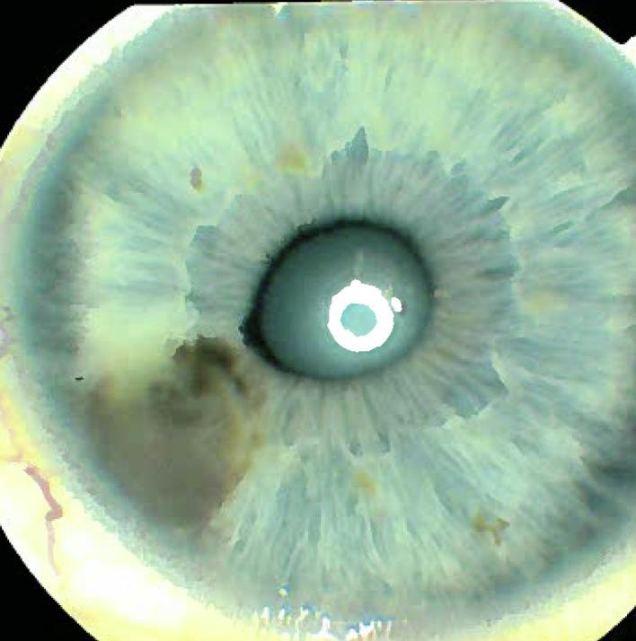
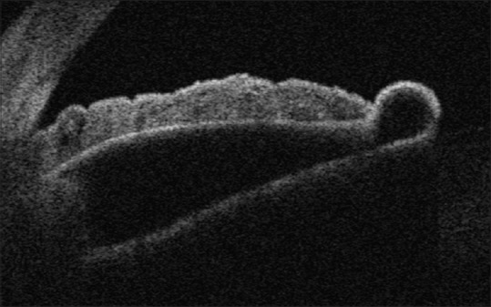
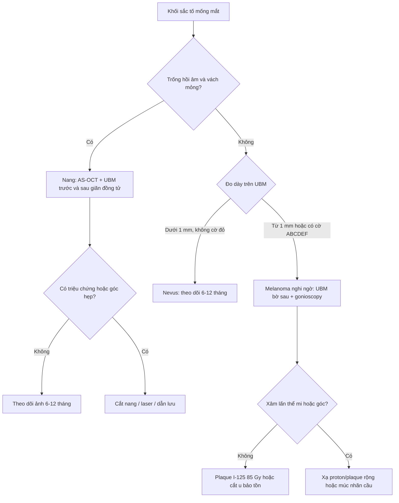
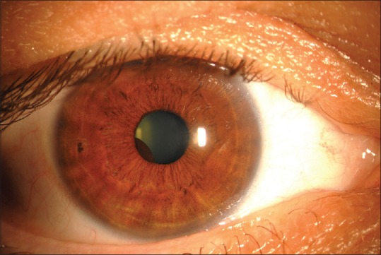
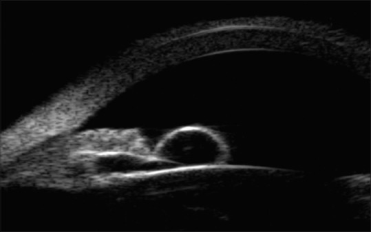
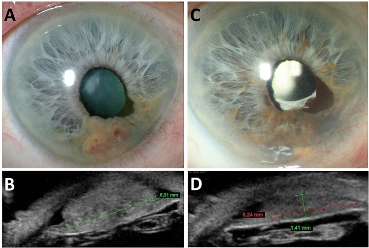
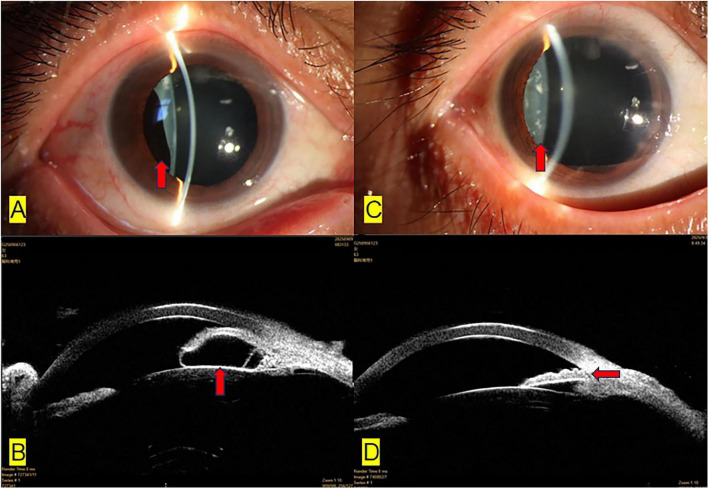

# 3231 — U sắc tố mống mắt: melanoma – nevus – nang biểu mô sắc tố trên UBM/AS-OCT / Iris melanocytic lesions: melanoma vs nevus vs iris cyst

**Tags:** `pattern:khoi-mong-mat` `pattern:sac-to-mong-mat` `pattern:nang-mong-mat` `pattern:day-mong-mat` `pattern:ectropion-uveae` `vung:mat` `vung:mong-mat` `vung:tien-phong` `vung:goc-tien-phong` `protocol:UBM-35-50MHz` `protocol:AS-OCT` `protocol:AS-OCTA` `protocol:sinh-thiet-FNAB` `score:ABCDEF` `incidentaloma:khong`

**Mức chắc chắn (certainty):** tổng hợp y văn (literature synthesis) — dựng từ đoàn hệ lớn về nevus mống mắt (**1.611 mắt**, *Ophthalmology* 2013, PMID **23290981**), melanoma mống mắt có mô bệnh (**169 mắt**, *Ophthalmology* 2001, PMID **11150284**), đoàn hệ điều trị **300 mắt** (*Can J Ophthalmol* 2024, PMID **38040029**) và **166 mắt** proton (*Ophthalmol Retina* 2023, PMID **36087876**), cùng các ca nguyên văn có ảnh mở (PMCID ghi tại từng ảnh). Nhóm **không có bệnh nhân của mình**; chỗ chưa đủ chắc ghi "chưa rõ". **Không ghi tên tác giả** — attribution dùng tạp chí + năm + PMCID/PMID.

## 1. Tổng quan bệnh học – cơ chế hình ảnh

- **Giải phẫu – mô học quyết định hình ảnh.** Mống mắt gồm **lớp đệm (stroma)** có tế bào sắc tố và mạch máu, phía sau là **hai lớp biểu mô sắc tố** (biểu mô sắc tố trước kiểu cơ, biểu mô sắc tố sau). Tổn thương sắc tố mống mắt là **tăng sinh tế bào hắc tố** (nevus → melanoma, melanocytoma) hoặc **tổn thương không phải hắc tố** (nang, di căn, adenoma, Lisch). Chính **melanin** — hạt hấp thụ ánh sáng mạnh và phản xạ ngược sóng siêu âm — tạo ra toàn bộ "chữ ký" hình ảnh của nhóm bệnh này.

- **TẠI SAO UBM nhìn rõ u sắc tố.** Siêu âm tần số cao **35–50 MHz** có độ phân giải trục **~50 µm**, xuyên thấu **4–5 mm**: đủ để đo độ dày u, bờ sau, **xâm lấn thể mi** và quan hệ với **góc tiền phòng**. Melanin phản xạ mạnh ở **bề mặt** u và làm suy giảm chùm siêu âm phía sau, nên melanoma điển hình là **khối đặc, hồi âm trong thấp–trung bình, bề mặt sáng, có bóng phía sau**; nang dịch thì **hoàn toàn trống hồi âm** vì nước không có mặt phân cách phản xạ.

- **TẠI SAO AS-OCT nhanh nhưng dễ "đo hụt".** AS-OCT dùng ánh sáng gần hồng ngoại, độ phân giải trục **5–7 µm**, không tiếp xúc, chịu được giác mạc mờ nhẹ. Nhưng melanin **hấp thụ và tán xạ** ánh sáng: khối sắc tố hiện **tăng phản xạ mạnh ở mặt trước kèm bóng tối (posterior shadowing) phía sau**, nên **không đo được hết độ dày** của u dày/sẫm màu. Vì vậy AS-OCT và UBM chỉ tương đương ở **u có đáy < 2,5 mm và dày < 2 mm**; vượt ngưỡng đó — hoặc nghi xâm lấn thể mi — **UBM là chuẩn**.

- **Hai con số vàng phân biệt nevus – melanoma (đo trên cùng một phương tiện).** Trong **1.611 mắt nevus** được theo dõi: đường kính đáy trung bình **3 mm**, độ dày trung bình **0,8 mm** (trung vị **0,5 mm**, khoảng **0–5 mm**). Trong **169 mắt melanoma có mô bệnh**: đáy trung bình **6 mm** (1–17 mm), dày trung bình **2 mm** (1–4 mm). Nói cách khác, **dày ≥ 1 mm là cờ đỏ**, nhưng **vùng 1–2 mm vẫn chồng lấp** — không có ngưỡng nào thay thế được **theo dõi tăng kích thước**.

- **Động học "nevus hóa melanoma" — chậm nhưng không hiếm.** Trong 1.611 nevus, **2% (27 mắt)** tăng sinh thành melanoma sau theo dõi trung bình **68 tháng**; Kaplan–Meier **3% lúc 5 năm, 4% lúc 10 năm, 8% lúc 15 năm, 11% lúc 20 năm**. Yếu tố dự báo (đa biến): **tuổi ≤ 40** (HR 3), **xuất huyết tiền phòng** (HR 9), **vị trí 4–9 giờ** (HR 9), **thể lan tỏa toàn mống mắt** (HR 14), **ectropion uveae** (HR 4), **bờ lông vũ** (HR 3) — mnemonic **ABCDEF**.

- **Dịch tễ và tiên lượng ung thư.** Melanoma mống mắt chiếm **~2–4%** u hắc mạc; khác u hắc mạc hậu cực, đây là thể **duy nhất có liên quan tia cực tím** (đoàn hệ **86 bệnh nhân** Queensland: 63% nữ, tuổi trung bình 54, 97% da trắng, 77% thể tế bào hình thoi, **1 ca di căn** trong theo dõi trung bình 8 năm). Di căn **5% lúc 10 năm, 10% lúc 20 năm** (169 mắt có mô bệnh); yếu tố nguy cơ: **tuổi cao, nhãn áp tăng, bờ sau ở góc/rễ mống mắt, lan ra ngoài củng mạc, đã được mổ/sinh thiết ở nơi khác trước đó**.

- **Vì sao mắt "đau" và "mờ" — cơ chế nhãn áp.** U xâm lấn **bè củng mạc – góc tiền phòng** làm tắc dòng thủy dịch; melanoma mống mắt có **nhãn áp 18,8 ± 6,1 mmHg** so với nevus **14,6 ± 3,5 mmHg** (P < 0,001), **C/D 0,36 ± 0,27** so với **0,24 ± 0,14** (P = 0,02), và **30,8%** đã có glôcôm thứ phát lúc khám. Vì thế **bất đối xứng nhãn áp/C-D** là manh mối rẻ tiền nhưng **không đặc hiệu** (AUC < 0,70).

- **Nang mống mắt hình thành thế nào.** Nang **biểu mô sắc tố (IPE cyst)** là khoang dịch giữa hai lớp biểu mô sắc tố, vách rất mỏng; **nang lớp đệm (stromal cyst)** thường là nang **cấy ghép sau chấn thương/phẫu thuật** (tế bào biểu mô bị đưa vào tiền phòng). Nang nguyên phát thường **một bên, nhiều ổ, ở vùng midzone hoặc ngoại vi**, và **thay đổi kích thước theo giãn đồng tử** — đặc điểm sinh lý này là chìa khóa để không gọi nhầm là u đặc.

## 2. Mẫu hình + chẩn đoán phân biệt theo vị trí (Gamut)

- **Dạng 1 — đốm/nốt phẳng, sắc tố đều:** **tàn nhang mống mắt (iris freckle)**, **nevus mống mắt**, **melanocytoma mống mắt** (hiếm, rất sẫm, dẹt), **nốt Lisch** (NF1: nốt nhỏ dạng vòm, cùng màu mống mắt, thường hai bên), **mammillation mống mắt** (hai bên, đối xứng, dạng "nan hoa"). Đặc điểm chung: **không dày đáng kể, không mạch nội u, không xâm lấn góc**.

- **Dạng 2 — khối vòm đặc, phát triển:** **melanoma mống mắt** (bờ lông vũ, tân mạch nuôi, ectropion uveae, gieo hạt góc), **di căn mống mắt** (thường không sắc tố, nhiều mạch, kèm viêm), **adenoma/adenocarcinoma biểu mô sắc tố** (đặc trung tâm, xuất phát từ lớp biểu mô), **melanoma thể mi lan ra sau mống mắt**.

- **Dạng 3 — tổn thương dạng nang:** **nang IPE nguyên phát** (midzone/ngoại vi/trung tâm), **nang lớp đệm/cấy ghép**, **nang thứ phát** sau chấn thương, phẫu thuật, viêm màng bồ đào, hoặc do thuốc (prostaglandin).

- **Dạng 4 — lan tỏa, không có "khối":** **melanoma mống mắt thể lan tỏa**, **ring melanoma** (dày toàn chu vi, hay bị chẩn đoán nhầm là glôcôm một mắt), **melanocytosis mống mắt** (bẩm sinh, dày không đều, sắc tố đậm).

- **Gamut theo vị trí:** **bờ đồng tử** → melanoma (ectropion uveae, corectopia), nang trung tâm; **vùng midzone** → nang IPE điển hình; **rễ mống mắt/góc** → melanoma xâm lấn góc, ring melanoma, melanoma thể mi; **vùng dưới (4–9 giờ)** → nevus hay gặp (74% nevus ở góc phần tư dưới) nhưng cũng là **vị trí nguy cơ cao** nếu nevus tăng sinh.

- **Gợi nhớ cờ đỏ ABCDEF:** **A**ge young (tuổi ≤ 40), **B**lood (xuất huyết tiền phòng), **C**lock hour inferior (4–9 giờ), **D**iffuse (lan tỏa), **E**ctropion uveae, **F**eathery margin (bờ lông vũ).

## 3. Bảng so sánh phân biệt (ma trận đối chiếu)

| Thực thể (entity) | Hình ảnh điển hình | Chốt vào (rule-in) | Chốt loại (rule-out) | Gợi ý xác nhận |
|---|---|---|---|---|
| **Nevus mống mắt** | Đốm/nốt sắc tố **dẹt**, bờ rõ, không mạch nội u; đáy trung bình 3 mm, dày 0,8 mm | **Dày < 1 mm, không đổi sau ≥ 2 lần khám cách ≥ 2 năm**, không ectropion | Dày ≥ 1 mm, bờ lông vũ, tân mạch nuôi → nghi melanoma | Ảnh chuẩn hóa + UBM mỗi 6–12 tháng |
| **Melanoma mống mắt** | Khối vòm **dày ≥ 1 mm** (trung bình 2 mm), bờ lông vũ, tân mạch, ectropion uveae, gieo hạt góc | **Tăng kích thước có ghi nhận**; dày ≥ 1 mm + ≥ 1 cờ ABCDEF; xâm lấn góc | Nang trống hồi âm, vách mỏng, đổi theo đồng tử → nang | UBM + ảnh chuẩn hóa; sinh thiết khi đổi điều trị |
| **Nang IPE** | Cấu trúc **trống hồi âm/giảm phản xạ**, vách mỏng, nằm **sau mống mắt**, nhiều ổ, một bên | **Trống hồi âm hoàn toàn + vách mỏng + thay đổi theo giãn đồng tử** (1.440 µm AS-OCT trước giãn → 300 µm UBM sau giãn) | Có thành phần đặc bên trong, ngấm thuốc → u đặc | AS-OCT + UBM **trước và sau giãn đồng tử** |
| **Nang lớp đệm/cấy ghép** | Nang thành dày hơn, thường **một ổ**, tiền sử chấn thương/mổ, dính bờ đồng tử | **Tiền sử thủng nhãn cầu/mổ + nang một ổ thành dày** | Nhiều nang hai bên không tiền sử → nang IPE nguyên phát | UBM, hỏi tiền sử; tế bào biểu mô trên tế bào học |
| **Di căn mống mắt** | Khối **không sắc tố, nhiều mạch**, kèm viêm tiền phòng, có thể hai bên; 8% di căn nội nhãn ở mống mắt | **Tiền sử ung thư (67–76% đã biết) + tổn thương mạch máu, viêm** | Sắc tố đậm, bờ rõ, không viêm → nevus/melanoma | Sinh thiết, PET/CT, phối hợp ung thư |
| **Nốt Lisch / mammillation** | Nhiều nốt nhỏ dạng vòm, **cùng màu mống mắt**, hai bên, đối xứng | **Hai bên + nhiều nốt + NF1 hoặc không thay đổi nhiều năm** | Một tổn thương đơn độc, sẫm màu, dày tiến triển → u | Khám da, tiền sử gia đình NF1; theo dõi ảnh |
| **Adenoma biểu mô sắc tố** | Khối **đặc trung tâm**, xuất phát từ lớp biểu mô, có thể gây đục thể thủy tinh/lệch thủy tinh thể | **Đặc, không phải nang, phát triển chậm** | Trống hồi âm + vách mỏng → nang | Mô bệnh sau cắt |
| **Melanoma thể mi lan ra** | Khối sau mống mắt, **đẩy mống mắt ra trước**, góc hẹp; 58,3% ca "iris melanoma" điều trị plaque có xâm lấn thể mi | **UBM thấy khối liên tục từ thể mi + đẩy rễ mống mắt** | Chỉ dày lớp đệm mống mắt, bờ sau rõ → melanoma mống mắt thuần | UBM 35–50 MHz bắt buộc; đo độ dày và bờ sau |

*Nevus sắc tố mống mắt mắt trái — tổn thương dẹt, bờ tương đối rõ, không thấy mạch nuôi. Nguồn: Case Rep Ophthalmol 2016, PMCID PMC5075749, CC BY-NC 4.0. Nguyên bản, không crop.*

### Ba dấu hiệu đọc ảnh theo thứ tự

1. **Đo độ dày** (mm) ở điểm dày nhất, **cùng một phương tiện, cùng một độ giãn đồng tử** — nevus 0,8 mm vs melanoma 2 mm.
2. **Trong lòng có gì?** Trống hoàn toàn + vách mỏng = nang; đặc + hồi âm trong thấp = melanoma; đặc + hồi âm trong cao/không đều = adenoma/di căn.
3. **Bờ sau và góc:** u có **bờ sau rõ, không chạm thể mi** thì xử trí tại mống mắt; **mất mặt phẳng sau, đẩy thể mi** thì phải tính phẫu thuật/xạ rộng hơn.

*AS-OCT trước giãn đồng tử: khối dạng nang bờ rõ ở mặt sau mống mắt, dày 1.440 µm ở ngoại vi, lớp đệm mống mắt phía trước bình thường. Nguồn: Oman J Ophthalmol 2018, PMCID PMC5991049, CC BY-NC-SA 4.0. Nguyên bản.*

## 4. Protocol chụp + hệ phân độ/điểm chuẩn hóa

### 4.1 Chụp và đo

- **Ảnh mống mắt chuẩn hóa (slit lamp)** mỗi lần khám: cùng đèn, cùng góc, **ghi rõ độ giãn đồng tử**; đo **đường kính đáy lớn nhất** và **số giờ tổn thương**.
- **AS-OCT tiền đoạn** trước: không tiếp xúc, 5–7 µm, tốt cho **bờ trước, bề mặt, nang nhỏ**; chấp nhận được khi giác mạc mờ nhẹ.
- **UBM 35–50 MHz** khi: **dày > 2 mm hoặc đáy > 2,5 mm**, sắc tố đậm có bóng, **nghi xâm lấn thể mi**, xuất huyết tiền phòng, giác mạc mờ, hoặc cần **bản đồ bờ sau để mổ/xạ**. Quét **vuông góc qua đường kính lớn nhất**, ghi cả **bờ sau và khoảng cách tới thể mi**.
- **Nang: bắt buộc chụp trước và sau giãn đồng tử** — nang thay đổi kích thước theo đồng tử, u đặc thì không. Ca minh họa: **1.440 µm trên AS-OCT trước giãn → 300 µm trên UBM sau giãn** (khác cả phương tiện lẫn độ giãn — vì thế phải so **cùng phương tiện, cùng độ giãn**).
- **Gonioscopy** tìm gieo hạt ở góc; **nhãn áp hai mắt**, **C/D hai mắt** (bất đối xứng gợi ý u xâm lấn góc); **soi đáy mắt** loại trừ u hắc mạc kèm theo.
- **Sinh thiết (FNAB/incisional)** không làm thường quy: nguy cơ **gieo hạt tế bào**, chẩn đoán không đủ mẫu; chỉ đặt ra khi **kết quả làm thay đổi điều trị** (đặc biệt để xét nghiệm tiên lượng). Hướng dẫn ESMO–EURACAN 2026 yêu cầu **thảo luận nguy cơ gieo hạt với bệnh nhân** trước sinh thiết.

### 4.2 Phân độ và ngưỡng xử trí

- **AJCC 8th (u hắc mạc tiền đoạn):** **T1 = giới hạn trong mống mắt** (chia a/b/c theo số giờ và gieo hạt/xuất huyết), **T2 = đã xâm lấn thể mi**; các bậc cao hơn thêm hắc mạc và lan ra ngoài củng mạc. Trong đoàn hệ 39 melanoma, **38,5% T1, 61,5% T2** lúc chẩn đoán — cho thấy **UBM bờ sau là bắt buộc**, vì hơn nửa đã vượt khỏi mống mắt.
- **Theo dõi (observation)** khi: nevus **dày < 1 mm**, không cờ ABCDEF, không xâm lấn góc — ảnh + UBM mỗi **6–12 tháng**; nevus chỉ chuyển melanoma **2%** trong 68 tháng.
- **Điều trị tại chỗ** khi có **tăng kích thước có ghi nhận**, dày ≥ 1 mm kèm cờ đỏ, hoặc xâm lấn góc/gây glôcôm:
  - **Plaque brachytherapy I-125: 85 Gy tới đỉnh u + biên 2 mm** (12 mắt; đáy trung vị 4,40 mm, dày 1,78 mm; 58,3% có xâm lấn thể mi; **đục thủy tinh thể 33%, khô mắt 16,7%, tái phát 8%** do một ca ring melanoma).
  - **Proton beam** (166 mắt T1): **tái phát tại chỗ 1,2%, múc nhãn cầu 3%, không ca di căn**; chiếu **> 10 giờ** làm tăng glôcôm thứ phát (HR 6,3) và can thiệp phẫu thuật (HR 10,85).
  - **Cắt u bảo tồn nhãn cầu** (iridectomy/iridocyclectomy) cho u khu trú; **múc nhãn cầu** cho thể lan tỏa/ring melanoma có glôcôm.
  - **Kết cục sống còn (300 mắt):** sống không di căn **95% / 93% / 87%** lúc 5/10/20 năm; **cắt u 98/97/94%** so với **plaque 94/94/89%** (không thua kém); **giữ mắt 90% vs 86%** lúc 20 năm; **xâm lấn thể mi không làm tăng di căn** trong đoàn hệ này (P = 0,95) — xem mục 7.
- **Theo dõi sau điều trị:** mỗi **6 tháng trong 2–5 năm đầu**, sau đó **hằng năm**; **ảnh màu phát hiện 98% tái phát tại chỗ**; tái phát tại chỗ chung **7,3% lúc 5 năm**; biến chứng đoạn trước hay gặp nhất là **đục thủy tinh thể và khô mắt**.

## 5. Biến thể bình thường và cạm bẫy

- **Tàn nhang mống mắt (iris freckle)** — dẹt, không dày, không đổi; đừng chụp UBM "cho có" rồi gọi nhầm "theo dõi u".
- **Mammillation mống mắt** — nhiều gờ nhỏ đối xứng hai bên, giãn đồng tử thấy rõ; **không phải nang, không phải melanoma**.
- **Nốt Lisch (NF1)** — cùng màu mống mắt, hai bên; nếu một tổn thương **sẫm màu, đơn độc, dày lên** thì đó không phải Lisch.
- **Nang đổi kích thước theo đồng tử** — đo sau giãn đồng tử rồi kết luận "u nhỏ đi" là sai; **luôn so cùng điều kiện**.
- **Bóng phía sau trên AS-OCT** — khối sắc tố dày bị che, đo được 1 mm trong khi UBM 2,5 mm; **AS-OCT không dùng để loại trừ melanoma dày**.
- **Ring melanoma** — không có khối, chỉ dày lan tỏa + nhãn áp cao một mắt; bệnh nhân bị theo dõi "glôcôm một mắt" nhiều tháng, đến khi **UBM thấy dày toàn chu vi**. Đây là lý do phải **UBM khi nhãn áp một mắt cao không giải thích được**.
- **Nang "mọc sau mống mắt"** — hình vòm đẩy mống mắt ra trước, dễ gọi là melanoma thể mi; **trống hồi âm + vách mỏng + đổi theo đồng tử** loại trừ.
- **Tiền sử can thiệp ở nơi khác** — mổ/sinh thiết u trước khi chuyển tuyến là **yếu tố nguy cơ di căn độc lập** (P = 0,006); đừng "đốt laser cho gọn" một nevus chưa chẩn đoán chắc.
- **Bỏ sót thể mi** — 58,3% ca được xếp "iris melanoma" trong một đoàn hệ điều trị plaque có **xâm lấn thể mi**; thiếu UBM bờ sau là thiếu một nửa chẩn đoán.

## 6. Tự lượng giá — Blind Quiz

**Ca 1 — Nam 49 tuổi, khối nâu "nghi melanoma thể mi" ở mống mắt phải. Nhìn ảnh trước, mô tả trước khi mở đáp án.**

- Gợi ý: tổn thương nằm **sau mống mắt** từ 6:30 đến 9:00, không thấy mạch nuôi, không ectropion.
- Câu hỏi: Đây là khối đặc hay nang? Cần thêm hai thao tác/manh mối nào để chốt? Đo độ dày bằng phương tiện nào?

<b>Bấm để hiện đáp án (findings + chẩn đoán)</b>

- Hình đèn khe trước giãn đồng tử chỉ thấy **bóng nâu khu trú**; sau giãn đồng tử tổn thương lộ rõ dạng **thoi dài** — gợi ý thành phần **sau mống mắt, thay đổi theo đồng tử**.
- **AS-OCT trước giãn:** khối **dạng nang**, bờ rõ, **trống phản xạ bên trong**, dày **1.440 µm** ở ngoại vi.
- **UBM sau giãn:** cấu trúc **trống hồi âm dài**, vách mỏng, dày **300 µm** — **không có thành phần đặc**, không có khối thể mi.
- Chẩn đoán: **nang biểu mô sắc tố mống mắt vùng midzone** (midzonal IPE cyst) + 3 nang ngoại vi nhỏ ở mắt trái; **theo dõi**, không can thiệp.
- Bài học: **kích thước thay đổi theo đồng tử** + **trống hồi âm** là chốt loại u đặc; đo trước và sau giãn đồng tử trên cùng phương tiện.

- Nguồn ảnh: Oman J Ophthalmol 2018, PMCID PMC5991049, CC BY-NC-SA 4.0 (nguyên bản, không crop).

**Ca 2 — Bệnh nhân 85 tuổi, tổn thương mống mắt theo dõi 7 năm, nay nghi to ra; UBM có thước đo.**

- Gợi ý: (A) ảnh đèn khe; (B) UBM trước điều trị với thước đo; (C, D) sau điều trị.
- Câu hỏi: Đọc hai số đo trên UBM. Tổn thương đặc hay nang? Vì sao "theo dõi 7 năm" không loại trừ melanoma?

<b>Bấm để hiện đáp án (findings + chẩn đoán)</b>

- (B) UBM đo **đường kính đáy 6,31 mm**; (D) sau điều trị đo **5,24 mm** và **độ dày 1,41 mm** — khối **đặc**, không có khoang trống hồi âm.
- Đáy **6,31 mm** và dày **> 1 mm** nằm đúng vùng của melanoma (đáy trung bình 6 mm, dày 2 mm trong 169 ca có mô bệnh); **tăng kích thước sau nhiều năm** mới là dấu hiệu được chấp nhận.
- Chẩn đoán: **melanoma mống mắt** (được xác nhận bằng sinh thiết trong ca gốc), điều trị bằng xạ định vị; đây là ca minh họa cho nguyên tắc **"theo dõi dài không bằng một lần đo đúng"**.
- Cạm bẫy: nếu chỉ nhìn ảnh đèn khe (A) mà không đo UBM, khối **không sắc tố/dẹt** rất dễ bị gọi là "nevus lành".

- Nguồn ảnh: Sci Rep 2021, PMCID PMC7952409, CC BY 4.0 (nguyên bản).

**Ca 3 — Nữ 63 tuổi, mờ mắt phải 1 tuần, nhãn áp 20 mmHg so với 10 mmHg mắt trái; hai mắt có gờ mống mắt.**

- Gợi ý: (A, B) trước điều trị; (C, D) sau điều trị; mũi tên đỏ chỉ tổn thương.
- Câu hỏi: (B) cho thấy gì? Vì sao nhãn áp chênh? Khi nào nang mống mắt cần can thiệp?

<b>Bấm để hiện đáp án (findings + chẩn đoán)</b>

- (A) gờ mống mắt phồng ra trước; (B) UBM: **nhiều khoang trống hồi âm hình bầu dục** giữa mặt sau mống mắt và mỏm thể mi, **vách mỏng**, khoang lớn ở thái dương **đẩy thể mi ra trước và làm hẹp góc** — nguyên nhân nhãn áp cao hơn mắt trái.
- Chẩn đoán: **nang biểu mô sắc tố mống mắt hai bên**, thể có triệu chứng (góc hẹp, chênh nhãn áp > 5 mmHg); điều trị **cắt nang nội soi**, sau mổ nhãn áp 12 mmHg, góc mở lại, không tái phát sau 3 tháng (C, D).
- Chỉ định can thiệp: **chắn trục thị giác, hẹp/góc đóng, tăng nhãn áp, hoặc nang to nhanh**; nang không triệu chứng thì theo dõi.
- Bài học: nang **không thuận lợi cho laser** vì nằm sau lớp sắc tố (tia bị chắn, nguy cơ tán sắc tố), và **chọc hút/sclerotherapy tái phát cao** vì không lấy được vách tiết dịch.

- Nguồn ảnh: Front Med 2026, PMCID PMC13171844, CC BY 4.0 (nguyên bản).

## 7. Câu hỏi nghiên cứu & điểm chưa đồng thuận (tính đến 11/2026)

1. **[Tranh cãi] Ở bệnh nhân melanoma mống mắt, xâm lấn thể mi có làm tăng nguy cơ di căn không?**
   - **Đã biết:** Đoàn hệ **300 mắt** không thấy khác biệt sống không di căn giữa có/không xâm lấn thể mi (P = 0,95); ngược lại, trong **47 ca có bộ gen nguy cơ cao** ở y văn, chỉ **6 ca (13%)** di căn và **tất cả đều có liên quan thể mi**.
   - **Chưa rõ:** Đây là khác biệt do **chọn mẫu/chỉ định điều trị** hay do **sinh học u**; chưa có phân tích gộp phân tầng theo giai đoạn AJCC.
   - **Hướng nghiên cứu:** Đoàn hệ đa trung tâm có **gen tiên lượng + UBM bờ sau** đồng nhất, outcome di căn 10 năm.
   - **Nguồn:** PMID 38040029 (2024); DOI 10.1016/j.survophthal.2023.05.006 (PMID 37207703).

2. **[Khoảng trống] Có ngưỡng độ dày UBM/AS-OCT nào đủ để chẩn đoán melanoma mống mắt mà không cần "tăng kích thước"?**
   - **Đã biết:** Hiện **chưa có tiêu chuẩn được chấp nhận**, ngoài **tăng kích thước có ghi nhận**; nevus dày trung bình **0,8 mm**, melanoma **2 mm**, vùng **1–2 mm chồng lấp**; AS-OCT chỉ tương đương UBM khi **dày < 2 mm, đáy < 2,5 mm**.
   - **Chưa rõ:** Giá trị tiên đoán của **độ dày tuyệt đối**, **hồi âm trong**, **tân mạch trên OCTA** khi chưa có tăng kích thước.
   - **Hướng nghiên cứu:** Nghiên cứu độ chính xác chẩn đoán tiến cứu, chuẩn tham chiếu mô bệnh, so sánh UBM và AS-OCT.
   - **Nguồn:** PMC11491096 (2024); PMC12523779 (2025).

3. **[Khác biệt thực hành] Melanoma mống mắt nhỏ: sinh thiết/xét nghiệm tiên lượng ngay hay theo dõi trước?**
   - **Đã biết:** ESMO–EURACAN 2026 yêu cầu **thảo luận nguy cơ gieo hạt và mẫu không đủ** trước sinh thiết; các trung tâm khác nhau rõ rệt: một đoàn hệ **12 mắt** chỉ sinh thiết **3 ca** nhưng gửi **8 ca** xét nghiệm tiên lượng; **mổ/sinh thiết ở nơi khác trước đó** là yếu tố nguy cơ di căn (P = 0,006).
   - **Chưa rõ:** Lợi ích sống còn của **điều trị sớm theo gen nguy cơ** so với **theo dõi sát** ở u < 2 mm chưa có tăng kích thước.
   - **Hướng nghiên cứu:** Registry quốc tế ghi **phương thức lấy mẫu + kết quả gen + can thiệp**, so sánh hai chiến lược.
   - **Nguồn:** PMC13131131 (2026); PMC11232867 (2024); PMID 11150284 (2001).

## Bài liên quan chéo
- [400 – Tổng quan Mắt & thị giác](../400-tong-quan-mat-thi-giac/lesson.md)
- [412 – U trong nhãn cầu: retinoblastoma vs melanoma](../412-u-trong-nhan-cau/lesson.md)
- [448 – U hắc mạc: melanoma vs nevus vs di căn](../448-u-hac-mac/lesson.md)
- [1507 – Melanoma hắc mạc thể lan tỏa](../1507-melanoma-hac-mac-lan-toa/lesson.md)
- [442 – Glaucoma: OCT RNFL/GCC + góc tiền phòng](../442-glaucoma-OCT/lesson.md)
- [460 – Can thiệp mạch mắt + xạ trị](../460-can-thiep-mat/lesson.md)

> Không dùng để chẩn đoán độc lập khi chưa có người hướng dẫn.
