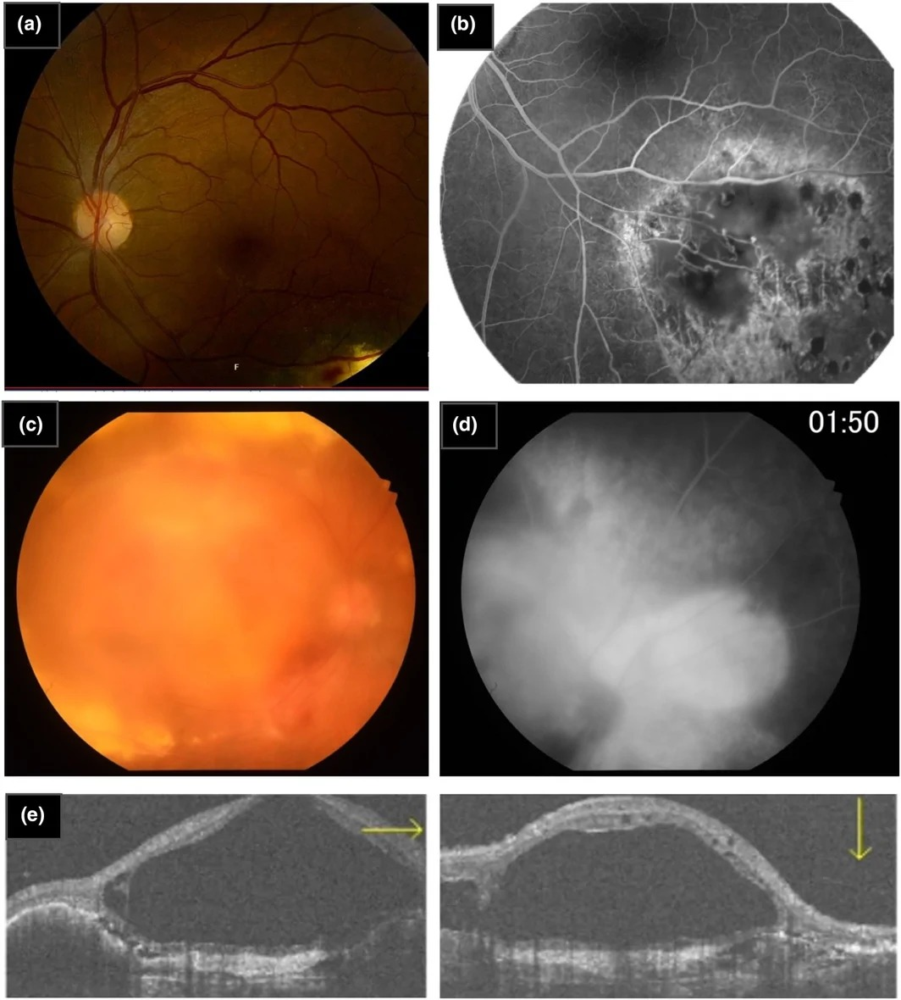
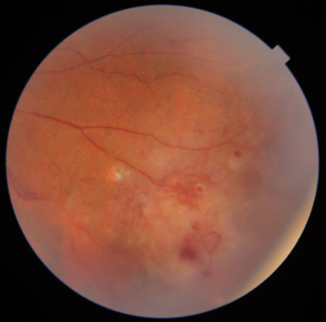
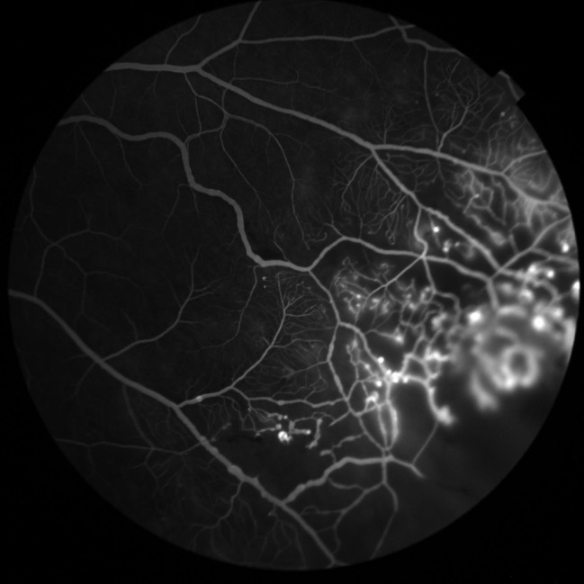
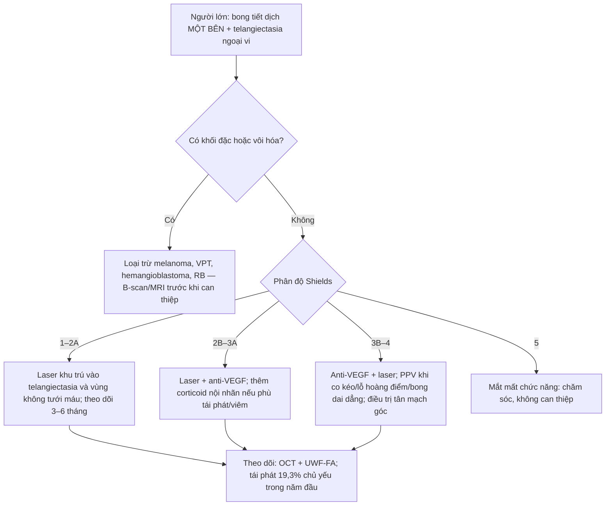
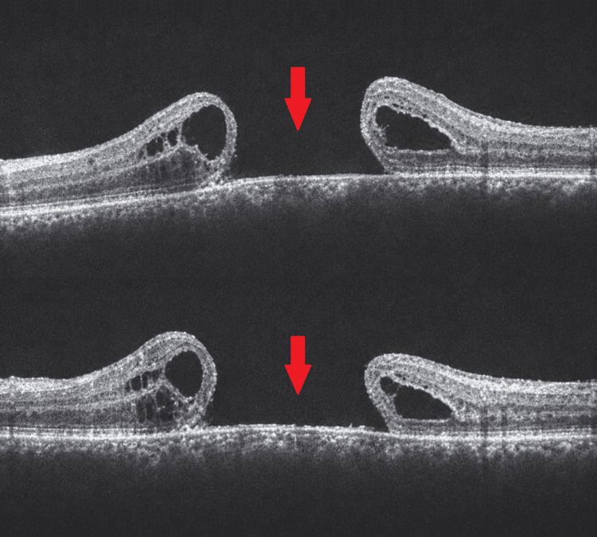
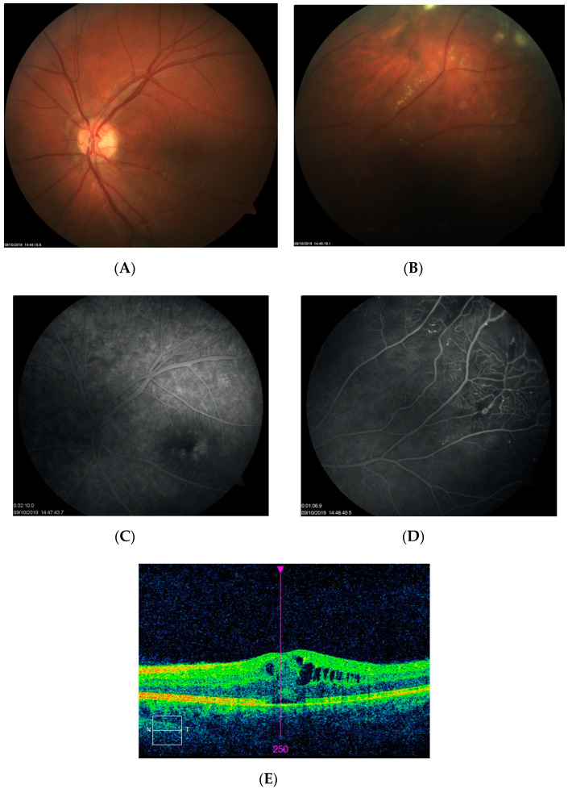

# 3232 — Bệnh Coats ở người lớn / Adult-onset Coats disease

**Tags:** `pattern:bong-vong-mac-tiet-dich` `pattern:telangiectasia-vong-mac` `pattern:xuat-tiet-lipid` `pattern:khong-co-khoi` `pattern:mat-mot-ben` `vung:mat` `vung:vong-mac` `protocol:UWF-FA` `protocol:OCT-hoang-diem` `protocol:sieu-am-B-scan` `score:Shields`
**Mức chắc chắn (certainty):** tổng hợp y văn (literature synthesis) — tổng hợp 1 phân tích gộp 35 nghiên cứu (240 bệnh nhân/250 mắt, 2026), 1 loạt 74 mắt, 1 loạt 15 bệnh nhân, 2 bài tổng quan và các ca nguyên văn có PMCID; số liệu lấy từ toàn văn.

## 1. Tổng quan bệnh học – cơ chế hình ảnh

- **Định nghĩa:** bệnh Coats (Coats disease) là **bệnh mạch máu võng mạc vô căn (idiopathic retinal vascular disorder)**: **giãn mao mạch (telangiectasia) + phình mạch (aneurysm)** ở võng mạc ngoại vi, gây **xuất tiết lipid trong võng mạc và dưới võng mạc**, dẫn tới **bong võng mạc tiết dịch** — **không có lỗ rách và không có co kéo dịch kính–võng mạc đáng kể**. Đây là điểm phân biệt gốc với bong võng mạc rách (RRD) và bong co kéo.
- **"Người lớn" nghĩa là gì:** bài này dùng **Coats được chẩn đoán ở tuổi ≥ 18** (phân tích gộp) và các loạt ≥ 35 tuổi. Tên gọi chính xác hơn là **"Coats diagnosed in adulthood"** vì tổn thương dưới lâm sàng có thể đã có từ trước — tuổi chẩn đoán **không đồng nghĩa cơ chế bệnh khác** (xem mục 5).
- **Dịch tễ – số phải nhớ:**
  - Ước tính **0,09/100.000 dân** (nghiên cứu tiến cứu ở Anh, dẫn trong bài tổng quan 2024); bệnh hiếm nhưng **không phải chỉ của trẻ**.
  - **35 nghiên cứu, 240 bệnh nhân/250 mắt**: **nam 76%** (KTC 95%: 71–81), **một bên 96%** (93–98).
  - Tuổi chẩn đoán **20–73,5 tuổi**; loạt 74 mắt có tuổi trung bình **50** (35–75); loạt Trung Quốc 15 bệnh nhân: **57,3 ± 12,6 tuổi** (24–72).
  - **Giảm thị lực là lý do đến khám số 1: 81,1%** (65,8–90,5); **đau mắt 18,9%**; **không triệu chứng 10,8%** (phát hiện tình cờ); nhìn méo/ruồi bay/ám điểm mỗi thứ **8–11%**.
  - **Hoàng điểm bị ảnh hưởng 62%** (56–68) — đây là lý do chính gây mất thị lực.
- **Phân bố giai đoạn Shields lúc chẩn đoán** (thang vốn xây cho trẻ, xem mục 4–5): **giai đoạn 2 = 58,0%** (2A **39,2%**, 2B **33,7%** trong loạt 74 mắt), **giai đoạn 3 = 28,0%**, **giai đoạn 1 = 12,8%**, **giai đoạn 4 = 0,1%**, **giai đoạn 5 không gặp**. Nghĩa là **đa số người lớn đến ở thể xuất tiết/vài giai đoạn bong**, không phải thể cuối.
- **Bệnh kèm hay gặp ở người lớn:** **tăng huyết áp 86,7%** (13/15), kèm liên hệ được báo cáo với **rối loạn lipid máu và đái tháo đường** — khác với thể trẻ, nơi các yếu tố này không nổi bật. Vì vậy mỗi ca mới cần **đo huyết áp, lipid, glucose** (không phải để chẩn đoán Coats, mà để xử lý yếu tố làm nặng phù).
- **Cơ chế tại sao có hình ảnh này:**
  1. **Mất tế bào ngoại mạch (pericyte) và thoái hóa tế bào nội mô** → thành mạch yếu → **giãn mao mạch và phình mạch**.
  2. **Hàng rào máu–võng mạc (blood–retinal barrier) vỡ** → huyết tương và **lipid** thoát ra; đại thực bào ăn lipid tạo **xuất tiết cứng (hard exudate)**.
  3. Dịch tích **trong võng mạc (intraretinal)** rồi **dưới võng mạc (subretinal)** → **bong tiết dịch**, có thể **không có lỗ rách**.
  4. Vùng mao mạch mất tưới máu → **thiếu máu cục bộ** → VEGF; ở người lớn còn có **viêm**: phân tích dịch tiền phòng thấy **IL-6 và IL-1β tăng** ở một số ca người lớn, trong khi **VEGF tăng trội ở trẻ**. Đây là cơ sở sinh học cho việc **corticoid có thể có vai trò** ở người lớn (mục 4).
- **TẠI SAO từng phương thức cho đúng hình ảnh đó (vật lý):**
  - **OCT (quang học, phân giải µm):** **dịch** gần như nước, ít tán xạ → **giảm phản xạ (hyporeflective)** thành khoang trong võng mạc/dưới võng mạc; **xuất tiết lipid + đại thực bào** là môi trường có nhiều mặt phân cách chiết suất → **tăng phản xạ (hyperreflective foci)**. Vì vậy OCT phân biệt được "nước" với "mỡ" và đo được **độ dày trung tâm hoàng điểm (CMT)**.
  - **FA (fluorescein angiography, 490/520 nm):** mao mạch giãn/phình **đầy thuốc sớm** ("bóng đèn" — light-bulb aneurysm), rồi **rò rỉ thì muộn** vì mất liên kết chặt nội mô; vùng **không tưới máu** tối vì không có thuốc đi qua. FA là phương thức **nhìn thấy chính tổn thương sinh bệnh** — nên là chuẩn chẩn đoán.
  - **Siêu âm B (10–20 MHz):** dịch dưới võng mạc **trống âm**, màng võng mạc **hồi âm mảnh, di động**, **không có khối đặc**, **không vôi hóa**. Đây là cách nhanh nhất để **loại trừ khối u** khi môi trường mờ.
  - **CT:** xuất tiết lipid **không vôi hóa** → **không tăng đậm độ**; khối u hắc mạc có tỉ trọng mô mềm; retinoblastoma **vôi hóa thô > 90%**. Vì vậy CT hiếm khi cần, chủ yếu để loại trừ vôi hóa/khối.
  - **MRI:** dịch **T1 thấp – T2 cao**; **melanin của melanoma T1 cao – T2 thấp**, khối ngấm thuốc. Coats **không có khối ngấm thuốc** — đây là chốt loại u khi lâm sàng không điển hình.
- **Số liệu hình ảnh định lượng (phân tích gộp trừ khi ghi khác):**
  - **Xuất tiết lipid 78,4%** (71,6–84,0); **dịch dưới võng mạc/bong tiết dịch 51,4%** (44,0–58,7); **vi phình mạch 48,6%** (41,3–56,0); **phù hoàng điểm trên lâm sàng 35,1%** (28,4–42,5).
  - **FA:** telangiectasia **75,7%** (68,5–81,7); rò rỉ hoạt động **56,8%** (49,3–64,0); không tưới máu **51,4%**; vi phình mạch trên FA **45,9%** (38,7–53,3).
  - **OCT:** phù/nang trong võng mạc **51,4%**; dịch dưới võng mạc **51,4%**; **màng trước võng mạc (ERM) 18,9%** (13,5–25,8); xuất tiết cứng dạng điểm tăng phản xạ **16,2%** (11,3–22,7).
  - Loạt 74 mắt (OCT 40 mắt): **dịch trong võng mạc 80,0%**, **xuất tiết cứng 77,5%**, **mất tổ chức lớp trong võng mạc 55,0%**; FA 35 mắt: **vùng không có mạch hoàng điểm (FAZ) không đều 80,0%**, **nhiều vi phình mạch rò rỉ 91,4%**, tổn thương mạch **trong hoàng điểm 86%** và **ngoài hoàng điểm 91%**.
  - Loạt 15 bệnh nhân: **CMT 473,0 ± 230,1 µm** (129–964), **86,7% có CMT > 250 µm**; ERM lúc đầu hoặc trong theo dõi **53,3%**; **sẹo tăng phản xạ 33,3%** liên quan tiên lượng thị lực kém.

*(a) Đáy mắt thể nhẹ: xuất tiết lipid **khu trú ngoài hoàng điểm**, hoàng điểm còn nguyên. (b) FA cùng mắt: rò rỉ từ **telangiectasia ngoại vi**. (c) Thể tiến triển: xuất tiết lipid lan **hậu cực**, bong hoàng điểm. (d) FA: **tăng huỳnh quang lan tỏa do rò rỉ**. (e) OCT: **dịch trong võng mạc dạng bọng nước** và mất tổ chức lớp. Nguồn: Francisco C, Silva N, Boon CJF, *Acta Ophthalmol* 2026 (PMC13651921), Fig. 5, CC BY 4.0.*

## 2. Mẫu hình + chẩn đoán phân biệt theo vị trí (Gamut)

- **Mẫu hình cửa vào:** người lớn, **một bên**, **mờ mắt tiến triển vài ngày–vài tuần**; đáy mắt có **xuất tiết cứng hình nan hoa/vòng** ở hậu cực hoặc **mảng vàng ngoại vi**, kèm **bong võng mạc tiết dịch**; soi **360° + ấn củng mạc** thấy **mạch giãn, phình mạch, mạch "như xúc xích"** ở ngoại vi.
- **Ba câu hỏi định vị (theo thứ tự, quyết định gần như toàn bộ DDx):**
  1. **Có khối đặc/vôi hóa không?** — có → nghĩ **u** (melanoma, u tăng sinh mạch, hemangioblastoma, retinoblastoma ở trẻ), phải siêu âm/MRI trước khi chạm laser.
  2. **Một bên hay hai bên?** — **một bên + không khối** = Coats; **hai bên** = nghĩ **bệnh hệ thống/di truyền** (FEVR, VHL, Coats plus, đái tháo đường, bệnh máu).
  3. **Telangiectasia ở đâu?** — **ngoại vi** = Coats điển hình; **chỉ quanh hoàng điểm** = **MacTel type 1** (thực thể chồng lấp, xem dưới).
- **Gamut theo cơ chế (từ "không khối" tới "có khối"):**
  1. **Coats người lớn (vô căn):** một bên, telangiectasia ngoại vi + xuất tiết, **không khối, không vôi hóa**.
  2. **MacTel type 1 / Coats thể hoàng điểm:** telangiectasia **khu trú hoàng điểm**, xuất tiết quanh hoàng điểm, **không lan ngoại vi**; nhiều tác giả coi là **cùng phổ bệnh** nhưng **kiểu hình và đáp ứng điều trị khác** — phân tích gộp đã **loại trừ** nhóm này để tránh trộn kiểu hình.
  3. **Coats-like thứ phát:** sau **xạ trị** (bài 1441/1409), **đái tháo đường**, **tắc tĩnh mạch võng mạc**, **viêm màng bồ đào**, **bệnh võng mạc sắc tố (RP)**, **hội chứng Coats plus** (thể hệ thống: vôi hóa não, thiếu máu, bệnh xương) — **không gọi là Coats vô căn** khi có nguyên nhân.
  4. **U tăng sinh mạch võng mạc (vasoproliferative tumor, VPT):** **khối vàng–hồng đặc**, có **mạch nuôi/dẫn**, thường **thái dương dưới**; **15% nguyên phát, 84% thứ phát**, trong đó **6/19 mắt thứ phát do chính Coats** — tức Coats và VPT có thể **cùng tồn tại**.
  5. **Hemangioblastoma mao mạch võng mạc (VHL):** khối **đỏ–cam**, **mạch nuôi và mạch dẫn rất giãn**, có thể **hai bên/nhiều ổ**; phải tầm soát VHL (thận, tụy, thần kinh trung ương).
  6. **FEVR (bệnh võng mạc xuất tiết do thiếu tưới máu ngoại vi di truyền):** **hai bên**, vùng ngoại vi **không tưới máu**, mạch kéo về phía thái dương, tiền sử gia đình.
  7. **Bệnh Eales:** nam trẻ, **viêm tĩnh mạch ngoại vi (periphlebitis)**, xuất huyết dịch kính tái phát, liên quan lao.
  8. **Đái tháo đường / bệnh mạch máu do xạ:** **hai bên** (ĐTĐ), vi phình mạch + xuất tiết, tiền sử và tổn thương đối xứng giúp phân biệt.
  9. **Melanoma hắc mạc:** khối **vòm/nấm**, **T1 cao – T2 thấp** (melanin), siêu âm **hồi âm nội khối thấp**, **không vôi hóa**; có thể gây **bong tiết dịch** và **bị gọi nhầm là Coats** — hậu quả là **múc nhãn cầu oan** nếu không loại trừ bằng hình ảnh.
  10. **Bong tiết dịch không do Coats:** **CNV** (thoái hóa hoàng điểm, cận thị), **hố đĩa thị (optic disc pit)**, **CSC/pachychoroid**, **MEKAR**, **VKH**, **bong hắc mạc** — xem bài 1479/417/448/445.
- **Gợi nhớ nhanh:** **"MỘT BÊN – NGOẠI VI – KHÔNG KHỐI – CÓ TELANGIECTASIA"** = Coats; **"CÓ KHỐI"** = u; **"HAI BÊN"** = bệnh hệ thống/di truyền.

## 3. Bảng so sánh phân biệt (ma trận đối chiếu)

| Thực thể (entity) | Hình ảnh điển hình | Chốt vào (rule-in) | Chốt loại (rule-out) | Gợi ý xác nhận |
|---|---|---|---|---|
| **Coats người lớn (vô căn)** | Một bên; telangiectasia **ngoại vi**; xuất tiết cứng hình nan hoa/vòng; bong tiết dịch; **không khối** | **Telangiectasia ngoại vi + phình mạch "bóng đèn" trên FA + không khối trên B-scan** | Có khối đặc/ngấm thuốc, hai bên, hoặc vôi hóa → không phải Coats vô căn | UWF-FA + OCT; B-scan khi môi trường mờ; theo dõi 3–6 tháng |
| **MacTel type 1 (Coats thể hoàng điểm)** | Telangiectasia **chỉ quanh hoàng điểm**, xuất tiết khu trú, **không lan ngoại vi** | **Tổn thương giới hạn ở hoàng điểm + FAZ bất thường** | Telangiectasia lan tới xích đạo/ora → Coats điển hình | OCTA (mạng mao mạch nông/sâu) + FA |
| **U tăng sinh mạch võng mạc (VPT)** | **Khối vàng–hồng đặc** ở ngoại vi, mạch nuôi/dẫn rõ, xuất tiết/vitreous | **Khối đặc + mạch nuôi trên B-scan/FA** | Không có khối, chỉ telangiectasia dẹt → Coats | B-scan + FA; theo dõi vì **VPT thứ phát sau Coats 6/19** |
| **Hemangioblastoma (VHL)** | Khối **đỏ–cam**, mạch nuôi/dẫn rất giãn, có thể hai bên/nhiều ổ | **Hai bên/nhiều ổ + tiền sử gia đình + tổn thương hệ thống** | Một bên, không khối, không tiền sử → Coats | Tầm soát VHL: MRI sọ–tủy, siêu âm thận/tụy, xét nghiệm di truyền |
| **FEVR** | **Hai bên**, ngoại vi **không tưới máu**, mạch kéo thái dương, có thể bong co kéo | **Hai bên + vùng vô mạch ngoại vi đối xứng + tiền sử gia đình** | Một bên hoàn toàn, không yếu tố gia đình → ít nghĩ FEVR | FA hai mắt + khám gia đình + gen (FZD4, LRP5, TSPAN12, NDP) |
| **Bệnh Eales** | Nam trẻ, **viêm tĩnh mạch ngoại vi**, xuất huyết dịch kính tái phát, tân mạch | **Periphlebitis + xuất huyết dịch kính + bối cảnh lao** | Không viêm mạch, chỉ giãn mao mạch + xuất tiết → Coats | FA, xét nghiệm lao (IGRA), khám nội khoa |
| **Đái tháo đường / sau xạ** | **Hai bên** (ĐTĐ) hoặc đúng trường chiếu (xạ), vi phình mạch + xuất tiết, có thể phù hoàng điểm | **Đối xứng hai bên + HbA1c/tiền sử xạ + tổn thương trong trường chiếu** | Một bên, không yếu tố nguy cơ → Coats | HbA1c, hồ sơ xạ trị; FA đối xứng |
| **Melanoma hắc mạc** | Khối **vòm/nấm**, **T1 cao – T2 thấp**, siêu âm **hồi âm thấp nội khối**, không vôi hóa; bong tiết dịch | **Khối đặc + melanin trên MRI + hồi âm thấp** | Không khối, không ngấm thuốc, có telangiectasia → Coats | B-scan + MRI hốc mắt; **không sinh thiết nội nhãn** |
| **Bong tiết dịch do CNV/hố đĩa thị/CSC** | Dịch dưới võng mạc **vòm nhẵn**, có/không có CNV; hố đĩa thị có **khe sáng ở đĩa** | **CNV trên OCTA/FA + bệnh nền; hố đĩa thị thấy rõ trên OCT** | Telangiectasia ngoại vi + xuất tiết lipid lan rộng → Coats | OCT hoàng điểm + FA/ICGA; xem bài 1479, 417, 448 |

*Đáy mắt màu mắt trái trước điều trị: **mạch giãn và phình mạch ("xúc xích") ở vùng thái dương dưới ngoại vi**, bao quanh là **bong võng mạc tiết dịch khu trú**. Nguồn: Abatli S, Shweiki SZ, *BMC Ophthalmol* 2025 (PMC11706013), Fig. 2, CC BY-NC-ND 4.0 (nguyên bản, không cắt/ghép).*

*FA thì động–tĩnh mạch: **vùng mao mạch mất tưới máu (tối)**, **rò rỉ quanh mạch** và **mạch dạng chuỗi hạt/beading**; các **phình mạch "bóng đèn"** sáng rồi rò rỉ thì muộn. Nguồn: Abatli S, Shweiki SZ, *BMC Ophthalmol* 2025 (PMC11706013), Fig. 3, CC BY-NC-ND 4.0.*

### Ba dấu hiệu chốt trên FA–OCT (đọc đúng thứ tự)
- **FA: phình mạch dạng "bóng đèn" (light-bulb)** — đầy thuốc sớm, rò rỉ muộn; nằm ở **rìa vùng xuất tiết**, không phải trung tâm hoàng điểm.
- **FA: vùng không tưới máu (capillary nonperfusion)** — nền tối, bờ rõ; là nguồn VEGF và là **đích đốt laser** cùng với telangiectasia.
- **OCT: xuất tiết cứng = điểm tăng phản xạ trong võng mạc**, còn **dịch = khoang giảm phản xạ**; phân biệt "mỡ" (cần đốt/điều trị nguồn) với "nước" (có thể giảm sau anti-VEGF nhưng **tái phát nếu không đóng telangiectasia**).

## 4. Protocol chụp + hệ phân độ/điểm chuẩn hóa

- **Khám lõi (không thay thế được):** soi đáy mắt **giãn đồng tử tối đa**, **360° + ấn củng mạc** tới **ora serrata** — tổn thương sinh bệnh nằm ở ngoại vi, hoàng điểm chỉ là "nạn nhân".
- **Chụp ảnh:** **ảnh đáy mắt góc siêu rộng (UWF)** là tối thiểu; **FA góc siêu rộng (UWF-FA)** là **chuẩn chẩn đoán** (thấy telangiectasia, phình mạch, vùng không tưới máu, rò rỉ).
- **OCT hoàng điểm (SD-OCT):** đo **CMT**, tìm **dịch trong/dưới võng mạc**, **xuất tiết cứng**, **ERM**, **co kéo dịch kính–hoàng điểm**, **lỗ hoàng điểm** (biến chứng đã báo cáo).
- **OCTA:** khi cần phân định tổn thương ở **mạng mao mạch nông/sâu** hoặc nghi MacTel type 1; hữu ích khi FA không dung nạp.
- **Siêu âm B-scan:** bắt buộc khi **môi trường mờ** (đục thể thủy tinh, xuất huyết dịch kính) hoặc khi **không loại trừ được khối**; tìm **khối đặc, vôi hóa, bong hắc mạc**.
- **CT/MRI hốc mắt:** **không thường quy**. Chỉ định khi **nghi khối** (B-scan không kết luận, có vôi hóa, đau/lồi mắt) hoặc cần **loại trừ melanoma/retinoblastoma**; MRI **T1 không mỡ + T2 + T1 sau tiêm**.
- **Xét nghiệm hệ thống:** **huyết áp, lipid máu, glucose/HbA1c** (yếu tố làm nặng); nếu **hai bên** hoặc tuổi trẻ bất thường → tầm soát **FEVR, VHL, Coats plus**, bệnh máu.
- **Phân độ Shields (1992, xây cho trẻ nhưng dùng rộng ở người lớn):**

| Giai đoạn | Mô tả | Đặc điểm chính |
|---|---|---|
| 1 | Chỉ telangiectasia | Mạch bất thường/giãn, **chưa xuất tiết** |
| 2A | Telangiectasia + xuất tiết **ngoài hoàng điểm** | Lipid **không** vào hoàng điểm |
| 2B | Telangiectasia + xuất tiết **hoàng điểm** | Lipid **vào** hoàng điểm |
| 3A | Bong tiết dịch **ngoài hoàng điểm** | Dịch dưới võng mạc **không** vào hoàng điểm |
| 3B | Bong tiết dịch **hoàng điểm** | Dịch dưới võng mạc **vào** hoàng điểm |
| 4 | Bong toàn bộ + **glôcôm thứ phát** | Nhãn áp cao/tân mạch |
| 5 | Thể cuối | **Phthisis bulbi**/mắt mù không chức năng (**không gặp** trong loạt người lớn) |

- **Điều trị – số liệu từ phân tích gộp:**
  - **Laser đốt (photocoagulation) là điều trị được dùng nhiều nhất: 82,4%** (77,7–87,1) số mắt được điều trị; **anti-VEGF 67,6%** (61,8–73,4); **corticoid nội nhãn 29,7%**; **cắt dịch kính (PPV) 27,0%**; **lạnh đông (cryotherapy) 21,6%**. Trong nhóm anti-VEGF: **bevacizumab 42,1%**, **aflibercept 21,1%**, **ranibizumab 5,3%**.
  - **Thành công giải phẫu (hết/hầu hết dịch và xuất tiết): 44,6%** (28,6–61,8; 2 nghiên cứu, 68 mắt, I² = 28,3%). Một phân tích khác trong cùng bài cho **52,2%** (7,2–93,9; 3 nghiên cứu, 128 mắt, **I² = 95,8%**) — **hai con số không khớp**, đúng như mức không đồng nhất của y văn; đừng trích một con số như "tỉ lệ chuẩn".
  - **Thị lực ổn định/cải thiện: 57,1%** (44,9–68,6). **Tái phát: 19,3%** (11,1–31,3), **phần lớn trong năm đầu**.
  - **So sánh theo phương thức (có thiên lệch chọn lựa):** laser đơn thuần — giải phẫu **79,2%** (38/48), thị lực ổn/cải thiện **47,9%** (23/48), tái phát **10,4%** (5/48); anti-VEGF đơn thuần — giải phẫu **88,9%** (24/27), thị lực **86,7%** (13/15), tái phát **66,7%** (6/9). **Không đọc là "anti-VEGF tốt hơn"**: nhóm anti-VEGF nhận ca nặng/khó hơn, và **telangiectasia không tự đóng** nếu chỉ tiêm.
  - Loạt 74 mắt: **39,6%** hết dịch dưới võng mạc/dịch trong võng mạc, nhưng **thị lực trung bình không cải thiện có ý nghĩa** — kết quả giải phẫu tốt hơn kết quả chức năng.
- **Nguyên tắc thực hành (theo giai đoạn):**
  1. **Giai đoạn 1–2A:** theo dõi hoặc **laser khu trú** vào telangiectasia/vùng rò rỉ; mục tiêu là **đóng nguồn rò**, không đốt hoàng điểm.
  2. **2B–3A:** **laser + anti-VEGF**; anti-VEGF giảm nhanh phù nhưng **phải đốt tổn thương mạch** để giảm tái phát; corticoid nội nhãn cân nhắc khi phù tái phát và bối cảnh viêm (IL-6/IL-1β).
  3. **3B–4:** điều trị tích cực phối hợp; **PPV** khi co kéo màng trước võng mạc, **lỗ hoàng điểm**, bong dai dẳng hoặc xuất huyết dịch kính; xử lý **tân mạch góc/glôcôm tân mạch**.
  4. **Theo dõi:** OCT + UWF-FA **3–6 tháng/lần trong năm đầu**, sau đó **hằng năm** vì bệnh **tái phát/tiến triển muộn** và có thể lan vùng võng mạc trước đó bình thường.
- **Biến chứng cần nhớ:** **ERM 18,9%**, **lỗ hoàng điểm toàn bộ chiều dày** (ca 39 tuổi, xuất hiện **11 tháng** sau điều trị), **xuất huyết dịch kính**, **glôcôm tân mạch**, **bong võng mạc co kéo**; hiếm nhưng có **bong võng mạc rách thật** trên nền Coats (ca 34 tuổi, lỗ ngoại vi + bong thái dương trên, điều trị **PPV + dầu silicon**).

## 5. Biến thể bình thường và cạm bẫy

- **"Adult-onset" không có nghĩa là bệnh mới bắt đầu ở tuổi trưởng thành.** Telangiectasia dưới lâm sàng có thể tồn tại từ lâu; bằng chứng là **thể nhẹ/Leber miliary aneurysms** thường không triệu chứng nhiều năm và **bệnh có thể tái phát/lan sang vùng võng mạc trước đó bình thường**. Vì vậy dùng **"Coats diagnosed in adulthood"** chính xác hơn, và **không ngừng theo dõi** sau khi hết phù.
- **Bỏ tổn thương ngoại vi vì chỉ nhìn hoàng điểm.** Bệnh nhân đến với **phù hoàng điểm**; nếu chỉ chụp OCT hoàng điểm và điều trị như "viêm màng bồ đào/CME vô căn", sẽ bỏ **telangiectasia ở ngoại vi**. Ca trong loạt 6 bệnh nhân: **xuất tiết cứng ở trung tâm hoàng điểm nhưng FA hoàng điểm bình thường**, tổn thương thật ở **ngoại vi xa**; một ca khác bị **asteroid hyalosis** che tổn thương. **Luôn soi 360° + ấn củng mạc trước khi kết luận "CME vô căn".**
- **Gọi mọi bong tiết dịch một bên là Coats.** Phải loại trừ **melanoma hắc mạc** (khối, T1 cao/T2 thấp, hồi âm thấp), **VPT** (khối đặc + mạch nuôi), **hemangioblastoma** (đỏ–cam, hai bên), **CNV/hố đĩa thị**, **bong hắc mạc**. Gọi nhầm melanoma thành Coats dẫn tới **múc nhãn cầu oan**; gọi nhầm Coats thành melanoma dẫn tới **múc nhãn cầu oan theo chiều ngược lại**. **B-scan/MRI là chốt, không sinh thiết nội nhãn.**
- **Không thấy lỗ rách không có nghĩa là không có lỗ rách.** Coats **có thể kèm lỗ rách võng mạc thật** (ca 34 tuổi: telangiectasia thái dương trên + lỗ ngoại vi + bong thái dương trên; **PPV + dầu silicon**, thị lực **6/15 → 6/10**). Nếu dịch **không giảm** sau laser/anti-VEGF hoặc có **xuất huyết**, phải **soi lại 360° tìm lỗ** trước khi tăng corticoid.
- **Lỗ hoàng điểm là biến chứng, không phải "Coats thể hoàng điểm".** Ca 39 tuổi: **11 tháng** sau điều trị xuất hiện **lỗ hoàng điểm toàn bộ chiều dày**, **PPV đóng lỗ**. Đừng nhầm với **MacTel type 1** (telangiectasia quanh hoàng điểm, không có xuất tiết ngoại vi lan rộng).
- **U tăng sinh mạch thứ phát sau Coats.** **6/19 mắt VPT** trong một loạt là **thứ phát sau Coats**; nếu thấy **khối đặc** mới xuất hiện, đừng đốt mù — **B-scan + FA** để phân biệt VPT với telangiectasia dẹt.
- **Anti-VEGF đơn thuần có thể che bệnh.** Phù giảm sau tiêm nhưng **telangiectasia vẫn còn**; tỉ lệ tái phát trong nhóm anti-VEGF đơn thuần là **66,7%** (6/9) so với **10,4%** (5/48) ở nhóm laser — dù có thiên lệch chọn lựa, thông điệp thực hành là: **phải đóng nguồn rò bằng laser/cryo**, không chỉ làm cạn dịch.
- **Thang Shields không mô tả hết kiểu hình người lớn.** Thang này xây cho trẻ, không có mục cho **kiểu hình hoàng điểm/foveal phenotype** và **diễn tiến tái phát từng đợt** của người lớn; vì vậy **phân độ chỉ để chọn điều trị**, không dùng để tiên lượng thị lực.
- **Cạm bẫy "bệnh nhân lớn tuổi + xuất tiết nhiều" bị quy cho đái tháo đường.** Nếu **một bên**, **không có vi phình mạch đối xứng**, **HbA1c bình thường**, phải nghĩ Coats; ngược lại Coats **có thể kèm tăng huyết áp/rối loạn lipid** nên đừng bỏ qua xử lý nội khoa.

## 6. Tự lượng giá — Blind Quiz

**Ca 1 — Nữ 20 tuổi, mắt trái mờ dần 2 tuần, không đau.**

- Gợi ý lâm sàng: thị lực **0,05** mắt trái, mắt phải **1,0**; nhãn áp hai mắt **16 mmHg**; tiền phòng không viêm.
- Câu hỏi: (1) Mô tả tổn thương mạch ở ngoại vi và mối liên hệ với vùng bong. (2) Phân độ Shields? (3) Vì sao phải đốt laser **vào telangiectasia** chứ không chỉ tiêm anti-VEGF?

<b>Bấm để hiện đáp án (findings + chẩn đoán)</b>

- **Findings:** **telangiectasia và phình mạch giãn ("xúc xích") ở vùng thái dương dưới ngoại vi**, bao quanh là **bong võng mạc tiết dịch khu trú < 4 giờ cung**; xuất tiết lan **12 giờ cung** và tới hoàng điểm; **phù hoàng điểm nặng, CMT 620 µm**.
- **Chẩn đoán:** **bệnh Coats người lớn, giai đoạn 3** (bong tiết dịch + tổn thương hoàng điểm).
- **Điều trị:** **aflibercept 2 mg/0,05 mL** ngày 0, 4 tuần, 8 tuần + **laser theo vùng**; CMT giảm **620 → 178 µm** sau mũi thứ 3, dịch trong/dưới võng mạc hết, còn xuất tiết dưới hoàng điểm.
- **Vì sao phải đốt:** anti-VEGF chỉ làm giảm tính thấm; **telangiectasia/phình mạch vẫn còn** là nguồn rò — không đốt thì **tái phát** (nhóm anti-VEGF đơn thuần tái phát **66,7%** trong phân tích gộp, có thiên lệch chọn lựa).
- **Nguồn ảnh:** Abatli S, Shweiki SZ, *BMC Ophthalmol* 2025 (PMC11706013), Fig. 2, CC BY-NC-ND 4.0.

**Ca 2 — Nữ 39 tuổi, mắt trái mờ đột ngột 3 ngày; 11 tháng sau…**

- Gợi ý lâm sàng: thị lực **0,1**; đáy mắt có **xuất huyết quanh đĩa**, **lỗ hoàng điểm đang hình thành**, **xuất tiết thái dương dưới**; FA có **tăng huỳnh quang bất thường ngoại vi + vùng không tưới máu**; đã được **laser + bevacizumab**, sau đó **cryotherapy**.
- Câu hỏi: (1) OCT này cho thấy gì? (2) Vì sao bệnh vẫn tiến triển dù đã tiêm và đốt? (3) Xử trí tiếp theo?

<b>Bấm để hiện đáp án (findings + chẩn đoán)</b>

- **Findings:** **lỗ hoàng điểm toàn bộ chiều dày (full-thickness macular hole)** — mất liên tục võng mạc từ lớp trong tới RPE, bờ lỗ dày, còn nang trong võng mạc; **võng mạc còn dính** (B-scan trước đó không có bong).
- **Chẩn đoán:** **Coats người lớn tiến triển nhanh, biến chứng lỗ hoàng điểm toàn bộ chiều dày** — không phải MacTel type 1 (có telangiectasia ngoại vi + xuất tiết lan).
- **Vì sao tiến triển:** tổn thương mạch **không đóng hoàn toàn** sau laser/cryo; xuất tiết và phù kéo dài làm **mỏng hoàng điểm** rồi rách; **không có bằng chứng corticoid đơn thuần sửa được tổn thương mạch**.
- **Xử trí:** **PPV + bóc màng + đốt laser vùng mạch bệnh**; sau 1 tháng **lỗ đóng**, còn **mất đều đường viền hõm hoàng điểm**.
- **Nguồn ảnh:** Cwikla B et al., *Cureus* 2026 (PMC13460418), Fig. 4, CC BY 4.0.

**Ca 3 — Bệnh nhân có xuất tiết cứng hình vòng ở hoàng điểm, FA hoàng điểm "không thấy gì".**

- Gợi ý lâm sàng: **xuất tiết cứng dạng vòng ở vùng thái dương trên**, **phù hoàng điểm (CME)** trên OCT; FA vùng hoàng điểm **không có bất thường mạch**, nhưng **ngoại vi xa** có tổn thương.
- Câu hỏi: (1) Vì sao FA hoàng điểm bình thường mà vẫn có CME? (2) Cần chụp gì tiếp? (3) Chẩn đoán và nguyên tắc điều trị?

<b>Bấm để hiện đáp án (findings + chẩn đoán)</b>

- **Findings:** (A–B) **vòng xuất tiết cứng** ở thái dương trên; (C–D) FA cho thấy **telangiectasia vùng ngoại vi** và **rò rỉ**; (E) OCT: **phù hoàng điểm dạng nang (CME)**.
- **Chẩn đoán:** **Coats người lớn** với tổn thương **ngoại vi xa** gây CME — "hoàng điểm chỉ là nạn nhân".
- **Vì sao FA hoàng điểm bình thường:** tổn thương sinh bệnh nằm **ngoài vùng chụp hoàng điểm**; phải chụp **góc siêu rộng/ngoại vi** và **soi 360° + ấn củng mạc**.
- **Điều trị:** **laser vào telangiectasia ngoại vi** ± anti-VEGF; CME giảm sau khi đóng nguồn rò (bài báo: laser + aflibercept, lui CME).
- **Nguồn ảnh:** Gawęcki M, *J Clin Med* 2021 (PMC8072906), Fig. 3, CC BY 4.0.

## 7. Câu hỏi nghiên cứu & điểm chưa đồng thuận (tính đến 11/2026)

1. **[Tranh cãi] Ở người lớn Coats có phù hoàng điểm/xuất tiết hoạt động, anti-VEGF đơn thuần hay laser ± anti-VEGF là điều trị đầu tay tốt hơn?**
   - **Đã biết:** phân tích gộp: anti-VEGF đơn thuần có thành công giải phẫu **88,9%** và thị lực ổn/cải thiện **86,7%**, nhưng **tái phát 66,7%**; laser đơn thuần **79,2% / 47,9% / 10,4%** — nhưng nhóm anti-VEGF nhận ca nặng hơn (thiên lệch chọn lựa).
   - **Chưa rõ:** chưa có RCT so sánh trực tiếp; định nghĩa "thành công giải phẫu" và thời điểm đánh giá khác nhau; tỉ lệ tái phát phụ thuộc lịch theo dõi.
   - **Hướng nghiên cứu:** RCT/registry tiến cứu phân tầng theo giai đoạn Shields, so sánh **laser trước–anti-VEGF trước–phối hợp**, outcome **thị lực 12 tháng + số mũi tiêm + tái phát**.
   - **Nguồn:** PMC13651921 (2026); PMC11556389 (2025); PMC11706013 (2025).

2. **[Khoảng trống] Có nên dùng corticoid nội nhãn/điều trị theo cytokine (IL-6, IL-1β) cho Coats người lớn kháng anti-VEGF, và ngưỡng cytokine nào dự báo đáp ứng?**
   - **Đã biết:** một số ca người lớn có **IL-6/IL-1β tăng** trong dịch tiền phòng và đáp ứng với **corticoid** sau khi anti-VEGF/laser thất bại; phân tích gộp ghi nhận corticoid được dùng ở **29,7%** mắt.
   - **Chưa rõ:** chưa có ngưỡng cytokine, thời điểm lấy mẫu, hay thử nghiệm so sánh corticoid với anti-VEGF; nguy cơ **tăng nhãn áp/đục thể thủy tinh** ở người lớn chưa được cân đo.
   - **Hướng nghiên cứu:** nghiên cứu tiến cứu đo cytokine dịch tiền phòng trước điều trị, phân nhóm theo kiểu hình viêm, so sánh corticoid ± anti-VEGF.
   - **Nguồn:** PMC13651921 (2026); PMC7329434 (2020); PMC12309173 (2025).

3. **[Khác biệt thực hành] Nên gọi và phân độ thế nào khi telangiectasia chỉ ở hoàng điểm: "Coats người lớn", "MacTel type 1" hay "Coats diagnosed in adulthood" — và thang Shields của trẻ có đủ mô tả kiểu hình hoàng điểm người lớn?**
   - **Đã biết:** phân tích gộp **loại trừ MacTel type 1** để tránh trộn kiểu hình; một số tác giả coi MacTel type 1 và Coats là **cùng phổ bệnh**; thang Shields **không có mục foveal phenotype** riêng.
   - **Chưa rõ:** chưa có đồng thuận thuật ngữ, nên cùng một mắt có thể được đếm vào hai nhóm khác nhau trong các loạt — làm sai lệch tỉ lệ và so sánh điều trị.
   - **Hướng nghiên cứu:** đồng thuận Delphi về thuật ngữ + bộ tiêu chuẩn hình ảnh tối thiểu (UWF-FA, OCT, OCTA), tiến tới phân loại riêng cho người lớn.
   - **Nguồn:** PMC13651921 (2026); PMC8072906 (2021); DOI 10.1016/j.survophthal.2023.03.002 (2023).

## Bài liên quan chéo

- [412 – U trong nhãn cầu: retinoblastoma vs melanoma / Coats / PHPV](../412-u-trong-nhan-cau/lesson.md) (tuổi + vôi hóa; Coats trẻ)
- [1479 – Bong võng mạc thanh dịch không có lỗ](../1479-bong-vong-mac-thanh-dich/lesson.md) (thuật toán "không lỗ → tìm nguyên nhân")
- [445 – Bong võng mạc: rách/co kéo/tiết dịch + PVR](../445-bong-vong-mac/lesson.md) (nguyên lý chung)
- [448 – U hắc mạc](../448-u-hac-mac/lesson.md) (loại trừ melanoma trước khi gọi Coats)
- [1486 – Khối hắc mạc trên siêu âm](../1486-khoi-hac-mac-sieu-am/lesson.md) (hồi âm thấp + hình nấm)
- [417 – Hội chứng Morning Glory](../417-hoi-chung-morning-glory/lesson.md) và [428 – Bong trên coloboma](../428-bong-vong-mac-tren-coloboma/lesson.md) (bong không rách ở mắt dị tật)
- [1469 – Bong võng mạc có lỗ sau tiêm nội nhãn](../1469-bong-vong-mac-co-lo-sau-tiem-noi-nhan/lesson.md) (phân biệt bong rách sau tiêm)
- [411 – Siêu âm nhãn cầu](../411-sieu-am-nhan-cau/lesson.md) (B-scan: khối vs dịch)

## Ảnh

- `images/3232_coats-nguoi-lon_Fundus-FA-OCT_AOS-2026-f5.jpg` — Fig. 5, Francisco C, Silva N, Boon CJF, *Acta Ophthalmol* 2026 (PMC13651921), CC BY 4.0.
- `images/3232_coats-nguoi-lon_Fundus_BMCO-2025-f2.jpg` — Fig. 2, Abatli S, Shweiki SZ, *BMC Ophthalmol* 2025 (PMC11706013), CC BY-NC-ND 4.0 (nguyên bản).
- `images/3232_coats-nguoi-lon_FA_BMCO-2025-f3.jpg` — Fig. 3, cùng bài, CC BY-NC-ND 4.0 (nguyên bản).
- `images/3232_coats-nguoi-lon_OCT-FTMH_Cureus-2026-f4.jpg` — Fig. 4, Cwikla B et al., *Cureus* 2026 (PMC13460418), CC BY 4.0.
- `images/3232_coats-nguoi-lon_Fundus-FA-OCT_JCM-2021-f3.jpg` — Fig. 3, Gawęcki M, *J Clin Med* 2021 (PMC8072906), CC BY 4.0.
- Chi tiết từng ảnh: `images/CREDITS.md`.

> Không dùng để chẩn đoán độc lập khi chưa có người hướng dẫn.
