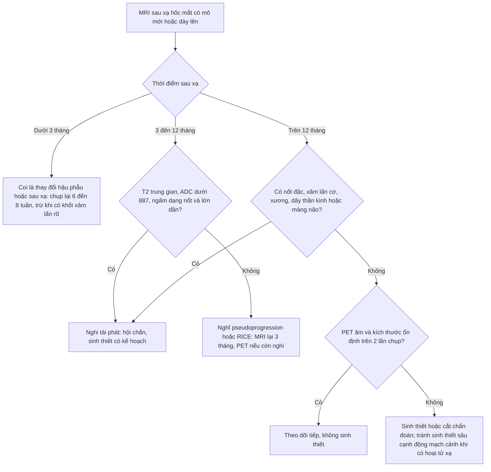
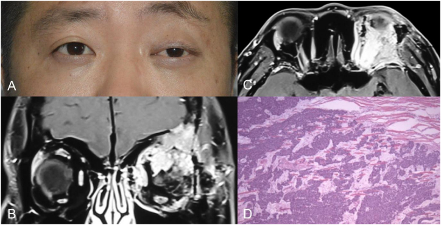
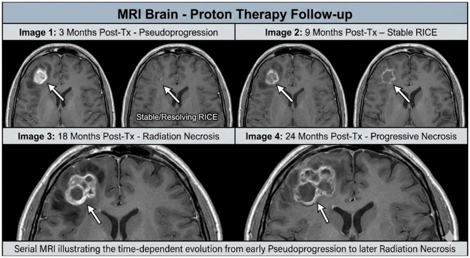
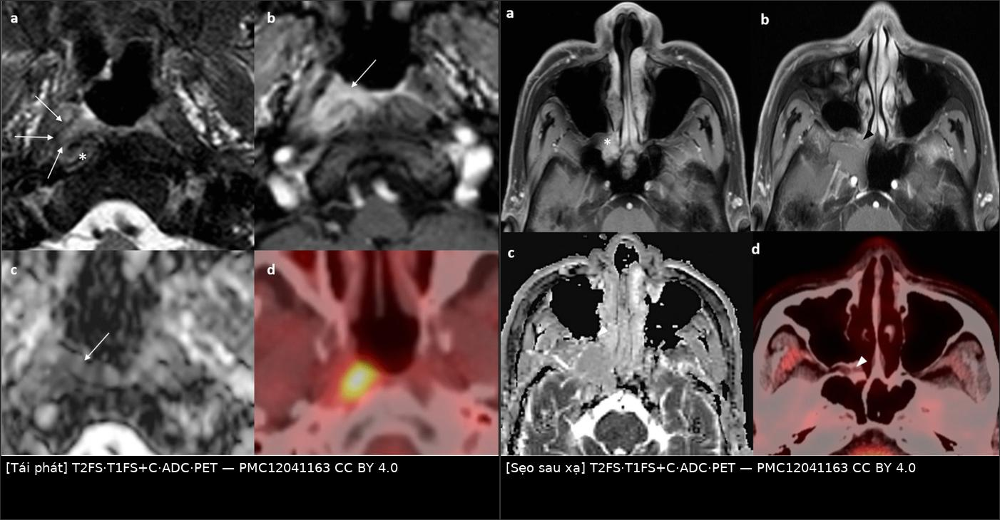

# 3233 — Theo dõi ACC tuyến lệ sau xạ: tái phát vs thay đổi do xạ / Post-radiation surveillance of lacrimal gland ACC

**Tags:** `pattern:tai-phat-sau-xa` `pattern:hoai-tu-xa` `pattern:xam-lan-than-kinh` `pattern:xam-lan-mang-nao` `pattern:di-lan-xuong` `vung:mat` `vung:hoc-mat` `protocol:MRI-hoc-mat` `protocol:T1-fat-sat` `protocol:DWI-ADC` `protocol:FDG-PET` `score:ADC-cutoff` `incidentaloma:khong`

**Mức chắc chắn (certainty):** tổng hợp y văn (literature synthesis) — dựng từ **tổng quan 89 bài/806 ca ACC tuyến lệ** (*Indian J Ophthalmol* 2025, **PMC12507167**), **meta 30 nghiên cứu/585 ca về xạ hậu phẫu** (**PMC13627049**), **loạt 6 ca xạ điều biến 66–70 Gy** (**PMC13627049**), **102 ca ACC tuyến nước bọt có tái phát muộn** (**PMC13270494**), **37 ca/74 nốt di căn phổi** (**PMC13696240**), cùng các tổng quan về **thay đổi sau xạ ở nền sọ** (**PMC13115542**), **đọc hình sau xạ vùng đầu–cổ** (**PMC12041163**), **độc tính mắt do xạ** (**PMC12384690**) và **RION** (**PMC13742046**). Nhóm **không có bệnh nhân của mình**; số nào chưa kiểm chứng ghi **"chưa rõ"**. **Không ghi tên tác giả** — attribution dùng tạp chí + năm + PMCID.

> **Câu chốt:** sau xạ trị ACC tuyến lệ, **mọi mô ngấm thuốc mới không phải là tái phát** — nhưng **mọi tái phát đều bắt đầu bằng mô ngấm thuốc mới**. Bốn con số phải thuộc: **(a)** tái phát tại chỗ **31,1%** (213/685), xuất hiện trung bình **35,2 tháng** sau điều trị, **dao động 4–168 tháng** — nghĩa là **tới 14 năm** và không được "xuất viện" ở mốc 5 năm (PMC12507167); **(b)** di căn xa **30,9%** (196/634), trung bình **39,6 tháng** (1–180), hay gặp **phổi 40,8% – não 25% – xương 22,9%** (PMC12507167), và **29%** di căn xa của ACC tuyến nước bọt xuất hiện **sau 5 năm** (PMC13270494); **(c)** trên đầu–cổ, **ADC < 887 × 10⁻⁶ mm²/s** tách mô xơ/viêm sau xạ khỏi u còn sống với **Se 87,2% – Sp 94,1% – AUC 0,967**, còn **FDG-PET có NPV 95%**, với **PET âm ở mốc 6 tháng** là mốc loại trừ đáng tin (PMC12041163); **(d)** thay đổi do xạ đi theo **dòng thời gian cố định**: cấp trong **giờ–ngày**, sớm muộn **1–6 tháng**, **pseudoprogression đỉnh ~3 tháng (20–30%)**, **hoại tử xạ > 6 tháng, điển hình 12–36 tháng** (PMC13115542). Bẫy chết người: **di căn phổi của ACC mọc cực chậm — thời gian nhân đôi 86–1.064 ngày, trung bình 393 ngày** (PMC13696240), nên "nốt phổi to hơn 1 mm" chưa chắc là thất bại điều trị, và **sinh thiết sâu vùng hoại tử xạ cạnh động mạch cảnh có thể gây chảy máu không cầm được** (PMC12041163).

## 1. Tổng quan bệnh học – cơ chế hình ảnh (TẠI SAO)

### 1.1 Vì sao ACC tuyến lệ tái phát muộn và tái phát "không theo hình khối"

- **Dịch tễ:** ACC là ung thư biểu mô tuyến lệ hay gặp nhất, chiếm **1,6%** u hốc mắt và **13,4%** ung thư tuyến lệ (PMC12507167). Đặc điểm sinh học: **phát triển chậm, xâm lấn quanh thần kinh (perineural invasion), phá xương và tái phát nhiều năm sau điều trị**.
- **Vì sao tái phát muộn:** ACC có **phân số tăng sinh thấp** (ít tế bào ở pha S) nên **thời gian nhân đôi dài**; tổn thương vi thể lan dọc **bao thần kinh** và **màng xương** vượt xa bờ khối thấy trên hình. Vì vậy sau mổ "sạch đại thể", tế bào còn lại có thể mất **vài năm** mới đủ lớn để thấy trên MRI — đúng với phân bố **4–168 tháng** của loạt 685 ca (PMC12507167).
- **Vì sao tái phát "không theo hình khối":** ACC lan theo **dây thần kinh V1/V2 → khe ổ mắt trên → xoang hang**, theo **màng não** và theo **xương hốc mắt**. Trên hình, biểu hiện có thể chỉ là **dày dây thần kinh**, **ngấm thuốc màng não**, **dày màng xương** hoặc **một dải mô mảnh ở đỉnh hốc mắt** — không phải một khối tròn dễ nhận.
- **Hệ quả lâm sàng:** loạt 39 ca ACC có MRI–mổ cho thấy nhóm phải **múc nội nhãn** có khối **3,8 cm** so với **2,9 cm** ở nhóm giữ mắt, bờ sau cách **khe ổ mắt trên 7,5 mm** so với **15 mm**, kèm **vượt đường giữa, xâm lấn cơ ngoài nhãn cầu, xoang hang** (PMC13604454). Nghĩa là **khoảng cách tới đỉnh hốc mắt** là biến quan trọng hơn "khối to hay nhỏ".

### 1.2 Vì sao sau xạ lại có "mô mới ngấm thuốc" — vật lý và mô bệnh

Bốn cơ chế, **cùng một triệu chứng hình ảnh** (ngấm thuốc), khác nhau ở **thời điểm** và **vi cấu trúc**:

1. **Phù và rối loạn hàng rào mạch–mô (giờ đến ngày):** xạ gây chết tế bào nội mô → thoát huyết tương → **T2 tăng tín hiệu, ngấm thuốc nhẹ, không có khối**. Đây là lý do **chụp MRI quá sớm sau xạ rất dễ "thấy u"**.
2. **Viêm/demyelination sớm muộn (1–6 tháng):** tổn thương myelin và phù gian bào → **T2 sáng, ngấm thuốc thoáng qua**, thường **giảm dần** nếu chụp lại.
3. **Pseudoprogression (đỉnh ~3 tháng, 20–30%):** mô hạt non và phản ứng viêm **ngấm thuốc mạnh hơn u thật**, có thể **to lên** rồi tự thoái triển. Trên proton, **RICE (radiation-induced contrast enhancement)** gặp **15%** trong đoàn hệ tiền cứu, **17,3%** ở nhóm đầu–cổ, **trung vị 11,8 tháng**, đa số **không triệu chứng** và **tự thoái triển < 9 tháng** (PMC13115542).
4. **Hoại tử xạ và xơ hóa (> 6 tháng, điển hình 12–36 tháng):** hoại tử trung tâm **không ngấm**, viền xơ **ngấm dày**; xơ trưởng thành **T2 tối, không ngấm** vì collagen làm **T2 ngắn** và mật độ tế bào thấp (PMC13115542).

**Nguyên tắc vật lý dùng chung:** *nước ngoài bào nhiều → T2 sáng + ADC cao; tế bào đặc hoặc xơ dày → T2 tối + ADC thấp; hoại tử/dịch → T2 sáng + ADC cao, không "hạn chế khuếch tán"; mô hạt non → ngấm mạnh nhưng ADC không thấp bằng u; máu/xơ canxi → T2 tối.* Vì vậy **"ngấm thuốc" một mình không phân biệt được gì** — phải đọc **cặp T2 ↔ ADC ↔ hình thái ↔ thời gian**.

### 1.3 Ngưỡng định lượng nằm lòng

| Chỉ số | Ngưỡng / giá trị | Nguồn |
|---|---|---|
| Tái phát tại chỗ ACC tuyến lệ | **31,1%** (213/685 ca) | PMC12507167 |
| Thời gian tái phát | trung bình **35,2 tháng**, **4–168 tháng** | PMC12507167 |
| Di căn xa | **30,9%** (196/634); **39,6 ± 39,6 tháng** (1–180) | PMC12507167 |
| Vị trí di căn | phổi **40,8%**, não **25%**, xương **22,9%** | PMC12507167 |
| Tử vong / sống không bệnh | **32,6%** / **61,5%**; sống toàn bộ **67,6%** | PMC12507167 |
| Xâm lấn quanh thần kinh | tái phát **53,4%**, di căn **36,9%**, tử vong **23,3%** | PMC12507167 |
| Phẫu thuật đơn thuần vs phẫu + xạ | sống 5 năm **50% vs 67%**; tái phát **63% vs 41%** | PMC13627049 (dẫn meta Yan) |
| Liều xạ hậu phẫu | **60–65 Gy / 30–33 phân liều** (IMRT/IMPT); loạt VMAT/TOMO **66–70 Gy** | PMC12833162, PMC13627049 |
| Proton giữ mắt (18 ca) | tái phát tại chỗ **22%**, tử vong do di căn **17%** | PMC12507167 |
| Tái phát muộn sau 5 năm | **29%** di căn xa của ACC tuyến nước bọt | PMC13270494 |
| Thời gian nhân đôi di căn phổi | **86–1.064 ngày**, trung bình **393 ngày** | PMC13696240 |
| ADC tách sẹo/viêm vs u sống (đầu–cổ) | **< 887 × 10⁻⁶ mm²/s** — Se **87,2%**, Sp **94,1%**, AUC **0,967** | PMC12041163 |
| FDG-PET sau xạ | **NPV 95%**; **PET âm ở mốc 6 tháng** = rất ít khả năng còn u | PMC12041163 |
| Thời điểm MRI nền sau xạ | **3–12 tháng**; chỉ **33,2%** đạt lui bệnh hoàn toàn ở MRI đầu (trung vị **93 ngày**) | PMC12041163 |
| Pseudoprogression / hoại tử xạ | đỉnh **~3 tháng, 20–30%** / **> 6 tháng, 12–36 tháng** | PMC13115542 |
| RICE sau proton | **15%** (đoàn hệ tiền cứu), **17,3%** ở nhóm đầu–cổ; trung vị **11,8 tháng**; đa số tự thoái triển **< 9 tháng** | PMC13115542 |
| Hoại tử xạ | photon **2–13,9%**; kỹ thuật 2D/3D cũ **2–10%**; proton **thấp hơn** (giảm liều cao vào nhu mô lành) | PMC13115542 |
| Ngưỡng liều thị thần kinh | **55–60 Gy** (QUANTEC); **< 12 Gy** khi SRS một lần | PMC12384690 |
| RION | liều **> 50–55 Gy**; khởi phát trung vị **16–30 tháng**, có thể **> 10 năm** | PMC13742046 |
| Ngưỡng liều võng mạc / thể thủy tinh | võng mạc **> 50 Gy** (40–62 Gy); đục thể thủy tinh **0,5 Gy** (ICRP), **> 8 Gy** | PMC12384690 |

## 2. Mẫu hình + chẩn đoán phân biệt theo vị trí và thời điểm (Gamut)

Bài toán sau xạ không phải "khối là gì" mà là **"mô này ở đâu, xuất hiện lúc nào, và có hành vi gì"**. Đọc theo 3 trục:

### 2.1 Trục vị trí — nơi ACC tái phát

- **Giường mổ / ổ mắt còn lại (orbital bed):** mô mềm **ngấm thuốc dạng nốt**, **xâm lấn cơ trực trên/cơ nâng mi**, đẩy nhãn cầu. Ca nguyên văn: tái phát **3 tháng** sau mổ, xâm lấn cơ trực trên và cơ nâng mi, **ngấm màng não nền sọ** (PMC11301145).
- **Đỉnh hốc mắt và khe ổ mắt trên:** dải mô mảnh, **dày dây thần kinh**, mất lớp mỡ sáng quanh đỉnh. Đây là vị trí **quyết định giữ mắt hay múc** (PMC13604454).
- **Xoang hang và nội sọ:** **ngấm thuốc màng não**, nốt dural, xâm lấn **hố sọ trước/hố sọ giữa** (PMC13683437, PMC13756941).
- **Xương hốc mắt (thành ngoài, trần, sàn):** **ăn mòn vỏ xương 75%**, **phá xương 34%** trong ACC (PMC12819838).
- **Hạch cổ và tuyến mang tai:** đường lan theo bạch huyết; trong loạt múc nội nhãn ở người đã điều trị, **8/16 tái phát ở hạch** (PMC13328222).
- **Di căn xa:** phổi (40,8%), não (25%), xương (22,9%), gan.

### 2.2 Trục thời điểm — học thuộc "đồng hồ" sau xạ

| Mốc | Thay đổi kỳ vọng | Điều **không** được làm |
|---|---|---|
| **0–1 tháng** | Phù, thay đổi hậu phẫu, ngấm thuốc viền mô mổ | Không gọi tái phát; không sinh thiết |
| **1–6 tháng** | Viêm/demyelination, **pseudoprogression đỉnh ~3 tháng (20–30%)** | Không sinh thiết khi chưa chụp lại |
| **6–24 tháng** | **RICE (trung vị 11,8 tháng)**, xơ hóa dần, **hoại tử xạ 12–36 tháng** | Không chọc sâu vùng hoại tử cạnh động mạch cảnh |
| **> 24 tháng** | Xơ ổn định / teo mỡ; **tái phát muộn vẫn tiếp tục tới 168 tháng** | Không dừng theo dõi ở 5 năm |
| **> 5–10 năm** | Tái phát muộn, **u thứ phát do xạ** (sarcoma, meningioma) | Không quy mọi khối mới là "tái phát ACC" |

### 2.3 Trục hành vi — 4 nhóm "mô mới" (nhớ **S-NAP**)

- **S — Scar (sẹo xơ trưởng thành):** **T2 tối, không ngấm hoặc ngấm mảnh thẳng**, **ADC không hạn chế**, **ổn định/teo** qua 2 lần chụp. Trên đầu–cổ: mô dày còn lại ở hố chân bướm–khẩu cái **18 tháng sau xạ**, ADC không thấp, **FDG âm** → sẹo (PMC12041163).
- **N — Necrosis (hoại tử xạ, gồm hoại tử xương):** **viền ngấm dày + trung tâm không ngấm ± khí**, T2 hỗn hợp, **đau/ chảy máu/liệt thần kinh sọ**; có thể **tự lành trong nhiều tháng**; sinh thiết sâu **nguy hiểm** (PMC12041163). Cơ chế xương: **giảm mạch máu – thiếu oxy – hoại tử xương**, có thể dẫn tới **liệt thần kinh sọ, viêm màng não, chảy máu động mạch cảnh** (PMC13115542).
- **A — Active granulation / pseudoprogression:** ngấm **mạnh, lan tỏa**, **T2 trung–cao**, **ADC không thấp bằng u**, **giảm sau 3–6 tháng**.
- **P — Progression (tái phát thật):** **nốt đặc bờ không đều**, **T2 trung gian**, **ADC thấp**, **ngấm tăng dần**, **lớn lên trên 2 lần chụp**, **theo dây thần kinh / màng não / xương**, **FDG dương**.

- **Gamut ngoài ACC (đừng bỏ sót):** **u thứ phát do xạ** (sarcoma xương mô mềm, meningioma — xuất hiện **nhiều năm** sau, hình thái khác ACC); **nhiễm trùng mạn quanh độn/vật liệu** (dịch, bóng khí, viền ngấm); **di căn tuyến lệ** (tiền sử ung thư khác); **bệnh hai bên** (lymphoma/IgG4 — không phải di căn ACC).

## 3. Bảng so sánh phân biệt (ma trận đối chiếu)

| Thực thể | Hình ảnh điển hình (MRI ± CT/PET) | Chốt vào (rule-in) | Chốt loại (rule-out) | Gợi ý xác nhận |
|---|---|---|---|---|
| **Tái phát tại chỗ** | Nốt/dải mô **T2 trung gian**, **ADC thấp**, ngấm **tăng dần**, xâm lấn cơ/xương/đỉnh hốc mắt | **Nốt đặc mới + lớn dần trên 2 lần chụp + ADC < 887** | **Mô mỏng, T2 tối, không ngấm, ổn định ≥ 6 tháng** → không phải tái phát | MRI 3–6 tháng/lần; sinh thiết có kế hoạch khi đổi xử trí |
| **Tái phát theo thần kinh (PNS)** | **Dày dây V1/V2**, ngấm dọc ống thần kinh, mất mỡ quanh **khe ổ mắt trên**, lan **xoang hang** | **Dày thần kinh không đối xứng + ngấm liên tục tới xoang hang** | **Dày đối xứng hai bên, không ngấm** → ít nghĩ PNS | MRI **T1FS+C** mỏng 1 mm tới xoang hang; đối chiếu lần chụp trước |
| **Sẹo xơ trưởng thành** | **T2 tối**, ngấm **mảnh/không**, ADC **không hạn chế**, teo dần | **Ổn định/teo ≥ 6 tháng + ADC cao + PET âm** | **To lên hoặc ADC giảm** → không phải sẹo | Chụp lại 6 tháng; không sinh thiết |
| **Mô hạt / pseudoprogression** | Ngấm **mạnh lan tỏa**, T2 trung–cao, ADC **không thấp bằng u**, xuất hiện **~3 tháng** | **Giảm sau 3–6 tháng, không có nốt đặc** | **Nốt đặc + ADC thấp + to dần** → không phải mô hạt | MRI lại 6–8 tuần; PET nếu còn nghi |
| **Hoại tử xạ (mô mềm)** | **Viền ngấm dày, trung tâm không ngấm**, T2 hỗn hợp, có thể **khí**; đau, chảy máu | **Viền + trung tâm hoại tử + bối cảnh liều cao** | **Nốt đặc ngấm đều** → nghĩ u | Theo dõi 3–6 tháng; **tránh sinh thiết sâu** |
| **Hoại tử xương hốc mắt (ORN)** | **Xơ hóa/vôi hóa không đều, tiêu xương, mảnh xương chết, khí trong mô mềm**, phản ứng màng xương | **Mảnh xương chết + khí + tiền sử liều cao** | **Phá xương kiểu ăn mòn có khối mô mềm** → nghĩ tái phát | CT cửa sổ xương; hội chẩn **không sinh thiết mù** |
| **RION (bệnh thần kinh thị do xạ)** | **Không có khối**; có thể **ngấm thị thần kinh**, teo theo thời gian; mất thị lực **không đau**, tiến triển | **Liều > 50–55 Gy + mất thị lực sau 16–30 tháng + không khối** | **Khối chèn ép đỉnh hốc mắt** → không phải RION | Đo liều, OCT/RNFL, VEP; đối chiếu MRI |
| **Bệnh võng mạc do xạ** | **Phù hoàng điểm, xuất tiết, giãn mao mạch**, không liên quan mô hốc mắt | **Liều võng mạc > 50 Gy + OCT có phù** | **Khối hốc mắt + thị lực giảm** → không phải thuần do xạ | OCT, FA; **không chụp lại hốc mắt vì "thị lực giảm"** |
| **Vạt / vật liệu tái tạo** | **Vạt cân cơ thái dương, mỡ ghép T1 sáng, mảnh ghép xương**, ngấm viền đều, bờ theo giải phẫu | **Bờ khớp với vạt, không nốt, ổn định** | **Nốt trong vạt, xâm lấn ngoài bờ vạt** → nghi tái phát | So với MRI hậu phẫu nền; CT xương |
| **U thứ phát do xạ** | Khối **mô mềm/xương mới**, hình thái **khác ACC** (sarcoma: hủy xương, mô mềm lớn), xuất hiện **> 5–10 năm** | **Khối mới muộn + hủy xương + không giống tái phát cũ** | **Tái phát đúng vị trí cũ, cùng hình thái** → nghĩ ACC | Sinh thiết (khác mô học = chẩn đoán mới) |

![Tái phát vs sẹo sau xạ trên cùng 4 chuỗi xung — nguyên lý áp dụng cho hốc mắt. Trái **tái phát**: T2FS **trung gian**, T1FS+C ngấm **vừa–mạnh**, **ADC thấp** (mũi tên), **FDG-PET dương**; tổn thương làm **mất mặt phẳng** và lan vào cơ trước đốt sống. Phải **sẹo**: T1FS+C còn **dày nhẹ**, **ADC không hạn chế**, **FDG âm**; mô **co nhỏ** theo thời gian. Ảnh gốc là bệnh nhân ung thư vòm mũi họng — dùng làm **hình đối chiếu nguyên lý**, không phải ca hốc mắt. Nguồn: *Neuroradiology* 2025, Fig. 8 và Fig. 9 (PMC12041163), CC BY 4.0 — ảnh ghép letterbox, không crop.](images/composite_tai-phat-vs-seo.jpg)

### Ba tiểu mục dấu hiệu hay bị đọc sai

- **"Ngấm thuốc = tái phát"** — sai. **Mô hạt non, viêm sau xạ và RICE đều ngấm mạnh hơn u**, và **pseudoprogression gặp 20–30%** ở đỉnh 3 tháng (PMC13115542). Ngấm thuốc chỉ có nghĩa khi **kèm nốt đặc, ADC thấp và lớn dần**.
- **"T2 tối = xơ = lành"** — sai một nửa: **u tế bào dày đặc cũng T2 tối** (ACC, lymphoma). T2 tối **chỉ** là xơ khi **không ngấm, ADC cao và ổn định**.
- **"To lên = thất bại"** — sai trong 6 tháng đầu: pseudoprogression **to lên rồi thoái triển**; ngược lại, **di căn phổi ACC mọc cực chậm** (nhân đôi **393 ngày** trung bình) nên đánh giá bằng **xu hướng nhiều lần** chứ không bằng một lần chụp (PMC13696240).

## 4. Protocol chụp + lịch theo dõi + quyết định sinh thiết

### 4.1 Bộ chuỗi xung tối thiểu (mỗi lần theo dõi)

1. **MRI hốc mắt + nội sọ 1,5T hoặc 3T**, lát **≤ 3 mm** cho hốc mắt, **1 mm** cho đỉnh hốc mắt/khe ổ mắt trên:
   - **T1 axial** (mỡ, máu, vật liệu);
   - **T2FS axial + coronal** (phân biệt xơ T2 tối vs u T2 trung gian vs phù T2 sáng);
   - **DWI b = 0/1000 + bản đồ ADC** (bắt buộc — đây là chốt phân biệt);
   - **T1FS sau tiêm axial + coronal + sagittal** (bắt buộc fat-sat vì hốc mắt nhiều mỡ; **phải tới xoang hang**);
   - **DCE** nếu có (đường cong tăng–thoát của u vs mô hạt).
2. **CT hốc mắt lát ≤ 1 mm, cửa sổ xương, có cản quang:** trả lời **ăn mòn/phá xương, mảnh xương chết, khí trong mô mềm, vôi hóa** — MRI **không** thay được cửa sổ xương.
3. **FDG-PET/CT toàn thân** khi: nghi tái phát tại chỗ **mà MRI chưa kết luận**, **hoặc** tìm di căn xa (phổi/não/xương), **hoặc** theo dõi sau điều trị toàn thân. Nhớ **NPV 95%** khi **PET âm ở mốc 6 tháng**; viêm/hoại tử xạ có thể **dương giả** (PMC12041163).
4. **Khám mắt đầy đủ mỗi lần**: thị lực, thị trường, **OCT/RNFL**, đáy mắt — vì **RION và bệnh võng mạc do xạ không thấy trên MRI hốc mắt** (PMC12384690, PMC13742046).

### 4.2 Lịch theo dõi (đề xuất, dựa trên ASCO cho ACC tuyến nước bọt + đặc thù ACC tuyến lệ)

- **MRI hốc mắt + nội sọ:** **3 tháng** sau kết thúc xạ (nền), sau đó **mỗi 3–6 tháng trong 2 năm**, **6–12 tháng tới năm 5**, **hằng năm tới ít nhất 10 năm**. *Đây là **đề xuất của bài** (suy ra từ khung ASCO và hành vi tái phát muộn của ACC), **chưa có thử nghiệm** kiểm chứng — xem mục 7.*
- **CT ngực:** **mỗi 6–12 tháng trong 2 năm đầu**, **hằng năm tới năm 5**, sau đó **hằng năm nếu nguy cơ cao** (thành phần đặc > 30%, giai đoạn III–IV) — đúng khung ASCO và lý do **29% di căn xa xuất hiện sau 5 năm** (PMC13270494).
- **Lý do không dừng ở 5 năm:** tái phát tại chỗ tới **168 tháng** (PMC12507167); di căn phổi có **thời gian nhân đôi 86–1.064 ngày** (PMC13696240) — bỏ theo dõi là bỏ mất cửa sổ can thiệp.
- **PET/CT không thay MRI:** dùng **bổ sung** khi MRI mơ hồ hoặc tìm di căn, không dùng làm "sàng lọc thay thế" (PMC12041163).

### 4.3 Đo ADC cho đúng (nếu không, ngưỡng 887 vô nghĩa)

- **ROI đặt ở phần đặc nhất**, **tránh** vùng hoại tử, canxi, xuất huyết và **tránh viền ngấm** (viền là mô hạt/xơ).
- **Luôn đo tỷ lệ** ADC tổn thương / ADC mô lành cùng lát (cơ ngoài nhãn cầu hoặc mỡ) — vì giá trị tuyệt đối phụ thuộc máy, b-value và nhà cung cấp.
- **Đo trên cùng một máy, cùng b-value** giữa các lần; nếu đổi máy, **so xu hướng** chứ không so số tuyệt đối.
- **Ngưỡng 887 lấy từ ung thư vòm mũi họng**, chưa kiểm định cho hốc mắt (xem mục 7) — dùng như **gợi ý, không phải chốt**.

### 4.4 Khi nào sinh thiết — và khi nào tuyệt đối không

- **Nên sinh thiết/cắt chẩn đoán:** nốt đặc **mới hoặc to dần**, ADC thấp, xâm lấn cơ/xương/màng não, **hoặc** thay đổi sẽ **đổi chiến lược** (múc nội nhãn, xạ lại, toàn thân).
- **Trì hoãn và chụp lại:** mô ngấm **lan tỏa không nốt**, xuất hiện **< 3 tháng**, đang giảm dần, PET âm.
- **Tránh sinh thiết sâu:** vùng **hoại tử xạ cạnh động mạch cảnh** — ca trong PMC12041163 **hoãn sinh thiết sâu** vì nguy cơ chảy máu và **tổn thương tự lành** khi điều trị bảo tồn.
- **Trước khi sinh thiết:** ngừng/đánh giá **chống đông**, kiểm tra **chức năng đông máu**, và **không chọc qua vạt/tấm ghép** nếu không có siêu âm/CT dẫn đường.

## 5. Biến thể bình thường và cạm bẫy

- **Vạt cân cơ thái dương và mảnh ghép xương "ngấm thuốc" là bình thường:** ảnh hậu phẫu **2 năm** với vạt cân cơ thái dương trong PMC13683437 cho thấy **bờ vạt rõ, không nốt**, khoang hốc mắt ổn định. Đọc **theo bờ giải phẫu**, không đọc "có ngấm = có u".
- **Mỡ ghép T1 sáng:** mỡ ghép **đồng tín hiệu mỡ** trên T1, **mất tín hiệu trên T1FS** — nếu **không mất tín hiệu**, đó là **máu/mô**, không phải mỡ.
- **Ngấm thuốc màng não sau mổ:** có thể **khu trú, mảnh, giảm dần**; **nốt dural to dần** mới đáng lo (PMC11301145).
- **Thay đổi xoang cạnh hốc mắt:** dày niêm mạc xoang sàng/bướm sau xạ là **kỳ vọng**; đừng gọi là "lan xoang" nếu không có **phá xương/nốt**.
- **"Xuất viện ở 5 năm":** sai — **29%** di căn xa xuất hiện sau 5 năm, tái phát tại chỗ tới **14 năm** (PMC13270494, PMC12507167).
- **"PET dương = tái phát":** sai — **viêm/hoại tử xạ** và **mô hạt** đều bắt FDG; PET chỉ có **NPV cao**, **PPV thấp** trong bối cảnh sau xạ (PMC12041163).
- **"Thị lực giảm do tái phát":** phải loại **RION** (liều **55–60 Gy**, khởi phát **16–30 tháng**) và **bệnh võng mạc do xạ** (**> 50 Gy**) trước khi quy cho u (PMC13742046, PMC12384690); cả hai **không có khối** trên MRI.
- **Satisfaction of search:** thấy tổn thương hốc mắt rồi dừng — **bỏ sót di căn phổi/não** (25% di căn là não) và **hạch cổ**. Ca 12 năm trong PMC13756941 có **đồng thời** tái phát màng não trán, di căn phổi và tiến triển dù đã xạ.
- **Nhầm "không thấy khối" là "không tái phát":** ACC lan **theo dây thần kinh và màng não** có thể **không tạo khối**; phải đọc **T1FS+C tới xoang hang** và **so từng lát với lần trước**.

## 6. Tự lượng giá — Blind Quiz ngay trên trang tĩnh

**Ca 1 — nam 34 tuổi, 3 tháng sau mổ lấy u hốc mắt trái, từ chối xạ; lồi mắt tái phát**

- Gợi ý lâm sàng: mổ **giữ mắt**, **không xạ hậu phẫu**, tái phát triệu chứng sau **3 tháng**.
- Câu hỏi: (a) Mô tả tổn thương ở B và C? (b) **3 tháng** có quá sớm để gọi tái phát không? (c) Dấu hiệu nào khiến đây **không thể là mô hạt lành**?

<b>Bấm để hiện đáp án (findings + chẩn đoán)</b>

- (a) **Khối mô mềm lớn ở phần trên và sâu hốc mắt trái**, **xâm lấn cơ trực trên và cơ nâng mi**, **ngấm thuốc màng não nền sọ** (B, C).
- (b) Không — **ung thư chưa được xử lý tại chỗ** có thể tái phát **trong vài tháng**; "3 tháng" chỉ làm **tăng xác suất** thay đổi lành tính, không loại trừ.
- (c) **Xâm lấn cơ + ngấm màng não + khối đặc** khác hẳn mô hạt lan tỏa; mô bệnh **ACC kém biệt hóa, xâm lấn cơ, nghi huyết khối trong mạch nhỏ**.
- **Bài học:** sau mổ **không xạ**, mọi mô mới đều phải coi là **u cho tới khi chứng minh ngược lại**; đây cũng là ca cho thấy vì sao **xạ hậu phẫu** làm giảm tái phát từ **63% xuống 41%** (PMC13627049, dẫn meta Yan).
- Nguồn ảnh: *Heliyon* 2024, Fig. 2 (PMC11301145), CC BY-NC-ND 4.0 — nguyên bản.

**Ca 2 — sau xạ proton, MRI 3 tháng thấy vùng ngấm thuốc mới; 9 tháng, 18 tháng và 24 tháng sau đó**

- Gợi ý lâm sàng (giả định cho bài tập): bệnh nhân **không có triệu chứng mới**, chỉ chụp theo lịch.
- Câu hỏi: (a) 3 tháng là gì? (b) 18 tháng là gì? (c) Khi nào bạn **không** được sinh thiết?

<b>Bấm để hiện đáp án (findings + chẩn đoán)</b>

- (a) **Pseudoprogression**: vùng ngấm thuốc mới, **có thể to hơn u**, xuất hiện **~3 tháng** — gặp **20–30%** sau xạ photon.
- (b) **Hoại tử xạ**: ổ **viền ngấm dày + trung tâm không ngấm**, xuất hiện **> 6 tháng**, điển hình **12–36 tháng**; ở proton, **RICE** (15% tiền cứu, trung vị **11,8 tháng**) thường **không triệu chứng** và **tự thoái triển**.
- (c) **Không sinh thiết** khi tổn thương còn trong "cửa sổ" pseudoprogression/RICE, **không có nốt đặc**, **ADC không thấp**, và **không có triệu chứng**; chụp lại 3 tháng là bước đúng.
- **Phản biện nguồn:** đây là **tổn thương não sau xạ nền sọ**, không phải hốc mắt; dùng để học **đồng hồ thời gian**, không suy ra tỷ lệ cho hốc mắt.
- Nguồn ảnh: *Diagnostics* 2026, Fig. 2 (PMC13115542), CC BY 4.0 — nguyên bản.

**Ca 3 — hai bệnh nhân sau xạ, cùng có "mô còn lại" trên MRI: ai cần sinh thiết?**

- Gợi ý (giả định cho bài tập): một bên **có triệu chứng mới** (đau, tê theo V2); bên kia **không triệu chứng**, chụp ở **18 tháng**.
- Câu hỏi: (a) Bên nào là tái phát? (b) Ba dấu hiệu nào chốt? (c) Bên còn lại nên làm gì?

<b>Bấm để hiện đáp án (findings + chẩn đoán)</b>

- (a) **Bên trái** là tái phát; **bên phải** là sẹo xơ.
- (b) **T2FS trung gian + ADC thấp (mũi tên) + FDG-PET dương**, kèm **mất mặt phẳng giải phẫu** và lan vào cơ trước đốt sống.
- (c) **Không sinh thiết**: ADC **không hạn chế**, **FDG âm**, mô **co nhỏ** sau 18 tháng → **theo dõi tiếp**.
- **Bài học:** ba chuỗi — **T2, ADC, PET** — phải đọc **cùng nhau**; một mình T1FS+C không phân biệt được sẹo và u.
- Nguồn ảnh: *Neuroradiology* 2025, Fig. 8–9 (PMC12041163), CC BY 4.0 — ảnh ghép letterbox.

## 7. Câu hỏi nghiên cứu & điểm chưa đồng thuận (tính đến 11/2026)

1. **[Tranh cãi] Ở ACC tuyến lệ T1–T2, phẫu thuật giữ mắt + xạ có kiểm soát tại chỗ tương đương múc nội nhãn không?**
   - **Đã biết:** tổng quan 806 ca cho tái phát tại chỗ **31,1%** chung, proton giữ mắt **22%** tái phát và **17%** tử vong do di căn (PMC12507167); loạt 6 ca xạ điều biến **66–70 Gy** có sống 5 năm **75%**, tái phát tại chỗ **16,7%** (PMC13627049); meta 585 ca cho thấy xạ hậu phẫu giảm tái phát **63% → 41%** nhưng chủ yếu cải thiện kiểm soát tại chỗ (PMC13627049 dẫn meta Yan; PMC12833162 về vai trò xạ).
   - **Chưa rõ:** **không có thử nghiệm ngẫu nhiên**; các loạt khác nhau về **chọn bệnh, kỹ thuật xạ, thời gian theo dõi**; tiêu chí **giữ mắt** dựa trên khoảng cách tới khe ổ mắt trên nhưng các biến **tương quan chặt**, chưa có mô hình tiên lượng độc lập.
   - **Hướng nghiên cứu:** registry **đa trung tâm, tiền cứu**, phân tầng theo **T, khoảng cách bờ sau → SOF tính bằng mm, xâm lấn thần kinh**, so **giữ mắt + proton/IMRT** với **múc + xạ**, outcome **kiểm soát tại chỗ 5 năm, sống toàn bộ, thị lực, độc tính**.
   - **Nguồn:** PMC12507167 (2025); PMC13627049 (2026); PMC12833162 (2026).

2. **[Khoảng trống] Ngưỡng ADC và vai trò PET nào đủ tin cậy để bỏ sinh thiết khi hốc mắt có mô mới sau xạ?**
   - **Đã biết:** trên đầu–cổ, **ADC < 887 × 10⁻⁶ mm²/s** đạt **Se 87,2% – Sp 94,1% – AUC 0,967**, **FDG-PET NPV 95%** và PET âm ở **6 tháng** gần như loại trừ còn u (PMC12041163); sau proton, **RICE 15–17,3%**, trung vị **11,8 tháng**, thường tự khỏi (PMC13115542).
   - **Chưa rõ:** **chưa có dữ liệu tiền cứu kiểm định ngưỡng ADC riêng cho hốc mắt**; mô hốc mắt nhỏ, nhiều mỡ, dễ nhiễu **susceptibility** do clip/vật liệu; tỷ lệ **dương giả của PET** do viêm/hoại tử xạ ở hốc mắt **chưa được định lượng**.
   - **Hướng nghiên cứu:** nghiên cứu **chẩn đoán tiền cứu**, ROI chuẩn hóa, báo cáo **Se/Sp theo từng vị trí** (giường mổ, đỉnh hốc mắt, xương), **hệ số tái lập giữa 2 người đọc**, và **giá trị tăng thêm của PET/MRI** so với MRI đơn thuần.
   - **Nguồn:** PMC12041163 (2025); PMC13115542 (2026); PMC12507167 (2025).

3. **[Khác biệt thực hành] Sau ACC tuyến lệ đã điều trị, theo dõi bằng MRI hốc mắt + CT ngực bao lâu, và có nên chụp PET định kỳ?**
   - **Đã biết:** ASCO khuyến cáo **MRI/CT ổ bệnh + CT ngực mỗi 6–12 tháng trong 2 năm**, **hằng năm tới 5 năm**, sau đó **tùy nguy cơ**; **29%** di căn xa xuất hiện **sau 5 năm** (PMC13270494); NCCN **không có hướng dẫn riêng cho ACC** (PMC13270494); ca 12 năm cho thấy **di căn phổi tiến triển chậm** và **tái phát màng não** vẫn xảy ra dù đã xạ (PMC13756941).
   - **Chưa rõ:** **không có lịch nào được chứng minh bằng thử nghiệm** cho ACC tuyến lệ; thời điểm dừng theo dõi, **khoảng cách CT ngực tối ưu khi nốt phổi nhân đôi 393 ngày**, và **ai cần PET định kỳ** đều chưa có dữ liệu.
   - **Hướng nghiên cứu:** **registry tiền cứu** ghi **thời điểm tái phát, phương thức phát hiện (triệu chứng vs hình ảnh), can thiệp và kết cục**, so sánh **theo dõi 5 năm vs 10 năm**, và **chi phí–hiệu quả** của PET toàn thân định kỳ.
   - **Nguồn:** PMC13270494 (2026); PMC13756941 (2026); PMC13696240 (2026).

## Bài liên quan chéo

- [400 – Tổng quan Mắt & thị giác](../400-tong-quan-mat-thi-giac/lesson.md)
- [3230 – Khối tuyến lệ: u biểu mô – lymphoma – IgG4](../3230-khoi-tuyen-le/lesson.md) (chẩn đoán nguyên phát, ADC, chỉ định mổ)
- [1515 – Theo dõi hốc mắt sau múc nhãn cầu](../1515-theo-doi-hoc-mat-sau-muc-nhan-cau/lesson.md) (khi ACC phải múc)
- [3228 – Lộ độn hốc mắt sau múc nhãn cầu](../3228-lo-don-hoc-mat-sau-muc-nhan-cau/lesson.md) (khối/dịch quanh độn — đừng nhầm tái phát)
- [1441 – Bong võng mạc sau xạ trị u nội nhãn](../1441-bong-vong-mac-xa-sau-xa-tri-u-noi-nhan/lesson.md) (biến chứng võng mạc do xạ)
- [449 – Chấn thương hở nhãn cầu trên CT](../449-chan-thuong-mat-dich-vat/lesson.md) (dị vật kim loại — chống chỉ định MRI)

## Ảnh

- Tên file: `3233_theo-doi-acc-tuyen-le_<Modality>_<mô tả>_<PMCID>.jpg|webp`; nguồn + giấy phép từng ảnh trong `images/CREDITS.md`.
- **6 ảnh gốc**: 3 ảnh **CC BY 4.0** (PMC13115542 ×2, PMC13683437), 2 ảnh **CC BY-NC-ND 4.0** (PMC11301145, PMC13756941 — dùng nguyên bản, không cắt/ghép), 1 bài **CC BY 4.0** làm nguồn cho **ảnh ghép** (PMC12041163).
- **1 ảnh ghép** `composite_tai-phat-vs-seo.jpg` tạo bằng `tools/make_composite.py` (letterbox nền đen, dải nhãn, **không crop/kéo giãn**) từ Fig. 8 và Fig. 9 của PMC12041163.
- **Không dùng ảnh** từ các bài chỉ trích số liệu (PMC12507167, PMC12833162, PMC13627049, PMC13270494, PMC13696240, PMC13742046, PMC12384690, PMC13328222).

> Không dùng để chẩn đoán độc lập khi chưa có người hướng dẫn.
